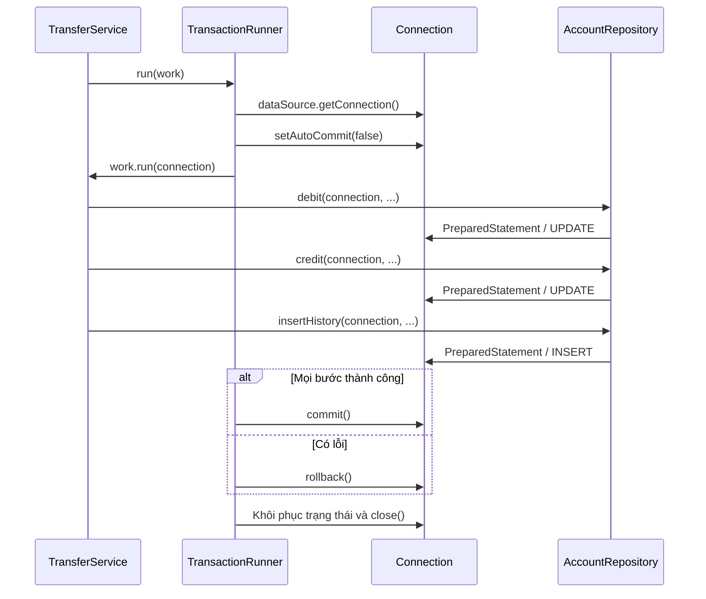

# Truyền Connection trong một ngữ cảnh giao dịch tường minh

## 1. Vì sao cần truyền cùng một Connection?

Trong JDBC, một `Connection` đại diện cho một phiên làm việc với cơ sở dữ liệu. Khi `autoCommit` được tắt, những câu lệnh thực thi trên **chính Connection đó** thuộc cùng một giao dịch cho đến khi được `commit()` hoặc `rollback()`. Đây là cơ sở để phối hợp nhiều thao tác CRUD thành một đơn vị công việc nguyên tử.

Giả sử chuyển tiền từ tài khoản A sang tài khoản B cần thực hiện ba bước:

1. Giảm số dư của A nếu A còn đủ tiền.
2. Tăng số dư của B.
3. Ghi một bản ghi lịch sử chuyển tiền.

Nếu bước 1 đã ghi thành công nhưng bước 2 hoặc 3 thất bại, ứng dụng phải hoàn tác tất cả. Điều đó đòi hỏi cả ba câu lệnh **cùng tham gia một transaction**. Mỗi repository tự lấy một `Connection` riêng từ `DataSource` sẽ không mặc nhiên bảo đảm được yêu cầu này, ngay cả khi cả ba kết nối đều trỏ tới cùng một cơ sở dữ liệu.

Bài thuộc chương **Giao dịch nâng cao** trong module **JDBC**. Phạm vi là các API chuẩn gồm `DataSource`, `Connection`, `PreparedStatement`, `ResultSet`, `SQLException`, quản lý kết nối và transaction. Trọng tâm là **truyền Connection tường minh** qua các tầng gọi, phân định rõ ai sở hữu kết nối, ai quyết định `commit`/`rollback` và cách xử lý lỗi an toàn.

Sau bài này, bạn có thể thiết kế một transaction coordinator đơn giản bằng JDBC, truyền một `Connection` cho nhiều repository, nhận diện những lệnh vô tình chạy ngoài giao dịch và kiểm tra hiệu lực rollback trên cơ sở dữ liệu thật.

## 2. Ngữ cảnh giao dịch tường minh là gì?

Với cách tiếp cận tường minh, đối tượng hoặc hàm điều phối **tạo ngữ cảnh giao dịch**, sau đó chuyển `Connection` đang nằm trong ngữ cảnh đó cho tất cả thao tác cần tham gia:



Khái niệm **ngữ cảnh giao dịch** ở đây là hợp đồng về vòng đời kết nối và quyền quyết định giao dịch. JDBC thuần không tự cung cấp một “transaction scope” ẩn cho tất cả lời gọi repository. Việc truyền đối số `Connection` cho thấy rõ lời gọi nào cần sử dụng đúng kết nối đang tham gia giao dịch.

| Thành phần | Trách nhiệm | Không được tự ý làm |
|---|---|---|
| Tầng điều phối giao dịch (`TransactionRunner`) | Lấy `Connection`, cấu hình transaction, gọi nghiệp vụ, `commit`/`rollback`, hoàn trả tài nguyên | Che giấu lỗi rollback hoặc trả `Connection` sống cho code sử dụng sau giao dịch |
| Tầng nghiệp vụ (`TransferService`) | Xác định những bước phải cùng thành công, gọi các repository với **cùng tham số Connection** | Mở kết nối khác cho một bước thuộc transaction |
| Repository nhận `Connection` | Tạo, đóng `PreparedStatement`/`ResultSet` và chạy SQL trên kết nối được giao | `close()`, `commit()`, `rollback()` hoặc tự thay `autoCommit` của kết nối do caller sở hữu |
| `DataSource` / pool | Cấp kết nối và quản lý kết nối vật lý theo hợp đồng pool | Tự hiểu rằng hai lần gọi `getConnection()` là cùng một giao dịch |

Quy tắc cốt lõi: **nơi sở hữu vòng đời Connection cũng sở hữu việc kết thúc transaction**. Các repository chỉ mượn kết nối trong phạm vi lời gọi.

## 3. Vì sao tự mở Connection ở mỗi repository dễ sai?

Một cách viết có vẻ thuận tiện:

```java
// Không phù hợp khi debit và credit phải cùng một transaction.
public void transfer(long fromId, long toId, BigDecimal amount)
        throws SQLException {
    accountRepository.debit(fromId, amount);  // tự mở connection A
    accountRepository.credit(toId, amount);   // tự mở connection B
}
```

Nếu cả hai phương thức đều dùng `try (Connection c = dataSource.getConnection())` với `autoCommit = true`, mỗi câu `UPDATE` có thể được commit riêng. Khi `debit` thành công rồi `credit` báo lỗi, việc rollback trên kết nối B không thể hoàn tác thay đổi đã commit trên kết nối A.

Việc hai phương thức được gọi liên tiếp trên cùng thread **không** tự khiến chúng cùng transaction. `ThreadLocal` hoặc transaction manager của framework có thể cung cấp cơ chế ngữ cảnh ẩn, nhưng khi tự viết JDBC thuần, cần chọn chủ đích và tuân theo đúng hợp đồng đó. Bài này dùng cách truyền `Connection` để quan hệ giữa các thao tác có thể kiểm tra ngay từ chữ ký phương thức.

Chữ ký nên thể hiện rõ kết nối do caller cấp:

```java
// Caller đã mở và sở hữu transaction.
void debit(Connection connection, long id, BigDecimal amount)
        throws SQLException;

// Caller cũng cấp đúng Connection đó cho thao tác tiếp theo.
void credit(Connection connection, long id, BigDecimal amount)
        throws SQLException;
```

Có thể cung cấp một phương thức tiện ích khác tự mở transaction cho thao tác độc lập, nhưng đừng gọi phiên bản tự mở kết nối từ giữa transaction đang chạy.

## 4. Ví dụ nghiệp vụ: chuyển tiền nguyên tử

### 4.1. Schema mẫu và bất biến dữ liệu

Giả sử hai bảng có cấu trúc logic như sau (DDL minh họa; cần điều chỉnh cú pháp ràng buộc cho hệ quản trị thực tế):

```sql
CREATE TABLE accounts (
    account_id BIGINT PRIMARY KEY,
    balance    DECIMAL(19, 2) NOT NULL CHECK (balance >= 0)
);

CREATE TABLE transfer_history (
    transfer_id  VARCHAR(36) PRIMARY KEY,
    from_account BIGINT NOT NULL REFERENCES accounts(account_id),
    to_account   BIGINT NOT NULL REFERENCES accounts(account_id),
    amount       DECIMAL(19, 2) NOT NULL CHECK (amount > 0)
);
```

`DECIMAL` và `BigDecimal` phù hợp với tiền tệ có độ chính xác thập phân. `transfer_id` do ứng dụng cấp để định danh yêu cầu; ràng buộc `PRIMARY KEY` ngăn ghi hai hàng lịch sử cùng mã, nhưng không tự tạo ra toàn bộ cơ chế xử lý yêu cầu lặp an toàn.

Yêu cầu bất biến:

- Không được ghi nợ nếu số dư không đủ.
- Tổng tiền trừ ở nguồn và cộng ở đích bằng nhau.
- Lịch sử chỉ được ghi khi cả hai biến động số dư thành công.
- Nếu bất kỳ bước nào thất bại, không có **một phần** kết quả được commit.

### 4.2. Lớp điều phối giao dịch tái sử dụng

`JdbcTransactionRunner` dưới đây làm nhiệm vụ duy nhất: mở một kết nối, tắt `autoCommit`, thực thi callback nhận `Connection`, rồi kết thúc giao dịch. Ví dụ sử dụng Java 17+ và JDBC chuẩn.

```java
import javax.sql.DataSource;
import java.sql.Connection;
import java.sql.SQLException;
import java.util.Objects;

public final class JdbcTransactionRunner {
    @FunctionalInterface
    public interface SqlWork<T> {
        T run(Connection connection) throws SQLException;
    }

    private final DataSource dataSource;

    public JdbcTransactionRunner(DataSource dataSource) {
        this.dataSource = Objects.requireNonNull(dataSource);
    }

    public <T> T run(SqlWork<T> work) throws SQLException {
        Objects.requireNonNull(work);

        try (Connection connection = dataSource.getConnection()) {
            // Hợp đồng của runner: nhận Connection ở chế độ auto-commit.
            // Nếu pool được cấu hình autoCommit=false, cần một thiết kế
            // sở hữu transaction phù hợp, không tự lồng transaction.
            if (!connection.getAutoCommit()) {
                throw new SQLException(
                        "Connection đã ở chế độ manual transaction");
            }

            connection.setAutoCommit(false);

            boolean resolved = false;
            Throwable originalFailure = null;

            try {
                T value = work.run(connection);
                connection.commit();
                resolved = true;
                return value;
            } catch (SQLException | RuntimeException | Error failure) {
                originalFailure = failure;

                try {
                    connection.rollback();
                    resolved = true;
                } catch (SQLException rollbackFailure) {
                    failure.addSuppressed(rollbackFailure);
                }

                throw failure;
            } finally {
                // Chỉ chuyển về auto-commit sau khi commit/rollback
                // đã thành công. Nếu rollback thất bại, tránh thay
                // autoCommit vì có thể vô tình commit phần còn lại.
                if (resolved) {
                    try {
                        connection.setAutoCommit(true);
                    } catch (SQLException restoreFailure) {
                        if (originalFailure != null) {
                            originalFailure.addSuppressed(restoreFailure);
                        } else {
                            throw restoreFailure;
                        }
                    }
                }
            }
        }
    }
}
```

Điểm cần đọc kỹ:

1. `getConnection()` chỉ được gọi **một lần cho toàn bộ giao dịch**. `try-with-resources` đóng hoặc trả kết nối về pool khi phương thức kết thúc.
2. `setAutoCommit(false)` được gọi trước khi các repository thực thi SQL. `commit()` chỉ nằm ở nhánh callback hoàn thành thành công.
3. `SQLException`, `RuntimeException` và `Error` từ callback/commit đều dẫn tới nỗ lực `rollback()`; lỗi rollback được gắn thành **suppressed exception** để giữ nguyên nguyên nhân ban đầu.
4. Nếu rollback thất bại, trạng thái giao dịch có thể chưa rõ. Runner **không** bật `autoCommit` trở lại vì JDBC có thể commit transaction khi chuyển chế độ này; kết nối được đóng, và pool/driver phải xử lý kết nối không an toàn theo chính sách của nó.
5. Nếu commit thành công nhưng việc khôi phục `autoCommit` hoặc đóng kết nối gặp lỗi, người gọi vẫn có thể nhận `SQLException` dù dữ liệu đã commit. Không được suy luận mọi ngoại lệ đều chứng minh giao dịch đã rollback. Với hệ thống quan trọng, cần log trạng thái commit và dùng định danh yêu cầu để đối soát.
6. Ví dụ **chủ động từ chối** kết nối có `autoCommit=false` ngay từ đầu, nhằm không chiếm quyền một giao dịch đã được mở từ bên ngoài. Nếu ứng dụng có cấu hình pool khác hoặc dùng JTA/framework transaction manager, phải thiết kế adapter thích hợp.

Trong ứng dụng có connection pool, cách khôi phục trạng thái session có thể phụ thuộc nhà cung cấp pool. Không nên giả định `close()` trên pooled connection luôn là đóng vật lý hoặc luôn tự rollback cho mọi tình huống lỗi.

### 4.3. Repository: chỉ sử dụng Connection được truyền vào

Repository thực thi SQL và quản lý những `PreparedStatement`/`ResultSet` do chính nó tạo. Nó **không sở hữu** giao dịch bao quanh và không lưu `Connection` làm field.

```java
import java.math.BigDecimal;
import java.sql.Connection;
import java.sql.PreparedStatement;
import java.sql.ResultSet;
import java.sql.SQLException;

public final class AccountRepository {
    public void debit(
            Connection connection, long accountId, BigDecimal amount
    ) throws SQLException {
        String sql = """
                UPDATE accounts
                SET balance = balance - ?
                WHERE account_id = ? AND balance >= ?
                """;

        try (PreparedStatement ps = connection.prepareStatement(sql)) {
            ps.setBigDecimal(1, amount);
            ps.setLong(2, accountId);
            ps.setBigDecimal(3, amount);

            int affected = ps.executeUpdate();
            if (affected != 1) {
                throw new SQLException(
                        "Không tìm thấy nguồn hoặc số dư không đủ: "
                                + accountId);
            }
        }
    }

    public void credit(
            Connection connection, long accountId, BigDecimal amount
    ) throws SQLException {
        String sql = """
                UPDATE accounts
                SET balance = balance + ?
                WHERE account_id = ?
                """;

        try (PreparedStatement ps = connection.prepareStatement(sql)) {
            ps.setBigDecimal(1, amount);
            ps.setLong(2, accountId);

            if (ps.executeUpdate() != 1) {
                throw new SQLException(
                        "Không tìm thấy tài khoản đích: " + accountId);
            }
        }
    }

    public void insertHistory(
            Connection connection,
            String transferId,
            long fromId,
            long toId,
            BigDecimal amount
    ) throws SQLException {
        String sql = """
                INSERT INTO transfer_history (
                    transfer_id, from_account, to_account, amount
                ) VALUES (?, ?, ?, ?)
                """;

        try (PreparedStatement ps = connection.prepareStatement(sql)) {
            ps.setString(1, transferId);
            ps.setLong(2, fromId);
            ps.setLong(3, toId);
            ps.setBigDecimal(4, amount);

            if (ps.executeUpdate() != 1) {
                throw new SQLException(
                        "Không thể ghi lịch sử: " + transferId);
            }
        }
    }

    public BigDecimal balance(
            Connection connection, long accountId
    ) throws SQLException {
        String sql = """
                SELECT balance FROM accounts WHERE account_id = ?
                """;

        try (PreparedStatement ps = connection.prepareStatement(sql)) {
            ps.setLong(1, accountId);

            try (ResultSet rs = ps.executeQuery()) {
                if (!rs.next()) {
                    throw new SQLException(
                            "Không tìm thấy tài khoản: " + accountId);
                }

                BigDecimal value = rs.getBigDecimal("balance");
                if (value == null) {
                    throw new SQLException(
                            "Số dư không hợp lệ: " + accountId);
                }
                return value;
            }
        }
    }
}
```

Việc đặt điều kiện `balance >= ?` trong **cùng câu `UPDATE`** giúp ràng buộc “chỉ trừ khi đủ tiền” được kiểm tra khi cơ sở dữ liệu thực thi cập nhật. Cách này tránh mẫu nguy hiểm “`SELECT balance` → kiểm tra ở Java → `UPDATE` không điều kiện”, vốn có thể bị cạnh tranh giữa các giao dịch. Tuy vậy, tính đúng đắn tổng thể vẫn phụ thuộc isolation, khóa và hành vi DB trong điều kiện đồng thời.

Repository đóng statement và result set, nhưng không gọi `connection.close()`. Khác biệt này cho phép `debit`, `credit`, `insertHistory` và `balance` cùng hoạt động trong ngữ cảnh giao dịch tường minh do caller tạo.

### 4.4. Service: quyết định đơn vị công việc cần commit cùng nhau

```java
import java.math.BigDecimal;
import java.sql.SQLException;
import javax.sql.DataSource;

public final class TransferService {
    public record TransferReceipt(
            String transferId,
            BigDecimal fromBalance,
            BigDecimal toBalance
    ) {}

    private final JdbcTransactionRunner transactions;
    private final AccountRepository accounts;

    public TransferService(DataSource dataSource) {
        transactions = new JdbcTransactionRunner(dataSource);
        accounts = new AccountRepository();
    }

    public TransferReceipt transfer(
            String transferId,
            long fromAccount,
            long toAccount,
            BigDecimal amount
    ) throws SQLException {
        if (transferId == null
                || transferId.isBlank()
                || transferId.length() > 36) {
            throw new IllegalArgumentException("transferId không hợp lệ");
        }
        if (fromAccount == toAccount) {
            throw new IllegalArgumentException(
                    "Tài khoản nguồn và đích phải khác nhau");
        }
        if (amount == null
                || amount.signum() <= 0
                || amount.scale() > 2) {
            throw new IllegalArgumentException(
                    "amount phải dương và có tối đa 2 chữ số thập phân");
        }

        return transactions.run(connection -> {
            accounts.debit(connection, fromAccount, amount);
            accounts.credit(connection, toAccount, amount);
            accounts.insertHistory(
                    connection, transferId,
                    fromAccount, toAccount, amount);

            // Hai lệnh đọc này cũng nằm trong cùng transaction.
            BigDecimal fromBalance =
                    accounts.balance(connection, fromAccount);
            BigDecimal toBalance =
                    accounts.balance(connection, toAccount);

            // Trả DTO độc lập với ResultSet/Connection.
            return new TransferReceipt(
                    transferId, fromBalance, toBalance);
        });
    }
}
```

Toàn bộ SQL trong lambda đều nhận **cùng biến `connection`**. `TransferService` quyết định thứ tự các bước và bất biến nghiệp vụ; `JdbcTransactionRunner` chịu trách nhiệm kết thúc giao dịch. Kết quả trả về là `TransferReceipt`, một đối tượng Java độc lập với kết nối đã đóng.

Nếu gọi `transfer("tx-001", 100, 200, new BigDecimal("50.00"))`, một giao dịch thành công thực hiện:

```text
BEGIN (JDBC: setAutoCommit(false))
    UPDATE tài khoản 100: -50.00
    UPDATE tài khoản 200: +50.00
    INSERT transfer_history: tx-001
    SELECT số dư mới của 100
    SELECT số dư mới của 200
COMMIT
Trả TransferReceipt
```

`BEGIN` ở đây là cách diễn giải ý nghĩa transaction; JDBC không yêu cầu ứng dụng phải gửi đúng chuỗi SQL `BEGIN` trong ví dụ. Khi `setAutoCommit(false)`, trạng thái transaction được quản lý bằng các phương thức của `Connection`.

## 5. Diễn giải trường hợp thành công, thất bại và kết quả chưa xác định

| Tình huống | Điều xảy ra trong code | Kỳ vọng dữ liệu |
|---|---|---|
| Mọi thao tác hợp lệ, `commit()` thành công | Callback trả DTO; runner commit và đóng kết nối | Cả hai số dư và lịch sử được lưu cùng nhau |
| Tài khoản nguồn không đủ tiền | `debit()` cập nhật 0 hàng, ném `SQLException` | Runner rollback; không ghi tăng tiền hoặc lịch sử |
| Tài khoản đích không tồn tại | `debit()` đã thực thi nhưng `credit()` cập nhật 0 hàng | Runner rollback; số dư nguồn trở lại trước giao dịch |
| Trùng `transfer_id` theo khóa chính | `insertHistory()` bị DB từ chối | Runner rollback cả hai cập nhật |
| Lỗi runtime trong callback | Runner bắt và thử rollback, sau đó ném lại lỗi | Không được commit một phần nếu rollback thành công |
| `rollback()` cũng lỗi | Lỗi rollback được lưu trong suppressed exceptions | Không thể khẳng định DB đã hoàn tác; cần quan sát trạng thái |
| `commit()` báo lỗi do mất kết nối | Runner thử rollback nhưng kết quả commit có thể mơ hồ | Không nên tự động khẳng định transaction chưa được ghi |
| Đóng hoặc khôi phục connection lỗi sau commit | Caller có thể nhận lỗi dù dữ liệu đã commit | Cần phân biệt lỗi hậu commit với lỗi trước commit |

Với những thao tác cần độ tin cậy cao, dùng một mã yêu cầu ổn định (`transfer_id`) và cơ chế kiểm tra trạng thái nghiệp vụ để xử lý tình huống **commit không rõ kết quả**. Không tự retry mù quáng một giao dịch tài chính nếu có khả năng nó đã được commit trước khi kết nối mất; cần thiết kế idempotency và đối soát theo quy tắc riêng của hệ thống.

## 6. Ai được phép commit, rollback, close và thay đổi Connection?

Một giao diện repository nhận `Connection` là **hợp đồng mượn tài nguyên**:

```java
public long createOrder(Connection connection, OrderData order)
        throws SQLException {
    // Tạo statement, gán tham số, executeUpdate, đọc generated keys...
    // Chỉ đóng ResultSet và PreparedStatement do phương thức tạo.
    // Không đóng/commit/rollback Connection của caller.
}
```

Đoạn trên minh họa chữ ký và trách nhiệm, không phải định nghĩa một phương thức đầy đủ có thể chạy độc lập.

Một số quy tắc cần ghi thành convention của codebase:

- **Chỉ một tầng làm chủ transaction.** Nếu hàm nghiệp vụ B được gọi từ hàm A đang chạy transaction, B phải nhận `Connection` từ A hoặc nhận một `TransactionContext` có chứa kết nối đó. B không mở transaction riêng khi phải tham gia cùng giao dịch.
- **Repository không thay chế độ transaction.** Việc tự gọi `commit()`, `rollback()`, `setAutoCommit(...)` hay `setTransactionIsolation(...)` có thể làm thay đổi kết quả của các thao tác khác cùng kết nối.
- **Không lưu giữ `Connection` sau khi callback kết thúc.** Không đặt connection vào field singleton, cache, `ThreadLocal` không có cơ chế dọn dẹp hay trả về cho caller để tiếp tục gọi sau khi runner đóng.
- **Không trả tài nguyên còn gắn với kết nối.** `ResultSet` hoặc stream lười phụ thuộc `ResultSet` sẽ không dùng được sau khi transaction kết thúc. Hãy ánh xạ thành DTO/collection trong khi kết nối còn mở, hoặc thiết kế API streaming có quyền sở hữu vòng đời riêng.

### 6.1. Bẫy gọi DataSource từ một repository con

Giả sử `transfer` truyền Connection cho `accounts.debit`, nhưng bên trong `accounts.insertHistory` lại gọi `dataSource.getConnection()`. Khi đó, `insertHistory` có thể tự commit độc lập và không được rollback cùng hai bước chuyển tiền.

Cách phòng tránh là thiết kế các thao tác repository tham gia transaction với tham số `Connection` bắt buộc, đồng thời kiểm thử rollback bao gồm tất cả bảng bị tác động. Một lớp repository vẫn có thể sở hữu `DataSource` cho những hàm CRUD độc lập, nhưng cần phân biệt rõ hàm nào dùng connection truyền vào và hàm nào tự quản lý transaction.

### 6.2. Có cần đối tượng TransactionContext thay vì Connection thô?

Khi hệ thống lớn, có thể gom thông tin thành một context tường minh:

```java
public record JdbcContext(Connection connection) {}
```

Repository có thể nhận `JdbcContext` rồi truy cập `context.connection()`. Cách này có ích nếu muốn bổ sung định danh truy vết, cấu hình hoặc chính sách cấp phát statement. Tuy nhiên, **bọc Connection không tự ngăn code gọi commit/close**. Để hạn chế thật sự quyền của repository, cần thiết kế giao diện context với các thao tác hẹp hơn hoặc áp dụng kiểm tra kiến trúc và convention trong code. Trong ví dụ học JDBC chuẩn, truyền thẳng `Connection` là cách đơn giản để thấy rõ quyền sở hữu và đường đi của giao dịch.

## 7. Isolation, khóa và tác động của thao tác đồng thời

Truyền một `Connection` giúp thống nhất ranh giới transaction, nhưng không tự giải quyết toàn bộ vấn đề tranh chấp dữ liệu. Isolation level vẫn ảnh hưởng việc các transaction đồng thời quan sát và cập nhật dữ liệu.

Các mức thông dụng của JDBC gồm:

| Hằng số JDBC | Mục tiêu cơ bản | Điều cần cân nhắc |
|---|---|---|
| `Connection.TRANSACTION_READ_UNCOMMITTED` | Cho phép mức cô lập thấp (tùy DB) | Có thể thấy dữ liệu chưa commit ở hệ thống hỗ trợ; một số DB nâng mức thực tế |
| `Connection.TRANSACTION_READ_COMMITTED` | Tránh đọc dữ liệu chưa commit | Dữ liệu có thể thay đổi giữa các lần đọc trong cùng transaction |
| `Connection.TRANSACTION_REPEATABLE_READ` | Tăng tính nhất quán của việc đọc lại | Hành vi với phantom, snapshot và khóa phụ thuộc DB |
| `Connection.TRANSACTION_SERIALIZABLE` | Hướng tới hiệu ứng tương đương giao dịch tuần tự | Tăng nguy cơ chờ khóa, deadlock hoặc lỗi cần retry |

Mức hỗ trợ và ngữ nghĩa cụ thể phải được kiểm tra với DB/driver. `connection.getMetaData().supportsTransactionIsolationLevel(level)` giúp kiểm tra khả năng được driver công bố; không thay thế thử nghiệm đồng thời.

Nếu cần cấu hình isolation riêng cho một transaction, **tầng sở hữu Connection** nên làm việc đó, lưu mức ban đầu và khôi phục trước khi trả kết nối về pool. Cần thực hiện việc cấu hình vào thời điểm phù hợp trước khi công việc giao dịch bắt đầu, vì một số hệ quản trị không cho đổi isolation giữa transaction hoặc có ngữ nghĩa thay đổi trạng thái riêng. Đừng để repository tự thay isolation cho những bước còn lại.

### Ví dụ cạnh tranh khi cùng trừ số dư

Nếu hai giao dịch đồng thời đọc số dư `100`, mỗi giao dịch kiểm tra ở Java rồi chạy `UPDATE accounts SET balance = ?` bằng số dư mới tính trước đó, cập nhật sau có thể ghi đè kết quả cập nhật trước (lost update).

Trong ví dụ repository, câu SQL:

```sql
UPDATE accounts
SET balance = balance - ?
WHERE account_id = ? AND balance >= ?
```

đặt điều kiện và phép trừ trực tiếp vào một thao tác cập nhật của DB. Điều này thường an toàn hơn cách đọc–sửa–ghi thiếu khóa. Nhưng nếu giao dịch còn thực hiện các quyết định dựa trên nhiều hàng hoặc nhiều bảng, phải xem xét isolation, điều kiện cập nhật, ràng buộc dữ liệu và thứ tự khóa phù hợp.

Chuyển tiền giữa nhiều tài khoản đồng thời còn có nguy cơ **deadlock**, ví dụ giao dịch A cập nhật tài khoản 1 rồi 2, còn giao dịch B cập nhật 2 rồi 1. Một quy tắc khóa/cập nhật theo thứ tự định danh ổn định có thể giúp giảm deadlock, nhưng cần điều chỉnh triển khai để vẫn giữ quy tắc debit/credit đúng. Khi DB báo deadlock hoặc lỗi serialization, chỉ retry **toàn bộ transaction từ đầu bằng Connection/transaction mới** khi nghiệp vụ cho phép, với số lần thử và backoff có giới hạn. Không tiếp tục sử dụng transaction đã bị DB đánh dấu thất bại.

## 8. Savepoint: hoàn tác một phần mà vẫn dùng cùng Connection

Một giao dịch đôi khi có bước tùy chọn, ví dụ đã lưu đơn hàng và muốn thử ghi một thông tin phụ, nhưng nếu bước phụ thất bại vẫn được phép commit phần chính. JDBC cung cấp `Savepoint`:

```java
Savepoint checkpoint = connection.setSavepoint();

try {
    optionalRepository.save(connection, optionalData);
} catch (SQLException optionalFailure) {
    connection.rollback(checkpoint);
    // Chỉ được bỏ qua optionalFailure nếu nghiệp vụ chấp nhận
    // và trạng thái giao dịch vẫn hợp lệ sau rollback tới savepoint.
}
```

Đoạn trích giả định `connection` đang ở transaction tường minh (`autoCommit=false`), `optionalRepository` và `optionalData` là các biến đã có, và import `java.sql.Savepoint`. Ứng dụng có thể gọi `connection.releaseSavepoint(checkpoint)` khi còn hiệu lực và driver hỗ trợ, theo chính sách của DB.

**Savepoint không tạo giao dịch độc lập.** Một `commit()` của connection vẫn commit toàn bộ thay đổi còn lại trong transaction. Nếu rollback về savepoint thất bại, không nên nuốt lỗi rồi commit một trạng thái chưa rõ; hãy để lỗi đi lên tầng điều phối để cố gắng rollback toàn bộ.

Một số DB/driver không hỗ trợ savepoint hoặc hạn chế khi dùng với DDL và các lệnh đặc biệt. Có thể kiểm tra `connection.getMetaData().supportsSavepoints()`; cần thử thêm trường hợp thực tế.

## 9. Những giới hạn cần nhớ khi truyền Connection

### 9.1. Không chia sẻ một Connection cho thao tác song song

`Connection`, `PreparedStatement` và `ResultSet` có trạng thái và cách đồng bộ phụ thuộc driver. Tránh đưa cùng một connection vào nhiều thread, `CompletableFuture`, parallel stream hoặc các tác vụ chạy bất đồng bộ song song trong một transaction. Bài toán xử lý song song thường cần một thiết kế riêng về khóa, transaction và phân phối công việc.

Nếu một phương thức trong callback mở tác vụ async nhưng trả về ngay, runner có thể commit/close trước khi tác vụ kết thúc. Mô hình callback tường minh ở đây giả định công việc thuộc transaction được thực thi **đồng bộ và hoàn tất trước khi callback trả về**.

### 9.2. Không giữ transaction mở trong lúc gọi mạng hoặc chờ người dùng

Transaction dài có thể giữ khóa, tăng thời gian chờ, gây deadlock, chiếm connection của pool hoặc kéo dài vòng đời snapshot. Đọc và chuẩn hóa dữ liệu đầu vào bên ngoài transaction khi không cần DB; chỉ giữ các câu lệnh phải nhất quán bên trong. Tránh gọi HTTP tới dịch vụ khác hoặc chờ tương tác người dùng khi đang giữ transaction mở, trừ khi có thiết kế nhất quán và xử lý lỗi cụ thể.

### 9.3. Một Connection không bao trùm nhiều tài nguyên độc lập

Một JDBC `Connection` thường quản lý transaction trên **một kết nối tới một DB**. Nếu nghiệp vụ còn ghi tới database khác, gửi message broker hoặc gọi dịch vụ bên ngoài, việc rollback connection đầu tiên không hoàn tác được những thao tác ngoài phạm vi đó.

Hệ thống có thể cần transaction phân tán do nền tảng hỗ trợ (ví dụ JTA/XA), transactional outbox, idempotent consumer hoặc saga tùy yêu cầu. Truyền `Connection` thuần qua repository chỉ giải quyết ranh giới của transaction trên kết nối đang được sở hữu.

### 9.4. Không hiểu sai việc đổi autoCommit

Theo hợp đồng JDBC, thay đổi chế độ `autoCommit` trong lúc transaction đang diễn ra có thể khiến transaction hiện tại được commit. Vì thế **đừng bật `autoCommit(true)` để “dọn dẹp” trước khi đã giải quyết transaction** bằng commit/rollback. Tương tự, không nên thay `autoCommit` từ sâu trong repository.

Trong code runner, cờ `resolved` chỉ cho phép khôi phục `autoCommit` sau khi commit hoặc rollback hoàn tất không báo lỗi. Đây là điểm khác biệt quan trọng giữa dọn dẹp tài nguyên thông thường và dọn dẹp một phiên đang có giao dịch.

## 10. Kiểm thử tích hợp giao dịch tường minh

Kiểm thử nên sử dụng DB/driver gần môi trường triển khai, tạo dữ liệu mẫu trong phạm vi riêng, thực thi `TransferService` và truy vấn lại bảng sau khi phương thức kết thúc.

| Trường hợp | Điều kiện | Kỳ vọng sau giao dịch |
|---|---|---|
| Chuyển tiền thành công | A có 100, B có 20, chuyển 30 | A = 70; B = 50; có đúng một hàng lịch sử |
| Nguồn không đủ tiền | A có 10, chuyển 30 | A/B không đổi; không có lịch sử |
| Đích không tồn tại | A đủ tiền, B không có trong bảng | A không bị trừ; không có lịch sử |
| Lỗi insert lịch sử | `transfer_id` trùng hoặc vi phạm constraint | Cả debit và credit bị rollback |
| Lỗi runtime tại bước giữa | Callback ném `RuntimeException` sau debit | Không còn cập nhật dở dang |
| Đọc trong cùng transaction | Đọc số dư sau hai `UPDATE`, trước commit | Đọc thấy thay đổi của chính giao dịch theo ngữ nghĩa DB |
| Đọc từ kết nối khác trước commit | Giữ một giao dịch chưa commit và đọc từ phiên khác | Quan sát sự khác nhau theo isolation; không coi dữ liệu chưa commit là đã công bố |
| Nhiều giao dịch đồng thời | Chuyển tiền ngược chiều và đồng thời rút tiền | Không âm số dư; lịch sử và tổng số dư nhất quán với các transaction thành công |
| Giả lập lỗi commit/rollback | Dùng môi trường kiểm soát hoặc fault injection phù hợp | Lỗi được báo rõ, có phương án đối soát trạng thái không chắc chắn |

Một phép kiểm tra quan trọng là **đọc dữ liệu sau khi đã đóng kết nối transaction**, bằng kết nối mới, để xác minh trạng thái đã commit hoặc rollback thật sự. Chỉ khẳng định một thao tác nguyên tử khi đã kiểm tra cả các bảng tham gia, không dựa vào việc từng `executeUpdate()` báo thành công.

Các kiểm thử driver, pool và transaction có thể còn bao gồm tính đúng đắn của `autoCommit`, `isolation`, việc hoàn trả connection vào pool và giới hạn timeout. Không nên dựa vào mock JDBC đơn thuần để kết luận về rollback thực tế.

## 11. Những câu hỏi thiết kế cần trả lời trước khi triển khai

| Câu hỏi | Hướng quyết định |
|---|---|
| Ai mở và đóng connection? | Một tầng điều phối chịu trách nhiệm cho toàn transaction. |
| Ai được gọi `commit()` hoặc `rollback()`? | Chỉ chủ sở hữu transaction, hoặc một trình quản lý transaction được ủy quyền. |
| Làm sao repository tham gia transaction đang chạy? | Nhận `Connection` tường minh từ caller và sử dụng cho mọi SQL thuộc phạm vi đó. |
| Có được gọi một repository tự mở connection từ callback không? | Chỉ khi thao tác đó **cố ý** độc lập transaction; nếu phải nguyên tử cùng nhóm, cần dùng connection được truyền. |
| Phương thức có thể trả `ResultSet` sau khi callback kết thúc không? | Không; phải ánh xạ dữ liệu khi connection còn mở hoặc thiết kế vòng đời khác. |
| Nếu muốn lồng một bước có thể hoàn tác riêng? | Xem xét savepoint nếu DB hỗ trợ; không giả định có nested independent transaction. |
| Nếu DB trả lỗi serialization/deadlock? | Rollback giao dịch cũ và retry toàn bộ đơn vị công việc theo chính sách đã thiết kế. |
| Nếu commit báo lỗi mất kết nối? | Trạng thái có thể không xác định; dùng định danh yêu cầu, kiểm tra và cơ chế chống lặp. |
| Nếu nhiều DB hoặc message broker cùng tham gia? | Cần chiến lược nhất quán đa tài nguyên; một Connection không đủ. |

### Bài tập thực hành

Hãy bổ sung phương thức `transferWithMemo` vào `TransferService`, trong đó có thêm một thao tác ghi `transfer_note` sau khi cập nhật số dư nhưng trước khi commit.

1. Viết repository `TransferNoteRepository.save(Connection, ...)` dùng `PreparedStatement`, chỉ đóng statement.
2. Thử làm `save` thất bại bằng vi phạm ràng buộc cột hoặc khóa; xác minh số dư và lịch sử đều được rollback.
3. Cố tình đổi `save` thành phiên bản tự gọi `dataSource.getConnection()`, quan sát vì sao tính nguyên tử bị phá vỡ hoặc xuất hiện blocking/tình trạng nhất quán khác tùy DB.
4. Sửa lại để mọi repository nhận đúng một `Connection`; thêm kiểm thử tình huống lỗi runtime.
5. Nếu nghiệp vụ cho phép bỏ qua việc ghi note, thử savepoint và so sánh phạm vi rollback một phần với rollback toàn bộ.

## 12. Ghi nhớ

- **Transaction trong JDBC gắn với Connection cụ thể**, không gắn tự động với một chuỗi lời gọi Java hay một `DataSource` nói chung.
- **Truyền Connection tường minh** là cách trực tiếp để nhiều repository tham gia đúng cùng ngữ cảnh giao dịch.
- **Một chủ sở hữu quản lý commit, rollback và close**; repository chỉ tạo và đóng statement/result set của mình.
- **Cùng một transaction không bảo đảm tự động an toàn đồng thời**: vẫn cần SQL nguyên tử, isolation, thứ tự khóa, retry và các ràng buộc DB phù hợp.
- **Xử lý cả lỗi cleanup và kết quả commit không chắc chắn**; tránh đổi `autoCommit` khi rollback thất bại.
- **Đoạn code chỉ coi là đúng khi kiểm thử lỗi ở giữa chuỗi nhiều thao tác**, và quan sát dữ liệu sau rollback bằng kết nối độc lập.
