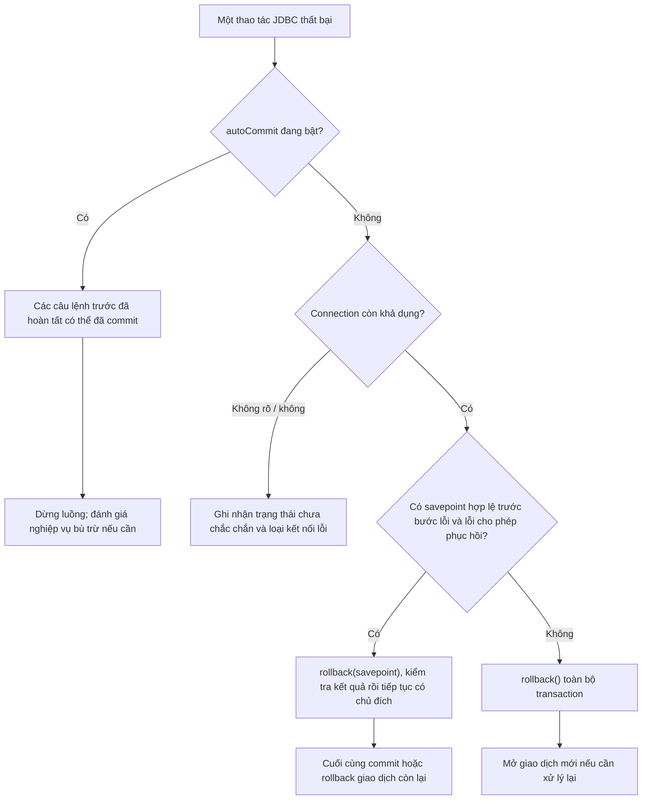
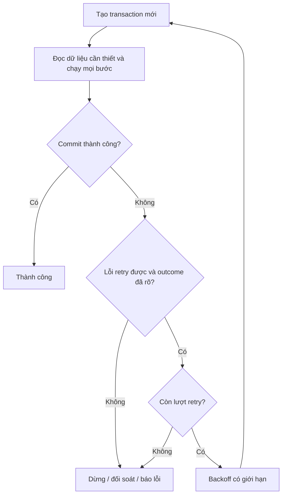

# Xử lý trạng thái giao dịch sau khi một câu SQL thất bại trong JDBC

Trong chương **Giao dịch nâng cao**, vấn đề khó không chỉ là phát hiện một lệnh SQL đã thất bại. Câu hỏi quan trọng hơn là: **transaction đang ở trạng thái nào, những thay đổi nào còn hiệu lực, và ứng dụng được phép làm gì tiếp theo?**

Với **JDBC**, ứng dụng Java truy cập cơ sở dữ liệu quan hệ thông qua `Connection`, `PreparedStatement` và `ResultSet`. Khi quản lý các tác vụ CRUD, transaction, batching và lỗi SQL, một `SQLException` không tự động cho biết mọi thay đổi trước đó đã được hoàn tác. Cũng không thể mặc định rằng kết nối vẫn sẵn sàng để chạy lệnh tiếp theo.

Bài học này xây dựng cách xử lý có hệ thống: phân biệt lỗi của một câu lệnh với lỗi của cả giao dịch, kiểm tra `autoCommit`, chọn `rollback()` hoặc `rollback(Savepoint)`, xử lý lỗi `commit()` và quyết định khi nào cần hủy kết nối hoặc thử lại.

## 1. Ba mức cần phân biệt khi SQL thất bại

Giả sử một transaction gồm ba bước:

```text
Bước A: UPDATE inventory ...           -- thành công
Bước B: INSERT reservations ...         -- thất bại
Bước C: UPDATE orders ...               -- chưa chạy
```

Sau lỗi ở bước B, có **ba câu hỏi độc lập**:

1. **Trạng thái câu lệnh B:** B có thực hiện được phần nào không? Khi lệnh SQL thất bại, nhiều hệ quản trị có cơ chế atomicity ở mức câu lệnh, nhưng phạm vi và các tác dụng phụ phụ thuộc loại lệnh, engine và DBMS. Không suy luận rằng mọi thành phần của nghiệp vụ đều đã quay về như cũ.
2. **Trạng thái transaction:** Những thay đổi từ A có còn nằm trong giao dịch đang mở? Transaction còn cho phép thực thi câu lệnh khác, đã bị đánh dấu thất bại hay đã bị DBMS tự rollback hoàn toàn?
3. **Trạng thái kết nối:** `Connection` có còn hoạt động và an toàn để tái sử dụng không? Lỗi mạng, timeout hoặc lỗi nghiêm trọng có thể khiến ứng dụng không biết chính xác phía server đã làm gì.

Một `catch (SQLException e)` chỉ báo có ngoại lệ ở phía JDBC. **Không tồn tại quy tắc JDBC chung rằng mọi `SQLException` đều rollback toàn bộ giao dịch, hoặc rằng có thể tiếp tục chạy SQL sau mọi ngoại lệ.**

### Sơ đồ quyết định ban đầu



Sơ đồ biểu diễn **quy trình quyết định**, không phải API chuẩn để tự động nhận diện mọi trạng thái DBMS. Đánh giá “connection còn khả dụng” và “lỗi cho phép phục hồi” phải dựa trên driver, DBMS, SQLState/mã lỗi và hợp đồng nghiệp vụ; khi không chắc chắn, ưu tiên dừng transaction và rollback toàn phần.

## 2. `autoCommit` quyết định phần nào còn có thể rollback

`Connection.getAutoCommit()` trả về chế độ hiện tại:

| Trước khi lỗi xảy ra | Đặc điểm | Điều có thể làm sau lỗi |
| --- | --- | --- |
| `autoCommit = true` | Mỗi câu SQL được commit tự động khi hoàn tất theo quy tắc JDBC | Không thể dùng `rollback()` để hủy những câu đã commit trước đó; cần xử lý nghiệp vụ bù trừ nếu cần |
| `autoCommit = false` | Nhiều câu SQL chạy trên **cùng `Connection`** trong giao dịch ứng dụng điều khiển | Có thể rollback transaction chưa commit, hoặc rollback tới savepoint nếu được hỗ trợ và trạng thái còn hợp lệ |

Ví dụ:

```java
// Hai câu UPDATE độc lập nếu connection đang autoCommit = true.
debit.executeUpdate();   // Thành công, có thể đã commit.
credit.executeUpdate();  // Ném SQLException.
```

Một thao tác `rollback()` được gọi sau đó **không đảo ngược được câu `debit` đã commit**. Ngoài ra, `commit()` và `rollback()` không phải cách dùng hợp lệ khi kết nối vẫn ở chế độ auto-commit.

Nếu yêu cầu nghiệp vụ là “cả hai bước cùng thành công hoặc cùng thất bại”, phải tắt auto-commit **trước bước đầu**, dùng cùng một kết nối và quản lý toàn bộ transaction.

> Với `SELECT` và các thao tác trả `ResultSet`, “hoàn tất câu lệnh” có thể phụ thuộc việc đọc hoặc đóng kết quả. Đừng hiểu auto-commit theo nghĩa cứng nhắc là mọi câu lệnh được commit đúng tại thời điểm gọi `executeQuery()`.

## 3. Trạng thái sau `SQLException` phụ thuộc DBMS và loại lỗi

Không nên dùng một nhánh chung theo kiểu “lỗi nào cũng rollback riêng câu vừa thất bại, rồi chạy tiếp”. Sau cùng một lỗi ràng buộc hoặc deadlock, các hệ quản trị có thể xử lý khác nhau.

| Tình huống | Hành vi có thể gặp | Hướng xử lý an toàn |
| --- | --- | --- |
| Vi phạm `UNIQUE` hoặc khóa ngoại | DBMS có thể chỉ hủy câu lệnh, hoặc đánh dấu toàn transaction bị lỗi | Mặc định rollback toàn bộ; chỉ tiếp tục nếu biết rõ DBMS và đã thiết kế savepoint |
| PostgreSQL: một câu SQL trong transaction bị lỗi | Transaction thường chuyển sang trạng thái **aborted**; các SQL thông thường tiếp theo có thể nhận `25P02` | `ROLLBACK` toàn phần, hoặc `ROLLBACK TO SAVEPOINT` đã tạo **trước** lỗi |
| MySQL/InnoDB: lỗi duplicate key thông thường | Câu lệnh lỗi có thể bị rollback nhưng transaction vẫn tồn tại | Không mặc định tiếp tục; xác định lỗi và quyết định rollback hay phục hồi có kiểm soát |
| Deadlock hoặc lỗi serialization | DBMS có thể hủy toàn transaction hoặc buộc giao dịch phải retry | Rollback/dọn trạng thái nếu còn phù hợp; retry **toàn bộ transaction** trong giao dịch mới khi an toàn |
| Lock timeout | Có DBMS chỉ rollback statement; cấu hình có thể làm thay đổi phạm vi rollback | Kiểm tra quy tắc của DBMS và cấu hình; không tự xem transaction là hợp lệ |
| Đứt kết nối hoặc lỗi truyền thông | Client có thể không biết câu lệnh hoặc commit đã hoàn tất ở server chưa | Ngừng dùng connection lỗi; xác minh kết quả trước khi thử lại thao tác không idempotent |
| `executeUpdate()` trả `0` | **Không phải `SQLException`**; SQL có thể thực thi hợp lệ nhưng không khớp bản ghi | Dựa vào nghiệp vụ để quyết định rollback |

Ví dụ, trong PostgreSQL khi chưa có savepoint:

```sql
BEGIN;
UPDATE inventory SET available = available - 1 WHERE product_id = 10;
INSERT INTO reservations (reservation_id, product_id)
VALUES (99, 10); -- giả sử vi phạm UNIQUE

-- Transaction đã bị đánh dấu lỗi;
-- nhiều SQL tiếp theo sẽ bị từ chối với SQLSTATE 25P02.
SELECT * FROM inventory; -- không thể coi như vẫn chạy bình thường
ROLLBACK;
```

Không phải lỗi nào cũng trả đúng `25P02` ngay từ câu bị lỗi: câu gây lỗi có thể trả SQLState riêng, ví dụ `23505` cho vi phạm unique của PostgreSQL; **các câu sau** mới báo transaction đang ở trạng thái aborted.

Với MySQL/InnoDB, lỗi deadlock thường khiến engine rollback toàn transaction, còn nhiều lỗi khác có thể chỉ rollback statement. Bởi vậy không thể dùng kinh nghiệm từ một DBMS để áp dụng cho mọi driver.

### Những trạng thái ứng dụng cần tự theo dõi

JDBC **không cung cấp một API tiêu chuẩn chung** kiểu `connection.getTransactionState()` để hỏi “transaction đang active, aborted hay committed?” cho tất cả DBMS. Ứng dụng nên theo dõi ít nhất:

- `originalAutoCommit`: chế độ đã có khi nhận connection.
- `transactionEnded`: ứng dụng đã hoàn tất `commit()` hoặc `rollback()` thành công hay chưa.
- `commitAttempted`: đã gửi yêu cầu commit hay chưa; nếu lỗi ngay lúc này, kết quả có thể chưa rõ.
- Loại `SQLException`/`SQLState`, cùng thông tin DBMS nếu cần quyết định retry hoặc recover.
- Phạm vi công việc đã có side effect ngoài CSDL, vì các side effect đó không được `rollback()` của JDBC hoàn tác.

Những cờ trạng thái này giúp tổ chức đường đi của mã. Chúng **không chứng minh trạng thái nội bộ của máy chủ** khi mất kết nối hoặc commit trả lỗi.

## 4. Quy tắc mặc định: rollback toàn bộ giao dịch khi một bước bắt buộc thất bại

Giả sử việc đặt chỗ gồm:

1. Trừ số lượng hàng còn lại.
2. Tạo bản ghi đặt chỗ với `reservation_id` duy nhất.

Nếu bước 2 lỗi, hệ thống phải trả lại số lượng đã trừ ở bước 1. Vì thế cả hai thuộc **một transaction**.

Lược đồ tham khảo (cách tạo bảng và khóa có thể khác nhau theo DBMS):

```sql
CREATE TABLE inventory (
    product_id BIGINT PRIMARY KEY,
    available BIGINT NOT NULL CHECK (available >= 0)
);

CREATE TABLE reservations (
    reservation_id BIGINT PRIMARY KEY,
    product_id BIGINT NOT NULL,
    quantity BIGINT NOT NULL CHECK (quantity > 0),
    FOREIGN KEY (product_id) REFERENCES inventory(product_id)
);
```

### Triển khai bằng `Connection` và `PreparedStatement`

```java
import javax.sql.DataSource;
import java.sql.Connection;
import java.sql.PreparedStatement;
import java.sql.SQLException;
import java.util.Objects;

public final class ReservationService {
    private final DataSource dataSource;

    public ReservationService(DataSource dataSource) {
        this.dataSource = Objects.requireNonNull(dataSource);
    }

    public void reserve(
            long reservationId, long productId, long quantity
    ) throws SQLException {
        if (quantity <= 0) {
            throw new IllegalArgumentException("quantity phải dương");
        }

        try (Connection conn = dataSource.getConnection()) {
            boolean originalAutoCommit = conn.getAutoCommit();
            conn.setAutoCommit(false);

            boolean transactionEnded = false;
            Throwable originalFailure = null;

            try {
                String decreaseSql = """
                    UPDATE inventory
                    SET available = available - ?
                    WHERE product_id = ? AND available >= ?
                    """;

                try (PreparedStatement ps =
                         conn.prepareStatement(decreaseSql)) {
                    ps.setLong(1, quantity);
                    ps.setLong(2, productId);
                    ps.setLong(3, quantity);
                    if (ps.executeUpdate() != 1) {
                        throw new SQLException(
                            "Sản phẩm không tồn tại hoặc không đủ hàng"
                        );
                    }
                }

                String insertSql = """
                    INSERT INTO reservations
                        (reservation_id, product_id, quantity)
                    VALUES (?, ?, ?)
                    """;

                try (PreparedStatement ps =
                         conn.prepareStatement(insertSql)) {
                    ps.setLong(1, reservationId);
                    ps.setLong(2, productId);
                    ps.setLong(3, quantity);
                    if (ps.executeUpdate() != 1) {
                        throw new SQLException(
                            "Không tạo được đúng một bản ghi đặt chỗ"
                        );
                    }
                }

                conn.commit();
                transactionEnded = true;

            } catch (SQLException | RuntimeException ex) {
                originalFailure = ex;

                try {
                    conn.rollback();
                    transactionEnded = true;
                } catch (SQLException rollbackFailure) {
                    ex.addSuppressed(rollbackFailure);
                }

                throw ex;

            } finally {
                // Chỉ khôi phục chế độ khi đã xác nhận transaction kết thúc.
                // setAutoCommit(true) khi transaction còn mở có thể COMMIT!
                if (transactionEnded) {
                    try {
                        conn.setAutoCommit(originalAutoCommit);
                    } catch (SQLException restoreFailure) {
                        if (originalFailure != null) {
                            originalFailure.addSuppressed(restoreFailure);
                        } else {
                            throw restoreFailure;
                        }
                    }
                }
            }
        }
    }
}
```

Ví dụ trên mô tả transaction JDBC thuần, không dùng framework quản lý transaction và giả định các bảng sử dụng engine có hỗ trợ transaction.

**Giải thích đường đi khi `INSERT` thất bại:**

1. `UPDATE inventory` chạy thành công nhưng **chưa commit**.
2. `INSERT reservations` gặp lỗi, ví dụ trùng `reservation_id`, và ném `SQLException`.
3. `catch` cố gọi `conn.rollback()` để hủy toàn bộ công việc chưa commit, **bao gồm cả thao tác giảm `available`**.
4. Nếu rollback thành công, transaction kết thúc; phương thức ném lại lỗi gốc để tầng trên xử lý.
5. Nếu rollback thất bại, lỗi rollback được đính kèm bằng `addSuppressed(...)`. Không gọi `setAutoCommit(true)` trong trạng thái chưa rõ vì thay đổi chế độ này có thể dẫn tới commit ngoài ý muốn.
6. `try-with-resources` đóng/trả connection; nó không thay thế cho yêu cầu `rollback()` tường minh.

Nếu câu `UPDATE` trả `0`, phương thức cũng ném ngoại lệ và rollback, dù SQL không báo lỗi kỹ thuật. Đó là **lỗi điều kiện nghiệp vụ**, không đồng nghĩa với việc server từ chối câu SQL.

**Giới hạn quan trọng:** Nếu lỗi xảy ra **đúng lúc `commit()`**, việc ứng dụng nhận `SQLException` không chứng minh DBMS chưa commit. Một số lỗi mạng tạo ra trạng thái **không xác định**: server có thể đã commit nhưng phản hồi không về tới Java. Dù đoạn mã thử rollback, bên gọi vẫn phải xem xét tình huống này theo mục 7 và không retry mù quáng.

### Vì sao phải giữ cùng một `Connection`?

```java
// Cách chia sai transaction: mỗi DAO tự lấy connection mới từ pool.
inventoryDao.decrease(dataSource, productId, quantity);
reservationDao.insert(dataSource, reservationId, productId, quantity);
```

Nếu hai DAO tự lấy và commit trên hai connection khác nhau, không thể rollback chung từ một connection thứ ba. Khi muốn cùng transaction, truyền **chính connection do tầng service đang quản lý** tới các DAO:

```java
inventoryDao.decrease(conn, productId, quantity);
reservationDao.insert(conn, reservationId, productId, quantity);
```

DAO nhận connection từ service nên không tự `commit()`, `rollback()`, `close()` hoặc đổi `autoCommit`; tầng sở hữu transaction chịu trách nhiệm các thao tác đó.

## 5. Khi nào có thể tiếp tục bằng `Savepoint`?

**Savepoint** cho phép đánh dấu một điểm trong transaction, rồi hủy các thay đổi **sau** điểm đó mà vẫn giữ các thay đổi **trước** điểm đó:

```text
Transaction bắt đầu
  ├─ A: UPDATE order        (bắt buộc)
  ├─ SAVEPOINT S
  ├─ B: INSERT optional tag (có thể lỗi trùng)
  │     └─ Nếu lỗi dự kiến: ROLLBACK TO S
  ├─ C: UPDATE audit count  (tiếp tục)
  └─ COMMIT
```

Để dùng savepoint hợp lệ:

- Kết nối phải ở chế độ `autoCommit = false`.
- DBMS/driver phải hỗ trợ savepoint (`DatabaseMetaData.supportsSavepoints()` có thể giúp kiểm tra).
- Tạo savepoint **trước** câu SQL có khả năng thất bại.
- Chỉ chấp nhận tiếp tục đối với **loại lỗi đã biết** và chính sách nghiệp vụ thực sự cho phép bỏ qua thao tác tùy chọn.
- Nếu toàn bộ transaction đã bị DBMS rollback (ví dụ một số deadlock), rollback tới savepoint cũ có thể không còn hợp lệ.
- Gặp lỗi khi rollback đến savepoint thì **không tiếp tục chạy SQL**; chuyển sang đường rollback toàn phần hoặc xử lý kết nối lỗi.

### Mẫu mã rollback tới savepoint

Đoạn sau minh họa việc bổ sung một tag **tùy chọn** trong một transaction đang mở. Phần bắt trùng dùng SQLState `23505` của **PostgreSQL** làm ví dụ; đây **không phải cách nhận diện trùng khóa chung cho mọi DBMS**. Trong thực tế cần kiểm tra thêm đúng tên constraint hoặc điều kiện nghiệp vụ, tránh bỏ qua một lỗi unique khác ngoài dự kiến.

```java
import java.sql.Connection;
import java.sql.PreparedStatement;
import java.sql.SQLException;
import java.sql.Savepoint;

public final class OptionalTagStep {
    // Hàm này chỉ thực hiện bước tùy chọn; bên gọi phải quản lý
    // commit/rollback của transaction lớn hơn.
    public static void insertIfAbsent(
            Connection conn, long orderId, String tag
    ) throws SQLException {
        if (conn.getAutoCommit()) {
            throw new SQLException("Phải tắt autoCommit trước khi dùng savepoint");
        }

        Savepoint beforeOptionalInsert = conn.setSavepoint();

        try (PreparedStatement ps = conn.prepareStatement("""
                INSERT INTO order_tags (order_id, tag) VALUES (?, ?)
                """)) {
            ps.setLong(1, orderId);
            ps.setString(2, tag);
            ps.executeUpdate();

        } catch (SQLException failure) {
            // PostgreSQL: 23505 = unique_violation.
            // Chỉ minh họa khi đã biết constraint duy nhất liên quan
            // là (order_id, tag), và trùng tag được phép bỏ qua.
            if (!"23505".equals(failure.getSQLState())) {
                throw failure;
            }

            // PostgreSQL có thể phục hồi transaction đang aborted
            // qua ROLLBACK TO SAVEPOINT đã tồn tại trước lỗi.
            conn.rollback(beforeOptionalInsert);
            // Sau đây caller có thể tiếp tục các bước khác.
        }
    }
}
```

Vì savepoint thuộc giao dịch hiện hành, code bên gọi vẫn phải `commit()` hoặc `rollback()` cho toàn bộ transaction. Có thể `releaseSavepoint()` khi không còn cần điểm đánh dấu, nếu driver/DBMS hỗ trợ; việc release **không commit transaction**.

Với PostgreSQL, cách làm này giúp phục hồi sau một lỗi SQL có thể đưa transaction vào trạng thái aborted, miễn là savepoint hợp lệ đã được lập trước. Với các hệ quản trị khác, phải kiểm chứng cả việc savepoint được hỗ trợ lẫn phạm vi rollback khi gặp loại lỗi cụ thể.

### Khi không nên dùng savepoint để cố tiếp tục

Nếu thao tác lỗi là **bắt buộc** để bảo đảm tính nhất quán (ví dụ trừ tồn kho không thành công khi tạo đơn), rollback đến savepoint rồi vẫn commit phần còn lại có thể làm dữ liệu sai. Hãy rollback toàn bộ.

Nếu lỗi là **deadlock, serialization failure, sự cố kết nối hoặc lỗi trạng thái transaction**, thường cần chấm dứt transaction hiện tại và cân nhắc retry ở phạm vi lớn hơn. Savepoint không bảo đảm phục hồi mọi tình huống.

## 6. Đọc `SQLException` để phân loại, không đoán trạng thái transaction

JDBC cung cấp những thông tin quan trọng:

```java
try {
    statement.executeUpdate();
} catch (SQLException e) {
    String sqlState = e.getSQLState();
    int vendorCode = e.getErrorCode();

    System.err.println(
        "SQL failed: state=" + sqlState
        + ", vendorCode=" + vendorCode
    );

    for (SQLException next = e.getNextException();
         next != null;
         next = next.getNextException()) {
        System.err.println(
            "Additional SQL error: " + next.getSQLState()
        );
    }

    throw e; // Để transaction owner quyết định rollback/retry.
}
```

**Cần ghi nhớ:**

- `getSQLState()` cung cấp mã trạng thái SQL do driver trả về. Khi driver dùng chuẩn SQLState, tiền tố `08` thường liên quan sự cố kết nối, `23` liên quan vi phạm ràng buộc, `40` liên quan transaction rollback. **Không phải mọi driver đều cung cấp cùng mức chi tiết hoặc cùng cách ánh xạ.**
- `getErrorCode()` là mã nhà cung cấp, hữu ích khi đọc tài liệu DBMS.
- `getNextException()` giúp đọc chuỗi lỗi liên quan, đặc biệt khi batch có nhiều lỗi.
- Các lớp như `SQLIntegrityConstraintViolationException`, `SQLTransactionRollbackException`, `SQLTransientException`, `SQLRecoverableException` giúp gợi ý cách xử lý, nhưng **không thay thế việc xác minh hành vi DBMS/driver**.
- `SQLWarning` là cảnh báo, không tự động tương đương một câu SQL đã thất bại.
- Exception cũng có thể xảy ra khi duyệt `ResultSet.next()` hoặc đóng/thao tác với các tài nguyên JDBC, không chỉ tại `executeUpdate()`.

Đừng đưa SQL kèm dữ liệu cá nhân, mật khẩu hoặc giá trị nhạy cảm vào log. Nên ghi mã lỗi, tên thao tác, mã correlation và thông tin đã được kiểm soát quyền truy cập.

## 7. Trường hợp khó nhất: `commit()` trả `SQLException`

Xét chuỗi sự kiện:

```text
Ứng dụng Java              Mạng                    CSDL
      |                      |                       |
      |------ COMMIT ------->|------ COMMIT -------->|
      |                      |                Ghi bền thành công
      |                      X  mất phản hồi         |
      |<--- SQLException ----|                       |
```

Ở phía Java, `commit()` ném lỗi. Nhưng **không thể suy ra transaction chắc chắn chưa được commit**: server có thể đã ghi bền, còn thông báo thành công bị mất trên đường truyền.

Ứng dụng cần phân biệt:

1. **Lỗi SQL trước khi thử commit:** Nếu rollback thành công trên kết nối khả dụng, các thay đổi chưa commit có thể được hủy theo khả năng transaction của DBMS.
2. **Lỗi khi gọi commit:** Kết quả có thể là **unknown outcome**. Một lệnh rollback gọi sau đó không chứng minh server chưa commit trước đó.
3. **Lỗi rollback hoặc đứt kết nối:** Connection không còn là cơ sở đáng tin để tiếp tục; cần chính sách loại bỏ kết nối và xác minh trạng thái nghiệp vụ.

Cách xử lý đối với nghiệp vụ không thể tạo bản ghi trùng:

- Cấp **idempotency key** hoặc `transaction_id` duy nhất cho yêu cầu trước khi ghi.
- Thiết lập ràng buộc `UNIQUE` tương ứng trong CSDL.
- Sau lỗi commit, kiểm tra trạng thái bằng **kết nối mới, lành mạnh** và khóa nghiệp vụ đó.
- Nếu phát hiện giao dịch đã tồn tại, trả kết quả tương ứng; nếu chưa có, thực hiện lại theo quy tắc an toàn khi còn rủi ro dữ liệu đang được xử lý.
- Chỉ retry tự động khi có thiết kế bảo đảm lặp lại không tạo side effect sai.

Đối với việc gửi email, gọi cổng thanh toán, ghi sang CSDL khác, một giao dịch JDBC cục bộ không thể tự rollback side effect bên ngoài. Có thể cần transactional outbox hoặc quy trình phối hợp/đối soát riêng.

## 8. Retry sau lỗi: thử lại câu lệnh hay toàn bộ giao dịch?

Các lỗi tạm thời như deadlock, serialization failure hoặc một số timeout có thể phù hợp với retry. Nhưng thử lại ngay **câu SQL cuối cùng** trong transaction cũ thường không đủ an toàn:

- Transaction có thể đã bị DBMS đánh dấu aborted hoặc tự hủy.
- Dữ liệu đọc trước đó có thể đã cũ; phép tính phụ thuộc dữ liệu cũ cần tính lại.
- Có thể đã phát sinh side effect bên ngoài không rollback được.
- Nếu commit vừa trả lỗi mạng, lần thực hiện trước có thể **đã thành công**.

Với các lỗi có thể retry và kết quả transaction trước đã được xác nhận là **chưa commit**, mô hình hợp lý thường là **retry toàn bộ đơn vị nghiệp vụ từ một transaction mới**:



Đặt số lần thử tối đa, backoff hợp lý, theo dõi thời gian và phân biệt lỗi **cần người dùng sửa đầu vào** (như vi phạm ràng buộc dữ liệu) với lỗi tạm thời. Không retry vô hạn và không retry mù sau commit không rõ trạng thái.

## 9. Khi câu SQL thất bại trong batch

Một batch JDBC có thể phát sinh `BatchUpdateException`. Tùy driver và DBMS, batch có thể dừng tại lệnh lỗi hoặc tiếp tục thực hiện một số lệnh khác. `getUpdateCounts()` cung cấp thông tin về các lệnh đã được xử lý, có thể gồm `Statement.SUCCESS_NO_INFO` hoặc `Statement.EXECUTE_FAILED`.

```java
import java.sql.BatchUpdateException;
import java.sql.Connection;
import java.sql.PreparedStatement;
import java.sql.SQLException;

public void saveBatch(Connection conn, long[] ids)
        throws SQLException {
    if (conn.getAutoCommit()) {
        throw new SQLException("Batch nguyên tử yêu cầu manual transaction");
    }

    try (PreparedStatement ps = conn.prepareStatement(
            "DELETE FROM stale_rows WHERE id = ?")) {
        for (long id : ids) {
            ps.setLong(1, id);
            ps.addBatch();
        }
        ps.executeBatch();

    } catch (BatchUpdateException e) {
        // Có thể kiểm tra e.getUpdateCounts() để chẩn đoán.
        // Không commit chỉ vì một số thao tác trong batch đã thành công.
        throw e; // Caller chịu trách nhiệm rollback toàn transaction.
    }
}
```

Nếu yêu cầu là **cả batch thành công hoặc không thay đổi gì**, tầng sở hữu connection phải chạy trong `autoCommit = false`, rollback khi có lỗi và chỉ commit khi toàn bộ batch cũng như các bước nghiệp vụ liên quan đã thành công.

**Bản thân `executeBatch()` không phải lời hứa về atomicity của cả batch.** Kiểm tra `updateCounts` phục vụ chẩn đoán; không thay thế `rollback()` hoặc quyết định commit.

## 10. Những sai lầm thường gặp

| Sai lầm | Hậu quả | Cách sửa |
| --- | --- | --- |
| `catch(SQLException)` rồi chạy SQL tiếp ngay | Có thể gặp trạng thái aborted, hoặc commit dữ liệu dở dang | Dừng và quyết định rollback hoặc phục hồi từ savepoint hợp lệ |
| Coi lỗi unique luôn vô hại | Có thể che mất lỗi dữ liệu, hoặc tiếp tục trong transaction đã bị lỗi | Chỉ bỏ qua lỗi đã xác định chính xác và nghiệp vụ cho phép |
| Bật `setAutoCommit(true)` trong `finally` trước rollback | Có nguy cơ commit phần thay đổi chưa mong muốn | Kết thúc transaction thành công rồi mới khôi phục chế độ |
| Bỏ qua lỗi `rollback()` | Che dấu trạng thái CSDL không chắc chắn | Ghi nhận lỗi rollback, không tiếp tục dùng connection không rõ trạng thái |
| Coi `close()` là rollback | Hành vi khi đóng connection còn transaction phụ thuộc môi trường | Rollback tường minh trước khi trả connection cho pool |
| Retry mỗi câu SQL ngay sau deadlock | Dùng lại transaction đã bị hủy hoặc dữ liệu đã cũ | Retry cả đơn vị nghiệp vụ trong transaction mới, có giới hạn |
| Coi mọi lỗi `executeBatch()` là không có hàng nào đã chạy | Dễ commit dữ liệu một phần | Quản lý batch trong transaction, rollback khi lỗi |
| Coi lỗi `commit()` chắc chắn đồng nghĩa thất bại | Có thể tạo giao dịch trùng khi retry | Theo dõi khóa idempotency và đối soát kết quả |
| Không kiểm tra `executeUpdate()` | Lỗi nghiệp vụ bị bỏ qua dù JDBC không ném ngoại lệ | Kiểm tra số hàng tác động theo điều kiện nghiệp vụ |

Một chi tiết khác: một số DBMS có quy tắc **implicit commit** cho DDL (`CREATE`, `ALTER`, `DROP`), hoặc cách xử lý đặc biệt với storage engine không hỗ trợ transaction. Không suy đoán rằng mọi SQL đều có thể được hủy bằng `rollback()` mà chưa xác minh môi trường.

## 11. Tự kiểm tra với tình huống

**Tình huống A.** Bước 1 giảm tồn kho thành công, bước 2 insert bản ghi đặt chỗ vi phạm `UNIQUE`. Cả hai thuộc cùng manual transaction và nghiệp vụ yêu cầu tất cả cùng thành công. Cần làm gì?

**Trả lời:** Gọi `rollback()` toàn transaction (nếu connection còn khả dụng), báo lỗi, không commit bước 1. Không cố gắng tiếp tục insert khác trên transaction chưa được xử lý.

**Tình huống B.** Trong PostgreSQL, câu SQL vi phạm unique khiến transaction aborted. Câu `SELECT` tiếp theo báo `25P02`. Có nên retry riêng câu `SELECT` liên tục không?

**Trả lời:** Không. Trước hết phải `ROLLBACK` toàn transaction, hoặc `ROLLBACK TO SAVEPOINT` đã tạo trước lỗi nếu quy trình hỗ trợ; sau đó mới chạy SQL hợp lệ.

**Tình huống C.** Bước tạo tag là tùy chọn và được phép bỏ qua khi trùng. Muốn vẫn commit các bước bắt buộc, cần chuẩn bị gì **trước** câu lệnh tạo tag?

**Trả lời:** Thiết lập savepoint trong transaction hiện tại, xác định chính xác lỗi trùng được cho phép, rồi rollback tới savepoint khi lỗi xảy ra. Nếu không thể phục hồi tại savepoint, dừng transaction và rollback toàn phần.

**Tình huống D.** Driver ném lỗi kết nối tại `commit()`. Có thể chắc chắn rằng dữ liệu chưa được commit và gửi lại yêu cầu ngay không?

**Trả lời:** Không. Kết quả có thể chưa rõ. Cần đối soát bằng khóa nghiệp vụ/idempotency và một kết nối mới đáng tin; chỉ retry khi đảm bảo không làm lặp thao tác.

**Tình huống E.** `executeUpdate()` trả `0` cho lệnh trừ số dư có điều kiện `balance >= amount`. Đây có phải lỗi SQL kỹ thuật không?

**Trả lời:** Không nhất thiết. SQL có thể hợp lệ nhưng không có bản ghi phù hợp. Đó có thể là lỗi nghiệp vụ buộc rollback cả giao dịch chuyển tiền.

**Tình huống F.** Sau khi rollback thành công, `autoCommit` có tự trở lại `true` không?

**Trả lời:** Không. `rollback()` kết thúc transaction hiện tại nhưng không tự thay đổi chế độ auto-commit. Tầng sở hữu connection phải khôi phục trạng thái sau khi transaction đã kết thúc; với connection pool cần chú ý để kết nối tái sử dụng không mang trạng thái sai.

## Ghi nhớ

- **Một câu SQL thất bại không đồng nghĩa toàn bộ transaction đã rollback**, và cũng không đảm bảo transaction có thể chạy tiếp.
- **Mặc định an toàn cho bước bắt buộc:** dừng nghiệp vụ, `rollback()` toàn bộ giao dịch trên connection còn dùng được, báo lỗi.
- **Chỉ dùng `rollback(Savepoint)` để tiếp tục** khi đã tạo savepoint trước lỗi, biết DBMS/driver hỗ trợ và lỗi thuộc trường hợp nghiệp vụ cho phép.
- **Đọc `SQLState`, mã lỗi, `getNextException()`** để chẩn đoán; không coi chúng là API trạng thái transaction toàn cục.
- **Không khôi phục `autoCommit` trước khi kết thúc giao dịch**, đặc biệt khi rollback thất bại.
- **Lỗi ở `commit()` có thể tạo kết quả không xác định**; idempotency và đối soát quan trọng hơn retry ngay lập tức.
- **Retry cả transaction trong một connection/transaction mới** đối với lỗi tạm thời đủ điều kiện, có giới hạn và bảo vệ dữ liệu khỏi ghi lặp.
