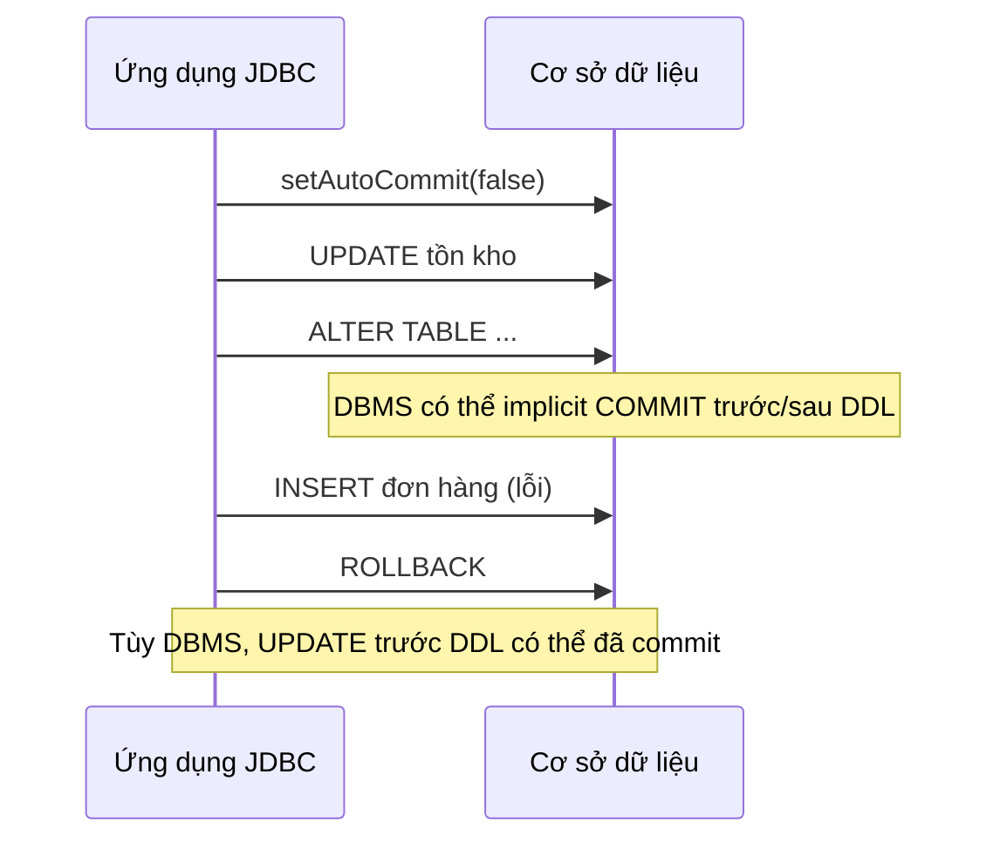

# Đánh giá ảnh hưởng của DDL và thao tác đặc thù tới ranh giới giao dịch

## Mục tiêu học tập

Khi làm việc với **JDBC**, ứng dụng Java thường dùng `DataSource` để lấy `Connection`, tắt `autoCommit` và gọi `commit()` hoặc `rollback()` để điều khiển một nhóm câu lệnh SQL. Cách này phù hợp cho các thay đổi dữ liệu thông thường trên những bảng và storage engine hỗ trợ transaction. Tuy nhiên, **không phải mọi câu lệnh được gửi qua cùng một `Connection` đều luôn có thể rollback như nhau**.

Các lệnh thay đổi cấu trúc cơ sở dữ liệu (**DDL**), dọn dữ liệu kiểu `TRUNCATE`, quản lý khóa, thay đổi thuộc tính session, thủ tục lưu trữ, câu lệnh điều khiển transaction và thao tác trên đối tượng không hỗ trợ giao dịch có thể làm thay đổi hoặc vượt ra ngoài ranh giới transaction mà ứng dụng nghĩ mình đã thiết lập. Hành vi cụ thể phụ thuộc **DBMS, phiên bản, storage engine, loại câu lệnh và đôi khi cả driver JDBC**.

Sau bài học thuộc chương **Giao dịch nâng cao**, bạn có thể:

- Phân biệt **transaction do JDBC quản lý** với khả năng giao dịch thực tế của từng câu lệnh SQL.
- Giải thích **implicit commit**, lệnh bị cấm trong transaction và tác động không thể rollback.
- Đánh giá ảnh hưởng của `CREATE`, `ALTER`, `DROP`, `TRUNCATE`, lệnh khóa, cấu hình session, thủ tục và batch có trộn DDL.
- Viết phép thử an toàn để kiểm tra giả định về `rollback()` bằng `PreparedStatement` và `ResultSet`.
- Thiết kế ranh giới giữa **schema migration** và **giao dịch nghiệp vụ**, giảm rủi ro dữ liệu được lưu một phần.

## 1. Ranh giới mà ứng dụng mong muốn và ranh giới thực tế

Giả sử một service xử lý việc đặt hàng:

1. Giảm tồn kho.
2. Ghi bản ghi đặt hàng.
3. Gọi `commit()` nếu cả hai bước thành công; ngược lại gọi `rollback()`.

Với các bảng có hỗ trợ transaction, cả hai câu DML nằm trên **cùng connection**, phương pháp này tạo một đơn vị nghiệp vụ có thể commit hoặc rollback cùng nhau. Nhưng nếu chèn một câu **DDL** giữa hai bước, một số DBMS có thể **tự commit các thay đổi đã thực hiện trước DDL**, ngay khi `connection.getAutoCommit()` vẫn trả về `false`.



**Điểm cốt lõi:** mã Java có thể thể hiện một phạm vi `try` duy nhất, nhưng ranh giới commit thật sự được quyết định bởi **ngữ nghĩa SQL và DBMS**. `setAutoCommit(false)` không phải lời hứa rằng bất kỳ thao tác nào trên kết nối đó cũng đều nằm trong một transaction có thể đảo ngược.

## 2. Các thuật ngữ cần phân biệt

| Khái niệm | Ý nghĩa | Vì sao quan trọng? |
| --- | --- | --- |
| **DML** (*Data Manipulation Language*) | Các lệnh tác động dữ liệu như `INSERT`, `UPDATE`, `DELETE` | Thường có thể rollback khi bảng/engine hỗ trợ transaction |
| **DDL** (*Data Definition Language*) | Các lệnh tạo, thay đổi, xóa cấu trúc như `CREATE TABLE`, `ALTER TABLE`, `DROP TABLE` | Có thể implicit commit, tham gia transaction hoặc bị hạn chế tùy DBMS |
| **TCL** (*Transaction Control Language*) | `COMMIT`, `ROLLBACK`, `SAVEPOINT` và các lệnh liên quan | Trực tiếp đổi ranh giới hoặc trạng thái transaction |
| **Implicit commit** | DBMS tự kết thúc giao dịch bằng commit vì một thao tác nhất định | Các thay đổi **trước** thao tác đó có thể đã bền vững, dù Java chưa gọi `commit()` |
| **Transactional DDL** | DDL có thể được thực thi và rollback trong transaction theo phạm vi DBMS hỗ trợ | `ROLLBACK` có thể khôi phục cả thay đổi schema lẫn dữ liệu, nhưng không mặc nhiên cho mọi DDL |
| **Nontransactional side effect** | Hiệu ứng không thuộc transaction đang điều khiển | `rollback()` không thể đảo ngược toàn bộ hiệu ứng như đã kỳ vọng |
| **Session state** | Thuộc tính gắn với một connection/session, ví dụ schema đang dùng hoặc cấu hình đặc thù | Có thể tồn tại qua nhiều transaction và ảnh hưởng lượt mượn connection kế tiếp |

Không nên suy ra khả năng rollback chỉ từ nhóm tên lệnh. Chẳng hạn, `TRUNCATE` có thể có hành vi giao dịch khác nhau giữa các DBMS; trong một hệ thống nó được xử lý như DDL có implicit commit, trong hệ thống khác nó có thể rollback khi ở trong transaction.

### Ba kiểu tác động cần kiểm tra

1. **Tự commit:** câu lệnh kết thúc transaction đang hoạt động, thường trước hoặc sau khi thao tác được thực thi. Những thay đổi đã commit không thể được rollback bởi lệnh rollback sau đó.
2. **Bị từ chối trong transaction:** DBMS báo lỗi vì câu lệnh không cho chạy bên trong transaction block hoặc trong một chế độ nhất định. Việc transaction trước đó có tiếp tục sử dụng được hay không cũng phụ thuộc DBMS.
3. **Hiệu ứng không thuộc phạm vi rollback:** lệnh có thể chạy được, nhưng một hoặc nhiều hiệu ứng của nó không được rollback, kể cả khi `ROLLBACK` được xác nhận.

Tình huống thứ hai **không đồng nghĩa** với implicit commit. Một lệnh bị từ chối có thể giữ nguyên transaction, làm transaction chuyển sang trạng thái lỗi buộc phải rollback hoặc có hành vi khác. Phải kiểm tra cụ thể, không gộp mọi lỗi DDL thành “đã commit”.

## 3. Đánh giá DDL phổ biến

Các ví dụ sau mô tả những hành vi **điển hình**, không phải hợp đồng thống nhất cho mọi phiên bản DBMS.

| Lệnh hoặc loại thao tác | Rủi ro cần đặt câu hỏi | Điều cần xác minh |
| --- | --- | --- |
| `CREATE TABLE` | Có implicit commit không? Có thể rollback bảng đã tạo không? | Tài liệu DDL transaction của DBMS và kiểu bảng |
| `ALTER TABLE` | Có commit transaction hiện tại, khóa schema kéo dài hoặc yêu cầu cơ chế DDL riêng? | Loại ALTER, thuật toán online/offline, phiên bản DBMS |
| `DROP TABLE` | Mất cấu trúc và dữ liệu; có rollback được không? | DBMS và khả năng transactional DDL |
| `CREATE INDEX` / `DROP INDEX` | Có bị giới hạn trong transaction, đặc biệt chế độ concurrent/online? | Cú pháp cụ thể, phiên bản và trạng thái transaction |
| `TRUNCATE TABLE` | Có implicit commit hay rollback được? Có reset identity/sequence? | Ngữ nghĩa TRUNCATE của DBMS |
| `CREATE DATABASE` / thao tác quản trị database | Có yêu cầu chạy ngoài transaction block? | Tài liệu câu lệnh quản trị |
| DDL trên temporary table | Tạo/xóa bảng tạm có rollback được không? Phạm vi sống theo session hay transaction? | Loại bảng tạm và DBMS |

### 3.1. Ví dụ khác biệt giữa các DBMS

- **MySQL với các bảng hỗ trợ transaction như InnoDB:** nhiều lệnh DDL phổ biến, chẳng hạn `CREATE TABLE`, `ALTER TABLE` hoặc `DROP TABLE`, gây **implicit commit**. Một số biến thể như `CREATE TEMPORARY TABLE` có ngoại lệ về implicit commit nhưng việc tạo bảng tạm không vì thế mà luôn rollback được. Cần đọc tài liệu theo đúng lệnh và phiên bản.
- **Oracle Database:** DDL thông thường thực hiện implicit commit quanh thao tác. Đặc biệt, một commit **trước khi thực hiện DDL** có thể làm thay đổi DML trước đó được xác nhận ngay cả khi DDL sau đó gặp lỗi. Không dùng `ROLLBACK` sau lỗi DDL để suy ra tất cả DML trước đó đã bị hủy.
- **PostgreSQL:** phần lớn DDL thông thường có thể tham gia một transaction và rollback cùng dữ liệu. Tuy vậy, có lệnh bị cấm trong transaction block, chẳng hạn `CREATE DATABASE`; `CREATE INDEX CONCURRENTLY` cũng không được chạy bên trong transaction block thông thường. Không áp dụng kết luận “mọi DDL đều rollback được” cho toàn bộ hệ thống.
- **Các DBMS khác như SQL Server:** nhiều thay đổi schema có thể tham gia transaction, nhưng vẫn có câu lệnh quản trị hoặc biến thể đặc biệt bị hạn chế. Phải xác minh từng lệnh thay vì suy luận từ nhãn “DDL”.

**Đánh giá kỹ thuật phải gắn với cấu hình thật.** Ngay cả trong cùng một họ DBMS, tính năng online schema change, storage engine, loại đối tượng, extension và phiên bản có thể thay đổi cách câu lệnh được phép chạy hoặc cách rollback.

### 3.2. DDL thất bại không chứng minh transaction còn nguyên

Xét tình huống:

```sql
UPDATE accounts
SET balance = balance - 100
WHERE id = 1;

-- Một DDL được gọi tiếp theo trên cùng session:
ALTER TABLE accounts ADD COLUMN note VARCHAR(50);

-- Sau đó ứng dụng gặp lỗi và gửi:
ROLLBACK;
```

Nếu DBMS **implicit commit trước DDL**, thay đổi số dư có thể đã được xác nhận trước khi câu `ALTER` bắt đầu. Ngay cả khi `ALTER` ném lỗi do xung đột tên cột hoặc hạn chế schema, điều đó **không tự động phục hồi** thay đổi trước nó.

Với DBMS hỗ trợ **transactional DDL** cho chính câu `ALTER` này, `ROLLBACK` có thể hủy cả `UPDATE` và `ALTER`. Hai kết quả đều hợp lý trong các môi trường khác nhau; bạn phải biết hệ thống của mình chọn kết quả nào.

## 4. Những thao tác đặc thù dễ làm sai giả định

### 4.1. `TRUNCATE` không phải lúc nào cũng tương đương `DELETE`

`DELETE FROM audit_log` và `TRUNCATE TABLE audit_log` có thể đều làm bảng trống, nhưng khác ngữ nghĩa về transaction, trigger, identity/sequence, quyền và khóa tùy DBMS.

- Một số hệ thống xử lý `TRUNCATE` như thao tác DDL có implicit commit.
- Một số hệ thống cho phép rollback `TRUNCATE` trong transaction.
- Tác động đến identity hoặc sequence và tính năng liên quan phải xem riêng theo DBMS.

Vì vậy, **không thay `DELETE` bằng `TRUNCATE` chỉ vì hiệu năng** bên trong một nghiệp vụ cần rollback. Cần kiểm chứng chức năng và ranh giới transaction trước.

### 4.2. Khóa dữ liệu và khóa bảng

`SELECT ... FOR UPDATE` có thể đặt khóa trên hàng (trong DBMS có hỗ trợ cú pháp này). Nếu dùng connection ở chế độ tự commit, transaction có thể hoàn tất ngay khi câu lệnh kết thúc, nên khóa không còn được giữ suốt các thao tác tiếp theo.

```sql
-- Ví dụ tư duy: dùng transaction thủ công khi cần giữ khóa
SELECT balance
FROM accounts
WHERE id = ?
FOR UPDATE;

UPDATE accounts
SET balance = ?
WHERE id = ?;
```

Muốn dựa vào khóa trong suốt nghiệp vụ, phải dùng đúng **cùng connection**, ranh giới transaction phù hợp và kiểm tra isolation cũng như đặc tính lock của DBMS.

Lệnh **khóa bảng tường minh** như `LOCK TABLES` (ở những DBMS có hỗ trợ) có ngữ nghĩa khác với `SELECT ... FOR UPDATE`. Ví dụ trong MySQL, `LOCK TABLES` có thể gây implicit commit transaction hiện tại. Không hoán đổi tùy tiện các loại khóa để “tăng an toàn”.

### 4.3. Thay đổi chế độ giao dịch bằng SQL hoặc API JDBC

`Connection.setAutoCommit(false)` là API JDBC để chuyển sang chế độ điều khiển transaction thủ công. Đặc biệt:

- `commit()` và `rollback()` kết thúc transaction theo ngữ nghĩa DBMS, nhưng **không tự bật lại** `autoCommit=true`.
- Chuyển `setAutoCommit(true)` từ `false` trong khi đang có transaction có thể **commit transaction đang hoạt động**. Phải kết thúc transaction an toàn trước khi đổi chế độ.
- Gửi SQL như `SET autocommit = 1`, `BEGIN`, `START TRANSACTION` hoặc `COMMIT` trực tiếp có hành vi phụ thuộc DBMS và có thể làm trạng thái thực tế lệch khỏi giả định của lớp quản lý transaction.
- Gọi `Connection.setTransactionIsolation(...)` trong khi transaction đã hoạt động có kết quả **phụ thuộc triển khai** theo JDBC. Nên cấu hình isolation trước khi thực hiện SQL của transaction và theo tài liệu driver.
- `SAVEPOINT` chỉ là mốc rollback **bên trong một transaction còn sống**; nếu một lệnh trước đó đã implicit commit, savepoint không còn là cơ chế khôi phục các bước trước đó.

Hãy để **một tầng duy nhất sở hữu ranh giới transaction**. Không cho repository tầng dưới tùy ý gọi `commit()`, `rollback()`, đổi `autoCommit` hay tự phát hành lệnh điều khiển transaction khi tầng dịch vụ đang điều phối.

### 4.4. Thay đổi session, schema và thuộc tính kết nối

Một số lệnh không sửa dữ liệu nghiệp vụ nhưng thay đổi **trạng thái session**, ví dụ schema hiện hành, múi giờ, chế độ SQL hoặc biến cấu hình đặc thù. Trạng thái này có thể **không cùng vòng đời** với dữ liệu được rollback.

Ví dụ:

- Chuyển schema/catalog mặc định bằng API `Connection.setSchema(...)`, `setCatalog(...)` hoặc cú pháp riêng của DBMS.
- Thay đổi biến hoặc thiết lập cấp session qua `SET ...`.
- Bật/tắt kiểm tra, trigger hoặc ràng buộc theo cách riêng của hệ quản trị.

Những tác động đó có thể tồn tại sau `rollback()` hoặc làm thay đổi ngữ nghĩa lệnh tiếp theo. Với connection pool, connection logic được trả lại có thể tái sử dụng session vật lý. Vì vậy cần xác định **pool reset thuộc tính nào**, thuộc tính nào phải tự khôi phục và khi nào phải bỏ connection không còn đáng tin cậy.

Không giả định một lệnh session luôn gây implicit commit, cũng không giả định nó luôn rollback. **Đánh giá từng thuộc tính và cú pháp cụ thể.**

### 4.5. Thủ tục lưu trữ và thao tác trong database

Một câu `CALL stored_procedure(...)` nhìn từ JDBC chỉ là một lệnh, nhưng thủ tục có thể thực hiện **nhiều SQL**, DDL, thao tác khác hoặc thay đổi trạng thái transaction nếu DBMS và ngữ cảnh cho phép.

Khi service gọi thủ tục:

1. Xác định thủ tục có `COMMIT`/`ROLLBACK` nội bộ không và lệnh này có hợp lệ ở ngữ cảnh gọi không.
2. Kiểm tra thủ tục có DDL hoặc lệnh implicit commit không.
3. Kiểm tra trigger, hàm phụ và đối tượng không hỗ trợ transaction mà thủ tục có thể tác động.
4. Ghi rõ contract: **ai sở hữu commit cuối cùng**, phía gọi hay thủ tục.

Không được suy ra “JDBC gọi một lần nên chỉ có một transaction” hay “thủ tục ném lỗi thì mọi thay đổi bên trong tự bị hủy”.

### 4.6. Bảng hoặc engine không hỗ trợ transaction

Với hệ thống có nhiều loại bảng/storage engine, một lệnh `UPDATE` trên bảng **không hỗ trợ rollback** có thể để lại thay đổi dù code đang ở `autoCommit=false` và sau đó gọi `rollback()`.

Trong hệ sinh thái hỗ trợ nhiều engine, hãy kiểm tra loại bảng thật, không chỉ nhìn tên DBMS hoặc cú pháp SQL. Tránh đưa các bảng nontransactional vào cùng một nghiệp vụ cần tính nguyên tử mà không có thiết kế bù trừ.

### 4.7. Tác động ngoài cơ sở dữ liệu

Gửi email, phát sự kiện tới message broker, gọi dịch vụ thanh toán hoặc ghi tệp **không mặc nhiên** thuộc transaction JDBC. Một lần `rollback()` có thể hủy DML trong database nhưng không thể “thu hồi” email đã gửi.

Nếu nghiệp vụ cần phối hợp dữ liệu với sự kiện ra ngoài, có thể dùng mẫu **transactional outbox**, cơ chế idempotency hoặc quy trình bù trừ phù hợp. Đừng nhầm tính nguyên tử của transaction local với tính nguyên tử trên toàn hệ thống.

## 5. Bảng đánh giá nhanh trước khi đưa lệnh vào transaction

| Hoạt động | Có nên mặc định thuộc transaction JDBC hiện tại? | Hành động trước khi triển khai |
| --- | --- | --- |
| `INSERT/UPDATE/DELETE` trên bảng hỗ trợ transaction | Thường có, nếu dùng cùng connection | Kiểm tra khóa, ràng buộc và isolation |
| `CREATE/ALTER/DROP TABLE` | **Không** | Xác minh implicit commit / transactional DDL |
| `TRUNCATE` | **Không** | Xác minh rollback, identity, trigger, quyền |
| `CREATE INDEX`, nhất là dạng concurrent/online | **Không** | Kiểm tra hạn chế của kiểu lệnh cụ thể |
| `LOCK TABLES`, `SELECT ... FOR UPDATE` | Tùy loại khóa và DBMS | Kiểm tra thời điểm giữ/nhả khóa và implicit commit |
| `SET`, thay schema/isolation/session | **Không** | Xác minh phạm vi session, transaction và pool reset |
| `CALL` thủ tục | **Không** nếu chưa biết nội dung | Kiểm tra DDL, TCL và side effect bên trong |
| `COMMIT/ROLLBACK` dưới dạng SQL | Có tác động trực tiếp, có thể xung đột transaction manager | Tập trung điều phối ở một nơi; ưu tiên API phù hợp |
| DML trên bảng không hỗ trợ transaction | **Không** | Đổi engine/thiết kế hoặc có kế hoạch bù trừ |
| Gửi API ngoài database | **Không** | Outbox, idempotency, saga hoặc cơ chế đảm bảo khác |

Từ “Không” trong bảng nghĩa là **không được giả định** an toàn hay có khả năng rollback, chứ không có nghĩa thao tác luôn gây implicit commit. Mục tiêu là thúc đẩy kiểm tra có bằng chứng.

## 6. Thử nghiệm khả năng rollback một lệnh DDL trong môi trường cách ly

Tài liệu DBMS là nguồn quyết định, nhưng thử nghiệm trên **đúng phiên bản, driver và cấu hình** giúp kiểm tra hành vi đang triển khai. Tuyệt đối không chạy bài thử DDL phá cấu trúc trên database production.

### 6.1. Chuẩn bị

Trên một database/schema thử nghiệm độc lập:

```sql
CREATE TABLE jdbc_tx_probe (
    id INTEGER PRIMARY KEY,
    marker INTEGER NOT NULL
);

INSERT INTO jdbc_tx_probe (id, marker) VALUES (1, 0);
```

Hoàn thành và xác nhận phần chuẩn bị **trước khi bắt đầu thí nghiệm**. Chọn tên bảng DDL mới chưa tồn tại, chẳng hạn `jdbc_tx_probe_created_01`. Việc chuẩn bị chính nó có thể chứa implicit commit; không dùng chung transaction của phần thí nghiệm.

### 6.2. Chạy thử với một connection

Ví dụ Java 17+, dùng `DataSource`, `Connection` và `PreparedStatement`. Phép thử cố ý đặt một câu DDL giữa câu DML và `rollback()` để **quan sát** kết quả thực tế.

```java
import java.sql.Connection;
import java.sql.PreparedStatement;
import java.sql.SQLException;
import java.sql.Statement;
import javax.sql.DataSource;

public final class DdlBoundaryProbe {
    public static void run(DataSource dataSource) throws SQLException {
        try (Connection connection = dataSource.getConnection()) {
            connection.setAutoCommit(false);

            try {
                // DML trong transaction được mong đợi.
                try (PreparedStatement ps = connection.prepareStatement(
                        "UPDATE jdbc_tx_probe SET marker = marker + 1 WHERE id = ?")) {
                    ps.setInt(1, 1);
                    if (ps.executeUpdate() != 1) {
                        throw new SQLException("Thiếu hàng probe id=1");
                    }
                }

                // CỐ Ý thử DDL: không làm thế trong code nghiệp vụ.
                try (Statement ddl = connection.createStatement()) {
                    ddl.executeUpdate(
                        "CREATE TABLE jdbc_tx_probe_created_01 (id INTEGER)"
                    );
                }
            } finally {
                // Rollback sau DML/DDL; có thể KHÔNG hủy DML đã implicit commit.
                connection.rollback();
            }
        }
    }
}
```

**Giới hạn của mã minh họa:** Đây là phép thử có chủ đích trong môi trường cách ly, **không phải template xử lý giao dịch cho production**. Lệnh `rollback()` trong `finally` được gọi cả khi DML hoặc DDL ném lỗi, nhưng không đảo ngược những thay đổi đã implicit commit. Nếu chính `rollback()` cũng lỗi, ngoại lệ rollback có thể che ngoại lệ ban đầu; hệ thống thực tế phải giữ cả hai lỗi và xác minh trạng thái transaction riêng.

Với DBMS có implicit commit do `CREATE TABLE`, lần `rollback()` cuối có thể không hủy thay đổi `marker`. Với DBMS hỗ trợ transactional DDL cho câu đó, cả DML và bảng vừa tạo có thể được rollback. Ngoài ra, lệnh DDL có thể bị từ chối trong transaction.

### 6.3. Quan sát bằng một connection mới

Sau khi `run(...)` hoàn tất (hoặc xử lý lỗi), lấy **connection mới** rồi kiểm tra giá trị:

```java
String verifySql = "SELECT marker FROM jdbc_tx_probe WHERE id = ?";

try (Connection verify = dataSource.getConnection();
     PreparedStatement ps = verify.prepareStatement(verifySql)) {
    ps.setInt(1, 1);

    try (java.sql.ResultSet rs = ps.executeQuery()) {
        if (rs.next()) {
            int marker = rs.getInt("marker");
            System.out.println("marker sau rollback = " + marker);
        }
    }
}
```

Nếu `marker` còn **0**, DML chưa được commit trong phạm vi thí nghiệm (theo điều kiện không có tác nhân khác sửa hàng). Nếu `marker` bằng **1**, có thay đổi đã bền vững sau `rollback()`; cần điều tra implicit commit hoặc nguyên nhân khác trong môi trường thí nghiệm. Kiểm tra **bảng DDL mới có tồn tại hay không** bằng metadata/truy vấn system catalog theo DBMS để kết luận về khả năng rollback cấu trúc.

| Kết quả quan sát trong môi trường thử độc lập | Diễn giải ban đầu |
| --- | --- |
| `marker = 0` và bảng mới không tồn tại | DML và DDL đã được rollback theo phạm vi thử |
| `marker = 1` và bảng mới tồn tại | Có dấu hiệu DML đã được commit và DDL vẫn tồn tại |
| `marker = 1` nhưng DDL báo lỗi | Có thể tồn tại implicit commit **trước** DDL; cần kiểm tra bằng chứng |
| DDL bị từ chối, `marker = 0` | Có thể lệnh không hợp lệ trong transaction; điều đó khác implicit commit |
| Bảng tồn tại nhưng `marker = 0` | Cần kiểm tra từng loại hiệu ứng: rollback dữ liệu và rollback schema có thể khác nhau |

Để quan sát đáng tin cậy, phải bắt đầu với dữ liệu sạch, dùng tên bảng DDL mới cho **mỗi lượt thử**, không chạy song song các tác nhân khác và bảo đảm câu truy vấn đối soát thực sự đọc từ nguồn có thẩm quyền (tránh nhầm độ trễ replica).

### 6.4. Bổ sung một ca DDL thất bại

Một phép thử quan trọng là **DDL cố ý thất bại**, chẳng hạn tạo bảng có tên đã tồn tại. Ở một số DBMS, việc chuẩn bị chạy DDL có thể đã commit DML trước đó ngay cả khi DDL lỗi.

Nhánh kiểm tra nên ghi nhận ba điều độc lập:

1. `SQLException`, `SQLState` và mã lỗi vendor của DDL.
2. Giá trị DML từ connection kiểm tra mới.
3. Khả năng tiếp tục dùng transaction hiện tại theo DBMS hoặc cần rollback/bỏ kết nối.

**Không dùng riêng `SQLException` làm bằng chứng rằng transaction đã được rollback.**

## 7. Cách viết ứng dụng JDBC tránh trộn schema change với giao dịch nghiệp vụ

Trong ứng dụng Java truy cập cơ sở dữ liệu quan hệ, việc cập nhật schema thường thuộc **quy trình migration** (có thể dùng công cụ quản lý phiên bản schema), còn việc ghi dữ liệu thuộc transaction nghiệp vụ. Hai trách nhiệm này nên có ranh giới rõ.

### 7.1. Tách migration ra khỏi thao tác đặt hàng

Quy trình hợp lý:

1. Chạy migration theo khả năng transactional DDL của DBMS **trước khi** phục vụ phiên bản ứng dụng mới, hoặc theo chiến lược triển khai có kiểm soát.
2. Kiểm tra migration thành công thực sự, khả năng tương thích schema và trạng thái version.
3. Khi xử lý request, chỉ chạy DML cần thiết trong transaction nghiệp vụ bằng một connection.
4. Nếu migration thất bại giữa chừng, dựa vào kế hoạch khôi phục/tiến tiếp của migration; **không giả định** cứ gọi `rollback()` là schema trở về như cũ.

Nếu hệ thống cần thay đổi schema khi đang hoạt động, nên đánh giá migration nhiều giai đoạn (ví dụ thêm cột tương thích trước, triển khai code, chuyển dữ liệu, sau đó mới bỏ cột cũ), thời gian giữ khóa và khả năng phục hồi khi triển khai một phần.

### 7.2. Ví dụ: một transaction chỉ chứa DML cần thiết

Ví dụ tồn kho đơn giản dưới đây dùng đúng một `Connection`. SQL được tham số hóa; không có `CREATE`, `ALTER` hoặc `TRUNCATE` trong phạm vi đặt hàng.

```java
import java.sql.Connection;
import java.sql.PreparedStatement;
import java.sql.SQLException;
import javax.sql.DataSource;

public final class ReservationService {
    private final DataSource dataSource;

    public ReservationService(DataSource dataSource) {
        this.dataSource = dataSource;
    }

    public void reserve(long requestId, long productId, int quantity)
            throws SQLException {
        if (quantity <= 0) {
            throw new IllegalArgumentException("quantity phải dương");
        }

        try (Connection connection = dataSource.getConnection()) {
            // Thiết lập ranh giới TRƯỚC lệnh DML đầu tiên.
            connection.setAutoCommit(false);

            try {
                String update = """
                    UPDATE inventory
                       SET available = available - ?
                     WHERE product_id = ? AND available >= ?
                    """;
                try (PreparedStatement ps =
                         connection.prepareStatement(update)) {
                    ps.setInt(1, quantity);
                    ps.setLong(2, productId);
                    ps.setInt(3, quantity);

                    if (ps.executeUpdate() != 1) {
                        throw new SQLException(
                            "Sản phẩm không tồn tại hoặc hết tồn kho"
                        );
                    }
                }

                String insert = """
                    INSERT INTO reservations(request_id, product_id, quantity)
                    VALUES (?, ?, ?)
                    """;
                try (PreparedStatement ps =
                         connection.prepareStatement(insert)) {
                    ps.setLong(1, requestId);
                    ps.setLong(2, productId);
                    ps.setInt(3, quantity);
                    ps.executeUpdate();
                }
            } catch (SQLException | RuntimeException error) {
                // Chỉ xử lý lỗi TRƯỚC khi bắt đầu gọi commit.
                try {
                    connection.rollback();
                } catch (SQLException rollbackError) {
                    error.addSuppressed(rollbackError);
                }
                throw error;
            }

            // Một lần commit cho cả hai thay đổi.
            connection.commit();
        }
    }
}
```

Mã giả định `inventory` và `reservations` đều hỗ trợ transaction, `reservations.request_id` là khóa duy nhất và mức cô lập/ràng buộc phù hợp. Bản hoàn thiện cho production cần xử lý yêu cầu lặp theo `request_id` và đối soát nếu `commit()` ném lỗi hoặc mất phản hồi. **Lỗi ngay trong `commit()` có thể là kết quả chưa xác định**, không được mặc nhiên coi toàn bộ thao tác đã rollback.

### 7.3. Kiểm tra transaction khi dùng connection pool

Một số pool reset `autoCommit` hoặc rollback transaction chưa hoàn tất khi trả connection, nhưng **không được mặc định** hành vi đó cho mọi pool/driver. Sau implicit commit do SQL, `getAutoCommit()` còn là `false` cũng không chứng minh những DML trước đó vẫn nằm trong một transaction chưa commit.

Khi một DDL hay thao tác đặc thù làm trạng thái transaction/session không đáng tin cậy, tránh tái sử dụng connection như thể chưa có gì xảy ra. Phải kiểm tra khả năng làm sạch kết nối và cách pool loại bỏ connection lỗi. Trong luồng nghiệp vụ, đừng tự gọi `setAutoCommit(true)` trong `finally` khi transaction chưa được kết thúc an toàn: việc chuyển chế độ có thể **commit** phần thay đổi còn treo.

## 8. Batch, savepoint và transaction lồng nhau: giới hạn cần nhớ

### 8.1. Trộn DDL và DML trong batch

Một batch JDBC có thể phát nhiều lệnh. Nếu batch **trộn DDL và DML**, lỗi giữa batch không đảm bảo mọi lệnh trước đó còn có thể rollback; một DDL gây implicit commit có thể phá vỡ giả định “batch là một đơn vị nguyên tử”.

Ngay cả với chỉ DML, `BatchUpdateException` cần được phân tích bằng update counts và hành vi của driver; khi cần tính nguyên tử toàn batch, ứng dụng phải dùng transaction thích hợp và kiểm tra bảng có hỗ trợ rollback. **Số lệnh thực hiện thành công không đồng nghĩa mọi thay đổi đã commit**.

### 8.2. Savepoint không vượt qua ranh giới commit

`Connection.setSavepoint()` tạo một điểm có thể rollback **bên trong transaction** đang hoạt động (nếu DBMS/driver hỗ trợ). Nó không thay thế `commit()` và không thể đưa transaction đã được implicit commit quay về trạng thái trước đó.

```java
connection.setAutoCommit(false);
java.sql.Savepoint point = connection.setSavepoint("before_details");

// Nếu DDL thực hiện sau đây tự commit transaction,
// savepoint có thể không còn hợp lệ.
// connection.createStatement().execute("ALTER TABLE ...");

// Không được mặc định lệnh sau luôn phục hồi được trạng thái:
// connection.rollback(point);
```

Việc `rollback(savepoint)` ném lỗi không giúp suy ra ngay dữ liệu trước DDL đã commit hay chưa; vẫn cần kiểm chứng trạng thái thực tế.

### 8.3. Nested transaction và transaction manager

JDBC local transaction không tự cung cấp một transaction lồng nhau độc lập theo mỗi hàm repository. Khi có nhiều tầng gọi hoặc framework transaction manager, cần thống nhất chủ sở hữu và cơ chế propagation; các thao tác DDL/TCL thủ công bên trong có thể phá vỡ mô hình mà framework dựa vào.

## 9. Tình huống thực hành: quyết định ranh giới phù hợp

### Tình huống A — Thêm cột trong lúc ghi đơn hàng

Một service gọi `setAutoCommit(false)`, ghi đơn hàng, chạy `ALTER TABLE` để “nếu thiếu thì thêm cột”, rồi ghi chi tiết đơn hàng. Bước cuối lỗi và service gọi `rollback()`.

**Đánh giá:** đây là thiết kế rủi ro cao. Với DBMS implicit commit cho `ALTER TABLE`, phần ghi đơn hàng có thể đã được xác nhận; rollback cuối không hủy được. **Cách sửa:** quản lý thay đổi schema bằng migration độc lập, rồi chạy các DML nghiệp vụ trên schema đã được chuẩn bị.

### Tình huống B — Dùng `TRUNCATE` xóa bảng tạm trước báo cáo

Một tiến trình thống kê có `DELETE`, `INSERT` và `TRUNCATE` giữa các bước, với giả định có thể rollback nếu báo cáo lỗi.

**Đánh giá:** cần tra cứu ngữ nghĩa `TRUNCATE` và loại bảng tạm trong DBMS. Nếu có implicit commit hoặc hiệu ứng session không rollback được, thay đổi cách làm: sử dụng bảng staging riêng cho từng job, thao tác `DELETE` có điều kiện hoặc workflow dọn dẹp phù hợp mà không phá ranh giới nghiệp vụ.

### Tình huống C — Thủ tục có `COMMIT` nội bộ

Service gọi thủ tục cập nhật dữ liệu rồi thực hiện thêm `UPDATE`, mong muốn hai bước là một transaction.

**Đánh giá:** nếu thủ tục được phép commit nội bộ, ranh giới của service có thể bị phá vỡ. Phải thống nhất contract: hoặc thủ tục tham gia transaction do service sở hữu, hoặc tách thành nghiệp vụ khác có cơ chế đồng bộ/đối soát.

### Tình huống D — Tạo chỉ mục đồng thời trong migration

Một công cụ migration muốn bọc mọi câu lệnh trong một transaction nhưng sử dụng biến thể tạo chỉ mục concurrent/online mà DBMS cấm ở transaction block.

**Đánh giá:** lỗi không tự chứng minh rằng DDL bị rollback hoặc đã implicit commit; khả năng thực thi của câu lệnh cần quy trình migration riêng. Xác định rõ những migration có thể bọc transaction và những migration phải chạy riêng theo DBMS.

## 10. Bộ câu hỏi trước khi chấp nhận một thao tác SQL vào transaction

Để quyết định đúng, trả lời các câu sau cho **chính câu lệnh trên DBMS/driver đang sử dụng**:

1. Câu lệnh có được phép chạy trong transaction thủ công không?
2. Nó có implicit commit **trước** hoặc **sau** khi chạy không, kể cả khi lệnh lỗi?
3. Nếu `rollback()` thành công, **tác động dữ liệu** có được đảo ngược không?
4. Nếu `rollback()` thành công, **tác động schema, identity, session hoặc khóa** có được đảo ngược không?
5. Câu lệnh có gọi thủ tục/trigger/đối tượng khác có khả năng thực hiện DDL, TCL hoặc hiệu ứng ngoài transaction không?
6. `Connection.getAutoCommit()` có phản ánh đủ trạng thái mong muốn không, hay cần đối soát với nguồn dữ liệu khác?
7. Kết nối có được trả về pool sau thao tác không, và trạng thái session đã được reset đầy đủ chưa?
8. Nếu lời gọi `commit()` hoặc một câu lệnh đặc thù ném `SQLException`, kế hoạch xác minh kết quả và retry an toàn là gì?

**Không nên quyết định chỉ dựa vào** `executeUpdate()` trả về số hàng cập nhật, lệnh SQL có/không ném lỗi, hay giá trị `autoCommit=false`. Những tín hiệu đó không xác nhận được mọi ranh giới commit và hiệu ứng ngoài transaction.

## Kết luận

**JDBC kiểm soát ranh giới transaction qua `Connection`, nhưng DBMS quyết định ngữ nghĩa giao dịch của từng câu lệnh.** Với DDL và thao tác đặc thù, điều quan trọng là phát hiện implicit commit, lệnh không được chạy trong transaction và hiệu ứng không rollback được. Hãy tách schema migration khỏi giao dịch nghiệp vụ, dùng `PreparedStatement` và cùng một `Connection` cho nhóm DML cần nguyên tử, kiểm tra transaction theo đúng DBMS/driver và có phương án đối soát khi kết quả chưa rõ. Những bước đó giúp tránh lỗi nguy hiểm nhất: ứng dụng tin rằng `rollback()` đã hủy toàn bộ nghiệp vụ trong khi một phần thay đổi thực tế đã được commit.
