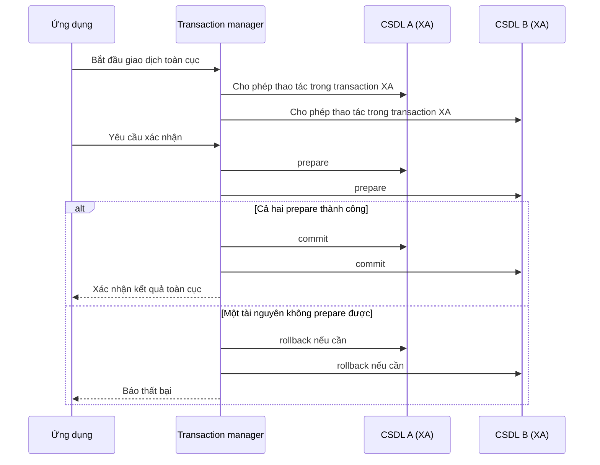

# Phân biệt giao dịch một kết nối và thay đổi trên nhiều nguồn dữ liệu

Trong JDBC, **giao dịch cục bộ** (local transaction) thường gắn với **một kết nối `java.sql.Connection`** đến một tài nguyên cơ sở dữ liệu hỗ trợ giao dịch. Nếu ứng dụng dùng `DataSource` để mở hai kết nối, gọi `commit()` trên kết nối thứ nhất **không** đồng thời xác nhận những thay đổi trên kết nối thứ hai. Sự khác nhau này quyết định ứng dụng có thể bảo đảm “tất cả cùng thành công hoặc tất cả cùng thất bại” đến đâu.

Bài học thuộc chương **Giao dịch nâng cao** của JDBC, tập trung vào việc nhận diện ranh giới transaction, phối hợp CRUD bằng `PreparedStatement`, quản lý `Connection` từ `DataSource`, xử lý lỗi và lựa chọn cơ chế khi một nghiệp vụ thay đổi dữ liệu ở **nhiều nguồn**. Đây cũng là nền tảng để hiểu vì sao giao dịch phân tán, `XA`, `JTA`, *saga* và *transactional outbox* giải quyết những nhu cầu khác nhau.

## 1. Bắt đầu từ ý nghĩa của một transaction

Giả sử người dùng chuyển 250.000 đồng từ tài khoản A sang tài khoản B. Nghiệp vụ có hai thay đổi bắt buộc:

1. Trừ 250.000 đồng khỏi tài khoản A.
2. Cộng 250.000 đồng vào tài khoản B.

Nếu cả hai tài khoản nằm trong cùng một CSDL và được cập nhật bằng **cùng một `Connection`**, ta có thể thực thi hai câu `UPDATE` trong một giao dịch:

```text
Connection duy nhất
  ├── setAutoCommit(false)
  ├── UPDATE account A: trừ tiền
  ├── UPDATE account B: cộng tiền
  └── commit()           ← xác nhận cả hai UPDATE
      hoặc rollback()    ← yêu cầu hủy cả hai UPDATE chưa xác nhận
```

Cách tiếp cận này có thể cung cấp tính nguyên tử (atomicity) của hai thao tác, **với điều kiện** bảng/engine hỗ trợ transaction và ứng dụng không chèn thao tác làm commit ngầm. Bản thân `commit()` chỉ xác nhận giao dịch trên kết nối được gọi; nó không “biết” toàn bộ nghiệp vụ của ứng dụng gồm những tài nguyên khác nào.

Nếu A ở CSDL nguồn X và B ở CSDL nguồn Y, ta có hai giao dịch cục bộ:

```text
DataSource X                              DataSource Y
    │                                         │
Connection X                               Connection Y
    │                                         │
UPDATE account A                          UPDATE account B
    │                                         │
commit X                                  commit Y
    └──── không có bảo đảm atomicity chung ────┘
```

Việc cả hai dòng lệnh đều nằm trong cùng một phương thức Java, cùng một `try`, hay cùng một luồng xử lý **không tạo ra một giao dịch chung** giữa chúng.

## 2. Ba khái niệm dễ bị nhầm: DataSource, Connection và nguồn dữ liệu

| Khái niệm | Vai trò trong JDBC | Liên quan tới ranh giới giao dịch |
|---|---|---|
| `DataSource` | Cung cấp kết nối; có thể được cấu hình với connection pool. | Không tự là một giao dịch. Gọi `getConnection()` nhiều lần thường lấy các phiên kết nối độc lập. |
| `Connection` | Đối tượng JDBC thực thi các lệnh SQL và điều khiển `setAutoCommit`, `commit`, `rollback`. | Là đối tượng điều khiển một giao dịch cục bộ đối với tài nguyên DB tương ứng. |
| CSDL / tài nguyên giao dịch | Hệ quản trị và dữ liệu thực sự được cập nhật. | Quy định khả năng ACID, isolation, khóa, cơ chế phục hồi và hỗ trợ giao dịch phân tán. |
| `PreparedStatement` | Thực thi SQL tham số hóa trên `Connection` đã tạo ra nó. | Tham gia transaction của chính kết nối đó, không có transaction riêng. |
| Connection pool | Cấp phát và thu hồi kết nối để tái sử dụng. | Không tự gộp các kết nối đang được mượn thành một transaction. |

Có hai bẫy quan trọng:

**Cùng một `DataSource` chưa chắc là cùng giao dịch.**

```java
Connection c1 = dataSource.getConnection();
Connection c2 = dataSource.getConnection();

// c1 và c2 có vòng đời transaction độc lập.
// c1.commit() không xác nhận các lệnh thực thi qua c2.
```

Hai lần mượn có thể trỏ vào cùng máy chủ, cùng tên database và cùng tài khoản đăng nhập, nhưng transaction của từng kết nối vẫn độc lập. Với pool, `Connection` có thể là đối tượng đại diện (proxy) cho phiên kết nối vật lý; nguyên tắc quản lý transaction vẫn dựa trên kết nối đã mượn và cơ chế transaction manager nếu có.

**Hai `DataSource` chưa chắc là hai CSDL khác nhau.** Chúng có thể được cấu hình cùng một CSDL nhưng tạo ra những kết nối riêng, nên vẫn không bảo đảm một lần `commit()` sẽ xử lý cả hai. Ngược lại, một `Connection` đôi khi truy cập nhiều schema hoặc catalog, thậm chí nhiều database theo cơ chế riêng của DBMS; việc các thay đổi đó có cùng một transaction nguyên tử hay không phải tra khả năng của **DBMS/driver**, không thể suy ra chỉ từ số tên schema hoặc database.

## 3. Giao dịch cục bộ: nhiều thao tác, một kết nối

### Schema minh họa

Giả sử hai tài khoản ở cùng một CSDL quan hệ, nơi bảng `account` sử dụng engine hỗ trợ transaction:

```sql
CREATE TABLE account (
    id BIGINT PRIMARY KEY,
    balance DECIMAL(19, 2) NOT NULL CHECK (balance >= 0)
);
```

Ràng buộc `CHECK` cùng cách xử lý số thập phân có thể khác nhau giữa các hệ quản trị; cần điều chỉnh DDL theo CSDL đang dùng. Ở đây `DECIMAL(19, 2)` tránh dùng số dấu phẩy động cho tiền.

Ta cập nhật số dư bằng SQL tham số hóa:

```sql
UPDATE account
SET balance = balance - ?
WHERE id = ? AND balance >= ?;

UPDATE account
SET balance = balance + ?
WHERE id = ?;
```

Điều kiện `balance >= ?` giúp không trừ quá số dư hiện có ngay trong câu cập nhật. Kiểm tra số dòng cập nhật là một bước của logic nghiệp vụ: nếu không có tài khoản nguồn, tài khoản không đủ tiền hoặc không có tài khoản đích, không được commit giao dịch.

### Mã JDBC đầy đủ

Ví dụ dùng `DataSource` đã được ứng dụng cấu hình và hai lần `executeUpdate()` trên **cùng một `Connection`**:

```java
import java.math.BigDecimal;
import java.math.RoundingMode;
import java.sql.Connection;
import java.sql.PreparedStatement;
import java.sql.SQLException;
import javax.sql.DataSource;

public final class AccountTransfer {
    private AccountTransfer() {
    }

    public static void transfer(
            DataSource dataSource,
            long sourceId,
            long targetId,
            BigDecimal amount
    ) throws SQLException {
        if (sourceId == targetId) {
            throw new IllegalArgumentException(
                    "Tài khoản nguồn và đích phải khác nhau");
        }
        if (amount == null || amount.signum() <= 0) {
            throw new IllegalArgumentException(
                    "Số tiền chuyển phải lớn hơn 0");
        }

        // Không lặng lẽ làm tròn số tiền người dùng yêu cầu.
        BigDecimal exactAmount =
                amount.setScale(2, RoundingMode.UNNECESSARY);

        String debitSql = "UPDATE account SET balance = balance - ? "
                + "WHERE id = ? AND balance >= ?";
        String creditSql = "UPDATE account SET balance = balance + ? "
                + "WHERE id = ?";

        try (Connection connection = dataSource.getConnection()) {
            connection.setAutoCommit(false);

            try {
                try (PreparedStatement debit =
                             connection.prepareStatement(debitSql);
                     PreparedStatement credit =
                             connection.prepareStatement(creditSql)) {

                    debit.setBigDecimal(1, exactAmount);
                    debit.setLong(2, sourceId);
                    debit.setBigDecimal(3, exactAmount);
                    if (debit.executeUpdate() != 1) {
                        throw new SQLException(
                                "Không tìm thấy tài khoản nguồn hoặc không đủ tiền");
                    }

                    credit.setBigDecimal(1, exactAmount);
                    credit.setLong(2, targetId);
                    if (credit.executeUpdate() != 1) {
                        throw new SQLException(
                                "Không tìm thấy tài khoản đích");
                    }
                }

                // Chỉ có một điểm xác nhận hai thay đổi.
                connection.commit();

            } catch (SQLException | RuntimeException failure) {
                try {
                    connection.rollback();
                } catch (SQLException rollbackFailure) {
                    failure.addSuppressed(rollbackFailure);
                }
                throw failure;
            }
        }
    }
}
```

**Diễn giải từng ranh giới:**

1. `dataSource.getConnection()` lấy một kết nối để thực hiện **toàn bộ** nghiệp vụ.
2. `setAutoCommit(false)` cho phép ứng dụng tự quyết định kết thúc giao dịch. Nếu giữ auto-commit mặc định, câu trừ tiền có thể đã được commit trước khi câu cộng tiền thất bại.
3. Hai `PreparedStatement` nhận cùng biến `connection`. Mỗi câu SQL được thực thi trong giao dịch hiện tại của kết nối ấy.
4. Chỉ sau khi cả hai câu lệnh trả về đúng một dòng bị ảnh hưởng, ứng dụng mới gọi `connection.commit()`.
5. Nếu bất kỳ câu lệnh nào thất bại, `rollback()` được gọi để yêu cầu DBMS hủy những thay đổi chưa xác nhận.
6. `try-with-resources` đóng statement và kết nối; việc đóng kết nối **không thay thế** một lệnh commit/rollback tường minh.

Đây là ví dụ về cơ chế transaction, chưa phải toàn bộ logic của hệ thống chuyển tiền: một hệ thống thực tế có thể cần sổ cái, khóa định danh yêu cầu chuyển tiền, kiểm toán, hạn mức và quy trình xử lý trường hợp kết quả `commit()` không rõ. Dùng giao dịch cục bộ cũng không loại trừ deadlock hoặc lỗi serialization khi nhiều giao dịch cạnh tranh trên cùng tài khoản. Ứng dụng phải có chính sách retry **toàn bộ giao dịch** cho những lỗi được DBMS cho phép retry và tránh gửi lại lệnh có tác dụng phụ khi kết quả commit chưa xác định.

### Thiết kế DAO để không vô tình mở thêm kết nối

Một cách tổ chức phù hợp là để tầng nghiệp vụ sở hữu transaction và truyền cùng `Connection` xuống các phương thức DAO:

```java
// Trong tầng service:
try (Connection connection = dataSource.getConnection()) {
    connection.setAutoCommit(false);
    try {
        accountDao.debit(connection, sourceId, amount);
        accountDao.credit(connection, targetId, amount);
        connection.commit();
    } catch (SQLException | RuntimeException failure) {
        try {
            connection.rollback();
        } catch (SQLException rollbackFailure) {
            failure.addSuppressed(rollbackFailure);
        }
        throw failure;
    }
}
```

`accountDao.debit(...)` và `accountDao.credit(...)` là phương thức do ứng dụng tự xây dựng, không phải API có sẵn của JDBC. Mỗi phương thức cần thực thi SQL qua **kết nối được truyền vào**, không tự gọi `dataSource.getConnection()` rồi tạo transaction mới.

## 4. Khi thay đổi nằm trên hai nguồn dữ liệu độc lập

Giả sử cửa hàng lưu đơn hàng trong database `sales_db` và giảm tồn kho trong database `inventory_db`. Hai nguồn sử dụng hai `DataSource`:

- `salesDataSource` để thêm đơn hàng.
- `inventoryDataSource` để trừ tồn kho.

Mỗi nguồn cho ra một `Connection` riêng. Giả sử ta tắt auto-commit cho cả hai rồi thực hiện SQL thành công, tiếp theo xác nhận từng kết nối.

**Đoạn dưới đây là ví dụ cảnh báo, không phải giải pháp bảo đảm atomicity xuyên hai DB:**

```java
// orderConnection và stockConnection đã mở, hai SQL đã chạy.
// Cả hai connection đang ở chế độ setAutoCommit(false).

orderConnection.commit(); // Có thể đã commit thành công ở sales_db.
stockConnection.commit(); // Nếu lỗi tại đây, sales_db vẫn đã thay đổi.
```

Một khi `orderConnection.commit()` thành công, việc gọi `orderConnection.rollback()` sau đó **không thể hoàn tác** giao dịch đơn hàng đã xác nhận. Kể cả nếu đảo thứ tự commit, vẫn tồn tại khoảng thời gian giữa hai lệnh; chỉ thay đổi nguồn nào có nguy cơ bị xác nhận trước.

| Thời điểm lỗi | Trạng thái có thể xảy ra | Tác động |
|---|---|---|
| Trước khi cả hai nguồn được commit | Nếu cả hai kết nối còn dùng được, có thể cố gắng rollback từng transaction cục bộ. | Thường tránh được thay đổi dở dang, nhưng rollback cũng có thể thất bại. |
| Sau khi commit nguồn A, trước khi commit nguồn B | A đã xác nhận; B còn chưa xác nhận hoặc sẽ rollback. | Dữ liệu có thể lệch nhau: có đơn nhưng chưa trừ tồn. |
| Khi nguồn B báo lỗi commit | A đã xác nhận; kết quả commit của B có thể chưa rõ nếu mất liên lạc. | Không thể kết luận chắc B đã commit hay chưa chỉ từ ngoại lệ. |
| Sau khi cả hai commit thành công | Cả hai nguồn đã báo xác nhận thành công. | Không có nghĩa hai lần commit là một thao tác nguyên tử chung trong quá trình xảy ra. |

**Hai transaction riêng không tự động trở thành một distributed transaction.** Việc đặt chúng trong một hàm Java, chạy cùng thread, cùng request HTTP, hay quản lý chung qua `try-with-resources` không giải quyết khoảng trống giữa hai lần `commit()`.

### `rollback()` và `Savepoint` có giới hạn tương tự

`connection.rollback()` và `connection.rollback(savepoint)` chỉ áp dụng cho **transaction của kết nối đó**. Một `Savepoint` trên kết nối A không đánh dấu trạng thái trên kết nối B; không thể tạo một savepoint chung giữa hai `DataSource` bằng các API JDBC cục bộ.

Đóng hai kết nối cũng không phải cơ chế phối hợp: hành vi khi kết nối còn transaction chưa kết thúc có thể khác nhau theo driver/pool. Mọi transaction phải được kết thúc tường minh khi có thể, rồi để cơ chế phối hợp cấp cao hơn quyết định giao dịch xuyên tài nguyên.

## 5. Phân biệt “hai kết nối” với “hai tài nguyên”

Để chọn kiến trúc đúng, cần xem **ai thực sự nắm quyền xác nhận dữ liệu**:

| Trường hợp | Có thể bảo đảm một transaction JDBC cục bộ? | Cách suy nghĩ |
|---|---|---|
| Nhiều `UPDATE` cùng bảng, cùng `Connection` | Có, nếu DBMS/engine hỗ trợ transaction. | Một kết nối, một transaction. |
| `INSERT` bảng A + `UPDATE` bảng B, cùng `Connection` và cùng DB giao dịch | Có trong phạm vi tài nguyên được DBMS bảo đảm. | Không phụ thuộc số bảng. |
| Hai lần `getConnection()` từ cùng một `DataSource` | Không, nếu chỉ gọi `commit()` trên từng `Connection`. | Hai phiên giao dịch độc lập. |
| Hai `DataSource` khác nhau cùng trỏ vào một DB | Không tự động; vẫn có các kết nối riêng. | Cần tổ chức cùng kết nối hoặc transaction manager phù hợp. |
| Một `Connection` truy cập nhiều schema/catalog | Tùy khả năng DBMS và kiểu thao tác. | Cần xác minh atomicity thực tế của DBMS/driver. |
| Hai DB/engine độc lập, mỗi DB một kết nối | Không bằng `Connection.commit()` cục bộ. | Cân nhắc XA/JTA hoặc mô hình nhất quán cuối cùng. |
| CSDL + hàng đợi thông điệp qua các tài nguyên riêng | Không bằng một lần JDBC commit, trừ khi dùng cơ chế giao dịch phân tán được các bên hỗ trợ. | Outbox hoặc giao dịch phân tán tùy yêu cầu. |

Một số DBMS hỗ trợ cập nhật nhiều database/schema qua **một phiên kết nối** với các bảo đảm riêng; số tên database trong SQL không đủ để kết luận. Một số thao tác DDL có thể gây commit ngầm, một số engine bảng không hỗ trợ transaction. Vì vậy, ngoài số lượng `Connection`, luôn kiểm tra **hợp đồng transaction của tài nguyên** và tài liệu nhà cung cấp.

## 6. Khi thật sự cần tất cả nguồn cùng xác nhận: XA và JTA

Trong hệ thống Java, **giao dịch phân tán** (distributed transaction) là một cách phối hợp nhiều tài nguyên giao dịch, ví dụ hai CSDL độc lập cùng hỗ trợ XA. Các thành phần liên quan:

- `javax.sql.XADataSource`: nhà cung cấp kết nối hỗ trợ tham gia giao dịch XA, tùy driver.
- `javax.sql.XAConnection`: kết nối XA mà từ đó có thể nhận JDBC `Connection` và `XAResource`.
- `javax.transaction.xa.XAResource`: giao diện giao tiếp với *transaction coordinator*, cung cấp các thao tác như `prepare`, `commit` và `rollback` của giao thức XA.
- **Transaction manager** (thường qua JTA trong nền tảng Java phù hợp): điều phối các tài nguyên và quản lý ranh giới giao dịch toàn cục. Trong Jakarta EE, tên gói JTA hiện đại có thể khác `javax.transaction`, tùy phiên bản nền tảng.

Một coordinator có thể dùng giao thức **two-phase commit (2PC)**:



Ở **pha chuẩn bị**, coordinator hỏi mỗi tài nguyên liệu có thể cam kết giao dịch hay không. Nếu tất cả tài nguyên tham gia sẵn sàng, coordinator tiến hành **pha xác nhận**. Việc phối hợp này giải quyết lỗ hổng “commit A trước rồi commit B” theo cách các lời gọi `Connection.commit()` riêng lẻ không làm được.

Tuy nhiên, XA/2PC có chi phí và giới hạn thực tế:

1. **Không phải mọi driver, DBMS hoặc dịch vụ ngoài đều hỗ trợ XA.** Cần cấu hình `XADataSource` và transaction manager tương thích với từng tài nguyên.
2. **Kết nối được enlist trong giao dịch XA** phải được transaction manager điều phối; không tự ý gọi các lệnh commit/rollback cục bộ trên kết nối tham gia XA.
3. 2PC có thêm lượt giao tiếp, có thể giữ khóa và trạng thái chuẩn bị lâu hơn; nếu coordinator hoặc mạng lỗi, transaction có thể ở trạng thái cần recovery.
4. Trong sự cố đặc biệt có thể phát sinh kết quả *heuristic* hoặc không xác định; hệ thống vẫn cần giám sát, recovery và đối soát. XA không làm các hệ thống phân tán miễn nhiễm với lỗi mạng.
5. Mục tiêu của XA là phối hợp nhất quán giữa tài nguyên có khả năng tham gia; nó không tự thay thế thiết kế khóa, isolation, kiểm soát trùng lặp hoặc quy tắc nghiệp vụ.

**Điểm phân biệt:** JDBC thuần với `Connection` cho phép quản lý transaction cục bộ. XA/JTA yêu cầu thành phần phối hợp và tài nguyên hỗ trợ, không thể đạt được chỉ bằng cách gọi `setAutoCommit(false)` trên hai kết nối rồi lần lượt `commit()`.

## 7. Khi không dùng XA: thiết kế nhất quán cuối cùng

Nhiều ứng dụng truy cập nhiều database, dịch vụ HTTP hoặc message broker không có XA chung hoặc không muốn chấp nhận độ phức tạp của 2PC. Trong trường hợp này, mục tiêu thường chuyển sang **eventual consistency**: mỗi bước được commit cục bộ, sau đó hệ thống bảo đảm tiếp tục xử lý, thử lại có kiểm soát và đối soát để các nguồn cuối cùng khớp nhau.

### Transactional outbox

Ví dụ một ứng dụng tạo đơn hàng tại CSDL A rồi cần đồng bộ đơn sang CSDL B. Nếu ứng dụng chỉ thực hiện `INSERT order` ở A, `commit` và sau đó gửi message, tiến trình có thể chết giữa hai bước: đơn đã có nhưng thông điệp bị mất.

*Transactional outbox* đặt **dữ liệu nghiệp vụ** và **bản ghi sự kiện cần phát** trong **cùng transaction cục bộ của A**:

```text
CSDL A (một transaction)
    ├── INSERT orders(...)
    ├── INSERT outbox(event_id, payload, status)
    └── commit()
            │
            ▼
     Worker đọc outbox
            │
            ▼
       Phát message
            │
            ▼
CSDL B: consumer xử lý trong transaction cục bộ
       kiểm tra event_id để tránh áp dụng trùng
```

Một bảng outbox minh họa (cú pháp cần tùy chỉnh cho CSDL):

```sql
CREATE TABLE outbox_event (
    event_id VARCHAR(64) PRIMARY KEY,
    aggregate_id BIGINT NOT NULL,
    event_type VARCHAR(64) NOT NULL,
    payload VARCHAR(4000) NOT NULL,
    published BOOLEAN NOT NULL DEFAULT FALSE
);
```

Hai thao tác `INSERT orders` và `INSERT outbox_event` phải dùng **cùng `Connection`** và cùng transaction ở A. Sau commit, worker đọc outbox rồi phát sự kiện; worker có thể thử lại nếu thất bại.

Cần hiểu giới hạn: một sự kiện **có thể được phát nhiều lần** nếu worker gửi thành công nhưng chưa kịp đánh dấu đã phát. Do đó, consumer ở B phải xử lý **idempotent** bằng `event_id` hoặc khóa nghiệp vụ, thường lưu dấu đã xử lý trong **cùng transaction cục bộ của B** với cập nhật dữ liệu. Outbox tránh mất sự kiện do lỗi giữa commit và publish, **không** biến A và B thành một giao dịch ACID chung; có khoảng thời gian B chưa đồng bộ.

### Saga và giao dịch bù

Một *saga* tổ chức nghiệp vụ thành chuỗi transaction cục bộ, ví dụ:

1. Tạo đơn ở A (transaction A).
2. Giữ hàng ở B (transaction B).
3. Xác nhận đơn ở A (transaction A tiếp theo).

Nếu giữ hàng thất bại, hệ thống có thể thực hiện **giao dịch bù** để hủy đơn đã tạo. Giao dịch bù là **hành động nghiệp vụ mới**, không phải `rollback()` của transaction cũ. Vì transaction cũ đã commit, không thể quay ngược dữ liệu bằng lệnh JDBC rollback thông thường.

Thiết kế saga phải định nghĩa trạng thái trung gian, quy tắc retry, idempotency, xử lý thông điệp đến sai thứ tự và cách đối soát. Một số hành động bên ngoài (đã gửi email, đã giao hàng, đã thanh toán) không thể hoàn tác hoàn hảo; cần bù trừ theo logic nghiệp vụ. Không nên chọn saga nếu yêu cầu bắt buộc một lần ghi nguyên tử tức thời qua tất cả tài nguyên và hệ thống có khả năng đáp ứng bằng một giao dịch thực sự.

### Chọn cơ chế phù hợp

| Yêu cầu | Cách tiếp cận thường phù hợp | Giới hạn cần chấp nhận |
|---|---|---|
| Nhiều lệnh SQL trong cùng CSDL giao dịch | Một `Connection`, `setAutoCommit(false)`, `commit()/rollback()`. | Phải dùng cùng kết nối, xử lý deadlock/isolation. |
| Nhiều dịch vụ có thể được thiết kế lại để cùng ghi một DB | Cân nhắc gom thay đổi vào một transaction cục bộ nếu ranh giới kiến trúc cho phép. | Phụ thuộc thiết kế sở hữu dữ liệu, coupling và triển khai. |
| Nhiều DB hỗ trợ XA, cần nguyên tử khi xác nhận | XA/JTA với transaction manager. | Chi phí phối hợp, hỗ trợ driver/DBMS, recovery. |
| Đồng bộ đơn hàng sang hệ thống khác, chấp nhận trễ | Transactional outbox + consumer idempotent. | Eventual consistency, thông điệp có thể đến lặp. |
| Nhiều bước nghiệp vụ độc lập có thể bù trừ | Saga + transaction cục bộ + hành động bù. | Trạng thái trung gian, bù trừ và giám sát. |

## 8. Những lỗi thường gặp

| Sai lầm | Tại sao có vấn đề | Cách sửa |
|---|---|---|
| “Dùng cùng `DataSource` nên hai DAO tự nằm trong một giao dịch.” | Mỗi DAO có thể tự mở một `Connection` mới. | Tầng điều phối truyền cùng `Connection` hoặc dùng cơ chế transaction manager đã xác thực. |
| “Tắt auto-commit ở hai kết nối là giao dịch phân tán.” | Hai lần `commit()` vẫn độc lập. | Dùng XA/JTA nếu thật sự cần xác nhận nguyên tử xuyên tài nguyên. |
| “Commit A thành công, commit B lỗi thì rollback A.” | Transaction A đã xác nhận, rollback không đảo ngược. | Thiết kế phối hợp hoặc giao dịch bù có chủ đích. |
| “Hai nguồn cùng một máy chủ nên transaction chắc chắn là một.” | Phạm vi transaction phụ thuộc kết nối, engine và DBMS. | Xác minh hành vi transaction thực tế của tài nguyên. |
| “Ghi DB thành công rồi gửi message chắc chắn sẽ gửi.” | Tiến trình có thể chết giữa commit và send. | Dùng outbox hoặc cơ chế bảo đảm phát phù hợp. |
| “Đã dùng outbox thì consumer không cần chống trùng.” | Retry có thể phát cùng sự kiện nhiều lần. | Thiết kế consumer idempotent với khóa sự kiện duy nhất. |
| “Một lần gọi `@Transactional` sẽ bảo đảm hai DB cùng rollback.” | Annotation/framework chỉ bảo đảm theo transaction manager và tài nguyên được cấu hình, không tự sinh XA. | Kiểm tra manager, enlistment và hỗ trợ distributed transaction; không suy đoán từ tên annotation. |
| “Mọi lỗi `commit()` đều có nghĩa chưa ghi gì.” | Mất kết nối có thể xảy ra sau khi DB đã xác nhận. | Dùng mã yêu cầu duy nhất, idempotency và quy trình đối soát. |

## 9. Thực hành để nhìn thấy ranh giới giao dịch

Thử nghiệm trên **CSDL kiểm thử**, không chạy các thao tác lỗi chủ đích trên dữ liệu thật.

**Thí nghiệm A — một kết nối, hai câu lệnh**

1. Tạo hai tài khoản A và B, mỗi bên có số dư cụ thể.
2. Mở một `Connection`, gọi `setAutoCommit(false)` và chạy hai `UPDATE` thành công.
3. Gọi `rollback()` thay cho `commit()`; đọc lại qua transaction mới để thấy cả hai thay đổi chưa xác nhận đều không được lưu.
4. Chạy lại và `commit()`; đọc qua transaction mới để thấy cả hai cập nhật được giữ lại. Việc quan sát qua kết nối thứ hai cần xét isolation và thời điểm bắt đầu snapshot đọc.

**Thí nghiệm B — cùng DataSource, hai kết nối**

1. Mở `c1` và `c2` từ cùng `DataSource`, tắt auto-commit ở cả hai.
2. Để `c1` cập nhật một bản ghi, `c2` cập nhật bản ghi khác mà không gây tranh chấp khóa.
3. `c1.commit()` rồi `c2.rollback()`.
4. Kiểm tra: thay đổi của `c1` được giữ lại, thay đổi chưa commit của `c2` bị hủy. Đó là **hai giao dịch** dù cùng DataSource.

**Thí nghiệm C — hai nguồn độc lập**

1. Dùng hai database hoặc tài nguyên giao dịch độc lập trên môi trường kiểm thử.
2. Xác nhận ở nguồn A, rồi cố ý gây lỗi ở thao tác/commit nguồn B.
3. Kiểm tra trạng thái thực tế: nguồn A có thể đã thay đổi trong khi nguồn B chưa thay đổi.
4. Lặp lại với phương án outbox hoặc coordinator XA đã cấu hình và so sánh **các bảo đảm** của từng phương án; không giả định một trong hai “luôn thành công” khi xảy ra lỗi mạng.

**Câu hỏi để tự giải thích sau thí nghiệm:**

- Vì sao truyền cùng `Connection` đến các DAO cho phép một lần `rollback()` bao trùm các cập nhật?
- Vì sao `Connection.commit()` trên `c1` không ảnh hưởng transaction của `c2`?
- Nếu yêu cầu công việc đòi “không bao giờ có đơn nếu tồn kho chưa được xác nhận”, ứng dụng có thể thiết kế lại tài nguyên để dùng một transaction cục bộ không? Nếu không, liệu XA có được hỗ trợ và chấp nhận chi phí không?
- Nếu cập nhật qua hai dịch vụ HTTP và không có XA, ứng dụng cần trạng thái chờ, idempotency và quy trình bù như thế nào?
- Nếu `commit()` của tài nguyên B trả lỗi mạng, có thể suy ra B chắc chắn chưa commit không? Vì sao cần đối soát?

## 10. Checklist trước khi triển khai

1. **Xác định ranh giới dữ liệu:** những câu SQL nào phải nguyên tử, thuộc tài nguyên và kết nối nào?
2. **Giao dịch cục bộ:** mọi câu lệnh thuộc một nghiệp vụ có cùng `Connection`, engine hỗ trợ transaction, `setAutoCommit(false)` được thiết lập trước khi ghi.
3. **Kết thúc rõ ràng:** chỉ `commit()` sau khi kiểm tra mọi bước; khi thất bại, rollback nếu còn khả thi, không coi đóng kết nối là rollback.
4. **Nhiều tài nguyên:** nếu cần atomicity xuyên DB, đã có transaction manager và hỗ trợ XA phù hợp chưa? Nếu không, đã có thiết kế nhất quán cuối cùng và bù trừ chưa?
5. **Lỗi không xác định:** retry có mã nghiệp vụ duy nhất hoặc khóa idempotency; có cơ chế đối soát và cảnh báo cho transaction treo hoặc trạng thái bất nhất.
6. **Đồng thời và hiệu năng:** giữ transaction ngắn, kiểm soát deadlock/isolation, không thực hiện chờ mạng dài khi giữ khóa DB nếu có thể tránh.
7. **Kiểm chứng tích hợp:** mô phỏng lỗi trước commit, giữa hai commit, trong lúc commit và sau khi phát sự kiện; xác minh dữ liệu qua các transaction độc lập.

**Ghi nhớ:** Trong JDBC, `Connection.commit()` xác nhận giao dịch cục bộ của **kết nối được gọi**. Nhiều `PreparedStatement` hoặc DAO có thể tham gia cùng giao dịch khi dùng cùng kết nối, nhưng hai kết nối, dù lấy từ cùng `DataSource`, vẫn có ranh giới transaction độc lập. Khi một nghiệp vụ cập nhật nhiều nguồn, ứng dụng phải lựa chọn rõ giữa **điều phối giao dịch phân tán** (nếu có hỗ trợ và cần atomicity) với **quy trình nhất quán cuối cùng** (outbox, saga, retry, bù trừ). Đây là quyết định về bảo đảm dữ liệu của hệ thống, không phải chỉ là nơi đặt lệnh `commit()`.
