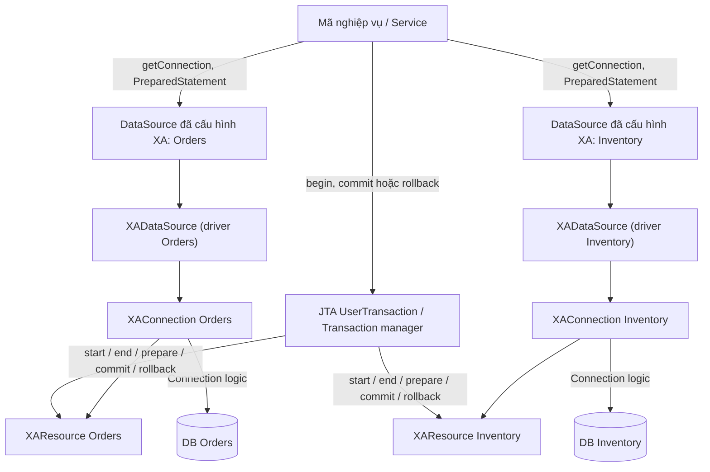

# Vai trò của `XADataSource`, `XAConnection` và bộ điều phối giao dịch trong JDBC

Trong một ứng dụng Java sử dụng JDBC, `Connection.commit()` và `Connection.rollback()` giúp bảo vệ một transaction trên **một kết nối cơ sở dữ liệu**. Nhưng một đơn đặt hàng có thể cần ghi thông tin đặt hàng ở database A và trừ tồn kho ở database B. Nếu A đã commit còn B thất bại, gọi `rollback()` trên B **không thể hoàn tác** commit của A.

Với những hệ thống mà nhiều tài nguyên **có hỗ trợ XA** phải cùng tham gia một giao dịch, JDBC cung cấp `XADataSource`, `XAConnection` và `XAResource` để kết nối các tài nguyên với **bộ điều phối giao dịch** (*transaction manager/coordinator*). Bộ điều phối có thể dùng giao thức *two-phase commit* (2PC) để tìm cách đạt kết quả **cùng commit hoặc cùng rollback** cho các tài nguyên tham gia, kèm cơ chế phục hồi khi tiến trình gặp sự cố.

Bài thuộc chương **Giao dịch nâng cao** trong module JDBC. Nội dung tập trung vào vai trò của từng API, cách chúng phối hợp trong giao dịch phân tán, ví dụ Java dùng Jakarta Transactions (JTA), những giới hạn khi xảy ra sự cố và tiêu chí chọn XA trong dự án.

## 1. Từ transaction cục bộ đến transaction phân tán

Xét tình huống xử lý đặt hàng:

- **Database Orders**: ghi hàng mới vào bảng `order_reservations`.
- **Database Inventory**: giảm số lượng trong bảng `inventory`.

Đây là hai database độc lập, có thể ở hai máy chủ hoặc hai hệ quản trị khác nhau.

Nếu dùng hai connection JDBC thông thường:

```text
Connection A (Orders)           Connection B (Inventory)
         |                                |
   INSERT order                       UPDATE stock
         |                                |
      commit()                          lỗi SQL
         |                                |
   Đơn đã tồn tại                     rollback()
         |                                |
         +------> DỮ LIỆU LỆCH NHAU <----+
```

Một transaction cục bộ không tự động bao trùm hai connection. `setAutoCommit(false)` trên cả A và B **không biến chúng thành một transaction chung**: hai lệnh `commit()` vẫn độc lập, và tiến trình có thể sập giữa hai lần commit.

Trong một **global transaction** (giao dịch toàn cục) có nhiều tài nguyên XA, bộ điều phối quản lý danh sách tài nguyên tham gia và ra quyết định commit/rollback chung. Những tài nguyên được đưa vào giao dịch phải có driver, cấu hình và cơ chế lưu trữ hỗ trợ XA.

| Đặc điểm | Transaction JDBC cục bộ | Transaction phân tán XA |
|---|---|---|
| Điều phối chính | Ứng dụng gọi `Connection.commit/rollback` | Transaction manager điều phối các `XAResource` |
| Phạm vi | Một giao dịch cục bộ của một connection | Nhiều tài nguyên XA được *enlist* vào cùng global transaction |
| Kết thúc | Một lệnh commit hoặc rollback cục bộ | Thường có bước prepare rồi bước quyết định |
| Khi lỗi/sập tiến trình | DB phục hồi theo transaction cục bộ | Cần log giao dịch của coordinator và recovery của từng tài nguyên |
| Chi phí | Thường đơn giản và ít phối hợp hơn | Thêm round trip, lock giữ lâu hơn, quản lý recovery và timeout |

**XA không đồng nghĩa với transaction “đa database” trong mọi trường hợp.** Chỉ các tài nguyên thực sự hỗ trợ giao thức XA và được transaction manager đăng ký đúng cách mới tham gia. Email, HTTP API thanh toán hoặc một file được ghi trực tiếp không trở thành tài nguyên XA chỉ vì ứng dụng chạy trong global transaction.

## 2. Bốn thành phần chính và trách nhiệm riêng

### 2.1. `XADataSource`: nhà máy tạo kết nối có khả năng XA

`javax.sql.XADataSource` là giao diện JDBC của nhà cung cấp driver dùng để tạo `XAConnection`. Nó không phải chính transaction manager, không tự commit đồng bộ nhiều database và cũng không phải kiểu `DataSource` thường mà mã nghiệp vụ buộc phải truy cập trực tiếp.

Các phương thức đặc trưng:

```java
public interface XADataSource extends javax.sql.CommonDataSource {
    XAConnection getXAConnection() throws java.sql.SQLException;
    XAConnection getXAConnection(String user, String password)
            throws java.sql.SQLException;
}
```

*Đây là lược trích các phương thức đặc trưng để giải thích API, không phải bản chép toàn bộ định nghĩa giao diện.*

Trong thực tế, mỗi database có thể cung cấp class triển khai `XADataSource` riêng. Cấu hình thường gồm URL, host, database, quyền truy cập, timeout, driver tương thích và tùy chọn XA. Tên class và thuộc tính phụ thuộc nhà cung cấp, vì vậy không có một class triển khai dùng chung cho mọi DBMS.

### 2.2. `XAConnection`: kết nối cơ sở dữ liệu gắn với tài nguyên XA

`javax.sql.XAConnection` đại diện cho một kết nối vật lý có khả năng tham gia giao dịch XA. Từ nó, hạ tầng lấy hai phần khác chức năng:

- `getConnection()`: lấy **JDBC `Connection` logic** để ứng dụng chạy SQL bằng `PreparedStatement`/`ResultSet`.
- `getXAResource()`: lấy **`XAResource`** để transaction manager điều khiển nhánh giao dịch bằng giao thức XA.

```java
import javax.sql.XAConnection;
import javax.sql.XADataSource;
import javax.transaction.xa.XAResource;
import java.sql.Connection;

// xaDataSource đã được cấu hình theo driver/DBMS cụ thể.
XAConnection xaConnection = xaDataSource.getXAConnection();

XAResource participant = xaConnection.getXAResource();
Connection jdbcConnection = xaConnection.getConnection();
```

Đoạn mã chỉ cho thấy mối quan hệ giữa các API. Nó **chưa bắt đầu một global transaction**, chưa enlist `participant`, chưa quản lý pool và chưa có cơ chế recovery; vì vậy không dùng riêng các dòng này để thay thế một transaction manager.

Thông thường pool hoặc application server sở hữu `XAConnection` vật lý, lo khởi tạo/đóng tài nguyên và cấp cho ứng dụng một `DataSource` đã được gắn với transaction manager. Ứng dụng dùng `Connection` logic rồi đóng handle theo quy ước của pool, không trực tiếp đóng kết nối vật lý do pool đang quản lý.

### 2.3. `XAResource`: đầu mối điều khiển một tài nguyên tham gia XA

`javax.transaction.xa.XAResource` là giao diện do driver trình bày cho bộ điều phối. Những phương thức đáng chú ý:

| API | Ý nghĩa trong giao thức XA |
|---|---|
| `start(Xid, flags)` | Bắt đầu hoặc gắn nhánh giao dịch với tài nguyên |
| `end(Xid, flags)` | Kết thúc sự tham gia hiện tại của một nhánh; chưa phải commit |
| `prepare(Xid)` | Yêu cầu tài nguyên sẵn sàng commit; trả về `XA_OK` hoặc `XA_RDONLY`, hoặc báo lỗi |
| `commit(Xid, false)` | Xác nhận nhánh đã được prepare trong 2PC |
| `commit(Xid, true)` | Commit theo cơ chế một pha khi hợp lệ, do coordinator quyết định |
| `rollback(Xid)` | Yêu cầu hủy một nhánh giao dịch |
| `recover(flags)` | Liệt kê các nhánh đang trong trạng thái cần phục hồi theo giao thức XA |
| `forget(Xid)` | Quên nhánh có kết quả *heuristic* khi giao thức/quy định cho phép |
| `isSameRM(other)` | Hỗ trợ nhận biết hai XAResource có trỏ đến cùng resource manager không |

`XAResource` nằm trong namespace `javax.transaction.xa` của Java. Đây là tên package ngay cả khi sử dụng các API JTA thuộc `jakarta.transaction`.

Tham số `Xid` (*transaction identifier*) xác định nhánh của giao dịch toàn cục, gồm mã định dạng, **global transaction ID** và **branch qualifier**. Transaction manager phải tạo và quản lý các ID này để nhận diện đúng nhánh trên từng resource manager; không nên tự nối chuỗi ID nghiệp vụ rồi xem như có `Xid` hợp lệ.

### 2.4. Transaction manager: nơi quyết định và phục hồi

Bộ điều phối chịu trách nhiệm:

1. **Bắt đầu** global transaction và cấp ngữ cảnh cho luồng xử lý.
2. **Enlist** các tài nguyên XA tham gia; phối hợp trạng thái nhánh với `XAResource`.
3. **Theo dõi kết quả** của từng tài nguyên; xử lý rollback-only, lỗi, timeout và việc tài nguyên ngắt kết nối.
4. **Điều phối 2PC**, quyết định commit/rollback cho toàn cục.
5. **Ghi log quyết định cần thiết để recovery** và khôi phục các nhánh còn ở trạng thái chưa kết thúc sau sự cố.
6. **Hoàn thành/dọn dẹp** trạng thái transaction và connection theo quy tắc của môi trường chạy.

Trong hệ thống Java, transaction manager thường là một phần của Jakarta EE application server hoặc thư viện quản lý giao dịch được tích hợp trong ứng dụng. API **Jakarta Transactions** (trước đây gọi là **JTA**) cung cấp cách khai báo hoặc điều khiển biên transaction ở mức ứng dụng, còn JDBC XA cung cấp giao diện giao tiếp với tài nguyên database.

Cần phân biệt: **`UserTransaction` là API mà ứng dụng gọi để bắt đầu/kết thúc transaction; bản thân nó không thay thế mọi nhiệm vụ nội bộ của transaction manager.**

## 3. Quan hệ giữa các lớp trong một ứng dụng



Sơ đồ trình bày vai trò logic, không diễn tả thứ tự lệnh mạng thực tế của mọi driver/pool. Trong code nghiệp vụ, ta thường thấy `DataSource.getConnection()` và `UserTransaction.begin()/commit()/rollback()`; các lệnh `XAResource.prepare(...)` và `XAResource.recover(...)` được giao cho transaction manager.

Một nguyên tắc thiết kế quan trọng: **không gọi `Connection.commit()` hoặc `rollback()` bằng tay trên một connection đang tham gia global transaction do JTA quản lý**. Biên commit/rollback thuộc về transaction manager; tùy driver/môi trường, lời gọi commit cục bộ có thể bị cấm hoặc phá vỡ mô hình điều phối.

## 4. Hai pha của giao thức 2PC diễn ra như thế nào?

*Two-phase commit* là giao thức kinh điển để điều phối kết quả của nhiều tài nguyên giao dịch.

### Pha 0: tham gia và thực thi SQL

Application bắt đầu global transaction. Khi lấy hai connection từ hai DataSource được cấu hình XA, transaction manager enlist các XAResource tương ứng. Các SQL cập nhật ở Orders và Inventory nằm trong những nhánh của cùng global transaction.

Trong quá trình điều phối, transaction manager dùng `start(xid, ...)` và `end(xid, ...)` với cờ trạng thái phù hợp (`TMNOFLAGS`, `TMSUCCESS`, v.v.). `end` chỉ kết thúc sự tham gia của nhánh trong giai đoạn hiện tại; nó **không đồng nghĩa** nhánh đã được commit.

### Pha 1: prepare — hỏi “đã sẵn sàng commit chưa?”

Coordinator yêu cầu từng nhánh đang cần ghi dữ liệu chuẩn bị commit:

```text
Transaction Manager                    Orders             Inventory
         |                                |                    |
         |---------- prepare(Xid A) ----->|                    |
         |<--------- XA_OK ---------------|                    |
         |---------- prepare(Xid B) ------------------------->  |
         |<------------------------- XA_OK ------------------- |
         |                                |                    |
              Cả hai chấp thuận: có thể ra quyết định COMMIT
```

Khi trả `XA_OK`, một resource manager xác nhận đã chuẩn bị theo hợp đồng XA để có thể hoàn thành quyết định commit hoặc rollback trong giai đoạn sau, kể cả khi cần recovery. Các thay đổi chưa trở thành transaction đã commit cho các ứng dụng khác theo cơ chế cô lập của DB. Nhánh đã prepare có thể giữ khóa/tài nguyên và cần được coordinator giải quyết.

Tài nguyên không có thay đổi cần commit có thể trả `XA_RDONLY`, cho biết không cần bước commit cho nhánh đó. Nếu một tài nguyên từ chối prepare, bị rollback hoặc báo lỗi, coordinator sẽ cố gắng rollback các nhánh liên quan theo giao thức.

### Pha 2: quyết định toàn cục

Nếu mọi nhánh cần ghi đều prepare thành công, coordinator **ghi quyết định cần thiết ra log bền vững trước khi gửi quyết định commit** theo cơ chế recovery của nó, rồi gọi `commit(xid, false)` trên các nhánh đã prepare. Nếu không thể commit, coordinator yêu cầu rollback các nhánh thích hợp.

```text
Cả hai đã prepare
        |
Coordinator ghi nhận quyết định COMMIT để có thể phục hồi
        |
        +-- commit(Xid A, false) --> Orders
        |
        +-- commit(Xid B, false) --> Inventory
        |
        +-- Khi các nhánh hoàn tất: global transaction kết thúc
```

Tùy số tài nguyên và khả năng tối ưu hóa, transaction manager có thể dùng **one-phase commit** (`commit(xid, true)`) khi hợp lệ, chẳng hạn global transaction chỉ còn một tài nguyên tham gia đủ điều kiện. “Dùng XA” không bảo đảm mọi transaction thực tế đều phát sinh đủ hai pha.

### Nếu coordinator sập giữa hai pha?

Giả sử hai database đã trả `XA_OK`, sau đó coordinator sập trước khi nhánh Inventory nhận quyết định. Nhánh đã prepare có thể ở trạng thái **in-doubt**: database giữ thông tin giao dịch để chờ quyết định cuối.

Khi coordinator khởi động lại, nó cần:

- Đọc log giao dịch đã được lưu bền vững.
- Nhận diện những nhánh chưa có kết quả cuối và tra cứu tài nguyên thông qua cơ chế recovery, trong đó có `XAResource.recover(...)`.
- Phát lại quyết định commit/rollback thích hợp; xử lý trường hợp mạng chưa liên lạc được, timeout và lỗi theo cơ chế retry/recovery.

**Không nên tự ý commit hoặc rollback các transaction in-doubt trong database** nếu chưa có phương án đối chiếu với log của coordinator. Một thao tác thủ công thiếu thông tin có thể gây kết quả khác nhau giữa các tài nguyên.

2PC cố gắng bảo đảm tính nguyên tử theo giao thức, nhưng không làm toàn bộ hệ thống “không bao giờ lỗi”. Coordinator có thể bị chặn khi tài nguyên đã prepare không khả dụng; giao thức có thêm chi phí lưu trạng thái và các kết quả *heuristic* cần xử lý.

## 5. Ví dụ Java: đặt hàng và giữ tồn kho bằng JTA

Giả sử ứng dụng chạy trong môi trường **Jakarta EE có transaction manager** và hai nguồn dữ liệu đã được cấu hình thành **XA-aware DataSource**:

- `jdbc/OrdersXa` kết nối database Orders;
- `jdbc/InventoryXa` kết nối database Inventory.

Mỗi DataSource bên dưới sử dụng triển khai `XADataSource` của driver tương ứng và được tích hợp với transaction manager/pool. Tên JNDI và cấu hình provider thay đổi theo application server.

Các bảng minh họa (được tạo trên hai database khác nhau):

**Database Orders**

```sql
CREATE TABLE order_reservations (
    order_id BIGINT PRIMARY KEY,
    sku VARCHAR(80) NOT NULL,
    quantity INTEGER NOT NULL,
    status VARCHAR(30) NOT NULL
);
```

**Database Inventory**

```sql
CREATE TABLE inventory (
    sku VARCHAR(80) PRIMARY KEY,
    available INTEGER NOT NULL
);
```

Ví dụ service dùng `UserTransaction` từ **Jakarta Transactions**. `javax.sql.DataSource` và JDBC API vẫn nằm trong package Java SE, còn `UserTransaction` của Jakarta EE hiện đại nằm trong `jakarta.transaction`:

```java
import jakarta.annotation.Resource;
import jakarta.transaction.UserTransaction;

import javax.sql.DataSource;
import java.sql.Connection;
import java.sql.PreparedStatement;
import java.sql.SQLException;

public class XaReservationService {
    @Resource
    private UserTransaction transaction;

    @Resource(lookup = "java:comp/env/jdbc/OrdersXa")
    private DataSource ordersDataSource;

    @Resource(lookup = "java:comp/env/jdbc/InventoryXa")
    private DataSource inventoryDataSource;

    public void reserve(long orderId, String sku, int quantity)
            throws Exception {

        if (sku == null || sku.isBlank() || quantity <= 0) {
            throw new IllegalArgumentException("Dữ liệu đặt hàng không hợp lệ");
        }

        transaction.begin();
        boolean commitAttempted = false;

        try {
            // Hai DataSource phải có cấu hình XA/JTA đúng tại runtime.
            try (Connection orders = ordersDataSource.getConnection();
                 Connection stock = inventoryDataSource.getConnection()) {

                insertReservation(orders, orderId, sku, quantity);
                int updated = decrementStock(stock, sku, quantity);

                if (updated != 1) {
                    throw new SQLException("SKU không tồn tại hoặc hết hàng");
                }
            }

            // Transaction manager điều phối các XAResource đã enlist.
            commitAttempted = true;
            transaction.commit();

        } catch (Exception | Error failure) {
            if (!commitAttempted) {
                try {
                    transaction.rollback();
                } catch (Exception rollbackFailure) {
                    failure.addSuppressed(rollbackFailure);
                }
            }
            // Nếu commit đã được thử và báo lỗi, kết quả có thể chưa rõ;
            // giao việc đối soát/phục hồi cho transaction manager.
            throw failure;
        }
    }

    private static void insertReservation(
            Connection connection, long orderId, String sku, int quantity)
            throws SQLException {

        String sql = "INSERT INTO order_reservations " +
                "(order_id, sku, quantity, status) VALUES (?, ?, ?, ?)";

        try (PreparedStatement ps = connection.prepareStatement(sql)) {
            ps.setLong(1, orderId);
            ps.setString(2, sku);
            ps.setInt(3, quantity);
            ps.setString(4, "RESERVED");

            if (ps.executeUpdate() != 1) {
                throw new SQLException("Không ghi được đơn hàng");
            }
        }
    }

    private static int decrementStock(
            Connection connection, String sku, int quantity)
            throws SQLException {

        String sql = "UPDATE inventory " +
                "SET available = available - ? " +
                "WHERE sku = ? AND available >= ?";

        try (PreparedStatement ps = connection.prepareStatement(sql)) {
            ps.setInt(1, quantity);
            ps.setString(2, sku);
            ps.setInt(3, quantity);
            return ps.executeUpdate();
        }
    }
}
```

**Điều kiện để ví dụ hoạt động đúng:** hai DataSource phải được quản lý và tự động enlist vào cùng JTA transaction, driver/DB phải hỗ trợ XA, tài khoản và cơ sở dữ liệu phải được cấu hình tương ứng. Việc chỉ khai báo hai `DataSource` bình thường rồi gọi `UserTransaction.begin()` **không đủ** để cam kết điều phối XA.

Trong application server sử dụng **container-managed transaction (CMT)**, phương án phù hợp thường là để container mở/đóng transaction theo annotation như `@Transactional` hoặc cơ chế giao dịch của môi trường thay vì tự gọi `UserTransaction`. Không trộn tùy tiện giao dịch quản lý bởi container với giao dịch quản lý bằng tay. Ví dụ trên minh họa kiểu **bean/application-managed transaction** có quyền sử dụng `UserTransaction`; phạm vi hỗ trợ cụ thể phụ thuộc container.

### Vì sao trong service không có `XAConnection` hay `XAResource`?

Trong mô hình thông thường, pool và transaction manager chịu trách nhiệm lấy `XAConnection`, truy cập `XAResource` và phối hợp các nhánh. Mã nghiệp vụ chỉ cần:

1. Bắt đầu biên global transaction.
2. Lấy JDBC `Connection` từ từng **managed XA DataSource** và thực hiện SQL tham số hóa.
3. Ném lỗi nếu một bước nghiệp vụ thất bại để transaction manager rollback.
4. Gọi commit global khi tất cả điều kiện hoàn tất.

Mã không gọi `orders.commit()`, `stock.rollback()` hoặc `setAutoCommit(false)` trên từng connection vì các transaction của chúng đang do JTA điều phối.

### Xử lý lỗi khi commit

Trường hợp `transaction.commit()` báo lỗi do mất mạng hoặc lỗi hạ tầng có thể dẫn đến **trạng thái chưa xác định ngay từ phía ứng dụng**. Đừng lập tức gửi lại cùng một yêu cầu đặt hàng mà không kiểm tra trạng thái.

Trong ví dụ, biến `commitAttempted` giúp tránh giả định rằng có thể gọi rollback như trước một lần commit thất bại. Transaction manager có thể đã kết thúc hoặc đang phục hồi các nhánh. Hệ thống thực tế cần có mã nghiệp vụ duy nhất như `orderId`, đối soát và chính sách retry/idempotency, cùng theo dõi log và trạng thái của coordinator.

## 6. Khi nào bộ điều phối gọi `XAResource`?

Ứng dụng thường không gọi trực tiếp các method này. Bảng sau giúp hiểu đường đi logic bên dưới một global transaction:

| Giai đoạn | Transaction manager | Tài nguyên/driver |
|---|---|---|
| Begin | Tạo transaction context và global ID | Chưa cần có thay đổi SQL |
| Enlist | Gắn resource vào transaction; có thể gọi `start(xid, TMNOFLAGS)` hoặc cờ khác | Driver liên kết nhánh với thao tác JDBC |
| Thực thi | Theo dõi nhánh và timeout | `PreparedStatement` thực hiện SQL trên DB |
| Delist | Có thể gọi `end(xid, TMSUCCESS)` hoặc cờ thích hợp | Nhánh kết thúc lần làm việc đang tham gia, chưa commit |
| Prepare | Gọi `prepare(xid)` cho nhánh cần chuẩn bị | Trả `XA_OK`, `XA_RDONLY` hoặc lỗi |
| Finish | Gọi `commit(xid, false)` hoặc `rollback(xid)` | DB áp dụng kết quả theo giao thức |
| Recovery | Đọc log, gọi `recover(...)`, hoàn tất nhánh còn treo | DB cung cấp danh sách nhánh đang cần giải quyết |

Không phải mọi đường đi đều có đúng một lời gọi `start` và `end`. Việc dùng `TMJOIN`, `TMRESUME`, `TMSUSPEND`, các tối ưu hóa một pha và giới hạn hỗ trợ sẽ do transaction manager/driver phối hợp. Mã nghiệp vụ không nên tự phỏng đoán hay tự phát sinh một chuỗi cờ mặc định cho mọi tình huống.

Một triển khai 2PC tự viết chỉ bằng vài câu gọi `prepare`/`commit` thường **thiếu log bền vững, recovery, phân biệt resource manager và xử lý lỗi heuristic**. Đó là lý do trong môi trường sản xuất nên dùng transaction manager hoàn chỉnh.

## 7. Những lỗi và trạng thái đặc biệt trong XA

### 7.1. Lỗi trước prepare

Nếu một SQL lỗi, hoặc tồn kho không đủ và service yêu cầu rollback trước giai đoạn prepare, coordinator thường có thể yêu cầu từng tài nguyên chưa commit hoàn tác transaction. Đây là tình huống tương tự rollback thông thường nhưng trải trên nhiều nhánh được quản lý chung.

### 7.2. Lỗi trong prepare

Nếu một tài nguyên không thể prepare, coordinator quyết định abort/rollback các nhánh liên quan theo giao thức. Các tài nguyên đã prepare có thể cần được gửi quyết định rollback để giải phóng chúng.

### 7.3. Mất kết nối sau khi quyết định commit

Coordinator có thể đã ghi log quyết định **commit** nhưng chưa gửi được quyết định đến một tài nguyên. Nhánh có thể ở trạng thái **prepared/in-doubt**. Recovery phải dựa vào quyết định đã ghi và phối hợp giải phóng nhánh đó. Dữ liệu của một số nhánh có thể đã nhìn thấy commit trước khi các nhánh khác hoàn tất, dù quyết định toàn cục nhất quán khi quá trình recovery thành công.

### 7.4. Heuristic outcome

Trong trường hợp ngoại lệ, một resource manager hoặc người vận hành có thể tự quyết định kết thúc nhánh khác với quyết định toàn cục. Hệ thống có thể gặp kết quả **heuristic commit, rollback, mixed hoặc hazard**. API `XAException` có các mã lỗi thuộc các nhóm XA tương ứng; transaction manager và Jakarta Transactions có cơ chế thông báo trạng thái thích hợp.

Với heuristic mixed, không thể hứa rằng “XA luôn khiến cả hai database bằng nhau trong mọi tình huống”. Cần điều tra, đối soát dữ liệu và có thể thực hiện nghiệp vụ bù trừ. `XAResource.forget(xid)` không phải cách sửa dữ liệu; nó phục vụ dọn trạng thái heuristic theo giao thức và quy trình quản trị.

### 7.5. Timeout và deadlock

Global transaction timeout không đồng nghĩa hoàn toàn với JDBC query timeout hoặc timeout TCP. Một lệnh SQL có thể đang chờ khóa, trong khi transaction manager đã quyết định rollback do vượt thời hạn. Cần cấu hình và kiểm thử phù hợp giữa timeout transaction, lock timeout, statement timeout, pool timeout và các kỳ vọng về recovery.

XA không thay thế mức cô lập giao dịch, không giải quyết mọi race condition và không biến thao tác cập nhật tồn kho thành chính xác nếu câu SQL hoặc điều kiện nghiệp vụ sai.

## 8. Điều kiện hạ tầng và vận hành phải kiểm chứng

| Phạm vi | Câu hỏi cần trả lời |
|---|---|
| **Driver** | Driver có triển khai `XADataSource` cho phiên bản đang dùng không? Có giới hạn XA với một số kiểu truy vấn/DDL/batch không? |
| **Database** | Database/storage engine có hỗ trợ prepared/global transaction? Có tham số, quyền, quota hoặc giới hạn giữ transaction chờ quyết định không? |
| **Transaction manager** | Có log phục hồi bền vững, cấu hình nhận diện coordinator và khả năng truy cập lại tài nguyên sau restart không? |
| **Connection pool** | Pool có thực sự dùng XA và enlist đúng transaction không? Có cơ chế reset/quản lý kết nối sau lỗi không? |
| **Định danh tài nguyên** | Các data source có được cấu hình tên tài nguyên ổn định để recovery sau khi deploy/restart không? |
| **Timeout** | Global timeout, JDBC timeout, DB lock timeout và thời gian recovery có được cấu hình tương thích không? |
| **Giám sát** | Có theo dõi nhánh prepared/in-doubt, lỗi recovery, heuristic outcomes và connection đang bị giữ khóa không? |
| **Kiểm thử** | Đã thử crash coordinator/DB, mất mạng và restart trong lúc chuẩn bị/commit chưa? |

Cấu hình mỗi DBMS khác nhau. Ví dụ, PostgreSQL yêu cầu xem xét khả năng **prepared transactions** và các cấu hình liên quan như `max_prepared_transactions` khi dùng giao dịch chuẩn bị theo cơ chế tương ứng; một số hệ thống khác có cơ chế XA và quyền riêng. Không nên giả định một driver JDBC tự động tạo đầy đủ quyền hạ tầng chỉ nhờ sử dụng `XADataSource`.

Trong môi trường có kết nối pool, từng database có thể được khai báo dưới dạng *XA data source* riêng để transaction manager biết cách khởi tạo resource và lưu metadata phục hồi. Thay đổi tên định danh resource sau khi có transaction in-doubt có thể gây khó cho recovery nếu manager không ánh xạ lại được nhánh cũ.

## 9. Chi phí và giới hạn kiến trúc của XA

XA hữu ích khi có yêu cầu nhất quán mạnh giữa một số ít tài nguyên hỗ trợ XA, nhưng nó không phải giải pháp mặc định cho mọi nghiệp vụ liên hệ nhiều hệ thống.

**Chi phí đáng kể:**

- **Thêm round trip và log:** pha prepare và pha quyết định đòi hỏi trao đổi với nhiều tài nguyên.
- **Khóa và tài nguyên bị giữ:** nhánh đã prepare có thể giữ khóa cho đến khi có quyết định, ảnh hưởng throughput và độ trễ.
- **Rủi ro tắc nghẽn khi sự cố:** nếu coordinator hoặc tài nguyên không khả dụng, một số nhánh có thể ở trạng thái cần phục hồi.
- **Khó vận hành:** phải đồng bộ phiên bản driver, quyền DB, cấu hình pool, recovery, giám sát và xử lý lỗi hiếm.
- **Không bảo vệ side effect không hỗ trợ XA:** gửi email, gọi REST API, nhiều loại cache hoặc xử lý file không tự tham gia 2PC.

Vì vậy, cần chọn chiến lược dựa trên yêu cầu và khả năng hệ thống:

| Tình huống | Cách tiếp cận thường phù hợp |
|---|---|
| Nhiều câu SQL trên **một** database/connection | Giao dịch JDBC cục bộ với `setAutoCommit(false)`, `commit`/`rollback` |
| Hai database đều hỗ trợ XA, cần cùng quyết định commit/rollback, có transaction manager và vận hành recovery | Global transaction XA/JTA |
| Một database và một HTTP API/email không có XA | Transactional outbox, xử lý bất đồng bộ hoặc quy trình bù trừ |
| Chuỗi dịch vụ độc lập, phải chấp nhận nhất quán cuối cùng | Saga với các bước bù trừ rõ ràng |
| Chỉ cần chạy nhiều truy vấn nhanh hơn | Batching, index, tối ưu SQL/pool; XA không tự tăng hiệu năng |

Ví dụ, với nghiệp vụ “ghi đơn hàng và gửi email xác nhận”, dùng **transactional outbox** trong cùng DB với đơn hàng thường phù hợp hơn cố đưa SMTP vào transaction XA: transaction cục bộ ghi cả đơn và hàng outbox, sau commit worker phát email; worker phải xử lý gửi lại/idempotency. Ngược lại, nếu hai database quan hệ hỗ trợ XA và tổ chức chấp nhận chi phí điều phối để cùng commit, XA là một lựa chọn có cơ sở.

## 10. Những nhầm lẫn phổ biến

| Nhầm lẫn | Điều đúng cần nhớ |
|---|---|
| Có hai `Connection` và đều gọi `setAutoCommit(false)` là có transaction phân tán | Chúng vẫn là hai transaction độc lập nếu không có coordinator/XA |
| `XADataSource` tự điều phối 2PC | Nó chỉ tạo `XAConnection`; coordinator quản lý các `XAResource` |
| Mã nghiệp vụ phải gọi `getXAResource()` và `prepare()` | Thông thường pool/transaction manager làm việc đó |
| `XAConnection` và `Connection` hoàn toàn là một | `XAConnection` cung cấp tài nguyên XA và tạo JDBC `Connection` logic |
| Gọi `end(xid, TMSUCCESS)` nghĩa là nhánh đã commit | `end` chỉ kết thúc sự tham gia; quyết định commit diễn ra sau |
| Cứ có XA là mọi thao tác trong service được rollback | Chỉ tài nguyên đã enlist đúng và hỗ trợ XA thuộc phạm vi giao dịch |
| Có thể gọi `Connection.commit()` trong JTA transaction để “chốt sớm” | Cần để transaction manager quyết định transaction toàn cục |
| 2PC bảo đảm không bao giờ có nhánh in-doubt | Sự cố có thể để nhánh prepared chờ recovery |
| Lỗi `commit()` nghĩa là database chắc chắn đã rollback | Outcome có thể chưa rõ; phải để manager phục hồi và đối soát |
| XA thay thế hoàn toàn isolation, retry và idempotency | Đây là những vấn đề riêng cần thiết kế/kiểm thử |

## 11. Bài thực hành và kiểm chứng

Có thể thực hành trong một môi trường thử nghiệm có sẵn **hai nguồn dữ liệu XA** và transaction manager, không cần viết bộ điều phối thủ công.

### Bài 1: Xác định vai trò

Trong kiến trúc Orders/Inventory, hãy xác định ai tạo kết nối XA, ai phát câu SQL, ai gọi `prepare`, ai lưu log recovery và ai quyết định rollback khi tồn kho không đủ. Đáp án kỳ vọng: driver triển khai `XADataSource`/`XAConnection`/`XAResource`; ứng dụng phát SQL; transaction manager enlist/điều phối và giữ cơ chế phục hồi.

### Bài 2: Thành công và thất bại trước commit

1. Tạo đủ tồn kho và gọi `reserve`; sau commit, Orders có đơn và Inventory giảm đúng số lượng.
2. Dùng SKU không tồn tại hoặc số lượng lớn hơn tồn kho; truy vấn cả hai DB sau khi transaction kết thúc để xác nhận đơn không được giữ lại và tồn kho không bị giảm.
3. Thử một lỗi `INSERT` do trùng khóa; xác nhận không có cập nhật tồn kho nào của yêu cầu lỗi được commit.

### Bài 3: Phục hồi giao dịch

Trong môi trường test dành riêng cho việc phá vỡ tiến trình, mô phỏng việc một tài nguyên hoặc coordinator bị ngắt trong giai đoạn prepare/commit theo hướng dẫn của transaction manager. Ghi lại log của coordinator, trạng thái transaction in-doubt ở database và kết quả sau khi khôi phục. **Không tùy tiện resolve prepared transaction bằng tay** nếu chưa đối chiếu với log.

### Bài 4: Xác định ranh giới XA

Thêm một lời gọi HTTP gửi email vào service đặt hàng. Trả lời vì sao rollback JTA trên hai database không thể thu hồi email đã gửi, rồi đề xuất thiết kế transactional outbox hoặc bước bù trừ phù hợp.

### Bài 5: Đọc log và đối soát

Khi quan sát lỗi commit do mất kết nối, phân biệt rõ ba loại kết quả:

- **Đã rollback chắc chắn** theo xác nhận của transaction manager.
- **Đã commit chắc chắn** sau khi recovery hoàn tất.
- **Outcome chưa rõ** hoặc có heuristic mismatch, cần kiểm tra log, trạng thái tài nguyên và dấu vết nghiệp vụ.

Không tự động retry một nghiệp vụ đặt hàng có side effect cho đến khi biết xử lý trùng đã được thiết kế.

## Ghi nhớ

- **`XADataSource`:** cơ chế JDBC để driver tạo kết nối có khả năng tham gia giao dịch XA.
- **`XAConnection`:** cung cấp JDBC `Connection` logic và `XAResource` của tài nguyên.
- **`XAResource`:** giao diện giao thức để transaction manager quản lý nhánh giao dịch bằng `Xid`, prepare, commit, rollback và recover.
- **Transaction manager/JTA:** tạo biên giao dịch toàn cục, enlist tài nguyên, điều phối 2PC và phục hồi khi sự cố.
- **2PC:** pha prepare kiểm tra khả năng hoàn tất; pha quyết định commit/rollback cần kết hợp log bền vững và recovery; vẫn có timeout, in-doubt và heuristic outcomes.
- **Lựa chọn kiến trúc:** dùng giao dịch JDBC cục bộ cho một tài nguyên; chỉ chọn XA khi yêu cầu tính nhất quán, khả năng hỗ trợ driver/DB và năng lực vận hành phù hợp.

Hiểu rõ trách nhiệm của ba API và bộ điều phối giúp lập trình viên JDBC tránh tự commit sai phạm vi, xác định đúng nơi xử lý sự cố và thiết kế giao dịch nhiều database với những cam kết thực tế mà hệ thống có thể bảo đảm.
