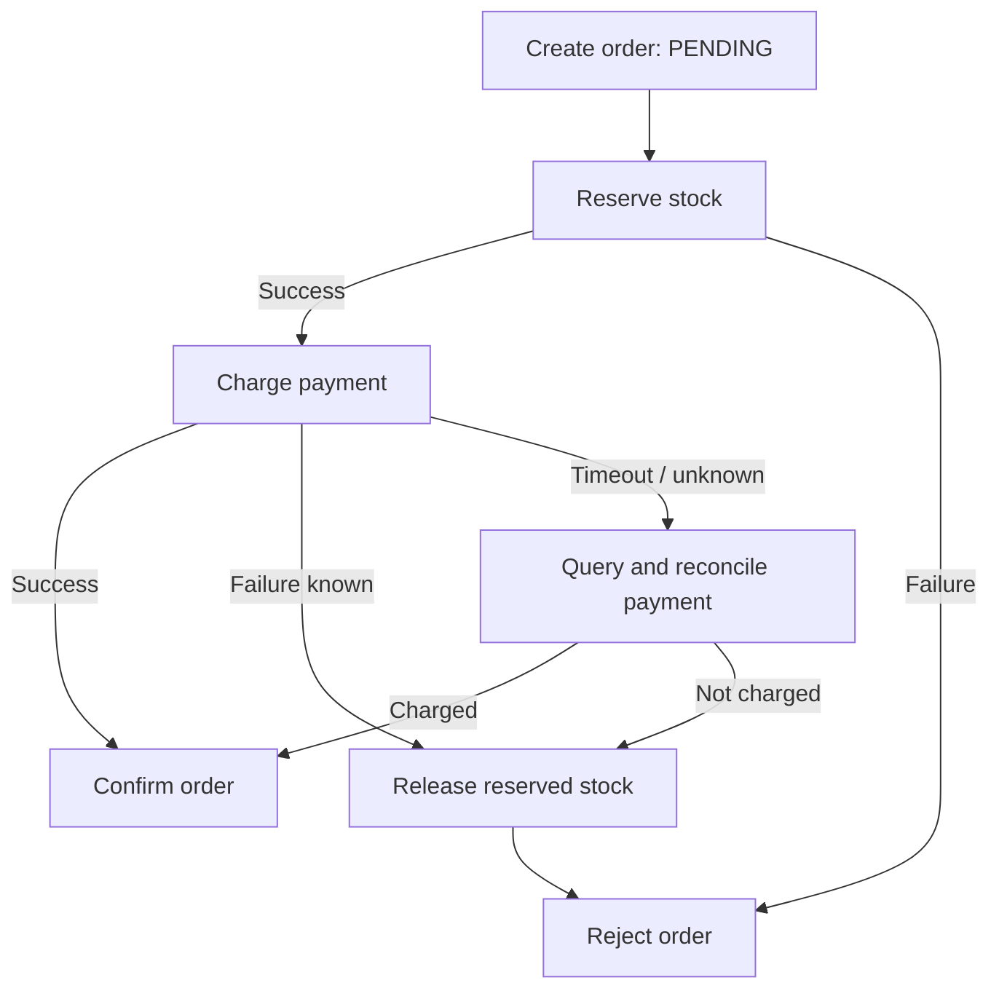

# Xử lý tác động ngoài cơ sở dữ liệu bằng thiết kế nhất quán phù hợp

Trong một ứng dụng Java dùng **JDBC**, `Connection.commit()` có thể xác nhận nhiều câu SQL trong **một giao dịch cơ sở dữ liệu quan hệ**. Nhưng thao tác gửi email, gọi cổng thanh toán, đẩy thông điệp vào broker, ghi tệp lên object storage hoặc gọi REST API của đối tác thường nằm **ngoài** phạm vi rollback của kết nối JDBC. Nếu ứng dụng ghi đơn hàng thành công nhưng không gửi được thông báo, hoặc đã thu tiền rồi lại rollback đơn hàng, dữ liệu giữa các hệ thống trở nên không nhất quán.

Bài học thuộc chương **Giao dịch nâng cao** của module **JDBC**. Mục tiêu là chọn cách phối hợp phù hợp giữa SQL transaction, `DataSource`, `PreparedStatement`, `ResultSet`, xử lý lỗi và các tác động bên ngoài: nhận diện ranh giới atomicity; dùng **transactional outbox**, idempotency, xử lý thông điệp trùng, trạng thái trung gian, đối soát và **saga** khi cần; đồng thời biết giới hạn của mỗi lựa chọn. Không có một lệnh `rollback()` chung cho mọi dịch vụ bên ngoài.

## 1. Ranh giới thật sự của một transaction JDBC

Giả sử yêu cầu “tạo đơn hàng và gửi email xác nhận” gồm hai hành động:

1. `INSERT INTO orders ...` trên kết nối JDBC.
2. Gọi dịch vụ email qua HTTP.

Lệnh `commit()`/ `rollback()` của `Connection` chỉ quản lý thay đổi trong tài nguyên giao dịch mà kết nối đó tham gia. Nó không thể tự thu hồi email đã gửi, hủy một khoản thanh toán mà đối tác đã nhận, hay xóa một file ở dịch vụ lưu trữ bên ngoài.

Hai cách viết trực tiếp đều có cửa sổ lỗi:

```text
Phương án A: DB trước, bên ngoài sau
BEGIN -> INSERT đơn hàng -> COMMIT -> gửi email
                               |
                               +-- ứng dụng dừng ở đây: có đơn, không có email

Phương án B: bên ngoài trước, DB sau
gửi email -> BEGIN -> INSERT đơn hàng -> COMMIT
           |
           +-- INSERT/COMMIT thất bại: đã gửi email, chưa chắc có đơn
```

Giữ giao dịch DB mở trong lúc gọi HTTP cũng không giải quyết vấn đề: lệnh `rollback()` vẫn không thể hoàn tác email đã gửi hoặc giao dịch ở hệ thống khác. Cách này còn giữ lock và connection lâu, tăng timeout và nguy cơ deadlock.

### Bảng phạm vi atomicity

| Tác động | JDBC transaction thông thường có thể rollback cùng SQL? | Ghi chú |
| --- | --- | --- |
| Hai câu `UPDATE` trên cùng `Connection`/DB | Có, khi dùng chung transaction | Phải tắt `autoCommit` và `commit`/`rollback` đúng |
| Ghi bảng nghiệp vụ và bảng outbox trên cùng DB | Có | Nền tảng của transactional outbox |
| Hai connection độc lập vào hai DB khác nhau | Không mặc định | Cần cơ chế điều phối phân tán nếu yêu cầu atomicity xuyên tài nguyên |
| Gọi API thanh toán | Không | Cần trạng thái nghiệp vụ, idempotency, xác minh kết quả |
| Gửi email/SMS/webhook | Không | Thường xử lý bất đồng bộ và chống gửi lặp nếu cần |
| Gửi thông điệp trực tiếp vào broker | Không mặc định | Publish và DB commit là hai bước độc lập |
| Upload hoặc xóa object trên storage | Không | Cần staging/cleanup và cơ chế đối soát |

Điểm cần ghi trong thiết kế: **“Những thay đổi nào bắt buộc cùng commit hoặc cùng rollback?”** và **“Nếu một tác động bên ngoài đã xảy ra mà ứng dụng mất phản hồi thì làm sao nhận biết và xử lý lại?”**

## 2. Định nghĩa mức nhất quán trước khi viết code

Không phải mọi tính năng đều cần cùng một mức nhất quán. Chọn theo hậu quả nếu thông tin đến trễ hoặc bị lặp.

| Nhu cầu | Hợp đồng có thể chấp nhận | Hướng giải |
| --- | --- | --- |
| Tạo đơn và lưu yêu cầu gửi sự kiện | Phải cùng thành công về mặt DB | Ghi `orders` và `outbox_events` trong một JDBC transaction |
| Cập nhật trang báo cáo/search index | Có thể chậm vài giây nhưng cần hội tụ | Eventual consistency, retry và đối soát |
| Gửi email xác nhận | Có thể gửi sau; tránh gửi trùng nếu người dùng nhạy cảm với trùng lặp | Outbox + consumer có chống trùng hoặc dịch vụ email hỗ trợ khóa idempotency |
| Thu tiền | Không chấp nhận tự ý thu hai lần hoặc mất dấu khoản đã thu | Stable idempotency key, trạng thái trung gian, tra cứu/đối soát |
| Đặt vé qua nhiều nhà cung cấp | Mỗi hệ thống xác nhận ở thời điểm khác nhau | Saga và hành động bù có điều kiện |
| Ghi tệp đính kèm rồi đăng bài | Có thể còn file tạm nếu DB lỗi, nhưng bài đã hiển thị phải có file hợp lệ | Upload tạm, xác nhận/đánh dấu sau, cleanup và retry |

Các khái niệm cần phân biệt:

- **Atomicity cục bộ**: mọi thay đổi thuộc **một** transaction DB được commit hoặc rollback cùng nhau.
- **Eventual consistency**: các hệ thống có thể lệch tạm thời nhưng được thiết kế để hội tụ khi các bước xử lý và khắc phục thành công.
- **Idempotency**: lặp lại cùng yêu cầu với cùng khóa không tạo thêm kết quả nghiệp vụ ngoài dự kiến.
- **At-least-once delivery**: thông điệp có thể được phát ít nhất một lần khi hạ tầng khôi phục và tiếp tục retry; vì vậy **có thể bị gửi trùng**.
- **Compensation**: hành động nghiệp vụ mới để bù hậu quả hành động đã hoàn thành, ví dụ hoàn tiền. Nó không tương đương một lần rollback vật lý.

Một hệ thống chỉ có thể đưa ra cam kết đúng bằng khả năng thực tế của DB, broker, API đối tác và cách lưu tiến trình xử lý.

## 3. Vì sao cách “ghi DB rồi publish ngay” vẫn thiếu an toàn

Xét hai dòng sau:

```java
orderRepository.insert(order); // JDBC transaction đã commit.
eventPublisher.publish("ORDER_CREATED", order.id());
```

Nếu Java process chết sau dòng đầu, sự kiện có thể mất vĩnh viễn. Đảo thứ tự cũng không giúp: broker có thể nhận sự kiện trong khi transaction tạo đơn hàng thất bại.

Ngay cả khi đặt `publish()` trong khối `try` và gọi `rollback()` nếu nó lỗi, vẫn có khả năng broker **đã nhận** sự kiện nhưng Java chỉ bị timeout khi chờ xác nhận. Không thể suy luận chính xác tác động bên ngoài chỉ từ việc HTTP/broker client trả lỗi.

Vì vậy, với yêu cầu **“nếu đơn hàng tồn tại thì ý định công bố sự kiện phải được lưu bền vững”**, hãy ghi ý định công bố vào **cùng DB** với đơn hàng. Đây là ý tưởng của **transactional outbox**.

## 4. Transactional outbox: commit dữ liệu và ý định phát sự kiện cùng nhau

Outbox là một bảng trong cùng cơ sở dữ liệu giao dịch với bảng nghiệp vụ. Mỗi lần thao tác thành công, ứng dụng lưu cả bản ghi nghiệp vụ và một bản ghi sự kiện chưa phát trong **cùng transaction JDBC**.

```mermaid
sequenceDiagram
    participant API as Java API
    participant DB as Database
    participant Relay as Outbox relay
    participant MQ as Broker
    participant Worker as Consumer
    API->>DB: BEGIN; INSERT orders; INSERT outbox
    API->>DB: COMMIT
    DB-->>API: COMMIT thành công
    Relay->>DB: Đọc outbox chưa publish
    Relay->>MQ: Gửi eventId + payload
    MQ-->>Relay: Ack đã nhận bền vững
    Relay->>DB: Đánh dấu đã publish
    MQ->>Worker: Giao sự kiện (có thể lặp)
    Worker->>Worker: Deduplicate và xử lý idempotent
```

**Ý nghĩa của bảo đảm**:

- Khi transaction DB rollback, cả đơn hàng **lẫn bản ghi outbox** đều biến mất.
- Khi transaction DB commit, bản ghi outbox tồn tại bền vững để relay gửi sau, ngay cả nếu tiến trình API dừng.
- Nếu relay chết sau khi broker đã nhận nhưng trước khi đánh dấu `published_at`, sự kiện sẽ **được gửi lại**. Outbox giải quyết nguy cơ mất sự kiện do “commit rồi crash”, nhưng **không tự bảo đảm exactly-once ở hệ thống nhận**.

### Schema ví dụ trên PostgreSQL

```sql
CREATE TABLE orders (
    order_id UUID PRIMARY KEY,
    customer_id BIGINT NOT NULL,
    total_amount NUMERIC(18, 2) NOT NULL CHECK (total_amount > 0),
    status VARCHAR(32) NOT NULL
);

CREATE TABLE outbox_events (
    event_id UUID PRIMARY KEY,
    aggregate_id UUID NOT NULL REFERENCES orders(order_id),
    event_type VARCHAR(64) NOT NULL,
    payload_json TEXT NOT NULL,
    created_at TIMESTAMPTZ NOT NULL DEFAULT CURRENT_TIMESTAMP,
    published_at TIMESTAMPTZ NULL
);

CREATE INDEX idx_outbox_pending
    ON outbox_events (created_at, event_id)
    WHERE published_at IS NULL;
```

`orders` và `outbox_events` nằm trong **cùng database** để giao dịch JDBC bao phủ cả hai. Khóa `event_id` là định danh sự kiện dùng xuyên suốt việc gửi và xử lý lại. `aggregate_id` chỉ đối tượng nghiệp vụ; `event_type` và `payload_json` mô tả nội dung thông điệp. Khi bổ sung version cho sự kiện, nên đưa version vào hợp đồng payload/schema để consumer có thể nâng cấp.

`TIMESTAMPTZ`, `UUID` và partial index trong mẫu là đặc điểm của PostgreSQL; DB khác có kiểu/cú pháp và cách thiết kế index tương đương nhưng không nhất thiết giống hệt.

### Một JDBC transaction ghi cả hai bản ghi

Ví dụ Java dùng `DataSource` và `PreparedStatement`. `orderId` và `eventId` được tạo, giữ ổn định ở ranh giới request; `payloadJson` được sinh bằng serializer JSON ở lớp gọi và có cùng ý nghĩa với dữ liệu đơn hàng.

```java
import java.math.BigDecimal;
import java.sql.Connection;
import java.sql.PreparedStatement;
import java.sql.SQLException;
import java.util.Objects;
import java.util.UUID;
import javax.sql.DataSource;

public final class OrderWriter {
    private OrderWriter() {}

    public static void createPendingOrder(
            DataSource dataSource,
            UUID orderId,
            UUID eventId,
            long customerId,
            BigDecimal amount,
            String payloadJson) throws SQLException {

        Objects.requireNonNull(dataSource, "dataSource");
        Objects.requireNonNull(orderId, "orderId");
        Objects.requireNonNull(eventId, "eventId");
        Objects.requireNonNull(amount, "amount");
        Objects.requireNonNull(payloadJson, "payloadJson");
        if (amount.signum() <= 0) {
            throw new IllegalArgumentException("total_amount phải dương");
        }

        String insertOrder = """
            INSERT INTO orders(order_id, customer_id, total_amount, status)
            VALUES (?, ?, ?, 'PENDING')
            """;
        String insertOutbox = """
            INSERT INTO outbox_events
                (event_id, aggregate_id, event_type, payload_json)
            VALUES (?, ?, 'ORDER_CREATED', ?)
            """;

        try (Connection con = dataSource.getConnection()) {
            boolean oldAutoCommit = con.getAutoCommit();
            boolean transactionStarted = false;
            boolean transactionEnded = false;
            Throwable primaryFailure = null;

            try {
                con.setAutoCommit(false);
                transactionStarted = true;

                try (PreparedStatement ps = con.prepareStatement(insertOrder)) {
                    ps.setObject(1, orderId); // PostgreSQL JDBC hỗ trợ UUID.
                    ps.setLong(2, customerId);
                    ps.setBigDecimal(3, amount);
                    ps.executeUpdate();
                }

                try (PreparedStatement ps = con.prepareStatement(insertOutbox)) {
                    ps.setObject(1, eventId);
                    ps.setObject(2, orderId);
                    ps.setString(3, payloadJson);
                    ps.executeUpdate();
                }

                con.commit();
                transactionEnded = true;
            } catch (SQLException | RuntimeException | Error failure) {
                primaryFailure = failure;
                if (transactionStarted) {
                    try {
                        con.rollback();
                        transactionEnded = true;
                    } catch (SQLException | RuntimeException | Error rollbackFailure) {
                        if (rollbackFailure != failure) {
                            failure.addSuppressed(rollbackFailure);
                        }
                    }
                }
                throw failure;
            } finally {
                if (transactionStarted && transactionEnded) {
                    try {
                        con.setAutoCommit(oldAutoCommit);
                    } catch (SQLException | RuntimeException | Error resetFailure) {
                        if (primaryFailure != null) {
                            if (resetFailure != primaryFailure) {
                                primaryFailure.addSuppressed(resetFailure);
                            }
                        } else {
                            throw resetFailure;
                        }
                    }
                }
            }
        }
    }
}
```

Các điểm cần hiểu:

- Hai `INSERT` và `commit()` chạy trên **một `Connection`**. Nếu lệnh ghi outbox lỗi trước commit, transaction được rollback nên không có đơn hàng mồ côi không có sự kiện.
- `PreparedStatement` tham số hóa giá trị; `payloadJson` được truyền qua `setString()`, không nối trực tiếp vào SQL. Tầng tạo payload cần bảo đảm serializer và cấu trúc sự kiện đúng hợp đồng.
- Đóng tài nguyên bằng `try-with-resources` và gắn lỗi rollback/khôi phục dưới dạng `suppressed` giúp giữ ngoại lệ ban đầu. Chỉ khôi phục `autoCommit` khi commit/rollback đã trả về thành công; rollback thất bại đòi hỏi connection pool xử lý connection không còn đáng tin cậy.
- Nếu `commit()` ném lỗi do mất kết nối, **không thể khẳng định transaction chưa được commit**. Phải tra cứu DB theo `orderId` hoặc khóa request ổn định trước khi thử ghi lại. Ràng buộc khóa chính hỗ trợ phát hiện trùng, nhưng khi trùng vẫn phải xác minh nội dung request có thực sự khớp.
- Ví dụ chưa xử lý cập nhật từ `PENDING` sang trạng thái tiếp theo, xác thực nội dung JSON hay cơ chế chống trùng hoàn chỉnh tại API. Những phần đó cần được bổ sung theo nghiệp vụ.

Lưu ý: `Connection` lấy từ pool phải có vòng đời thích hợp; nếu rollback thất bại thì không mặc định `close()` sẽ khiến **mọi** pool loại bỏ connection hỏng. Hệ thống production cần kiểm tra chính sách pool/driver. Chỉ các nguồn dữ liệu hỗ trợ transaction DB quan hệ và cùng tham gia transaction đó mới nhận được bảo đảm atomicity nói trên.

## 5. Relay: gửi sau commit và chấp nhận khả năng gửi lặp

Một tiến trình nền đọc các sự kiện outbox chưa có `published_at`, gửi tới broker, chờ xác nhận từ broker rồi cập nhật DB:

```sql
-- Ví dụ đọc các sự kiện đang chờ:
SELECT event_id, aggregate_id, event_type, payload_json
FROM outbox_events
WHERE published_at IS NULL
ORDER BY created_at, event_id
LIMIT 100;

-- Chỉ đánh dấu sau khi broker xác nhận đã nhận bền vững:
UPDATE outbox_events
SET published_at = CURRENT_TIMESTAMP
WHERE event_id = ? AND published_at IS NULL;
```

Relay cần truyền **cùng một `event_id` khi retry**, và gửi payload theo schema/version đã chốt. “Publisher gọi xong hàm send” không đồng nghĩa với broker đã nhận bền vững: tùy client cần chờ publisher confirm/ack phù hợp.

Thứ tự quan trọng:

1. Đọc bản ghi sự kiện chưa publish.
2. Gửi thông điệp và chờ xác nhận thành công theo hợp đồng broker.
3. Mở thao tác JDBC cập nhật `published_at`.

Nếu đánh dấu trước khi gửi, relay có thể crash và khiến sự kiện **không bao giờ** được gửi. Nếu gửi trước khi đánh dấu, relay có thể crash giữa hai bước và dẫn đến **gửi lặp**: đó là đánh đổi đúng của chiến lược at-least-once.

Với nhiều relay chạy đồng thời, truy vấn đơn giản ở trên **không tự chia việc**: hai worker có thể đọc cùng một hàng. Cần cơ chế claim công việc bằng transaction ngắn, khóa hàng hoặc lease với thời hạn, ví dụ khả năng `FOR UPDATE SKIP LOCKED` trên PostgreSQL; quy tắc retry và khôi phục lease khi worker chết. Không giữ row lock DB trong thời gian chờ HTTP/broker; một cách làm thực tế là claim nhanh, commit trạng thái lease, gửi bên ngoài transaction, rồi đánh dấu thành công.

Lease hết hạn hoặc worker bị ngắt vẫn có thể khiến hai lần gửi trùng. Do đó **claim job không thay thế dedup ở consumer**. Nếu nghiệp vụ yêu cầu các sự kiện của cùng một đơn được nhận đúng thứ tự, thiết kế thêm sequence theo aggregate, cách partition/key thông điệp và cơ chế relay đảm bảo thứ tự tương ứng; `ORDER BY created_at` một mình không bảo đảm thứ tự cuối cùng khi có nhiều worker và retry.

Nếu có lỗi dài hạn, relay nên lưu số lần thử, thời điểm thử tiếp, lỗi cuối và trạng thái cần can thiệp; dùng backoff, cảnh báo và khả năng replay có kiểm soát. Bảng outbox có thể được lưu trữ/xóa theo chính sách retention **sau** khi đã xác nhận publish và đã qua thời gian phục vụ đối soát.

## 6. Consumer cũng phải an toàn khi nhận sự kiện trùng

Giả sử consumer đã cập nhật bảng báo cáo và commit, nhưng crash trước khi ack thông điệp với broker. Broker có thể phát lại cùng sự kiện. Nếu consumer cứ tăng số lượng đơn mỗi lần nhận, báo cáo sẽ bị nhân đôi.

Với consumer cập nhật **một DB riêng**, có thể dùng **inbox/dedup table** trong cùng transaction với nghiệp vụ:

```sql
-- PostgreSQL, trên DB của consumer:
CREATE TABLE processed_events (
    consumer_name VARCHAR(100) NOT NULL,
    event_id UUID NOT NULL,
    processed_at TIMESTAMPTZ NOT NULL DEFAULT CURRENT_TIMESTAMP,
    PRIMARY KEY (consumer_name, event_id)
);

-- Mã xử lý consumer sẽ thực hiện trong MỘT JDBC transaction:
INSERT INTO processed_events (consumer_name, event_id)
VALUES (?, ?)
ON CONFLICT DO NOTHING;

-- Chỉ khi executeUpdate() == 1 thì thực hiện các SQL nghiệp vụ tương ứng.
-- Nếu executeUpdate() == 0, sự kiện đã được xử lý: bỏ qua phần cập nhật.
-- COMMIT toàn bộ, sau đó ACK broker.
```

Trình tự trong worker:

1. Nhận `event_id` và payload; xác thực loại event, version và dữ liệu bắt buộc.
2. Trong **một JDBC transaction**, chèn cặp `(consumer_name, event_id)` vào `processed_events`.
3. Nếu insert thành công, thực thi cập nhật nghiệp vụ **cùng transaction**; nếu đã có khóa thì không thực thi lại.
4. `commit()` thành công mới ack broker; nếu lỗi thì rollback và để broker giao lại theo chính sách retry.

Việc ghi dấu đã xử lý **trước** cập nhật nghiệp vụ nhưng **trong cùng transaction** là an toàn: nếu cập nhật nghiệp vụ thất bại, cả dấu dedup cũng rollback. Nếu lưu dấu và nghiệp vụ trong hai transaction khác nhau, consumer có thể đánh dấu “đã xử lý” nhưng thực ra chưa cập nhật dữ liệu.

Consumer phải xác định `consumer_name` ổn định cho từng xử lý logic; dùng `event_id` duy nhất toàn hệ thống giúp chống trùng. Nếu event cùng ID nhưng payload khác, đó là lỗi hợp đồng cần phát hiện, không được im lặng coi là bình thường.

**Giới hạn rất quan trọng:** inbox chỉ đưa ra bảo đảm atomicity cho **những thay đổi SQL trong cùng DB của consumer**. Nếu consumer gọi API gửi SMS hoặc thanh toán bên ngoài, inbox không thể rollback API đó. Khi đó vẫn cần idempotency key của dịch vụ đích, lưu tiến trình, retry/đối soát hoặc một outbox tiếp theo.

## 7. API bên ngoài: idempotency key và trạng thái chưa biết

Ví dụ thanh toán:

```text
Ứng dụng gửi charge(orderId, amount, key=paymentRequestId)
     |
     +-- Cổng thanh toán thu tiền thành công
     |
     +-- Mạng đứt trước khi trả phản hồi
Ứng dụng thấy timeout, không biết tiền đã thu hay chưa
```

Nếu gọi lại với một yêu cầu **mới**, khách có nguy cơ bị thu lần thứ hai. Thiết kế tốt hơn thường gồm:

- Tạo một `paymentRequestId`/idempotency key ổn định **trước lần gọi đầu tiên**, lưu bền vững cùng đơn hàng và truyền cùng khóa trong mọi lần thử lại.
- Dùng cơ chế idempotency do cổng thanh toán **thực sự hỗ trợ**; kiểm tra phạm vi, thời hạn giữ khóa, điều kiện so sánh request và hành vi trả lại kết quả. Không tự cho rằng mọi API đều có khả năng này.
- Lưu trạng thái có ý nghĩa như `PENDING_PAYMENT`, `PAYMENT_UNKNOWN`, `PAID`, `PAYMENT_FAILED`; các chuyển trạng thái phải có điều kiện, có audit và chống xử lý trùng.
- Khi timeout hoặc lỗi ở đường phản hồi, tra cứu trạng thái theo khóa ở nhà cung cấp nếu API cho phép; đối chiếu webhook/sự kiện và sổ giao dịch trước khi quyết định retry, hủy hoặc hoàn tiền.
- Xác thực chữ ký webhook, cho phép webhook đến trễ, sai thứ tự hoặc trùng; dùng event ID hay payment ID để chống lặp trong DB.

Không có idempotency/query status hoặc cơ chế đối soát đáng tin cậy từ bên ngoài, ứng dụng **không thể tự hứa exactly-once cho thao tác đó**. Khi trường hợp không xác định ảnh hưởng đến tiền, đơn hàng, quyền lợi người dùng, phải có đường xử lý ngoại lệ hoặc can thiệp nghiệp vụ.

Một quy tắc quan trọng: **idempotency key phải đại diện cho cùng một ý định nghiệp vụ**, không tạo UUID mới ở mỗi lần retry. Đồng thời cần chống trường hợp cùng khóa nhưng amount/currency/customer khác: kiểm tra hợp đồng tham số và từ chối yêu cầu không tương thích.

## 8. Saga khi quy trình trải qua nhiều dịch vụ

Outbox giúp thông báo đáng tin cậy về những thay đổi của một DB. Nhưng bài toán “đặt vé, thanh toán, giữ kho, gửi xác nhận” là một **chuỗi quyết định nghiệp vụ**, nơi mỗi dịch vụ có transaction riêng. **Saga** mô hình hóa chuỗi bước cục bộ và các bước bù khi một phần thất bại.

Ví dụ quy trình đặt hàng:



Các nguyên tắc:

1. Mỗi bước ghi trạng thái **trong DB của chính dịch vụ đó** bằng transaction cục bộ.
2. Mỗi yêu cầu sang dịch vụ khác mang một mã idempotency và có thể retry an toàn theo hợp đồng cụ thể.
3. Kết quả thành công/thất bại được lưu bền vững và kích hoạt bước tiếp theo, thường qua outbox/events hoặc một orchestrator có trạng thái.
4. Khi một bước đã hoàn tất nhưng quy trình tổng thể thất bại, thực thi **compensation** như hoàn tiền hoặc trả tồn kho; bước bù cũng có thể thất bại và cần retry/đối soát.
5. Mỗi bước phải xử lý kết quả **không xác định**, sự kiện đến sai thứ tự và chuyển trạng thái trùng.

Saga có hai cách phối hợp phổ biến:

| Phương án | Cách vận hành | Thích hợp |
| --- | --- | --- |
| **Orchestration** | Một bộ điều phối lưu trạng thái và yêu cầu từng dịch vụ thực hiện/bù | Quy trình nhiều bước có rẽ nhánh và timeout phức tạp |
| **Choreography** | Dịch vụ phản ứng với sự kiện của nhau, không có bộ điều phối tập trung | Luồng đơn giản, ranh giới dịch vụ rõ và ít phụ thuộc chéo |

Phần bù không phải phép đảo ngược hoàn hảo của DB rollback. Ví dụ, hoàn tiền có thể chịu phí, chậm về tài khoản hoặc mất thêm thời gian; email đã gửi không thể bị “thu hồi”. Vì vậy cần quyết định trước những trạng thái nghiệp vụ trung gian có thể lộ ra, hướng phục hồi và mức chấp nhận chậm.

## 9. Tệp và object storage: tình huống không có rollback

Giả sử người dùng tải ảnh lên và ứng dụng lưu URL vào DB:

- **Upload trước, commit DB sau:** commit có thể thất bại, để lại file mồ côi.
- **Commit DB trước, upload sau:** người dùng có thể nhìn thấy bản ghi trỏ tới file chưa tồn tại.

Một thiết kế phù hợp thường dùng trạng thái:

1. Upload file vào vùng **tạm/staging**, tạo `upload_id` ổn định và ghi thời gian hết hạn.
2. Trong transaction JDBC, tạo bản ghi nghiệp vụ ở trạng thái `PENDING_FILE` và lưu tham chiếu tới `upload_id`; có thể ghi thêm công việc hoàn thiện vào outbox.
3. Worker sau commit xác nhận/promote file đến vị trí cuối cùng bằng thao tác có thể thử lại; khi thành công, cập nhật DB sang `READY`.
4. Chỉ hiển thị bản ghi hoàn chỉnh khi trạng thái `READY`; dọn file staging quá hạn và đối soát đối tượng thiếu hoặc không được tham chiếu.

Không kỳ vọng `DELETE` một object từ xa trong `catch` là đủ: thao tác xóa có thể fail, request có thể thành công nhưng mất phản hồi và có thể bị trùng. Cần công việc cleanup có trạng thái và chạy lại được.

Nếu dịch vụ lưu trữ hỗ trợ tạo đối tượng theo khóa cố định và thao tác ghi có điều kiện, dùng chúng để giúp retry an toàn. Nếu dữ liệu nhạy cảm, quy trình cleanup và quyền truy cập tạm thời cũng cần theo yêu cầu bảo mật của hệ thống.

## 10. Khi nào xem xét giao dịch phân tán (XA/2PC)?

Một số hệ thống dùng JTA/XA với các tài nguyên có hỗ trợ để điều phối **two-phase commit (2PC)**. Về nguyên tắc, bộ điều phối yêu cầu các bên chuẩn bị rồi mới quyết định commit/rollback. Tuy nhiên:

- `DataSource` và `Connection` JDBC thông thường **không tự biến** mọi hệ thống thành một XA transaction. Cần XA-capable resource, transaction manager và cấu hình cụ thể.
- Các bên có thể giữ lock lâu trong giai đoạn chuẩn bị; khi lỗi mạng hoặc điều phối viên gặp sự cố, việc khôi phục phức tạp và có thể trì hoãn giải phóng tài nguyên.
- Email, SMS, HTTP API thông thường, nhiều loại object storage và nhiều dịch vụ bên ngoài **không hỗ trợ** giao thức XA/2PC.
- Ngay cả khi hệ thống hỗ trợ, phải đánh giá chi phí vận hành, failure mode, latency và khả năng recovery theo tài liệu của nhà cung cấp.

Không nên chọn 2PC chỉ vì nghiệp vụ “muốn tất cả hoặc không gì cả”. Khi tác động bên ngoài không có giao thức commit phân tán chung, dùng trạng thái tiến trình, idempotency, outbox và compensation thường là lựa chọn khả thi hơn.

## 11. Bảng quyết định thiết kế

| Điều cần giải quyết | Giải pháp nền tảng | Điều vẫn phải xử lý |
| --- | --- | --- |
| Cập nhật nhiều bảng trong một DB | JDBC transaction, `setAutoCommit(false)`, `commit/rollback` | SQL exception, isolation, deadlock, kết nối |
| Ghi nghiệp vụ và đảm bảo event không mất sau commit | Transactional outbox | Relay, retry, duplicate delivery, retention |
| Xử lý cùng event nhiều lần trên DB consumer | Inbox/dedup cùng transaction nghiệp vụ | Schema/version, thứ tự, xử lý đồng thời |
| Gọi API thanh toán có thể timeout | Idempotency key + trạng thái + query/reconciliation | Provider có thực sự hỗ trợ, hết hạn khóa, trạng thái mơ hồ |
| Nhiều bước giữa các dịch vụ | Saga/orchestration hoặc choreography | Compensation, bước bù thất bại, idempotency |
| DB kết hợp file/object storage | Staging + trạng thái `READY` + cleanup | Orphan object, file thiếu, retry và quyền truy cập |
| Nhiều tài nguyên có XA thực sự | JTA/XA/2PC sau khi cân nhắc kỹ | Coordinator recovery, lock, hiệu năng, độ phức tạp |
| Thông báo không quan trọng, có thể bỏ qua | Best-effort có tài liệu hóa | Không tuyên bố bảo đảm phát đủ; theo dõi mức mất chấp nhận được |

Không một mẫu nào là mặc định đúng cho mọi tình huống: tiêu chí chọn là **hậu quả khi trễ, mất, lặp hoặc chỉ hoàn tất một phần**, khả năng của dịch vụ đích và chi phí vận hành của cơ chế phục hồi.

## 12. Bảo toàn trạng thái trước các kiểu lỗi khó

| Thời điểm lỗi | Kết quả có thể xảy ra | Hướng xử lý |
| --- | --- | --- |
| Lỗi khi ghi bảng nghiệp vụ trước `commit` | Transaction rollback, không có đơn và outbox | Trả lỗi, giữ cause; retry theo chính sách DB |
| Ghi nghiệp vụ thành công nhưng ghi outbox lỗi | Cả hai được rollback trong một transaction | Không publish sự kiện độc lập |
| `commit()` timeout/mất phản hồi | Có thể đã commit hoặc chưa | Tra cứu bằng khóa request/order ổn định; không tạo lại với ID khác ngay |
| DB commit thành công, API chết trước relay | Bản ghi outbox vẫn ở DB | Relay tiếp tục khi khởi động lại |
| Broker đã nhận, relay chết trước `published_at` | Event được gửi lại | Giữ cùng `event_id`; dedup consumer |
| Consumer đã commit nhưng chết trước ack | Broker có thể redeliver | Inbox/dedup cùng transaction xử lý |
| External API đã thực thi nhưng trả timeout | Trạng thái bên ngoài không chắc chắn | Query/reconcile theo idempotency key |
| Compensation cũng thất bại | Nghiệp vụ có thể còn trạng thái trung gian | Retry có kiểm soát, cảnh báo và xử lý thủ công khi cần |
| Hai worker cùng xử lý một outbox row | Có thể publish trùng | Claim/lease, cộng thêm dedup downstream |

Trong tất cả trường hợp lỗi, cần **giữ ngoại lệ gốc** của JDBC/driver và thông tin lỗi rollback/cleanup dưới dạng suppressed khi phù hợp. Không trả `SUCCESS` giả nếu bước chính thất bại; đồng thời không khẳng định “đã rollback hết” khi có tác động ngoài DB hoặc `commit()` mất phản hồi.

## 13. Quan sát và đối soát để bảo đảm hệ thống hội tụ

Eventual consistency chỉ có ý nghĩa nếu có cách phát hiện và sửa những tác động đang bị kẹt. Nên theo dõi tối thiểu:

- **Outbox lag**: tuổi của sự kiện chưa publish lâu nhất, số lượng hàng chờ, số lần retry và lỗi cuối.
- **Consumer lag**: sự kiện đã publish nhưng consumer chưa xử lý thành công; tỷ lệ duplicate bị bỏ qua.
- **Trạng thái trung gian**: số đơn ở `PENDING_PAYMENT`, `PAYMENT_UNKNOWN`, `PENDING_FILE` quá thời hạn.
- **Đối soát**: so sánh trạng thái DB nội bộ với ledger/payment provider, kho hoặc object storage theo lịch; xuất danh sách chênh lệch để sửa.
- **Liên kết truy vết**: `request_id`, `order_id`, `event_id`, `payment_request_id` xuất hiện xuyên các log/traces và bảng trạng thái.

Không chỉ log `SQLException.getMessage()`: giữ `SQLState`, mã lỗi nhà cung cấp, cause, `getNextException()` và các suppressed khi cần chẩn đoán. Không ghi bí mật truy cập, thông tin thẻ hoặc nội dung riêng tư không cần thiết vào log/payload.

Đặt ngưỡng cảnh báo cho thời gian pending và lỗi lặp; có quy trình replay an toàn (giữ ID cũ), đưa vào hàng chờ xử lý thủ công nếu quá số lần thử và xác minh rằng các bước bù không tự gây thêm tác động ngoài ý muốn.

## 14. Kiểm thử failure mode thay vì chỉ kiểm tra đường thành công

Một bộ kiểm thử quan trọng nên chạy trên **DB và driver thật** đối với phần JDBC, kết hợp fake broker/API để chủ động tạo sự cố ở các ranh giới. Test nên kiểm tra trạng thái dữ liệu sau thao tác và danh tính/ID sự kiện, không chỉ thông điệp lỗi.

| Tình huống được chủ động tạo | Kết quả kỳ vọng |
| --- | --- |
| `INSERT orders` thành công, `INSERT outbox_events` ném lỗi | Cả hai bảng không có dữ liệu mới sau rollback |
| Cả hai `INSERT` thành công và commit | Cùng tồn tại order + đúng một event chưa publish |
| API chết sau commit, trước publish | Relay khôi phục và gửi event từ outbox |
| Relay gửi thành công nhưng chết trước đánh dấu | Consumer thấy lại cùng `event_id`, không xử lý nghiệp vụ thêm lần nữa |
| Consumer nhận cùng event nhiều lần, kể cả đồng thời | Tác động SQL xảy ra một lần nhờ unique key và transaction |
| Consumer rollback sau khi ghi inbox nhưng trước khi ghi nghiệp vụ | Dấu inbox cũng rollback, event có thể retry |
| Payment API timeout sau khi đã thu tiền | Khóa idempotency không đổi; tra cứu/reconcile, không tự thu thêm |
| Two-step saga: thanh toán bị từ chối | Kho được release, đơn chuyển trạng thái từ chối |
| Compensation thất bại | Có trạng thái chờ sửa, retry/giám sát thay vì mất dấu |
| Hai relay chạy song song và lease hết hạn | Không mất event; duplicate có thể xảy ra nhưng consumer chịu được |
| File đã upload, commit DB lỗi | File tạm được cleanup về sau |
| Commit JDBC trả timeout | Code chuyển vào nhánh xác minh trạng thái, không tạo request mới tùy tiện |

Cần thử cả các ranh giới **trước và sau khi một bên xác nhận thành công**. Ví dụ, giết worker ngay sau broker ack nhưng trước DB update để thấy tại sao outbox không thể tự ngăn thông điệp trùng. Nếu chức năng là thu tiền thật, nên dùng sandbox của nhà cung cấp và kiểm chứng idempotency theo tài liệu của họ.

## 15. Bài tập thiết kế

**Bài 1 — Đơn hàng và email.** Thiết kế schema JDBC cho `orders` và `outbox_events`, viết lệnh `INSERT` bằng `PreparedStatement` và giải thích tại sao phải commit chúng cùng nhau. Mô tả ít nhất hai điểm crash của relay.

**Bài 2 — Nhận sự kiện trùng.** Xây dựng consumer lưu `processed_events` và cập nhật `daily_order_summary`. Tạo thử nghiệm gửi `event_id` giống nhau ba lần; xác minh tổng hợp chỉ tăng một lần. Làm rõ vì sao dấu dedup phải cùng transaction với cập nhật summary.

**Bài 3 — Thanh toán mơ hồ.** Cổng thanh toán nhận yêu cầu với `paymentRequestId=P123`, đã thu tiền nhưng ứng dụng chỉ nhận timeout. Mô tả cách retry/tra cứu và các trạng thái DB cần lưu. Điều gì xảy ra nếu mỗi lần thử ứng dụng tự tạo khóa mới?

**Bài 4 — Ghi tệp.** Một hồ sơ người dùng chứa tệp đã upload lên object storage. Chọn cách staging, trạng thái hiển thị và tác vụ cleanup. Liệt kê trường hợp file mồ côi và trường hợp DB trỏ tới file chưa sẵn sàng.

**Bài 5 — Saga.** Đơn hàng cần giữ kho, thanh toán, phát hành vé và gửi email. Hãy thiết kế các trạng thái, sự kiện, bước bù và xử lý kết quả không xác định. Nêu rõ hành động nào có thể bù bằng tác vụ nghiệp vụ và hành động nào không thể thật sự hoàn tác.

### Gợi ý đánh giá lời giải

Một phương án đạt yêu cầu khi mô tả rõ: **ranh giới transaction** ở từng bước, **khóa idempotency** ổn định, **tình huống crash giữa hai hệ thống**, khả năng **retry không gây thêm tác động**, trạng thái cần đối soát và quy tắc hoàn tất/compensation. Nếu câu trả lời chỉ nêu “bọc mọi thứ trong `try/catch`, lỗi thì rollback” thì chưa giải quyết được tác động ngoài cơ sở dữ liệu.

## 16. Checklist trước khi đưa vào production

1. Đã phân loại mọi tác động: nằm trong SQL transaction hay bên ngoài DB?
2. Với các tác động bắt buộc sau commit, đã lưu ý định xử lý bền vững trong cùng transaction (outbox hoặc cơ chế tương đương)?
3. Relay chỉ đánh dấu hoàn tất sau khi đích xác nhận theo hợp đồng, và dùng cùng `event_id` khi retry?
4. Consumer có thể tiếp nhận cùng thông điệp nhiều lần, kể cả đồng thời và sau restart?
5. Các API bên ngoài có idempotency key ổn định, cơ chế tra cứu kết quả mơ hồ và kế hoạch đối soát?
6. Các trạng thái nghiệp vụ trung gian và bước compensation có thể quan sát, thử lại và xử lý khi bị kẹt?
7. Worker đồng thời có claim/lease và chiến lược xử lý sự kiện sai thứ tự nếu cần?
8. `commit()` timeout được coi là trạng thái cần xác minh, không đồng nghĩa với chắc chắn rollback?
9. Có log/traces theo request ID, event ID; có cảnh báo về outbox/consumer lag và các trạng thái quá hạn?
10. Đã kiểm thử trên DB thật các lỗi trước commit, sau commit, sau publish, trước ack và khi bước bù lỗi?

Trong **JDBC**, transaction là nền móng để bảo toàn dữ liệu thuộc cùng một cơ sở dữ liệu. Khi nghiệp vụ tạo thêm tác động ở hệ thống khác, tính nhất quán phải được **thiết kế thành quy trình có trạng thái, có khóa nhận diện ổn định và có đường phục hồi**, không thể chỉ trông đợi `Connection.rollback()`. Transactional outbox, consumer idempotent, đối soát và saga giúp hệ thống vượt qua lỗi mạng, restart và thông điệp lặp mà vẫn biết điều gì đã xảy ra và điều gì còn phải xử lý.
