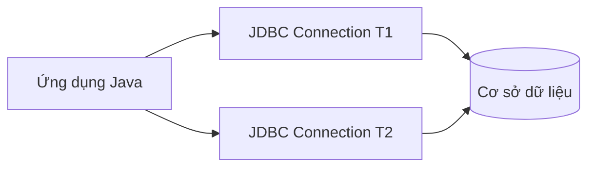
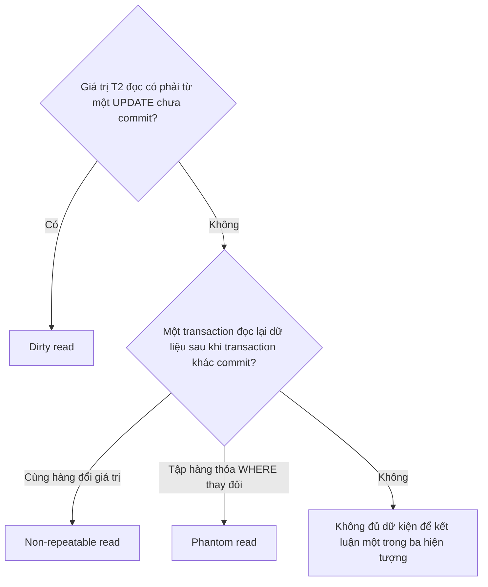

# Những hiện tượng đọc bẩn, đọc không lặp lại và bản ghi ma trong JDBC

## 1. Vì sao cần cô lập giao dịch?

Một ứng dụng Java dùng **JDBC (Java Database Connectivity)** để truy cập cơ sở dữ liệu quan hệ thường phục vụ nhiều người dùng cùng lúc. Chẳng hạn, nhân viên A cập nhật số dư tài khoản trong khi nhân viên B đang lập báo cáo; hoặc một tiến trình thêm đơn hàng trong lúc tiến trình khác đếm đơn hàng đủ điều kiện để hưởng khuyến mãi. Nếu các giao dịch (transaction) xen kẽ nhau, dữ liệu một giao dịch đọc được có thể thay đổi giữa các câu lệnh SQL.

**Isolation (tính cô lập)** là một trong bốn thuộc tính ACID. Nó quy định cách những thay đổi và kết quả của các giao dịch đồng thời được quan sát, nhằm cân bằng giữa tính nhất quán và khả năng xử lý đồng thời. Ba hiện tượng kinh điển cần phân biệt là:

1. **Đọc bẩn (dirty read):** đọc một thay đổi mà giao dịch khác *chưa commit*.
2. **Đọc không lặp lại (non-repeatable read):** đọc lại cùng một hàng và nhận giá trị khác vì giao dịch khác đã *commit* thay đổi hàng đó.
3. **Bản ghi ma (phantom read):** chạy lại một truy vấn theo *điều kiện lọc* và thấy tập hàng đáp ứng điều kiện thay đổi vì giao dịch khác đã *commit* thêm, xóa hoặc làm thay đổi hàng đáp ứng điều kiện.

Các hiện tượng này có thể phát sinh dù SQL hợp lệ và mỗi thao tác đọc/ghi đơn lẻ đều đúng. Vì vậy, lập trình viên JDBC cần hiểu chúng để đặt ranh giới giao dịch và chọn mức cô lập phù hợp, thay vì chỉ kiểm tra xem `SELECT` hoặc `UPDATE` có chạy thành công hay không.

## 2. Dữ liệu mẫu và cách đọc các kịch bản

Giả sử có hai bảng trong cơ sở dữ liệu thử nghiệm:

```sql
CREATE TABLE demo_accounts (
    id BIGINT PRIMARY KEY,
    balance INTEGER NOT NULL
);

CREATE TABLE demo_orders (
    id BIGINT PRIMARY KEY,
    customer_id BIGINT NOT NULL,
    amount DECIMAL(12, 2) NOT NULL
);

INSERT INTO demo_accounts (id, balance) VALUES (1, 100);
INSERT INTO demo_orders (id, customer_id, amount) VALUES
    (1001, 42, 1500.00),
    (1002, 42, 2000.00);
```

`balance` là giá trị số nguyên minh họa; trong nghiệp vụ tiền tệ thực tế nên thiết kế kiểu dữ liệu và đơn vị lưu trữ thích hợp. Các kịch bản phía dưới bắt đầu từ dữ liệu mẫu ban đầu, **độc lập với nhau**; cần khôi phục dữ liệu giữa các lần thử. Chúng có hai kết nối cơ sở dữ liệu, ký hiệu `T1` và `T2`, mỗi kết nối vận hành một transaction. Những câu lệnh trên hai kết nối được thực thi theo thứ tự thời gian mô tả trong bảng.



Hai `Connection` là cần thiết để tái hiện hai transaction độc lập. Hai `Statement` tạo từ *cùng một* `Connection` sẽ cùng chịu trạng thái transaction của kết nối đó, nên không tương đương với hai giao dịch đồng thời.

## 3. Dirty read — đọc dữ liệu chưa được xác nhận

**Đọc bẩn** xảy ra khi `T2` thấy một giá trị do `T1` ghi **trước khi `T1` commit**. Nếu `T1` rollback, giá trị `T2` đã thấy chưa từng trở thành trạng thái được xác nhận của cơ sở dữ liệu.

Giả sử tài khoản `id = 1` có `balance = 100`:

| Thứ tự | Giao dịch T1 | Giao dịch T2 |
| --- | --- | --- |
| 1 | `BEGIN` | |
| 2 | `UPDATE demo_accounts SET balance = 50 WHERE id = 1;` | |
| 3 | *Chưa commit* | `BEGIN` ở mức `READ UNCOMMITTED` |
| 4 | | `SELECT balance FROM demo_accounts WHERE id = 1;` → **có thể nhận `50`** |
| 5 | `ROLLBACK` | |
| 6 | Giá trị đã xác nhận vẫn là `100` | T2 đã dùng một giá trị không còn tồn tại |

Đây là tình huống nguy hiểm nếu T2 lấy `50` để tính thưởng, kiểm tra hạn mức hoặc tạo một quyết định nghiệp vụ không thể tự đảo ngược. Việc **T1 rollback** khiến `50` thành một giá trị *bẩn* đối với T2.

Điểm mấu chốt: `T2` nhìn thấy **thay đổi chưa commit**, chứ không đơn thuần là thấy dữ liệu mới hơn. Mức cô lập `READ COMMITTED` trở lên theo mô hình chuẩn không cho phép dirty read.

> **Lưu ý phụ thuộc hệ quản trị:** Bảng chỉ minh họa tình huống *có thể xảy ra* ở `READ UNCOMMITTED`. Chẳng hạn PostgreSQL nhận yêu cầu `READ UNCOMMITTED` nhưng thực thi với hành vi của `READ COMMITTED`, nên không tái hiện dirty read theo cách này. Một số hệ quản trị khác có thể cho phép. JDBC định nghĩa tên mức cô lập, còn hành vi cụ thể do hệ quản trị và driver hỗ trợ.

## 4. Non-repeatable read — đọc cùng một hàng hai lần ra hai giá trị

**Đọc không lặp lại** xảy ra khi một giao dịch `T1` đọc một hàng, sau đó một giao dịch khác `T2` **commit** thay đổi đối với hàng đó, và `T1` đọc lại hàng ấy nhưng nhận giá trị khác.

Ví dụ ở mức `READ COMMITTED` của nhiều hệ quản trị:

| Thứ tự | Giao dịch T1 | Giao dịch T2 |
| --- | --- | --- |
| 1 | `BEGIN` | |
| 2 | `SELECT balance FROM demo_accounts WHERE id = 1;` → **`100`** | |
| 3 | | `BEGIN` |
| 4 | | `UPDATE demo_accounts SET balance = 80 WHERE id = 1;` |
| 5 | | `COMMIT` |
| 6 | `SELECT balance FROM demo_accounts WHERE id = 1;` → **`80`** | |
| 7 | `COMMIT` hoặc `ROLLBACK` giao dịch đọc | |

Ở đây `80` là giá trị **đã commit**, vì thế đây **không phải dirty read**. Vấn đề là hai lần đọc cùng một hàng trong *cùng transaction T1* không còn cho kết quả giống nhau.

Một báo cáo kiểm tra số dư đầu kỳ, làm một số phép tính rồi đọc số dư cuối kỳ có thể dựa trên hai trạng thái dữ liệu khác nhau. Nếu nghiệp vụ cần một cái nhìn ổn định trong toàn transaction, phải chọn chiến lược cô lập hoặc khóa phù hợp.

Lưu ý rằng nếu `T1` commit sau lần đọc đầu tiên và mở một giao dịch mới để đọc lần thứ hai thì việc nhận hai giá trị khác nhau **không phải** non-repeatable read theo định nghĩa trên: hai lần đọc đã thuộc hai transaction riêng biệt.

## 5. Phantom read — bản ghi ma làm thay đổi tập kết quả

**Bản ghi ma** xảy ra khi `T1` chạy một truy vấn chọn tập hàng theo điều kiện, `T2` commit một thay đổi khiến một hoặc nhiều hàng xuất hiện hay biến mất khỏi tập đó, rồi `T1` chạy lại **cùng truy vấn trong cùng transaction** và nhận tập kết quả khác.

Giả sử T1 đếm đơn hàng của khách `42` có `amount >= 1000`:

```sql
SELECT id
FROM demo_orders
WHERE customer_id = 42 AND amount >= 1000
ORDER BY id;
```

Lần đầu T1 thấy `1001`, `1002`. Kịch bản ở mức `READ COMMITTED` có thể diễn ra như sau:

| Thứ tự | Giao dịch T1 | Giao dịch T2 |
| --- | --- | --- |
| 1 | `BEGIN` | |
| 2 | Chạy truy vấn trên → **`[1001, 1002]`** | |
| 3 | | `BEGIN` |
| 4 | | `INSERT INTO demo_orders (id, customer_id, amount) VALUES (1003, 42, 1200.00);` |
| 5 | | `COMMIT` |
| 6 | Chạy lại cùng truy vấn → **`[1001, 1002, 1003]`** | |
| 7 | Kết quả có thêm hàng `1003` | |

Hàng mới xuất hiện trong kết quả lần hai được gọi là **phantom**. Nó không nhất thiết là một bản ghi được tạo mới: nếu `T2` xóa một hàng đang thỏa điều kiện, hoặc cập nhật giá trị để một hàng bắt đầu hoặc ngừng thỏa điều kiện, tập kết quả cũng có thể thay đổi.

Khác với non-repeatable read, trọng tâm ở đây là **tập hàng khớp một vị từ (predicate)**, chẳng hạn `WHERE amount >= 1000`; thay vì chỉ theo dõi giá trị của một hàng cụ thể. Tình huống thường gặp là đếm số bản ghi, phân trang, kiểm tra khoảng giá, tính tổng theo nhóm hoặc phát hành khuyến mãi dựa trên tập bản ghi đã lọc.

## 6. So sánh nhanh ba hiện tượng

| Hiện tượng | Giao dịch T2 làm gì? | T1/T2 quan sát điều gì? | Đặc điểm phân biệt |
| --- | --- | --- | --- |
| **Dirty read** | T1 ghi nhưng **chưa commit**, T2 đọc thay đổi đó. | T2 có thể thấy giá trị sau đó bị T1 rollback. | Đọc **dữ liệu chưa xác nhận**. |
| **Non-repeatable read** | T2 sửa hoặc xóa hàng rồi **commit**. | T1 đọc lại cùng hàng trong một transaction và nhận kết quả khác. | **Cùng hàng**, khác giá trị/trạng thái giữa hai lần đọc. |
| **Phantom read** | T2 thêm, xóa hoặc thay đổi hàng rồi **commit**. | T1 chạy lại truy vấn theo điều kiện và thấy tập hàng thay đổi. | **Cùng điều kiện lọc**, khác tập hàng đáp ứng. |



Trong thực tế, cùng một lịch thực thi có thể biểu hiện nhiều dạng thay đổi, nhất là khi câu truy vấn chọn nhiều hàng. Khi phân tích, hãy hỏi **giá trị được đọc đã commit hay chưa**, **đối tượng đang được so sánh là một hàng hay một tập hàng**, và **hai lần đọc có nằm trong cùng transaction hay không**.

## 7. Các mức cô lập trong JDBC có ý nghĩa gì?

JDBC định nghĩa các hằng số mức cô lập trong `java.sql.Connection`. Bảng sau mô tả **phân loại chuẩn thường được dùng để học**, trong đó “Có thể” nghĩa là mức đó không bắt buộc ngăn hiện tượng tương ứng, không có nghĩa lần chạy nào cũng gặp.

| Mức cô lập JDBC | Dirty read | Non-repeatable read | Phantom read |
| --- | --- | --- | --- |
| `TRANSACTION_READ_UNCOMMITTED` | **Có thể** | **Có thể** | **Có thể** |
| `TRANSACTION_READ_COMMITTED` | Không | **Có thể** | **Có thể** |
| `TRANSACTION_REPEATABLE_READ` | Không | Không | **Có thể** theo phân loại chuẩn |
| `TRANSACTION_SERIALIZABLE` | Không | Không | Không |

Mỗi mức tăng cường những bảo đảm quan sát dữ liệu; tuy nhiên, bảng **không thay thế tài liệu của hệ quản trị thực tế**:

- **PostgreSQL** triển khai `READ UNCOMMITTED` với hành vi tương đương `READ COMMITTED`. `REPEATABLE READ` của PostgreSQL dựa trên snapshot nên cũng ngăn phantom read trong các truy vấn phù hợp, mạnh hơn mức tối thiểu của phân loại chuẩn. `SERIALIZABLE` có thể báo lỗi serialization failure, cần retry toàn transaction.
- **MySQL InnoDB** sử dụng MVCC và các dạng khóa khác nhau cho consistent read và locking read. Ở `REPEATABLE READ`, các truy vấn đọc snapshot thông thường thường không thấy phantom do insert đã commit sau snapshot, nhưng cách quan sát có thể khác với truy vấn khóa hoặc câu lệnh cập nhật. Cần đọc tài liệu về consistent read, next-key lock và isolation theo phiên bản.
- **SQL Server** có các lựa chọn khóa và row versioning, bao gồm `SNAPSHOT` hoặc chế độ `READ_COMMITTED_SNAPSHOT` tùy cấu hình. Kết quả thực tế phụ thuộc mức cô lập và tùy chọn của database.

`TRANSACTION_NONE` cũng là hằng số JDBC, biểu thị không hỗ trợ transaction; **đây không phải một trong bốn mức cô lập dùng để giải quyết các hiện tượng trên**. Trước khi chọn một mức, kiểm tra driver/hệ quản trị có hỗ trợ hay không qua `DatabaseMetaData.supportsTransactionIsolationLevel(...)` hoặc xử lý `SQLException` khi thiết lập.

### Mức cô lập cao không đồng nghĩa mọi nghiệp vụ tự động đúng

Ngay cả khi một hệ quản trị ngăn được ba hiện tượng đọc này, chương trình vẫn phải xét **lost update** (ghi đè thay đổi của transaction khác), **write skew** (các transaction cùng đọc điều kiện rồi ghi những hàng khác nhau làm vi phạm bất biến), tranh chấp khóa, deadlock và các ràng buộc dữ liệu. Không thể kết luận “không có dirty/non-repeatable/phantom” thì hệ thống miễn nhiễm mọi lỗi đồng thời.

Mức `SERIALIZABLE` nhằm bảo đảm kết quả các transaction được chấp nhận tương đương với một thứ tự thực thi tuần tự nào đó. Tùy DBMS, hệ thống có thể chặn bằng khóa hoặc hủy một transaction có xung đột để ứng dụng retry. Vì vậy mức này thường đòi hỏi chiến lược xử lý lỗi phù hợp, chứ không chỉ thay đổi một hằng số Java.

## 8. Thiết lập mức isolation qua JDBC

Trong JDBC, **mức isolation là thuộc tính của `Connection`**. Để điều khiển một transaction, ứng dụng thường tắt tự động commit và chỉ commit hoặc rollback sau khi hoàn tất nghiệp vụ:

```java
import java.sql.Connection;
import java.sql.SQLException;
import javax.sql.DataSource;

public class IsolationConfiguration {
    public static void process(DataSource dataSource) throws SQLException {
        try (Connection connection = dataSource.getConnection()) {
            int target = Connection.TRANSACTION_REPEATABLE_READ;
            if (!connection.getMetaData()
                    .supportsTransactionIsolationLevel(target)) {
                throw new SQLException("Muc co lap khong duoc database ho tro");
            }

            // Chọn isolation trước khi transaction bắt đầu.
            connection.setTransactionIsolation(target);
            connection.setAutoCommit(false);

            try {
                // Thực hiện các câu SQL của cùng một nghiệp vụ ở đây.
                // Tất cả statement phải dùng chính connection này.
                connection.commit();
            } catch (SQLException | RuntimeException error) {
                try {
                    connection.rollback();
                } catch (SQLException rollbackError) {
                    error.addSuppressed(rollbackError);
                }
                throw error;
            }
        }
    }
}
```

Trong ví dụ trên, `DataSource` cung cấp kết nối, `setTransactionIsolation` chọn mức cô lập và `setAutoCommit(false)` cho phép nhóm nhiều câu SQL thành một transaction. `commit()` xác nhận thay đổi, `rollback()` hủy phần chưa xác nhận khi xảy ra lỗi. `try-with-resources` đảm bảo gọi `close()`; khi dùng pool, thao tác này thường trả kết nối về pool.

Với connection pool, cấu hình isolation thay đổi theo từng nghiệp vụ cần có **quy tắc khôi phục trạng thái connection** trước khi trả lại pool, hoặc để pool/framework quản lý việc khôi phục. Một transaction tiếp theo có thể dùng lại cùng kết nối vật lý. Không thay đổi isolation tùy tiện giữa lúc một transaction đang hoạt động; hãy thiết lập trước khi bắt đầu, theo hợp đồng và hành vi của hệ quản trị/driver.

Một chi tiết rất dễ bỏ sót: chế độ `autoCommit=true` (thường là mặc định) khiến các câu SQL riêng lẻ được commit riêng theo quy tắc JDBC. Nếu cần so sánh **hai lần đọc trong cùng một transaction**, trước tiên phải bảo đảm chúng thuộc cùng ranh giới transaction. Chỉ gọi `setTransactionIsolation(...)` mà vẫn để hai lần đọc thành hai transaction riêng không tái hiện đúng tình huống non-repeatable read trong một transaction.

## 9. Ví dụ Java: tái hiện non-repeatable read với hai Connection

Đoạn mã sau minh họa việc dùng hai kết nối từ cùng `DataSource`. Giả sử bảng `demo_accounts` đã tồn tại, hàng `id = 1` có `balance = 100`, và DBMS cho phép giao dịch đọc ở `READ COMMITTED` thấy commit mới của transaction khác. Chạy trên dữ liệu thử nghiệm vì chương trình **thực sự thay đổi số dư từ `100` thành `80`**.

```java
import java.sql.Connection;
import java.sql.PreparedStatement;
import java.sql.ResultSet;
import java.sql.SQLException;
import javax.sql.DataSource;

public class NonRepeatableReadDemo {

    public static void run(DataSource dataSource) throws SQLException {
        try (Connection t1 = dataSource.getConnection();
             Connection t2 = dataSource.getConnection()) {

            // Thiết lập trước khi tắt auto-commit và gửi SQL.
            t1.setTransactionIsolation(Connection.TRANSACTION_READ_COMMITTED);
            t2.setTransactionIsolation(Connection.TRANSACTION_READ_COMMITTED);
            t1.setAutoCommit(false);
            t2.setAutoCommit(false);

            try {
                int first = readBalance(t1, 1L);
                System.out.println("T1 lan 1: " + first); // 100

                String sql = "UPDATE demo_accounts SET balance = ? WHERE id = ?";
                try (PreparedStatement update = t2.prepareStatement(sql)) {
                    update.setInt(1, 80);
                    update.setLong(2, 1L);
                    if (update.executeUpdate() != 1) {
                        throw new SQLException("Khong tim thay tai khoan mau");
                    }
                }
                t2.commit();

                // Vẫn cùng transaction T1, nhưng T2 đã commit.
                int second = readBalance(t1, 1L);
                System.out.println("T1 lan 2: " + second); // 80

                t1.rollback(); // Giao dịch T1 chỉ đọc, kết thúc thí nghiệm.
            } catch (SQLException | RuntimeException error) {
                try {
                    t2.rollback();
                } catch (SQLException rollbackError) {
                    error.addSuppressed(rollbackError);
                }
                try {
                    t1.rollback();
                } catch (SQLException rollbackError) {
                    error.addSuppressed(rollbackError);
                }
                throw error;
            }
        }
    }

    private static int readBalance(Connection connection, long id)
            throws SQLException {
        String sql = "SELECT balance FROM demo_accounts WHERE id = ?";
        try (PreparedStatement query = connection.prepareStatement(sql)) {
            query.setLong(1, id);
            try (ResultSet rows = query.executeQuery()) {
                if (!rows.next()) {
                    throw new SQLException("Khong tim thay tai khoan " + id);
                }
                return rows.getInt("balance");
            }
        }
    }
}
```

Nếu hệ quản trị cho phép lịch thực thi trên ở `READ COMMITTED`, đầu ra là:

```text
T1 lan 1: 100
T1 lan 2: 80
```

**Điều đáng chú ý:** `T1` không commit giữa hai câu `SELECT`; `T2` mới là transaction commit cập nhật. Nếu thay `T1` sang `REPEATABLE READ`, nhiều DBMS sẽ giữ kết quả đọc ổn định, nhưng **không thể dùng nguyên lịch hai kết nối chạy tuần tự này để kết luận trên mọi DBMS**: hệ quản trị dùng read lock có thể khiến câu `UPDATE` của `T2` chờ đến khi `T1` kết thúc. Nếu kiểm thử ở mức này, hãy dùng hai session hoặc thread có đồng bộ và timeout thích hợp, đồng thời đối chiếu tài liệu DBMS.

Ví dụ `DataSource` được truyền từ cấu hình môi trường hoặc framework của ứng dụng; cách khởi tạo tùy driver và thư viện connection pool, không phải một tính năng tự sinh của JDBC.

## 10. Cách khóa và MVCC ảnh hưởng tới ba hiện tượng

Hai nhóm cơ chế thường gặp là **locking** và **multi-version concurrency control (MVCC)**. Chúng có thể được kết hợp trong cùng hệ quản trị.

**Khóa (locking):** hệ quản trị đặt khóa đọc/ghi trên hàng, khoảng khóa hoặc các đối tượng khác để kiểm soát truy cập đồng thời. Ví dụ, nếu giữ khóa đọc thích hợp trên một hàng cho đến cuối transaction, một giao dịch khác có thể phải chờ trước khi sửa hàng đó. Khóa trên hàng riêng lẻ chưa chắc chặn được việc chèn hàng mới đáp ứng một điều kiện `WHERE`; tùy hệ quản trị và isolation, cần cơ chế bảo vệ phạm vi/predicate hoặc cách kiểm soát tương đương.

**MVCC:** hệ quản trị duy trì các phiên bản dữ liệu để giao dịch đọc có thể quan sát một snapshot phù hợp mà không nhất thiết chặn các cập nhật đang diễn ra. Trong một số hệ thống, `READ COMMITTED` tạo góc nhìn mới cho từng statement, còn `REPEATABLE READ` giữ một snapshot ổn định cho nhiều statement trong transaction. Tuy nhiên, snapshot ổn định **không tự chứng minh mọi ràng buộc nghiệp vụ dưới cạnh tranh đều được bảo vệ**.

Các câu lệnh như `SELECT ... FOR UPDATE` thường yêu cầu khóa các hàng được chọn trong những hệ quản trị hỗ trợ cú pháp đó; ngữ nghĩa chính xác, khả năng chặn phantom và tương tác với snapshot vẫn khác nhau. Hãy chọn khóa dựa trên **bất biến nghiệp vụ**, truy vấn và cơ chế DBMS cụ thể.

## 11. Chọn isolation theo nghiệp vụ và xử lý lỗi

Không có một mức cô lập tối ưu cho tất cả các thao tác:

| Tình huống | Câu hỏi cần đặt ra | Hướng xử lý thường được cân nhắc |
| --- | --- | --- |
| Hiển thị danh sách thông thường | Có chấp nhận kết quả khác nhau giữa hai lần tải không? | `READ COMMITTED` có thể phù hợp nếu yêu cầu chỉ đọc dữ liệu đã commit. |
| Xuất báo cáo gồm nhiều truy vấn | Các phép tính có phải nhìn cùng một snapshot dữ liệu không? | Cân nhắc snapshot nhất quán hoặc `REPEATABLE READ` theo DBMS. |
| Kiểm tra số lượng tồn trước khi trừ kho | Transaction khác có thể cùng trừ kho không? | Dùng cập nhật có điều kiện, ràng buộc và/hoặc khóa; kiểm tra số hàng ảnh hưởng. |
| Đảm bảo bất biến liên quan nhiều hàng | Hai transaction có thể đồng thời đọc điều kiện rồi sửa các hàng khác nhau không? | Xem xét `SERIALIZABLE`, khóa phù hợp hoặc mô hình ghi được thiết kế để bảo vệ bất biến. |

Một mẫu cập nhật tồn kho thường giúp tránh ghi đè kết quả do nhiều request cùng đọc trước:

```sql
UPDATE inventory
SET quantity = quantity - ?
WHERE product_id = ? AND quantity >= ?;
```

Ứng dụng phải kiểm tra số hàng cập nhật: `0` thường có nghĩa là không tìm thấy hàng hoặc không đủ tồn; `1` nghĩa là câu lệnh cập nhật được một hàng. Điều này vẫn cần được phối hợp với transaction, ràng buộc `CHECK`, các bước nghiệp vụ khác và hành vi của DBMS. `PreparedStatement` dùng để bind ba tham số, tránh nối giá trị đầu vào trực tiếp vào SQL.

Khi dùng cô lập mạnh hoặc khóa, hãy dự kiến các vấn đề vận hành như **lock wait timeout**, **deadlock** và **serialization failure**. Với lỗi có thể retry, phải retry **toàn bộ transaction từ đầu**, gồm cả các lần đọc và kiểm tra điều kiện đã dẫn đến quyết định ghi. Không retry mù từng câu `UPDATE` của một transaction đã thất bại. Thiết kế thao tác bên ngoài DB (ví dụ gửi thông báo hoặc gọi hệ thống thanh toán) sao cho việc retry không vô tình thực hiện tác dụng phụ nhiều lần.

Với `SQLException`, `getSQLState()` và mã lỗi nhà cung cấp hỗ trợ phân biệt lỗi xung đột, lỗi kết nối và lỗi dữ liệu. Mã lỗi cụ thể, khả năng retry và thời điểm transaction bị hủy phụ thuộc driver/DBMS. Không nên suy từ một SQLState duy nhất rằng mọi hệ quản trị xử lý giống nhau.

## 12. Thực hành với hai cửa sổ SQL hoặc hai kết nối JDBC

Để tự quan sát hiện tượng, mở hai session đến **cùng cơ sở dữ liệu thử nghiệm**, tắt auto-commit, chạy lần lượt các bước trong bảng kịch bản, rồi ghi lại kết quả. Mỗi lần thử cần thiết lập lại dữ liệu mẫu và kết thúc/rollback các transaction còn mở. Khi câu lệnh bị chặn, kiểm tra lock, timeout hoặc deadlock theo hướng dẫn DBMS đang sử dụng.

1. **Dirty read:** cho T1 cập nhật nhưng không commit, đặt T2 ở `READ UNCOMMITTED`, thử đọc rồi rollback T1. Ghi lại liệu T2 có thấy dữ liệu chưa commit không. Nếu không thấy, kiểm tra xem DBMS có thực sự hỗ trợ dirty read hay không.
2. **Non-repeatable read:** để T1 đọc hàng `id = 1` hai lần trong *cùng transaction*. Xen giữa hai lần đọc, để T2 cập nhật và commit; so sánh kết quả ở `READ COMMITTED` và `REPEATABLE READ`.
3. **Phantom read:** để T1 chạy truy vấn `WHERE customer_id = 42 AND amount >= 1000` hai lần. Xen giữa, để T2 thêm bản ghi khớp điều kiện và commit; ghi lại danh sách `id` ở mỗi lần và thử lại dưới các mức cô lập khác nhau.
4. **Phân tích kết quả khác tài liệu:** xem transaction có thực sự mở xuyên suốt hai lần đọc không, bản ghi đã commit chưa, câu lệnh có đang chờ khóa không, và hệ quản trị dùng locking hay MVCC ở isolation đó.

### Câu hỏi tự kiểm tra

**Câu 1.** T1 cập nhật số dư thành `40`, chưa commit. T2 đọc được `40`. T1 rollback. Đây là hiện tượng nào? **Đáp án:** dirty read, vì T2 đã nhìn thấy giá trị chưa được xác nhận.

**Câu 2.** T1 đọc số dư `100`, T2 cập nhật thành `80` rồi commit, T1 đọc lại đúng hàng đó thấy `80`. Đây là hiện tượng nào? **Đáp án:** non-repeatable read, nếu cả hai lần đọc thuộc cùng transaction T1.

**Câu 3.** T1 đếm 10 đơn hàng thỏa `WHERE amount > 500`, T2 thêm một đơn thỏa điều kiện và commit, T1 đếm lại thấy 11. Đây là hiện tượng nào? **Đáp án:** phantom read, vì tập hàng thỏa điều kiện đã thay đổi.

**Câu 4.** `READ COMMITTED` có bảo đảm hai lần `SELECT` trong một transaction trả về cùng kết quả không? **Đáp án:** không theo phân loại chuẩn; dữ liệu đã commit bởi giao dịch khác có thể xuất hiện ở lần đọc sau.

**Câu 5.** Có thể khẳng định `REPEATABLE READ` ở mọi DBMS đều xuất hiện phantom read không? **Đáp án:** không. Phân loại chuẩn cho phép phantom, nhưng một số triển khai MVCC ngăn hiện tượng này trong các truy vấn snapshot thông thường.

Khi làm việc với JDBC, điều quyết định là hiểu **giao dịch nào đọc, giao dịch nào ghi, thay đổi đã commit hay chưa, cùng một hàng hay tập hàng theo điều kiện đang được so sánh**, và mức isolation thực tế của connection. Từ những dấu hiệu đó, ta mới chọn được cơ chế cô lập, khóa và xử lý lỗi đúng với nghiệp vụ.
