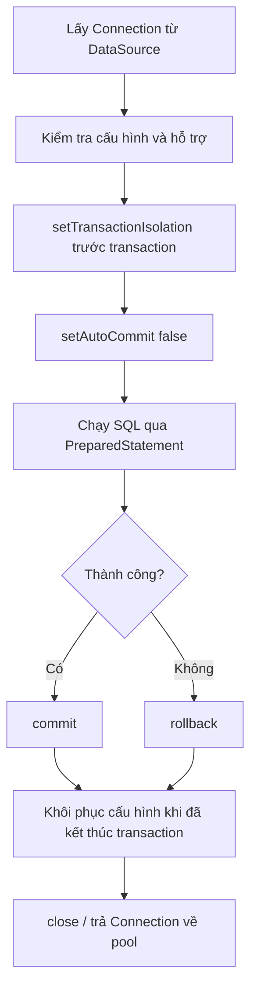

# Đọc và thiết lập mức cô lập qua Connection

Khi một ứng dụng Java sử dụng **JDBC** để truy cập cơ sở dữ liệu quan hệ, nhiều giao dịch có thể chạy cùng lúc trên những hàng dữ liệu liên quan. Mức cô lập giao dịch (*transaction isolation level*) quyết định những thay đổi của giao dịch khác mà một giao dịch được phép quan sát, qua đó ảnh hưởng đến tính nhất quán, khả năng xử lý đồng thời và tranh chấp khóa.

Trong chương **Cô lập và khóa**, bài này tập trung vào hai phương thức của `java.sql.Connection`:

- `getTransactionIsolation()`: **đọc** mức cô lập hiện được cấu hình cho kết nối.
- `setTransactionIsolation(int level)`: **thiết lập** mức cô lập của kết nối, để các giao dịch tiếp theo sử dụng theo quy tắc của driver và hệ quản trị cơ sở dữ liệu (DBMS).

Bạn cũng sẽ sử dụng `DataSource` để lấy kết nối, `DatabaseMetaData` để kiểm tra hỗ trợ, `PreparedStatement` và `ResultSet` để thử đọc dữ liệu, cùng `commit()`/`rollback()` để kết thúc giao dịch đúng cách.

## 1. Vì sao phải quan tâm đến mức cô lập?

Giả sử hai kết nối JDBC cùng truy cập tài khoản `id = 42`:

1. Giao dịch A đọc số dư `100.00`.
2. Giao dịch B sửa số dư thành `150.00` và `commit`.
3. Giao dịch A đọc lại số dư trong **cùng giao dịch**.

Ở một số mức cô lập, A có thể đọc thấy `150.00` trong lần thứ hai; ở mức khác, A tiếp tục thấy `100.00`, phải chờ B hoặc nhận lỗi khi có xung đột. Kết quả cụ thể còn phụ thuộc DBMS, cách nó hiện thực cô lập và thời điểm hai giao dịch thực hiện lệnh.

Ba hiện tượng cơ bản cần phân biệt:

| Hiện tượng | Tình huống |
| --- | --- |
| **Dirty read** (đọc bẩn) | A đọc thay đổi **chưa commit** của B; sau đó B `rollback` nên giá trị A đã thấy chưa bao giờ được xác nhận. |
| **Non-repeatable read** (đọc không lặp lại) | A đọc **cùng một hàng** hai lần trong một giao dịch và thấy giá trị khác nhau vì B sửa và `commit` giữa hai lần đọc. |
| **Phantom read** (đọc bóng ma) | A chạy lại một truy vấn theo điều kiện, chẳng hạn `WHERE status = 'OPEN'`, và thấy tập hàng phù hợp thay đổi do B thêm/xóa hoặc sửa hàng rồi `commit`. |

Mức cô lập cũng có thể ảnh hưởng đến khả năng xuất hiện các bất thường khác như **write skew** hoặc mất cập nhật, nhưng ba hiện tượng trên là cách phân loại kinh điển của JDBC. Không nên suy luận rằng chỉ cần chọn một mức cô lập thì mọi quy tắc nghiệp vụ tự động an toàn; có thể vẫn cần cập nhật có điều kiện, ràng buộc cơ sở dữ liệu hoặc khóa tường minh.

## 2. Các hằng số cô lập trong JDBC

`Connection` định nghĩa các hằng `int` sau:

| Hằng JDBC | Giá trị số | Dirty read | Non-repeatable read | Phantom read |
| --- | ---: | --- | --- | --- |
| `Connection.TRANSACTION_READ_UNCOMMITTED` | `1` | Có thể | Có thể | Có thể |
| `Connection.TRANSACTION_READ_COMMITTED` | `2` | Ngăn | Có thể | Có thể |
| `Connection.TRANSACTION_REPEATABLE_READ` | `4` | Ngăn | Ngăn | Có thể |
| `Connection.TRANSACTION_SERIALIZABLE` | `8` | Ngăn | Ngăn | Ngăn |

Bảng diễn tả **mức bảo đảm tối thiểu theo cách phân loại JDBC**, không có nghĩa mọi DBMS bắt buộc phải cho phép từng hiện tượng được ghi “Có thể”. Một DBMS có thể cung cấp bảo đảm mạnh hơn mức tối thiểu hoặc dùng cơ chế khác để đạt tính nhất quán. Chẳng hạn, một hệ quản trị dùng MVCC có thể tránh phantom read ở mức `REPEATABLE_READ`, dù mô tả JDBC vẫn cho phép hiện tượng này ở mức đó. Một số DBMS không hỗ trợ đủ cả bốn mức, hoặc ánh xạ yêu cầu sang mức gần nhất.

Ngoài ra còn có `Connection.TRANSACTION_NONE` (giá trị `0`), có nghĩa là **không hỗ trợ giao dịch**; đây không phải một mức cô lập để lựa chọn khi muốn giảm khóa.

### Đừng nhầm mức cô lập với khóa

Mức cô lập mô tả **những kết quả một giao dịch có thể quan sát**. DBMS có thể hiện thực điều đó bằng khóa, phiên bản dữ liệu (*MVCC*), kiểm tra xung đột hoặc kết hợp nhiều kỹ thuật. Vì vậy:

- Không thể khẳng định mỗi câu `SELECT` ở `REPEATABLE_READ` đều giữ khóa đọc đến `commit`.
- `SERIALIZABLE` không nhất thiết làm mọi giao dịch tuần tự thực thi; DBMS có thể cho chạy đồng thời nhưng từ chối một giao dịch khi phát hiện kết quả không thể tuần tự hóa.
- `READ_COMMITTED` không bảo vệ mọi quyết định nghiệp vụ dựa trên ảnh chụp đã đọc trước đó.

Mức cô lập cao hơn thường có thể gây chờ khóa, retry hoặc hao tài nguyên hơn, nhưng chi phí cụ thể phải đo trên DBMS và tải thực tế.

## 3. Đọc mức cô lập hiện tại qua Connection

Khi lấy kết nối từ `DataSource`, gọi `getTransactionIsolation()` để biết cấu hình hiện tại của **kết nối đó**:

```java
import java.sql.Connection;
import java.sql.SQLException;
import javax.sql.DataSource;

public final class IsolationInspector {
    public static String currentIsolation(DataSource dataSource)
            throws SQLException {
        try (Connection connection = dataSource.getConnection()) {
            int level = connection.getTransactionIsolation();
            return isolationName(level);
        }
    }

    private static String isolationName(int level) {
        switch (level) {
            case Connection.TRANSACTION_NONE:
                return "NONE (không hỗ trợ transaction)";
            case Connection.TRANSACTION_READ_UNCOMMITTED:
                return "READ_UNCOMMITTED";
            case Connection.TRANSACTION_READ_COMMITTED:
                return "READ_COMMITTED";
            case Connection.TRANSACTION_REPEATABLE_READ:
                return "REPEATABLE_READ";
            case Connection.TRANSACTION_SERIALIZABLE:
                return "SERIALIZABLE";
            default:
                return "Không nhận diện: " + level;
        }
    }
}
```

`getTransactionIsolation()` trả về một số nguyên thuộc các hằng `Connection.TRANSACTION_*`. Không so sánh giá trị với chuỗi hoặc tự suy luận từ tên DBMS; nên sử dụng hằng JDBC để mã dễ đọc.

**Lưu ý về nguồn cấu hình:** giá trị thực tế của kết nối có thể do DBMS, JDBC URL, driver, bộ quản lý pool hoặc cấu hình ứng dụng quyết định. Đừng mặc định mọi môi trường có cùng một mức cô lập. `getTransactionIsolation()` cho biết mức được báo cáo cho kết nối đang cầm, còn việc DBMS xử lý từng truy vấn thế nào vẫn phải dựa vào đặc tả và thử nghiệm.

## 4. Kiểm tra driver/DBMS có hỗ trợ mức muốn dùng

JDBC cung cấp `DatabaseMetaData` để truy vấn khả năng giao dịch:

```java
import java.sql.Connection;
import java.sql.DatabaseMetaData;
import java.sql.SQLException;
import javax.sql.DataSource;

public final class IsolationSupport {
    public static void inspect(DataSource dataSource) throws SQLException {
        try (Connection connection = dataSource.getConnection()) {
            DatabaseMetaData metadata = connection.getMetaData();

            System.out.println("Có hỗ trợ transaction: "
                    + metadata.supportsTransactions());
            System.out.println("Mức mặc định theo metadata: "
                    + metadata.getDefaultTransactionIsolation());
            System.out.println("Mức trên Connection này: "
                    + connection.getTransactionIsolation());

            int requested = Connection.TRANSACTION_REPEATABLE_READ;
            boolean supported =
                    metadata.supportsTransactionIsolationLevel(requested);
            System.out.println("Hỗ trợ REPEATABLE_READ: " + supported);
        }
    }
}
```

Ý nghĩa các phương thức:

| API | Câu hỏi trả lời |
| --- | --- |
| `DatabaseMetaData.supportsTransactions()` | Cơ sở dữ liệu/driver báo có hỗ trợ transaction không? |
| `DatabaseMetaData.getDefaultTransactionIsolation()` | Mức cô lập mặc định mà metadata báo cáo là gì? |
| `DatabaseMetaData.supportsTransactionIsolationLevel(level)` | Một mức cụ thể có được driver/DBMS công bố hỗ trợ không? |
| `Connection.getTransactionIsolation()` | Kết nối **đang sử dụng** báo mức cô lập nào? |

Hai giá trị **mặc định** và **hiện tại** không nhất thiết bằng nhau. Pool hoặc cấu hình kết nối có thể đã đặt một mức khác. Metadata là một kiểm tra hữu ích, nhưng không thay thế kiểm chứng bằng giao dịch thật: khả năng được công bố còn tùy phiên bản driver, DBMS và những quy tắc riêng.

Nếu `supportsTransactionIsolationLevel(level)` trả `false`, đừng dựa vào mức đó trong logic nghiệp vụ. Nếu trả `true` mà `setTransactionIsolation(level)` vẫn ném `SQLException`, xử lý lỗi và đối chiếu quyền, trạng thái giao dịch, cấu hình, driver cùng DBMS.

## 5. Thiết lập mức cô lập bằng setTransactionIsolation

Cú pháp trực tiếp:

```java
connection.setTransactionIsolation(
        Connection.TRANSACTION_REPEATABLE_READ);
```

**Đặt mức cô lập trước khi bắt đầu công việc trong transaction.** Theo JDBC, nếu gọi `setTransactionIsolation(...)` trong lúc đang có một transaction hoạt động, kết quả là **phụ thuộc cách hiện thực** (*implementation-defined*); có hệ quản trị từ chối, có hệ có quy tắc riêng. Do đó không đổi mức cô lập ở giữa hai câu SQL mà lại kỳ vọng chúng dùng hai mức khác nhau theo cách nhất quán trên mọi DBMS.

Luồng tổng quát:



Việc chỉ gọi `setTransactionIsolation(...)` trên kết nối đang bật `autoCommit` **không tạo ra một giao dịch nhiều câu lệnh**. Trong chế độ `autoCommit=true`, mỗi câu SQL được xác nhận theo quy tắc hoàn thành câu lệnh của JDBC; hai câu `SELECT` thường không thuộc cùng một transaction. Muốn kiểm tra sự ổn định của nhiều lần đọc trong một giao dịch, cần `setAutoCommit(false)` và kết thúc bằng `commit()` hoặc `rollback()`.

### Ví dụ đầy đủ: đọc hai lần trong REPEATABLE_READ

Giả sử có bảng:

```sql
CREATE TABLE accounts (
    id BIGINT PRIMARY KEY,
    balance DECIMAL(18, 2) NOT NULL
);
```

Ví dụ dưới đây đọc số dư hai lần trên **cùng một kết nối và cùng một transaction**. Việc người khác sửa tài khoản giữa hai lượt đọc không được mô phỏng trực tiếp trong phương thức; muốn quan sát xung đột phải phối hợp thêm kết nối thứ hai.

```java
import java.math.BigDecimal;
import java.sql.Connection;
import java.sql.DatabaseMetaData;
import java.sql.PreparedStatement;
import java.sql.ResultSet;
import java.sql.SQLException;
import java.sql.SQLFeatureNotSupportedException;
import java.util.Objects;
import javax.sql.DataSource;

public final class AccountReadService {
    private final DataSource dataSource;

    public AccountReadService(DataSource dataSource) {
        this.dataSource = Objects.requireNonNull(dataSource);
    }

    public BigDecimal[] readTwice(long accountId) throws SQLException {
        try (Connection connection = dataSource.getConnection()) {
            // Ví dụ quản lý transaction thủ công từ autoCommit=true.
            if (!connection.getAutoCommit()) {
                throw new SQLException("Ví dụ yêu cầu Connection có autoCommit=true");
            }

            DatabaseMetaData metadata = connection.getMetaData();
            int target = Connection.TRANSACTION_REPEATABLE_READ;
            if (!metadata.supportsTransactionIsolationLevel(target)) {
                throw new SQLFeatureNotSupportedException(
                        "Driver/DBMS không công bố hỗ trợ REPEATABLE_READ");
            }

            int originalLevel = connection.getTransactionIsolation();
            boolean transactionFinished = false;

            try {
                // Thiết lập trước khi transaction bắt đầu.
                connection.setTransactionIsolation(target);
                connection.setAutoCommit(false);

                try {
                    BigDecimal first = readBalance(connection, accountId);
                    BigDecimal second = readBalance(connection, accountId);

                    connection.commit();
                    transactionFinished = true;
                    return new BigDecimal[] { first, second };
                } catch (SQLException | RuntimeException failure) {
                    try {
                        connection.rollback();
                        transactionFinished = true;
                    } catch (SQLException rollbackError) {
                        failure.addSuppressed(rollbackError);
                    }
                    throw failure;
                }
            } finally {
                if (transactionFinished) {
                    // Chỉ đổi autoCommit về true sau commit/rollback thành công.
                    connection.setAutoCommit(true);
                    connection.setTransactionIsolation(originalLevel);
                }
                // Nếu kết thúc transaction thất bại: không ép autoCommit=true.
                // Connection sẽ được close; pool cần chính sách loại/reset
                // kết nối có trạng thái giao dịch không chắc chắn.
            }
        }
    }

    private static BigDecimal readBalance(Connection connection, long id)
            throws SQLException {
        String sql = "SELECT balance FROM accounts WHERE id = ?";

        try (PreparedStatement statement = connection.prepareStatement(sql)) {
            statement.setLong(1, id);
            try (ResultSet rows = statement.executeQuery()) {
                if (!rows.next()) {
                    throw new SQLException("Không tìm thấy account id=" + id);
                }
                return rows.getBigDecimal(1);
            }
        }
    }
}
```

Cách sử dụng (giả định ứng dụng đã cấu hình `dataSource`):

```java
AccountReadService service = new AccountReadService(dataSource);
BigDecimal[] balances = service.readTwice(42L);
System.out.println("Lần 1: " + balances[0]);
System.out.println("Lần 2: " + balances[1]);
```

Ở mức `REPEATABLE_READ`, theo bảo đảm JDBC, việc đọc lại một hàng trong cùng transaction không bị non-repeatable read. Tuy nhiên, **không chạy giao dịch B song song thì ví dụ chưa chứng minh tính chất đồng thời**; nó chủ yếu minh họa vị trí đặt isolation, vòng đời transaction và cách đọc dữ liệu.

Các điểm cần chú ý trong mã:

1. Mức cô lập được kiểm tra bằng `supportsTransactionIsolationLevel`, sau đó thiết lập bằng `setTransactionIsolation` **trước** `setAutoCommit(false)` và các câu SQL.
2. Cả hai lần đọc dùng cùng `Connection` và được nhóm trong một transaction. `PreparedStatement`, `ResultSet` đều được đóng nhanh bằng `try-with-resources`.
3. Nếu một câu đọc thất bại, ứng dụng cố gắng `rollback`; lỗi rollback được gắn vào ngoại lệ đầu tiên bằng `addSuppressed`.
4. Mẫu chỉ phục hồi `autoCommit` và mức cô lập cũ sau khi đã xác nhận hoặc rollback thành công. Nếu việc kết thúc transaction lỗi, đừng gọi `setAutoCommit(true)` một cách mù quáng: theo hợp đồng JDBC, thay đổi từ `false` sang `true` khi còn transaction hoạt động có thể khiến nó được `commit`.
5. Kết nối có thể đến từ pool. Trong sản phẩm thật, cần tuân thủ chính sách quản lý/reset/loại bỏ kết nối của thư viện pool; nếu khôi phục cấu hình thất bại, không nên tiếp tục sử dụng kết nối như thể trạng thái đã sạch. Không suy diễn rằng mọi `DataSource` tự động reset cùng một cách.

Nếu `commit()` ném lỗi do mất kết nối, **kết quả commit có thể chưa xác định**, ngay cả khi ứng dụng tiếp tục cố gắng rollback. Không tự suy luận rằng dữ liệu chắc chắn chưa được ghi hoặc tự động retry một giao dịch có tác động nghiệp vụ mà thiếu cơ chế kiểm tra/idempotency.

Mã kiểm tra `autoCommit=true` để làm rõ giả định; nếu ứng dụng có transaction manager hoặc pool cấu hình `autoCommit=false`, phải để thành phần sở hữu transaction quản lý việc đặt mức cô lập và kết thúc giao dịch. Tránh tự ý thay đổi trạng thái kết nối do framework đang quản lý.

## 6. Thí nghiệm với hai kết nối: READ_COMMITTED và REPEATABLE_READ

Giả sử có hàng `accounts(id=42, balance=100.00)`. Mở hai kết nối `A` và `B` độc lập, thực hiện từng bước có kiểm soát trong môi trường thử nghiệm (không cần `Thread.sleep` để “đoán” thời điểm chạy):

| Bước | Kết nối A | Kết nối B |
| ---: | --- | --- |
| 1 | `setTransactionIsolation(READ_COMMITTED)`, `setAutoCommit(false)`. | |
| 2 | `SELECT balance ... WHERE id=42` → `100.00`. | |
| 3 | | `UPDATE accounts SET balance=150.00 WHERE id=42` rồi `commit`. |
| 4 | Đọc lại cùng SQL trên A. | |
| 5 | `commit`/`rollback` A, đóng các kết nối. | |

Với DBMS hiện thực `READ_COMMITTED` theo từng statement, A **có thể** thấy `150.00` ở bước 4: mức này không bảo đảm hai lần đọc một hàng cho cùng kết quả. Kết quả thực tế phải xác minh trên DBMS đang sử dụng.

Lặp lại thí nghiệm nhưng đặt kết nối A ở `REPEATABLE_READ` **trước khi chạy SQL**. Theo bảo đảm JDBC, non-repeatable read sẽ được ngăn; tùy DBMS, B có thể chờ A hoàn thành, hoặc A tiếp tục thấy ảnh chụp `100.00`. Đừng coi việc B bị chặn hay không bị chặn là một đặc tính chung của JDBC.

Một tình huống khác để khảo sát **phantom read**: A chạy `SELECT COUNT(*) FROM orders WHERE status='PENDING'`, B chèn thêm một đơn `PENDING` và `commit`, rồi A chạy lại cùng câu `COUNT` trong một transaction. Ở mức cho phép phantom, A có thể thấy số lượng tăng; ở `SERIALIZABLE`, DBMS phải bảo đảm hiệu ứng tương đương một thứ tự tuần tự hợp lệ, có thể bằng chặn hoặc báo lỗi xung đột.

Nếu B bị chặn ở bước 3, không đợi vô thời hạn: có thể dùng timeout và chủ động kết thúc transaction A để quan sát kết quả. Mỗi kết nối phải có transaction riêng và được đóng sau thí nghiệm.

## 7. Những nhầm lẫn thường gặp khi đổi mức cô lập

| Hiện tượng / cách làm | Vấn đề | Cách xử lý |
| --- | --- | --- |
| Đọc `getDefaultTransactionIsolation()` rồi cho rằng mọi kết nối đều đang ở mức đó. | Pool, session hoặc ứng dụng có thể thay đổi mức cô lập thực tế. | Gọi `getTransactionIsolation()` trên đúng `Connection` đang sử dụng. |
| Gọi `setTransactionIsolation(...)` sau câu `SELECT` đầu tiên trong transaction. | Việc đổi isolation giữa transaction có kết quả phụ thuộc DBMS/driver. | Chọn mức cô lập **trước** transaction, không đổi giữa các câu SQL. |
| Dùng `setTransactionIsolation(...)` nhưng để `autoCommit=true` khi cần ảnh chụp cho nhiều truy vấn. | Hai lệnh có thể là hai transaction độc lập. | Quản lý bằng `setAutoCommit(false)`, `commit`/`rollback` trên cùng connection. |
| Dùng `TRANSACTION_NONE` để “tắt cô lập”. | Đây là cờ biểu thị **không có hỗ trợ giao dịch**, không phải giải pháp hiệu năng. | Chọn mức cô lập thực sự được hỗ trợ. |
| Chỉ tin kết quả metadata `supportsTransactionIsolationLevel`. | Metadata không cho thấy mọi quy tắc vận hành hoặc vấn đề cấu hình cụ thể. | Chạy thử với hai kết nối và kiểm tra theo DBMS/driver đang triển khai. |
| Đặt `SERIALIZABLE` cho mọi truy vấn mà không đo. | Có thể tăng chờ khóa, xung đột, lỗi serialization và số lần retry. | Chọn mức phù hợp yêu cầu và theo dõi latency, retry, deadlock, throughput. |
| Gọi `setAutoCommit(true)` trong `finally` khi transaction chưa kết thúc. | JDBC có thể `commit` phần công việc chưa hoàn tất. | `commit` hoặc `rollback` rõ ràng trước khi phục hồi cấu hình. |
| Thay isolation trên một kết nối rồi trả ngay về pool. | Yêu cầu tiếp theo có thể nhận cấu hình không mong đợi nếu pool không reset đầy đủ. | Tuân thủ hợp đồng pool, phục hồi cấu hình khi an toàn, xác định chính sách loại kết nối lỗi. |
| Dùng isolation thay cho kiểm tra điều kiện nghiệp vụ. | Vẫn có thể vi phạm ràng buộc nghiệp vụ trong một số mức/triển khai. | Dùng `UPDATE ... WHERE ...`, ràng buộc SQL, kiểm soát version hoặc khóa khi cần. |

### Về SQL đặt isolation trực tiếp

Một số DBMS cho phép câu lệnh như `SET TRANSACTION ISOLATION LEVEL ...` hoặc `SET SESSION ...`, nhưng cú pháp và phạm vi hiệu lực khác nhau. Khi viết JDBC có tính di động, ưu tiên `Connection.setTransactionIsolation(...)` nếu driver hỗ trợ. Tránh tự thay đổi isolation bằng SQL riêng rồi giả định `getTransactionIsolation()` của driver luôn phản ánh đầy đủ trạng thái đó, trừ khi đã xác nhận cách tích hợp cụ thể.

### Về transaction read-only

`Connection.setReadOnly(true)` là **gợi ý** cho driver/DBMS rằng kết nối dự định dùng cho thao tác đọc. Nó không phải mức cô lập, không đảm bảo ngăn mọi thao tác ghi và nên được thiết lập trước khi transaction bắt đầu theo yêu cầu driver. Một transaction ở `READ_COMMITTED` vẫn là `READ_COMMITTED` dù đã gọi `setReadOnly(true)`.

## 8. Chọn mức cô lập theo yêu cầu nghiệp vụ

Không có lựa chọn tối ưu cho mọi chức năng. Hãy bắt đầu từ bất biến nghiệp vụ cần bảo vệ, rồi kiểm tra hành vi thật:

| Trường hợp | Điều cần cân nhắc |
| --- | --- |
| Tra cứu danh sách, hiển thị thông tin thông thường | `READ_COMMITTED` có thể phù hợp nếu chấp nhận kết quả thay đổi giữa các lần truy vấn. |
| Hai lần đọc phải giữ cùng giá trị một hàng trong một transaction | Xem xét `REPEATABLE_READ` trở lên; kiểm chứng trên DBMS. |
| Giao dịch ra quyết định dựa trên tập hàng và cần kết quả có thể tuần tự hóa | Có thể cần `SERIALIZABLE`, khóa tường minh hoặc cấu trúc dữ liệu/ràng buộc phù hợp. |
| Trừ hàng tồn kho không được âm | Dùng SQL cập nhật có điều kiện như `UPDATE stock SET qty=qty-? WHERE id=? AND qty>=?`; kiểm tra số hàng cập nhật, trong transaction nếu có các bước liên quan. |
| Nhiều người sửa cùng một bản ghi trên giao diện lâu | Dùng `version`/optimistic locking để phát hiện dữ liệu cũ, không giữ transaction mở trong lúc người dùng nhập liệu. |

Nếu dùng `SERIALIZABLE`, một số DBMS có thể báo serialization failure; phải rollback transaction, sau đó chỉ retry **toàn bộ đơn vị công việc** với giới hạn và khi nghiệp vụ cho phép. Không retry một bước SQL bị lỗi trong transaction mà bỏ qua những giả định dữ liệu đã đọc trước đó. Với thao tác có hiệu ứng bên ngoài như chuyển tiền, gửi email, gọi dịch vụ thanh toán, cần thêm cơ chế idempotency hoặc outbox khi thích hợp.

Theo dõi **thời gian giữ kết nối, thời gian giao dịch, thời gian chờ khóa, tỷ lệ deadlock/serialization failure, p95/p99 latency** và số lần retry. Nâng isolation không thay thế cho tối ưu truy vấn, chỉ mục và rút ngắn giao dịch.

## 9. Bài tập tự kiểm tra

**Bối cảnh:** một dịch vụ JDBC tổng hợp trạng thái đơn hàng bằng hai câu `SELECT` trên cùng dữ liệu. Ở môi trường phát triển, hai kết quả dường như ổn định; tại môi trường thật, kết quả có lúc khác nhau.

1. Viết mã JDBC để **đọc** mức cô lập trên kết nối được mượn từ `DataSource`. Tại sao không nên chỉ lấy mức mặc định của metadata?
2. Nếu nghiệp vụ yêu cầu không có *non-repeatable read*, bạn sẽ kiểm tra mức hỗ trợ và gọi những phương thức nào, theo thứ tự nào, trước khi chạy hai câu SQL?
3. Vì sao chỉ gọi `setTransactionIsolation(Connection.TRANSACTION_REPEATABLE_READ)` nhưng vẫn giữ `autoCommit=true` chưa bảo đảm hai câu `SELECT` thuộc cùng một transaction?
4. Sau `SQLException` ở lệnh thứ hai, bạn cần làm gì trước khi trả kết nối về pool? Vì sao không thể luôn gọi `setAutoCommit(true)` ngay trong `finally`?
5. Nếu DBMS hiện thực `SERIALIZABLE` bằng cách từ chối giao dịch có xung đột, có nên retry vô hạn từng câu lệnh SQL bị lỗi không?

**Đáp án định hướng:**

- (1) Lấy `Connection` rồi gọi `getTransactionIsolation()`; metadata cho biết mức mặc định được công bố, pool có thể đã thay đổi cài đặt.
- (2) Dùng `getMetaData().supportsTransactionIsolationLevel(Connection.TRANSACTION_REPEATABLE_READ)`; sau đó `setTransactionIsolation(...)` **trước** `setAutoCommit(false)` và các truy vấn; hoàn tất bằng `commit` hoặc `rollback`.
- (3) Khi `autoCommit=true`, các statement thường là các transaction riêng, nên không hình thành yêu cầu đọc lặp trong **cùng một** transaction.
- (4) Cố gắng `rollback`, bảo toàn ngoại lệ ban đầu, đóng kết nối; chỉ phục hồi `autoCommit` sau khi đã xác nhận transaction kết thúc thành công, đồng thời tuân theo cơ chế reset/loại kết nối của pool.
- (5) Không; cần rollback rồi retry cả transaction nếu lỗi thuộc loại được phép retry và thao tác an toàn khi lặp, có giới hạn lần thử.

**Ghi nhớ:** `Connection.getTransactionIsolation()` cho biết cấu hình hiện tại của kết nối; `Connection.setTransactionIsolation(level)` dùng để đặt mức cô lập **trước khi transaction bắt đầu**. Kiểm tra hỗ trợ qua `DatabaseMetaData`, dùng **cùng một connection** và `setAutoCommit(false)` khi cần nhiều SQL trong một transaction, kết thúc rõ ràng bằng `commit`/`rollback` và kiểm chứng đặc tính cô lập trên DBMS thực tế.
