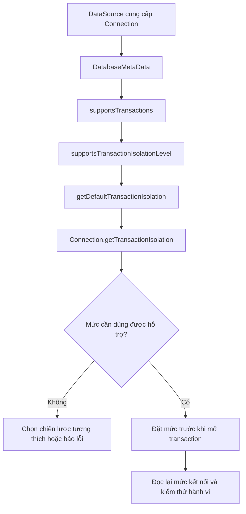

# Kiểm tra mức cô lập được driver và hệ quản trị hỗ trợ

## 1. Vì sao phải kiểm tra khả năng hỗ trợ transaction isolation?

Khi nhiều kết nối **JDBC** đọc và cập nhật cùng dữ liệu, kết quả mà một transaction nhìn thấy phụ thuộc vào **mức cô lập** (*transaction isolation level*) do hệ quản trị cơ sở dữ liệu (DBMS) thực thi. Mức cô lập ảnh hưởng đến các hiện tượng như đọc dữ liệu chưa commit, đọc lại một hàng thấy giá trị khác và truy vấn lại thấy số hàng thay đổi. Nó cũng ảnh hưởng đến khả năng phải chờ khóa, gặp deadlock hoặc phải chạy lại transaction.

Ví dụ, một ứng dụng đặt hàng có thể đọc tồn kho qua `ResultSet`, sau đó dùng `PreparedStatement` để cập nhật. Trong khoảng thời gian giữa hai câu lệnh, một transaction khác có thể đã thay đổi cùng bản ghi. Việc đặt mức cô lập cần dựa vào **yêu cầu nhất quán của nghiệp vụ** và **khả năng của driver/DBMS**, không đơn thuần chọn mức cao nhất.

Với JDBC, có ba câu hỏi khác nhau cần trả lời:

1. **Driver và DBMS khai báo hỗ trợ mức nào?** Kiểm tra qua `DatabaseMetaData`.
2. **Kết nối cụ thể đang dùng mức nào?** Đọc bằng `Connection.getTransactionIsolation()`; giá trị này có thể khác mức mặc định do pool hoặc cấu hình ứng dụng.
3. **DBMS thực thi mức đó như thế nào khi có truy cập đồng thời?** Kiểm tra tài liệu của DBMS và thử nghiệm với nhiều transaction thật. Kết quả từ metadata không thể thay thế phần này.



## 2. Bốn mức cô lập chuẩn trong API JDBC

`java.sql.Connection` định nghĩa các hằng số chuẩn sau:

| Hằng số JDBC | Ý nghĩa khái quát | Những hiện tượng có thể xuất hiện theo mô hình chuẩn |
| --- | --- | --- |
| `TRANSACTION_READ_UNCOMMITTED` | Mức cô lập thấp nhất trong bốn mức chuẩn. | Có thể đọc dữ liệu chưa commit (*dirty read*), đọc không lặp lại và phantom. |
| `TRANSACTION_READ_COMMITTED` | Không đọc dữ liệu chưa commit từ transaction khác. | Có thể đọc không lặp lại và phantom. |
| `TRANSACTION_REPEATABLE_READ` | Bảo vệ việc đọc lại cùng một hàng trong mô hình mức cô lập chuẩn. | Phantom có thể xảy ra theo định nghĩa thông thường; nhiều DBMS thực thi chặt hơn. |
| `TRANSACTION_SERIALIZABLE` | Hướng tới kết quả tương đương một thứ tự tuần tự của các transaction. | Ngăn các hiện tượng nêu trên theo hợp đồng serializable; vẫn có thể xuất hiện lỗi cần retry. |

Các thuật ngữ cần hiểu:

- **Dirty read:** transaction A nhìn thấy thay đổi của B trước khi B commit; B có thể rollback sau đó.
- **Non-repeatable read:** A đọc cùng một hàng hai lần trong cùng transaction nhưng nhận giá trị khác nhau vì transaction khác đã commit.
- **Phantom read:** A chạy lại truy vấn theo điều kiện và thấy tập hàng phù hợp điều kiện khác đi do transaction khác thay đổi dữ liệu.
- **Serialization failure:** DBMS không thể cho phép một transaction hoàn tất theo quy tắc serializable trong lịch chạy hiện tại; ứng dụng có thể cần rollback và thử lại **toàn bộ transaction**, tùy mã lỗi và chính sách retry.

**Không đồng nhất tên mức với thuật toán khóa.** DBMS có thể dùng khóa, MVCC (*multi-version concurrency control*), snapshot hoặc kết hợp nhiều cơ chế. Chẳng hạn PostgreSQL xử lý yêu cầu `READ UNCOMMITTED` theo hành vi `READ COMMITTED`, và `REPEATABLE READ` của PostgreSQL dựa trên snapshot nên tránh được nhiều phantom mà mô hình tối thiểu cho phép. Những khác biệt này là lý do phải kiểm tra trên DBMS thực tế.

JDBC còn có `Connection.TRANSACTION_NONE`, mang nghĩa **không hỗ trợ transaction**. Đây không phải mức cô lập thứ năm để lựa chọn cho một nghiệp vụ giao dịch. Các chế độ như `SNAPSHOT` hoặc biến thể snapshot của từng nhà cung cấp cũng không có hằng số chuẩn tương ứng trong bốn mức JDBC; cần xem tài liệu driver nếu muốn sử dụng.

## 3. Các API dùng để phát hiện mức cô lập

JDBC cung cấp API chuẩn trong `java.sql.DatabaseMetaData` và `java.sql.Connection`:

| API | Câu hỏi được trả lời | Điều không nên suy diễn |
| --- | --- | --- |
| `meta.supportsTransactions()` | Driver/DBMS có khai báo hỗ trợ transaction không? | Không bảo đảm mọi loại bảng hoặc câu SQL đều rollback được. |
| `meta.supportsTransactionIsolationLevel(level)` | Mức cô lập chuẩn được hỏi có được khai báo hỗ trợ không? | Không bảo đảm mọi DBMS triển khai đúng cùng một thuật toán và mọi hiện tượng đồng thời giống nhau. |
| `meta.getDefaultTransactionIsolation()` | Mức cô lập mặc định do driver/DBMS báo cáo là gì? | Không nhất thiết bằng mức đang áp dụng cho connection mượn từ pool. |
| `connection.getTransactionIsolation()` | Mức cô lập đang được kết nối JDBC báo cáo là gì? | Không mô tả đầy đủ các lựa chọn riêng của DBMS hoặc kết quả concurrency. |
| `connection.setTransactionIsolation(level)` | Yêu cầu đặt mức cô lập chuẩn trên connection. | Không nên gọi giữa transaction đang hoạt động; hành vi commit khi đổi mức đang trong transaction phụ thuộc triển khai. |
| `connection.getAutoCommit()` | Connection đang tự commit từng câu SQL hay đang được quản lý thủ công? | Auto-commit **không phải** mức cô lập và không thay thế kiểm tra isolation. |

Các mức được truyền vào `supportsTransactionIsolationLevel` hoặc `setTransactionIsolation` là **hằng số số nguyên của `Connection`**, không phải chuỗi tên SQL. Việc gửi một giá trị mức không hợp lệ hoặc mức không được hỗ trợ có thể gây `SQLException`/`SQLFeatureNotSupportedException` tùy driver.

Một kết nối có thể báo `TRANSACTION_READ_COMMITTED` khi metadata cho biết mức mặc định là `TRANSACTION_REPEATABLE_READ`, ví dụ vì cấu hình ứng dụng hoặc pool đã thay đổi session. Do đó, cần **in cả mặc định và mức hiện tại** khi chẩn đoán.

## 4. Ví dụ hoàn chỉnh: liệt kê các mức được khai báo hỗ trợ

Đoạn Java sau dùng `DataSource` để lấy đúng loại kết nối ứng dụng sẽ sử dụng. Nó chỉ đọc thông tin từ driver và kết nối; **không thay đổi isolation** hoặc chạy transaction ghi dữ liệu.

```java
import javax.sql.DataSource;
import java.sql.Connection;
import java.sql.DatabaseMetaData;
import java.sql.SQLException;
import java.util.Objects;

public final class IsolationInspector {
    private static final int[] LEVELS = {
        Connection.TRANSACTION_READ_UNCOMMITTED,
        Connection.TRANSACTION_READ_COMMITTED,
        Connection.TRANSACTION_REPEATABLE_READ,
        Connection.TRANSACTION_SERIALIZABLE
    };

    private IsolationInspector() {}

    public static void inspect(DataSource dataSource) throws SQLException {
        Objects.requireNonNull(dataSource, "dataSource");

        try (Connection connection = dataSource.getConnection()) {
            DatabaseMetaData meta = connection.getMetaData();

            System.out.printf("DBMS: %s %s%n",
                meta.getDatabaseProductName(),
                meta.getDatabaseProductVersion());
            System.out.printf("JDBC driver: %s %s%n",
                meta.getDriverName(),
                meta.getDriverVersion());

            System.out.println("Có hỗ trợ transaction: "
                + meta.supportsTransactions());
            System.out.println("Isolation mặc định: "
                + levelName(meta.getDefaultTransactionIsolation()));
            System.out.println("Isolation của connection hiện tại: "
                + levelName(connection.getTransactionIsolation()));
            System.out.println("Auto-commit hiện tại: "
                + connection.getAutoCommit());

            for (int level : LEVELS) {
                boolean supported =
                    meta.supportsTransactionIsolationLevel(level);
                System.out.printf("%-20s : %s%n",
                    levelName(level), supported ? "SUPPORTED" : "NOT SUPPORTED");
            }
        }
    }

    public static String levelName(int level) {
        switch (level) {
            case Connection.TRANSACTION_NONE:
                return "NONE";
            case Connection.TRANSACTION_READ_UNCOMMITTED:
                return "READ_UNCOMMITTED";
            case Connection.TRANSACTION_READ_COMMITTED:
                return "READ_COMMITTED";
            case Connection.TRANSACTION_REPEATABLE_READ:
                return "REPEATABLE_READ";
            case Connection.TRANSACTION_SERIALIZABLE:
                return "SERIALIZABLE";
            default:
                return "UNKNOWN(" + level + ")";
        }
    }
}
```

Cách gọi (giả sử ứng dụng đã cấu hình `dataSource`):

```java
IsolationInspector.inspect(dataSource);
```

Ví dụ **định dạng** kết quả có thể thấy, không phải đầu ra cố định của mọi hệ quản trị:

```text
DBMS: <ten DBMS> <phien ban>
JDBC driver: <ten driver> <phien ban>
Có hỗ trợ transaction: true
Isolation mặc định: READ_COMMITTED
Isolation của connection hiện tại: READ_COMMITTED
Auto-commit hiện tại: true
READ_UNCOMMITTED     : SUPPORTED
READ_COMMITTED       : SUPPORTED
REPEATABLE_READ      : SUPPORTED
SERIALIZABLE         : SUPPORTED
```

Không sao chép kết quả minh họa này thành giả định cho hệ thống thật. Đầu ra phụ thuộc DBMS, driver, phiên bản, cấu hình session và cấu hình `DataSource`.

## 5. Chọn mức cô lập phù hợp trước khi bắt đầu transaction

Sau khi biết mức được khai báo hỗ trợ, ứng dụng có thể yêu cầu mức cụ thể qua `setTransactionIsolation()`. Hãy thực hiện việc này **trước khi transaction bắt đầu**; theo JDBC, nếu thay đổi mức khi giao dịch đang hoạt động thì việc driver có tự commit hay không là phụ thuộc triển khai.

Ví dụ PostgreSQL có bảng thăm dò:

```sql
CREATE TABLE isolation_probe (
    id BIGINT PRIMARY KEY,
    observed_value INTEGER NOT NULL
);

INSERT INTO isolation_probe (id, observed_value) VALUES (1, 10);
```

Đoạn mã dưới đây yêu cầu `REPEATABLE_READ` cho một đơn vị công việc đọc, kiểm tra mức kết nối trả về và sử dụng `PreparedStatement`/`ResultSet`. Ví dụ giả định pool cấp kết nối ở chế độ auto-commit để bảo đảm không có transaction do bên gọi quản lý sẵn.

```java
import javax.sql.DataSource;
import java.sql.Connection;
import java.sql.DatabaseMetaData;
import java.sql.PreparedStatement;
import java.sql.ResultSet;
import java.sql.SQLException;

public final class IsolationReadService {
    private final DataSource dataSource;

    public IsolationReadService(DataSource dataSource) {
        this.dataSource = dataSource;
    }

    public int readValue(long id) throws SQLException {
        int required = Connection.TRANSACTION_REPEATABLE_READ;

        try (Connection connection = dataSource.getConnection()) {
            if (!connection.getAutoCommit()) {
                throw new SQLException(
                    "Ví dụ yêu cầu connection chưa có transaction thủ công"
                );
            }

            DatabaseMetaData meta = connection.getMetaData();
            if (!meta.supportsTransactions()
                    || !meta.supportsTransactionIsolationLevel(required)) {
                throw new SQLException("DBMS/driver không hỗ trợ mức yêu cầu");
            }

            int originalLevel = connection.getTransactionIsolation();
            boolean transactionStarted = false;
            boolean transactionEnded = false;
            Throwable primaryFailure = null;

            try {
                // Đặt mức trước khi tắt auto-commit và chạy SQL.
                connection.setTransactionIsolation(required);
                if (connection.getTransactionIsolation() != required) {
                    throw new SQLException("Mức cô lập đọc lại khác mức yêu cầu");
                }

                connection.setAutoCommit(false);
                transactionStarted = true;

                int value;
                try (PreparedStatement statement = connection.prepareStatement(
                        "SELECT observed_value FROM isolation_probe WHERE id = ?")) {
                    statement.setLong(1, id);
                    try (ResultSet rows = statement.executeQuery()) {
                        if (!rows.next()) {
                            throw new SQLException("Không tìm thấy bản ghi id=" + id);
                        }
                        value = rows.getInt(1);
                    }
                }

                connection.commit();
                transactionEnded = true;
                return value;
            } catch (SQLException | RuntimeException failure) {
                primaryFailure = failure;
                if (transactionStarted && !transactionEnded) {
                    try {
                        connection.rollback();
                        transactionEnded = true;
                    } catch (SQLException rollbackFailure) {
                        failure.addSuppressed(rollbackFailure);
                    }
                }
                throw failure;
            } finally {
                // Chỉ thay đổi lại cấu hình khi transaction đã kết thúc
                // hoặc chưa được bắt đầu. Không vô tình commit bằng reset.
                if (!transactionStarted || transactionEnded) {
                    try {
                        if (transactionStarted) {
                            connection.setAutoCommit(true);
                        }
                        connection.setTransactionIsolation(originalLevel);
                    } catch (SQLException restoreFailure) {
                        if (primaryFailure != null) {
                            primaryFailure.addSuppressed(restoreFailure);
                        } else {
                            throw restoreFailure;
                        }
                    }
                }
            }
        }
    }
}
```

Điểm cần lưu ý trong ví dụ:

- `supportsTransactionIsolationLevel(required)` là bước **kiểm tra khả năng được khai báo**, không phải sự đảm bảo tuyệt đối về hành vi của DBMS.
- `getTransactionIsolation()` xác minh trạng thái mức cô lập driver báo cáo sau khi đặt. Nó vẫn không thay thế kiểm thử đồng thời.
- Mọi câu SQL của nghiệp vụ chạy **trên cùng `Connection`** giữa `setAutoCommit(false)` và `commit()`/`rollback()`.
- Mẫu dùng `rollback()` cho cả `SQLException` lẫn lỗi Java không kiểm tra; nếu rollback lỗi, nguyên nhân bổ sung nằm trong `getSuppressed()`.
- Mẫu cố gắng khôi phục `autoCommit` và isolation ban đầu trước khi trả connection về pool, **chỉ khi transaction đã kết thúc hoặc chưa bắt đầu**. Nếu rollback/commit có kết quả không chắc chắn, việc đóng connection và chính sách loại kết nối lỗi của pool cần được kiểm chứng riêng.

Nếu dùng framework đã quản lý transaction hoặc một `Connection` được truyền từ caller, **không tự ý đổi mức cô lập** bằng cách này: nơi sở hữu transaction phải chọn mức phù hợp ở ranh giới bắt đầu giao dịch.

## 6. Phân biệt mức mặc định, mức yêu cầu và mức hiệu lực

Cần ghi lại ít nhất ba giá trị khi cấu hình:

| Giá trị | Nguồn | Ví dụ tình huống |
| --- | --- | --- |
| **Mặc định được khai báo** | `meta.getDefaultTransactionIsolation()` | DBMS/driver thông báo `REPEATABLE_READ`. |
| **Mức connection đang báo cáo** | `connection.getTransactionIsolation()` | Pool đã cấu hình session thành `READ_COMMITTED`. |
| **Mức yêu cầu của nghiệp vụ** | `connection.setTransactionIsolation(required)` | Nghiệp vụ cần `SERIALIZABLE`. |

Trong một số DBMS, mức yêu cầu có thể được quy đổi thành hành vi của mức khác hoặc chịu ảnh hưởng cấu hình riêng của session. Ví dụ, mức `READ_UNCOMMITTED` có thể được chấp nhận về API nhưng không cho phép dirty read thực tế. Vì vậy, **giá trị `getTransactionIsolation()` khớp hằng số yêu cầu cũng chưa đủ để chứng minh toàn bộ hiện tượng concurrency**.

Khi cần kiểm tra phía máy chủ, có thể xem các tham số cấu hình theo DBMS, ví dụ PostgreSQL hỗ trợ:

```sql
SHOW transaction_isolation;
SHOW default_transaction_isolation;
```

Hai lệnh `SHOW` này **không phải SQL di động**; chúng minh họa cách đối chiếu session server với những gì driver báo. Với hệ quản trị khác, cần sử dụng cú pháp hoặc view hệ thống tương ứng. Cần chạy truy vấn xác minh trên **chính connection** đang được khảo sát, tránh dùng một kết nối khác có cấu hình session khác.

## 7. Kiểm thử hành vi thật bằng hai connection độc lập

Kiểm tra metadata chỉ mô tả năng lực. Muốn biết một mức cô lập có đáp ứng nghiệp vụ không, nên chạy thí nghiệm trên **hai connection đồng thời** từ cùng `DataSource`, sử dụng bảng thử riêng và bắt đầu ở trạng thái dữ liệu đã biết.

Ví dụ quan sát khả năng xảy ra *non-repeatable read* với `isolation_probe` từ mục 5:

| Thứ tự | Connection A | Connection B |
| --- | --- | --- |
| 1 | Đặt mức cần thử **trước khi mở transaction**; `setAutoCommit(false)`. | Đặt mức thích hợp; `setAutoCommit(false)`. |
| 2 | `SELECT observed_value FROM isolation_probe WHERE id = 1`; ghi nhận giá trị `10`. | Chưa thay đổi gì. |
| 3 | Giữ transaction A mở. | `UPDATE isolation_probe SET observed_value = 11 WHERE id = 1`; `commit()`. |
| 4 | Chạy lại cùng câu `SELECT` trên A; ghi nhận kết quả. | Đã kết thúc transaction. |
| 5 | `commit()` hoặc `rollback()` A để kết thúc. | Đưa bảng test về trạng thái ban đầu trong transaction mới. |

Ở nhiều triển khai `READ_COMMITTED`, lần đọc thứ hai của A có thể trả `11`; với `REPEATABLE_READ` dựa trên snapshot, A có thể vẫn nhìn thấy `10`. Tuy nhiên **không được coi kết quả này là bất biến trên mọi driver/DBMS**: tùy cơ chế khóa và isolation, bước cập nhật ở B có thể phải chờ, bị từ chối hoặc cần điều chỉnh trình tự thí nghiệm. Không chạy thí nghiệm này trên dữ liệu sản xuất.

Các loại kiểm thử nên có:

1. **Dirty read:** B cập nhật nhưng chưa commit; A thử đọc, sau đó B rollback. Không để giao dịch thử nghiệm tác động dữ liệu thật.
2. **Non-repeatable read:** A đọc cùng hàng hai lần, B thay đổi và commit ở giữa.
3. **Phantom:** A truy vấn theo điều kiện hai lần, B thêm/xóa hàng phù hợp điều kiện và commit giữa hai lần.
4. **Tranh chấp ghi:** hai transaction cập nhật cùng bản ghi hoặc cùng tập dữ liệu; quan sát khóa, deadlock, serialization failure và chính sách retry.

Không nên suy ra rằng DBMS có thể tránh mọi lỗi đồng thời chỉ vì đã đặt `SERIALIZABLE`. Mức này có thể **từ chối một transaction** để giữ tính tuần tự hóa. Ứng dụng phải xác định được loại lỗi có thể thử lại, chạy lại **toàn bộ công việc** với một transaction mới và tránh lặp các tác dụng phụ bên ngoài database.

## 8. Những yếu tố khiến kết quả kiểm tra khác nhau

### 8.1. Khác driver, DBMS và phiên bản

Driver và DBMS có thể báo phạm vi hỗ trợ khác nhau. Ngay cả khi hai hệ thống đều báo `REPEATABLE_READ`, cách snapshot/lock, phantom, xung đột ghi và thời điểm đọc dữ liệu có thể khác. Hãy ghi phiên bản từ `getDriverVersion()` và `getDatabaseProductVersion()` để tái hiện vấn đề.

### 8.2. Connection pool và thiết lập session

Với `DataSource` có pool, kết nối mượn ra có thể được cấu hình isolation, auto-commit, read-only hoặc trạng thái session riêng. Thời điểm mượn kết nối là lúc cần đọc `getTransactionIsolation()` để biết mức đang được **connection** báo cáo. Khi ứng dụng tự đổi isolation, cần có quy tắc khôi phục trước khi trả về pool hoặc bảo đảm pool reset một cách đáng tin cậy. Trả một connection với transaction chưa kết thúc về pool có thể làm lộ trạng thái giữa các yêu cầu.

### 8.3. Quyền truy cập, engine và loại thao tác

Khả năng hỗ trợ transaction có thể phụ thuộc engine bảng hoặc loại SQL. Một số thao tác DDL có thể phát sinh commit ngầm. `supportsTransactions()` là điều kiện kiểm tra hữu ích nhưng **không chứng minh** mọi thay đổi đều rollback được; hãy thử bằng các bảng/loại thao tác cụ thể mà ứng dụng sử dụng.

### 8.4. `setReadOnly` và timeout không thay cho isolation

`connection.setReadOnly(true)` là gợi ý/chế độ read-only theo khả năng driver/DBMS, **không phải** một trong các mức isolation. `Statement.setQueryTimeout()` giới hạn thời gian theo khả năng driver, cũng không thay đổi tính nhất quán của transaction. Việc đọc `FOR UPDATE` hoặc khóa tường minh là cơ chế riêng, có thể cần khi giải quyết tranh chấp, nhưng không đồng nghĩa nâng mức cô lập toàn bộ connection.

## 9. Lỗi thường gặp và cách xử lý

| Sai lầm | Hậu quả | Hướng xử lý |
| --- | --- | --- |
| Tin rằng cả bốn mức luôn được hỗ trợ | `setTransactionIsolation()` có thể báo lỗi hoặc mức không có hành vi mong đợi. | Dùng `supportsTransactionIsolationLevel()` và kiểm thử thật. |
| Dùng `getDefaultTransactionIsolation()` để mô tả connection đang mượn | Bỏ qua cấu hình khác của pool/session. | Gọi thêm `connection.getTransactionIsolation()`. |
| Chỉ nhìn `supportsTransactions()` | Không biết mức cô lập cụ thể hoặc loại bảng có hỗ trợ rollback. | Kiểm tra từng mức và bảng/engine đang sử dụng. |
| Đổi isolation giữa transaction | Có thể dẫn đến commit ngoài ý muốn hoặc lỗi, tùy driver. | Đặt trước giao dịch; để tầng sở hữu transaction thực hiện. |
| Coi `READ_UNCOMMITTED` chắc chắn cho dirty read | Một số DBMS nâng hành vi lên mức cô lập mạnh hơn. | Đọc tài liệu DBMS và kiểm chứng bằng hai transaction. |
| Giả định `REPEATABLE_READ` giống nhau mọi DBMS | Dễ sai về phantom, snapshot hoặc khóa. | Kiểm thử các hiện tượng cần bảo vệ trên driver/DBMS mục tiêu. |
| Không reset isolation khi trả pool | Giao dịch tiếp theo có thể chạy ở mức không mong muốn. | Khôi phục an toàn và kiểm chứng cấu hình reset của pool. |
| Giữ nguyên transaction sau lỗi concurrency | Phát sinh lỗi dây chuyền hoặc giữ khóa lâu. | Rollback, phân loại lỗi, thử lại toàn bộ transaction khi thích hợp. |

Trường hợp metadata báo không hỗ trợ mức cần dùng, **không tự động hạ mức** nếu điều đó làm thay đổi bảo đảm nghiệp vụ. Các lựa chọn phải được quyết định rõ: dùng mức tương đương đã kiểm chứng, thiết kế lại câu SQL/khóa, hoặc từ chối thao tác với thông báo cấu hình chưa đáp ứng. Nếu `setTransactionIsolation()` ném `SQLException`, hãy ghi SQLState/vendor code để chẩn đoán và đóng kết nối theo hợp đồng pool.

## 10. Quy trình chọn mức cô lập cho ứng dụng JDBC

Một quy trình có thể áp dụng trong giai đoạn triển khai và kiểm thử tích hợp:

1. **Nêu rõ bất biến nghiệp vụ.** Ví dụ không cho phép số dư âm, không phân phối vượt tồn kho, hoặc cần báo cáo nhất quán tại một thời điểm.
2. **Xác định mức cô lập mong muốn.** Chọn mức phục vụ bất biến và cân nhắc chi phí chờ khóa, xung đột và retry; không giả định mức cao hơn luôn nhanh hoặc phù hợp hơn.
3. **Khảo sát khả năng.** Từ đúng `DataSource`, đọc `supportsTransactions()`, `supportsTransactionIsolationLevel()`, mức mặc định và mức hiện tại.
4. **Đặt trước transaction.** Gọi `setTransactionIsolation()` ở nơi sở hữu transaction; đọc lại `getTransactionIsolation()` và tránh thay đổi khi đang có giao dịch.
5. **Kiểm thử đa kết nối.** Tái hiện hiện tượng cần ngăn, đối chiếu kết quả và lỗi trên đúng driver/DBMS/phiên bản.
6. **Kiểm tra kết thúc và khôi phục.** `commit`/`rollback` rõ ràng, tránh để connection hoặc pool mang isolation/transaction của yêu cầu trước.
7. **Ghi nhận và theo dõi.** Khi nâng cấp driver, chuyển DBMS hoặc đổi cấu hình pool, chạy lại kiểm tra hỗ trợ và thí nghiệm cạnh tranh.

## 11. Ghi nhớ

JDBC cho phép **khảo sát** mức cô lập qua `DatabaseMetaData.supportsTransactions()`, `supportsTransactionIsolationLevel()` và `getDefaultTransactionIsolation()`, rồi kiểm tra **connection cụ thể** bằng `getTransactionIsolation()`. Để yêu cầu một mức, dùng `setTransactionIsolation()` **trước khi mở transaction** và kiểm tra lại trạng thái. Tuy nhiên, mức được khai báo hỗ trợ, mức kết nối báo cáo và bảo đảm đồng thời thực tế là ba vấn đề khác nhau. Chỉ khi kết hợp API chuẩn, tài liệu DBMS và thử nghiệm trên nhiều kết nối, ứng dụng mới có cơ sở chọn mức isolation phù hợp cho các thao tác CRUD và transaction của mình.
