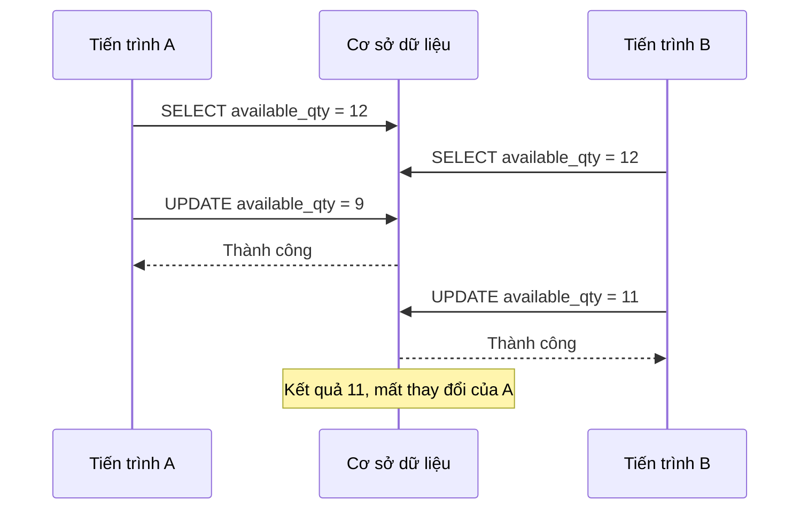
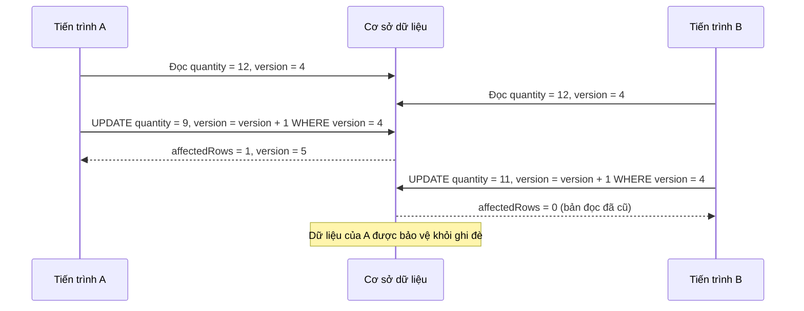

# Kiểm soát đồng thời lạc quan bằng cột phiên bản

## 1. Vấn đề: hai người cùng sửa một bản ghi

Ứng dụng Java dùng **JDBC** để truy cập cơ sở dữ liệu quan hệ thường có nhiều yêu cầu đến cùng lúc. Một người quản trị có thể sửa tồn kho trong khi một tiến trình khác cũng đang cập nhật đúng sản phẩm đó. Nếu mỗi tiến trình đọc dữ liệu, tính toán ở Java rồi ghi lại mà không kiểm tra dữ liệu đã thay đổi hay chưa, cập nhật mới có thể ghi đè kết quả của cập nhật trước.

Giả sử kho sản phẩm `301` hiện còn **12** sản phẩm:

1. A đọc số lượng `12` và định giảm đi `3`, nên tính được `9`.
2. B cũng đọc số lượng `12` và định giảm đi `1`, nên tính được `11`.
3. A ghi `9` vào cơ sở dữ liệu.
4. B ghi `11` vào cơ sở dữ liệu dựa trên kết quả đã đọc trước đó.

Kết quả cuối cùng là `11`, dù cả hai thao tác được kỳ vọng cùng có hiệu lực thì phải còn `8`. Một cập nhật đã bị mất: đây là một dạng **lost update**.



**Kiểm soát đồng thời lạc quan (optimistic concurrency control)** giải quyết dạng xung đột này bằng cách giả định xung đột tương đối hiếm. Ứng dụng không giữ khóa độc quyền trong toàn bộ thời gian người dùng xem hoặc chỉnh sửa dữ liệu. Thay vào đó, tại lúc ghi, ứng dụng kiểm tra xem bản ghi có còn ở **phiên bản đã đọc** hay không.

Trong JDBC, cách thông dụng là thêm một cột `version` vào bảng, đưa phiên bản cũ vào `WHERE`, đồng thời tăng phiên bản bằng chính lệnh `UPDATE`. Kết quả `PreparedStatement.executeUpdate()` cho biết câu lệnh có áp dụng lên hàng đủ điều kiện hay không.

**Sau bài này, bạn có thể:**

- Giải thích vì sao chỉ đọc rồi ghi theo khóa chính có thể gây lost update.
- Thiết kế cột `version` và câu SQL cập nhật có điều kiện phiên bản.
- Ánh xạ `version` bằng `ResultSet`, gửi lại phiên bản đã đọc qua tầng nghiệp vụ, và dùng `PreparedStatement` để ghi an toàn.
- Diễn giải `executeUpdate()` trả `0`, `1` hoặc nhiều hơn `1`; phân biệt xung đột dữ liệu với lỗi SQL.
- Phối hợp optimistic locking với transaction, điều kiện nghiệp vụ, xử lý retry và phạm vi khóa của đối tượng.

## 2. Cơ chế kiểm tra phiên bản hoạt động thế nào?

Thêm cột nguyên `version` không null cho mỗi bản ghi, ban đầu bằng `0`:

```sql
CREATE TABLE inventory_items (
    id            BIGINT PRIMARY KEY,
    tenant_id     BIGINT NOT NULL,
    sku           VARCHAR(60) NOT NULL,
    available_qty INTEGER NOT NULL CHECK (available_qty >= 0),
    version       BIGINT NOT NULL DEFAULT 0 CHECK (version >= 0),
    updated_at    TIMESTAMP
);
```

Ví dụ một hàng:

| id | tenant_id | sku | available_qty | version |
|---|---|---|---|---|
| 301 | 9 | `KB-01` | 12 | 4 |

Tại thời điểm đọc, ứng dụng nhận **cả dữ liệu và version = 4**. Khi ghi, thay vì cập nhật chỉ theo ID, nó dùng:

```sql
UPDATE inventory_items
SET available_qty = ?,
    version = version + 1,
    updated_at = CURRENT_TIMESTAMP
WHERE id = ?
  AND tenant_id = ?
  AND version = ?;
```

Tham số cuối phải là **phiên bản đã đọc trước khi người dùng quyết định sửa**. Ví dụ `expectedVersion = 4`.

- Nếu không có ai cập nhật hàng `301` kể từ lúc đọc, phiên bản vẫn bằng `4`; lệnh tác động một hàng và lưu `version = 5`.
- Nếu tiến trình khác đã thay đổi hàng và tăng phiên bản thành `5`, điều kiện `version = 4` không còn đúng; lệnh cũ sẽ không thể ghi đè bản ghi mới bằng một cập nhật thông thường. Tùy hệ quản trị, mức cô lập và lịch thực thi, thao tác có thể trả về `0` hoặc phát sinh lỗi xung đột/serialization cần xử lý.
- Nếu ID không tồn tại hoặc hàng nằm ngoài `tenant_id` được phép thao tác, lệnh cũng không tác động hàng nào. Chỉ từ số `0` không thể phân biệt chắc chắn các nguyên nhân này.

**Hai thành phần phải đi cùng nhau:** kiểm tra `WHERE version = ?` và tăng `SET version = version + 1`. Nếu chỉ kiểm tra mà quên tăng phiên bản, những yêu cầu khác vẫn có thể ghi với phiên bản cũ. Nếu chỉ tăng mà không kiểm tra, yêu cầu đến sau vẫn có thể ghi đè dữ liệu dựa trên bản đọc cũ.



Sơ đồ mô tả kết quả điển hình khi các cập nhật được thực thi tuần tự và commit thành công. Nếu hai transaction giữ các snapshot khác nhau ở mức cô lập cao, cơ sở dữ liệu có thể báo lỗi cập nhật đồng thời thay vì chỉ trả update count `0`. Kết quả cần được kiểm chứng với DB và driver cụ thể.

## 3. Thiết kế cột phiên bản và hợp đồng dữ liệu

Cột phiên bản nên có các tính chất:

| Quy tắc | Lý do |
|---|---|
| `BIGINT NOT NULL` | Tránh so sánh với `NULL` và có phạm vi đủ lớn cho nhiều lần cập nhật. |
| Khởi tạo `0` hoặc `1` thống nhất | Mỗi bản ghi cần một điểm khởi đầu rõ ràng; quy tắc tăng phải nhất quán. |
| Tăng mỗi khi dữ liệu được bảo vệ thay đổi | Yêu cầu đã đọc phiên bản cũ cần bị phát hiện là lỗi thời. |
| Tăng trong chính câu `UPDATE` của DB | Không sử dụng một giá trị phiên bản được tính rồi ghi không có điều kiện bảo vệ. |
| Giữ nguyên giá trị phiên bản đã đọc ở phía yêu cầu | Nếu thay bằng phiên bản mới ngay trước khi ghi, cơ chế có thể bỏ qua xung đột thực tế. |
| Kiểm tra cập nhật trả đúng một hàng | Biết câu lệnh thực sự đã khớp một bản ghi tại thời điểm thực thi. |

`version` là mã số thay đổi của bản ghi, **không phải mã phân quyền**. Yêu cầu vẫn cần kiểm tra người dùng có quyền truy cập bản ghi và ràng buộc `tenant_id` hoặc phạm vi chủ sở hữu trong `WHERE`.

Không nên dùng riêng `updated_at` làm phiên bản nếu chưa đánh giá độ chính xác của timestamp, cách làm tròn của DB/driver và khả năng hai cập nhật dùng cùng thời điểm. Một số hệ quản trị có token thay đổi được tạo tự động, nhưng ví dụ này sử dụng `BIGINT` để minh họa cơ chế chuẩn có thể triển khai qua JDBC trên nhiều hệ quản trị.

Giá trị `BIGINT` có giới hạn: nếu một hàng đạt đến cực đại, phép `version + 1` có thể gây lỗi tràn số hoặc hành vi phụ thuộc DB. Cần chính sách vận hành khi gần giới hạn; ví dụ Java sau đây từ chối phiên bản `Long.MAX_VALUE`.

## 4. Đọc dữ liệu và phiên bản qua `ResultSet`

Ứng dụng phải truyền cả dữ liệu hiện tại và `version` đến nơi người dùng hoặc dịch vụ sẽ đưa ra quyết định cập nhật. Ví dụ mô hình Java dùng `record` (Java 17+):

```java
public record InventoryItem(
        long id,
        long tenantId,
        String sku,
        int availableQuantity,
        long version) {

    public InventoryItem {
        if (id <= 0 || tenantId <= 0 || availableQuantity < 0 || version < 0) {
            throw new IllegalArgumentException("Invalid inventory item");
        }
    }
}
```

Repository dùng `DataSource` và `PreparedStatement` để đọc dữ liệu:

```java
import java.sql.Connection;
import java.sql.PreparedStatement;
import java.sql.ResultSet;
import java.sql.SQLException;
import java.util.Objects;
import java.util.Optional;
import javax.sql.DataSource;

public final class InventoryRepository {
    private final DataSource dataSource;

    public InventoryRepository(DataSource dataSource) {
        this.dataSource = Objects.requireNonNull(dataSource);
    }

    public Optional<InventoryItem> findById(long itemId, long tenantId)
            throws SQLException {
        String sql = """
                SELECT id, tenant_id, sku, available_qty, version
                FROM inventory_items
                WHERE id = ? AND tenant_id = ?
                """;

        try (Connection connection = dataSource.getConnection();
             PreparedStatement ps = connection.prepareStatement(sql)) {
            ps.setLong(1, itemId);
            ps.setLong(2, tenantId);

            try (ResultSet rs = ps.executeQuery()) {
                if (!rs.next()) {
                    return Optional.empty();
                }

                return Optional.of(new InventoryItem(
                        rs.getLong("id"),
                        rs.getLong("tenant_id"),
                        rs.getString("sku"),
                        rs.getInt("available_qty"),
                        rs.getLong("version")
                ));
            }
        }
    }
}
```

Với bảng minh họa, `version` là `BIGINT NOT NULL` nên `getLong("version")` có thể đọc trực tiếp vào `long`. Nếu lược đồ thật cho phép `NULL`, `getLong()` sẽ trả `0` cho null; khi đó cần dùng `wasNull()` ngay sau lần đọc để phân biệt. Giải pháp tốt hơn cho cột version là đặt `NOT NULL`.

Ứng dụng có thể trả bản ghi đọc được cho giao diện dưới dạng DTO có `version`, hoặc dùng nó làm giá trị so sánh trong một yêu cầu cập nhật. Khi người dùng nhấn “Lưu”, gửi **phiên bản đã hiển thị lúc bắt đầu chỉnh sửa**, không đọc phiên bản mới rồi gắn vào bản cập nhật cũ. Đọc mới và dùng version mới một cách mù quáng sẽ làm mất khả năng phát hiện xung đột.

## 5. Cập nhật bằng `PreparedStatement` và kiểm tra số dòng

Tiếp tục trong lớp `InventoryRepository`, thêm phương thức sau:

```java
public enum UpdateOutcome {
    UPDATED,
    NOT_APPLIED
}

public UpdateOutcome setQuantityIfVersionMatches(
        long itemId,
        long tenantId,
        long expectedVersion,
        int newQuantity) throws SQLException {

    if (itemId <= 0 || tenantId <= 0 || newQuantity < 0) {
        throw new IllegalArgumentException("Invalid update arguments");
    }
    if (expectedVersion < 0 || expectedVersion == Long.MAX_VALUE) {
        throw new IllegalArgumentException("Invalid version");
    }

    String sql = """
            UPDATE inventory_items
            SET available_qty = ?,
                version = version + 1,
                updated_at = CURRENT_TIMESTAMP
            WHERE id = ?
              AND tenant_id = ?
              AND version = ?
            """;

    // Ví dụ một lệnh độc lập, giả định connection được cấp ở auto-commit.
    try (Connection connection = dataSource.getConnection()) {
        if (!connection.getAutoCommit()) {
            throw new SQLException("This method expects auto-commit mode");
        }

        try (PreparedStatement ps = connection.prepareStatement(sql)) {
            ps.setInt(1, newQuantity);
            ps.setLong(2, itemId);
            ps.setLong(3, tenantId);
            ps.setLong(4, expectedVersion);

            int affectedRows = ps.executeUpdate();
            if (affectedRows == 1) {
                return UpdateOutcome.UPDATED;
            }
            if (affectedRows == 0) {
                return UpdateOutcome.NOT_APPLIED;
            }
            throw new SQLException(
                    "Expected at most one row, changed " + affectedRows);
        }
    }
}
```

**Cách đọc kết quả:**

- `UPDATED`: một hàng thỏa điều kiện phiên bản đã được cập nhật. Trong ví dụ độc lập `autoCommit = true`, JDBC thực hiện commit khi câu lệnh cập nhật hoàn tất theo cơ chế auto-commit.
- `NOT_APPLIED`: không có hàng nào được báo tác động. Có thể ID/tenant không đúng hoặc phiên bản đã thay đổi. Nếu muốn trả thông báo chi tiết cho người dùng, thực hiện tra cứu bổ sung có phân quyền và nhớ rằng trạng thái có thể tiếp tục đổi đồng thời.
- `SQLException`: lỗi thực thi SQL, ràng buộc hoặc kết nối. Không tự động đổi mọi `SQLException` thành “dữ liệu đã bị người khác sửa”.
- Nếu `affectedRows > 1` với `id` là khóa chính thì có điều bất thường trong hợp đồng truy vấn hoặc lược đồ; không coi đây là thành công.

Lệnh cập nhật luôn thay đổi `version` khi khớp hàng, nên tránh sự mơ hồ phổ biến của một câu `UPDATE` chỉ gán lại giá trị cũ. Tuy vậy, cách driver báo affected rows có thể khác nhau theo loại SQL và cơ sở dữ liệu; cần kiểm chứng trên môi trường thực.

**Phạm vi ví dụ:** đây là một thao tác ghi độc lập trên connection ở chế độ auto-commit. Khi một cập nhật thuộc transaction nhiều bước, hãy dùng cùng một `Connection` được transaction owner quản lý và kiểm tra `commit()` cuối cùng trước khi thông báo toàn bộ nghiệp vụ thành công.

### Theo dõi phiên bản mới

Nếu phiên bản cũ là `4` và câu `UPDATE` trả `1`, phiên bản mới theo hợp đồng SQL này là `5`. Khi trả dữ liệu về phía gọi có thể dùng `expectedVersion + 1` sau khi biết thao tác đã commit thành công. Nếu DB có trigger hoặc cơ chế khác tác động vào `version`, hoặc cần chắc chắn giá trị được lưu sau commit, hãy truy vấn lại bản ghi theo ID/tenant.

Không thay đổi đối tượng Java đang giữ thành version mới **trước khi** có kết quả thành công từ DB. Nếu cập nhật thất bại, bản sửa tại phía client vẫn dựa trên snapshot cũ và cần được giải quyết như một xung đột.

## 6. Tại sao `SELECT` trước `UPDATE` chưa đủ?

Một cách tiếp cận dễ sai:

```java
// Mẫu sai về ý nghĩa đồng thời, chỉ để minh họa.
InventoryItem latest = repository.findById(id, tenantId).orElseThrow();
if (latest.version() == expectedVersion) {
    // Ngay sau khi kiểm tra, transaction khác có thể cập nhật bản ghi.
    // UPDATE inventory_items SET available_qty = ? WHERE id = ?;
}
```

Việc kiểm tra `version` trong Java trước khi cập nhật tạo ra khoảng thời gian giữa đọc và ghi (**time-of-check to time-of-use**). Hai transaction có thể cùng vượt qua câu `if`, sau đó ghi đè lẫn nhau nếu SQL chỉ lọc theo ID.

Giải pháp là cho cơ sở dữ liệu đánh giá điều kiện **trong chính câu cập nhật**:

```sql
UPDATE inventory_items
SET available_qty = ?,
    version = version + 1
WHERE id = ?
  AND tenant_id = ?
  AND version = ?;
```

Cơ sở dữ liệu thực hiện kiểm tra điều kiện và cập nhật như một thao tác ghi có kiểm soát transaction. Tuy nhiên, không có nghĩa mọi nguy cơ đồng thời đã biến mất: các bước khác ngoài câu lệnh này vẫn có thể cần transaction, ràng buộc cơ sở dữ liệu hoặc cơ chế khóa bổ sung.

### Lịch trình hai yêu cầu điển hình

| Thời điểm | Tiến trình A | Tiến trình B | DB |
|---|---|---|---|
| T1 | Đọc `qty = 12, version = 4` |  | `qty = 12, v4` |
| T2 |  | Đọc `qty = 12, version = 4` | `qty = 12, v4` |
| T3 | Ghi `qty = 9 WHERE version = 4` |  | `qty = 9, v5`; count `1` |
| T4 |  | Ghi `qty = 11 WHERE version = 4` | Không khớp phiên bản; count `0` trong tình huống điển hình |
| T5 |  | Đọc lại `qty = 9, version = 5` | `qty = 9, v5` |
| T6 |  | Sau khi đánh giá lại nghiệp vụ, có thể ghi `qty = 8 WHERE version = 5` | `qty = 8, v6` nếu thành công |

Yêu cầu B phải quyết định lại theo dữ liệu mới. Với thao tác giảm kho một đơn vị, có thể thử tính lại; với thao tác chỉnh sửa một biểu mẫu nhiều trường, việc tự động ghi lại toàn bộ nội dung cũ có thể làm mất chỉnh sửa của A.

## 7. Kết hợp phiên bản với điều kiện nghiệp vụ

**Khớp phiên bản không thay thế kiểm tra quy tắc nghiệp vụ.** Ví dụ muốn xác nhận đơn hàng chỉ khi nó còn `PENDING`, đang thuộc tenant của người gọi và số lượng hợp lệ:

```sql
UPDATE orders
SET status = 'CONFIRMED',
    version = version + 1
WHERE id = ?
  AND tenant_id = ?
  AND status = 'PENDING'
  AND version = ?;
```

Một kết quả `0` có thể do phiên bản cũ **hoặc** đơn đã chuyển trạng thái. Tầng ứng dụng có thể đưa ra phản hồi chung “Yêu cầu không còn hợp lệ, vui lòng tải lại” khi chưa có đủ thông tin để phân biệt.

Với tồn kho, một cách khác là diễn đạt ràng buộc ngay trong SQL:

```sql
UPDATE inventory_items
SET available_qty = available_qty - ?,
    version = version + 1
WHERE id = ?
  AND tenant_id = ?
  AND version = ?
  AND available_qty >= ?;
```

Đặt cùng một `requestedQty` dương cho tham số thứ nhất và cuối cùng. Lệnh này bảo vệ cả **điều kiện còn đủ hàng** lẫn **phiên bản đã đọc**. Nếu chỉ cần phép cộng/trừ kho độc lập, có thể không cần buộc người gọi truyền phiên bản; câu `UPDATE ... SET available_qty = available_qty - ? WHERE available_qty >= ?` đã là một phép thay đổi có điều kiện quan trọng. Version hữu ích hơn khi quyết định ghi phụ thuộc một snapshot gồm nhiều thuộc tính hoặc cần phát hiện mọi thay đổi cạnh tranh.

### Xóa và xóa logic

Optimistic locking cũng áp dụng với `DELETE`:

```sql
DELETE FROM inventory_items
WHERE id = ?
  AND tenant_id = ?
  AND version = ?;
```

Nếu ứng dụng dùng xóa logic qua cột `deleted_at`, một lệnh phù hợp có thể là:

```sql
-- Ví dụ giả sử bảng đã được bổ sung cột deleted_at TIMESTAMP NULL.
UPDATE inventory_items
SET deleted_at = CURRENT_TIMESTAMP,
    version = version + 1
WHERE id = ?
  AND tenant_id = ?
  AND version = ?
  AND deleted_at IS NULL;
```

Lệnh xóa logic chỉ áp dụng với hàng chưa bị đánh dấu xóa, đồng thời ngăn yêu cầu đã giữ phiên bản cũ thực hiện lại. Các truy vấn đọc hàng còn hiệu lực cũng cần lọc `deleted_at IS NULL`.

## 8. Optimistic locking và transaction isolation

Cột `version` là một cơ chế **kiểm tra xung đột ở tầng dữ liệu và ứng dụng**, còn isolation level xác định những hiện tượng đọc/ghi đồng thời mà DB cho phép trong transaction. Hai cơ chế bổ sung cho nhau.

| Cơ chế | Bảo vệ chủ yếu | Giới hạn |
|---|---|---|
| `WHERE version = ?` | Phát hiện bản ghi đã đổi từ snapshot được người gọi dùng; bảo vệ update cùng hàng nếu mọi đường ghi tham gia quy ước. | Không tự bảo vệ bất biến trên nhiều hàng hay các truy vấn tập hợp. |
| `READ_COMMITTED` | Thông thường ngăn đọc dữ liệu chưa commit. | Vẫn có thể xuất hiện nhiều tình huống concurrent update; cần điều kiện và khóa phù hợp. |
| `REPEATABLE_READ` | Cung cấp khả năng đọc lặp theo ngữ nghĩa DB. | Hành vi cập nhật cạnh tranh/phantom khác giữa các DB; không mặc định thay thế version. |
| `SERIALIZABLE` | Hướng đến hiệu ứng tương đương thực thi tuần tự. | Có thể phát sinh lỗi serialization phải retry toàn transaction; tốn chi phí hơn tùy workload. |
| Khóa bi quan, ví dụ `SELECT ... FOR UPDATE` | Khóa hàng hoặc phạm vi liên quan từ lúc đọc đến khi ghi theo DB. | Có thể tăng chờ khóa, deadlock; cú pháp và phạm vi khóa tùy DB. |

Các mức cô lập trong JDBC được đặt qua `Connection.setTransactionIsolation(...)`, ví dụ:

```java
connection.setTransactionIsolation(Connection.TRANSACTION_READ_COMMITTED);
```

Hãy cấu hình mức cô lập theo tính chất nghiệp vụ và khả năng DB/driver. `READ_COMMITTED` cùng version có thể giải quyết lost update trên **một hàng** khi mọi lệnh ghi đều tăng và kiểm tra version, nhưng không tự bảo đảm các bất biến về tổng, số lượng hàng hoặc quan hệ nhiều bảng.

**Write skew** là ví dụ giới hạn: hai transaction cùng đọc “phải còn ít nhất một bác sĩ trực” rồi mỗi transaction cho một bác sĩ khác nhau nghỉ. Hai hàng có phiên bản riêng nên cả hai có thể cập nhật thành công, nhưng tổng số bác sĩ trực bằng 0. Cần bảo vệ bất biến chung bằng cách thích hợp: ràng buộc DB nếu biểu diễn được, cập nhật một hàng điều phối chung, khóa các hàng/nhóm liên quan hoặc mức cô lập cao hơn tùy DB.

## 9. Một transaction có nhiều bản ghi

Giả sử chuyển số lượng giữa hai kho. Cần đảm bảo giảm kho nguồn và tăng kho đích đều thành công. Mỗi lệnh dùng version riêng, nhưng **cả hai phải nằm trong cùng transaction**:

```java
import java.sql.Connection;
import java.sql.PreparedStatement;
import java.sql.SQLException;

// Phác họa phần thân phương thức dịch vụ, dùng chung một Connection.
// expectedSourceVersion và expectedTargetVersion đã được đọc trước đó.
try (Connection connection = dataSource.getConnection()) {
    if (!connection.getAutoCommit()) {
        throw new SQLException("Example expects an unmanaged connection");
    }
    connection.setAutoCommit(false);
    boolean transactionEnded = false;
    try {
        String decrease = """
                UPDATE inventory_items
                SET available_qty = available_qty - ?, version = version + 1
                WHERE id = ? AND tenant_id = ?
                  AND version = ? AND available_qty >= ?
                """;
        int sourceCount;
        try (PreparedStatement ps = connection.prepareStatement(decrease)) {
            ps.setInt(1, quantity);
            ps.setLong(2, sourceId);
            ps.setLong(3, tenantId);
            ps.setLong(4, expectedSourceVersion);
            ps.setInt(5, quantity);
            sourceCount = ps.executeUpdate();
        }

        if (sourceCount != 1) {
            throw new SQLException("Source changed or stock is insufficient");
        }

        String increase = """
                UPDATE inventory_items
                SET available_qty = available_qty + ?, version = version + 1
                WHERE id = ? AND tenant_id = ? AND version = ?
                """;
        int targetCount;
        try (PreparedStatement ps = connection.prepareStatement(increase)) {
            ps.setInt(1, quantity);
            ps.setLong(2, targetId);
            ps.setLong(3, tenantId);
            ps.setLong(4, expectedTargetVersion);
            targetCount = ps.executeUpdate();
        }

        if (targetCount != 1) {
            throw new SQLException("Target changed or is missing");
        }

        connection.commit();
        transactionEnded = true;
    } catch (SQLException | RuntimeException error) {
        try {
            connection.rollback();
            transactionEnded = true;
        } catch (SQLException rollbackError) {
            error.addSuppressed(rollbackError);
        }
        throw error;
    } finally {
        // Không bật auto-commit nếu rollback thất bại: thao tác đó có thể
        // commit một transaction vẫn còn dang dở.
        if (transactionEnded) {
            connection.setAutoCommit(true);
        }
    }
}
```

Đây là ví dụ cấu trúc nằm trong một phương thức dịch vụ, giả định `dataSource` và các tham số `sourceId`, `targetId`, `tenantId`, `quantity`, `expectedSourceVersion`, `expectedTargetVersion` đã được khai báo và xác thực. Cần yêu cầu `quantity > 0`, `sourceId != targetId` và kiểm tra nguy cơ tràn số tồn kho trước khi dùng trong hệ thống thật.

**Nếu nguồn ghi thành công nhưng đích báo xung đột, rollback toàn bộ** để khôi phục tồn kho nguồn. Nếu không có transaction, đã giảm kho nguồn rồi thì không thể chỉ dựa vào việc target trả `0` để “tự động sửa” trạng thái. Với transaction do framework quản lý, tầng dịch vụ nên sử dụng connection/transaction của framework; không tự gọi `setAutoCommit(false)` trên một connection thuộc transaction khác.

Trong ví dụ, khi `connection.commit()` thành công, hai thay đổi cùng được xác nhận. Nếu commit thất bại hoặc mất kết nối, không thể suy ra từ hai `executeUpdate() == 1` rằng kết quả đã được lưu bền vững. Khi cần giao tiếp với dịch vụ bên ngoài, cân nhắc outbox hoặc cơ chế đối soát phù hợp.

## 10. Chọn cách xử lý khi phát hiện xung đột

Khi cập nhật trả `0` vì không khớp phiên bản, có một số chính sách phù hợp với các nghiệp vụ khác nhau:

| Nghiệp vụ | Cách xử lý thường hợp lý |
|---|---|
| Sửa biểu mẫu có nhiều trường | Thông báo dữ liệu đã đổi, cho người dùng tải bản mới và so sánh những phần cần giữ. |
| Điều chỉnh tồn kho theo phép trừ một lượng | Có thể đọc lại, tính toán lại và thử khi còn đủ hàng; giới hạn số lần thử. |
| Xác nhận thanh toán, đặt chỗ, chuyển tiền | Cần khóa yêu cầu bằng mã idempotency/định danh nghiệp vụ, xác minh trạng thái hiện tại; không retry mù quáng. |
| Chuyển trạng thái theo quy trình | Chỉ thử lại nếu trạng thái mới vẫn cho phép chuyển và điều kiện người dùng còn hợp lệ. |
| Đồng bộ dữ liệu từ nguồn bên ngoài | Có thể chọn chiến lược hòa giải hoặc ưu tiên theo quy tắc rõ ràng; không mặc định ghi đè phiên bản mới. |

Quy trình xử lý thông thường:

1. Ghi `UPDATE ... WHERE version = expectedVersion` với các điều kiện nghiệp vụ khác.
2. Nếu affected rows bằng `1` và transaction commit, trả kết quả thành công.
3. Nếu bằng `0`, trả một kết quả có ý nghĩa như `CONFLICT_OR_NOT_FOUND`; có thể đọc trạng thái mới **sau khi kiểm tra quyền**.
4. Nếu muốn retry, tải lại dữ liệu, đánh giá lại nghiệp vụ và chuẩn bị một lệnh cập nhật mới với phiên bản mới. Giới hạn số lần thử, có thời hạn và xử lý backoff khi thích hợp.
5. Nếu DB báo `SQLException` do deadlock, serialization hoặc timeout, phân loại riêng dựa trên SQLState/mã lỗi và quy định driver. Trong một số trường hợp cần chạy lại **toàn bộ transaction** trên connection/transaction mới.

Đừng coi việc tăng `version` hoặc retry là một thay thế cho **idempotency**. Một yêu cầu bị gửi hai lần có thể gây tác dụng kép ở các hệ thống khác nếu không có định danh yêu cầu hoặc ràng buộc nghiệp vụ ngăn thực thi lặp.

### Phản hồi qua API

Ở tầng HTTP, một API có thể gửi phiên bản về cho client và sử dụng nó làm tiền điều kiện khi cập nhật, chẳng hạn thông qua `ETag` / `If-Match` nếu thiết kế phù hợp. Mã phản hồi như `409 Conflict` hoặc `412 Precondition Failed` được chọn theo hợp đồng API. JDBC chỉ cung cấp kết quả SQL; việc ánh xạ sang mã lỗi API thuộc tầng ứng dụng.

Giá trị phiên bản người gọi gửi lên là thông tin **để kiểm tra xung đột**, không phải bằng chứng cho phép họ sửa bản ghi. Luôn lấy quyền và tenant từ ngữ cảnh xác thực đáng tin cậy.

## 11. Những lỗi triển khai thường gặp

| Lỗi | Hậu quả | Cách sửa |
|---|---|---|
| `UPDATE ... WHERE id = ?` mà không lọc version | Yêu cầu cũ có thể ghi đè yêu cầu mới. | Thêm `WHERE version = ?`. |
| Kiểm tra version bằng `SELECT` rồi cập nhật chỉ theo ID | Có khoảng trống đua tranh giữa đọc và ghi. | Kiểm tra version trong **cùng lệnh UPDATE**. |
| Lọc version nhưng quên tăng | Nhiều yêu cầu vẫn dùng phiên bản cũ và ghi thành công. | `SET version = version + 1` cho mọi lần cập nhật cần bảo vệ. |
| Tự đổi `expectedVersion` sang giá trị mới ngay trước ghi | Bỏ qua phát hiện snapshot cũ. | Giữ phiên bản đã đọc cùng dữ liệu mà người dùng chỉnh sửa. |
| Chỉ kiểm tra `affectedRows > 0` | Có thể chấp nhận cập nhật nhiều hàng ngoài ý định. | Với thao tác theo khóa chính, yêu cầu `== 1`. |
| Báo “xung đột phiên bản” cho mọi kết quả `0` | Không phân biệt sai tenant, ID không có hoặc điều kiện nghiệp vụ khác. | Trả kết quả trung tính hoặc kiểm tra có phân quyền. |
| Tất cả lệnh ghi đều không tăng version | Một đường ghi khác có thể vượt qua cơ chế bảo vệ. | Thống nhất quy ước ghi ở repository, job và công cụ vận hành. |
| Dùng `updated_at` làm version mà không kiểm tra độ chính xác | Hai cập nhật có thể có cùng timestamp và không bị phát hiện. | Ưu tiên cột version tăng đơn điệu. |
| Bật version cho từng hàng rồi cho rằng đã bảo vệ mọi điều kiện nhiều hàng | Có thể vẫn xảy ra write skew hoặc vi phạm invariant tổng hợp. | Khóa/ràng buộc phù hợp hoặc phiên bản ở cấp aggregate. |
| Chỉ nhìn count trước `commit()` | Transaction có thể bị rollback hoặc commit lỗi. | Xác nhận kết quả sau ranh giới transaction. |
| Tự động retry vô hạn khi xung đột | Tốn tải, che xung đột nghiệp vụ, có thể thực thi tác vụ ngoài DB nhiều lần. | Retry có điều kiện, giới hạn và đảm bảo idempotency. |

### Một lưu ý về cập nhật hàng loạt

`UPDATE inventory_items SET ... WHERE tenant_id = ?` có thể thay đổi nhiều hàng. Nếu cần optimistic locking cho **từng** hàng, mỗi hàng phải được kiểm tra phiên bản dự kiến tương ứng, hoặc thao tác phải được định nghĩa theo một cơ chế kiểm tra tập hợp đáng tin cậy. Chỉ tăng version cho toàn bộ tập mà không có điều kiện version dự kiến không thể phát hiện chính xác những chỉnh sửa đã xảy ra từ lúc người dùng đọc dữ liệu.

Nếu sử dụng `PreparedStatement.addBatch()` và `executeBatch()`, driver có thể trả `Statement.SUCCESS_NO_INFO` thay vì count cụ thể. Với nghiệp vụ đòi hỏi xác nhận chính xác `1` hàng cho mỗi cập nhật, không nên coi `SUCCESS_NO_INFO` là bằng chứng đủ để xác nhận optimistic update thành công. Cần cơ chế kiểm tra hoặc cách thực thi phù hợp.

## 12. Phạm vi phiên bản: một hàng hay một aggregate?

Với một đối tượng nghiệp vụ đơn giản lưu trong một hàng, cột `version` của hàng đó thường đủ để ngăn hai yêu cầu thay đổi dựa trên cùng một snapshot.

Nhưng một **aggregate** như đơn hàng có thể gồm hàng `orders` và nhiều hàng `order_items`. Nếu yêu cầu A sửa thông tin đơn trong `orders`, còn yêu cầu B sửa một item mà không tăng version của đơn, hai thao tác có thể phá vỡ một bất biến chung dù mỗi bảng có version riêng.

Ví dụ nghiệp vụ yêu cầu tổng giá đơn bằng tổng giá item. Khi một item thay đổi, nếu tổng giá ở `orders` được tính theo snapshot cũ rồi ghi lại, có thể xảy ra xung đột mà version ở hàng con không phát hiện được. Các hướng xử lý:

- Dùng version ở **aggregate root** (`orders.version`), tăng version khi thay đổi bất kỳ thành phần nào ảnh hưởng đến bất biến chung.
- Đưa những thay đổi phụ thuộc nhau vào cùng transaction và kiểm tra update count của hàng cha.
- Dùng ràng buộc dữ liệu hoặc khóa phù hợp nếu bất biến phải được bảo đảm trên nhiều bản ghi đồng thời.

Cần xác định rõ phạm vi của một “đơn vị cần tránh ghi đè”: hàng dữ liệu, tập hàng hay aggregate nghiệp vụ. Cột version chỉ bảo vệ **phạm vi mà mọi đường ghi cùng tuân theo hợp đồng kiểm tra và tăng phiên bản**.

## 13. Bài thực hành với hai kết nối JDBC

Thực hiện trên database thử nghiệm có JDBC driver và `DataSource`:

1. Tạo bảng `inventory_items`; chèn hàng `id = 301`, `tenant_id = 9`, `available_qty = 12` và `version = 4`.
2. Đọc cùng hàng qua hai phiên truy cập A và B bằng `findById(301, 9)`. Xác nhận cả hai nhận `version = 4`.
3. Cho A cập nhật số lượng còn `9` với `expectedVersion = 4`; xác nhận `executeUpdate() == 1` và DB có `version = 5`.
4. Cho B cập nhật số lượng còn `11` với phiên bản cũ `4`; với thao tác theo thứ tự này, xác nhận cập nhật không áp dụng (thông thường `0`). Kiểm tra số lượng vẫn bằng `9`.
5. Đọc lại phiên bản `5`, đánh giá lại nghiệp vụ và cho B cập nhật thành `8` khi hợp lệ; xác nhận `version = 6`.
6. Thử cập nhật cùng ID nhưng khác `tenant_id`; kiểm tra không có hàng được tác động, không suy ra chi tiết quyền truy cập từ kết quả.
7. Chạy hai transaction thực sự đồng thời ở mức cô lập đang dùng; ghi nhận liệu DB trả `0`, chờ khóa, ném lỗi serialization hay deadlock. Sau lỗi, rollback và xử lý theo quy ước của driver.
8. Thử quy trình cập nhật hai hàng trong một transaction. Chủ động làm version của hàng đích thay đổi trước khi ghi; xác nhận rollback cũng hoàn tác cập nhật hàng nguồn.

### Câu hỏi tự đánh giá

- Vì sao `SELECT version` rồi kiểm tra bằng `if` trong Java chưa đủ để chống cập nhật bị mất?
- Tại sao lệnh `UPDATE` phải có đồng thời `WHERE version = ?` và `SET version = version + 1`?
- Khi affected rows bằng `0`, còn những nguyên nhân nào ngoài xung đột phiên bản?
- Nếu một transaction cập nhật ba hàng, hai hàng thành công và hàng thứ ba bị xung đột, khi nào nên rollback cả transaction?
- Khi nào cần kết hợp optimistic locking với khóa bi quan hoặc isolation cao hơn?
- Vì sao version của từng hàng con có thể chưa đủ để bảo vệ bất biến của cả aggregate?

### Ghi nhớ

**Optimistic locking bằng cột `version`** phát hiện yêu cầu ghi đang dựa trên một bản ghi đã thay đổi. Qua JDBC, ứng dụng đọc phiên bản bằng `ResultSet`, truyền phiên bản đã đọc vào `PreparedStatement`, cập nhật bằng `WHERE version = ?` và tăng `version = version + 1` trong cùng câu SQL. Kết quả `executeUpdate()` giúp biết lệnh có áp dụng trên đúng một hàng hay không; transaction quyết định khi nào thay đổi được commit. Cơ chế này bảo vệ tốt các thao tác cùng hàng khi mọi đường ghi tuân thủ, nhưng với bất biến nhiều hàng, trạng thái nghiệp vụ và tác động bên ngoài, vẫn cần thiết kế transaction, ràng buộc và xử lý xung đột phù hợp.
