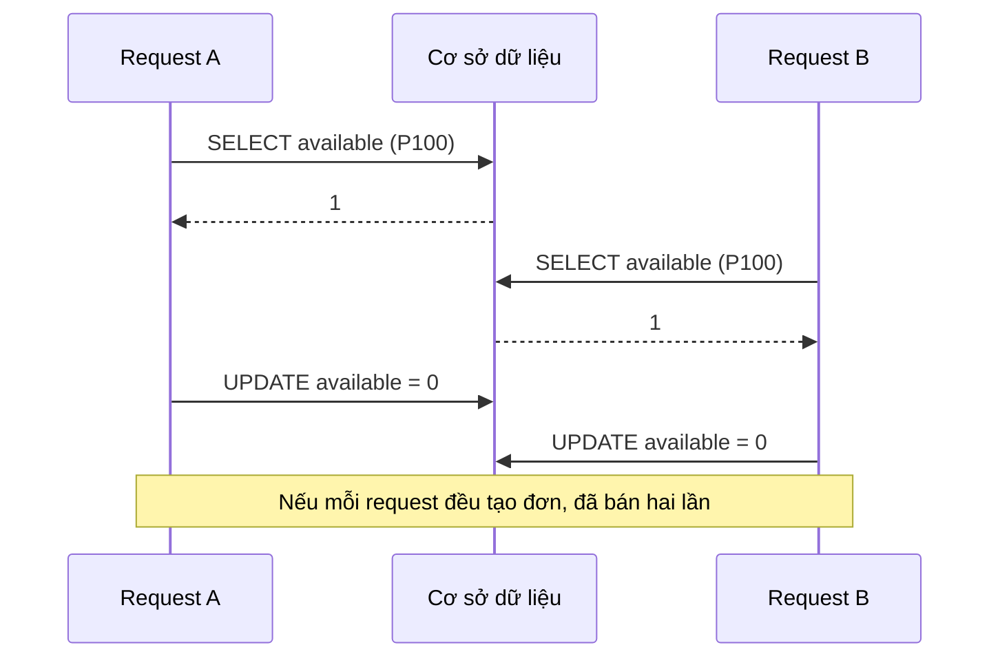

# Phân biệt khóa của cơ sở dữ liệu và khóa đồng bộ trong JVM

Khi ứng dụng Java dùng **JDBC** để đọc và ghi dữ liệu quan hệ, hai yêu cầu có thể nghe giống nhau nhưng cần hai cơ chế khác nhau:

- **Không cho hai luồng Java trong cùng một tiến trình đồng thời sửa một đối tượng dùng chung**: sử dụng cơ chế đồng bộ của Java như `synchronized`, `ReentrantLock` hoặc cấu trúc dữ liệu đồng thời phù hợp.
- **Không cho hai giao dịch đồng thời cập nhật dữ liệu trong cơ sở dữ liệu theo cách làm sai quy tắc nghiệp vụ**: dùng ranh giới transaction JDBC, lệnh SQL nguyên tử, khóa và mức cô lập do hệ quản trị cơ sở dữ liệu (DBMS) cung cấp, cùng các ràng buộc dữ liệu.

Bài học thuộc chương **Cô lập và khóa** của JDBC, giải thích phạm vi hiệu lực, cách sử dụng và những tình huống không thể thay thế nhau của hai loại khóa. Ta sẽ dùng `DataSource`, `Connection`, `PreparedStatement`, `ResultSet`, transaction và câu SQL tham số hóa để thực hành bài toán giữ chỗ tồn kho.

## 1. “Khóa” đang bảo vệ tài nguyên nào?

**Khóa đồng bộ trong JVM** bảo vệ một đoạn mã hoặc một đối tượng mà nhiều *thread* cùng tiến trình Java có thể truy cập. **Khóa của cơ sở dữ liệu** điều phối các transaction và thao tác trên dữ liệu mà DBMS quản lý, kể cả khi nhiều ứng dụng hoặc nhiều máy chủ cùng kết nối.

| Tiêu chí | Khóa trong JVM | Khóa trong cơ sở dữ liệu |
|---|---|---|
| Đối tượng được bảo vệ | Trạng thái trong bộ nhớ, đoạn mã, cấu trúc dữ liệu dùng chung | Hàng dữ liệu, khóa chỉ mục, phạm vi truy vấn hoặc tài nguyên khác tùy engine |
| Ai cùng chịu sự điều phối? | Những thread dùng **cùng cơ chế và cùng đối tượng khóa** trong một JVM | Những transaction đi qua DBMS và tranh chấp trên dữ liệu tương ứng |
| Đi qua hai JVM khác nhau? | **Không**; mỗi JVM có heap và khóa riêng | **Có**, nếu hai kết nối đến cùng tài nguyên DB đang được DBMS điều phối |
| API tiêu biểu | `synchronized`, `ReentrantLock.lock()` / `unlock()` | `UPDATE`, `SELECT ... FOR UPDATE`, `Connection.commit()` / `rollback()` |
| Thời điểm kết thúc | Ra khỏi khối `synchronized`; hoặc `unlock()` với `Lock` | Theo việc hoàn tất transaction, loại lệnh và quy tắc DBMS |
| Bảo đảm atomicity của nhiều câu SQL? | **Không tự bảo đảm** | Có thể bảo đảm bằng một transaction trên tài nguyên có hỗ trợ giao dịch |
| Khi nào dùng? | Đồng bộ bộ nhớ đệm, trạng thái/thuật toán dùng chung trong tiến trình | Bảo vệ tính đúng đắn của dữ liệu lưu bền vững trước nhiều phiên truy cập |

Một thread đang giữ khóa `synchronized` **không tự động** ngăn các transaction ở cơ sở dữ liệu thao tác với cùng bản ghi. Ngược lại, một transaction giữ khóa hàng ở DB **không tự động** bảo vệ một biến Java dùng chung khỏi data race.

> **Nguyên tắc:** Chọn cơ chế theo tài nguyên cần bảo vệ và phạm vi những tác nhân có thể sửa tài nguyên đó. Chỉ vì cùng gọi là “lock” không có nghĩa chúng phối hợp hoặc thay thế được nhau.

## 2. Tình huống: hai người cùng đặt sản phẩm cuối cùng

Giả sử bảng `inventory` ghi nhận sản phẩm `P100` còn đúng **1** đơn vị:

```sql
CREATE TABLE inventory (
    sku VARCHAR(40) PRIMARY KEY,
    available INTEGER NOT NULL CHECK (available >= 0)
);

INSERT INTO inventory (sku, available) VALUES ('P100', 1);
```

Hai yêu cầu đồng thời gửi tới hệ thống:

- Yêu cầu A: đặt một sản phẩm `P100`.
- Yêu cầu B: cũng đặt một sản phẩm `P100`.

Nếu chương trình làm theo trình tự “`SELECT` số lượng → nếu còn hàng thì cho đặt → `UPDATE` số lượng”, hai request có thể đều thấy `available = 1` trước khi bất kỳ request nào cập nhật. Kết quả có thể là **hai đơn hàng được chấp nhận cho một đơn vị tồn kho**.



Sơ đồ là ví dụ về **logic đọc–kiểm tra–ghi không nguyên tử**, không khẳng định mọi DBMS/isolation sẽ cho phép đúng thứ tự ghi này. Tùy CSDL và câu SQL, một transaction có thể chờ, bị từ chối do xung đột, hoặc phát hiện cập nhật đồng thời. Dù vậy, chương trình không nên phụ thuộc vào may mắn về lịch chạy.

## 3. Khóa JVM hoạt động như thế nào?

### `synchronized` bảo vệ một monitor

Trong Java, `synchronized` cho phép tại một thời điểm chỉ một thread giữ *monitor* của **một đối tượng khóa cụ thể**. Các thread khác cố gắng vào khối `synchronized` trên **chính đối tượng đó** phải chờ.

```java
public final class LocalCounter {
    private final Object lock = new Object();
    private int count;

    public void increase() {
        synchronized (lock) {
            count++; // Bảo vệ thao tác đọc-sửa-ghi trong cùng đối tượng.
        }
    }

    public int currentValue() {
        synchronized (lock) {
            return count;
        }
    }
}
```

Nếu hai thread cùng gọi `increase()` trên **cùng thể hiện `LocalCounter`**, chúng chia sẻ `lock` và được tuần tự hóa ở đoạn mã được bảo vệ. Nếu ứng dụng tạo hai thể hiện `LocalCounter` khác nhau, hai biến `lock` cũng khác nhau và chúng không đồng bộ với nhau.

Một `static final Object` có thể được dùng làm khóa dùng chung trong phạm vi lớp đã được nạp vào một JVM/class loader; nó vẫn **không** trở thành khóa liên tiến trình hay khóa DB.

### `ReentrantLock` và yêu cầu mở khóa

`ReentrantLock` hỗ trợ khả năng thử lấy khóa (`tryLock`), chờ có điều kiện và cơ chế khác so với `synchronized`. Khi dùng, phải `unlock()` trong `finally`:

```java
import java.util.concurrent.locks.ReentrantLock;

public final class LocalQueueState {
    private final ReentrantLock lock = new ReentrantLock();
    private int pending;

    public void add() {
        lock.lock();
        try {
            pending++;
        } finally {
            lock.unlock();
        }
    }
}
```

Ví dụ này chỉ bảo vệ `pending` trong bộ nhớ. Dùng `ReentrantLock` không khiến một `PreparedStatement` tự động giữ hàng trong CSDL, không commit được transaction và không ảnh hưởng những ứng dụng ngoài JVM.

### Vì sao `synchronized` không đủ để khóa bản ghi JDBC?

Giả sử dịch vụ đặt hàng có đoạn mã:

```java
private final Object orderLock = new Object();

public void placeOrder(String sku) throws SQLException {
    synchronized (orderLock) {
        // SELECT tồn kho; kiểm tra; INSERT đơn; UPDATE tồn kho.
        // Các hàm truy cập DB là ví dụ, chưa triển khai ở đây.
    }
}
```

Khối mã trên chỉ ngăn **các request dùng cùng đối tượng `orderLock`** chạy đồng thời. Trong triển khai thực tế:

1. Ứng dụng có thể chạy **hai instance/JVM** để cân bằng tải; mỗi instance có `orderLock` riêng.
2. Một chương trình khác, job nền hoặc người vận hành vẫn có thể cập nhật cùng bảng trực tiếp qua DB.
3. Một DAO có thể được gọi từ đường đi khác không sử dụng `orderLock`.
4. Nếu SQL đã được auto-commit riêng lẻ, một ngoại lệ ở bước sau vẫn có thể để lại thay đổi từ bước trước; `synchronized` không thể rollback các bản ghi đã commit.

Do đó, dùng khóa JVM để bảo đảm không bán quá tồn kho là thiết kế thiếu ranh giới bảo vệ nếu có thể tồn tại hơn một tác nhân ghi vào DB.

## 4. Khóa DB và transaction được quản lý ở đâu?

DBMS sử dụng các cơ chế như **khóa ghi, khóa đọc, khóa phạm vi, khóa trên chỉ mục** và/hoặc **MVCC** (*multi-version concurrency control*) để phối hợp các truy cập đồng thời. Mỗi engine có cách khóa chi tiết khác nhau; ví dụ ở một số hệ, thao tác `UPDATE` sẽ chờ transaction khác đang ghi cùng hàng, hoặc bị từ chối khi phát hiện xung đột.

**MVCC không có nghĩa “không có khóa”.** Đọc thông thường có thể dùng phiên bản dữ liệu mà không phải chờ người ghi theo một số mức isolation; việc ghi vẫn có thể cần khóa hoặc cơ chế phát hiện xung đột. Không nên khẳng định mọi `SELECT` đều khóa hàng, hoặc mọi DBMS đều khóa cả bảng khi `UPDATE` một dòng.

Công cụ điều khiển transaction cơ bản trong JDBC:

```java
try (Connection connection = dataSource.getConnection()) {
    connection.setAutoCommit(false);

    // PreparedStatement và ResultSet dùng chính connection này.

    connection.commit(); // Xác nhận những thay đổi của transaction.
}
```

Đoạn trên minh họa ranh giới API. Trong mã thực tế cần `rollback()` khi thất bại, vì đóng kết nối chưa kết thúc transaction không thay thế được yêu cầu rollback tường minh.

**Một transaction JDBC cục bộ** thuộc một `Connection`. Hai lần gọi `dataSource.getConnection()` cho ra hai kết nối với giao dịch độc lập, kể cả khi trỏ tới cùng database. Tuy nhiên, các giao dịch đó vẫn được **DBMS phối hợp** khi cập nhật cùng dữ liệu, vì khóa DB không bị giới hạn trong một `Connection` hoặc một JVM.

### Sự khác nhau ở thời điểm nhả khóa

- Khóa `synchronized` được JVM tự nhả khi thread ra khỏi khối đồng bộ, kể cả khi ném ngoại lệ.
- Khóa `ReentrantLock` được ứng dụng nhả bằng `unlock()`; quên `unlock()` có thể khiến thread khác chờ vô hạn.
- Khóa DB và tài nguyên tương ứng thường được nhả khi transaction kết thúc bằng `commit` hoặc `rollback`, **nhưng phạm vi và thời điểm chính xác phụ thuộc lệnh, isolation và DBMS**. Một vài khóa có thể tồn tại ở thời gian ngắn hơn hoặc có quy tắc khác.

Đừng giữ transaction mở khi chờ người dùng, gọi dịch vụ mạng lâu hoặc thực hiện tính toán không liên quan, vì tài nguyên DB có thể bị giữ lâu và cản trở các transaction khác.

## 5. Cách bảo vệ tồn kho bằng một câu SQL nguyên tử

Đối với nghiệp vụ “chỉ trừ tồn nếu còn đủ số lượng”, cách đơn giản thường hiệu quả hơn việc đọc rồi mới ghi là **đưa điều kiện kiểm tra vào cùng lệnh `UPDATE`**:

```sql
UPDATE inventory
SET available = available - ?
WHERE sku = ? AND available >= ?;
```

Nếu request A và B đều muốn trừ 1 sản phẩm khi `available = 1`, trên hệ quản trị hỗ trợ giao dịch với semantics cập nhật điều kiện thích hợp, một request có thể cập nhật thành công; request còn lại không được phép trừ tiếp xuống âm. DBMS chịu trách nhiệm phối hợp việc ghi theo các quy tắc isolation và cập nhật của engine.

Điều kiện `available >= ?` nằm **ngay trong `UPDATE`**, tránh việc ứng dụng kiểm tra một giá trị đã cũ rồi quyết định ghi. Kết quả `executeUpdate()` cho biết số dòng đã bị tác động; trong ví dụ một SKU là khóa chính, ta kỳ vọng `1` khi đặt chỗ thành công hoặc `0` khi SKU không tồn tại/không đủ tồn.

### Ví dụ Java với `DataSource` và `PreparedStatement`

```java
import java.sql.Connection;
import java.sql.PreparedStatement;
import java.sql.SQLException;
import javax.sql.DataSource;

public final class InventoryRepository {
    private final DataSource dataSource;

    public InventoryRepository(DataSource dataSource) {
        this.dataSource = dataSource;
    }

    public boolean reserve(String sku, int quantity) throws SQLException {
        if (sku == null || sku.isBlank()) {
            throw new IllegalArgumentException("SKU không hợp lệ");
        }
        if (quantity <= 0) {
            throw new IllegalArgumentException("Số lượng phải dương");
        }

        String sql = "UPDATE inventory SET available = available - ? "
                + "WHERE sku = ? AND available >= ?";

        try (Connection connection = dataSource.getConnection()) {
            connection.setAutoCommit(false);
            try {
                int changed;
                try (PreparedStatement ps = connection.prepareStatement(sql)) {
                    ps.setInt(1, quantity);
                    ps.setString(2, sku);
                    ps.setInt(3, quantity);
                    changed = ps.executeUpdate();
                }

                if (changed != 1) {
                    // Không có hàng phù hợp: không xác nhận thay đổi.
                    connection.rollback();
                    return false;
                }

                connection.commit();
                return true;
            } catch (SQLException | RuntimeException error) {
                try {
                    connection.rollback();
                } catch (SQLException rollbackError) {
                    error.addSuppressed(rollbackError);
                }
                throw error;
            }
        }
    }
}
```

Ví dụ sử dụng `String.isBlank()` nên yêu cầu Java 11 trở lên; với Java 8 có thể thay bằng `sku.trim().isEmpty()`.

**Vì sao ví dụ không cần `synchronized`?** DBMS điều phối những thao tác ghi tranh chấp trên hàng `inventory` tương ứng. Lệnh SQL mang chính điều kiện nghiệp vụ cần bảo vệ, nên một ứng dụng hoặc một JVM khác cũng phải tuân thủ điều kiện đó khi sử dụng cùng câu lệnh.

Một số điều kiện triển khai vẫn cần được xác minh:

- Bảng `inventory` phải dùng engine hỗ trợ transaction, với isolation và quy tắc xử lý `UPDATE` phù hợp.
- Cột `available` phải có ý nghĩa và ràng buộc đúng; có thể bổ sung `CHECK (available >= 0)` để DB từ chối trạng thái bất hợp lệ, nếu DBMS hỗ trợ.
- Cần xử lý deadlock, serialization failure và `SQLException` do timeout; những lỗi này không phải là “hết hàng”.
- Nếu `commit()` ném ngoại lệ vì mất kết nối, ứng dụng có thể **không biết chắc** liệu DB đã commit hay chưa. Không tự động gửi lại một thao tác đặt hàng có tác dụng phụ nếu chưa có idempotency hoặc đối soát.

## 6. Một giao dịch nhiều bước: trừ tồn kho và ghi đơn hàng

Một câu `UPDATE` nguyên tử chỉ đảm bảo điều kiện cho **câu lệnh đó**. Nếu đặt hàng gồm hai bước bắt buộc, chẳng hạn giảm tồn và ghi bản ghi đặt chỗ, hai bước nên nằm trong cùng một transaction trên **cùng `Connection`**.

Giả sử có bảng đặt chỗ:

```sql
CREATE TABLE reservation (
    id BIGINT PRIMARY KEY,
    sku VARCHAR(40) NOT NULL,
    quantity INTEGER NOT NULL CHECK (quantity > 0)
);
```

Ví dụ rút gọn về ranh giới giao dịch; `DataSource dataSource` và `reservationId` đã được tầng gọi cung cấp:

```java
String decrease = "UPDATE inventory SET available = available - ? "
        + "WHERE sku = ? AND available >= ?";
String create = "INSERT INTO reservation (id, sku, quantity) "
        + "VALUES (?, ?, ?)";

try (Connection connection = dataSource.getConnection()) {
    connection.setAutoCommit(false);
    try {
        try (PreparedStatement stock = connection.prepareStatement(decrease);
             PreparedStatement booking = connection.prepareStatement(create)) {
            stock.setInt(1, quantity);
            stock.setString(2, sku);
            stock.setInt(3, quantity);

            if (stock.executeUpdate() != 1) {
                throw new SQLException("Không đủ tồn kho hoặc SKU không tồn tại");
            }

            booking.setLong(1, reservationId);
            booking.setString(2, sku);
            booking.setInt(3, quantity);
            if (booking.executeUpdate() != 1) {
                throw new SQLException("Không thể tạo reservation");
            }
        }

        connection.commit();
    } catch (SQLException | RuntimeException error) {
        try {
            connection.rollback();
        } catch (SQLException rollbackError) {
            error.addSuppressed(rollbackError);
        }
        throw error;
    }
}
```

Nếu `INSERT reservation` thất bại, `rollback()` yêu cầu hủy cả thao tác giảm tồn **chưa commit**. Nếu trước đó ta đã commit lệnh giảm tồn riêng lẻ, việc rollback giao dịch ghi đơn không thể hoàn tác lần commit đó. Khóa JVM không sửa được thiết kế transaction bị chia tách.

Nếu hệ thống chạy nhiều instance, cả hai instance vẫn có thể cập nhật dữ liệu qua DBMS với ranh giới transaction và ràng buộc giống nhau. Mã giao dịch không cần một `synchronized` cấp toàn ứng dụng chỉ để giảm tồn kho theo điều kiện nói trên.

## 7. `SELECT ... FOR UPDATE`: chủ động khóa hàng để thực hiện chuỗi đọc–ghi

Có trường hợp nghiệp vụ buộc phải **đọc bản ghi, tính toán theo nhiều trường, rồi cập nhật**. Một số DBMS hỗ trợ dạng câu lệnh:

```sql
SELECT available
FROM inventory
WHERE sku = ?
FOR UPDATE;
```

Trong PostgreSQL, MySQL với engine thích hợp và nhiều hệ quản trị khác, `FOR UPDATE` có thể yêu cầu khóa hàng được chọn theo quy tắc của DBMS, giúp transaction khác không đồng thời cập nhật hàng đó theo cách xung đột khi transaction hiện tại chưa kết thúc. Tuy nhiên, cú pháp, loại khóa, hành vi với hàng không tồn tại, phạm vi chỉ mục và mức isolation **phụ thuộc DBMS**; không nên coi `FOR UPDATE` là cú pháp hoặc bảo đảm giống hệt trên mọi hệ SQL.

Để khóa có ích cho quá trình đọc–ghi, thao tác đọc và ghi phải cùng **một giao dịch**:

```java
// dataSource do ứng dụng cấu hình, sku là tham số hợp lệ.
try (Connection connection = dataSource.getConnection()) {
    connection.setAutoCommit(false);
    try {
        int available;
        String selectSql =
                "SELECT available FROM inventory WHERE sku = ? FOR UPDATE";

        try (PreparedStatement select =
                     connection.prepareStatement(selectSql)) {
            select.setString(1, sku);

            try (java.sql.ResultSet rs = select.executeQuery()) {
                if (!rs.next()) {
                    throw new SQLException("SKU không tồn tại");
                }
                available = rs.getInt("available");
            }
        }

        if (available < quantity) {
            throw new SQLException("Không đủ tồn kho");
        }

        String updateSql =
                "UPDATE inventory SET available = available - ? WHERE sku = ?";
        try (PreparedStatement update =
                     connection.prepareStatement(updateSql)) {
            update.setInt(1, quantity);
            update.setString(2, sku);
            if (update.executeUpdate() != 1) {
                throw new SQLException("Bản ghi không còn khả dụng");
            }
        }

        connection.commit();
    } catch (SQLException | RuntimeException error) {
        try {
            connection.rollback();
        } catch (SQLException rollbackError) {
            error.addSuppressed(rollbackError);
        }
        throw error;
    }
}
```

Đoạn này minh họa API dưới **giả định DBMS hỗ trợ `FOR UPDATE` trên hàng đã tìm thấy**. Với nhu cầu trừ tồn đơn giản, giải pháp `UPDATE ... WHERE available >= ?` ở phần 5 thường ngắn và tránh được một lượt truy vấn. `FOR UPDATE` hữu ích khi việc ra quyết định bắt buộc dựa vào nhiều giá trị và không thể chuyển hết vào một câu cập nhật có điều kiện. Hãy kiểm tra kế hoạch truy vấn, chỉ mục, lock timeout và số lượng hàng bị khóa để tránh tranh chấp ngoài ý muốn.

Đặc biệt, **khóa hàng tồn tại không đồng nghĩa khóa được một hàng chưa tồn tại**. Nếu yêu cầu “mỗi người dùng chỉ được có một đặt chỗ cho một ngày”, cần ràng buộc `UNIQUE` (hoặc chiến lược phù hợp của DBMS), thay vì chỉ thử `SELECT ... FOR UPDATE` trên kết quả chưa có bản ghi rồi dựa vào đó để cho phép `INSERT`.

## 8. Mức cô lập transaction và mối quan hệ với khóa

Trong JDBC, có thể cấu hình mức isolation của kết nối bằng `Connection.setTransactionIsolation(...)`. Các mức được JDBC định nghĩa gồm `READ_UNCOMMITTED`, `READ_COMMITTED`, `REPEATABLE_READ` và `SERIALIZABLE`; không phải DBMS nào cũng hỗ trợ hoặc triển khai chúng hoàn toàn giống nhau.

| Mức isolation (JDBC) | Ý nghĩa khái quát | Điểm phải xác minh |
|---|---|---|
| `TRANSACTION_READ_UNCOMMITTED` | Có thể cho phép đọc dữ liệu chưa commit. | Một số DBMS không thực sự cung cấp dirty read dù chọn mức này. |
| `TRANSACTION_READ_COMMITTED` | Không đọc dữ liệu chưa commit theo tiêu chuẩn; các lần đọc có thể thấy phiên bản khác nhau. | Quy tắc snapshot, khóa và hành vi cập nhật cạnh tranh theo DBMS. |
| `TRANSACTION_REPEATABLE_READ` | Bảo vệ tốt hơn với đọc lặp lại; cách thực thi khác nhau giữa DBMS. | Phantom, write conflict và lost update không có cùng bảo đảm trên mọi hệ. |
| `TRANSACTION_SERIALIZABLE` | Nhắm tới hiệu ứng tương đương một thứ tự thực thi tuần tự hợp lệ. | Có thể phải chờ hoặc hủy một transaction để giữ tính serializable; ứng dụng cần retry khi thích hợp. |

Những hiện tượng thường được bàn trong cô lập:

- **Dirty read:** đọc thay đổi chưa commit của giao dịch khác.
- **Non-repeatable read:** đọc lại cùng hàng nhưng giá trị khác vì giao dịch khác đã commit.
- **Phantom read:** chạy lại truy vấn theo điều kiện thấy tập hàng thay đổi vì giao dịch khác đã chèn/xóa/cập nhật hàng phù hợp.
- **Lost update:** hai luồng thao tác đọc–sửa–ghi khiến một lần cập nhật ghi đè hiệu ứng của lần khác.
- **Write skew:** hai transaction cùng dựa vào một điều kiện tổng thể rồi cập nhật các hàng khác nhau, tạo trạng thái vi phạm ràng buộc nghiệp vụ, có thể gặp trong mô hình snapshot isolation.

Mức isolation tác động đến khả năng nhìn thấy dữ liệu và cách DBMS xử lý xung đột, **nhưng không được thay bằng khóa JVM**. Một `synchronized` không ngăn transaction của chương trình khác đọc hoặc ghi theo mức isolation DB.

Ví dụ cấu hình trước khi bắt đầu transaction:

```java
try (Connection connection = dataSource.getConnection()) {
    // Trước khi thực hiện bất kỳ SQL nào trong transaction:
    connection.setTransactionIsolation(Connection.TRANSACTION_READ_COMMITTED);
    connection.setAutoCommit(false);

    // Thực hiện SQL, commit hoặc rollback với xử lý ngoại lệ.
}
```

Đây là đoạn cấu hình minh họa. Ứng dụng cần kiểm tra DBMS/driver có hỗ trợ mức này không, ví dụ qua `DatabaseMetaData.supportsTransactionIsolationLevel(...)`, và xem cơ chế pool khôi phục trạng thái kết nối ra sao. Nên thiết lập isolation **trước khi bắt đầu transaction**, vì đổi isolation giữa transaction có thể không được hỗ trợ hoặc có tác dụng khác nhau giữa các DBMS.

## 9. Khóa lạc quan: một lựa chọn khác với khóa chờ

Không phải mọi bài toán cập nhật đồng thời đều cần giữ khóa hàng từ lúc đọc đến lúc ghi. Với mô hình **optimistic locking**, ứng dụng đọc một cột phiên bản và kiểm tra phiên bản đó ngay trong câu `UPDATE`.

Ví dụ schema:

```sql
CREATE TABLE document (
    id BIGINT PRIMARY KEY,
    content VARCHAR(4000) NOT NULL,
    version BIGINT NOT NULL
);
```

Một người dùng đọc `version = 7` và chỉnh sửa nội dung; khi lưu, ứng dụng thực hiện:

```sql
UPDATE document
SET content = ?, version = version + 1
WHERE id = ? AND version = ?;
```

Với JDBC:

```java
String sql = "UPDATE document "
        + "SET content = ?, version = version + 1 "
        + "WHERE id = ? AND version = ?";

try (Connection connection = dataSource.getConnection();
     PreparedStatement ps = connection.prepareStatement(sql)) {
    ps.setString(1, newContent);
    ps.setLong(2, documentId);
    ps.setLong(3, versionReadEarlier);

    int changed = ps.executeUpdate();
    if (changed == 0) {
        throw new IllegalStateException(
                "Dữ liệu đã được thay đổi; cần tải lại trước khi lưu");
    }
}
```

Đoạn này giả định `Connection` được cấu hình auto-commit cho một lệnh cập nhật đơn lẻ, hoặc tầng gọi chịu trách nhiệm transaction nếu auto-commit tắt. Khi hai request đọc phiên bản 7, request cập nhật thành công trước làm phiên bản tăng lên 8; request kia thấy `0` dòng bị ảnh hưởng và có thể yêu cầu tải lại dữ liệu.

Đây là **kiểm tra xung đột lạc quan ở DB**, không phải `ReentrantLock` hay `synchronized`. Bản thân DB vẫn có thể cần khóa nội bộ để thực hiện `UPDATE` nguyên tử. Optimistic locking phù hợp với tình huống đọc thường xuyên, cập nhật ít và ứng dụng có thể xử lý xung đột bằng tải lại hoặc thử lại có chủ đích.

## 10. Deadlock và timeout ở hai lớp có gì khác nhau?

Cả JVM và DBMS đều có thể gặp **deadlock** khi các tác nhân giữ tài nguyên này và chờ tài nguyên kia theo vòng.

Ví dụ JVM:

```text
Thread A giữ monitor X, chờ monitor Y
Thread B giữ monitor Y, chờ monitor X
```

Ví dụ transaction DB:

```text
Transaction A cập nhật hàng id=1, rồi chờ hàng id=2
Transaction B cập nhật hàng id=2, rồi chờ hàng id=1
```

Khác biệt quan trọng:

- JVM không tự động giải quyết mọi deadlock giữa các monitor `synchronized`. Chương trình có thể bị kẹt chờ.
- Nhiều DBMS có cơ chế phát hiện deadlock và chọn một transaction làm nạn nhân, trả lỗi để ứng dụng rollback và cân nhắc retry.
- Timeout có thể xảy ra do đợi khóa quá lâu ngay cả khi không có vòng deadlock. Cú pháp cấu hình lock timeout của từng DBMS khác nhau; `PreparedStatement.setQueryTimeout(...)` là API timeout thao tác truy vấn, không nên coi là một cấu hình lock timeout phổ quát trên mọi DBMS.

**Biện pháp giảm tranh chấp:**

1. Cập nhật nhiều bản ghi theo **thứ tự nhất quán** (ví dụ ID tăng dần) để giảm khả năng deadlock.
2. Giữ transaction ngắn, đóng `ResultSet`, `PreparedStatement` và kết thúc transaction đúng lúc.
3. Có chỉ mục phù hợp để câu `UPDATE` / `SELECT ... FOR UPDATE` hạn chế số hàng/quãng dữ liệu cần quét và có thể cần khóa.
4. Dùng retry có giới hạn cho các lỗi transient được xác định theo SQLState, error code hoặc tài liệu driver; khi retry phải chạy lại **toàn bộ transaction**, không chỉ một câu SQL.
5. Đừng mặc định retry sau mọi lỗi `commit()`: nếu mất kết nối ngay lúc commit, kết quả có thể **chưa biết**, và retry có thể gây trùng nghiệp vụ. Dùng khóa yêu cầu duy nhất/idempotency khi phù hợp.

Cũng cần xem xét tình huống **khóa chéo lớp**: một thread giữ `synchronized` rồi chờ khóa DB, trong khi thread khác đang giữ tài nguyên cần thiết để transaction DB hoàn tất. Tránh giữ JVM lock qua các thao tác I/O DB dài khi không cần thiết; thiết kế thứ tự lấy khóa rõ ràng ở tất cả tầng.

## 11. Khóa phân tán có thay thế được khóa DB không?

Khi nhiều JVM phải phối hợp một công việc ngoài DB, đôi khi hệ thống dùng **distributed lock** từ một dịch vụ điều phối bên ngoài. Cơ chế đó khác cả monitor của JVM lẫn khóa do DBMS quản lý.

Ví dụ: chỉ để một instance chạy tác vụ quét dữ liệu theo lịch tại một thời điểm có thể cần cơ chế điều phối liên tiến trình. Tuy nhiên, một distributed lock có thể hết hạn lease, tiến trình có thể mất kết nối, hoặc worker cũ vẫn tiếp tục ghi sau khi mất quyền khóa. Vì vậy:

- Đừng chỉ dựa vào distributed lock để thay ràng buộc `UNIQUE` hoặc transaction khi cần tính đúng đắn của dữ liệu trong DB.
- Với những thao tác có nguy cơ tác nhân cũ ghi muộn, cần cơ chế **fencing token** hoặc kiểm tra phiên bản/điều kiện ở nơi nhận ghi khi thiết kế yêu cầu.
- Với JDBC, hãy tiếp tục sử dụng SQL nguyên tử, ràng buộc dữ liệu, transaction và isolation tương ứng. Khóa phân tán chỉ bổ sung phần điều phối mà DB không trực tiếp quản lý.

## 12. Thực hành so sánh khóa JVM và khóa DB

Hãy làm các thí nghiệm trên CSDL kiểm thử có engine hỗ trợ transaction. Mục đích là quan sát **hành vi** thay vì dựa vào tốc độ chạy ngẫu nhiên.

### Thí nghiệm A: hai thread, một JVM

Tạo một đối tượng `LocalCounter` và cho nhiều thread đồng thời gọi `increase()`. Sau khi tất cả thread hoàn tất, kiểm tra số đếm. Sau đó tạo **hai đối tượng** `LocalCounter` độc lập và quan sát rằng mỗi đối tượng có khóa và trạng thái riêng. Bài thử cho thấy phạm vi monitor, chưa kiểm chứng được bất kỳ transaction SQL nào.

### Thí nghiệm B: hai kết nối JDBC, cùng bản ghi

1. Chuẩn bị một SKU có `available = 1`.
2. Mở hai `Connection` khác nhau (có thể từ cùng `DataSource`) và thiết lập transaction.
3. Cho mỗi kết nối cố đặt 1 sản phẩm bằng `UPDATE ... WHERE available >= 1`, xử lý commit/rollback.
4. Kiểm tra sau khi hai transaction kết thúc: không có hai lần giảm tồn thành công hợp lệ với tổng vượt mức 1. Ghi nhận transaction nào chờ hoặc phát sinh lỗi; hành vi phụ thuộc isolation/DBMS.

Nếu thí nghiệm dùng một transaction đọc rồi ghi với SQL tách rời, hãy quan sát sự khác biệt và giới hạn của phương án “chỉ `SELECT` trước” khi không có khóa hoặc kiểm tra phiên bản.

### Thí nghiệm C: hai tiến trình/JVM

Khởi chạy hai tiến trình Java độc lập, mỗi tiến trình có một `synchronized` riêng và cùng cố đặt sản phẩm cuối cùng. Nếu chỉ dùng khóa JVM để bảo vệ chuỗi đọc–ghi, việc đồng bộ hai JVM **không được bảo đảm**. Khi sửa sang SQL nguyên tử/transaction có ràng buộc đúng, bảo vệ dữ liệu diễn ra tại DBMS bất kể số instance ứng dụng.

### Thí nghiệm D: khóa hàng và rollback

1. Trên kết nối A, tắt auto-commit, thực hiện `SELECT ... FOR UPDATE` đối với SKU có thật và giữ transaction đang mở trong một khoảng ngắn **chỉ trên môi trường kiểm thử**.
2. Trên kết nối B, thử `UPDATE` cùng SKU; quan sát chờ hoặc lỗi do lock timeout theo DBMS.
3. Kết thúc transaction A bằng `rollback()` hoặc `commit()` và quan sát B tiếp tục hoặc nhận lỗi.
4. Lặp lại ở mức isolation khác nếu driver/DBMS hỗ trợ và ghi nhận sự khác biệt.

**Chú ý:** không nên tạo thí nghiệm giữ khóa lâu trên CSDL dùng chung hoặc dữ liệu sản xuất.

### Thí nghiệm E: optimistic locking

Cho hai kết nối đọc cùng `version` từ một tài liệu; cả hai cố `UPDATE document ... WHERE version = ?` với phiên bản cũ. Khi một request thành công làm tăng phiên bản, request còn lại phải phát hiện xung đột qua số dòng được cập nhật hoặc lỗi tương ứng, thay vì âm thầm ghi đè chỉnh sửa.

## 13. Bảng chọn cơ chế theo yêu cầu

| Yêu cầu thực tế | Cơ chế nên xem xét | Kiểm tra bắt buộc |
|---|---|---|
| Nhiều thread tăng bộ đếm trong bộ nhớ của một object Java | `synchronized`, `ReentrantLock` hoặc `AtomicInteger` tùy thao tác | Các thread có thực sự chia sẻ cùng trạng thái/đối tượng không? |
| Hai request từ nhiều instance cùng giảm tồn kho | `UPDATE` nguyên tử với điều kiện tồn kho + ràng buộc DB | Driver, engine, transaction và số dòng cập nhật |
| Đọc thông tin rồi quyết định cập nhật nhiều trường cùng hàng | `SELECT ... FOR UPDATE` hoặc optimistic locking | SQL dialect, isolation và chiến lược xử lý xung đột |
| Ghi đơn và trừ tồn trong một CSDL | Transaction JDBC trên cùng `Connection` | `setAutoCommit(false)`, `commit/rollback`, cùng kết nối |
| Không cho tạo hai đặt chỗ có cùng mã duy nhất | `PRIMARY KEY` / `UNIQUE` trong DB | Điều kiện uniqueness áp dụng đúng khóa nghiệp vụ |
| Nhiều JVM cần phối hợp một job chạy nền | Cơ chế điều phối/distributed lock, có thể kèm lưu trạng thái DB | Lease, mất quyền khóa, fencing và idempotency |
| Nhiều nguồn dữ liệu độc lập cần đồng thời xác nhận | XA/JTA nếu hỗ trợ, hoặc kiến trúc bù trừ/outbox tùy yêu cầu | Không thể giải quyết chỉ bằng JVM lock hay một `Connection.commit()` |

## 14. Câu hỏi tự kiểm tra

**1. Vì sao `synchronized` vẫn có thể để hai người cùng mua sản phẩm cuối cùng?**

Vì mỗi instance ứng dụng có monitor riêng và các tác nhân bên ngoài JVM không bị monitor đó điều phối. Quy tắc “chỉ bán khi còn hàng” phải được thực thi tại DB bằng cập nhật có điều kiện/ràng buộc và transaction phù hợp.

**2. Hai `Connection` cùng lấy từ một `DataSource` có chia sẻ một transaction không?**

Không tự động. Mỗi kết nối quản lý transaction cục bộ của nó; DBMS vẫn phối hợp xung đột ghi qua các khóa/quy tắc isolation của hệ quản trị.

**3. `SELECT ... FOR UPDATE` và `synchronized` giống nhau ở điểm nào, khác nhau ở đâu?**

Cả hai có thể làm tác nhân đồng thời phải chờ. Nhưng `FOR UPDATE` tác động tới dữ liệu và giao dịch do DBMS quản lý, kể cả các tiến trình khác; `synchronized` khóa monitor trong JVM trên đối tượng cụ thể. Cú pháp/hành vi `FOR UPDATE` phụ thuộc DBMS.

**4. `UPDATE ... WHERE version = ?` là khóa JVM hay khóa DB?**

Đó là cơ chế optimistic concurrency control thực thi tại DB. DBMS quyết định câu cập nhật nào thỏa điều kiện phiên bản; ứng dụng dựa vào số dòng cập nhật để phát hiện thay đổi cạnh tranh.

**5. Có cần luôn chọn `SERIALIZABLE` để đảm bảo mọi cập nhật đúng không?**

Không có một mức isolation phù hợp với mọi workload. Cần xác định invariant cần bảo vệ, dùng SQL nguyên tử/ràng buộc phù hợp và đánh giá isolation theo DBMS; mức cao hơn có thể tăng chờ, xung đột hoặc retry.

**6. Nếu một lệnh `UPDATE` đã chạy thành công rồi `commit()` báo lỗi mạng, nên làm gì?**

Không mặc định transaction chưa commit. Kết quả có thể không xác định; cần đối soát theo mã nghiệp vụ/idempotency trước khi lặp lại thao tác có tác dụng phụ.

## Ghi nhớ

**Khóa JVM** giữ cho các thread dùng chung một đối tượng/monitor Java không chạy đồng thời vào đoạn mã được bảo vệ. **Khóa DB, isolation và transaction** giữ cho dữ liệu trong cơ sở dữ liệu được truy cập và cập nhật theo các bảo đảm của DBMS, có hiệu lực với nhiều kết nối và nhiều tiến trình. Trong JDBC, hãy ưu tiên ràng buộc dữ liệu, câu SQL tham số hóa có điều kiện nguyên tử, `PreparedStatement` và `Connection.commit()/rollback()` cho quy tắc dữ liệu bền vững; chỉ dùng `synchronized` hoặc `ReentrantLock` khi thật sự cần bảo vệ trạng thái nội bộ JVM.
