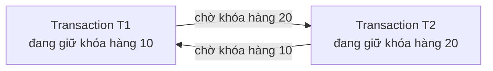
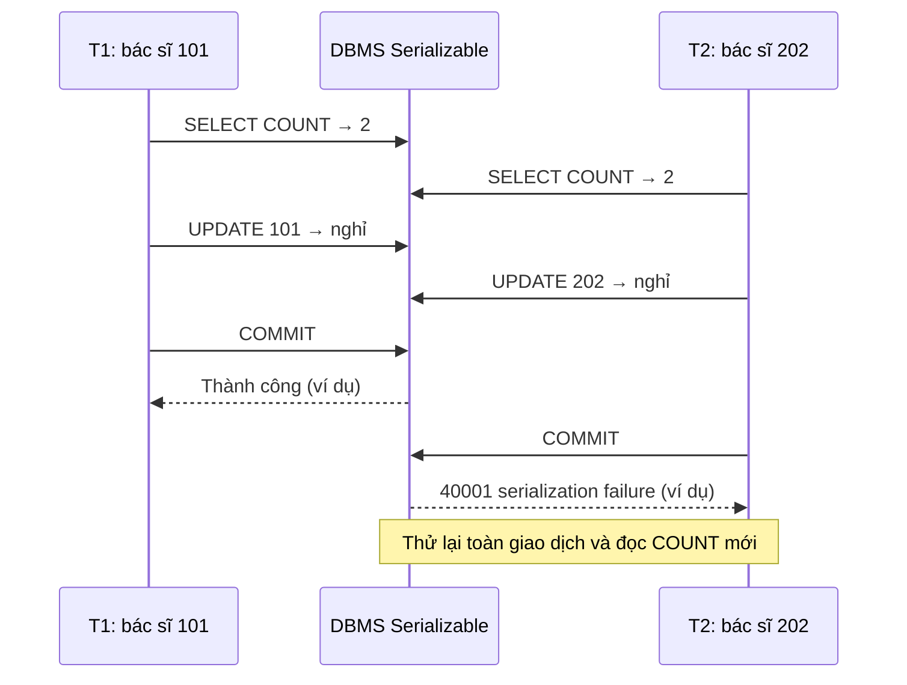
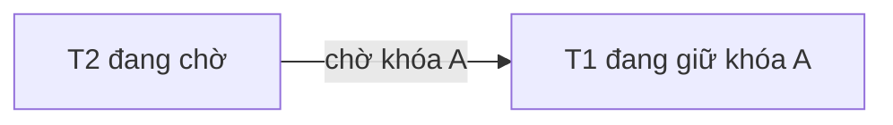

# Nhận diện bế tắc (deadlock) và lỗi tuần tự hóa giao dịch trong JDBC

Trong chương **Cô lập và khóa**, hai lỗi thường xuất hiện khi nhiều giao dịch cùng truy cập dữ liệu là **deadlock** (bế tắc) và **serialization failure** (lỗi tuần tự hóa giao dịch). Chúng đều có thể khiến một giao dịch bị hủy hoặc phải thực hiện lại, nhưng **nguyên nhân và cách phòng tránh không giống nhau**.

Với **JDBC**, ứng dụng Java kết nối cơ sở dữ liệu quan hệ qua driver hoặc `DataSource`, dùng `PreparedStatement` và `ResultSet` để thao tác SQL, dùng `Connection` để điều khiển transaction. Phân biệt đúng hai lỗi giúp ứng dụng xử lý CRUD đồng thời, chọn mức cô lập phù hợp và xây dựng cơ chế retry không làm mất hoặc lặp dữ liệu.

Sau bài học, bạn có thể:

- Mô tả chu trình chờ khóa dẫn tới deadlock và cách DBMS chọn giao dịch bị hủy.
- Giải thích vì sao một lịch thực thi không thể tuần tự hóa có thể dẫn tới lỗi dù không có vòng chờ khóa.
- Đọc `SQLException`, `SQLState` và mã lỗi theo DBMS để nhận diện tình huống.
- Thiết kế transaction ngắn, thứ tự khóa thống nhất và retry **toàn bộ đơn vị nghiệp vụ** trong giao dịch mới.
- Phân biệt lỗi retry được, lock timeout, xung đột optimistic locking và kết quả `commit()` không xác định.

## 1. Nhìn nhanh: deadlock và serialization failure

| Khía cạnh | Deadlock (bế tắc) | Serialization failure (lỗi tuần tự hóa) |
| --- | --- | --- |
| Bản chất | Các transaction **chờ tài nguyên/khóa của nhau theo chu trình**, không thể cùng tiến tiếp | DBMS không thể xác nhận một lịch sử giao dịch phù hợp yêu cầu **serializable** |
| Điều kiện điển hình | Hai giao dịch giữ các khóa khác nhau rồi yêu cầu khóa của nhau | Các giao dịch đọc/ghi đồng thời tạo phụ thuộc có thể dẫn đến kết quả không tương đương thứ tự tuần tự |
| Có cần vòng chờ khóa không? | Có, theo mô hình deadlock chờ khóa đang xét | **Không** |
| Có xảy ra ở `READ COMMITTED` không? | Có thể | Một hệ quản trị chỉ báo lỗi tuần tự hóa ở chế độ hoặc cơ chế cần kiểm soát xung đột như `SERIALIZABLE`; hành vi khác nhau theo DBMS |
| Hành vi khi phát hiện | DBMS thường chọn một transaction làm nạn nhân, hủy để giải phóng khóa | DBMS có thể hủy một transaction để bảo toàn tính tuần tự hóa, kể cả ở lúc `COMMIT` |
| Phòng ngừa | Lấy khóa theo thứ tự cố định, giữ transaction ngắn, có index phù hợp | Thiết kế invariant đúng, chọn isolation phù hợp, xử lý retry toàn transaction |
| Khắc phục tức thời | Kết thúc/rollback transaction lỗi, thử lại khi an toàn | Kết thúc transaction lỗi, đọc lại và thực thi lại toàn bộ logic |
| Ví dụ mã lỗi PostgreSQL | `40P01` (`deadlock_detected`) | `40001` (`serialization_failure`) |

**Điểm quan trọng:** Một DBMS có thể phát hiện deadlock ở nhiều mức isolation; tăng hoặc giảm isolation **không bảo đảm loại bỏ deadlock**. Ngược lại, một lỗi serialization không nhất thiết báo rằng có giao dịch bị kẹt vì vòng chờ khóa.

## 2. Deadlock hình thành như thế nào?

Giả sử hai tài khoản có các hàng `accounts.id = 10` và `accounts.id = 20`. Cùng lúc, giao dịch T1 và T2 đều muốn sửa cả hai tài khoản nhưng **theo thứ tự ngược nhau**:

| Thời điểm | T1 | T2 |
| --- | --- | --- |
| 1 | `UPDATE accounts ... WHERE id = 10` → giữ khóa hàng 10 | — |
| 2 | — | `UPDATE accounts ... WHERE id = 20` → giữ khóa hàng 20 |
| 3 | Muốn `UPDATE ... WHERE id = 20` → **chờ T2** | — |
| 4 | — | Muốn `UPDATE ... WHERE id = 10` → **chờ T1** |
| 5 | T1 chờ T2 | T2 chờ T1 |



Đây là **vòng chờ** (cycle) trong *wait-for graph*. Nếu cả hai cứ giữ khóa và chờ nhau, không giao dịch nào tự hoàn thành. Hệ quản trị CSDL thường có bộ phát hiện deadlock và chọn một giao dịch để hủy, nhờ đó giao dịch còn lại có thể tiến tiếp.

### Lịch SQL minh họa bằng hai session

*Session A – T1:*

```sql
BEGIN;
UPDATE accounts SET balance_cents = balance_cents + 1
WHERE id = 10;

-- Sau khi session B đã sửa hàng 20:
UPDATE accounts SET balance_cents = balance_cents + 1
WHERE id = 20; -- Có thể phải chờ.
```

*Session B – T2:*

```sql
BEGIN;
UPDATE accounts SET balance_cents = balance_cents + 1
WHERE id = 20;

-- Khi session A đang chờ hàng 20:
UPDATE accounts SET balance_cents = balance_cents + 1
WHERE id = 10; -- Tạo vòng chờ.
```

Đây là minh họa SQL theo cơ chế locking của các DBMS phổ biến; các lệnh `BEGIN` được dùng để thể hiện transaction trong SQL client. Trong **JDBC thuần**, ứng dụng thường dùng `conn.setAutoCommit(false)`, rồi `commit()`/`rollback()` thay vì tự gửi `BEGIN`.

**Kết quả có thể xảy ra:** PostgreSQL báo `SQLSTATE 40P01` cho một trong hai session; InnoDB có thể báo lỗi deadlock với mã nhà cung cấp **1213**. Transaction còn lại được giải phóng khỏi vòng chờ. Không giả định **T1** hay **T2** luôn là nạn nhân: lựa chọn phụ thuộc DBMS và tình huống.

### Vì sao việc sắp thứ tự khóa giúp giảm deadlock?

Nếu mọi giao dịch **luôn khóa hàng 10 rồi hàng 20**, T2 có thể phải chờ T1 ở hàng 10, nhưng T2 chưa giữ khóa hàng 20 để khiến T1 quay lại chờ. Một vòng chờ kiểu trên sẽ không hình thành.

Tuy nhiên, thứ tự nhất quán chỉ **giảm** deadlock, không đảm bảo triệt tiêu hoàn toàn. DBMS còn có thể khóa index, khóa ngoại, hàng do trigger thay đổi hoặc tài nguyên khác. Các đường cập nhật phải được đánh giá cùng nhau.

## 3. Serialization failure xuất hiện như thế nào?

Mức cô lập `SERIALIZABLE` yêu cầu kết quả của các giao dịch đồng thời phù hợp một thứ tự thực hiện **tuần tự** nào đó. DBMS có thể bảo đảm điều này bằng khóa, phát hiện phụ thuộc đọc/ghi, cơ chế MVCC/SSI hoặc các phương pháp khác.

Một **serialization failure** xảy ra khi DBMS xác định giao dịch không thể được xác nhận mà vẫn thỏa ràng buộc cô lập cần thiết. Trong PostgreSQL, mã SQLSTATE thường gặp là **`40001`**. Lỗi có thể được phát hiện ở thao tác đọc, ghi, hoặc lúc gọi `commit()`.

### Ví dụ write skew: phải còn ít nhất một bác sĩ trực

Bảng minh họa:

```sql
CREATE TABLE on_call (
    shift_id   BIGINT NOT NULL,
    doctor_id  BIGINT NOT NULL,
    is_on_call BOOLEAN NOT NULL,
    PRIMARY KEY (shift_id, doctor_id)
);
```

Trong ca trực `shift_id = 7`, hai bác sĩ `101` và `202` đều đang trực. Quy tắc nghiệp vụ: **mỗi ca luôn có ít nhất một bác sĩ trực**.

Hai giao dịch đồng thời cùng làm:

```sql
SELECT COUNT(*)
FROM on_call
WHERE shift_id = 7 AND is_on_call = TRUE;

-- Chỉ cho phép nghỉ khi kết quả đếm còn lớn hơn 1.
```

T1 thấy `2`, rồi cập nhật `doctor_id = 101` thành không trực. T2 cũng thấy `2`, rồi cập nhật `doctor_id = 202` thành không trực. Hai lệnh `UPDATE` ghi vào **hai hàng khác nhau**.

| Bước | T1 | T2 |
| --- | --- | --- |
| 1 | Đếm bác sĩ đang trực → 2 | — |
| 2 | — | Đếm bác sĩ đang trực → 2 |
| 3 | Cho bác sĩ 101 nghỉ | — |
| 4 | — | Cho bác sĩ 202 nghỉ |
| 5 | Muốn commit | Muốn commit |

Nếu cả hai đều commit với snapshot cũ, ca trực có thể còn **0 bác sĩ**, vi phạm quy tắc. Không cần có vòng chờ khóa: mỗi bên cập nhật một hàng khác nhau.

Với cách triển khai `SERIALIZABLE` có phát hiện xung đột thích hợp (ví dụ PostgreSQL Serializable Snapshot Isolation), DBMS có thể **hủy một trong hai giao dịch** với `40001`. Giao dịch được thử lại sẽ đọc trạng thái mới (chỉ còn một bác sĩ trực) và từ chối yêu cầu nghỉ tiếp.



**Chú ý:** Đây là *một lịch minh họa*, không phải cam kết rằng mọi DBMS đều phát lỗi tại đúng bước `COMMIT` hoặc chọn T2 làm nạn nhân. Một hệ có thể phát hiện xung đột sớm hơn, khóa chặn trước, hoặc dùng cách điều phối khác.

Nếu dùng mức cô lập thấp hơn, ví dụ một số triển khai snapshot isolation, tình huống *write skew* có thể không bị ngăn chặn. Vì vậy, **đúng isolation là một phần của thiết kế invariant**, bên cạnh ràng buộc SQL và logic nghiệp vụ.

## 4. Nhận diện lỗi khi làm việc với JDBC

Khi một lệnh SQL thất bại, JDBC thường ném `SQLException`, có thể kèm `SQLState`, mã lỗi riêng của DBMS, chuỗi ngoại lệ liên quan và lớp con của `SQLException`.

```java
import java.sql.SQLException;

public static void logSqlFailure(SQLException error) {
    for (SQLException current = error;
         current != null;
         current = current.getNextException()) {
        System.err.printf(
            "SQLState=%s, vendorCode=%d, type=%s%n",
            current.getSQLState(),
            current.getErrorCode(),
            current.getClass().getSimpleName()
        );
    }
}
```

Không ghi trực tiếp tham số nhạy cảm hay toàn bộ SQL chứa dữ liệu cá nhân vào log. Nên bổ sung tên thao tác, mã yêu cầu, số lần retry và thời lượng transaction để chẩn đoán.

### Bảng mã lỗi thường gặp

| Hệ quản trị / ngữ cảnh | Dấu hiệu tiêu biểu | Diễn giải |
| --- | --- | --- |
| PostgreSQL | `SQLSTATE 40P01` | `deadlock_detected` |
| PostgreSQL | `SQLSTATE 40001` | `serialization_failure` |
| MySQL/InnoDB | Vendor code `1213`, thường SQLSTATE `40001` | Deadlock; engine có thể rollback giao dịch nạn nhân |
| MySQL/InnoDB | Vendor code `1205`, thường SQLSTATE `HY000` | Lock wait timeout; khác deadlock |
| SQLState lớp `40` | Các mã bắt đầu bằng `40` | Nhóm lỗi liên quan đến transaction rollback, **không đồng nghĩa mọi mã là deadlock** |
| SQLState lớp `08` | Các mã bắt đầu bằng `08` | Lỗi kết nối; trạng thái commit có thể không rõ |
| JDBC, không có exception | `executeUpdate() == 0` | Có thể là xung đột optimistic locking hoặc không có hàng phù hợp; **không phải deadlock** |

**Không suy luận chỉ từ một mã độc lập với DBMS.** Ví dụ `40001` là serialization failure theo SQLSTATE, nhưng MySQL cũng thường gắn mã này với lỗi InnoDB deadlock (vendor code `1213`). Muốn phân biệt phục vụ giám sát hay hướng dẫn người dùng, phải kết hợp loại DBMS, SQLState và vendor code.

JDBC có các lớp như `SQLTransactionRollbackException` và `SQLTransientException`. Đây là tín hiệu hữu ích, nhưng cách driver ánh xạ từng lỗi có thể khác nhau. Đừng chỉ dựa vào `instanceof` rồi retry mọi trường hợp.

### Hàm phân loại mẫu cho hai DBMS cụ thể

```java
import java.sql.SQLException;

enum Dbms { POSTGRESQL, MYSQL }
enum ConflictKind {
    DEADLOCK, SERIALIZATION_FAILURE, LOCK_TIMEOUT,
    CONNECTION_FAILURE, OTHER
}

static ConflictKind classify(SQLException e, Dbms dbms) {
    String state = e.getSQLState();
    int vendorCode = e.getErrorCode();

    if (state != null && state.startsWith("08")) {
        return ConflictKind.CONNECTION_FAILURE;
    }

    if (dbms == Dbms.POSTGRESQL) {
        if ("40P01".equals(state)) return ConflictKind.DEADLOCK;
        if ("40001".equals(state)) {
            return ConflictKind.SERIALIZATION_FAILURE;
        }
    }

    if (dbms == Dbms.MYSQL) {
        if (vendorCode == 1213) return ConflictKind.DEADLOCK;
        if (vendorCode == 1205) return ConflictKind.LOCK_TIMEOUT;
    }

    return ConflictKind.OTHER;
}
```

Đoạn mã trên chỉ minh họa ánh xạ **PostgreSQL và MySQL/InnoDB**. Trong ứng dụng thực tế cần thử với phiên bản driver/DBMS đang dùng, có thể duyệt `getNextException()` và định nghĩa chính sách cụ thể cho từng loại lỗi. Không phải mã nào thuộc `OTHER` cũng vĩnh viễn không retry được, nhưng chưa có bằng chứng thì không nên tự retry.

## 5. Phân biệt deadlock, lock wait timeout và xung đột nghiệp vụ

Ba tình huống sau thường bị nhầm:

### 5.1. Deadlock: có vòng chờ

T1 giữ khóa A và chờ B; T2 giữ khóa B và chờ A. DBMS phát hiện vòng chờ, hủy một giao dịch.

### 5.2. Lock wait timeout: chờ quá lâu nhưng không nhất thiết có vòng chờ

T1 đang giữ khóa A để xử lý một giao dịch lâu. T2 chỉ chờ A, không giữ tài nguyên mà T1 cần. Sau thời gian giới hạn, DBMS báo **lock timeout**. Đây có thể chỉ là một quan hệ chờ một chiều:



Không có cạnh quay lại nên **không đủ bằng chứng deadlock**.

Với MySQL/InnoDB, mặc định nhiều trường hợp lock wait timeout chỉ rollback **câu lệnh đang chờ**, còn deadlock thường khiến engine rollback **toàn giao dịch nạn nhân**. Cấu hình, engine và loại lỗi ảnh hưởng đến hành vi thực tế; không áp dụng máy móc cho mọi DBMS. Trong transaction nghiệp vụ nhiều bước, hướng an toàn vẫn là rollback toàn phần khi không biết rõ trạng thái.

### 5.3. Optimistic locking: không có hàng nào phù hợp

```sql
UPDATE customers
SET email = ?, version = version + 1
WHERE id = ? AND version = ?;
```

Nếu `executeUpdate()` trả `0`, dữ liệu có thể đã được người khác sửa khiến `version` không còn khớp. Đây là **xung đột phiên bản do ứng dụng phát hiện**, không nhất thiết có deadlock hoặc serialization failure.

Tùy nghiệp vụ, ứng dụng có thể trả lỗi xung đột cho người dùng, tải lại bản ghi, hoặc tự hòa giải dữ liệu. Không nên chạy retry lặp lại với cùng `expectedVersion` cũ vì vẫn sẽ thất bại.

## 6. Mức cô lập ảnh hưởng ra sao?

JDBC dùng `Connection.setTransactionIsolation(...)` để yêu cầu mức cô lập; khả năng hỗ trợ và cách thực thi cụ thể phụ thuộc DBMS.

```java
import java.sql.Connection;
import java.sql.SQLException;

static void configureIsolation(Connection conn) throws SQLException {
    // Thiết lập trước khi chạy các câu SQL của transaction.
    conn.setTransactionIsolation(
        Connection.TRANSACTION_SERIALIZABLE
    );
    conn.setAutoCommit(false);
}
```

Các mức cô lập chuẩn thường được nêu dưới đây:

| Mức cô lập JDBC | Ý nghĩa thực hành | Liên hệ lỗi đồng thời |
| --- | --- | --- |
| `TRANSACTION_READ_UNCOMMITTED` | Có thể cho phép đọc dữ liệu chưa commit tùy DBMS | Không ngăn deadlock; hỗ trợ thực tế khác nhau |
| `TRANSACTION_READ_COMMITTED` | Tránh dirty read theo mô hình chuẩn | Deadlock vẫn có thể xảy ra; một số bất biến đa hàng chưa được bảo vệ |
| `TRANSACTION_REPEATABLE_READ` | Hạn chế biến động khi đọc lại theo định nghĩa/triển khai DBMS | Không đồng nghĩa mọi lịch đều serializable; có thể còn anomaly tùy hệ |
| `TRANSACTION_SERIALIZABLE` | Yêu cầu kết quả tương đương thực thi tuần tự | DBMS có thể dùng khóa, phát hiện xung đột và hủy transaction bằng serialization failure |

Không được suy đoán rằng gọi `setTransactionIsolation(SERIALIZABLE)` khiến **mọi thao tác chạy tuần tự theo thời gian thực**. DBMS vẫn có thể cho nhiều transaction chạy song song và hủy một transaction nếu lịch không thể thỏa điều kiện.

**Thực hành an toàn:**

- Thiết lập isolation **trước khi bắt đầu** câu SQL của transaction; thay đổi isolation giữa transaction có thể bị cấm hoặc phụ thuộc driver/DBMS.
- Đọc lại bằng `getTransactionIsolation()` khi cần kiểm chứng trạng thái connection được pool cấp.
- Tránh giữ mức `SERIALIZABLE` cho mọi thao tác nếu ứng dụng không cần, vì có thể tăng khóa/chờ hoặc tỷ lệ retry tùy DBMS và tải.
- Không hạ isolation chỉ để làm mất thông báo lỗi; hãy đánh giá xem quy tắc nghiệp vụ có còn được bảo vệ không.

## 7. Phòng deadlock bằng thứ tự lấy khóa nhất quán

Với hai hàng tài khoản, ứng dụng có thể chủ động khóa theo **ID tăng dần** trước khi ghi. Ví dụ dưới dùng câu `SELECT ... FOR UPDATE`, được PostgreSQL và MySQL/InnoDB hỗ trợ; cú pháp/cách khóa ở hệ quản trị khác cần điều chỉnh.

```java
import java.sql.Connection;
import java.sql.PreparedStatement;
import java.sql.ResultSet;
import java.sql.SQLException;

public final class AccountLocking {
    private AccountLocking() {}

    // Chỉ dùng trong transaction đã bật manual commit.
    public static void lockBothInIdOrder(
        Connection conn, long accountA, long accountB
    ) throws SQLException {
        if (conn.getAutoCommit()) {
            throw new SQLException(
                "Cần transaction thủ công trước khi khóa nhiều hàng"
            );
        }
        if (accountA == accountB) {
            throw new IllegalArgumentException("Hai tài khoản phải khác nhau");
        }

        long first = Math.min(accountA, accountB);
        long second = Math.max(accountA, accountB);

        String sql = "SELECT id FROM accounts WHERE id = ? FOR UPDATE";

        // Khóa từng hàng theo thứ tự do ứng dụng quyết định.
        for (long id : new long[] { first, second }) {
            try (PreparedStatement ps = conn.prepareStatement(sql)) {
                ps.setLong(1, id);
                try (ResultSet rs = ps.executeQuery()) {
                    if (!rs.next()) {
                        throw new SQLException("Không tìm thấy account: " + id);
                    }
                }
            }
        }

        // Sau khi cả hai khóa đã có, caller cập nhật số dư
        // trên CHÍNH conn này, rồi commit/rollback toàn transaction.
    }
}
```

So với truy vấn lấy nhiều hàng có `ORDER BY`, việc khóa hai hàng **bằng hai truy vấn theo thứ tự cố định** giúp ý định khóa trước/sau rõ ràng hơn, tránh giả định DBMS luôn lấy khóa theo thứ tự sắp xếp của kết quả truy vấn.

Mẫu code cần được gọi từ service sở hữu transaction, chẳng hạn:

```java
conn.setAutoCommit(false);
try {
    AccountLocking.lockBothInIdOrder(conn, sourceId, targetId);
    debitAccount(conn, sourceId, amountCents);
    creditAccount(conn, targetId, amountCents);
    conn.commit();
} catch (SQLException | RuntimeException error) {
    try {
        conn.rollback();
    } catch (SQLException rollbackError) {
        error.addSuppressed(rollbackError);
    }
    throw error;
}
```

Đoạn gọi trên minh họa trình tự và giả định `conn` do tầng ngoài cấp, chịu trách nhiệm khôi phục trạng thái và đóng/trả kết nối sau khi giao dịch kết thúc. `debitAccount` và `creditAccount` là các thao tác JDBC nghiệp vụ, phải dùng cùng `conn` và kiểm tra số hàng cập nhật. Trong mã thật, cần kiểm tra số tiền hợp lệ, tính toán tràn số, ràng buộc số dư và các quy tắc nghiệp vụ khác.

### Nguyên tắc hỗ trợ giảm deadlock

- **Thống nhất thứ tự truy cập bảng và hàng** giữa các luồng nghiệp vụ có cùng tập dữ liệu.
- **Transaction ngắn:** chỉ thực hiện SQL cần thiết; không chờ tương tác người dùng hoặc gọi HTTP chậm khi đang giữ khóa.
- **Index đúng điều kiện `WHERE`/JOIN:** tránh khóa/đọc phạm vi lớn ngoài ý muốn; cơ chế khóa thực tế phụ thuộc query plan.
- **Giảm tranh chấp:** không dồn mọi cập nhật vào một hàng tổng đếm nóng nếu có phương án thiết kế khác.
- **Truy cập nhất quán:** dùng `PreparedStatement` tham số hóa, kiểm tra số hàng cập nhật và có ranh giới transaction rõ ràng.
- **Vẫn phải xử lý deadlock:** tối ưu thứ tự khóa làm giảm xác suất, không xóa bỏ nhu cầu retry có kiểm soát.

## 8. Retry đúng: thực thi lại toàn bộ transaction

Sau deadlock hoặc serialization failure, **công việc trong transaction bị hủy phải được thực hiện lại từ đầu**: đọc dữ liệu mới, tính toán lại quyết định và áp dụng lại các thay đổi theo nghiệp vụ.

Ví dụ không đúng:

```java
// Sai ý đồ: sau serialization failure ở bước ghi,
// chỉ gọi lại UPDATE cuối cùng trên transaction cũ.
updateFinalRow(conn);
```

Lý do:

1. Transaction cũ có thể đã bị DBMS tự rollback hoặc đang ở trạng thái lỗi.
2. Kết quả `SELECT` trước đó có thể đã cũ; ví dụ số bác sĩ đang trực đã đổi.
3. Cần tạo **connection/transaction mới** cho lượt thử tiếp theo; không nên giữ lại những giả định về snapshot và khóa cũ.
4. Nếu đã có side effect ngoài DB (gửi email, thanh toán), retry có thể gây thực hiện lặp.
5. Lỗi khi `commit()` do mất kết nối có thể khiến kết quả **chưa rõ**; không retry mù quáng.

### Khung retry có giới hạn cho PostgreSQL

Đây là mã minh họa cách phân loại **hai SQLState của PostgreSQL**: `40P01` và `40001`. Chỉ dùng cùng chính sách nếu đã xác minh hành vi của DBMS/driver hiện tại. Đơn vị `work` phải chứa **toàn bộ công việc truy vấn và cập nhật nghiệp vụ**, không được thực hiện side effect bên ngoài CSDL.

```java
import javax.sql.DataSource;
import java.sql.Connection;
import java.sql.SQLException;
import java.util.Objects;

public final class PgTransactionRetry {
    private static final int MAX_ATTEMPTS = 3;

    @FunctionalInterface
    public interface SqlWork<T> {
        T execute(Connection conn) throws SQLException;
    }

    private final DataSource dataSource;

    public PgTransactionRetry(DataSource dataSource) {
        this.dataSource = Objects.requireNonNull(dataSource);
    }

    public <T> T execute(SqlWork<T> work) throws SQLException {
        for (int attempt = 1; attempt <= MAX_ATTEMPTS; attempt++) {
            if (attempt > 1) {
                // Backoff đơn giản. Sản phẩm thực tế nên thêm jitter.
                try {
                    Thread.sleep(50L * attempt);
                } catch (InterruptedException interrupted) {
                    Thread.currentThread().interrupt();
                    throw new SQLException(
                        "Đã hủy thao tác khi đang đợi retry",
                        interrupted
                    );
                }
            }

            // Lấy connection mới cho MỖI attempt.
            try (Connection conn = dataSource.getConnection()) {
                boolean originalAutoCommit = conn.getAutoCommit();
                conn.setAutoCommit(false);

                boolean transactionEnded = false;
                boolean rollbackSucceeded = false;
                Throwable failure = null;

                try {
                    T result = work.execute(conn);
                    conn.commit();
                    transactionEnded = true;
                    return result;
                } catch (SQLException | RuntimeException error) {
                    failure = error;
                    try {
                        conn.rollback();
                        transactionEnded = true;
                        rollbackSucceeded = true;
                    } catch (SQLException rollbackError) {
                        error.addSuppressed(rollbackError);
                    }

                    if (error instanceof SQLException sqlError
                            && rollbackSucceeded
                            && isPgRetryable(sqlError)
                            && attempt < MAX_ATTEMPTS) {
                        continue; // Chỉ sau rollback thành công.
                    }
                    throw error;
                } finally {
                    // Không chuyển sang autoCommit=true nếu rollback lỗi:
                    // điều này có nguy cơ commit phần transaction còn treo.
                    if (transactionEnded) {
                        try {
                            conn.setAutoCommit(originalAutoCommit);
                        } catch (SQLException restoreError) {
                            if (failure != null) {
                                failure.addSuppressed(restoreError);
                            } else {
                                // Giao dịch đã commit thành công.
                                // Không được coi lỗi cleanup là lý do retry.
                                throw new SQLException(
                                    "Commit đã thành công; lỗi khôi phục connection",
                                    "HY000",
                                    restoreError
                                );
                            }
                        }
                    }
                }
            }
        }
        throw new IllegalStateException("Không thể đến đây");
    }

    private static boolean isPgRetryable(SQLException error) {
        // Mã PostgreSQL; không dùng cho mọi DBMS.
        String state = error.getSQLState();
        return "40P01".equals(state) || "40001".equals(state);
    }
}
```

**Đọc kỹ giới hạn của mã:**

- Cùng **`work` được gọi lại từ đầu** ở mỗi attempt; bên trong phải đọc lại trạng thái hiện tại, kiểm tra điều kiện nghiệp vụ và cập nhật trên connection vừa nhận.
- Mỗi attempt có transaction riêng. Khi driver báo `40P01` hoặc `40001`, mã vẫn yêu cầu `rollback()` thành công trước khi lặp. Nếu rollback hỏng, không tiếp tục retry tự động.
- Nếu `commit()` trả lỗi kết nối (`SQLState` thuộc lớp `08` hoặc lỗi không biết rõ), mã **không** retry; phải đối soát trạng thái thực tế.
- Lỗi khi khôi phục connection **sau một commit thành công** được thông báo riêng, và không được xử lý như deadlock/serialization failure để tránh chạy trùng nghiệp vụ.
- Đây là ví dụ cho **PostgreSQL**, không tự phân loại MySQL vendor code `1213`. Thời gian chờ `50L * attempt` đơn giản để dễ đọc; khi chạy tải cao nên dùng exponential backoff có jitter, giới hạn thời gian tổng và theo dõi số lượt retry.
- `DataSource`/pool phải được cấu hình quản lý kết nối lỗi và khôi phục trạng thái phù hợp. Nếu `rollback()` thất bại, không ép `autoCommit = true` trước khi trả kết nối.

Ví dụ cách gọi:

```java
PgTransactionRetry executor = new PgTransactionRetry(dataSource);

executor.execute(conn -> {
    int active = countOnCallDoctors(conn, shiftId);
    if (active <= 1) {
        throw new IllegalStateException(
            "Ca trực phải còn ít nhất một bác sĩ"
        );
    }
    setDoctorOffCall(conn, shiftId, doctorId);
    return null;
});
```

`countOnCallDoctors` và `setDoctorOffCall` đại diện cho hai thao tác JDBC dùng `PreparedStatement` trên **cùng `conn`**. Để xử lý tình huống write skew nêu trên, transaction phải chạy ở mức isolation bảo đảm serializability; hãy thiết lập `TRANSACTION_SERIALIZABLE` theo cấu hình connection **trước khi bắt đầu thao tác của từng attempt**, đồng thời xét ràng buộc và hành vi của DBMS.

### Các tiêu chí cần đạt trước khi retry

| Câu hỏi | Nếu câu trả lời là “không” |
| --- | --- |
| Lỗi đã được xác định là transient và được phép retry trên DBMS này? | Trả lỗi thay vì retry |
| Transaction cũ chắc chắn không commit? | Đối soát, dùng idempotency key; không chạy lại bừa |
| Đã rollback hoặc DBMS chắc chắn đã hủy transaction? | Không tái sử dụng trạng thái cũ |
| Có thể chạy lại **toàn bộ** quyết định trên dữ liệu mới? | Thiết kế lại transaction |
| Mọi side effect đã được bảo vệ chống lặp? | Cần outbox/idempotency hoặc bù trừ |
| Có giới hạn lượt thử, thời gian và backoff? | Tránh vòng retry vô hạn và retry storm |

Một số lỗi vi phạm unique, lỗi cú pháp, trường dữ liệu không hợp lệ hoặc lỗi quyền truy cập **không tự trở nên đúng** sau retry. Với xung đột optimistic locking, nghiệp vụ thường phải tải lại dữ liệu, hỏi người dùng hoặc áp dụng quy tắc hợp nhất thay vì lặp cùng bản ghi cũ.

## 9. Chẩn đoán deadlock và lỗi tuần tự hóa trong môi trường thực tế

Chỉ dựa vào thông báo lỗi không đủ để biết vì sao tải tăng đột ngột hoặc hai transaction tranh chấp nhau. Cần kết hợp thông tin từ ứng dụng và DBMS.

### Quan sát từ ứng dụng JDBC

Nên ghi nhận:

- Tên **đơn vị nghiệp vụ** (ví dụ `transferFunds`, `reserveSeat`), mã yêu cầu/correlation ID.
- DBMS, `SQLState`, vendor code, tên loại `SQLException` và chuỗi `getNextException()`.
- Số attempt, số transaction đã rollback, thời lượng transaction, thời gian chờ và tỷ lệ retry hết giới hạn.
- Isolation level tại đầu transaction, có savepoint hay không và bước nào trong workflow gặp lỗi.
- Thống kê theo nhóm lỗi: deadlock, serialization, lock timeout, lỗi kết nối/commit chưa rõ outcome.

Nên **không** log nguyên văn chuỗi SQL có giá trị nhạy cảm hoặc bản ghi cá nhân. Khi truy vết SQL, ưu tiên tên truy vấn được định danh và tham số đã được lọc thông tin.

### Quan sát từ PostgreSQL

Các công cụ có thể dùng khi có quyền phù hợp:

```sql
-- Xem session đang chờ tài nguyên và session đang chặn.
SELECT pid,
       state,
       wait_event_type,
       wait_event,
       pg_blocking_pids(pid) AS blocking_pids
FROM pg_stat_activity
WHERE datname = current_database();
```

Những dấu hiệu như `wait_event_type = 'Lock'` cho biết session đang chờ khóa. **Một quan hệ blocking đơn lẻ không chứng minh deadlock**; cần xác định vòng chờ hoặc xem báo cáo deadlock trong log server. Tùy cấu hình, PostgreSQL có thể ghi thông tin deadlock và chi tiết transaction vào log.

### Quan sát từ MySQL/InnoDB

```sql
SHOW ENGINE INNODB STATUS;
```

Phần deadlock gần nhất trong kết quả thường giúp nhận diện các transaction, khóa đang giữ/chờ và giao dịch bị chọn hủy. Ở các phiên bản hỗ trợ, `performance_schema.data_locks` và `performance_schema.data_lock_waits` có thể giúp quan sát tình trạng khóa hiện tại. Quyền truy cập và độ đầy đủ của dữ liệu phụ thuộc cấu hình.

### Phân tích theo chuỗi nguyên nhân

Ví dụ một endpoint chuyển tiền bị deadlock thường xuyên:

1. Xác định hai hoặc nhiều lệnh SQL cụ thể từ log và định danh transaction.
2. Kiểm tra tập hàng/bảng chúng truy cập và **thứ tự** truy cập.
3. Kiểm tra index, khóa ngoại và trigger có làm tăng phạm vi khóa không.
4. Kiểm tra thời gian giữ transaction, có gọi hệ thống ngoài hoặc thao tác không liên quan trong lúc giữ khóa không.
5. Đồng thời xác minh cơ chế rollback/retry có giữ nguyên bất biến nghiệp vụ và không tạo giao dịch trùng không.

Với serialization failure, bổ sung phân tích **tập dữ liệu đã đọc trước khi ra quyết định**, predicate đọc, điều kiện cập nhật và quy tắc nghiệp vụ mà isolation phải bảo vệ. Không chỉ nhìn các hàng được `UPDATE`; các giá trị đã `SELECT` cũng có thể tạo phụ thuộc gây lỗi.

## 10. Các lỗi triển khai thường gặp

### 10.1. Chỉ retry câu SQL bị lỗi

Nếu cả transaction vừa bị hủy, các truy vấn và phép tính trước đó không còn giá trị. Phải **chạy lại toàn bộ transaction** khi chính sách cho phép.

### 10.2. Tiếp tục sử dụng connection đang trong transaction thất bại

PostgreSQL có thể đánh dấu giao dịch đang *aborted* sau `40P01` hoặc `40001`; các câu tiếp theo không thể cứ thực thi bình thường. Hãy rollback/đóng transaction cũ, và thiết lập transaction mới phù hợp.

### 10.3. Retry khi không biết `commit()` đã thành công chưa

Nếu mất kết nối đúng lúc commit, DBMS có thể đã commit nhưng phản hồi thất lạc. Retry vô điều kiện có thể trừ tiền hoặc tạo đơn hàng lần hai. Cần khóa idempotency, ràng buộc unique và quy trình đối soát.

### 10.4. Coi mọi lần `executeUpdate() == 0` là deadlock

Không có exception nghĩa là không có cơ sở để gắn nhãn deadlock. Hãy xem điều kiện `WHERE`, xung đột phiên bản hoặc lỗi nghiệp vụ.

### 10.5. Dùng isolation thấp để làm giảm lỗi mà không kiểm tra tính đúng

Nếu ứng dụng cần đảm bảo mỗi ca còn người trực, hạ isolation từ `SERIALIZABLE` có thể khiến hai yêu cầu cùng thành công nhưng phá vỡ invariant. Chọn thiết kế và ràng buộc đúng trước khi tối ưu tỷ lệ retry.

### 10.6. Giữ transaction khi chờ HTTP, người dùng hoặc tác vụ chậm

Transaction quá lâu kéo dài thời gian giữ khóa/snapshot và tăng xác suất chờ, deadlock, timeout hoặc serialization failure. Thu ngắn phần công việc cần tính nguyên tử.

### 10.7. Nghĩ rằng một thứ tự khóa chuẩn loại bỏ mọi bế tắc

Các trigger, khóa ngoại, các index và tuyến truy cập khác có thể lấy thêm khóa ngoài dự tính. Cần log và theo dõi lỗi trên tải thực tế, kể cả khi đã sắp thứ tự hàng.

## 11. Bài tập tình huống

**Tình huống A.** T1 khóa hàng 1, T2 khóa hàng 2, T1 chờ hàng 2, T2 chờ hàng 1. Đây là loại lỗi nào và phương án giảm thiểu?

**Đáp án:** Deadlock vì có vòng chờ. Thống nhất thứ tự khóa giữa các transaction (ví dụ ID tăng dần), giảm thời gian giữ khóa và xử lý retry khi DBMS hủy một giao dịch.

**Tình huống B.** Hai giao dịch `SERIALIZABLE` cùng đọc số bác sĩ trực rồi sửa hai hàng khác nhau. Một giao dịch nhận PostgreSQL `40001` khi `commit()`. Có chắc đây là deadlock?

**Đáp án:** Không. `40001` là serialization failure. Lỗi có thể xuất hiện do phụ thuộc đọc/ghi không thể tuần tự hóa, dù không có vòng chờ khóa. Phải thực hiện lại toàn bộ transaction với dữ liệu mới nếu đủ điều kiện retry.

**Tình huống C.** MySQL/InnoDB trả vendor code `1213`, SQLSTATE `40001`. Có nên chỉ dựa vào `40001` để gắn nhãn “lỗi serialization” cho báo cáo?

**Đáp án:** Không. Trên MySQL, `1213` thường là deadlock. Kết hợp vendor code và tài liệu driver/DBMS.

**Tình huống D.** T2 đợi T1 giữ một hàng quá lâu và nhận lock wait timeout. Không quan sát thấy cạnh chờ từ T1 sang T2. Có chứng minh được deadlock không?

**Đáp án:** Không. Có thể chỉ là chờ khóa một chiều quá hạn. Cần phân biệt timeout với deadlock và xác minh trạng thái transaction sau lỗi theo DBMS.

**Tình huống E.** Lần đầu transaction SERIALIZABLE bị hủy sau khi đọc dữ liệu. Ở lần retry, có nên dùng lại giá trị `COUNT(*)` trước đó không?

**Đáp án:** Không. Lượt thử mới phải đọc lại dữ liệu và tính toán lại điều kiện nghiệp vụ để quyết định có được ghi hay không.

**Tình huống F.** Lỗi mạng đến đúng lúc `commit()` khiến ứng dụng không biết DBMS đã commit chưa. Có nên tự retry chuyển tiền ngay?

**Đáp án:** Không. Phải đối soát trạng thái và dùng cơ chế chống lặp như idempotency key/unique transaction ID. Retry mù có thể chuyển tiền hai lần.

**Tình huống G.** Bạn đã sắp thứ tự khóa, nhưng vẫn ghi nhận deadlock khi một trigger cập nhật bảng khác. Điều đó có mâu thuẫn với nguyên tắc khóa nhất quán?

**Đáp án:** Không. Nguyên tắc cần áp dụng cho **mọi đường lấy khóa**, kể cả index, trigger, khóa ngoại và các thao tác phụ; thứ tự trên hai hàng chính chưa chắc bao phủ toàn bộ khóa của transaction.

## Ghi nhớ

- **Deadlock** là vòng chờ khóa giữa các transaction; **serialization failure** là lịch thực thi không thể được xác nhận theo yêu cầu tuần tự hóa. Hai lỗi **có thể liên quan nhưng không đồng nghĩa**.
- **Phân loại bằng DBMS + SQLState + vendor code**: PostgreSQL thường dùng `40P01` cho deadlock, `40001` cho serialization; MySQL/InnoDB thường dùng vendor code `1213` cho deadlock.
- **Lock timeout không tự chứng minh deadlock**, và `executeUpdate() == 0` có thể chỉ là xung đột nghiệp vụ/optimistic locking.
- **Giảm deadlock** bằng thứ tự khóa cố định, transaction ngắn, index phù hợp và ít tranh chấp; vẫn phải chuẩn bị nhánh xử lý lỗi.
- **Retry đúng** nghĩa là rollback/dừng giao dịch cũ, thực thi lại **toàn bộ nghiệp vụ với dữ liệu mới** trong transaction mới, giới hạn số lần và dùng backoff.
- **Không retry mù khi commit có kết quả chưa rõ**; ứng dụng cần chống lặp bằng idempotency và đối soát. Mức isolation phải bảo vệ đúng invariant, không chỉ nhằm giảm số lỗi báo ra.
