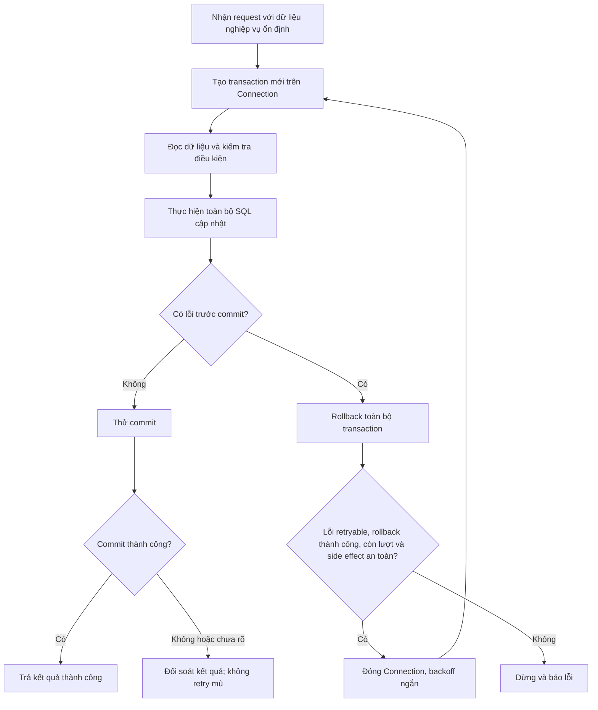

# Thử lại toàn bộ giao dịch khi đáp ứng điều kiện an toàn trong JDBC

Trong hệ thống Java truy cập cơ sở dữ liệu quan hệ qua JDBC, hai yêu cầu có thể cùng đọc và sửa dữ liệu. Khi **cô lập giao dịch** và **khóa** ngăn những lịch thực thi không an toàn, DBMS đôi khi phải hủy một giao dịch bằng lỗi **serialization failure**, **deadlock** hoặc một lỗi cạnh tranh khác. Một thao tác vốn hợp lệ có thể thất bại chỉ vì nhiều transaction diễn ra đồng thời.

Thử lại có thể giúp hoàn thành nghiệp vụ, nhưng **chỉ đúng khi biết rõ transaction cũ đã không commit, toàn bộ thao tác có thể thực hiện lại và lỗi thuộc nhóm được phép retry**. Thử lại mỗi câu SQL lỗi, thử lại vô hạn hoặc thử lại sau một lần commit có kết quả chưa rõ đều có thể tạo ra sai lệch dữ liệu.

Bài thuộc chương **Cô lập và khóa** của JDBC. Ta sẽ xác định điều kiện retry, cách nhận diện lỗi bằng `SQLException` và `SQLState`, thực hiện lại **toàn bộ transaction** bằng `Connection` mới, xử lý `rollback()`, giới hạn số lần thử, áp dụng backoff và phân biệt lỗi có thể retry với trạng thái commit chưa xác định.

## 1. Vì sao transaction hợp lệ vẫn có thể thất bại?

Xét hai giao dịch chuyển tiền:

- **T1:** đọc tài khoản A, cập nhật A, rồi cập nhật B.
- **T2:** đọc tài khoản B, cập nhật B, rồi cập nhật A.

Nếu T1 giữ khóa trên A, T2 giữ khóa trên B và mỗi bên chờ khóa của bên kia, có thể hình thành **deadlock**.

```text
T1: khóa A ──────────── chờ khóa B
       ▲                     │
       │                     ▼
T2: chờ khóa A ◀────────── khóa B

DBMS phát hiện vòng chờ và thường chọn một giao dịch làm nạn nhân.
```

DBMS sẽ thông báo lỗi và xử lý hủy theo quy tắc của sản phẩm. Nếu T1 bị hủy, chương trình cần hoàn tất việc dọn trạng thái giao dịch rồi có thể thực hiện **lại T1 từ đầu**. Trong lần thử mới, lịch tranh chấp có thể đã khác nên transaction có thể thành công.

Một ví dụ khác là **serialization failure** ở mức `SERIALIZABLE`. DBMS phát hiện không thể hoàn thành giao dịch với kết quả tương đương một thứ tự tuần tự hợp lệ, nên từ chối một transaction để bảo vệ tính đúng đắn.

Không nên xem mọi lỗi cạnh tranh là deadlock, hay xem cứ dùng `SERIALIZABLE` thì sẽ không còn lỗi: mức cô lập mạnh có thể **tăng khả năng transaction phải được thử lại** để bảo toàn tính nhất quán.

## 2. Retry câu SQL và retry toàn bộ transaction là hai việc khác nhau

Giả sử logic đặt hàng gồm:

1. Đọc số lượng tồn kho.
2. Kiểm tra số lượng yêu cầu.
3. Ghi đơn hàng.
4. Giảm tồn kho.
5. `commit()`.

Một transaction ở `SERIALIZABLE` có thể lỗi tại bước 4 hoặc thậm chí ở bước commit. Nếu chỉ chạy lại `UPDATE inventory`, kết quả tính từ bước đọc ban đầu có thể không còn hợp lệ. Bởi vậy, khi DBMS báo cần retry transaction, phải **làm lại cả quyết định nghiệp vụ dựa trên dữ liệu đọc trong transaction**, không chỉ lệnh báo lỗi.



**Toàn bộ transaction** gồm các truy vấn `SELECT` dẫn tới quyết định, các kiểm tra điều kiện và tất cả câu `INSERT`/`UPDATE`/`DELETE`. Giá trị lấy từ DB ở lần thử cũ phải được đọc lại. Dữ liệu yêu cầu như mã đơn, số tiền và số lượng do người dùng gửi cần giữ ổn định giữa các lượt thử, trừ khi quy tắc nghiệp vụ xác định khác.

Tránh để một helper JDBC tự `commit()` sớm: khi một phần transaction đã commit, retry toàn bộ không còn là phép chạy lại đơn thuần.

## 3. Điều kiện để thử lại an toàn

Một lỗi `SQLException` có thể trở thành ứng viên retry nếu **đồng thời** đáp ứng các điều kiện sau:

| Điều kiện | Ý nghĩa thực tế |
|---|---|
| Lỗi thuộc loại **có thể phục hồi bằng thử lại** | DBMS/driver xác nhận đây là tình huống tranh chấp hoặc trạng thái tạm thời phù hợp, như serialization failure |
| Transaction cũ **chắc chắn chưa commit** | Lỗi xảy ra trước khi commit được thử, hoặc có xác nhận đáng tin cậy từ DBMS rằng commit bị hủy |
| Rollback/việc hủy transaction được xác nhận phù hợp | Có thể dừng transaction cũ và bắt đầu transaction mới; không tiếp tục dùng trạng thái đã lỗi |
| Mọi thao tác có thể chạy lại | Đọc lại dữ liệu, kiểm tra lại điều kiện nghiệp vụ, không sử dụng kết quả đọc cũ |
| Không có side effect ngoài DB không thể thu hồi | Không gửi email, gọi API thu tiền, xuất message hoặc ghi file trong đoạn có thể retry mà không có kiểm soát |
| Request có cơ chế chống xử lý trùng nếu cần | Mã yêu cầu/đơn hàng duy nhất, khóa nghiệp vụ hoặc bản ghi idempotency |
| Có giới hạn tài nguyên | Số lần thử, timeout, backoff và khả năng hủy/cancel rõ ràng |

**Các điều kiện tạo thành một phép giao**, không phải danh sách tùy chọn. Chẳng hạn, lỗi `40001` rất điển hình để retry ở PostgreSQL, nhưng nếu ứng dụng đã gửi một khoản thanh toán qua HTTP trước khi lỗi thì chạy lại cả service có thể thu tiền lần thứ hai.

### Không thể kết luận bằng mỗi kiểu exception

JDBC có `SQLTransientException` và `SQLTransactionRollbackException`, giúp mô tả một số lỗi dự kiến có thể thành công khi retry. Tuy nhiên, **chỉ kiểm tra `instanceof SQLTransientException` là chưa đủ**: driver có thể phân loại khác nhau, tình huống commit có thể chưa rõ, và nghiệp vụ vẫn có thể tạo side effect.

Quyết định retry nên dựa trên **DBMS cụ thể**, `SQLState`, mã lỗi nhà cung cấp, giai đoạn xảy ra lỗi và khả năng chạy lại toàn bộ transaction.

## 4. Nhận diện lỗi phổ biến theo SQLState và DBMS

`SQLException.getSQLState()` cung cấp mã SQLSTATE khi driver có thông tin; `getErrorCode()` thường là mã lỗi riêng của nhà cung cấp. SQLSTATE là điểm bắt đầu hữu ích nhưng không thay thế tài liệu của DBMS/driver đang triển khai.

| Hệ quản trị/tình huống | Dấu hiệu thường gặp | Có nên retry nguyên transaction? |
|---|---|---|
| PostgreSQL: serialization failure | SQLSTATE `40001` | **Có thể**, nếu transaction chưa commit và các điều kiện an toàn khác đạt |
| PostgreSQL: deadlock detected | SQLSTATE `40P01` | **Có thể**, sau khi transaction bị hủy/rollback rõ ràng |
| MySQL InnoDB: deadlock | Mã lỗi `1213`, thường có SQLSTATE `40001` | **Có thể**, sau khi xử lý lại toàn bộ transaction |
| MySQL InnoDB: lock wait timeout | Mã lỗi `1205`, thường SQLSTATE `HY000` | **Tùy chính sách**: mặc định InnoDB có thể chỉ rollback statement; phải rollback cả transaction trước khi cân nhắc retry |
| Lỗi ràng buộc duy nhất/khóa ngoại | Ví dụ PostgreSQL `23505` hoặc `23503` | **Thường không**: dữ liệu hoặc quy tắc nghiệp vụ cần xử lý, retry mù không giải quyết |
| Cú pháp SQL hoặc sai bảng/cột | Ví dụ SQLSTATE lớp `42` | **Không**: cần sửa mã hoặc cấu trúc dữ liệu |
| Lỗi xác thực hoặc thiếu quyền | SQLSTATE lớp `28` hoặc mã DB tương ứng | **Không**: không tự retry transaction |
| Mất kết nối quanh thời điểm commit | Có thể là SQLSTATE lớp `08` hoặc mã transport riêng | **Không tự động**: cần xác minh commit đã xảy ra hay chưa |

Đặc biệt, cùng tên “timeout” có nhiều cơ chế: timeout truy vấn, chờ khóa, lấy connection từ pool, mạng TCP hay timeout toàn transaction. Không nên gom tất cả vào một luật `retry=true`.

Một số giao thức/DBMS dùng serialization failure khi kiểm tra ràng buộc cạnh tranh và có thể phát sinh lỗi ở **`commit()`**, không nhất thiết chỉ ở SQL statement. Để retry trường hợp này, ứng dụng cần căn cứ riêng rằng DBMS **đã hủy transaction**, không suy đoán mọi lỗi commit đều an toàn.

## 5. Quy tắc trọng tâm: phải có transaction mới cho mỗi lượt thử

Trong JDBC, một lượt thử nên có vòng đời rõ ràng:

```text
Attempt 1:
  getConnection()
  setAutoCommit(false)
  SELECT + kiểm tra + UPDATE + INSERT
  lỗi serialization/deadlock
  rollback()
  close()

[backoff]

Attempt 2:
  getConnection()       <-- nhận transaction/connection sạch
  setAutoCommit(false)
  SELECT LẠI + kiểm tra LẠI + UPDATE + INSERT
  commit()
  close()
```

Lấy `Connection` mới ở mỗi lượt thử là mẫu dễ kiểm chứng với `DataSource` và connection pool: mỗi lượt có scope tài nguyên độc lập, statement/result set cũ không bị tái sử dụng. Pool có thể cấp lại cùng *kết nối vật lý*, nhưng phải khôi phục trạng thái an toàn trước khi giao cho lượt mới. Nếu hệ thống cố tái sử dụng một connection, phải xác nhận transaction đã kết thúc và trạng thái phiên đã được reset đúng cách.

Không gọi `rollback()` rồi lập tức chạy lại **câu SQL cuối** trên cùng đối tượng `PreparedStatement` như thể mọi quyết định trước đó vẫn đúng.

`setAutoCommit(false)` cần được đặt trước các lệnh DML trong transaction. Không dùng `setAutoCommit(true)` để “reset” sau lỗi khi chưa xác định rõ trạng thái giao dịch vì thay đổi chế độ có thể kết thúc/commit transaction đang hoạt động theo quy định JDBC.

## 6. Ví dụ hoàn chỉnh: chuyển tiền và retry có giới hạn

Ví dụ này dành cho **PostgreSQL** với JDBC driver phù hợp. Ta sử dụng mức cô lập `SERIALIZABLE` để minh họa một trong các nguyên nhân phát sinh `40001`. Khi DBMS từ chối một transaction vì serialization failure hoặc deadlock trước giai đoạn commit, chương trình rollback rồi bắt đầu **transaction mới**, với tối đa ba lượt thử.

Schema minh họa:

```sql
CREATE TABLE accounts (
    id       BIGINT PRIMARY KEY,
    balance  NUMERIC(18, 2) NOT NULL CHECK (balance >= 0)
);

INSERT INTO accounts (id, balance)
VALUES (1, 500000.00), (2, 300000.00);
```

Một request chuyển `150000.00` từ tài khoản 1 sang tài khoản 2 cần bảo đảm không trừ tiền nếu tài khoản nguồn thiếu số dư và không làm mất tiền nếu tài khoản đích không tồn tại.

### 6.1. Mã Java thực hiện lại toàn bộ giao dịch

```java
import javax.sql.DataSource;
import java.math.BigDecimal;
import java.sql.Connection;
import java.sql.PreparedStatement;
import java.sql.ResultSet;
import java.sql.SQLException;
import java.util.concurrent.ThreadLocalRandom;

public final class TransferWithRetry {
    private static final int MAX_ATTEMPTS = 3;

    private TransferWithRetry() {
    }

    public static void transfer(
            DataSource dataSource,
            long sourceId,
            long targetId,
            BigDecimal amount)
            throws SQLException, InterruptedException {

        if (dataSource == null) {
            throw new IllegalArgumentException("Thiếu DataSource");
        }
        if (sourceId == targetId) {
            throw new IllegalArgumentException("Hai tài khoản phải khác nhau");
        }
        if (amount == null || amount.signum() <= 0) {
            throw new IllegalArgumentException("Số tiền phải dương");
        }

        for (int attempt = 1; attempt <= MAX_ATTEMPTS; attempt++) {
            boolean retry = false;

            // Mỗi lượt có một JDBC Connection/scope tài nguyên độc lập.
            try (Connection connection = dataSource.getConnection()) {
                connection.setTransactionIsolation(
                        Connection.TRANSACTION_SERIALIZABLE);
                connection.setAutoCommit(false);

                boolean commitAttempted = false;

                try {
                    // Phải đọc lại và tính lại quyết định ở mỗi attempt.
                    BigDecimal balance = readBalance(connection, sourceId);
                    if (balance.compareTo(amount) < 0) {
                        throw new SQLException("Không đủ số dư");
                    }

                    int debited = debit(connection, sourceId, amount);
                    if (debited != 1) {
                        throw new SQLException("Không thể trừ tiền");
                    }

                    int credited = credit(connection, targetId, amount);
                    if (credited != 1) {
                        throw new SQLException("Không thấy tài khoản đích");
                    }

                    commitAttempted = true;
                    connection.commit();
                    return;

                } catch (SQLException failure) {
                    boolean rollbackSucceeded = true;
                    try {
                        connection.rollback();
                    } catch (SQLException rollbackFailure) {
                        rollbackSucceeded = false;
                        failure.addSuppressed(rollbackFailure);
                    }

                    if (!commitAttempted
                            && rollbackSucceeded
                            && isRetryablePostgres(failure)
                            && attempt < MAX_ATTEMPTS) {
                        retry = true;
                    } else {
                        // Bao gồm lỗi nghiệp vụ và mọi lỗi tại commit.
                        // Lỗi commit không được retry mù.
                        throw failure;
                    }

                } catch (RuntimeException failure) {
                    try {
                        connection.rollback();
                    } catch (SQLException rollbackFailure) {
                        failure.addSuppressed(rollbackFailure);
                    }
                    throw failure;
                }
            }

            // Connection đã đóng/trả pool; không giữ khóa khi đợi.
            if (retry) {
                long baseMillis = 50L * (1L << (attempt - 1));
                long jitterMillis =
                        ThreadLocalRandom.current().nextLong(50L);

                try {
                    Thread.sleep(baseMillis + jitterMillis);
                } catch (InterruptedException interrupted) {
                    Thread.currentThread().interrupt();
                    throw interrupted;
                }
            }
        }

        throw new IllegalStateException("Không còn lượt retry");
    }

    private static boolean isRetryablePostgres(SQLException error) {
        String state = error.getSQLState();
        return "40001".equals(state) || "40P01".equals(state);
    }

    private static BigDecimal readBalance(
            Connection connection, long id) throws SQLException {

        String sql = "SELECT balance FROM accounts WHERE id = ?";

        try (PreparedStatement ps = connection.prepareStatement(sql)) {
            ps.setLong(1, id);

            try (ResultSet rs = ps.executeQuery()) {
                if (!rs.next()) {
                    throw new SQLException("Không thấy tài khoản nguồn");
                }
                return rs.getBigDecimal("balance");
            }
        }
    }

    private static int debit(
            Connection connection, long id, BigDecimal amount)
            throws SQLException {

        String sql = "UPDATE accounts SET balance = balance - ? " +
                     "WHERE id = ? AND balance >= ?";

        try (PreparedStatement ps = connection.prepareStatement(sql)) {
            ps.setBigDecimal(1, amount);
            ps.setLong(2, id);
            ps.setBigDecimal(3, amount);
            return ps.executeUpdate();
        }
    }

    private static int credit(
            Connection connection, long id, BigDecimal amount)
            throws SQLException {

        String sql = "UPDATE accounts SET balance = balance + ? " +
                     "WHERE id = ?";

        try (PreparedStatement ps = connection.prepareStatement(sql)) {
            ps.setBigDecimal(1, amount);
            ps.setLong(2, id);
            return ps.executeUpdate();
        }
    }
}
```

Ví dụ gọi:

```java
TransferWithRetry.transfer(
        dataSource, 1L, 2L, new BigDecimal("150000.00"));
```

**Giới hạn có chủ đích của ví dụ:** đây là thao tác chỉ đọc và ghi **một database có transaction thực sự**; chưa gửi email, không gọi API ngoài, không xuất message và không sửa dữ liệu phi giao dịch. Với yêu cầu chuyển tiền thực tế, cần bổ sung mã giao dịch duy nhất, nhật ký nghiệp vụ, chống xử lý trùng, đối soát và xử lý sự cố phía ngân hàng/hệ thống ngoài.

### 6.2. Vì sao mẫu này bảo thủ ở `commit()`?

Biến `commitAttempted` được đặt thành `true` ngay trước `connection.commit()`. Nếu commit báo lỗi, mã **không tự động retry**, dù `rollback()` sau đó có thể trả về thành công. Với lỗi mạng, JDBC client có thể không biết chắc DBMS đã ghi nhận commit hay chưa. Gọi lại toàn bộ chuyển tiền trong tình huống đó có thể tạo **chuyển tiền hai lần**.

Trong PostgreSQL, một lỗi `40001` được xác nhận là transaction bị abort tại `COMMIT` có thể phù hợp để thử lại theo chính sách riêng. Nhưng phải có quy tắc **rõ cho DBMS/driver/SQLSTATE và trạng thái giao dịch**. Ví dụ trên cố ý giới hạn retry vào lỗi đã bắt **trước khi** bắt đầu gọi commit; như vậy không giả định mọi `SQLException` tại commit có chung ngữ nghĩa.

Ngay cả khi đã commit thành công, `Connection.close()` hoặc việc trả connection về pool có thể báo lỗi sau đó. Caller cũng không được mặc định rằng mọi ngoại lệ thoát ra từ phương thức đồng nghĩa “chưa ghi dữ liệu”. Thiết kế mã yêu cầu duy nhất và tra cứu trạng thái nghiệp vụ là quan trọng khi có khả năng kết quả không rõ.

### 6.3. Tại sao vừa `SELECT` vừa `UPDATE ... balance >= ?`?

`SELECT` biểu diễn một **quyết định nghiệp vụ phải tính lại** sau retry. Điều kiện `balance >= ?` trên `UPDATE` là lớp bảo vệ giúp thao tác trừ tiền kiểm tra số dư ở thời điểm cập nhật; tránh hoàn toàn dựa vào bản đọc cũ khi có truy cập đồng thời. Ở các mức cô lập và DBMS khác nhau, cơ chế khóa/snapshot ảnh hưởng tính hợp lệ; câu SQL có điều kiện không thay thế mọi yêu cầu isolation.

Trong một giao dịch có nhiều bảng hoặc ràng buộc phức tạp, phải đọc lại toàn bộ dữ liệu quyết định, bao gồm giá, hạn mức, trạng thái đơn và số lượng tồn kho, nếu chúng ảnh hưởng kết quả nghiệp vụ.

## 7. Không retry mù khi không chắc kết quả commit

Đây là ranh giới quan trọng nhất để tránh nhân đôi dữ liệu.

Giả sử ứng dụng gửi `COMMIT` cho database và bị mất kết nối trước khi nhận phản hồi:

```text
Ứng dụng                Mạng / DBMS
    |                        |
    | ------ COMMIT -------> |
    |                        |  (có thể đã commit)
    | <--- mất kết nối ---X   |
    |                        |
    | Kết quả: KHÔNG RÕ       |
```

Từ góc nhìn ứng dụng, có hai khả năng:

1. DBMS đã commit nhưng phản hồi bị mất.
2. DBMS chưa commit và transaction đã bị hủy.

Nếu retry ngay khi chưa biết kết quả, ứng dụng có thể xử lý request hai lần. Cách tiếp cận an toàn hơn:

- Mỗi **yêu cầu nghiệp vụ** có mã định danh ổn định, ví dụ `request_id`, được tạo **một lần** từ phía hệ thống gửi yêu cầu.
- Ghi mã này cùng kết quả nghiệp vụ trong transaction, đặt ràng buộc `UNIQUE` nếu phù hợp.
- Khi commit không rõ, tra cứu trạng thái bằng mã đó trên kết nối khỏe, đọc từ nguồn dữ liệu đủ nhất quán (tránh bản sao đọc trễ nếu chưa bảo đảm).
- Chỉ thử lại khi đã xác nhận lần trước không thành công hoặc khi thiết kế idempotent có thể trả lại kết quả cũ mà không thực hiện thêm side effect.
- Nếu vẫn không thể xác minh, đưa yêu cầu vào quy trình đối soát/thẩm định thay vì giả báo thành công hay âm thầm chạy lại.

Ví dụ schema ghi nhận khóa chống trùng:

```sql
CREATE TABLE transfer_requests (
    request_id VARCHAR(100) PRIMARY KEY,
    from_account BIGINT NOT NULL,
    to_account BIGINT NOT NULL,
    amount NUMERIC(18, 2) NOT NULL,
    status VARCHAR(20) NOT NULL
);
```

Trong transaction chuyển tiền, có thể ghi `request_id` vào bảng này cùng cập nhật số dư. Ràng buộc khóa duy nhất giúp ngăn hai bản ghi cho cùng ID, **nhưng một khóa duy nhất tự nó không đủ**: vẫn cần thiết kế cách trả về kết quả khi yêu cầu trùng, xác minh rằng payload cũ và mới khớp, và xử lý tình huống đồng thời khi một request khác đang tiến hành.

Không xem mọi lỗi duplicate key là lỗi có thể retry. Nếu cùng mã request đã được xử lý, nghiệp vụ cần đọc kết quả trước đó; retry một thao tác tạo mới sẽ tiếp tục đụng ràng buộc.

## 8. Side effect ngoài database làm thay đổi điều kiện an toàn

Một transaction JDBC có thể bị rollback, nhưng việc gửi email, gọi HTTP API, ghi file hoặc đẩy message lên broker **không nhất thiết** cùng tham gia transaction đó.

**Ví dụ nguy hiểm:**

```java
// Minh họa một cách làm cần tránh:
connection.setAutoCommit(false);
try {
    updateOrder(connection);
    paymentGateway.charge(card, amount); // Tác động bên ngoài!
    connection.commit();
} catch (SQLException e) {
    connection.rollback();
    // Retry toàn bộ có thể gọi charge(...) lần thứ hai.
}
```

Khi SQL lỗi sau khi API đã thu tiền, rollback DB không hoàn tiền. Một lượt retry có thể khiến API thu tiền lần nữa.

Các giải pháp thiết kế thường dùng:

- **Transactional outbox:** ghi thay đổi nghiệp vụ và một hàng sự kiện cần phát **trong cùng transaction DB**. Sau commit, worker gửi message; phía nhận nên idempotent.
- **Idempotency key của API ngoài:** gửi mã yêu cầu ổn định nếu API hỗ trợ, và kiểm tra trạng thái giao dịch khi phản hồi mơ hồ.
- **Saga/bù trừ:** dùng các bước và hành động đảo ngược nghiệp vụ cho hệ thống độc lập khi không có transaction chung.
- **Tách side effect ra sau commit:** chỉ thực hiện khi có kết quả commit được xác nhận; với nghiệp vụ quan trọng vẫn cần outbox để tránh mất sự kiện nếu tiến trình sập sau commit.

Ngay cả nếu chỉ tương tác DB, sequence/identity cấp số có thể không bị đảo ngược cùng transaction ở một số DBMS. Vì vậy, không nên dựa vào việc các ID tự tăng sẽ liên tiếp sau rollback/retry.

## 9. Backoff, jitter và giới hạn retry

Nếu 100 request cùng nhận lỗi khóa rồi đồng loạt retry ngay, chúng có thể tiếp tục tranh chấp và làm tình hình tệ hơn.

**Backoff** là khoảng chờ tăng theo số lần thử; **jitter** là độ ngẫu nhiên nhỏ giúp các request không thức dậy cùng lúc.

```text
Attempt 1: lỗi retryable -> nghỉ ~50–100 ms
Attempt 2: lỗi retryable -> nghỉ ~100–150 ms
Attempt 3: lỗi tiếp       -> dừng, trả lỗi có ngữ cảnh
```

Con số chỉ minh họa, không phải cấu hình mặc định tối ưu cho mọi dịch vụ. Giới hạn cần dựa trên SLA, độ dài transaction, khả năng chịu tải, latency, mức tranh chấp và thời hạn xử lý request.

Nguyên tắc thực hành:

1. **Số lượt hữu hạn:** ví dụ tối đa 3; nếu hết lượt phải báo thất bại, không nuốt lỗi.
2. **Ngủ giữa các transaction:** rollback và đóng/trả connection trước khi chờ; tránh giữ khóa hoặc connection đang sử dụng trong lúc backoff.
3. **Có jitter và thời hạn tổng:** giới hạn tổng thời gian tránh vượt timeout phía HTTP, queue consumer hoặc service upstream.
4. **Tôn trọng interruption/cancellation:** không bắt rồi bỏ qua `InterruptedException`; nếu bị ngắt, khôi phục cờ interrupt và dừng retry.
5. **Quan sát được:** log số attempt, loại SQLSTATE, thời gian chờ và kết quả cuối; theo dõi tỷ lệ retry và mức chờ khóa.
6. **Tránh retry nhiều tầng không kiểm soát:** HTTP client, service, ORM và tầng DAO cùng retry có thể nhân số lần gọi theo cấp số nhân.

Với request được deadline cố định, kiểm tra thời gian còn lại trước khi ngủ hay bắt đầu attempt mới; không bắt đầu transaction nếu chắc chắn không đủ thời gian hoàn thành. Nếu lỗi tranh chấp xuất hiện liên tục, ngoài retry còn cần sửa cách truy cập dữ liệu và cấu hình khóa.

## 10. Giảm xung đột từ thiết kế transaction

Retry là cơ chế phục hồi, **không thay thế** việc giảm tranh chấp.

### 10.1. Giữ transaction ngắn

Chỉ đưa các thao tác cần tính nguyên tử vào một transaction. Tránh gọi API mạng, xử lý file, tính toán nặng hoặc chờ người dùng trong lúc đang giữ transaction. Transaction ngắn giúp giảm thời gian giữ khóa và khả năng deadlock.

### 10.2. Khóa theo thứ tự nhất quán

Nếu thao tác thường xuyên sửa cùng nhiều hàng, nên nhất quán thứ tự lấy khóa. Ví dụ, khi chuyển tiền giữa hai tài khoản, có thể khóa theo `account_id` tăng dần thay vì bên gửi trước/bên nhận sau, nếu thiết kế khóa và mức cô lập yêu cầu. Thứ tự truy cập nhất quán có thể giảm vòng chờ nhưng không triệt tiêu mọi deadlock.

### 10.3. Dùng truy vấn cập nhật có điều kiện

`UPDATE inventory SET available = available - ? WHERE sku = ? AND available >= ?` giúp kiểm tra tồn kho ngay trong thao tác cập nhật. Sau đó kiểm tra số hàng bị ảnh hưởng. Điều này có thể tránh một số lỗi check-then-act, nhưng các quyết định cần nhiều hàng/ràng buộc khác vẫn có thể cần isolation/locking cao hơn.

### 10.4. Chọn mức cô lập theo yêu cầu nghiệp vụ

Các hằng JDBC `Connection.TRANSACTION_READ_COMMITTED`, `TRANSACTION_REPEATABLE_READ` và `TRANSACTION_SERIALIZABLE` diễn đạt những mức cô lập tiêu chuẩn, nhưng hiện thực MVCC/locking và các hiện tượng bị cấm có thể khác giữa DBMS.

- Mức thấp hơn có thể cho phép nhiều lịch thực thi hơn, nhưng ứng dụng phải bảo vệ các bất biến nghiệp vụ cần thiết.
- `SERIALIZABLE` giúp ngăn các kết quả không thể xếp tuần tự theo quy định của DBMS, nhưng có thể yêu cầu retry giao dịch khi xung đột.
- `SELECT ... FOR UPDATE` hay các câu khóa cụ thể có thể hữu ích, nhưng cú pháp, thời điểm khóa và tương tác với isolation phụ thuộc DBMS.

Đừng nâng toàn bộ hệ thống lên `SERIALIZABLE` chỉ vì muốn “hết race condition” nếu chưa đánh giá thông lượng, thời gian chờ và khả năng retry.

## 11. Phân biệt retry transaction, retry connection và retry toàn request

Các phạm vi retry thường bị trộn lẫn:

| Phạm vi | Ví dụ | Điều kiện |
|---|---|---|
| **Retry kết nối** | Không lấy được connection trước khi SQL nào chạy | Có thể mở connection mới khi lỗi tạm thời, có giới hạn và deadline |
| **Retry transaction** | PostgreSQL `40001` trước commit | Rollback/abort rõ ràng, thực hiện lại mọi SQL và quyết định trên transaction mới |
| **Retry nghiệp vụ/request** | Client không nhận phản hồi sau khi service xử lý | Cần mã request/idempotency và đối soát khi outcome chưa rõ |
| **Retry side effect ngoài DB** | API thanh toán timeout | Theo chính sách của hệ thống ngoài và khóa idempotency riêng; không suy từ rollback JDBC |

Một lần JDBC connection lỗi khi đang thực thi SQL cũng có thể rơi vào trạng thái không rõ, nhất là sát thời điểm commit hoặc khi có side effect khác. Không suy rằng `SQLTransientConnectionException` tự cho phép chạy lại toàn bộ nghiệp vụ.

**Retry ở tầng thấp chỉ nên được phép thực thi khi tầng đó có đủ thông tin về tác dụng và kết quả của thao tác.** Với giao dịch nhiều bước, tầng service thường là nơi thích hợp quản lý vòng đời retry vì biết toàn bộ nghiệp vụ cần phát lại.

## 12. Kiểm thử tích hợp các nhánh retry

Một bài test hữu ích cần xác minh **dữ liệu cuối cùng** và **số lần xử lý nghiệp vụ**, không chỉ assert rằng hàm không ném exception.

### Kịch bản A — xung đột tạm thời rồi thành công

Chuẩn bị hai transaction đồng thời trên cùng hàng/bảng để DBMS thực sự trả lỗi thuộc nhóm đã xác nhận retryable (ví dụ `40001` hoặc `40P01` ở PostgreSQL). Đảm bảo sau rollback, attempt mới đọc lại dữ liệu và chỉ có một lần commit cuối.

### Kịch bản B — dữ liệu không hợp lệ

Chuyển tiền âm, chuyển số dư vượt khả năng hoặc dùng tài khoản không tồn tại. Lỗi nghiệp vụ không được retry, không làm thay đổi số dư và báo nguyên nhân phù hợp.

### Kịch bản C — hết số lần thử

Ép nhiều lượt liên tiếp gặp serialization failure trong môi trường test (có thể dùng fault injection ở lớp DAO, không cần phá DB thật). Đảm bảo dừng sau số lượt định sẵn, không chạy vô hạn và không giữ connection khi backoff.

### Kịch bản D — rollback cũng thất bại

Giả lập `SQLException` khi `rollback()`. Xác minh lỗi gốc vẫn được giữ, lỗi rollback được đính kèm và **không** retry tiếp khi không xác nhận được trạng thái transaction cũ.

### Kịch bản E — commit không rõ kết quả

Giả lập mất phản hồi mạng sau khi gửi commit. Xác minh chương trình **không tự động phát lại thao tác**. Kiểm tra workflow tra cứu `request_id`, đối soát và chính sách idempotency.

### Kịch bản F — side effect ngoài DB

Chèn giả lập gửi message/email sau bước ghi SQL. Cho transaction thất bại và thử lại: nếu side effect xảy ra nhiều lần, thiết kế chưa đạt điều kiện an toàn. Sửa bằng outbox hoặc API idempotent rồi kiểm thử lại.

### Kịch bản G — concurrency làm thay đổi điều kiện

Hai request cùng tranh số dư/tồn kho. Sau một transaction bị hủy, attempt mới phải đọc lại số dư tồn kho. Nếu lần đầu đủ hàng nhưng lần sau thiếu, ứng dụng phải trả kết quả **hết hàng** thay vì ép cập nhật theo số lượng đọc từ snapshot cũ.

Có thể đo chỉ số vận hành như số attempt trung bình, p95/p99 transaction latency, tần suất `40001`/`40P01`, timeout, tỷ lệ lỗi ở commit và số request cần đối soát. Retry rate tăng đột ngột thường là tín hiệu cần kiểm tra index, thời gian giữ khóa hoặc độ tranh chấp.

## 13. Checklist trước khi bật retry trong sản xuất

1. **DBMS/driver:** đã xác định cụ thể SQLState/mã lỗi và trạng thái transaction tương ứng chưa?
2. **Biên transaction:** mọi truy vấn đọc, kiểm tra và ghi dữ liệu của nghiệp vụ có nằm trong một đơn vị thử lại không?
3. **Trạng thái trước retry:** có bằng chứng transaction cũ chưa commit và có rollback/abort rõ ràng không?
4. **Connection:** mỗi lượt có trạng thái transaction sạch, đóng `ResultSet`/`PreparedStatement`/`Connection` đúng cách không?
5. **Tác động ngoài DB:** có email, HTTP API, message, file hoặc hệ thống khác cần outbox/idempotency/bù trừ không?
6. **Không chắc commit:** có mã yêu cầu duy nhất và quy trình tra cứu/đối soát thay vì retry mù không?
7. **Giới hạn:** có số lượt tối đa, backoff/jitter, deadline, interruption và quan sát/log không?
8. **Kiểm chứng:** đã thử lỗi giữa transaction, tại commit, rollback failure, xung đột kéo dài và kịch bản concurrency thật trên DBMS đang dùng chưa?

## Ghi nhớ

- **Retry toàn bộ transaction** nghĩa là thực hiện lại **các lần đọc, quyết định nghiệp vụ và các câu SQL** trong một transaction mới sau khi lượt cũ kết thúc an toàn.
- **`40001` và `40P01` ở PostgreSQL** là những ứng viên retry phổ biến; việc cho phép retry còn phụ thuộc giai đoạn lỗi, rollback và side effect.
- **Không retry mù sau lỗi commit/mất kết nối** khi chưa biết DBMS đã commit hay chưa; cần đối soát và idempotency.
- **Không retry mọi `SQLException`**; lỗi ràng buộc, cú pháp, dữ liệu hoặc quyền truy cập thường đòi hỏi sửa nguyên nhân.
- **Giới hạn số lượt, dùng backoff/jitter và đóng connection trước khi chờ** để tránh làm tăng tranh chấp.
- **Giảm deadlock và serialization failure từ thiết kế** bằng transaction ngắn, thứ tự khóa nhất quán, cập nhật có điều kiện và mức cô lập phù hợp.

Trong JDBC, retry an toàn bắt đầu từ việc biết **điều gì đã được commit, điều gì đã bị hủy và toàn bộ đơn vị nghiệp vụ có thể thực hiện lại hay không**. Khi những điều kiện đó được xác nhận, một vòng retry có giới hạn sẽ giúp ứng dụng chịu được các xung đột nhất thời mà vẫn bảo toàn tính nhất quán dữ liệu.
