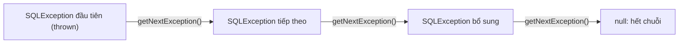
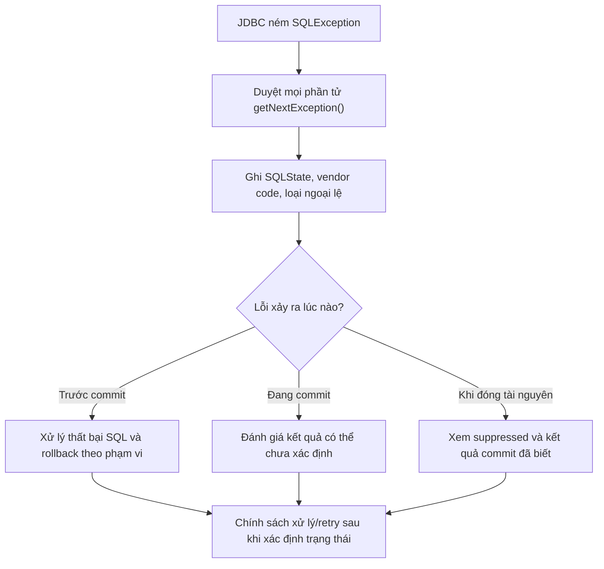

# Duyệt chuỗi SQLException bằng getNextException

## Mục tiêu học tập

Trong **JDBC**, một thao tác truy cập cơ sở dữ liệu quan hệ có thể tạo ra nhiều thông tin lỗi liên quan. Driver đôi khi ném một `SQLException` tổng quát ở lớp ngoài, đồng thời đính kèm các `SQLException` bổ sung mô tả nguyên nhân ở phía máy chủ, dòng dữ liệu không hợp lệ hoặc lỗi của từng phần trong batch. Nếu ứng dụng chỉ đọc `exception.getMessage()` của ngoại lệ đầu tiên, người vận hành có thể bỏ sót thông tin chẩn đoán quan trọng.

Bài học thuộc chương **Lỗi và cảnh báo** tập trung vào API chuẩn `SQLException.getNextException()`: hiểu **chuỗi ngoại lệ SQL**, duyệt từng phần tử, kết hợp `SQLState` và mã lỗi của nhà cung cấp, đồng thời phân biệt chuỗi này với **cause**, **suppressed exception** và **SQLWarning**.

Sau bài, bạn có thể:

- Mô tả cách một `SQLException` liên kết tới những ngoại lệ SQL tiếp theo.
- Viết vòng lặp duyệt đầy đủ chuỗi bằng `getNextException()` mà không bỏ sót ngoại lệ đầu.
- Ghi nhận `getSQLState()`, `getErrorCode()` và loại ngoại lệ để hỗ trợ điều tra.
- Phân biệt `getNextException()` với `getCause()`, `getSuppressed()` và `getNextWarning()`.
- Vận dụng vào `DataSource`, `PreparedStatement`, `ResultSet` và thao tác `executeBatch()`, đồng thời tránh suy luận sai về retry hoặc transaction.

## 1. Tại sao một lần gọi JDBC lại có nhiều SQLException?

Giả sử ứng dụng nhập một lô đơn hàng vào database. `PreparedStatement.executeBatch()` có thể phát hiện nhiều vấn đề: một dòng vi phạm khóa duy nhất, một dòng không thỏa ràng buộc và một lỗi tổng hợp cho toàn batch. Thay vì trả về các lỗi đó dưới dạng nhiều lần `throw`, driver có thể liên kết chúng trong **chuỗi `SQLException`**.



Đối tượng ngoại lệ mà Java bắt được trong `catch (SQLException ex)` là **phần tử đầu**. Phương thức `ex.getNextException()` trả về phần tử kế tiếp nếu có; tiếp tục gọi `getNextException()` trên từng phần tử để duyệt cho tới `null`.

Điều này **không có nghĩa mọi driver đều đưa mọi lỗi chi tiết vào chuỗi**. Driver có thể chỉ ném một ngoại lệ, thêm lỗi vào cause, trả thông tin riêng theo loại statement, hoặc đặt mã vendor trong thông điệp. Hợp đồng JDBC cung cấp cơ chế duyệt; **có bao nhiêu phần tử và chúng chứa gì phụ thuộc nguồn lỗi và driver**.

### Một lỗi chính, nhiều chẩn đoán

Ví dụ dữ liệu mô phỏng:

| Vị trí trong chuỗi | Loại lỗi minh họa | Thông tin |
| --- | --- | --- |
| 0 — ngoại lệ được `throw` | “Batch execution failed” | Báo lỗi ở mức cả thao tác |
| 1 — `getNextException()` lần đầu | “Unique constraint violated” | Mô tả một ràng buộc bị vi phạm |
| 2 — `getNextException()` lần tiếp theo | “Row rejected” | Thông tin bổ sung |
| Kết thúc | `null` | Không còn ngoại lệ SQL trong chuỗi |

**Không mặc định phần tử cuối là “root cause”.** Thứ tự, mức chi tiết và ý nghĩa chẩn đoán có thể khác nhau giữa driver; muốn xác định nguyên nhân phải xem đầy đủ các tín hiệu và ngữ cảnh SQL.

## 2. Các API cần nhớ

| API | Trả về | Mục đích |
| --- | --- | --- |
| `SQLException.getNextException()` | `SQLException` tiếp theo hoặc `null` | Duyệt chuỗi lỗi SQL do JDBC/driver liên kết |
| `SQLException.setNextException(SQLException)` | `void` | Nối ngoại lệ SQL bổ sung vào cuối chuỗi; thường driver hoặc mã kiểm thử dùng |
| `SQLException.getSQLState()` | Chuỗi SQLState hoặc `null` | Đọc mã trạng thái lỗi SQL được cung cấp |
| `SQLException.getErrorCode()` | Số nguyên | Mã lỗi riêng của nhà cung cấp, có thể bằng `0` nếu không có |
| `SQLException.getMessage()` | Thông điệp hoặc `null` | Đọc mô tả lỗi, cần cân nhắc rò rỉ dữ liệu khi log |
| `Throwable.getCause()` | `Throwable` hoặc `null` | Xem nguyên nhân Java được gắn với ngoại lệ hiện tại |
| `Throwable.getSuppressed()` | Mảng `Throwable[]` | Xem ngoại lệ bị ghi nhận bổ sung, thường xuất hiện khi đóng tài nguyên |
| `SQLWarning.getNextWarning()` | `SQLWarning` hoặc `null` | Duyệt cảnh báo SQL từ API lấy warning |

`SQLException` là một lớp con của `Exception`; vì vậy nó cũng thừa hưởng `getCause()` và `getSuppressed()` từ `Throwable`. Nhưng **cả ba cấu trúc** (next exception, cause và suppressed) **không phải cùng một liên kết**.

```text
SQLException ex
  |
  +-- getNextException() --> SQLException next --> ...
  |
  +-- getCause() --------> Throwable cause --> ...
  |
  +-- getSuppressed() ---> Throwable[] suppressed
```

Nếu chỉ gọi `getCause()` thì **không** duyệt được chuỗi `getNextException()`; ngược lại, nếu chỉ duyệt next thì chưa chắc thấy toàn bộ nguyên nhân Java hoặc lỗi khi đóng tài nguyên.

## 3. Mẫu vòng lặp chuẩn: duyệt cả ngoại lệ đầu tiên

Cách dễ đọc nhất là dùng biến con trỏ riêng:

```java
static void inspectSqlExceptions(SQLException first) {
    int index = 0;

    for (SQLException current = first;
         current != null;
         current = current.getNextException()) {

        System.out.printf(
            "index=%d, type=%s, SQLState=%s, vendorCode=%d%n",
            index,
            current.getClass().getSimpleName(),
            current.getSQLState(),
            current.getErrorCode()
        );
        index++;
    }
}
```

Cần có `import java.sql.SQLException;` nếu đưa đoạn mã này vào một lớp Java đầy đủ.

**Vì sao bắt đầu từ `first`?** Bản thân ngoại lệ trong `catch` cũng chứa chẩn đoán quan trọng. Nếu khởi tạo vòng lặp bằng `first.getNextException()`, bạn sẽ **bỏ qua ngoại lệ được ném ban đầu**.

**Vì sao dừng ở `null`?** Theo API, `getNextException()` trả `null` khi không còn phần tử kế tiếp. Một ngoại lệ đơn lẻ là trường hợp hợp lệ: vòng lặp sẽ xử lý đúng một lần.

**Vì sao không xử lý dữ liệu theo thông điệp?** `getMessage()` có thể thay đổi theo phiên bản driver, ngôn ngữ và loại lỗi. Khi cần phân loại, ưu tiên các tín hiệu có cấu trúc như `SQLState`, mã vendor, lớp ngoại lệ và kiến thức về thao tác đang chạy.

Trong ví dụ bài học, `System.out` giúp quan sát nhanh. Ứng dụng thực tế nên dùng hệ thống logging/monitoring có kiểm soát và không ghi thẳng dữ liệu nhạy cảm từ câu SQL hoặc tham số.

### Cách không nên viết

```java
catch (SQLException ex) {
    // Chỉ ghi ngoại lệ đầu: có thể mất các chẩn đoán nối tiếp.
    System.err.println(ex.getMessage());
}
```

Đoạn trên còn có hai rủi ro: **nuốt lỗi** (không truyền thông tin cho tầng gọi) và **log thông điệp thô** vốn có thể chứa thông tin không phù hợp để đưa ra log công khai. Tối thiểu nên duyệt chuỗi để ghi thông tin an toàn rồi ném lại hoặc chuyển thành ngoại lệ ứng dụng có lưu nguyên nhân gốc.

## 4. Ví dụ hoàn chỉnh với DataSource, PreparedStatement và ResultSet

Giả sử ứng dụng có bảng `orders(id, customer_id, status)`. Một repository tìm ID đơn hàng của khách hàng bằng câu SQL tham số hóa. Khi lỗi truy cập dữ liệu xảy ra, repository duyệt chuỗi `SQLException` và **ném lại chính ngoại lệ ban đầu**, để tầng điều phối quyết định hành vi tiếp theo.

```java
import java.sql.Connection;
import java.sql.PreparedStatement;
import java.sql.ResultSet;
import java.sql.SQLException;
import java.util.ArrayList;
import java.util.List;
import java.util.Objects;
import java.util.logging.Level;
import java.util.logging.Logger;
import javax.sql.DataSource;

public final class OrderRepository {
    private static final Logger LOG =
        Logger.getLogger(OrderRepository.class.getName());

    private final DataSource dataSource;

    public OrderRepository(DataSource dataSource) {
        this.dataSource = Objects.requireNonNull(dataSource);
    }

    public List<Long> findOrderIds(long customerId) throws SQLException {
        String sql = """
            SELECT id
              FROM orders
             WHERE customer_id = ?
             ORDER BY id
            """;

        try (Connection connection = dataSource.getConnection();
             PreparedStatement ps = connection.prepareStatement(sql)) {

            ps.setLong(1, customerId);
            List<Long> ids = new ArrayList<>();

            try (ResultSet rs = ps.executeQuery()) {
                while (rs.next()) {
                    ids.add(rs.getLong("id"));
                }
            }
            return ids;
        } catch (SQLException error) {
            logSqlChain("findOrderIds", error);
            throw error; // Giữ nguyên SQLState, vendor code và next chain.
        }
    }

    private static void logSqlChain(String operation, SQLException first) {
        int index = 0;
        for (SQLException current = first;
             current != null;
             current = current.getNextException()) {

            // Không log SQL chứa literal, tham số nhạy cảm
            // hoặc thông điệp driver thô khi chưa được kiểm duyệt.
            LOG.log(Level.WARNING,
                "operation={0}, chainIndex={1}, exceptionType={2}, "
                + "sqlState={3}, vendorCode={4}",
                new Object[] {
                    operation,
                    index,
                    current.getClass().getSimpleName(),
                    current.getSQLState(),
                    current.getErrorCode()
                }
            );
            index++;
        }
    }
}
```

Đoạn mã dùng **Java 17+** để viết chuỗi SQL nhiều dòng bằng text block. Nếu dùng Java 8 hoặc 11, thay bằng chuỗi SQL thông thường. Các API `DataSource`, `Connection`, `PreparedStatement`, `ResultSet` và `SQLException.getNextException()` vẫn là JDBC chuẩn.

Các điểm cần chú ý:

1. `DataSource.getConnection()` lấy kết nối; lỗi từ chính bước lấy kết nối cũng được bắt bởi `catch (SQLException error)` bên ngoài.
2. `PreparedStatement` giữ `?` làm tham số thay vì nối giá trị `customerId` trực tiếp vào SQL.
3. `try-with-resources` giải phóng `ResultSet`, `PreparedStatement` và `Connection`. Nếu lỗi đóng tài nguyên phát sinh trong khi đang xử lý ngoại lệ khác, Java có thể đính kèm nó qua `getSuppressed()`.
4. Hàm `logSqlChain` ghi từng phần tử next chain theo chỉ số. `getSQLState()` có thể là `null` và `getErrorCode()` có thể bằng `0`: đây là dữ liệu hợp lệ cần được giữ nguyên.
5. `throw error;` giữ đối tượng ngoại lệ, cả liên kết next và thông tin cause/suppressed. Tránh thay thế tùy tiện bằng `new SQLException(error.getMessage())` vì cách đó có thể đánh mất các chẩn đoán gốc.

**Lưu ý về chính sách logging:** ví dụ chỉ ghi tên thao tác tĩnh cùng thông tin có cấu trúc. Thông điệp lỗi và stack trace có thể hữu ích trong môi trường được kiểm soát, nhưng cần đánh giá nguy cơ chứa tên bảng, giá trị tham số hoặc dữ liệu cá nhân trước khi đưa vào hệ thống log. Cũng nên quy định **một tầng chịu trách nhiệm ghi log** để không lặp cùng một chuỗi lỗi tại nhiều lớp.

## 5. Tự tạo một chuỗi SQLException để hiểu thứ tự duyệt

Bạn không cần kết nối database để kiểm tra cơ chế duyệt. `setNextException(...)` cho phép tạo dữ liệu mô phỏng có nhiều phần tử:

```java
import java.sql.SQLException;

public class SqlExceptionChainDemo {
    public static void main(String[] args) {
        SQLException first = new SQLException(
            "Batch failed", "HY000", 0
        );

        SQLException detail1 = new SQLException(
            "Duplicate key", "23000", 0
        );
        SQLException detail2 = new SQLException(
            "Invalid row", "22000", 0
        );

        first.setNextException(detail1);
        first.setNextException(detail2);

        int index = 0;
        for (SQLException current = first;
             current != null;
             current = current.getNextException()) {
            System.out.printf("%d: %s (%s)%n",
                index++, current.getMessage(), current.getSQLState());
        }
    }
}
```

Kết quả từ dữ liệu **mô phỏng do chính mã trên tạo**, không phải chẩn đoán của DBMS cụ thể:

```text
0: Batch failed (HY000)
1: Duplicate key (23000)
2: Invalid row (22000)
```

`setNextException(...)` nối ngoại lệ vào **cuối chuỗi hiện có**, vì thế hai lần gọi trên tạo thứ tự `first → detail1 → detail2`. Trong ứng dụng bình thường, bạn **đọc** chuỗi từ driver; không cần tự thêm lỗi nếu chỉ muốn phân tích một `SQLException` vừa bắt được.

Ví dụ giúp kiểm tra thêm hai tình huống:

- **Không có phần tử next:** nếu bỏ cả hai lệnh `setNextException(...)`, vòng lặp vẫn xử lý `first` một lần.
- **Có nhiều phần tử:** vòng lặp phải tiếp tục tới `null`; không dừng sau phần tử thứ hai.

Khi cần bảo vệ bộ thu thập log khỏi chuỗi lỗi quá lớn hoặc dữ liệu do thành phần bên ngoài tạo không đúng kỳ vọng, có thể giới hạn số phần tử được ghi log và đánh dấu phần bị cắt. Đó là quy định vận hành, **không thay đổi cách API `getNextException()` hoạt động**.

## 6. Đọc SQLState và mã lỗi của nhà cung cấp như thế nào?

Mỗi phần tử `SQLException` có thể chứa:

- **`SQLState`:** chuỗi mã trạng thái SQL. Hai ký tự đầu thường thể hiện **nhóm lỗi**; phần còn lại mô tả cụ thể hơn.
- **Vendor error code:** số nguyên đặc thù do driver/DBMS cung cấp. Cùng một loại lỗi có thể dùng mã khác nhau trên PostgreSQL, MySQL, Oracle hoặc SQL Server.
- **Lớp ngoại lệ:** các lớp như `SQLIntegrityConstraintViolationException`, `SQLTransactionRollbackException`, `SQLTransientConnectionException` có thể cung cấp dấu hiệu về loại vấn đề.

Một số lớp SQLState thường gặp:

| Nhóm SQLState | Ý nghĩa thường gặp | Điều cần lưu ý |
| --- | --- | --- |
| `08` | Lỗi liên quan kết nối | Không tự suy ra thao tác đã rollback, nhất là khi mất kết nối trong `commit()` |
| `22` | Ngoại lệ dữ liệu | Có thể do kiểu dữ liệu, giá trị ngoài phạm vi hoặc chuyển đổi dữ liệu |
| `23` | Vi phạm ràng buộc toàn vẹn | Cần xem ràng buộc nào và trạng thái transaction sau lỗi |
| `40` | Transaction rollback | Xem chi tiết SQLState và hành vi DBMS để quyết định retry |
| `42` | Lỗi cú pháp hoặc quyền truy cập | Không tự động kết luận chỉ là sai cú pháp |
| `HY` và một số tiền tố khác | Nhóm mã theo quy ước khác, thường gặp lỗi driver/ODBC | Ý nghĩa phụ thuộc chuẩn mã được driver sử dụng |

Ví dụ `SQLState=23505` thường được sử dụng để biểu thị vi phạm tính duy nhất trong những hệ thống theo mã SQLState phù hợp. Tuy vậy, **không viết quy tắc nghiệp vụ dựa riêng vào một ví dụ mã** nếu chưa xác nhận DBMS/driver thật.

### Đọc toàn chuỗi trước khi phân loại lỗi

Giả sử ngoại lệ đầu tiên có `SQLState=HY000`, còn một ngoại lệ nối tiếp có `SQLState=23000`. Nếu chỉ xem phần tử đầu, tầng xử lý lỗi có thể bỏ qua tín hiệu ràng buộc. Đọc toàn chuỗi giúp tăng khả năng chẩn đoán.

Nhưng **không phải cứ gặp mã lớp `08`, `23` hoặc `40` là đủ để quyết định retry**. Cần kết hợp thời điểm lỗi, khả năng idempotency, ràng buộc nghiệp vụ và hướng dẫn cụ thể của DBMS. Đặc biệt, lỗi kết nối khi đang gọi `commit()` có thể khiến kết quả giao dịch **chưa xác định**.

### Tại sao không dựa vào getMessage() để viết if/else?

`getMessage()` có thể thay đổi theo nhà cung cấp, phiên bản, ngôn ngữ hoặc cấu hình. Điều kiện kiểu `message.contains("duplicate")` rất dễ hỏng khi thông điệp đổi. Nếu cần nhánh xử lý ràng buộc, hãy dùng mã SQLState/vendor đã được xác minh cùng ngoại lệ chuyên biệt và kiểm tra ràng buộc đúng phạm vi, sau đó chuyển thành lỗi nghiệp vụ rõ ràng.

## 7. Ứng dụng đặc biệt với BatchUpdateException

`BatchUpdateException` là lớp con của `SQLException`, thường xuất hiện khi `executeBatch()` gặp vấn đề. Bên cạnh chuỗi next exception, nó có thể cung cấp **mảng update counts**: trạng thái thực thi của các phần tử batch theo quy ước của JDBC.

```java
import java.sql.BatchUpdateException;
import java.sql.PreparedStatement;
import java.sql.SQLException;
import java.sql.Statement;

// Giả sử ps là PreparedStatement và đã gọi addBatch() trước đó.
try {
    int[] counts = ps.executeBatch();
    // Dùng counts theo ngữ nghĩa của driver/JDBC.
} catch (BatchUpdateException batchError) {
    // Đọc phần đã báo cáo của batch.
    int[] counts = batchError.getUpdateCounts();

    for (int i = 0; i < counts.length; i++) {
        int value = counts[i];
        if (value == Statement.SUCCESS_NO_INFO) {
            System.out.println("Batch entry " + i + ": thành công, chưa rõ số hàng");
        } else if (value == Statement.EXECUTE_FAILED) {
            System.out.println("Batch entry " + i + ": thực thi thất bại");
        } else {
            System.out.println("Batch entry " + i + ": affectedRows=" + value);
        }
    }

    // Đọc tiếp thông tin lỗi chi tiết từ JDBC/driver.
    for (SQLException current = batchError;
         current != null;
         current = current.getNextException()) {
        System.out.printf("SQLState=%s, vendorCode=%d%n",
            current.getSQLState(), current.getErrorCode());
    }

    throw batchError;
}
```

**Đoạn mã là khung minh họa nằm trong phương thức có xử lý `SQLException`**, không phải chương trình Java độc lập. Trong chương trình thực tế, tạo `PreparedStatement` qua `Connection.prepareStatement(...)`, gắn tham số, gọi `addBatch()` cho từng bản ghi và quản lý tài nguyên với `try-with-resources`.

Giải thích giá trị update counts:

- Số không âm: số hàng bị ảnh hưởng được báo cáo cho phần tử tương ứng.
- `Statement.SUCCESS_NO_INFO` (`-2`): đã thực thi thành công nhưng không xác định được số hàng ảnh hưởng.
- `Statement.EXECUTE_FAILED` (`-3`): một phần tử thất bại; driver có thể tiếp tục xử lý các phần tử sau khi gặp lỗi hoặc dừng batch, nên **độ dài mảng** cũng cần được diễn giải theo hành vi driver.

Với hệ thống cần hỗ trợ số dòng rất lớn, JDBC còn có các API dạng `large batch` và `BatchUpdateException.getLargeUpdateCounts()`.

**Điều quan trọng:** `getUpdateCounts()` phản ánh tình trạng thực thi được driver báo cáo, **không phải bằng chứng tất cả phần tử đã commit**. Nếu batch chạy trong transaction thủ công và chưa commit, nhiều phần tử thực thi thành công vẫn có thể rollback. Khi batch kết hợp thao tác khác, cần xem cả trạng thái transaction, ràng buộc của DBMS và chính sách retry.

Ngoài ra, không phải mọi `SQLException` từ JDBC batch đều đảm bảo có cùng cách liên kết chi tiết theo từng phần tử. `getNextException()` nên được xem là **kênh thông tin bổ sung**, không phải nguồn bắt buộc chứa chính xác một ngoại lệ trên mỗi hàng lỗi.

## 8. getNextException khác getCause và getSuppressed

Ba cấu trúc có thể cùng tồn tại trên một ngoại lệ. Ví dụ:

```java
SQLException first = new SQLException(
    "Failed to execute statement", "HY000", 0
);

first.setNextException(new SQLException(
    "Constraint diagnostic", "23000", 0
));

first.initCause(new java.io.IOException("Connection reset"));

first.addSuppressed(new SQLException(
    "Statement close failed", "HY000", 0
));
```

Trong ví dụ này:

- `first.getNextException()` trả ngoại lệ “Constraint diagnostic”.
- `first.getCause()` trả `IOException` “Connection reset”.
- `first.getSuppressed()` trả mảng chứa ngoại lệ “Statement close failed”.

Mỗi đường liên kết có ý nghĩa riêng. Duyệt next chain **không tự động** duyệt cause hoặc suppressed. Nếu cần chẩn đoán sâu, bạn có thể thu thập cả ba nhưng phải tránh tạo log lặp và giới hạn thông tin nhạy cảm.

### try-with-resources tạo suppressed exception

Ví dụ:

```java
try (Connection connection = dataSource.getConnection();
     PreparedStatement ps = connection.prepareStatement(sql)) {
    ps.executeUpdate(); // Ném SQLException A.
} // Khi đóng ps/connection, lỗi B có thể được gắn suppressed vào A.
```

Nếu trong phần thân `try` đã có ngoại lệ A, lỗi đóng tài nguyên B có thể được Java lưu thành **suppressed exception** của A để không làm mất nguyên nhân chính. `A.getNextException()` **không bắt buộc** chứa B. Muốn kiểm tra lỗi đóng tài nguyên, phải xét `A.getSuppressed()` riêng.

**Cẩn thận với tầng wrapper:** `RuntimeException` hoặc exception nghiệp vụ bọc `SQLException` qua cause vẫn giữ khả năng truy cập đối tượng gốc nếu tạo như `new RuntimeException("...", sqlException)`. Nếu chỉ tạo `new RuntimeException(sqlException.getMessage())`, thông tin gốc có thể mất.

## 9. Đừng nhầm chuỗi SQLException với SQLWarning

`SQLWarning` là lớp con của `SQLException` nhưng mô tả **cảnh báo** mà driver/database cung cấp; một thao tác JDBC có thể hoàn thành mà vẫn sinh cảnh báo. Các API như `Connection.getWarnings()`, `Statement.getWarnings()` và `ResultSet.getWarnings()` cho phép lấy chuỗi warning từ đối tượng tương ứng khi driver hỗ trợ.

Ví dụ:

```java
import java.sql.SQLWarning;

// Sau khi thực thi câu SQL trên PreparedStatement ps:
SQLWarning warning = ps.getWarnings();

while (warning != null) {
    System.out.printf(
        "warning SQLState=%s, vendorCode=%d%n",
        warning.getSQLState(),
        warning.getErrorCode()
    );
    warning = warning.getNextWarning();
}
```

- `getNextWarning()` duyệt **các warning**; `getNextException()` duyệt liên kết `SQLException` nói chung.
- Warning thường **không được ném ra như exception** chỉ vì nó tồn tại. Nếu muốn theo dõi, ứng dụng cần lấy từ đối tượng JDBC.
- Thời điểm warning bị xóa hoặc thay thế có thể phụ thuộc phương thức JDBC và driver. Đọc warning khi đối tượng vẫn còn hợp lệ, trước khi tái sử dụng hoặc đóng, rồi dùng `clearWarnings()` nếu phù hợp với ngữ cảnh.

Không biến mọi cảnh báo thành lỗi nghiệp vụ; mức độ cần chú ý phụ thuộc mã warning và quy tắc vận hành.

## 10. Ghi log chuỗi lỗi an toàn và hiệu quả

Một bộ ghi log chẩn đoán hữu ích thường chứa:

| Trường | Lợi ích |
| --- | --- |
| Tên thao tác tĩnh, ví dụ `createOrder` | Biết luồng JDBC nào lỗi mà không lộ tham số |
| Chỉ số ngoại lệ `chainIndex` | Phân biệt lỗi đầu và lỗi nối tiếp |
| Lớp ngoại lệ | Nhận diện subtype JDBC nếu có |
| `SQLState` | Phân loại nhóm lỗi theo mã có cấu trúc |
| Mã vendor | Tra cứu tài liệu driver/DBMS |
| Request/correlation ID đã được thiết kế an toàn | Ghép thông tin giữa các thành phần hệ thống |
| DBMS/driver version trong metadata vận hành | Hiểu khác biệt theo môi trường |

**Không mặc định log** mật khẩu, JDBC URL chứa credentials, toàn bộ câu SQL có literal, giá trị tham số, thông tin khách hàng hay thông điệp lỗi thô. Nếu cần message và stack trace để điều tra, giới hạn quyền truy cập, lọc dữ liệu nhạy cảm và theo chính sách bảo mật của hệ thống.

Khi hệ thống có hàng nghìn lỗi giống nhau, log mỗi phần tử với mức `SEVERE` có thể gây nhiễu; cân nhắc dùng một sự kiện cấu trúc cho toàn chuỗi, có giới hạn số phần tử và cơ chế gom/giảm mẫu. Giới hạn logging không làm thay đổi cách exception được truyền và xử lý.

**Không nuốt ngoại lệ sau khi log.** Repository nên ném lại `SQLException` hoặc bọc vào exception cấp ứng dụng kèm cause, để service có đủ thông tin quyết định rollback, thông báo lỗi hoặc retry theo chính sách phù hợp.

## 11. Chuỗi lỗi không quyết định kết quả transaction

Duyệt đầy đủ chuỗi giúp **chẩn đoán**, nhưng không tự chứng minh transaction đã commit hay rollback. Ví dụ:

1. Ứng dụng dùng `Connection.setAutoCommit(false)` và thực hiện nhiều `PreparedStatement`.
2. Một lệnh SQL lỗi **trước khi gọi commit**. Ứng dụng xem chuỗi ngoại lệ rồi yêu cầu `rollback()`; phải xử lý riêng trường hợp rollback cũng lỗi.
3. Nếu chính `connection.commit()` ném `SQLException` do mất kết nối, database có thể đã ghi nhận transaction nhưng phản hồi về ứng dụng bị mất.

Trong trường hợp thứ ba, một ngoại lệ next mang SQLState lớp `08` có thể cho biết vấn đề kết nối, **không** chứng minh rằng các thay đổi chưa được commit. Với nghiệp vụ có tác động lớn, cần dấu vết yêu cầu duy nhất, cơ chế idempotency và bước đối soát trạng thái thực tế.

Tương tự, nhìn thấy `SQLTransactionRollbackException` có thể cung cấp thông tin quan trọng về transaction theo ngữ nghĩa driver, nhưng vẫn cần kiểm tra thời điểm lỗi và tài liệu DBMS trước khi tự động chạy lại toàn bộ nghiệp vụ.



## 12. Bài luyện tập

**Bài 1 — Chuỗi có ba lỗi.** Ngoại lệ `A` nối tới `B`, rồi `C`. Viết vòng lặp in thông tin cả ba. Nếu `A.getNextException()` được gọi một lần rồi in, lỗi nào bị bỏ sót?

*Gợi ý:* dùng `for (SQLException current = A; current != null; current = current.getNextException())`. Nếu bắt đầu từ `A.getNextException()` thì bỏ sót A.

**Bài 2 — Cause và next.** Ngoại lệ `A` có `getCause()` trả `IOException`, đồng thời `getNextException()` trả `SQLException B`. Khi chỉ duyệt next, bạn có nhìn thấy `IOException` không?

*Đáp án:* không theo vòng lặp next; phải xem `getCause()` riêng.

**Bài 3 — Batch failure.** `BatchUpdateException.getUpdateCounts()` trả một mảng chứa `1`, `Statement.EXECUTE_FAILED` và `Statement.SUCCESS_NO_INFO`. Ý nghĩa của từng phần tử là gì? Có thể kết luận ba câu đã commit không?

*Đáp án:* lần lượt là báo một hàng bị ảnh hưởng, phần tử thực thi lỗi, phần tử thành công nhưng chưa biết số hàng; không thể suy ra trạng thái commit chỉ từ mảng.

**Bài 4 — SQLState thiếu.** Driver trả `SQLException` với `getSQLState() == null` và `getErrorCode() == 0`. Vòng lặp có nên dừng không?

*Đáp án:* không. Vẫn xử lý phần tử hiện tại và tiếp tục duyệt next; hai trường trên có thể không được cung cấp.

**Bài 5 — Retry sau lỗi commit.** Chuỗi SQLException chứa thông tin mất kết nối đúng lúc `commit()`. Có nên tạo một yêu cầu chuyển tiền mới và thử lại ngay không?

*Đáp án:* không được tự quyết định chỉ dựa vào chuỗi lỗi. Kết quả commit có thể chưa xác định; cần đối soát hoặc retry có idempotency.

## Kết luận

`SQLException.getNextException()` giúp ứng dụng JDBC **không bỏ sót các lỗi SQL được driver liên kết**. Bắt đầu từ ngoại lệ trong `catch`, lần lượt gọi `getNextException()` đến khi gặp `null`, đồng thời đọc `SQLState`, mã vendor và loại ngoại lệ để chẩn đoán. Hãy kiểm tra **cause**, **suppressed exception** và **SQLWarning** bằng API riêng khi cần; không dùng message thô hoặc một SQLState đơn lẻ để quyết định retry hay kết quả transaction. Một hệ thống truy cập dữ liệu đáng tin cậy vừa ghi nhận đủ bằng chứng lỗi, vừa bảo vệ dữ liệu nhạy cảm và giữ nguyên nguyên nhân gốc cho tầng xử lý cao hơn.
