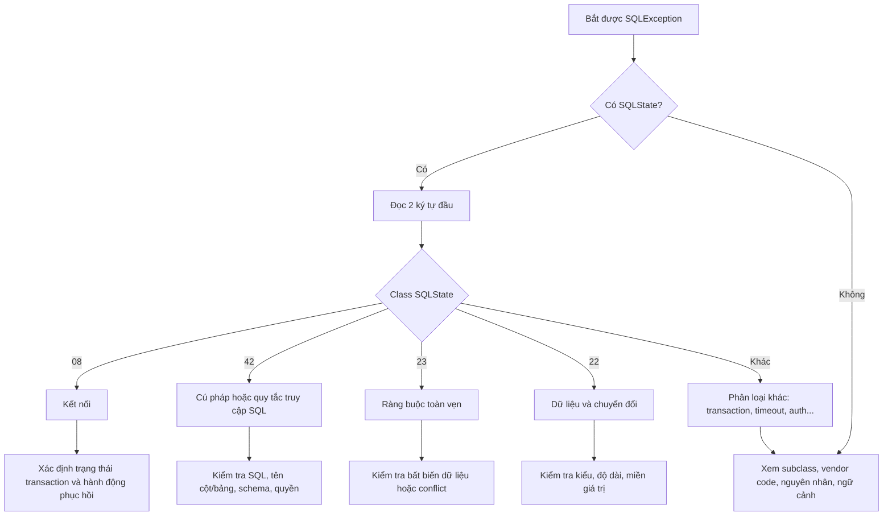

# Phân loại lỗi kết nối, cú pháp, ràng buộc và chuyển đổi dữ liệu trong JDBC

## 1. Vì sao cần phân loại lỗi thay vì chỉ in `SQLException`?

Khi ứng dụng Java truy cập cơ sở dữ liệu quan hệ qua **JDBC**, một lời gọi như `DataSource.getConnection()`, `PreparedStatement.executeUpdate()` hay `ResultSet.getInt()` có thể thất bại vì nhiều nguyên nhân khác nhau. Dù thường được biểu diễn dưới dạng `SQLException`, cách xử lý thích hợp **không giống nhau**:

- Mất kết nối trong lúc thực thi: cần xem lại trạng thái connection, transaction và khả năng khôi phục.
- Viết sai SQL hoặc tham chiếu cột không tồn tại: phải sửa câu lệnh/schema hoặc cấu hình triển khai.
- Vi phạm khóa duy nhất, khóa ngoại, `NOT NULL` hay `CHECK`: phản ánh điều kiện dữ liệu hoặc quy tắc nghiệp vụ không được thỏa mãn.
- Giá trị không thể chuyển sang kiểu dữ liệu SQL hoặc Java đích: phải kiểm tra hợp đồng kiểu, độ dài, miền giá trị, định dạng hoặc getter.

Nếu tất cả lỗi đều bị bắt rồi `retry` giống nhau, ứng dụng có thể gửi lại những yêu cầu không bao giờ thành công, làm trùng thao tác ghi dữ liệu hoặc che giấu lỗi lập trình. Nếu mọi lỗi đều bị trả về dưới một thông báo “database error”, người vận hành khó xác định đúng vị trí để sửa.

Bài thuộc chương **Lỗi và cảnh báo**, trong phạm vi **JDBC**: kết nối qua driver và `DataSource`, câu lệnh SQL tham số hóa qua `PreparedStatement`, đọc `ResultSet`, thực hiện CRUD, quản lý transaction, batching và theo dõi độ tin cậy. Mục tiêu là nhận diện bốn nhóm lỗi chính **kết nối, cú pháp, ràng buộc, chuyển đổi dữ liệu**, sử dụng thông tin chẩn đoán chuẩn của JDBC và lựa chọn cách xử lý phù hợp.

> **Nguyên tắc:** kiểu exception Java, mã `SQLState`, mã lỗi riêng của nhà cung cấp, thông điệp và ngữ cảnh câu SQL cần được **đọc cùng nhau**. Không trường nào bảo đảm đủ để xác định nguyên nhân trong mọi driver và hệ quản trị.

## 2. Cấu trúc của một lỗi JDBC

Các thành phần quan trọng của `java.sql.SQLException`:

| API | Ý nghĩa | Lưu ý |
|---|---|---|
| `getMessage()` | Thông điệp chẩn đoán do driver/DB cung cấp | Có thể chứa SQL, tên bảng/cột hoặc dữ liệu nhạy cảm; không trả nguyên văn cho người dùng cuối |
| `getSQLState()` | Mã trạng thái SQL, thường có 5 ký tự | Hai ký tự đầu thường biểu thị lớp lỗi; một số driver có thể trả `null` hoặc mã riêng |
| `getErrorCode()` | Mã lỗi số nguyên riêng của DB/driver | Không nên so sánh mã này giữa nhiều hệ quản trị |
| `getNextException()` | Exception kế tiếp trong chuỗi chẩn đoán JDBC | Đặc biệt có ích với batch hoặc lỗi do DB gửi nhiều thông tin |
| `getCause()` | Nguyên nhân Java trong chuỗi `Throwable` | Có thể chứa nguyên nhân mạng, driver hoặc exception cấp thấp |
| `getSuppressed()` | Lỗi phát sinh khi đóng tài nguyên hoặc cleanup, nếu được gắn vào | Thường thấy khi dùng `try-with-resources`, rollback và xử lý lỗi |
| Kiểu con của `SQLException` | Nhóm lỗi mà API JDBC biểu diễn, ví dụ `SQLDataException` | Không phải driver nào cũng phân loại cụ thể như nhau |

Mã `SQLState` thường được diễn giải bằng **class**, tức hai ký tự đầu. Ví dụ `23505` có class `23` (vi phạm ràng buộc toàn vẹn), còn `22003` có class `22` (lỗi dữ liệu). Các mã cụ thể như `23505` hoặc `22P02` bên dưới minh họa **PostgreSQL**; không nên coi chúng là danh sách đầy đủ hay cam kết chung cho mọi DB.

### Sơ đồ định hướng



## 3. Bốn nhóm lỗi chính và tín hiệu nhận diện

| Nhóm | Class `SQLState` thường gặp | Subclass JDBC thường liên quan | Ví dụ tình huống | Hướng xử lý chính |
|---|---|---|---|---|
| **Kết nối** | `08` | `SQLTransientConnectionException`, `SQLNonTransientConnectionException`; đôi khi `SQLRecoverableException` | Hết số kết nối khả dụng, đường mạng đứt, DB đóng session | Kiểm tra hạ tầng/connection pool; quyết định retry có điều kiện với connection mới |
| **Cú pháp/quy tắc truy cập SQL** | `42` | `SQLSyntaxErrorException` | Sai cú pháp `SELECT`, cột/bảng không tồn tại, một số lỗi quyền truy cập | Sửa SQL, schema, quyền; **không retry mù** |
| **Ràng buộc toàn vẹn** | `23` | `SQLIntegrityConstraintViolationException` | Trùng `UNIQUE`, sai `FOREIGN KEY`, vi phạm `NOT NULL` hoặc `CHECK` | Báo lỗi dữ liệu/nghiệp vụ, xử lý cạnh tranh hợp lệ; không che giấu lỗi |
| **Dữ liệu/chuyển đổi** | `22` | `SQLDataException` | Chuỗi quá dài, số vượt miền, ngày không hợp lệ, ép kiểu không thể thực hiện | Sửa đầu vào hoặc mapping, kiểm tra kiểu SQL và Java |

**Lưu ý quan trọng về phạm vi:**

- `42` không chỉ bao gồm lỗi **gõ sai cú pháp**. Class này còn có thể chứa lỗi truy cập và tên đối tượng SQL. Chỉ nhận định chính xác sau khi xem mã đầy đủ, thông điệp và DB cụ thể.
- `08` có thể xảy ra cả lúc lấy connection lẫn trong lúc một câu lệnh đã được gửi tới DB. Với `INSERT` hoặc `COMMIT`, trạng thái ghi **có thể chưa xác định** nếu kết nối mất trước khi client nhận kết quả.
- Lỗi chuyển kiểu xảy ra trong **code Java** như `ClassCastException`, `NumberFormatException` hoặc `DateTimeParseException` có thể không phải `SQLException`; không nên chỉ bắt `SQLDataException` rồi cho rằng đã xử lý hết lỗi mapping.
- JDBC còn nhiều nhóm lỗi khác như `SQLTimeoutException`, `SQLTransactionRollbackException`, `SQLInvalidAuthorizationSpecException`, `SQLFeatureNotSupportedException`. Bốn nhóm của bài là phân loại phục vụ chẩn đoán; chúng **không bao trùm mọi lỗi JDBC**.

## 4. Nhóm 1: lỗi kết nối

### 4.1. Xuất hiện ở đâu?

```java
try (Connection connection = dataSource.getConnection()) {
    // Có thể lỗi ngay khi lấy connection.
    try (PreparedStatement ps = connection.prepareStatement(
            "SELECT id FROM customers WHERE id = ?")) {
        ps.setLong(1, customerId);
        try (ResultSet rs = ps.executeQuery()) {
            // Kết nối cũng có thể đứt trong executeQuery()/next().
        }
    }
}
```

Ở đây `dataSource` và `customerId` là biến do code gọi cung cấp; cần import `javax.sql.DataSource` và `java.sql.*`. Kết nối có thể thất bại do tài khoản không được chấp nhận, DB không sẵn sàng, lỗi TLS, timeout mạng, cạn pool, hoặc do DB kết thúc session. **Không phải mọi nguyên nhân trong danh sách đều được driver trả về cùng SQLState `08`**: lỗi xác thực chẳng hạn có thể thuộc nhóm authorization, còn timeout chờ connection từ pool có thể dùng mã và kiểu exception của pool.

Một số subclass hữu ích:

- `SQLTransientConnectionException`: driver biểu thị lỗi kết nối có thể là tạm thời; vẫn cần quyết định có nên thử lại thao tác hay không.
- `SQLNonTransientConnectionException`: driver biểu thị lỗi không được kỳ vọng hết chỉ nhờ thử lại như cũ, ví dụ cấu hình không hợp lệ.
- `SQLRecoverableException`: báo có thể phục hồi sau một hành động thích hợp, ví dụ thiết lập lại kết nối. Lớp này **không** chứng minh lỗi thực tế luôn là mạng và cũng không cho phép retry toàn bộ nghiệp vụ mà không xem xét tác động đã ghi.

### 4.2. Phân biệt thất bại trước và sau khi gửi SQL

| Thời điểm | Mức độ chắc chắn | Hành động |
|---|---|---|
| `getConnection()` thất bại trước khi chạy bất kỳ SQL nào | Chưa thực hiện câu lệnh trên connection đó | Có thể cân nhắc retry cấp kết nối theo chính sách giới hạn |
| Truy vấn chỉ đọc bị gián đoạn | Kết quả đọc không hoàn chỉnh | Đóng tài nguyên cũ, lấy connection mới và có thể thử lại khi nghiệp vụ cho phép |
| `INSERT`/`UPDATE` mất kết nối sau khi gửi | Có thể không biết DB đã áp dụng câu lệnh tới đâu | Không tự động gửi lại khi chưa có chiến lược idempotency/transaction rõ ràng |
| Mất kết nối ngay lúc `commit()` | Kết quả commit có thể không chắc chắn | Đối soát bằng định danh nghiệp vụ, tránh retry làm ghi trùng |

**Ví dụ dễ sai:** gửi `INSERT orders`, DB đã commit nhưng phản hồi bị mất; client bắt SQLState `08` rồi tạo lại đơn hàng. Nếu không có khóa yêu cầu duy nhất, hệ thống có thể tạo hai đơn. Giải pháp thuộc thiết kế nghiệp vụ: mã yêu cầu ổn định, constraint `UNIQUE`, kiểm tra trạng thái đã lưu, hoặc cơ chế idempotency có kiểm soát.

Kiểm tra `connection.isValid(timeoutSeconds)` có thể hữu ích khi cần kiểm tra tình trạng connection, nhưng không phải biện pháp bảo đảm kết nối sẽ không đứt ngay sau đó. Khi pool quản lý việc kiểm tra và loại bỏ kết nối hỏng, ứng dụng nên phối hợp theo hợp đồng của pool.

## 5. Nhóm 2: lỗi cú pháp và quy tắc truy cập SQL

### 5.1. Các tình huống điển hình

```sql
-- Sai cú pháp: thiếu FROM.
SELEC id customers WHERE id = ?;

-- Tham chiếu cột không tồn tại theo schema giả định.
SELECT missing_column FROM customers WHERE id = ?;

-- SQL hợp lệ nhưng người dùng DB không được cấp quyền
-- truy cập bảng cũng có thể gây lỗi liên quan quy tắc truy cập.
SELECT id FROM restricted_table;
```

Trong PostgreSQL, `42601` là ví dụ lỗi cú pháp, `42P01` thường liên quan bảng không tồn tại, `42703` là cột không tồn tại, `42501` là lỗi thiếu quyền. Chúng thuộc hoặc có liên hệ với class `42`, nhưng cách phân mã và câu chữ khác nhau giữa DB/driver.

Nhóm này thường phản ánh lỗi **code hoặc triển khai**:

- Đổi tên cột trong migration nhưng SQL cũ chưa được cập nhật.
- Gõ sai tên bảng, alias hoặc cấu trúc câu lệnh.
- Chưa chạy migration tạo bảng trước khi service khởi động.
- Database user chưa có quyền tương ứng với thao tác.
- Sử dụng cú pháp riêng một DB, chẳng hạn `RETURNING`, khi đang chạy trên hệ quản trị không hỗ trợ cú pháp đó.

**Hướng khắc phục:** sửa SQL, quy trình migration, cấu hình schema và quyền. Thử lại chính câu SQL không thay đổi thường chỉ tạo thêm tải; nếu hệ thống vừa triển khai migration bất đồng bộ, cần xử lý nguyên nhân thứ tự triển khai thay vì che lỗi bằng retry.

### 5.2. PreparedStatement không tự sửa câu SQL sai

`PreparedStatement` tham số hóa **giá trị**, không bảo đảm cú pháp chính xác:

```java
String sql = "SELECT full_name FROM customers WHERE id = ?";
try (PreparedStatement ps = connection.prepareStatement(sql)) {
    ps.setLong(1, customerId);
    try (ResultSet rs = ps.executeQuery()) {
        // ...
    }
}
```

Nếu cột `full_name` đã bị đổi tên hoặc bảng `customers` không tồn tại, truy vấn vẫn thất bại. Việc truyền dữ liệu qua dấu `?` giúp tránh nối trực tiếp giá trị người dùng vào SQL, nhưng không thay thế kiểm thử truy vấn, migration hoặc quyền truy cập.

Các lỗi **thiếu tham số**, sai chỉ số tham số hoặc sai chế độ gọi statement cũng có thể gây `SQLException` với SQLState khác class `42`; chẩn đoán phải dựa trên lỗi thực tế.

## 6. Nhóm 3: vi phạm ràng buộc dữ liệu

Cơ sở dữ liệu có thể từ chối một lệnh ghi hoàn toàn hợp lệ về cú pháp khi kết quả vi phạm bất biến của schema.

### 6.1. Schema ví dụ

Giả sử bảng được tạo trên PostgreSQL như sau:

```sql
CREATE TABLE customers (
    id BIGINT GENERATED ALWAYS AS IDENTITY PRIMARY KEY,
    email VARCHAR(200) NOT NULL UNIQUE,
    age INTEGER CHECK (age >= 18)
);

CREATE TABLE orders (
    id BIGINT GENERATED ALWAYS AS IDENTITY PRIMARY KEY,
    customer_id BIGINT NOT NULL REFERENCES customers(id)
);
```

Bảng có các ràng buộc:

| Ràng buộc | Ví dụ lỗi | Mã minh họa PostgreSQL |
|---|---|---|
| `PRIMARY KEY`/`UNIQUE` | Thêm hai khách hàng có cùng `email` | `23505` |
| `FOREIGN KEY` | Tạo đơn hàng với `customer_id` không tồn tại | `23503` |
| `NOT NULL` | Ghi `email = NULL` | `23502` |
| `CHECK` | Ghi `age = 12` khi yêu cầu từ 18 tuổi | `23514` |

Tất cả ví dụ trên thuộc class SQLState `23`. Đây là **mã cụ thể của PostgreSQL**, không phải danh mục mã bắt buộc mọi driver hoặc DB đều giống nhau.

### 6.2. Kiểm tra trước ở Java vẫn chưa đủ

```text
Request A: SELECT email => chưa tồn tại
Request B: SELECT email => chưa tồn tại
Request A: INSERT email => thành công
Request B: INSERT email => UNIQUE violation
```

Do cạnh tranh đồng thời, kiểm tra “email đã tồn tại hay chưa?” trước khi `INSERT` không thể thay thế constraint `UNIQUE` tại DB. Cần kiểm tra sớm ở tầng ứng dụng để có thông báo tốt, **và** xử lý lỗi ràng buộc do DB trả về.

Phản ứng phù hợp tùy loại ràng buộc:

- Trùng email hoặc mã đơn hàng: trả kết quả xung đột tương ứng với API/nghiệp vụ; không tự đổi thành email khác.
- Khóa ngoại không tồn tại: báo thiếu đối tượng tham chiếu hoặc xử lý thứ tự ghi dữ liệu.
- `NOT NULL`/`CHECK`: xem lại validation hoặc logic cập nhật; nếu dữ liệu đầu vào trái quy tắc, cần sửa yêu cầu.
- Bị vi phạm vì race condition: điều chỉnh luồng đồng thời, UPSERT có kiểm soát hoặc chiến lược xử lý conflict theo nghiệp vụ.

**Không nên retry vô hạn lỗi class `23`.** Hầu hết lỗi sẽ lặp lại cho đến khi dữ liệu, câu lệnh hoặc trạng thái nghiệp vụ thay đổi.

### 6.3. Transaction có thể ở trạng thái lỗi sau một câu lệnh

Trong một số DB như PostgreSQL, một lệnh thất bại vì ràng buộc bên trong transaction tường minh có thể khiến **toàn transaction bị đánh dấu thất bại** cho tới khi rollback (hoặc rollback tới savepoint hợp lệ). Bắt `SQLException` rồi tiếp tục chạy SQL trên cùng connection mà không xử lý trạng thái transaction có thể gây thêm lỗi.

Trong JDBC thuần, tầng sở hữu `Connection` phải chịu trách nhiệm `rollback()` hoặc cách phục hồi hợp lệ. Repository không tự ý commit/rollback nếu connection do caller cung cấp.

## 7. Nhóm 4: lỗi chuyển đổi dữ liệu và kiểu SQL/Java

### 7.1. Lỗi do DB từ chối giá trị

Class SQLState `22` thường bao gồm lỗi giá trị không phù hợp kiểu, độ dài hoặc miền:

| Tình huống | Ví dụ | Mã minh họa PostgreSQL |
|---|---|---|
| Chuỗi vượt độ dài | `VARCHAR(10)` nhận chuỗi dài hơn giới hạn | `22001` |
| Số vượt miền giá trị | Giá trị vượt giới hạn của kiểu số/cột | `22003` |
| Giá trị ngày/giờ không hợp lệ | Chuyển chuỗi không phải ngày hợp lệ sang `DATE` | `22007` trong các ngữ cảnh tương ứng |
| Văn bản không chuyển được thành kiểu đích | `CAST('abc' AS INTEGER)` | `22P02` ở PostgreSQL |

Ví dụ:

```sql
-- PostgreSQL: lỗi chuyển kiểu văn bản sang số nguyên.
SELECT CAST('not-a-number' AS INTEGER);

-- Có thể gây lỗi độ dài nếu DB không áp dụng quy tắc cắt khác.
INSERT INTO products (sku) VALUES ('an-extremely-long-sku');
```

Ví dụ thứ hai chỉ minh họa khi bảng `products.sku` có giới hạn ngắn hơn chuỗi và các cột bắt buộc khác được cung cấp hợp lệ; hành vi cắt chuỗi, cảnh báo hoặc từ chối cần xác nhận theo DB. Không nên suy luận mọi lỗi liên quan giá trị đều dùng class `22`: `NOT NULL`, `CHECK`, `UNIQUE` thuộc nhóm ràng buộc (`23`).

### 7.2. Lỗi đọc ResultSet có thể đến từ driver hoặc code Java

Giả sử cột `total_amount` có SQL type `DECIMAL(18,2)`. Đọc bằng `getBigDecimal` giữ được ý nghĩa số thập phân; đọc bằng `getInt` có thể mất phần lẻ, vượt miền hoặc gây `SQLException` tùy driver và dữ liệu.

```java
import java.math.BigDecimal;
import java.sql.ResultSet;
import java.sql.SQLException;

static BigDecimal readAmount(ResultSet rs) throws SQLException {
    BigDecimal value = rs.getBigDecimal("total_amount");
    if (value == null) {
        throw new SQLException("total_amount không được NULL");
    }
    return value;
}
```

Đoạn trên yêu cầu `ResultSet` đang ở hàng hợp lệ. `getBigDecimal()` có thể trả `null` khi SQL là `NULL`; còn các getter primitive như `getInt()` hoặc `getLong()` trả giá trị mặc định khi gặp SQL `NULL`. Khi sử dụng getter primitive, cần gọi `rs.wasNull()` **ngay sau getter** để phân biệt giá trị 0 hợp lệ và SQL `NULL`.

Một lỗi casting do ứng dụng gây ra có thể **không** là `SQLException`:

```java
// Có thể gây ClassCastException nếu driver trả kiểu khác.
Object raw = rs.getObject("total_amount");
Integer amount = (Integer) raw;
```

Nếu phải parse chuỗi từ đầu vào API bằng `Integer.parseInt(...)`, giá trị không hợp lệ gây `NumberFormatException` **trước khi** JDBC thực hiện truy vấn. Nếu dùng `LocalDate.parse(...)`, lỗi định dạng thuộc nhóm `DateTimeParseException`. Đây là lỗi chuyển đổi **ở Java**, cần đặt validation và thông báo phù hợp tại ranh giới input/mapping, thay vì gộp tất cả vào “SQL data error”.

### 7.3. Cần nhất quán khi bind tham số

```java
String sql = "INSERT INTO invoices (amount, issued_on) VALUES (?, ?)";

try (PreparedStatement ps = connection.prepareStatement(sql)) {
    ps.setBigDecimal(1, new BigDecimal("120.50"));
    ps.setDate(2, java.sql.Date.valueOf(java.time.LocalDate.now()));
    ps.executeUpdate();
}
```

`setBigDecimal` và `setDate` diễn đạt rõ kiểu dữ liệu đích. Cần import `java.math.BigDecimal`. Trường hợp `LocalDate` là thông tin ngày nghiệp vụ nên cân nhắc múi giờ khi chuyển sang `TIMESTAMP` hoặc `TIMESTAMP WITH TIME ZONE`; không gộp các kiểu này vào một chuỗi ngày không rõ ngữ nghĩa.

Một `PreparedStatement` **không tự kiểm tra** giá trị có vừa độ dài cột, miền `DECIMAL` hay ràng buộc của DB; nó giúp truyền tham số đúng kiểu và an toàn hơn so với nối giá trị vào SQL.

## 8. Viết bộ phân loại SQLException trong ứng dụng

### 8.1. Phân loại từ SQLState, sau đó dùng subclass làm tín hiệu phụ

Đoạn dưới là một bộ phân loại **đơn giản phục vụ chẩn đoán**, dựa trên bốn class phổ biến. Nó không thay thế điều kiện nghiệp vụ hoặc xử lý lỗi riêng cho driver:

```java
import java.sql.SQLException;
import java.sql.SQLDataException;
import java.sql.SQLIntegrityConstraintViolationException;
import java.sql.SQLNonTransientConnectionException;
import java.sql.SQLSyntaxErrorException;
import java.sql.SQLTransientConnectionException;

public final class JdbcErrorClassifier {
    public enum Group {
        CONNECTION,
        SYNTAX_OR_ACCESS,
        CONSTRAINT,
        DATA_CONVERSION,
        OTHER
    }

    private JdbcErrorClassifier() {}

    public static Group classify(SQLException failure) {
        if (failure == null) {
            throw new IllegalArgumentException("failure không được null");
        }

        // Có thể có lỗi nguyên nhân nằm trong chuỗi JDBC kế tiếp.
        // Đoạn ví dụ giả định chuỗi lỗi hợp lệ và hữu hạn.
        for (SQLException e = failure;
             e != null;
             e = e.getNextException()) {
            String state = e.getSQLState();

            if (state != null && state.length() >= 2) {
                String errorClass = state.substring(0, 2);
                switch (errorClass) {
                    case "08":
                        return Group.CONNECTION;
                    case "42":
                        return Group.SYNTAX_OR_ACCESS;
                    case "23":
                        return Group.CONSTRAINT;
                    case "22":
                        return Group.DATA_CONVERSION;
                    default:
                        break;
                }
            }
        }

        if (failure instanceof SQLTransientConnectionException
                || failure instanceof SQLNonTransientConnectionException) {
            return Group.CONNECTION;
        }
        if (failure instanceof SQLSyntaxErrorException) {
            return Group.SYNTAX_OR_ACCESS;
        }
        if (failure instanceof SQLIntegrityConstraintViolationException) {
            return Group.CONSTRAINT;
        }
        if (failure instanceof SQLDataException) {
            return Group.DATA_CONVERSION;
        }

        return Group.OTHER;
    }
}
```

**Đặc điểm và giới hạn:**

- Ưu tiên `SQLState` của lỗi đầu và các lỗi được nối bằng `getNextException()`. Nếu chỉ có subclass, dùng subclass như tín hiệu dự phòng.
- Nếu chuỗi lỗi chứa **nhiều lỗi thuộc nhiều class**, ví dụ trong batch, một kết quả `Group` duy nhất chỉ cho biết class đầu tiên được nhận diện, **không mô tả hết các lệnh hỏng**. Tầng batch cần đọc từng lỗi và `BatchUpdateException.getUpdateCounts()`.
- `SQLException` có thể là lỗi timeout, authorization, transaction rollback hoặc feature không hỗ trợ mà không thuộc bốn nhóm; `OTHER` là trạng thái hợp lệ, không phải lỗi của bộ phân loại.
- Driver có thể trả `SQLState = null`, mã ngoài quy ước thông dụng, hoặc subclass chưa cụ thể. Khi đó cần phân tích thêm vendor code, nguyên nhân và bối cảnh.
- Nếu dữ liệu exception chain đến từ một thư viện có cấu trúc bất thường, nên bảo vệ việc duyệt chuỗi bằng giới hạn số phần tử hoặc tập nhận diện đối tượng đã gặp, tránh vòng lặp không kết thúc.

**Không nên dùng giá trị `Group.CONNECTION` làm lệnh “retry ngay”.** Nó chỉ nói nhóm lỗi được chẩn đoán, không kết luận thao tác ghi có an toàn để thực hiện lại hay không.

### 8.2. Dùng nhóm lỗi đúng chỗ

Ví dụ service gọi repository và chuyển một số tình huống dữ liệu thành lỗi nghiệp vụ:

```java
try {
    customerRepository.insert(connection, email);
} catch (SQLException failure) {
    JdbcErrorClassifier.Group group =
            JdbcErrorClassifier.classify(failure);

    if (group == JdbcErrorClassifier.Group.CONSTRAINT) {
        // Kiểm tra mã cụ thể/constraint name và nghiệp vụ
        // trước khi kết luận chắc chắn email đã trùng.
        throw new CustomerConflictException(
                "Không thể tạo khách hàng do ràng buộc dữ liệu",
                failure);
    }

    // Các nhóm khác để tầng điều phối transaction xử lý.
    throw failure;
}
```

Đoạn này minh họa luồng xử lý: `customerRepository`, `connection`, `email` và `CustomerConflictException` là các thành phần ứng dụng tự định nghĩa. **Không được gộp mọi lỗi class `23` thành “email đã tồn tại”**, vì nó có thể là khóa ngoại, `CHECK` hoặc `NOT NULL`.

Ngoài ra, nhóm `SYNTAX_OR_ACCESS` có thể bao gồm thiếu quyền; lỗi về quyền truy cập nên được xử lý trong cấu hình bảo mật, tránh trả nguyên nội dung SQL hoặc DB schema cho người dùng.

## 9. Ghi log và thu thập chẩn đoán đúng cách

### 9.1. Một lỗi có thể mang nhiều phần chẩn đoán

Đối với batch hoặc driver gửi nhiều lỗi, đừng chỉ log `e.getMessage()`. Có thể ghi thông tin cấu trúc cho từng exception:

```java
import java.sql.SQLException;
import java.util.logging.Level;
import java.util.logging.Logger;

public final class JdbcDiagnostics {
    private static final Logger LOG =
            Logger.getLogger(JdbcDiagnostics.class.getName());

    private JdbcDiagnostics() {}

    public static void log(
            String operation, SQLException failure
    ) {
        int index = 0;
        for (SQLException e = failure;
             e != null && index < 32;
             e = e.getNextException(), index++) {
            LOG.log(
                    Level.WARNING,
                    "JDBC operation={0}, chainIndex={1}, sqlState={2}, "
                            + "vendorCode={3}, exceptionType={4}",
                    new Object[] {
                            operation,
                            index,
                            e.getSQLState(),
                            e.getErrorCode(),
                            e.getClass().getSimpleName()
                    }
            );
        }

        // Ghi stack trace theo chính sách observability:
        // LOG.log(Level.WARNING, "JDBC operation thất bại: " + operation,
        //         failure);
        // Chỉ dùng khi kênh log được kiểm soát và nội dung an toàn.
    }
}
```

Đoạn mã cố tình không log trực tiếp toàn bộ SQL hoặc giá trị tham số đầu vào. Trong thực tế, có thể ghi thêm request ID, tên thao tác ổn định (`createCustomer`, `findOrders`), thời gian, DB/driver version và số lượt retry. Không log mật khẩu, connection string có credentials, token hoặc giá trị cá nhân nhạy cảm.

Thông tin chẩn đoán cần giữ được **nguyên nhân gốc**:

- Khi bọc lại exception, truyền `failure` làm `cause`.
- Khi rollback hoặc đóng tài nguyên cũng gặp lỗi, không ghi đè lỗi đầu; dùng `addSuppressed(...)` nếu cần.
- Phân biệt lỗi JDBC với các exception mapping/validation ở Java.
- Giới hạn lượng log trong vòng lặp retry để không tạo bão log khi DB không sẵn sàng.

### 9.2. Cảnh báo SQLWarning khác SQLException

JDBC còn có `SQLWarning`, là một kiểu con của `SQLException` được dùng để **thông báo điều kiện cảnh báo**. Cảnh báo không đồng nghĩa với một thao tác đã thất bại. Driver có thể lưu cảnh báo trên `Connection`, `Statement` hoặc `ResultSet` và cho phép truy vấn bằng `getWarnings()` thay vì ném exception thông thường.

```java
import java.sql.PreparedStatement;
import java.sql.ResultSet;
import java.sql.SQLException;
import java.sql.SQLWarning;

static void inspectWarnings(PreparedStatement statement)
        throws SQLException {
    for (SQLWarning warning = statement.getWarnings();
         warning != null;
         warning = warning.getNextWarning()) {
        System.out.printf(
                "SQLWarning: state=%s code=%d%n",
                warning.getSQLState(),
                warning.getErrorCode()
        );
    }
}
```

Ví dụ gọi `inspectWarnings(ps)` **sau khi statement đã thực thi** và trước khi đóng nó. `getWarnings()` có thể trả `null` khi không có cảnh báo. Khi xử lý `ResultSet`, có thể kiểm tra `rs.getWarnings()` trong thời gian result set còn mở; tương tự với connection.

`clearWarnings()` xóa danh sách cảnh báo đang lưu theo hợp đồng API; không dùng nó thay việc xử lý nguyên nhân. Nhiều driver/DB không tạo cảnh báo cho cùng một tình huống, vì vậy không nên dựa vào `SQLWarning` làm cơ chế bắt buộc duy nhất để phát hiện cắt dữ liệu hoặc mất độ chính xác. Việc chuẩn hóa `SQLWarning` thành exception nghiệp vụ phải là lựa chọn có chủ đích.

## 10. Xử lý lỗi trong transaction và batch

### 10.1. Rollback bởi tầng sở hữu Connection

Giả sử service đã tắt `autoCommit` và truyền cùng một `Connection` cho nhiều repository. Khi một bước thất bại, service hoặc transaction manager phải xem xét **rollback toàn bộ**:

```java
import java.sql.Connection;
import java.sql.SQLException;
import javax.sql.DataSource;

static void runUnitOfWork(DataSource dataSource) throws SQLException {
    try (Connection connection = dataSource.getConnection()) {
        boolean originalAutoCommit = connection.getAutoCommit();
        if (!originalAutoCommit) {
            throw new SQLException(
                    "Ví dụ này cần connection ban đầu ở autoCommit=true");
        }

        connection.setAutoCommit(false);
        boolean resolved = false;

        try {
            // Thực thi các repository với cùng Connection tại đây.
            // Không tự tạo connection mới cho từng bước.
            executeBusinessSteps(connection);

            connection.commit();
            resolved = true;
        } catch (SQLException | RuntimeException failure) {
            try {
                connection.rollback();
                resolved = true;
            } catch (SQLException rollbackFailure) {
                failure.addSuppressed(rollbackFailure);
            }
            throw failure;
        } finally {
            if (resolved) {
                connection.setAutoCommit(originalAutoCommit);
            }
        }
    }
}
```

`executeBusinessSteps(Connection)` là hàm nghiệp vụ do ứng dụng tự định nghĩa. Ví dụ minh họa quyền sở hữu transaction, không là một utility hoàn chỉnh cho mọi trạng thái pool/driver. Nếu `rollback()` thất bại, `resolved` vẫn `false`; code tránh đổi `autoCommit` vì việc bật auto-commit trong lúc transaction chưa được giải quyết có thể làm commit thay đổi còn lại. Nếu `commit()` báo lỗi do mất kết nối, trạng thái kết quả có thể không xác định, cần cơ chế đối soát/idempotency phù hợp.

**Lưu ý:** Thêm một lệnh `SELECT` trước khi `INSERT` không tự bảo đảm loại bỏ race condition; ràng buộc và mức isolation của DB mới quyết định tính nhất quán thực tế.

### 10.2. BatchUpdateException và khả năng ghi một phần

Khi dùng `addBatch()`/`executeBatch()`, lỗi một phần tử có thể được biểu diễn qua `BatchUpdateException`. Exception này cung cấp `getUpdateCounts()`, trong đó driver có thể trả số hàng cập nhật hoặc các hằng `Statement.SUCCESS_NO_INFO` và `Statement.EXECUTE_FAILED`; số phần tử được báo và việc driver tiếp tục sau lỗi phụ thuộc driver.

```java
import java.sql.BatchUpdateException;
import java.sql.Statement;

static void inspectBatch(BatchUpdateException failure) {
    int[] counts = failure.getUpdateCounts();
    for (int i = 0; i < counts.length; i++) {
        int value = counts[i];
        if (value == Statement.SUCCESS_NO_INFO) {
            System.out.println("Batch index " + i + ": đã chạy, không rõ số hàng");
        } else if (value == Statement.EXECUTE_FAILED) {
            System.out.println("Batch index " + i + ": thất bại");
        } else {
            System.out.println(
                    "Batch index " + i + ": updateCount=" + value);
        }
    }
}
```

**Không suy diễn rằng batch hoàn toàn đã rollback chỉ vì `executeBatch()` ném exception.** Khi cần tính nguyên tử, dùng transaction tường minh và thực hiện rollback theo chính sách. Nếu auto-commit còn bật, các lệnh batch đã thành công có thể đã được commit trước khi exception xảy ra.

Khi làm việc với hàng nghìn bản ghi, lỗi `23` có thể chỉ liên quan một phần tử vi phạm `UNIQUE`, nhưng `08` có thể phá vỡ cả lượt xử lý. Cần lưu bối cảnh lô, số lần thực thi và mã nghiệp vụ để xác định dữ liệu nào phải xử lý lại.

## 11. Khi nào nên retry?

Bảng sau là **hướng quyết định**, không phải lệnh tự động:

| Nhóm/tình huống | Retry? | Điều kiện bắt buộc |
|---|---|---|
| Lấy connection thất bại tạm thời **trước khi gửi SQL** | Có thể | Backoff, giới hạn số lần thử, kiểm soát pool và timeout |
| Query `SELECT` chỉ đọc bị gián đoạn | Có thể | Chấp nhận thay đổi dữ liệu giữa hai lần chạy; mở connection mới |
| `INSERT`/update mất kết nối sau khi gửi | Không mặc định | Kiểm tra transaction, idempotency và trạng thái đã lưu |
| Lỗi cú pháp/thiếu cột `42` | Không | Sửa SQL/schema trước |
| Vi phạm `UNIQUE`/`CHECK`/`FOREIGN KEY` `23` | Không mặc định | Chỉ thực hiện lại nếu dữ liệu hoặc chiến lược conflict đã thay đổi hợp lệ |
| Lỗi kiểu/giá trị `22` | Không | Sửa đầu vào, kiểu dữ liệu và mapping |
| Deadlock/serialization (thường class `40`) | Có thể | Rollback **toàn transaction**, dùng transaction mới, retry giới hạn và bảo đảm an toàn nghiệp vụ |
| Timeout không rõ tiến trình ghi | Cần thận trọng | Phải biết thao tác đã hoàn tất hay chưa hoặc có idempotency/đối soát |

Không dùng `if (e instanceof SQLTransientException) retry();` như một quy tắc tuyệt đối. Subclass chỉ là tín hiệu về khả năng tạm thời của lỗi, **không xác nhận an toàn khi phát lại thao tác ghi**. Với thao tác không có idempotency, retry khi kết quả commit chưa rõ có thể gây ghi trùng.

## 12. Bộ tình huống kiểm thử và bài tập

### 12.1. Kiểm thử trên DB/driver mục tiêu

Có thể tạo một database thử nghiệm riêng và kiểm tra bốn nhóm:

| Thử nghiệm | SQL hoặc hành động | Kỳ vọng để quan sát |
|---|---|---|
| Lỗi cú pháp | Thực thi SQL gõ sai `SELECT` | `SQLException`; ghi `SQLState`, subclass và error code thực tế |
| Cột không tồn tại | Chọn tên cột sai | Xem khác biệt giữa parse error và undefined column |
| Trùng `UNIQUE` | Thêm hai hàng có cùng email | Class `23` hoặc tín hiệu tương đương theo DB/driver |
| Sai `FOREIGN KEY` | Tạo đơn hàng tới khách hàng không tồn tại | Lỗi ràng buộc; dữ liệu không được thêm |
| Vi phạm `CHECK` | Thêm tuổi dưới ngưỡng của schema | Lỗi ràng buộc; không tự coi là lỗi conversion |
| Lỗi ép kiểu | `CAST('abc' AS INTEGER)` trên DB hỗ trợ | Lỗi dữ liệu hoặc mã DB cụ thể |
| Vượt miền kiểu số | Ghi số vượt giới hạn cột | Quan sát dữ liệu bị từ chối hay cảnh báo theo DB |
| Đứt kết nối | Dùng môi trường thử nghiệm/fault injection được kiểm soát | Xem SQLState, trạng thái transaction và thông tin nối lỗi |
| Batch có một phần tử lỗi | Gửi batch chứa một `UNIQUE` conflict | Quan sát `BatchUpdateException`, update counts và tình trạng rollback |
| Java mapping sai | Ép kiểu `getObject()` sang kiểu Java không phù hợp | Có thể nhận `ClassCastException`, không phải `SQLException` |
| Cảnh báo DB | Thực thi thao tác mà driver mục tiêu có thể cảnh báo | Kiểm tra `getWarnings()` tại scope thích hợp, kể cả trường hợp `null` |

Kiểm thử phải chạy bằng **cùng loại DB và JDBC driver** với môi trường dự kiến, vì cách phân loại exception, độ dài SQLState, hỗ trợ cảnh báo và chính sách batch có thể khác nhau. Không coi các mã ví dụ của PostgreSQL là oracle chung cho tất cả.

### 12.2. Bài tập tự thực hành

Hãy xây dựng một repository thêm khách hàng dùng:

```java
String sql = "INSERT INTO customers (email, age) VALUES (?, ?)";
```

Yêu cầu:

1. Dùng `DataSource` để nhận kết nối, `PreparedStatement` và `setString`/`setInt` để truyền tham số; đóng statement/connection bằng `try-with-resources`.
2. Bắt `SQLException`, dùng `JdbcErrorClassifier.classify` phân nhóm, ghi tối thiểu SQLState và vendor code vào log kiểm soát.
3. Tạo thử một lỗi `UNIQUE`, một lỗi `CHECK`, một lỗi SQL sai tên cột và một lỗi ép kiểu trong truy vấn phù hợp.
4. Với lỗi `UNIQUE`, bổ sung kiểm tra **mã cụ thể hoặc tên constraint** trước khi trả lỗi nghiệp vụ “email đã tồn tại”; không dựa duy nhất vào class `23`.
5. Thử một thao tác ghi nhiều bước trong transaction, cố tình cho bước cuối thất bại và chứng minh rollback bằng truy vấn qua connection mới.
6. Ghi lại sự khác nhau giữa `SQLException.getNextException()`, `Throwable.getCause()` và `getSuppressed()` ở các trường hợp có thông tin bổ sung.

## 13. Ghi nhớ

- `SQLException` không phải một nguyên nhân duy nhất. Phân loại theo **SQLState, subclass, vendor code và bối cảnh câu lệnh**.
- Bốn class SQLState hữu ích: **`08` kết nối**, **`42` cú pháp/quy tắc truy cập**, **`23` ràng buộc**, **`22` lỗi dữ liệu/chuyển đổi**.
- `42` có thể là vấn đề schema hoặc quyền; `23` có thể do nhiều loại constraint; đừng suy đoán nguyên nhân chi tiết chỉ từ hai ký tự đầu.
- Phân biệt lỗi chuyển đổi do DB/driver báo thành `SQLException` với lỗi parse/cast phát sinh trực tiếp trong Java.
- Retry chỉ sau khi xác định **an toàn nghiệp vụ**, trạng thái transaction, mức idempotency và nguyên nhân thực tế.
- Giữ đủ thông tin chẩn đoán nhưng không lộ dữ liệu nhạy cảm; kiểm tra `SQLWarning` khi có nhu cầu quan sát cảnh báo.
- Kiểm thử cả thao tác thường, batch và lỗi giữa transaction trên DB/driver thực, đặc biệt tình huống kết quả commit không chắc chắn.
