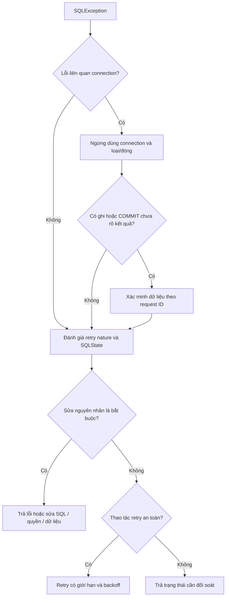

# Phân biệt lỗi tạm thời, lỗi không tạm thời và lỗi cần phục hồi kết nối

Khi ứng dụng Java gọi cơ sở dữ liệu qua **JDBC**, một lệnh `PreparedStatement.executeUpdate()` có thể thất bại vì nhiều lý do rất khác nhau: mất kết nối ngắn hạn, deadlock, câu SQL sai cú pháp, vi phạm khóa duy nhất, mật khẩu sai hoặc một kết nối đã không còn sử dụng được. Nếu ứng dụng xử lý mọi `SQLException` bằng cùng một câu lệnh `retry`, kết quả có thể là vòng lặp vô hạn, quá tải cơ sở dữ liệu, hoặc tệ hơn là **ghi dữ liệu hai lần** khi kết quả `commit()` chưa rõ.

Bài học thuộc chương **Lỗi và cảnh báo** của module **JDBC**. Trọng tâm là đọc đúng phân cấp ngoại lệ `java.sql`, phân tích `SQLState` và mã lỗi của driver, quyết định khi nào có thể thử lại, khi nào cần sửa yêu cầu hoặc cấu hình, và khi nào phải bỏ kết nối cũ để phục hồi. Những quyết định này áp dụng xuyên suốt việc lấy `Connection` từ `DataSource`, chạy SQL tham số hóa bằng `PreparedStatement`, đọc `ResultSet`, thực hiện CRUD, batching và quản lý transaction.

## 1. Ba câu hỏi trước khi phản ứng với một `SQLException`

Khi một thao tác JDBC thất bại, hãy tách ba câu hỏi:

1. **Nguyên nhân có thể biến mất nếu thử lại không?** Deadlock hoặc một gián đoạn mạng ngắn có thể biến mất; câu SQL sai cú pháp hay dữ liệu vi phạm `UNIQUE` thì thông thường không.
2. **Kết nối hiện tại còn đáng tin cậy không?** Một lỗi constraint thường không làm connection hỏng, còn lỗi kết nối có thể buộc phải đóng hoặc loại bỏ connection khỏi pool.
3. **Thử lại thao tác có an toàn về nghiệp vụ không?** Lệnh `SELECT` chỉ đọc có thể được chạy lại dễ hơn một lệnh thanh toán. `commit()` bị timeout có thể đã thành công ở DB, dù ứng dụng nhận ngoại lệ.

Ba câu hỏi này độc lập một phần với nhau. **“Tạm thời” không có nghĩa là “tự động retry luôn an toàn”**, và **“không tạm thời” không đồng nghĩa là “cứ giữ connection cũ”**.

| Tình huống | Có thể biến mất khi thử lại? | Connection cần thay? | Hành động điển hình |
| --- | --- | --- | --- |
| Deadlock hoặc xung đột serialization | Có thể | Thường không nhất thiết | Rollback transaction cũ; retry **toàn bộ transaction** nếu nghiệp vụ an toàn |
| Mất kết nối thoáng qua khi mở connection | Có thể | Dùng connection mới | Retry có giới hạn, backoff và kiểm tra pool/DB |
| SQL sai tên cột, sai cú pháp | Không nếu giữ nguyên SQL | Thường không | Sửa code/schema |
| Vi phạm khóa duy nhất | Không nếu giữ nguyên dữ liệu | Thường không | Xử lý trùng theo nghiệp vụ, không retry mù |
| Mất kết nối giữa `commit()` | Không thể suy ra từ lỗi | Connection có thể hỏng | Xác minh kết quả commit trước khi thực hiện lại |
| Driver yêu cầu phục hồi connection | Có thể sau bước phục hồi | Có, ít nhất phải xử lý connection cũ | Đóng/loại connection, lấy connection mới, tái lập trạng thái rồi đánh giá retry |

## 2. Phân cấp ngoại lệ JDBC

`SQLException` là lớp cơ sở của nhiều lỗi JDBC. Từ JDBC 4, các lớp con giúp biểu đạt bản chất dự kiến của lỗi. Java phân thành các nhánh đáng quan tâm:

```text
java.sql.SQLException
├── SQLTransientException
│   ├── SQLTransientConnectionException
│   ├── SQLTransactionRollbackException
│   └── SQLTimeoutException
├── SQLNonTransientException
│   ├── SQLNonTransientConnectionException
│   ├── SQLIntegrityConstraintViolationException
│   ├── SQLSyntaxErrorException
│   ├── SQLInvalidAuthorizationSpecException
│   ├── SQLDataException
│   └── SQLFeatureNotSupportedException
├── SQLRecoverableException
└── SQLWarning
```

Sơ đồ chỉ liệt kê một số lớp tiêu biểu. `SQLRecoverableException` là **nhánh trực tiếp khác** với `SQLTransientException` và `SQLNonTransientException`; không kiểm tra nó bằng cách chỉ hỏi `instanceof SQLTransientException`. `SQLWarning` cũng kế thừa `SQLException` nhưng thường biểu thị **cảnh báo** được gắn vào đối tượng JDBC, không phải một thao tác chắc chắn đã thất bại.

Các driver có thể trả một `SQLException` chung, thay vì lớp con chuyên biệt, hoặc chọn kiểu ngoại lệ không hoàn toàn tương ứng với ý nghĩa của một mã `SQLState`. Bởi vậy, cần hiểu **cả kiểu exception, SQLState, mã vendor, giai đoạn xảy ra lỗi và hành vi đã tài liệu hóa của DB/driver**.

### 2.1. `SQLTransientException`: lỗi tạm thời

Theo ý nghĩa API, lỗi này có khả năng biến mất nếu thao tác được thử lại **mà không cần ứng dụng sửa nguyên nhân**. Các lớp con phổ biến:

- `SQLTransientConnectionException`: vấn đề kết nối có tính tạm thời, như không cấp được kết nối trong một thời điểm; lần thử sau có thể thành công.
- `SQLTransactionRollbackException`: DB yêu cầu hủy transaction, ví dụ do deadlock hoặc xung đột concurrency; lần chạy lại **transaction mới** có thể thành công.
- `SQLTimeoutException`: thao tác không hoàn thành trong thời hạn được áp dụng; lần thử sau có thể thành công nhưng **không bảo đảm thao tác trước chưa có tác động**.

Đừng suy luận rằng cứ `instanceof SQLTransientException` là có thể chạy lại ngay lệnh `INSERT` trên cùng connection. Có thể cần rollback, bắt đầu transaction mới, thay connection, chờ backoff hoặc kiểm tra kết quả trước.

### 2.2. `SQLNonTransientException`: lỗi không tự hết khi thử lại y hệt

Lỗi thuộc nhóm này được định nghĩa là thường **không thành công khi thử lại cùng thao tác mà không sửa nguyên nhân**. Ví dụ:

- `SQLIntegrityConstraintViolationException`: vi phạm `UNIQUE`, `FOREIGN KEY`, `CHECK`, `NOT NULL`...
- `SQLSyntaxErrorException`: cú pháp SQL sai, tên bảng/cột không hợp lệ.
- `SQLInvalidAuthorizationSpecException`: thông tin xác thực hoặc quyền truy cập không hợp lệ.
- `SQLDataException`: giá trị dữ liệu không hợp lệ, lỗi chuyển đổi hay ngoài phạm vi kiểu.
- `SQLFeatureNotSupportedException`: driver hoặc DB chưa hỗ trợ tính năng.
- `SQLNonTransientConnectionException`: lỗi kết nối mà chỉ thử lại cùng cách không được kỳ vọng là đủ để khắc phục, chẳng hạn cấu hình hoặc tình trạng dịch vụ cần sửa.

**Trường hợp dễ nhầm:** một `SQLNonTransientConnectionException` vẫn có thể cho biết **connection hiện tại không dùng được**. Nó thuộc nhóm không tạm thời về *khả năng retry*, nhưng về *vòng đời connection* vẫn phải đóng/loại connection lỗi theo chính sách pool.

### 2.3. `SQLRecoverableException`: cần thực hiện bước phục hồi

`SQLRecoverableException` biểu đạt tình huống thao tác **có thể** thành công sau khi ứng dụng thực hiện các bước phục hồi. Theo ý nghĩa API, tối thiểu là **đóng connection hiện tại, nhận một connection mới** và khôi phục những trạng thái cần thiết trước khi thử lại.

Đây không phải cam kết rằng chỉ gọi `dataSource.getConnection()` là mọi thứ sẽ ổn. Ví dụ, ứng dụng còn có thể phải:

- Khởi tạo transaction mới, thiết lập isolation/read-only/schema/session settings mà nghiệp vụ yêu cầu.
- Xác minh kết quả nếu connection cũ mất trong lúc gửi `COMMIT`.
- Tái tạo `PreparedStatement`, `ResultSet` và các tài nguyên JDBC gắn với connection mới.
- Khôi phục trạng thái nghiệp vụ từ DB thay vì dùng những giả định chưa chắc đã commit trên connection cũ.

Một `ResultSet` hoặc `PreparedStatement` của connection đã hỏng **không thể được mang sang connection mới**. Các đối tượng này phải được tạo lại.

### 2.4. Ngoại lệ chung và nhánh không phân loại

`SQLException` không thuộc ba nhánh trên là tình huống hợp lệ; nhiều driver trả lỗi chung cho sự cố đặc thù. Chính sách an toàn là **chưa tự động retry**, kiểm tra thêm `SQLState`, `getErrorCode()`, `getNextException()` và tài liệu driver. Khi có thông tin chính thức của DB, ứng dụng có thể bổ sung quy tắc xử lý có kiểm thử.

## 3. SQLState và vendor error code bổ sung những gì?

Một `SQLException` có ba nguồn thông tin chính:

```java
catch (SQLException e) {
    String sqlState = e.getSQLState(); // Có thể null.
    int vendorCode = e.getErrorCode(); // 0 nếu không có mã riêng.
    String message = e.getMessage();
}
```

`SQLState` thường là chuỗi **5 ký tự**. Hai ký tự đầu chỉ *lớp* lỗi trong các quy ước SQLState; ba ký tự sau cung cấp mã cụ thể. Nhiều hệ quản trị mở rộng mã riêng. `vendorCode` cũng có ý nghĩa theo DB/driver đang dùng, không phải mã chuẩn chung cho mọi cơ sở dữ liệu.

| Lớp/mã SQLState minh họa | Ý nghĩa thường gặp | Phản ứng cần xem xét |
| --- | --- | --- |
| `08xxx` | Lỗi kết nối | Xem connection không đáng tin cậy; đóng/loại khỏi pool, không mặc định retry DML |
| `23xxx` | Vi phạm toàn vẹn dữ liệu | Xử lý ràng buộc và dữ liệu đầu vào |
| `28xxx` | Vấn đề xác thực/quyền | Kiểm tra tài khoản, quyền hoặc cấu hình |
| `40xxx` | Transaction bị rollback/xung đột | Rollback theo hợp đồng DB, xem xét retry **toàn bộ transaction** |
| `42xxx` | Cú pháp SQL/vi phạm quy tắc truy cập | Sửa câu SQL, schema hoặc quyền theo mã cụ thể |
| `40001` | Serialization failure ở nhiều DB | Có thể retry transaction mới có giới hạn |
| `23505` (PostgreSQL) | Vi phạm khóa duy nhất | Giải quyết trùng dữ liệu hoặc idempotency |
| `40P01` (PostgreSQL) | Deadlock được phát hiện | Thường rollback rồi retry transaction thích hợp |
| `08006` (PostgreSQL) | Kết nối thất bại | Loại connection cũ; xác minh trạng thái nếu vừa ghi/commit |
| `57014` (PostgreSQL) | Query canceled, có thể vì timeout/cancel | Xác định ai hủy, có tác động nào đã diễn ra và có nên retry |

Các ví dụ có tên PostgreSQL **không phải bảo đảm phổ quát**. Chẳng hạn, lỗi deadlock hoặc timeout của hệ khác có thể có mã vendor và SQLState khác. Cũng đừng tự coi toàn bộ lớp `40` là an toàn để retry: quyết định còn phụ thuộc thao tác, side effect và tình trạng transaction.

**Một SQLState thuộc lớp `08` nói lên rủi ro của connection; nó không trả lời câu hỏi `commit()` trước đó có thành công hay không.** Nếu nhận `08006` sau khi gửi lệnh ghi hoặc `COMMIT`, phải xem trạng thái DB và khóa nghiệp vụ trước khi ghi lại.

## 4. Mô hình phân loại hai trục: retry và tình trạng connection

Để không trộn các khái niệm, nên phân loại lỗi theo hai trục:

1. **Retry nature:** `TRANSIENT`, `NON_TRANSIENT`, `RECOVERABLE`, `UNKNOWN`.
2. **Connection suspect:** connection có dấu hiệu không an toàn để dùng tiếp hay không.

Ví dụ Java 17+:

```java
import java.sql.SQLException;
import java.sql.SQLNonTransientConnectionException;
import java.sql.SQLNonTransientException;
import java.sql.SQLRecoverableException;
import java.sql.SQLTransientConnectionException;
import java.sql.SQLTransientException;

public final class JdbcFailureClassifier {
    private JdbcFailureClassifier() {}

    public enum RetryNature {
        TRANSIENT, NON_TRANSIENT, RECOVERABLE, UNKNOWN
    }

    public record Assessment(
            RetryNature nature,
            boolean connectionSuspect,
            String sqlState) {}

    public static Assessment assess(SQLException error) {
        String state = error.getSQLState();
        boolean stateSignalsConnection =
                state != null && state.startsWith("08");

        if (error instanceof SQLRecoverableException) {
            return new Assessment(RetryNature.RECOVERABLE, true, state);
        }
        if (error instanceof SQLTransientConnectionException) {
            return new Assessment(RetryNature.TRANSIENT, true, state);
        }
        if (error instanceof SQLNonTransientConnectionException) {
            return new Assessment(RetryNature.NON_TRANSIENT, true, state);
        }
        if (error instanceof SQLTransientException) {
            return new Assessment(
                    RetryNature.TRANSIENT, stateSignalsConnection, state);
        }
        if (error instanceof SQLNonTransientException) {
            return new Assessment(
                    RetryNature.NON_TRANSIENT, stateSignalsConnection, state);
        }
        // Driver có thể chỉ ném SQLException chung.
        return new Assessment(
                RetryNature.UNKNOWN, stateSignalsConnection, state);
    }
}
```

Đây là bộ phân loại **thận trọng**, không phải bộ quyết định retry hoàn chỉnh. Nó không tự biến `SQLState=40001` của một `SQLException` chung thành “được phép retry”: chính sách retry theo mã SQLState/vender cần được bổ sung dựa trên tài liệu DB và test thực tế.

Ví dụ cách đọc:

```java
JdbcFailureClassifier.Assessment result =
        JdbcFailureClassifier.assess(sqlException);

if (result.connectionSuspect()) {
    // Không tiếp tục dùng Statement/ResultSet của connection đang lỗi.
    // Đóng connection (hoặc yêu cầu pool loại bỏ khi cần).
}

// result.nature() chỉ là dữ kiện đầu vào của chính sách xử lý.
// Kết quả cuối còn phụ thuộc transaction và tính an toàn nghiệp vụ.
```

| Kết quả phân loại | Ý nghĩa | Chính sách ban đầu |
| --- | --- | --- |
| `TRANSIENT + false` | Có thể thử lại, connection chưa bị đánh dấu hỏng theo dữ kiện hiện có | Kiểm tra transaction; rollback/khởi tạo transaction mới khi cần; retry có giới hạn |
| `TRANSIENT + true` | Lỗi có thể tạm thời và liên quan connection | Không tái sử dụng connection lỗi; lấy connection mới, kiểm tra an toàn trước retry |
| `NON_TRANSIENT + false` | Không kỳ vọng hết nếu chỉ lặp lại y hệt | Sửa SQL, quyền hoặc dữ liệu; trả lỗi phù hợp |
| `NON_TRANSIENT + true` | Cần xử lý nguyên nhân và connection | Đóng/loại connection; không retry mù |
| `RECOVERABLE + true` | Có hy vọng sau khi thực hiện bước phục hồi | Connection mới và khôi phục trạng thái; **sau đó** mới cân nhắc retry |
| `UNKNOWN` | Chưa đủ dữ kiện | Thu thập mã và ngữ cảnh, tránh tự động retry |

Chỉ kiểm tra `state.startsWith("08")` khi `state != null`; một số driver không cung cấp SQLState. Không so sánh riêng `getMessage()` để phân loại vì thông điệp có thể đổi theo phiên bản, ngôn ngữ hoặc cách bọc lỗi.

## 5. Quy tắc retry đúng: toàn bộ đơn vị công việc và an toàn nghiệp vụ

Một lỗi mang tính tạm thời chỉ là **điều kiện cần**, chưa phải điều kiện đủ cho retry:

- **Phạm vi thử lại:** nếu transaction bị rollback bởi DB do deadlock/serialization conflict, phải thử lại **toàn bộ transaction** trên trạng thái mới; không chỉ phát lại câu `UPDATE` thất bại sau khi transaction cũ đã bị abort.
- **Mức giới hạn:** đặt số lần thử tối đa và ngân sách thời gian; dùng exponential backoff có jitter để nhiều client không cùng retry ngay.
- **Idempotency:** yêu cầu ghi có khóa nhận diện ổn định, constraint chống trùng hoặc cơ chế kiểm tra kết quả; retry không được tạo thêm một kết quả nghiệp vụ ngoài ý định.
- **Tác động ngoài DB:** nếu transaction còn gửi email, gọi thanh toán hoặc đẩy message, các bước đó phải có outbox/idempotency/compensation phù hợp trước khi cho phép retry.
- **Kết quả commit:** `SQLException` phát sinh từ `commit()` do timeout/mất kết nối có thể xảy ra **sau khi DB đã commit**. Không tự động thực hiện lại giao dịch có side effect.
- **Quản lý kết nối:** trong môi trường pool, đóng connection lỗi theo API chuẩn; với lỗi nghiêm trọng cần chính sách pool loại bỏ physical connection, không chỉ giả định `close()` luôn hủy kết nối vật lý.

### Retry toàn bộ giao dịch khác retry một statement

```text
BEGIN
  UPDATE kho hàng
  INSERT hóa đơn
  COMMIT
```

Nếu transaction thất bại do serialization conflict, không thể giữ kết quả cập nhật kho rồi chỉ thử lại `INSERT`. Đơn vị cần retry là **toàn bộ quy tắc cập nhật kho + tạo hóa đơn**, đọc lại dữ liệu cần thiết và kết thúc bằng một commit mới.

Trên PostgreSQL, sau một lỗi SQL làm transaction rơi vào trạng thái aborted, các câu SQL tiếp theo thường bị từ chối cho đến khi `ROLLBACK` (trừ các cơ chế savepoint được dùng đúng). Vì vậy lặp lại statement trên connection vẫn nằm trong transaction lỗi sẽ không sửa vấn đề. Hệ quản trị khác có chính sách abort transaction khác nhau; phải hiểu quy tắc DB đang dùng.

## 6. Ví dụ JDBC: retry có giới hạn cho truy vấn chỉ đọc

Ví dụ sau dùng `DataSource`, `PreparedStatement`, `ResultSet` và `Optional` để tìm tên khách hàng. Đây là truy vấn `SELECT` đơn giản **không có side effect**. Mỗi lần thử mở một connection mới và đóng tài nguyên theo `try-with-resources`.

```java
import java.sql.Connection;
import java.sql.PreparedStatement;
import java.sql.ResultSet;
import java.sql.SQLException;
import java.sql.SQLTransientException;
import java.util.Optional;
import javax.sql.DataSource;

public final class CustomerReader {
    private static final int MAX_ATTEMPTS = 3;
    private final DataSource dataSource;

    public CustomerReader(DataSource dataSource) {
        this.dataSource = dataSource;
    }

    public Optional<String> findName(long customerId) throws SQLException {
        String sql = "SELECT full_name FROM customers WHERE id = ?";
        SQLException previousFailure = null;

        for (int attempt = 1; attempt <= MAX_ATTEMPTS; attempt++) {
            try (Connection con = dataSource.getConnection();
                 PreparedStatement ps = con.prepareStatement(sql)) {
                ps.setLong(1, customerId);

                try (ResultSet rs = ps.executeQuery()) {
                    if (!rs.next()) {
                        return Optional.empty();
                    }
                    // Hợp đồng schema: full_name phải NOT NULL.
                    String name = rs.getString("full_name");
                    if (name == null) {
                        throw new SQLException("full_name bất ngờ là NULL");
                    }
                    return Optional.of(name);
                }
            } catch (SQLException error) {
                // Giữ lại cả những lần thử trước khi ném lỗi cuối cùng.
                if (previousFailure != null && previousFailure != error) {
                    error.addSuppressed(previousFailure);
                }

                boolean retryable =
                        error instanceof SQLTransientException;
                if (!retryable || attempt == MAX_ATTEMPTS) {
                    throw error;
                }
                previousFailure = error;
                // Minh họa ngắn: production cần backoff + jitter
                // và giới hạn tổng thời gian trước lần thử tiếp theo.
            }
        }
        throw new AssertionError("Không thể đi tới dòng này");
    }
}
```

**Giới hạn chủ đích của ví dụ:**

- Chính sách chỉ retry khi driver ném `SQLTransientException`; các `SQLRecoverableException` và `SQLException` chung cần xử lý theo chính sách riêng sau phục hồi/kiểm chứng. Không coi đoạn code là một retry engine đầy đủ.
- Ví dụ giả định cột `customers.full_name` có ràng buộc `NOT NULL`. Nếu một hàng vi phạm hợp đồng đó, mã ném lỗi thay vì nhập nhằng `Optional.empty()` (không tìm thấy hàng) với tên `NULL`.
- Mỗi vòng lặp tạo connection và statement mới, thích hợp cho truy vấn đọc độc lập. Với transaction ghi nhiều bước, phải mở/rollback/commit **toàn bộ transaction mỗi lần thử**, không áp dụng thẳng cấu trúc này.
- `getConnection()` có thể ném ngoại lệ trong lúc tạo statement, và `close()` cũng có thể ném lỗi. `try-with-resources` giữ lỗi chính và gắn lỗi đóng tài nguyên bằng `getSuppressed()`.
- Đoạn ví dụ bỏ qua backoff để tập trung vào phân loại lỗi. Ứng dụng thực tế cần backoff có jitter và dừng khi quá thời hạn request. Không sleep vô hạn trên thread xử lý web.
- Trước khi retry, cần bảo đảm truy vấn đúng là chỉ đọc theo hợp đồng. Một `SELECT` có gọi stored function tác động dữ liệu hoặc gọi dịch vụ ngoài **không còn** là thao tác đọc thuần túy.

Để retry `SQLRecoverableException`, cần thực hiện bước phục hồi theo driver/DB (ít nhất là thay connection) và xem xét tính xác định của kết quả trước đó. Không chỉ đổi điều kiện thành `error instanceof SQLRecoverableException` rồi cho retry mọi câu ghi.

## 7. Khi kết nối cần phục hồi

Hành động với connection phụ thuộc cả kiểu exception, SQLState và thao tác vừa thực hiện:

1. **Dừng sử dụng** `PreparedStatement`/`ResultSet` và transaction hiện tại nếu nghi connection hỏng.
2. **Đóng hoặc loại connection** qua API pool phù hợp. Với `Connection` lấy từ pool, `close()` thông thường có thể trả logical connection về pool; việc loại physical connection phải theo cơ chế của pool và khả năng phát hiện connection lỗi.
3. **Lấy connection mới** từ `DataSource`, kiểm tra các cấu hình transaction/connection cần thiết cho nghiệp vụ: isolation, `autoCommit`, `readOnly`, schema, các tham số session.
4. **Xác minh trạng thái dữ liệu** nếu lỗi xảy ra sau một thao tác ghi hoặc trong `commit()`. Không xác nhận “rollback thành công” chỉ vì socket đã đứt.
5. **Chạy lại cả đơn vị công việc** nếu chính sách retry cho phép và các tác động trước đó đã được kiểm soát.

Một sơ đồ quyết định:



**`Connection.isValid(timeout)` không thay cho chiến lược phục hồi**: kết quả kiểm tra chỉ phản ánh tình trạng tại thời điểm kiểm tra, không chứng minh transaction trước đó đã commit hay rollback, và không thể ngăn connection hỏng ngay sau khi kiểm tra.

Với connection pool, cần theo dõi số connection bị loại, số lỗi khi lấy connection và thời gian chờ cấp connection. Nếu lỗi liên tục do sai mật khẩu hoặc endpoint sai, việc tăng số lần retry sẽ làm xấu thêm tình trạng hệ thống.

## 8. Đặc biệt nguy hiểm: timeout hoặc mất kết nối trong `commit()`

Xét giao dịch tạo một đơn hàng:

```text
Java API            Database
  |  BEGIN             |
  |  INSERT order      |
  |  COMMIT ---------->|
  |                    | Thực hiện commit thành công
  |       X mạng đứt   |
  |<-- SQLException ---|
```

Ứng dụng thấy lỗi, nhưng có thể DB **đã lưu đơn hàng**. Nếu tạo ID mới rồi chạy lại, hệ thống có thể có hai đơn. Ngay cả khi `rollback()` sau đó trả về một ngoại lệ khác, nó không chứng minh commit trước đó chưa xảy ra.

Giải pháp ứng dụng:

- Tạo và lưu **khóa request/idempotency** ổn định trước khi gửi giao dịch.
- Dùng ràng buộc `UNIQUE(request_id)` hoặc khóa chính có ý nghĩa nghiệp vụ để chống trùng.
- Nếu kết quả commit không xác định, truy vấn trạng thái bằng khóa ấy trên một connection **mới** khi DB có thể truy cập.
- Nếu tìm thấy dữ liệu, xác minh nó tương ứng với đúng request/payload, rồi trả kết quả phù hợp; không coi mọi lỗi duplicate là thành công.
- Nếu chưa xác minh được, giữ trạng thái **không xác định/cần đối soát**; chỉ retry khi quy tắc nghiệp vụ chứng minh an toàn.

Vấn đề này áp dụng cả khi `autoCommit=true` và lệnh `INSERT` tự commit: mất phản hồi từ câu lệnh ghi có thể khiến kết quả ghi không rõ. **Phân cấp `SQLException` không thể tự xác minh kết quả nghiệp vụ.**

## 9. Phân biệt lỗi `executeBatch()` với các lệnh đơn

`PreparedStatement.addBatch()` và `executeBatch()` có thể tăng hiệu năng, nhưng một batch lỗi khiến việc quyết định retry phức tạp hơn.

`BatchUpdateException` là một dạng `SQLException` có thể mang:

- `getUpdateCounts()`: số hàng cập nhật hoặc mã `Statement.SUCCESS_NO_INFO`/`Statement.EXECUTE_FAILED` tùy khả năng driver.
- `getLargeUpdateCounts()`: dạng `long[]` khi dùng API tương ứng.
- `getNextException()`: các ngoại lệ SQL liên quan khác.

Ví dụ quan sát:

```java
import java.sql.BatchUpdateException;
import java.sql.Statement;
import java.util.Arrays;

try {
    statement.executeBatch();
} catch (BatchUpdateException error) {
    int[] counts = error.getUpdateCounts();
    System.err.println("Batch counts: " + Arrays.toString(counts));
    for (int count : counts) {
        if (count == Statement.EXECUTE_FAILED) {
            System.err.println("Một phần tử batch đã thất bại");
        }
    }
    throw error; // Để tầng transaction quyết định rollback/retry.
}
```

Đây là đoạn minh họa cần đặt trong phương thức có `Statement statement` đã được tạo/đóng đúng và `throws SQLException`. Các driver khác nhau về việc **dừng tại lỗi đầu** hay **tiếp tục thực thi phần tử sau lỗi**, nên không suy luận dữ liệu cuối cùng chỉ bằng độ dài `counts`.

Nếu tất cả lệnh trong batch phải cùng thành công, hãy chạy trong một transaction rõ ràng, rollback khi lỗi và kiểm tra chính sách DB về transaction bị abort. Nếu commit không rõ kết quả, vẫn cần idempotency/đối soát trước khi chạy lại batch.

## 10. `SQLWarning` là một kênh thông tin riêng

Không phải thông tin bất thường nào JDBC cung cấp cũng là một lỗi khiến thao tác dừng. `SQLWarning` kế thừa `SQLException`, nhưng thường được **gắn vào** `Connection`, `Statement` hoặc `ResultSet` để ứng dụng truy xuất khi cần:

```java
import java.sql.Connection;
import java.sql.PreparedStatement;
import java.sql.ResultSet;
import java.sql.SQLException;
import java.sql.SQLWarning;
import javax.sql.DataSource;

public static void inspectWarnings(DataSource dataSource)
        throws SQLException {
    try (Connection con = dataSource.getConnection();
         PreparedStatement ps =
                 con.prepareStatement("SELECT id FROM customers")) {
        try (ResultSet rs = ps.executeQuery()) {
            while (rs.next()) {
                // Xử lý hàng dữ liệu.
                long id = rs.getLong("id");
            }

            for (SQLWarning w = rs.getWarnings();
                 w != null; w = w.getNextWarning()) {
                System.out.println("ResultSet warning: " + w.getSQLState());
            }
        }

        for (SQLWarning w = ps.getWarnings();
             w != null; w = w.getNextWarning()) {
            System.out.println("Statement warning: " + w.getMessage());
        }
        for (SQLWarning w = con.getWarnings();
             w != null; w = w.getNextWarning()) {
            System.out.println("Connection warning: " + w.getMessage());
        }

        // clearWarnings() khi cần và khi tài nguyên vẫn đang mở.
        ps.clearWarnings();
    }
}
```

`SQLWarning.getNextWarning()` duyệt chuỗi cảnh báo. Nội dung và thời điểm xuất hiện cảnh báo tùy DB/driver; nhiều truy vấn không có warning. JDBC có thể tự xóa một số warning khi thực hiện thao tác mới trên cùng đối tượng, nên hãy đọc khi còn đúng ngữ cảnh và trước khi đóng. `clearWarnings()` xóa warning gắn với **đối tượng được gọi**, không sửa lỗi DB.

Ví dụ cảnh báo: DB/driver có thể thông báo cắt giảm dữ liệu, điều kiện xử lý không tối ưu hoặc thông tin khác tùy sản phẩm. Với việc cắt dữ liệu, đừng giả định mọi driver đều trả `SQLWarning`: một số tình huống có thể ném `DataTruncation` hoặc `SQLException`. Cần đối chiếu cấu hình DB và kiểm thử.

**Không coi warning tương đương `SQLTransientException`.** Cảnh báo có thể xuất hiện dù thao tác thành công; xử lý tùy mức nghiêm trọng của nghiệp vụ, ghi log hoặc chuyển thành lỗi ở tầng ứng dụng khi cần.

## 11. Đọc đủ chuỗi lỗi, cause và suppressed

`SQLException` thường cung cấp nhiều nhánh thông tin lỗi:

| Kênh | API | Mục đích |
| --- | --- | --- |
| Lỗi chính | `getMessage()`, `getSQLState()`, `getErrorCode()` | Xác định lỗi được ném và trạng thái DB |
| Các lỗi SQL liên quan | `getNextException()` | Có thể chứa thêm lỗi của driver, batch hoặc DB |
| Nguyên nhân lồng | `getCause()` | Giữ ngoại lệ thấp hơn khi một lớp bọc lỗi khác |
| Lỗi trong lúc cleanup | `getSuppressed()` | Giữ lỗi rollback/close/reset phát sinh sau lỗi chính |

Ví dụ logger có thể giữ đủ dữ kiện:

```java
import java.sql.SQLException;
import java.util.logging.Level;
import java.util.logging.Logger;

public static void logJdbcFailure(Logger logger, SQLException error) {
    logger.log(Level.SEVERE,
            "JDBC failure; SQLState=" + error.getSQLState()
            + "; vendorCode=" + error.getErrorCode(), error);

    for (SQLException next = error.getNextException();
         next != null; next = next.getNextException()) {
        logger.log(Level.WARNING,
                "Additional SQL error; SQLState=" + next.getSQLState()
                + "; vendorCode=" + next.getErrorCode(), next);
    }
}
```

`Logger.log(..., error)` in stack trace và thường thể hiện cause/suppressed; chuỗi `nextException` có thể cần duyệt riêng. Nếu hệ thống bọc lỗi vào `DataAccessException` của ứng dụng, cần truyền `SQLException` ban đầu làm `cause`, không chỉ sao chép `getMessage()`.

Ghi thêm tên thao tác, mã correlation/request và giai đoạn thất bại (`getConnection`, `execute`, `commit`, `rollback`) nhưng tránh log mật khẩu, connection string có secret và giá trị tham số chứa dữ liệu riêng tư. Đừng chỉ bắt ngoại lệ rồi ghi log nhiều lần ở mỗi tầng, tạo bản ghi trùng khó theo dõi.

## 12. Quyết định lỗi ở các tầng ứng dụng

Một kiến trúc đơn giản có thể phân vai:

| Tầng | Trách nhiệm |
| --- | --- |
| JDBC DAO/repository | Ném nguyên `SQLException` hoặc bọc có `cause`; đóng tài nguyên; không tự retry mọi lỗi |
| Transaction service | Giữ transaction, rollback khi phù hợp, hiểu đơn vị retry và hậu quả commit |
| Retry policy | Nhận kiểu lỗi, SQLState/vendor code, số lần thử, deadline, khả năng idempotent |
| Connection pool | Cấp connection mới, kiểm tra và loại connection vật lý không đáng tin cậy |
| API/controller | Phân loại kết quả nghiệp vụ: đầu vào không hợp lệ, xung đột, dịch vụ tạm lỗi, chưa biết kết quả |
| Giám sát/vận hành | Theo dõi tỷ lệ timeout, deadlock, connection failure, retry, lỗi pool và pending reconciliation |

Ví dụ cùng một lỗi `SQLIntegrityConstraintViolationException` có thể có **hai cách xử lý nghiệp vụ**:

- Khi đăng ký username trùng: trả thông báo đã tồn tại hoặc mã xung đột phù hợp.
- Khi nhận lại một yêu cầu tạo đơn có cùng `request_id`: kiểm tra record cũ có đúng nội dung không; nếu khớp, có thể trả lại kết quả cũ như một phần của cơ chế idempotency.

Lỗi SQL vẫn cùng nhóm **không tạm thời**, nhưng phản ứng của ứng dụng khác nhau theo hợp đồng nghiệp vụ. Đó là lý do không nên tạo một ánh xạ “một exception → một hành động” áp dụng vô điều kiện cho mọi endpoint.

## 13. Những phản mẫu thường gặp

| Phản mẫu | Hậu quả | Cách làm thích hợp |
| --- | --- | --- |
| `catch (SQLException e) { retry(); }` cho mọi lỗi | Retry câu SQL sai, dữ liệu trùng, tăng tải | Phân loại và xét an toàn nghiệp vụ |
| Retry vô hạn, không backoff | Gây quá tải và thác lỗi khi DB phục hồi | Giới hạn số lần, deadline, exponential backoff + jitter |
| Retry chỉ statement sau transaction bị rollback | Transaction cũ không còn hợp lệ | Thử lại toàn bộ transaction mới |
| Giữ `Statement`/`ResultSet` của connection hỏng | Lỗi liên tiếp, trạng thái không hợp lệ | Đóng/loại connection và tạo tài nguyên mới |
| `SQLNonTransientConnectionException` mà vẫn tái sử dụng connection | Connection hỏng còn trong pool | Phân biệt khả năng retry với tình trạng connection |
| `SQLRecoverableException` rồi retry cùng connection | Bỏ qua bước phục hồi mà API yêu cầu | Đóng connection, lấy connection mới, tái lập trạng thái |
| `commit()` báo timeout rồi tạo request khác | Có thể ghi dữ liệu hai lần | ID ổn định, tra cứu trạng thái, idempotency |
| So khớp chuỗi trong `getMessage()` | Dễ hỏng khi thay driver hoặc thông điệp | Dùng lớp exception, SQLState, vendor code có kiểm chứng |
| Chỉ log lỗi rollback, quên lỗi SQL đầu | Mất nguyên nhân chính | Giữ lỗi ban đầu và gắn lỗi cleanup bằng `addSuppressed()` |
| Đọc warning sau khi tài nguyên đã đóng | Mất thông tin cảnh báo | Đọc `getWarnings()` đúng đối tượng và thời điểm |
| Coi mọi `SQLState` nhóm `40` là an toàn retry | Có thể nhân đôi tác động ngoài DB | Xét từng mã và tính idempotency |
| Bọc lỗi chỉ bằng message | Mất SQLState, vendor code, cause/suppressed | Bọc bằng constructor nhận `cause` |

## 14. Kiểm thử phân loại và phục hồi

Cần kiểm thử theo **hai lớp**: unit test cho logic phân loại và integration test với DB/driver thực tế để kiểm chứng lỗi được driver trả về, trạng thái transaction và connection pool.

### Ma trận unit test

| Dữ liệu lỗi mô phỏng | Kết quả bộ phân loại | Kỳ vọng về xử lý |
| --- | --- | --- |
| `new SQLTransientConnectionException(...)` | `TRANSIENT`, connection suspect | Lấy connection khác nếu thử lại |
| `new SQLTransactionRollbackException(...)` | `TRANSIENT`, không mặc định suspect | Rollback rồi retry transaction mới khi an toàn |
| `new SQLTimeoutException(...)` | `TRANSIENT` | Phải xét giai đoạn và khả năng tác động đã xảy ra |
| `new SQLSyntaxErrorException(...)` | `NON_TRANSIENT` | Không retry cùng SQL |
| `new SQLIntegrityConstraintViolationException(...)` | `NON_TRANSIENT` | Giải quyết dữ liệu/ràng buộc |
| `new SQLNonTransientConnectionException(...)` | `NON_TRANSIENT`, connection suspect | Loại/đóng connection và xử lý nguyên nhân |
| `new SQLRecoverableException(...)` | `RECOVERABLE`, connection suspect | Đóng connection, lấy connection mới, tái lập trạng thái |
| `new SQLException("x", "08006")` | `UNKNOWN`, connection suspect | Không dùng connection cũ; chưa tự retry |
| `new SQLException("x", null)` | `UNKNOWN`, không đủ dữ kiện | Log, xử lý theo hợp đồng driver |

Một vài assertion minh họa:

```java
import java.sql.SQLException;
import java.sql.SQLRecoverableException;
import java.sql.SQLSyntaxErrorException;

JdbcFailureClassifier.Assessment a =
        JdbcFailureClassifier.assess(
                new SQLRecoverableException("Connection lost", "08006"));
assert a.nature() == JdbcFailureClassifier.RetryNature.RECOVERABLE;
assert a.connectionSuspect();

JdbcFailureClassifier.Assessment b =
        JdbcFailureClassifier.assess(
                new SQLSyntaxErrorException("Invalid SQL", "42000"));
assert b.nature() == JdbcFailureClassifier.RetryNature.NON_TRANSIENT;

JdbcFailureClassifier.Assessment c =
        JdbcFailureClassifier.assess(new SQLException("Unknown", "08006"));
assert c.nature() == JdbcFailureClassifier.RetryNature.UNKNOWN;
assert c.connectionSuspect();
```

Trong ứng dụng thực tế, nên dùng framework kiểm thử với assertion luôn được thực thi; từ khóa `assert` của Java chỉ hoạt động khi bật `-ea`. Đoạn code ở trên là ví dụ dựa trên lớp `JdbcFailureClassifier` trong mục 4.

### Ma trận integration test

1. **Unique/foreign-key constraint:** gửi dữ liệu vi phạm, xác nhận exception/SQLState thực tế, tránh retry.
2. **SQL syntax/permission:** chạy SQL sai hoặc dùng quyền không đủ, xác nhận lỗi thuộc nhóm không thể sửa bằng retry y hệt.
3. **Deadlock hoặc serialization conflict:** tái tạo bằng hai transaction có kiểm soát; xác nhận rollback và retry **toàn bộ transaction**, có giới hạn.
4. **Query timeout:** đặt timeout thật theo JDBC/DB, ghi nhận exception và phân biệt timeout trước ghi với kết quả không rõ.
5. **Connection lỗi:** ngắt connection ở môi trường test; xác nhận client không tiếp tục dùng statement cũ và pool không phát lại connection hỏng.
6. **Commit không rõ kết quả:** mô phỏng mất phản hồi sau khi DB xử lý commit, xác nhận dùng idempotency key và đối soát trước retry.
7. **Batch có lỗi giữa chừng:** xem update counts, rollback và trạng thái dữ liệu cuối.
8. **Warning:** nếu driver/DB có tình huống sinh warning có kiểm soát, đọc warning theo đúng đối tượng và thời điểm.

Trong test, so sánh **dữ liệu cuối của DB** và số lần tác động nghiệp vụ, không chỉ kiểm tra exception có đúng lớp hay không. Driver có thể thay đổi kiểu ngoại lệ giữa các phiên bản; dùng mã SQLState/vendor được tài liệu hóa và kiểm tra lại khi nâng cấp.

## 15. Bài tập thực hành

**Bài 1 — Phân loại.** Một dịch vụ gặp bốn lỗi: `SQLTransactionRollbackException`, `SQLIntegrityConstraintViolationException`, `SQLRecoverableException` và `SQLNonTransientConnectionException`. Với mỗi lỗi, giải thích: có thể retry không, có nên dùng connection cũ không và cần thêm thông tin gì trước khi quyết định.

**Bài 2 — Retry transaction.** Một transaction JDBC trừ hàng tồn kho rồi tạo hóa đơn bị deadlock ở bước thứ hai. Thiết kế trình tự rollback, backoff và chạy lại, bảo đảm không chỉ chạy lại câu `INSERT` cuối.

**Bài 3 — Commit mơ hồ.** API `POST /orders` dùng `requestId=R-001`, `commit()` ném lỗi kết nối. Hãy mô tả các bước xác minh, xử lý khi tìm thấy đơn khớp request, khi thấy đơn không khớp và khi DB vẫn chưa truy cập được.

**Bài 4 — Connection pool.** Thiết kế một bài test khiến connection vật lý hỏng, sau đó xác nhận connection cũ không được đưa cho request khác. Liệt kê metric cần theo dõi khi số connection lỗi tăng.

**Bài 5 — Cảnh báo và batch.** Chạy một `PreparedStatement` có batch; mô phỏng một phần tử vi phạm constraint. Giải thích cách đọc `BatchUpdateException`, `getNextException()` và warning (nếu có), rồi kiểm tra kết quả sau rollback.

## 16. Checklist áp dụng cho code JDBC

- [ ] Khi catch `SQLException`, ghi rõ giai đoạn lỗi: lấy kết nối, chạy SQL, đọc `ResultSet`, commit, rollback hay close.
- [ ] Phân biệt `SQLTransientException`, `SQLNonTransientException`, `SQLRecoverableException` và `SQLException` chưa phân loại.
- [ ] Kiểm tra `SQLState` có thể `null`; dùng vendor code theo đúng DB/driver.
- [ ] Dựa vào trạng thái connection để quyết định đóng/loại, không dựa duy nhất vào nhóm transient.
- [ ] Sau `SQLRecoverableException`, thực hiện phục hồi và tạo connection/statement/result set mới.
- [ ] Retry có số lần tối đa, deadline, backoff và jitter; chỉ chạy lại đơn vị nghiệp vụ an toàn.
- [ ] Sau transaction abort, thử lại toàn transaction thay vì chỉ lệnh SQL cuối.
- [ ] Với `commit()` hoặc DML mất phản hồi, có khóa idempotency và cơ chế xác minh trước retry.
- [ ] Bảo toàn ngoại lệ SQL gốc và lỗi rollback/close qua cause/suppressed; không nuốt lỗi.
- [ ] Đọc `SQLWarning`, `getNextException()` và batch counts khi chúng liên quan đến chẩn đoán.
- [ ] Có test trên driver và cơ sở dữ liệu thật cho các loại lỗi quan trọng, kể cả trạng thái commit không rõ.

Phân loại đúng ngoại lệ JDBC giúp ứng dụng **phản ứng theo nguyên nhân**: lỗi tạm thời chỉ được retry khi đơn vị công việc an toàn; lỗi không tạm thời cần sửa dữ liệu, SQL hoặc cấu hình; lỗi cần phục hồi đòi hỏi làm lại vòng đời connection. Kết hợp phân loại exception với SQLState, tình trạng transaction, idempotency và kiểm thử thực tế là cách tránh cả hai thái cực nguy hiểm: từ bỏ quá sớm một lỗi có thể phục hồi, hoặc thử lại một thao tác có thể đã thành công.
