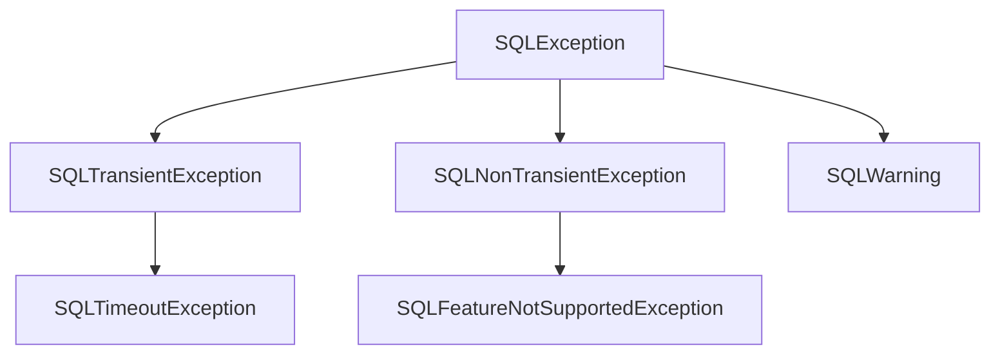

# Xử lý `SQLTimeoutException` và `SQLFeatureNotSupportedException` trong JDBC

## 1. Hai ngoại lệ, hai loại vấn đề khác nhau

Trong **JDBC**, ứng dụng Java truy cập cơ sở dữ liệu quan hệ qua driver, `DataSource`, `Connection`, `PreparedStatement` và `ResultSet`. Khi một thao tác thất bại, không phải `SQLException` nào cũng nên được xử lý theo cùng một cách. Đặc biệt, cần phân biệt **thao tác vượt quá giới hạn thời gian** với **API hoặc tính năng mà driver không hỗ trợ**.

Ví dụ: ứng dụng đặt `statement.setQueryTimeout(3)` trước khi cập nhật tồn kho. Nếu câu SQL chạy quá thời gian được driver áp dụng, driver có thể ném `SQLTimeoutException`. Ngược lại, ngay ở lúc đặt giới hạn, driver có thể ném `SQLFeatureNotSupportedException` vì không hỗ trợ cách cấu hình đó. Cùng là `SQLException`, nhưng hướng xử lý hoàn toàn khác: trường hợp đầu cần xem xét trạng thái transaction và khả năng retry; trường hợp sau cần xử lý **năng lực hệ thống hoặc cấu hình**, không lặp đi lặp lại cùng lời gọi.

| Ngoại lệ | Bản chất | Hướng xử lý ưu tiên |
| --- | --- | --- |
| `SQLTimeoutException` | Driver báo thao tác vượt quá thời gian chờ và đã cố gắng hủy thao tác đang chạy. | Xử lý trạng thái transaction, ghi nhận thời gian/mã lỗi, cân nhắc retry an toàn. |
| `SQLFeatureNotSupportedException` | Driver không hỗ trợ một tính năng JDBC được yêu cầu. | Ngừng phụ thuộc vào tính năng đó; kiểm tra driver/DBMS, chọn phương án thay thế đã kiểm chứng. |
| `SQLException` khác | Lỗi ràng buộc, kết nối, cú pháp SQL, deadlock, dữ liệu... | Phân loại theo SQLState, loại ngoại lệ và ngữ cảnh câu lệnh. |

**Đừng hiểu tên lớp ngoại lệ thành bảo đảm tuyệt đối về trạng thái DB.** Khi timeout, việc driver *cố gắng* hủy câu lệnh không chứng minh rằng lệnh đã dừng ngay, giao dịch đã rollback hoặc phía server chưa thực hiện thay đổi. Một số driver/DBMS còn báo timeout, hủy truy vấn hay mất kết nối bằng lớp `SQLException` khác và SQLState riêng. Ứng dụng phải kiểm chứng hành vi trên đúng môi trường thực tế.

## 2. Vị trí trong cây ngoại lệ JDBC

Hai loại ngoại lệ kế thừa các nhánh khác nhau của `SQLException`:



- **`SQLTimeoutException`** kế thừa `SQLTransientException`: nguyên nhân *có thể* tạm thời, nên trong một số trường hợp thao tác có thể thành công khi thử lại. Tính “transient” **không cấp phép retry tự động** đối với mọi thao tác ghi.
- **`SQLFeatureNotSupportedException`** kế thừa `SQLNonTransientException`: cùng cách gọi trên cùng driver/cấu hình thường sẽ tiếp tục thất bại. Cần đổi cách triển khai hoặc thay đổi năng lực môi trường trước khi thử lại.
- **`SQLWarning`** là nhánh dùng cho cảnh báo, thường được truy xuất qua `getWarnings()`; hai ngoại lệ trọng tâm của bài là ngoại lệ cần xử lý qua `catch`, không phải nội dung của warning chain.

Vì đều là lớp con của `SQLException`, **thứ tự `catch` phải đi từ loại cụ thể đến tổng quát**:

```java
try {
    // Thực thi thao tác JDBC có thể vượt timeout hoặc yêu cầu API tùy chọn.
} catch (SQLTimeoutException timeout) {
    // Xử lý hết thời gian và chính sách retry có điều kiện.
} catch (SQLFeatureNotSupportedException unsupported) {
    // Xử lý tính năng không được driver hỗ trợ.
} catch (SQLException otherSqlError) {
    // Xử lý những lỗi SQL còn lại.
}
```

Khối trên là **mẫu cấu trúc**, không phải chương trình Java hoàn chỉnh. Nếu đặt `catch (SQLException)` trước, các `catch` cụ thể phía dưới sẽ trở thành mã không thể tới được và không biên dịch.

## 3. `SQLTimeoutException`: cấu hình và giới hạn của query timeout

### 3.1. Sử dụng `Statement.setQueryTimeout(int)`

`Statement#setQueryTimeout(int seconds)` yêu cầu driver giới hạn thời gian thực thi câu SQL, tính bằng **giây**. `PreparedStatement` kế thừa API này. Giá trị `0` theo JDBC biểu thị **không đặt giới hạn** qua cơ chế này. Nếu driver không hỗ trợ timeout, lời gọi có thể ném `SQLFeatureNotSupportedException`.

```java
String sql = "SELECT id, display_name FROM customers WHERE id = ?";

try (PreparedStatement statement = connection.prepareStatement(sql)) {
    statement.setQueryTimeout(5); // Yêu cầu tối đa 5 giây
    statement.setLong(1, customerId);

    try (ResultSet rows = statement.executeQuery()) {
        if (rows.next()) {
            long id = rows.getLong("id");
            String displayName = rows.getString("display_name");
            // Sử dụng dữ liệu vừa đọc.
        }
    }
}
```

Giới hạn này là **yêu cầu gửi tới driver**, không phải đồng hồ đo thời gian thực thi chính xác đến từng mili giây. Thời điểm bắt đầu đếm, thời gian hủy truy vấn và khả năng áp dụng cho việc đọc toàn bộ `ResultSet` có thể khác nhau giữa driver/DBMS. Nếu thao tác đã bị timeout, driver theo hợp đồng JDBC sẽ *cố gắng* hủy câu lệnh, nhưng việc hủy có thể đến muộn hoặc thất bại.

`getQueryTimeout()` cho biết giá trị statement đang báo cáo, không chứng minh server thực sự đã áp dụng mọi giới hạn:

```java
statement.setQueryTimeout(5);
int configuredSeconds = statement.getQueryTimeout();
System.out.println("Query timeout: " + configuredSeconds + " s");
```

Không gọi `setQueryTimeout(0)` chỉ để né ngoại lệ nếu nghiệp vụ có yêu cầu thời gian tối đa. Làm vậy có thể khiến kết nối giữ khóa và chiếm tài nguyên vô thời hạn theo góc nhìn ứng dụng.

### 3.2. Phân biệt các loại timeout

| Cơ chế | Đơn vị | Phạm vi điển hình |
| --- | --- | --- |
| `Statement.setQueryTimeout(seconds)` | Giây | Thời gian thực thi SQL do driver quản lý; có thể phát sinh `SQLTimeoutException` khi giới hạn bị vượt. |
| `Connection.setNetworkTimeout(executor, milliseconds)` | Mili giây | Thời gian chờ cho các thao tác mạng theo JDBC; có thể đóng hoặc đánh dấu lỗi kết nối khi timeout, tùy driver. |
| Cấu hình socket/driver riêng | Theo driver | Thời gian kết nối, đọc socket hoặc giao tiếp mạng, không có một API chung cho mọi thuộc tính. |
| Timeout bên server | Theo DBMS | Giới hạn thời gian câu SQL/lock/session tại máy chủ; mã lỗi trả về có thể khác `SQLTimeoutException`. |
| Deadline của HTTP/request | Theo ứng dụng | Thời gian tối đa mà caller chịu chờ; request hết hạn không tự chứng minh SQL đã bị hủy. |

`Connection#setNetworkTimeout()` cũng là API có thể không được driver hỗ trợ. Timeout mạng **không thay thế** timeout truy vấn hay quy tắc transaction. Cũng không nên tin rằng việc một request HTTP bị hủy sẽ tự động rollback JDBC transaction đang chạy ở tầng dưới.

## 4. `SQLFeatureNotSupportedException`: phát hiện thiếu năng lực

`SQLFeatureNotSupportedException` báo rằng **driver không hỗ trợ một tính năng JDBC được yêu cầu**. Đây là tín hiệu về khả năng triển khai: driver có thể cũ, driver mỏng có tính năng giới hạn, hoặc DBMS không cung cấp cơ chế tương ứng. Một số phương thức JDBC có API để hỏi khả năng hỗ trợ trước, nhưng không có một phép kiểm tra tổng quát bảo đảm mọi phương thức sẽ hoạt động.

Ví dụ, trước khi dùng batch có thể gọi `DatabaseMetaData.supportsBatchUpdates()`; trước khi dùng generated keys có thể gọi `supportsGetGeneratedKeys()`. Nhưng với `setQueryTimeout()`, chương trình vẫn phải **xử lý ngoại lệ khi gọi phương thức**. `getQueryTimeout()` đọc được một giá trị cũng không thay thế phép kiểm thử giới hạn trên SQL thực tế.

```java
try (PreparedStatement statement = connection.prepareStatement(
        "UPDATE inventory SET available_qty = available_qty - ? " +
        "WHERE sku = ? AND available_qty >= ?")) {

    try {
        statement.setQueryTimeout(3);
    } catch (SQLFeatureNotSupportedException unsupported) {
        // Chính sách: không cho chạy UPDATE khi thiếu giới hạn được yêu cầu.
        throw unsupported;
    }

    statement.setInt(1, requestedQty);
    statement.setString(2, sku);
    statement.setInt(3, requestedQty);
    int updated = statement.executeUpdate();
}
```

Đoạn này minh họa **fail fast**: nếu timeout là điều kiện bắt buộc, không chạy SQL ghi dữ liệu khi driver không cung cấp cơ chế đã chọn. Với hệ thống khác, phương án dự phòng có thể là timeout phía DBMS đã được cấu hình và kiểm thử, hoặc chuyển sang một driver có hỗ trợ. Không nên tự động bỏ qua lỗi “feature not supported” rồi chạy truy vấn không giới hạn mà không có quyết định kỹ thuật rõ ràng.

## 5. Ví dụ đầy đủ: giao dịch cập nhật tồn kho có xử lý cả hai ngoại lệ

Giả sử PostgreSQL có bảng:

```sql
CREATE TABLE inventory (
    sku VARCHAR(40) PRIMARY KEY,
    available_qty INTEGER NOT NULL CHECK (available_qty >= 0)
);
```

Mỗi lần đặt hàng phải giảm tồn kho đúng một đơn vị nghiệp vụ. `UPDATE` dùng điều kiện `available_qty >= ?` để kiểm tra đủ hàng ngay trong một câu SQL. Service bật transaction thủ công, yêu cầu query timeout **trước khi thực thi**, và rollback nếu lỗi SQL hoặc lỗi nghiệp vụ phát sinh:

```java
import javax.sql.DataSource;
import java.sql.Connection;
import java.sql.PreparedStatement;
import java.sql.SQLException;
import java.sql.SQLTimeoutException;
import java.sql.SQLFeatureNotSupportedException;
import java.util.Objects;

public final class InventoryService {
    private final DataSource dataSource;

    public InventoryService(DataSource dataSource) {
        this.dataSource = Objects.requireNonNull(dataSource);
    }

    public void reserve(String sku, int quantity) throws SQLException {
        if (sku == null || sku.isBlank() || quantity <= 0) {
            throw new IllegalArgumentException("SKU hoặc số lượng không hợp lệ");
        }

        String sql =
            "UPDATE inventory " +
            "SET available_qty = available_qty - ? " +
            "WHERE sku = ? AND available_qty >= ?";

        try (Connection connection = dataSource.getConnection()) {
            connection.setAutoCommit(false);

            try {
                try (PreparedStatement statement = connection.prepareStatement(sql)) {
                    // Nếu driver không hỗ trợ, câu UPDATE sẽ không được chạy.
                    statement.setQueryTimeout(3);
                    statement.setInt(1, quantity);
                    statement.setString(2, sku);
                    statement.setInt(3, quantity);

                    int changedRows = statement.executeUpdate();
                    if (changedRows != 1) {
                        throw new InsufficientStockException(sku);
                    }
                }

                connection.commit();
            } catch (SQLException | RuntimeException failure) {
                rollbackPreserving(connection, failure);
                throw failure;
            }
        }
    }

    private static void rollbackPreserving(
            Connection connection, Throwable failure) {
        try {
            connection.rollback();
        } catch (SQLException rollbackFailure) {
            failure.addSuppressed(rollbackFailure);
        }
    }

    public static final class InsufficientStockException
            extends RuntimeException {
        public InsufficientStockException(String sku) {
            super("Không đủ tồn kho hoặc không tìm thấy SKU: " + sku);
        }
    }
}
```

Các đặc điểm quan trọng:

- **Một `Connection`** cho toàn bộ transaction; `setAutoCommit(false)` được gọi trước lệnh cập nhật.
- `setQueryTimeout(3)` được thực thi trước `executeUpdate()`. Nếu driver ném `SQLFeatureNotSupportedException`, transaction chưa ghi dữ liệu nhưng vẫn đi qua nhánh rollback.
- Nếu truy vấn vượt thời hạn và driver ném `SQLTimeoutException`, service **không mặc định thử lại trong cùng transaction**; nó thực hiện rollback, rồi ném lại đúng ngoại lệ ban đầu.
- Lỗi nghiệp vụ (`0` hàng bị cập nhật) cũng khiến transaction rollback. Kết quả `executeUpdate()` là số hàng tác động, không phải tín hiệu duy nhất để xác định thành công của toàn bộ nghiệp vụ.
- Nếu `rollback()` lỗi, nguyên nhân gốc vẫn được giữ và lỗi rollback được thêm bằng `addSuppressed()`.
- `try-with-resources` đóng statement/connection. Kết nối bị hỏng do timeout cần được driver/pool xử lý theo chính sách của hệ thống; không tái sử dụng thủ công một kết nối có trạng thái không chắc chắn.

Trong ví dụ, kết quả `commit()` cũng có thể phát sinh `SQLException`. Nếu liên lạc với DBMS mất đúng lúc commit, **không thể khẳng định chắc chắn transaction đã commit hay rollback** chỉ dựa trên ngoại lệ nhận được. Khi retry nghiệp vụ ghi, cần cơ chế kiểm tra kết quả và idempotency ở tầng cao hơn.

Ví dụ tầng gọi phân biệt chính xác hai kiểu lỗi:

```java
InventoryService inventoryService = new InventoryService(dataSource);

try {
    inventoryService.reserve("BOOK-01", 2);
} catch (SQLTimeoutException timeout) {
    // Ghi nhận SQLState/vendor code; báo thao tác không hoàn tất chắc chắn.
    // Xác minh trạng thái trước khi quyết định retry nghiệp vụ ghi.
} catch (SQLFeatureNotSupportedException unsupported) {
    // Báo cấu hình/driver không đáp ứng query timeout bắt buộc.
    // Không retry cùng câu lệnh ngay trên cùng môi trường.
} catch (InventoryService.InsufficientStockException insufficient) {
    // Báo không đủ hàng hoặc SKU không tồn tại.
} catch (SQLException other) {
    // Phân loại các lỗi SQL khác theo SQLState và nghiệp vụ.
}
```

Đoạn gọi phía trên giả định `dataSource` đã được cấu hình. Ví dụ dùng PostgreSQL để minh họa schema; khả năng hỗ trợ và cách báo timeout vẫn phụ thuộc JDBC driver và phiên bản DBMS thực tế.

## 6. Ghi nhận lỗi để chẩn đoán mà không mất nguyên nhân gốc

`SQLException` cho phép đọc `getSQLState()`, `getErrorCode()`, `getMessage()` và chuỗi `getNextException()`. Nếu rollback hoặc đóng tài nguyên gặp lỗi sau một ngoại lệ chính, `getSuppressed()` có thể chứa các lỗi đó. Nên ghi đủ thông tin kỹ thuật nhưng tránh ghi mật khẩu, giá trị tham số nhạy cảm hoặc nguyên văn câu SQL chứa dữ liệu cá nhân.

```java
import java.sql.SQLException;

static void reportJdbcFailure(SQLException failure) {
    for (SQLException current = failure;
         current != null;
         current = current.getNextException()) {

        System.err.printf(
            "JDBC error=%s SQLState=%s vendorCode=%d%n",
            current.getClass().getSimpleName(),
            current.getSQLState(),
            current.getErrorCode()
        );
    }

    for (Throwable suppressed : failure.getSuppressed()) {
        System.err.println("Suppressed failure type: "
            + suppressed.getClass().getName());
    }
}
```

Một số DBMS/driver có thể báo `HYT00` cho timeout hoặc `0A000` cho tính năng không hỗ trợ; PostgreSQL có thể báo `57014` cho câu lệnh bị hủy. **Đây là ví dụ chẩn đoán, không phải bảng mã phổ quát.** Một số trường hợp timeout máy chủ hoặc mất kết nối được ném dưới dạng `SQLException` khác `SQLTimeoutException`. Khi cần xử lý tương thích nhiều driver, kết hợp **loại ngoại lệ, SQLState, mã nhà cung cấp và vị trí lời gọi bị lỗi**.

Không biến mọi `SQLException` có từ “timeout” trong thông điệp thành `SQLTimeoutException` bằng cách so khớp chuỗi lỗi. Thông điệp có thể thay đổi theo ngôn ngữ, phiên bản và driver; chính sách phân loại nên có thử nghiệm tích hợp.

## 7. Retry: trường hợp nào có thể thử lại?

`SQLTimeoutException` là `SQLTransientException`, nhưng retry phải dựa trên **tính an toàn của thao tác** và **trạng thái giao dịch**:

| Tình huống | Có thể làm gì? | Lưu ý |
| --- | --- | --- |
| `SELECT` thuần đọc và không có tác dụng phụ | Cân nhắc thử lại có giới hạn, sau khi kết thúc transaction lỗi và nhận kết nối phù hợp. | Tránh lặp vô hạn; đặt deadline tổng và theo dõi tải DB. |
| `UPDATE`/`INSERT` trong transaction chưa chắc rollback thành công | Kiểm tra trạng thái trên DBMS trước khi thử lại toàn bộ nghiệp vụ. | Hạn chế tạo bản ghi trùng, trừ tồn kho hai lần hoặc lặp thanh toán. |
| `commit()` timeout hoặc mất kết nối | Coi kết quả commit là có thể chưa xác định; đối chiếu bằng khóa nghiệp vụ/idempotency key. | Chỉ retry khi đã thiết kế an toàn với thao tác lặp. |
| `SQLFeatureNotSupportedException` lặp lại | Điều chỉnh driver/DBMS/cấu hình hoặc chọn API thay thế đã hỗ trợ. | Retry cùng API và cùng cấu hình thường không giải quyết vấn đề. |

Một retry policy phù hợp cần: **số lần thử giới hạn**, khoảng chờ có kiểm soát, một deadline tổng cho nghiệp vụ, phân loại lỗi cụ thể, và tạo transaction mới khi cần. Với thao tác ghi, nên có khóa nghiệp vụ duy nhất hoặc idempotency key để xác định yêu cầu đã được xử lý hay chưa. Không tự động gọi lại `executeUpdate()` trên cùng `PreparedStatement` và cùng transaction ngay sau timeout khi chưa biết trạng thái kết nối.

Đối với `SQLFeatureNotSupportedException`, cách sửa lâu dài thường là nâng cấp hoặc thay driver, thay thiết kế câu lệnh, hoặc thiết lập tính năng tương đương được DBMS hỗ trợ. Nếu chọn fallback, cần xác nhận fallback đó **giữ nguyên yêu cầu đúng đắn, bảo mật và giới hạn tài nguyên** của nghiệp vụ; ví dụ không được bỏ timeout trên một câu SQL ghi dữ liệu nếu timeout là điều kiện bắt buộc.

## 8. Thử nghiệm tích hợp trên driver và DBMS thực tế

Một phép thử đúng cần xác minh cả loại ngoại lệ, SQLState, thời điểm xử lý và trạng thái dữ liệu sau lỗi. Với PostgreSQL, có thể dùng câu lệnh thử nghiệm **chỉ đọc** sau trong môi trường phát triển, không chạy trên dữ liệu sản xuất:

```java
try (Connection connection = dataSource.getConnection();
     PreparedStatement statement = connection.prepareStatement(
         "SELECT pg_sleep(?)")) {

    statement.setInt(1, 5);
    statement.setQueryTimeout(1);

    try (ResultSet rows = statement.executeQuery()) {
        while (rows.next()) {
            // Trường hợp truy vấn hoàn tất trước deadline.
        }
    }
} catch (SQLException failure) {
    reportJdbcFailure(failure);
    // Kiểm tra loại lỗi thực tế thay vì giả định luôn là SQLTimeoutException.
}
```

`pg_sleep` là **hàm riêng của PostgreSQL**. Nếu timeout được áp dụng, lệnh có thể phát sinh ngoại lệ liên quan hủy truy vấn; lớp Java chính xác và SQLState cần xác nhận với phiên bản JDBC driver được dùng. Không thiết kế kiểm thử chỉ dựa vào việc chờ đúng 1 giây: thời gian hủy và truyền lỗi có thể dài hơn.

Các tình huống cần có trong bộ kiểm thử:

1. **Dưới giới hạn:** truy vấn ngắn hoàn tất, nhận `ResultSet` hợp lệ và không nhầm thành timeout.
2. **Quá giới hạn:** truy vấn kéo dài, ghi loại ngoại lệ thực tế, SQLState, thời gian tổng và khả năng hủy statement.
3. **Không hỗ trợ cấu hình:** kiểm thử `setQueryTimeout()` trên driver/mock báo `SQLFeatureNotSupportedException`; xác nhận SQL ghi **chưa được thực thi** nếu chính sách yêu cầu timeout bắt buộc.
4. **Timeout sau khi có thay đổi:** gây lỗi trong một transaction với nhiều bước, kiểm tra có rollback, có rò rỉ kết nối hoặc giữ khóa hay không.
5. **Rollback thất bại hoặc mất kết nối:** mô phỏng bằng hạ tầng kiểm thử; giữ lỗi gốc trong kết quả chẩn đoán và không tuyên bố transaction chắc chắn đã hủy.
6. **Thao tác nhiều phiên bản:** chạy lại khi đổi JDBC driver, cơ sở dữ liệu hoặc cấu hình pool/server, vì hành vi timeout và hỗ trợ API có thể thay đổi.

## 9. Sai lầm thường gặp

| Sai lầm | Hậu quả | Cách xử lý |
| --- | --- | --- |
| Bắt mọi `SQLException` rồi thử lại ngay | Lặp cả lỗi cấu hình và lỗi không thể phục hồi. | Phân loại `SQLTimeoutException`, `SQLFeatureNotSupportedException` và lỗi khác. |
| Tin rằng timeout đồng nghĩa rollback | Có thể còn transaction đang mở hoặc kết quả commit chưa rõ. | Gọi rollback ở ranh giới transaction và xác minh trạng thái khi cần. |
| `setQueryTimeout(0)` khi driver không hỗ trợ | Mất giới hạn bắt buộc, dễ để truy vấn chiếm tài nguyên lâu. | Fail fast hoặc dùng cơ chế timeout thay thế đã kiểm chứng. |
| Retry `INSERT` sau mất kết nối mà không kiểm tra | Có thể sinh bản ghi trùng hoặc lặp tác dụng phụ. | Dùng idempotency key/khóa nghiệp vụ và đối chiếu trạng thái. |
| Cho rằng SQLState của mọi driver giống nhau | Bỏ sót hoặc phân loại nhầm lỗi. | Ghi nhận exception class, SQLState, vendor code và driver. |
| Chỉ đặt timeout HTTP ở caller | SQL phía backend vẫn có thể chạy sau khi request hết hạn. | Cấu hình thêm giới hạn tại tầng JDBC/DB phù hợp. |
| Ghi log toàn bộ tham số SQL khi lỗi | Có nguy cơ lộ dữ liệu nhạy cảm. | Log metadata chẩn đoán và mã lỗi; che dữ liệu đầu vào. |
| Nuốt `SQLFeatureNotSupportedException` và tiếp tục | Nghiệp vụ chạy thiếu tính năng dự kiến. | Xác định rõ chính sách bắt buộc hay fallback trước khi thực thi. |

## 10. Ghi nhớ

Trong JDBC, **`SQLTimeoutException`** nói rằng driver phát hiện giới hạn thời gian bị vượt và đã cố gắng hủy câu lệnh; còn **`SQLFeatureNotSupportedException`** cho biết một tính năng JDBC được yêu cầu không được driver hỗ trợ. Hãy cấu hình timeout trước khi chạy SQL, phân loại ngoại lệ theo cây kế thừa, quản lý transaction và rollback rõ ràng, giữ lỗi gốc cùng các lỗi bổ sung, và chỉ retry khi bảo đảm an toàn nghiệp vụ. Những giả định về timeout, hủy truy vấn và khả năng fallback phải được kiểm chứng trên đúng **driver, DBMS và cấu hình triển khai**.
