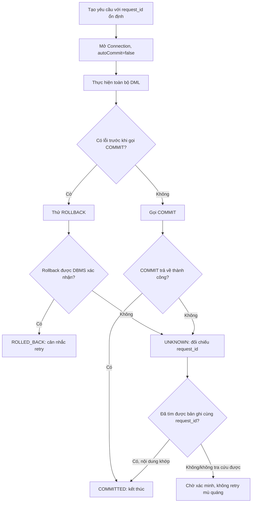

# Thiết kế chính sách thử lại theo trạng thái giao dịch và tính lũy đẳng

## 1. Thử lại một câu SQL có thể tạo ra lỗi nghiệp vụ mới

Ứng dụng Java sử dụng **JDBC** thường gặp lỗi tạm thời khi làm việc với cơ sở dữ liệu quan hệ: mất kết nối, timeout, deadlock, xung đột khi dùng mức cô lập cao hoặc một dịch vụ DBMS đang khởi động lại. Phản ứng tự nhiên là “bắt `SQLException` rồi chạy lại”. Nhưng **thử lại không đúng ranh giới** có thể khiến một yêu cầu được xử lý hai lần.

Giả sử ứng dụng chuyển 100.00 từ tài khoản A sang B bằng ba thao tác: trừ tiền, cộng tiền, ghi lịch sử. Ngay sau khi DBMS nhận `COMMIT`, đường mạng bị ngắt trước khi ứng dụng nhận được xác nhận:

```text
Ứng dụng                         DBMS
    |                                |
    |  UPDATE A, UPDATE B, INSERT    |
    | -----------------------------> |
    |  COMMIT                        |
    | -----------------------------> |
    |                 Commit thành công
    |       X (mất kết nối)          |
    |  SQLException                  |
    |                                |
    |  Chạy lại toàn bộ không kiểm tra?
    |  => Có nguy cơ chuyển thêm 100.00 lần thứ hai.
```

Từ phía ứng dụng, `commit()` ném `SQLException` **không đủ chứng minh** transaction đã rollback. Ngược lại, khi DBMS xác nhận rollback hoàn tất sau một deadlock, ứng dụng có thể thử lại một **transaction mới** nếu nghiệp vụ cho phép.

**Chính sách retry an toàn phải kết hợp hai câu hỏi độc lập:**

1. **Trạng thái kết thúc transaction trước là gì?** Đã rollback chắc chắn, đã commit chắc chắn hay chưa thể xác định?
2. **Thực hiện lại cùng yêu cầu có an toàn không?** Có mã yêu cầu duy nhất và cơ chế phát hiện/khử trùng lặp với kết quả đã commit hay chưa?

Không nên chỉ dựa vào loại ngoại lệ hoặc `SQLState` để trả lời cả hai.

## 2. Phân biệt trạng thái JDBC, lỗi và kết quả transaction

`SQLState` là mã **phân loại lỗi SQL**, còn “trạng thái giao dịch” ở đây là **kết quả commit/rollback của một đơn vị nghiệp vụ**. Hai khái niệm liên quan nhưng không đồng nhất.

| Trạng thái quan sát được | Điều đã biết | Hành động hợp lý |
| --- | --- | --- |
| **Chưa bắt đầu transaction** | Chưa có thay đổi nào trong phạm vi thao tác | Có thể tạo lần thử mới nếu lỗi là tạm thời và còn ngân sách retry |
| **Đang thực thi, chưa commit** | Một số DML có thể đã chạy, nhưng chưa được xác nhận | Cố gắng `rollback()` trên cùng `Connection` |
| **Rollback được xác nhận** | DBMS xác nhận đã hoàn tác transaction đó | Có thể thử lại **toàn bộ** nghiệp vụ từ đầu nếu nguyên nhân retryable |
| **Commit được xác nhận** | DBMS đã xác nhận transaction | Trả kết quả thành công, không chạy lại các bước gây tác dụng phụ |
| **Kết quả chưa xác định** | Lỗi ở thời điểm commit, mất phiên hoặc rollback không xác nhận được | Đối chiếu dữ liệu bền vững bằng khóa lũy đẳng; nếu chưa đủ chứng cứ thì giữ trạng thái “chờ xác minh” |

Không có một phương thức JDBC chung kiểu `Connection.getTransactionOutcome()` trả về mọi trạng thái trên. Ứng dụng phải **ghi nhận giai đoạn đang xử lý**, kết quả các lệnh `commit/rollback`, và có cơ chế xác minh bằng dữ liệu đã commit.

Ví dụ dòng thời gian:



**Quan trọng:** `rollback()` trả về thành công *sau khi* một lời gọi `commit()` gặp lỗi vẫn không chứng minh rằng commit trước đó chưa xảy ra. Hãy giữ trạng thái **UNKNOWN** nếu đã bước vào giai đoạn commit mà không nhận được xác nhận thành công.

## 3. Đọc `SQLException` để biết nguyên nhân, không suy đoán kết quả

JDBC cung cấp thông tin qua `SQLException.getSQLState()`, `getErrorCode()`, `getMessage()`, `getNextException()` và chuỗi nguyên nhân `getCause()`.

```java
import java.sql.SQLException;
import java.util.HashSet;
import java.util.Set;

public final class SqlErrorReporter {
    private SqlErrorReporter() {}

    public static void report(SQLException failure) {
        Set<SQLException> visited = new HashSet<>();
        SQLException current = failure;

        while (current != null && visited.add(current)) {
            System.err.printf(
                    "SQLState=%s, vendorCode=%d, type=%s%n",
                    current.getSQLState(),
                    current.getErrorCode(),
                    current.getClass().getSimpleName());
            current = current.getNextException();
        }
    }
}
```

Ví dụ cố ý **không in câu SQL đầy đủ hoặc tham số người dùng**. Trong ứng dụng thực tế, log nên có request ID, mã lỗi và giai đoạn transaction, nhưng phải kiểm soát dữ liệu cá nhân, bí mật và số tài khoản khi ghi log.

Một số nhóm `SQLState` theo quy ước SQL thường gặp:

| Nhóm / mã | Ví dụ ý nghĩa | Retry thế nào? |
| --- | --- | --- |
| **`08`** | Lỗi kết nối | Có thể tạm thời, nhưng **kết quả commit có thể chưa xác định** |
| **`40`** | Transaction rollback | Có thể retry toàn bộ transaction khi DBMS thực sự đã rollback và lỗi có tính tạm thời |
| **`40001`** | Serialization failure; tùy DBMS có thể dùng cho deadlock | Thường cần bắt đầu transaction mới; giới hạn số lần |
| **`23`** | Lỗi ràng buộc dữ liệu, ví dụ khóa duy nhất/khóa ngoại | Thường là lỗi đầu vào hoặc xung đột nghiệp vụ; khóa lũy đẳng trùng cần **đối chiếu** |
| **`22`** | Lỗi giá trị/kiểu dữ liệu | Sửa dữ liệu hoặc quy tắc chuyển đổi, không retry nguyên xi |
| **`42`** | Lỗi cú pháp SQL hoặc đối tượng DB không hợp lệ | Sửa SQL/schema/permission phù hợp, không retry tức thì |
| **`HYT00` / `HYT01`** | Timeout theo một số driver/chuẩn ODBC | Phân tích giai đoạn và DBMS; không mặc định transaction đã rollback |

Ví dụ mã chuyên biệt thường gặp (cần kiểm tra phiên bản, driver và tài liệu DBMS):

- **PostgreSQL:** `40001` (serialization failure), `40P01` (deadlock), `55P03` (không lấy được khóa hoặc lock timeout); `23505` là trùng khóa duy nhất, không phải một lỗi đáng thử lại ngay theo cách chung.
- **MySQL InnoDB:** deadlock thường có mã lỗi nhà cung cấp `1213`, lock wait timeout thường `1205`. Tùy cấu hình và đường lỗi, lock wait timeout có thể chỉ hủy **câu lệnh** thay vì toàn transaction: cần rollback rõ ràng trước khi retry.
- **SQL Server:** lỗi deadlock victim thường có error number `1205` (khác ý nghĩa với mã `1205` của MySQL); driver có thể trả `SQLState` riêng. Do đó không nên phân loại chỉ bằng error number mà thiếu định danh DBMS.
- **Oracle Database:** `ORA-00060` (deadlock), `ORA-08177` (không thể serialize giao dịch), `ORA-00054` (tài nguyên bận với yêu cầu không chờ hoặc timeout). Cần phân tích tác động lên transaction và rollback thích hợp.

Không phải tất cả driver đều trả `SQLState` có nội dung, và các mã nhà cung cấp có thể thay đổi theo tình huống. Lỗi `SQLTimeoutException` cũng không tự bảo đảm máy chủ chưa thực thi câu lệnh. **Phân loại retryable không đồng nghĩa với xác nhận an toàn để thử lại**.

### Phân biệt lỗi, cảnh báo và kết quả batch

`SQLWarning` thường là cảnh báo không làm câu lệnh thất bại. Có thể kiểm tra bằng `Statement.getWarnings()` hoặc `Connection.getWarnings()` ở phạm vi phù hợp; xử lý cảnh báo như lỗi bắt buộc rollback chỉ khi quy tắc nghiệp vụ hoặc dữ liệu thật sự yêu cầu.

Với JDBC batching, `BatchUpdateException.getUpdateCounts()` có thể cho biết những lệnh đã thực thi hoặc thất bại trước khi xảy ra lỗi. Nhưng **số đếm không chứng minh các thay đổi đã commit**. Khi batch nằm trong một transaction, hãy rollback toàn bộ nếu một lỗi khiến nghiệp vụ không thể hoàn thành; không retry từng lệnh “chưa được tính” khi chưa xác định ranh giới transaction và idempotency.

## 4. Chính sách quyết định: khi nào retry, khi nào dừng?

Một retry policy hữu ích gồm các điều kiện:

1. **Nguyên nhân có khả năng thoáng qua**, chẳng hạn deadlock hay serialization conflict; lỗi sai SQL hoặc dữ liệu không hợp lệ thường cần sửa.
2. **Lần thử trước đã được kết thúc an toàn** (rollback xác nhận), hoặc có cơ chế đối chiếu kết quả đối với trạng thái UNKNOWN.
3. **Toàn bộ đơn vị nghiệp vụ được thử lại từ đầu**, sử dụng một `Connection` và transaction mới; không chạy lại một câu `UPDATE` trong transaction đã lỗi.
4. **Cùng yêu cầu sử dụng cùng idempotency key**, không tạo mã mới mỗi lần retry.
5. **Có ngân sách retry và backoff**, tránh vòng lặp vô hạn, thêm tải cho DBMS hoặc khiến yêu cầu người dùng treo quá lâu.

| Tình huống | Retry tự động? | Lý do |
| --- | --- | --- |
| Lỗi deadlock/serialization và `rollback()` xác nhận thành công | **Có điều kiện** | Transaction cũ được hoàn tác; có thể chạy lại toàn bộ trên kết nối mới |
| Lỗi kết nối **trước khi có bất kỳ câu DML nào** | **Có điều kiện** | Chưa tạo tác dụng phụ DB từ yêu cầu, nếu có thể xác nhận lỗi xảy ra trước khi bắt đầu |
| Lỗi `INSERT` do khóa nghiệp vụ đã tồn tại | **Không chạy lại ngay** | Tra cứu idempotency key, so sánh payload và trả kết quả đã có hoặc báo xung đột |
| Dữ liệu vi phạm CHECK, khóa ngoại, sai kiểu/cú pháp SQL | **Không** | Thử lại nguyên dữ liệu/câu lệnh khó giải quyết lỗi |
| Mất kết nối trong hoặc sau `commit()` | **Không retry mù quáng** | Commit có thể đã được ghi, cần đối chiếu |
| Rollback thất bại hoặc trạng thái transaction chưa rõ | **Không retry mù quáng** | Không có chứng cứ về kết quả lần thử trước |
| Chờ khóa quá lâu | **Có điều kiện** | Rollback transaction nếu cần, thử lại theo giới hạn thời gian và chính sách ưu tiên |
| API thanh toán ngoài DB đã được gọi | **Không dùng chỉ transaction JDBC để quyết định** | Phải có idempotency hoặc quy trình đối soát của hệ thống bên ngoài |

Nguyên tắc này có thể tóm tắt bằng một điều kiện logic:

```text
retry =
    lỗi có thể phục hồi
    AND số lần thử còn trong giới hạn
    AND (
        transaction trước được xác nhận chưa commit
        OR yêu cầu có cơ chế lũy đẳng và quy trình đối chiếu
    )
```

Đối với transaction có trạng thái UNKNOWN, nhánh thứ hai **không cho phép lặp vô điều kiện**: phải sử dụng idempotency key và quy trình đối chiếu được thiết kế để ngăn tác dụng phụ bị áp dụng hai lần.

## 5. Tính lũy đẳng ở cấp nghiệp vụ

Một thao tác là **lũy đẳng** (*idempotent*) nếu thực hiện nhiều lần với cùng yêu cầu cho kết quả nghiệp vụ tương đương thực hiện một lần. Ví dụ:

- `UPDATE users SET preferred_language = 'vi' WHERE user_id = ?` thường lũy đẳng đối với **giá trị cột đó** nếu không có tác dụng phụ khác.
- `UPDATE wallets SET balance = balance - 100 WHERE wallet_id = ?` **không** lũy đẳng: chạy hai lần sẽ trừ 200.
- `INSERT` với `request_id` duy nhất có thể giúp nhận diện yêu cầu đã xử lý, nhưng phải ghi nhận nó **cùng transaction** với các thay đổi nghiệp vụ.

Idempotency key cần được **tạo ở ranh giới nhận yêu cầu**, truyền qua từng lần thử và tồn tại ổn định giữa retry. Không tạo `UUID.randomUUID()` mới trong mỗi lần retry, vì DBMS sẽ xem đó là yêu cầu hoàn toàn khác.

**Đừng đồng nhất “trùng key” với “cùng nghiệp vụ”.** Hệ thống phải lưu đủ dữ liệu để so sánh: loại thao tác, tài khoản nguồn/đích, số tiền, đơn vị tiền tệ hoặc định danh đối tượng liên quan. Nếu cùng key nhưng payload khác, cần trả lỗi xung đột để tránh gán kết quả của yêu cầu này cho yêu cầu khác.

Một số yêu cầu có thể đến đồng thời với cùng idempotency key. Vì thế việc “`SELECT` thấy chưa có rồi mới `INSERT`” **không đủ** bảo vệ khỏi race condition; phải có **ràng buộc duy nhất ở DBMS**. Mỗi transaction có cùng key sẽ bị cơ chế uniqueness phối hợp, thay vì cả hai cùng tạo bản ghi thành công.

## 6. Thiết kế bảng để có thể đối chiếu sau sự cố

Ví dụ dưới minh họa trên **PostgreSQL** một yêu cầu chuyển tiền nội bộ. Cần cập nhật số dư và ghi dấu yêu cầu trong **cùng transaction**:

```sql
CREATE TABLE accounts (
    account_id BIGINT PRIMARY KEY,
    balance DECIMAL(18, 2) NOT NULL,
    CONSTRAINT ck_accounts_balance CHECK (balance >= 0)
);

CREATE TABLE applied_transfers (
    request_id VARCHAR(64) PRIMARY KEY,
    source_id BIGINT NOT NULL REFERENCES accounts(account_id),
    target_id BIGINT NOT NULL REFERENCES accounts(account_id),
    amount DECIMAL(18, 2) NOT NULL,
    CONSTRAINT ck_transfer_amount CHECK (amount > 0),
    CONSTRAINT ck_distinct_accounts CHECK (source_id <> target_id)
);

INSERT INTO accounts (account_id, balance)
VALUES (1, 150.00), (2, 30.00);
```

Quy tắc khi yêu cầu chuyển `25.00` từ tài khoản `1` sang `2` với key `TX-2026-001`:

1. Trong transaction, **chèn `request_id` trước**. Nếu key đã tồn tại, phải rollback lần thử hiện tại và đọc bản ghi đã commit.
2. Trừ `25.00` ở tài khoản nguồn bằng `UPDATE ... WHERE balance >= ?`. Kiểm tra `executeUpdate() == 1`.
3. Cộng `25.00` vào tài khoản đích. Kiểm tra `executeUpdate() == 1`.
4. Chỉ `commit()` khi cả ba bước thành công.

Khi commit thành công, bảng `applied_transfers` là **bằng chứng bền vững** rằng các bước ghi trong transaction này đã commit cùng nhau. Truy vấn theo `request_id` trên **cơ sở dữ liệu chính** sau khi kết nối cũ lỗi giúp xác định yêu cầu đã được áp dụng hay chưa.

Trường hợp ghi key thành công nhưng trừ tiền thất bại phải rollback **cả key**. Không lưu một dấu “đã xử lý” riêng rồi commit trước khi chuyển tiền; dấu đó sẽ làm các lần thử sau nhầm tưởng nghiệp vụ đã hoàn thành. Nếu cần ghi trạng thái `PENDING` ngoài phạm vi transaction, đó là **thiết kế workflow khác**, cần quy tắc chuyển trạng thái và khôi phục riêng.

## 7. Cài đặt JDBC cho một lần thử transaction

Ví dụ Java 17+ sau chỉ đảm nhiệm **một lần thử**. Nó sử dụng `DataSource`, `PreparedStatement` và một `Connection` dùng cho toàn bộ ba lệnh DML. Phần quyết định có thử lại hay không được để cho lớp điều phối ở mục 8.

```java
import java.math.BigDecimal;
import java.math.RoundingMode;
import java.sql.Connection;
import java.sql.PreparedStatement;
import java.sql.SQLException;
import javax.sql.DataSource;

public final class TransferTransaction {
    private final DataSource dataSource;

    public TransferTransaction(DataSource dataSource) {
        this.dataSource = dataSource;
    }

    public void applyOnce(
            String requestId, long sourceId, long targetId,
            BigDecimal rawAmount) throws SQLException {

        if (requestId == null || requestId.isBlank()
                || requestId.length() > 64 || sourceId == targetId
                || rawAmount == null || rawAmount.signum() <= 0) {
            throw new IllegalArgumentException("Yêu cầu chuyển tiền không hợp lệ");
        }
        BigDecimal amount = rawAmount.setScale(
                2, RoundingMode.UNNECESSARY);

        try (Connection connection = dataSource.getConnection()) {
            boolean originalAutoCommit = connection.getAutoCommit();
            if (!originalAutoCommit) {
                throw new SQLException(
                        "Ví dụ yêu cầu Connection chưa có transaction");
            }
            connection.setAutoCommit(false);

            boolean finished = false;
            Throwable originalFailure = null;
            try {
                insertRequest(
                        connection, requestId, sourceId, targetId, amount);

                if (debit(connection, sourceId, amount) != 1) {
                    throw new IllegalStateException(
                            "Tài khoản nguồn không tồn tại hoặc không đủ tiền");
                }

                if (credit(connection, targetId, amount) != 1) {
                    throw new IllegalStateException(
                            "Tài khoản đích không tồn tại");
                }

                connection.commit();
                finished = true;
            } catch (SQLException | RuntimeException failure) {
                originalFailure = failure;
                try {
                    connection.rollback();
                    finished = true;
                } catch (SQLException rollbackFailure) {
                    failure.addSuppressed(rollbackFailure);
                }
                throw failure;
            } finally {
                // Chỉ khôi phục autoCommit sau khi đã kết thúc transaction.
                if (finished) {
                    try {
                        connection.setAutoCommit(originalAutoCommit);
                    } catch (SQLException resetFailure) {
                        if (originalFailure != null) {
                            originalFailure.addSuppressed(resetFailure);
                        } else {
                            throw resetFailure;
                        }
                    }
                }
            }
        }
    }

    private static void insertRequest(
            Connection c, String key, long source, long target,
            BigDecimal amount) throws SQLException {
        String sql = """
                INSERT INTO applied_transfers
                    (request_id, source_id, target_id, amount)
                VALUES (?, ?, ?, ?)
                """;

        try (PreparedStatement ps = c.prepareStatement(sql)) {
            ps.setString(1, key);
            ps.setLong(2, source);
            ps.setLong(3, target);
            ps.setBigDecimal(4, amount);
            if (ps.executeUpdate() != 1) {
                throw new SQLException("Không ghi được request_id");
            }
        }
    }

    private static int debit(
            Connection c, long account, BigDecimal amount)
            throws SQLException {
        String sql = """
                UPDATE accounts
                SET balance = balance - ?
                WHERE account_id = ? AND balance >= ?
                """;

        try (PreparedStatement ps = c.prepareStatement(sql)) {
            ps.setBigDecimal(1, amount);
            ps.setLong(2, account);
            ps.setBigDecimal(3, amount);
            return ps.executeUpdate();
        }
    }

    private static int credit(
            Connection c, long account, BigDecimal amount)
            throws SQLException {
        String sql = """
                UPDATE accounts
                SET balance = balance + ?
                WHERE account_id = ?
                """;

        try (PreparedStatement ps = c.prepareStatement(sql)) {
            ps.setBigDecimal(1, amount);
            ps.setLong(2, account);
            return ps.executeUpdate();
        }
    }
}
```

Sử dụng cho một transaction (giả định `dataSource` đã được cấu hình):

```java
TransferTransaction transaction = new TransferTransaction(dataSource);

transaction.applyOnce(
        "TX-2026-001", 1L, 2L, new BigDecimal("25.00"));
```

Nếu commit thành công, số dư sẽ lần lượt là `125.00` và `55.00`, và `applied_transfers` có một hàng với `request_id = 'TX-2026-001'`.

**Ranh giới của ví dụ:** `applyOnce()` minh họa giao dịch nguyên tử và ghi key lũy đẳng; **nó chưa phải là retry policy hoàn chỉnh**. Nó có thể ném ngoại lệ ở `commit()`, lúc đóng kết nối hoặc lúc khôi phục `autoCommit`, nên chỉ nhìn thấy ngoại lệ ở lời gọi `applyOnce()` **không chứng minh** transaction đã rollback. Ngay cả khi `rollback()` gọi sau lỗi commit và trả về thành công, việc commit trước đó có thể đã hoàn tất.

Ở hệ thống thực tế, lớp điều phối cần nhận một kết quả hoặc ngoại lệ **có thông tin pha transaction** (trước commit, rollback xác nhận, đang/đã gọi commit, sau commit) thay vì tự suy trạng thái từ `SQLException` bên ngoài. Với connection pool hoặc transaction manager, phải tuân thủ hợp đồng về việc khôi phục/đóng kết nối; không dùng lại một `Connection` có trạng thái chưa rõ cho lần thử tiếp theo.

## 8. Điều phối retry và đối chiếu theo idempotency key

Một thiết kế điều phối có thể định nghĩa ba loại kết quả rõ ràng:

```java
public enum TransactionOutcome {
    COMMIT_CONFIRMED,
    ROLLBACK_CONFIRMED,
    UNKNOWN
}
```

`ROLLBACK_CONFIRMED` chỉ được gán khi **có đủ bằng chứng** transaction trước chưa commit và rollback được DBMS xác nhận; không dựa đơn thuần vào `SQLState`. `UNKNOWN` được dùng đặc biệt khi lỗi xảy ra sau khi gọi `commit()` hoặc khi mất thông tin kết quả.

Pseudo-code của bộ điều phối:

```text
submit(command, idempotencyKey):
    validate(command, idempotencyKey)
    deadline = now + retryBudget
    attempt = 0

    loop:
        // Luôn đọc từ primary với mức nhất quán phù hợp.
        existing = lookupCommitted(idempotencyKey)
        if existing exists:
            if existing.payload differs from command:
                return CONFLICT_SAME_KEY_DIFFERENT_PAYLOAD
            return ALREADY_APPLIED

        attempt++
        result = executeWholeTransactionWithOutcome(command, idempotencyKey)

        if result is COMMIT_CONFIRMED:
            return APPLIED

        if result is UNKNOWN:
            // Không xem "chưa tìm thấy" tức là "chưa commit".
            existing = reconcileCommitted(idempotencyKey)
            if existing exists and payload matches:
                return ALREADY_APPLIED
            return PENDING_RECONCILIATION

        // Chỉ tới đây khi transaction cũ đã ROLLBACK_CONFIRMED.
        if result was duplicate-idempotency-key:
            existing = lookupCommitted(idempotencyKey)
            if existing exists:
                return ALREADY_APPLIED if payload matches else CONFLICT
            return RETRY_OR_RECONCILE_WITH_CAUTION

        if not isTransient(result.error):
            return FAILED_NON_RETRYABLE

        if attempt >= maxAttempts or deadlineReached:
            return RETRY_BUDGET_EXHAUSTED

        backoffWithJitter(attempt)
        // Lặp lại từ đầu, trên một transaction và Connection mới.
```

Đây là **thuật toán nghiệp vụ**, không phải đoạn Java chạy trực tiếp. Hàm `executeWholeTransactionWithOutcome` cần phân loại pha kết thúc transaction, đóng/loại bỏ kết nối hỏng và giữ lỗi gốc. Một API thực tế nên trả mã trạng thái có nghĩa rõ ràng cho người gọi; `PENDING_RECONCILIATION` giúp tránh thông báo “thất bại chắc chắn” khi kết quả còn bất định.

**Vì sao “chưa tìm thấy key” không đủ chứng minh thất bại?** Có thể transaction đầu tiên vẫn đang commit, cơ sở dữ liệu replica chưa bắt kịp, phiên đọc đang ở snapshot cũ hoặc kho dữ liệu tạm thời không truy cập được. Hãy đọc từ primary, dùng transaction/snapshot mới khi cần, và chỉ kết luận theo bảo đảm nhất quán mà hệ thống thực sự cung cấp.

Với cùng request ID, ràng buộc unique trong DBMS ngăn **hai transaction commit cùng một bản ghi key**; nó chỉ bảo vệ nghiệp vụ nếu việc ghi key và mọi tác động nghiệp vụ nằm trong **cùng transaction**. Nếu yêu cầu đi qua nhiều cơ sở dữ liệu hoặc hệ thống bên ngoài, cần thêm cơ chế phối hợp riêng.

### Thử lại sau trùng khóa duy nhất

Khi `INSERT applied_transfers` trả lỗi trùng `request_id`, không được diễn giải ngay thành “thành công”. Trên PostgreSQL, transaction chứa lỗi SQL thường ở trạng thái *aborted* và cần `rollback` trước khi thực hiện truy vấn khác.

Quy trình an toàn:

1. Kết thúc lần thử bị trùng key bằng rollback (hoặc bỏ kết nối hỏng).
2. Mở transaction hoặc kết nối mới, đọc bản ghi đã commit theo `request_id`.
3. So sánh `source_id`, `target_id` và `amount` với yêu cầu gốc.
4. **Khớp:** trả kết quả đã được áp dụng. **Không khớp:** báo xung đột key. **Không tra cứu được:** giữ lỗi/chờ đối chiếu theo chính sách; không vội tạo key mới.

Ví dụ truy vấn đối chiếu:

```sql
SELECT source_id, target_id, amount
FROM applied_transfers
WHERE request_id = ?;
```

Ánh xạ số tiền bằng `ResultSet.getBigDecimal("amount")` rồi so sánh giá trị số qua `compareTo` khi phù hợp; `BigDecimal.equals` còn xét cả `scale`. Đối với nghiệp vụ có currency, loại hành động, phiên bản công thức giá hoặc phí, cần lưu và kiểm tra những thuộc tính đó trong fingerprint của yêu cầu.

## 9. Giới hạn retry và backoff

Retry là một nguồn phát sinh lưu lượng. Nếu hàng nghìn request cùng retry ngay sau deadlock hoặc sự cố kết nối, hệ thống có thể rơi vào *retry storm*.

Ví dụ một chính sách có thể là:

| Tham số | Giá trị minh họa | Ý nghĩa |
| --- | --- | --- |
| `maxAttempts` | 3 lần, tính cả lần đầu | Ngăn retry vô hạn |
| `initialBackoff` | 50 ms | Giãn cách ngay sau lỗi tạm thời |
| `maxBackoff` | 500 ms | Chặn thời gian chờ tăng quá lớn |
| `jitter` | Ngẫu nhiên trong khoảng chờ | Tránh các client cùng retry đồng bộ |
| `deadline` | Phụ thuộc giới hạn thời gian xử lý request | Ngăn một yêu cầu chiếm tài nguyên quá lâu |

Các con số trên chỉ là **ví dụ**, không phải cấu hình mặc định của JDBC. Phải chọn dựa trên độ trễ thực tế, số lượng kết nối, timeout của DBMS, SLA của API và mức độ nguy hiểm của tác dụng phụ.

Một quy tắc tính độ trễ tăng dần thường gặp:

```text
cap = min(maxBackoff, initialBackoff * 2^(attempt - 1))
sleep = random(0, cap)
```

`attempt` ở đây là **số lần retry** bắt đầu từ 1, không tính lần chạy ban đầu. Nếu request HTTP đã bị hủy hoặc không còn đủ thời gian trước deadline, nên dừng và trả trạng thái thích hợp; hệ thống không nên mặc định tiếp tục retry nền khi chưa có cơ chế job/queue được thiết kế cho điều đó.

**Không bao giờ dùng backoff thay cho kiểm soát trạng thái.** Chờ 500 ms không khiến một commit UNKNOWN tự biến thành ROLLED_BACK. Phải đối chiếu trước khi quyết định cách xử lý tiếp.

## 10. Những trường hợp cần chú ý

### 10.1. Deadlock, serialization failure và lock timeout

Khi DBMS thông báo deadlock/serialization conflict, hãy kiểm tra bảo đảm DBMS về transaction bị hủy. Sau khi rollback được xác nhận hoặc biết chắc transaction đã bị hủy, tạo **transaction mới** và thực hiện lại toàn bộ bước; tránh chỉ chạy lại câu `INSERT` cuối cùng.

Một lock timeout không phải lúc nào cũng hủy toàn bộ transaction (ví dụ cấu hình MySQL có thể chỉ hủy một statement). Với JDBC thuần, lựa chọn rõ ràng thường là **rollback toàn bộ nghiệp vụ** rồi mới cân nhắc retry. Nếu rollback thất bại, chuyển sang trạng thái chưa rõ.

### 10.2. Lỗi ở `executeBatch()`

Với batch nhiều lệnh, `BatchUpdateException` có thể có update count `SUCCESS_NO_INFO` hoặc `EXECUTE_FAILED`, tùy driver và chế độ tiếp tục sau lỗi. Không xây chính sách “chỉ retry các câu failed” cho nghiệp vụ yêu cầu nguyên tử nếu chưa xác định transaction đã commit đến đâu.

Ưu tiên batch nằm trong transaction thủ công, rollback toàn batch khi có lỗi bắt buộc, sau đó **retry toàn đơn vị nghiệp vụ** nếu an toàn. Với batch quá lớn, cân nhắc chia thành các đơn vị nghiệp vụ độc lập có khóa lũy đẳng riêng và ghi nhận tiến độ bền vững.

### 10.3. Kết nối lỗi ở thời điểm commit

Sau khi `commit()` phát sinh lỗi:

- Ghi request ID, thời điểm và giai đoạn `COMMIT_INVOKED` để hỗ trợ tra cứu.
- Không trả lời người dùng rằng giao dịch “đã rollback” nếu chưa có bằng chứng.
- Tra cứu record lũy đẳng đã commit ở primary; nếu chưa xác định thì giữ trạng thái chờ xử lý/đối chiếu.
- Nếu phát sinh lỗi `close()` hoặc khôi phục thuộc tính kết nối **sau khi `commit()` đã trả thành công**, nghiệp vụ có thể vẫn thành công; tránh đổi kết quả thành “cần chạy lại”.

### 10.4. Transaction JDBC không bao phủ tác dụng phụ ngoài DB

Nếu chuyển tiền nội bộ xong phải gọi API gửi thông báo hoặc dịch vụ thanh toán ngoài DB, một transaction trên `Connection` không thể rollback email hoặc request HTTP.

Một cách phối hợp là **transactional outbox**: ghi sự kiện “đã chuyển tiền” vào bảng `outbox` cùng transaction với số dư và `applied_transfers`. Worker sau commit gửi thông báo và đánh dấu tiến độ. Để chống gửi lặp, bên nhận cần khóa lũy đẳng hoặc cơ chế deduplication; outbox thường cho bảo đảm **at-least-once delivery**, không tự động là exactly-once đối với tác dụng bên ngoài.

## 11. Kiểm thử chính sách thay vì chỉ kiểm thử một câu lệnh

Kiểm thử tích hợp cần đánh giá **cả dữ liệu đã commit, số lần áp dụng tác dụng phụ và trạng thái trả về**. Có thể dùng DBMS thật trong môi trường thử nghiệm, hai kết nối độc lập và cơ chế tạo lỗi có kiểm soát.

| Ca kiểm thử | Điều kiện | Kết quả mong đợi |
| --- | --- | --- |
| Thành công lần đầu | Chuyển `25.00`, key mới | Hai số dư cập nhật, đúng một bản ghi key |
| Gửi lại cùng key/cùng payload | Lần đầu đã commit | Không trừ thêm tiền; trả `ALREADY_APPLIED` hoặc kết quả cũ |
| Gửi lại cùng key/khác payload | Đổi số tiền hoặc tài khoản | Báo xung đột, không phát sinh cập nhật mới |
| Lỗi trước commit, rollback thành công | Giả lập lỗi ở bước cộng tiền | Cả ghi key và trừ tiền được rollback |
| Deadlock có thể retry | Hai transaction tranh khóa | Retry toàn bộ sau khi rollback, trong giới hạn |
| Lỗi cú pháp hoặc constraint không liên quan key | Đầu vào/SQL sai | Không retry lặp lại vô ích |
| Mất kết nối ngay khi commit | Không có xác nhận commit | Đối chiếu key; không thực hiện tác dụng phụ lần hai |
| Không truy cập được primary để đối chiếu | Commit UNKNOWN | Trả trạng thái chưa xác định để xử lý tiếp |
| Ghi key trước nhưng UPDATE sau lỗi | Cùng transaction | Không để lại key giả báo thành công |
| Hai yêu cầu cùng key đồng thời | Hai kết nối thực thi song song | Tối đa một nghiệp vụ commit; yêu cầu còn lại đối chiếu |
| Batch có một câu thất bại | Batch trong transaction | Không lưu kết quả dở dang nếu yêu cầu nguyên tử |

Khi kiểm thử concurrency, dùng `CountDownLatch`/barrier để xác định thời điểm mỗi transaction đã lấy khóa hoặc tiến vào commit; tránh dựa đơn thuần vào `Thread.sleep` để suy đoán thứ tự. Kiểm tra dữ liệu từ **kết nối khác** sau khi transaction kết thúc, không chỉ dựa vào giá trị mà service trả về.

Những phép kiểm tra quan trọng gồm:

1. **Tính bảo toàn dữ liệu:** số tiền sau khi chuyển khớp với quy tắc (ví dụ tổng hai số dư không đổi nếu không có phí).
2. **Tính duy nhất:** mỗi `request_id` chỉ có một hàng trong `applied_transfers`.
3. **Không lặp tác dụng phụ:** cùng một yêu cầu được gửi lại nhiều lần không làm số dư thay đổi thêm.
4. **Trạng thái chưa rõ được xử lý rõ ràng:** ứng dụng không chuyển UNKNOWN thành FAILED rồi tự cấp request ID mới.
5. **Ngân sách retry:** không vượt giới hạn số lần hoặc deadline kể cả khi DBMS liên tục lỗi tạm thời.

## 12. Checklist áp dụng vào ứng dụng JDBC

Trước khi triển khai một retry policy cho CRUD, transaction hoặc batching, hãy xác nhận:

1. **Ranh giới nghiệp vụ:** chính xác những `INSERT`/`UPDATE`/`DELETE` nào phải cùng thành công.
2. **Quyền sở hữu transaction:** một `Connection` cho toàn đơn vị, `autoCommit=false`, `commit/rollback` và đóng tài nguyên đúng cách.
3. **Phân loại lỗi có ngữ cảnh:** `SQLState`, vendor error code, giai đoạn transaction, kết quả rollback, kết quả commit.
4. **Chính sách khi UNKNOWN:** có truy vấn đối chiếu bằng idempotency key từ primary, không suy đoán từ timeout.
5. **Khóa lũy đẳng bền vững:** unique key lưu cùng transaction, và payload được so sánh trước khi chấp nhận kết quả cũ.
6. **Retry đúng phạm vi:** transaction mới từ đầu, kết nối mới khi cần; không dùng lại transaction lỗi hay retry một bước đơn lẻ thiếu ngữ cảnh.
7. **Backoff và giới hạn:** số lần, jitter, deadline và giới hạn tài nguyên phù hợp.
8. **Tác động ngoài DB:** sử dụng cơ chế idempotency/đối soát riêng, có thể dùng outbox khi phù hợp.
9. **Kiểm thử lỗi thực tế:** deadlock, lock timeout, ngắt kết nối quanh commit, duplicate request và batch lỗi.

**Ghi nhớ:** Trong JDBC, câu hỏi “lỗi này có retryable không?” chỉ là bước đầu. Chính sách an toàn phải biết **kết quả của transaction trước** và **có thể chứng minh tác dụng phụ chưa được áp dụng hai lần**. Khi rollback được xác nhận, có thể cân nhắc retry toàn bộ đơn vị nghiệp vụ; khi commit đã thành công thì kết thúc; khi kết quả chưa xác định, hãy đối chiếu bằng **idempotency key** và dữ liệu đã commit trước khi quyết định.
