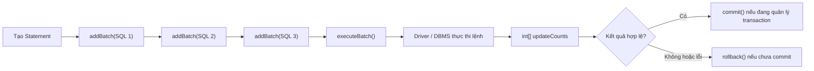

# Gom câu SQL bằng `Statement.addBatch`

Trong **JDBC**, một chương trình có thể phải thực hiện hàng chục, hàng trăm hoặc hàng nghìn lệnh SQL để nhập dữ liệu, cập nhật trạng thái hay xóa bản ghi cũ. Gọi `Statement.executeUpdate(...)` riêng cho từng lệnh có thể làm tăng số lần ứng dụng giao tiếp với cơ sở dữ liệu. API **`Statement.addBatch(String sql)`** cho phép xếp nhiều câu lệnh cập nhật vào một danh sách, rồi yêu cầu driver thực thi danh sách đó bằng **`Statement.executeBatch()`**.

Bài này thuộc chương **Xử lý theo lô**. Sau khi học, bạn cần tự giải thích được câu SQL được xếp vào batch ở bước nào, được thực thi ở bước nào, đọc kết quả qua `int[]` ra sao, quản lý `commit/rollback` thế nào và khi nào nên thay `Statement` bằng `PreparedStatement`. Toàn bộ ví dụ dùng API JDBC chuẩn, kết nối từ `DataSource` và giao dịch trên `Connection`.

> **Cần phân biệt ngay:** **Batching** gom các lệnh để thực thi thuận tiện và có thể giảm chi phí giao tiếp; **transaction** quyết định nhóm thay đổi nào được xác nhận hoặc hoàn tác. Gọi `addBatch()` không tự tạo một giao dịch nguyên tử.

## 1. Vì sao gom SQL thành batch?

Giả sử hệ thống kho có 500 sản phẩm mới. Cách thực thi từng lệnh có thể là:

```text
Java                              JDBC driver / DBMS
 |                                       |
 |-- INSERT sản phẩm 1 ---------------->|
 |<------------------ kết quả ----------|
 |-- INSERT sản phẩm 2 ---------------->|
 |<------------------ kết quả ----------|
 |             ...                       |
 |-- INSERT sản phẩm 500 -------------->|
 |<------------------ kết quả ----------|
```

Với `Statement.addBatch(...)`, ứng dụng chuẩn bị danh sách lệnh trước khi thực thi:



**Những lợi ích có thể có:**

- Giảm số lần ứng dụng phải gọi API JDBC và đôi khi giảm lượt trao đổi mạng giữa driver và DBMS.
- Gom nhiều thao tác dữ liệu thành một đơn vị xử lý dễ theo dõi, có thể gắn với một transaction.
- Đối với driver hỗ trợ tối ưu hóa batch, tăng throughput cho tác vụ nhập dữ liệu hoặc cập nhật hàng loạt.

**Những điều API không hứa chắc:** Driver có thể gửi cả batch bằng một cơ chế tối ưu, hoặc phải thực thi các câu lần lượt; batch **không bảo đảm đúng một network round trip**. Batch cũng không tự đảm bảo lệnh sẽ chạy nhanh hơn trong mọi trường hợp, không tự rollback tất cả khi một lệnh lỗi và không thay thế việc kiểm tra transaction.

## 2. Các API thiết yếu của `Statement`

| API | Ý nghĩa | Thời điểm có tác dụng |
|---|---|---|
| `connection.createStatement()` | Tạo đối tượng `Statement` gắn với một `Connection`. | Trước khi gom lệnh. |
| `statement.addBatch(String sql)` | Thêm **một câu SQL** vào danh sách chờ thực thi. | Chưa thực hiện SQL tại thời điểm thêm. |
| `statement.executeBatch()` | Gửi các câu đã thêm để thực thi theo thứ tự; trả về `int[]` số dòng bị ảnh hưởng hoặc mã kết quả. | Khi ứng dụng thực sự yêu cầu chạy batch. |
| `statement.clearBatch()` | Xóa các câu đang nằm trong danh sách batch mà chưa chạy. | Khi muốn bỏ danh sách hiện tại; **không hoàn tác dữ liệu đã chạy**. |
| `statement.executeLargeBatch()` | Phiên bản trả về `long[]`, hữu ích khi số dòng có thể vượt phạm vi `int`; phụ thuộc driver. | Khi thực thi batch với update count rất lớn. |
| `connection.commit()` | Xác nhận transaction hiện tại trên kết nối khi auto-commit đã tắt. | Sau khi toàn bộ kết quả bắt buộc đã thành công. |
| `connection.rollback()` | Yêu cầu hoàn tác các thay đổi chưa commit trên kết nối. | Khi nghiệp vụ lỗi và transaction còn có thể rollback. |

Trong JDBC, kiểu `Statement` thích hợp cho các **câu SQL hoàn chỉnh** đã được ứng dụng kiểm soát nội dung. Câu SQL được truyền trực tiếp bằng `String`:

```java
Statement statement = connection.createStatement();

statement.addBatch(
        "UPDATE inventory_item SET quantity = quantity + 2 WHERE id = 101");
statement.addBatch(
        "UPDATE inventory_item SET quantity = quantity + 1 WHERE id = 102");

// Hai lệnh UPDATE vẫn chưa được gửi đi để thực thi.
int[] results = statement.executeBatch();
```

Đoạn mã ngắn minh họa cơ chế; khi dùng thực tế cần đóng `Statement`, xử lý `SQLException` và xác định transaction. Việc `addBatch(...)` thực thi theo thứ tự thêm lệnh **không đồng nghĩa** toàn bộ batch là một giao dịch nguyên tử.

### `Statement.addBatch(String)` khác gì `PreparedStatement.addBatch()`?

Cả hai đều xử lý batch nhưng chữ ký và cách bind dữ liệu khác nhau:

| | `Statement` | `PreparedStatement` |
|---|---|---|
| Cách thêm batch | `addBatch("UPDATE ...")`: truyền câu SQL hoàn chỉnh mỗi lần. | `setXxx(...)` để bind giá trị, rồi `addBatch()` **không tham số**. |
| Hình dạng SQL | Có thể gom các câu SQL khác nhau, tùy khả năng DBMS/driver. | Thường là cùng một câu SQL tham số hóa, chạy nhiều bộ tham số. |
| Dữ liệu đến từ người dùng | Không nên nối trực tiếp dữ liệu động vào chuỗi SQL. | Dùng dấu `?` để bind; giúp tránh SQL injection và lỗi ghép literal. |
| Tối ưu hóa | Tùy driver và SQL thực tế. | Driver thường có thêm cơ hội tái sử dụng câu lệnh tham số hóa. |
| Ví dụ phù hợp | Một số lệnh cập nhật cố định do chương trình định nghĩa. | Chèn hoặc cập nhật nhiều bản ghi nhận từ file, API, người dùng. |

Bài này tập trung vào **`Statement.addBatch(String sql)`**. Phần cuối sẽ cho thấy cách chuyển sang `PreparedStatement` khi dữ liệu là biến động.

## 3. Ví dụ nền: bảng tồn kho và ba câu `INSERT` cố định

Tạo bảng ví dụ trong **cơ sở dữ liệu kiểm thử**, sử dụng cú pháp tương thích với DBMS đang chạy:

```sql
CREATE TABLE inventory_item (
    id BIGINT PRIMARY KEY,
    sku VARCHAR(40) NOT NULL UNIQUE,
    quantity INTEGER NOT NULL CHECK (quantity >= 0)
);
```

Tùy hệ quản trị, cú pháp `CHECK` và mức hỗ trợ constraint có thể khác nhau. Lệnh tạo bảng **nên chạy riêng trước ví dụ batch**: một số DBMS tự commit với DDL như `CREATE TABLE`, nên không thể mặc định DDL nằm an toàn trong cùng transaction với các lệnh DML.

Ví dụ sử dụng ba `INSERT` có giá trị cố định:

```sql
INSERT INTO inventory_item (id, sku, quantity)
VALUES (101, 'PEN-BLUE', 30);

INSERT INTO inventory_item (id, sku, quantity)
VALUES (102, 'NOTE-A5', 20);

INSERT INTO inventory_item (id, sku, quantity)
VALUES (103, 'PENCIL-2B', 40);
```

Ba câu lệnh hoàn chỉnh có thể đưa vào một `Statement`. Để ví dụ có ý nghĩa, bảng phải **chưa chứa** các `id` hoặc `sku` nói trên; chạy lại lệnh `INSERT` sẽ gặp ràng buộc trùng khóa. Một ví dụ sản xuất thường nhận dữ liệu động, do đó nên dùng `PreparedStatement` thay vì viết literal trực tiếp như ở đây.

## 4. Mẫu hoàn chỉnh: `addBatch`, `executeBatch`, `commit` và `rollback`

Giả sử ứng dụng đã cấu hình biến `DataSource dataSource`. Phương thức dưới đây tạo một transaction chỉ chứa ba `INSERT`, kiểm tra kết quả rồi mới commit:

```java
import javax.sql.DataSource;
import java.sql.Connection;
import java.sql.PreparedStatement;
import java.sql.ResultSet;
import java.sql.SQLException;
import java.sql.Statement;

public final class StaticInventoryBatch {
    private StaticInventoryBatch() {
    }

    public static void insertSampleRows(DataSource dataSource)
            throws SQLException {

        try (Connection connection = dataSource.getConnection()) {
            connection.setAutoCommit(false);

            try {
                try (Statement statement = connection.createStatement()) {
                    statement.addBatch(
                            "INSERT INTO inventory_item (id, sku, quantity) "
                            + "VALUES (101, 'PEN-BLUE', 30)");
                    statement.addBatch(
                            "INSERT INTO inventory_item (id, sku, quantity) "
                            + "VALUES (102, 'NOTE-A5', 20)");
                    statement.addBatch(
                            "INSERT INTO inventory_item (id, sku, quantity) "
                            + "VALUES (103, 'PENCIL-2B', 40)");

                    // Chỉ ở đây driver mới bắt đầu xử lý ba lệnh SQL.
                    int[] counts = statement.executeBatch();

                    if (counts.length != 3) {
                        throw new SQLException(
                                "Số kết quả batch không khớp số lệnh");
                    }

                    for (int index = 0; index < counts.length; index++) {
                        int count = counts[index];
                        if (count != 1
                                && count != Statement.SUCCESS_NO_INFO) {
                            throw new SQLException(
                                    "INSERT thứ " + (index + 1)
                                    + " có kết quả ngoài mong đợi: " + count);
                        }
                    }
                }

                // Xác nhận cả ba INSERT trong cùng transaction.
                connection.commit();

            } catch (SQLException | RuntimeException failure) {
                try {
                    connection.rollback();
                } catch (SQLException rollbackFailure) {
                    // Không che mất lỗi gốc của batch hoặc commit.
                    failure.addSuppressed(rollbackFailure);
                }
                throw failure;
            }
        }
    }

    public static int countSampleRows(DataSource dataSource)
            throws SQLException {
        String sql = "SELECT COUNT(*) FROM inventory_item "
                   + "WHERE id BETWEEN ? AND ?";

        try (Connection connection = dataSource.getConnection();
             PreparedStatement ps = connection.prepareStatement(sql)) {
            ps.setLong(1, 101L);
            ps.setLong(2, 103L);

            try (ResultSet rs = ps.executeQuery()) {
                if (!rs.next()) {
                    throw new SQLException("Truy vấn COUNT không có kết quả");
                }
                return rs.getInt(1);
            }
        }
    }
}
```

Ví dụ gọi:

```java
// dataSource đã được cấu hình kết nối tới CSDL kiểm thử.
StaticInventoryBatch.insertSampleRows(dataSource);
int total = StaticInventoryBatch.countSampleRows(dataSource);
System.out.println("Số bản ghi từ 101 đến 103: " + total); // Kỳ vọng 3
```

Để hiểu chính xác ý nghĩa của các dòng mã:

1. **Một kết nối:** ba SQL được đưa vào `Statement` sinh từ cùng `Connection`. Giao dịch JDBC cục bộ gắn với kết nối này.
2. **Tắt auto-commit:** `setAutoCommit(false)` được gọi trước khi gửi các lệnh ghi, để ứng dụng quyết định điểm xác nhận.
3. **Gom trước, chạy sau:** ba lần `addBatch(String)` chỉ xếp lệnh; `executeBatch()` thực thi batch và trả kết quả.
4. **Kiểm tra:** vì ví dụ là ba lệnh chèn một dòng, kết quả hợp lệ cho mỗi lệnh thường là `1` hoặc `SUCCESS_NO_INFO` khi driver xác nhận thành công nhưng không trả số dòng cụ thể.
5. **Commit:** chỉ sau khi kiểm tra thành công, `connection.commit()` xác nhận transaction.
6. **Rollback:** nếu thực thi hoặc kiểm tra gặp lỗi, nhánh `catch` cố gắng rollback những thay đổi chưa được xác nhận.
7. **Dọn tài nguyên:** `try-with-resources` đóng `Statement` và `Connection` dù có ngoại lệ; đóng đối tượng JDBC không thay thế `commit/rollback` rõ ràng.

Lời gọi `countSampleRows` sử dụng một kết nối mới để kiểm tra dữ liệu đã commit. Nếu các kết nối đọc dùng isolation đặc biệt hoặc một transaction đọc đã có snapshot cũ, kết quả quan sát còn phụ thuộc quy tắc DBMS. Với một transaction đọc mới sau commit, ví dụ kỳ vọng có đúng ba dòng tương ứng.

> **Giới hạn của ví dụ:** mã xử lý lỗi commit theo hướng cố gắng rollback. Nếu kết nối bị ngắt ngay trong `commit()`, hệ thống đôi khi **không biết chắc DBMS đã xác nhận giao dịch hay chưa**; gọi `rollback()` không thể đảo ngược một commit đã hoàn tất. Với nghiệp vụ quan trọng, cần khóa định danh yêu cầu, idempotency và đối soát trước khi thử lại.

## 5. Hiểu kết quả `int[]` từ `executeBatch()`

Theo JDBC, `Statement.executeBatch()` trả về mảng số nguyên, mỗi phần tử phản ánh kết quả của một lệnh theo thứ tự trong batch khi hoàn tất bình thường. Không nên chỉ dùng `counts.length` hoặc tổng các phần tử để khẳng định bao nhiêu dòng đã được ghi.

| Phần tử trong `int[]` | Ý nghĩa |
|---|---|
| Số nguyên `0` hoặc dương | Số dòng được lệnh tác động, theo cách driver/DBMS báo cáo. `0` có thể hợp lệ đối với một câu `UPDATE` không khớp hàng nào. |
| `Statement.SUCCESS_NO_INFO` (giá trị `-2`) | Lệnh được thực thi thành công nhưng driver không xác định/không trả update count cụ thể. |
| `Statement.EXECUTE_FAILED` (giá trị `-3`) | Lệnh thất bại; có thể xuất hiện trong mảng khi driver tiếp tục chạy các lệnh sau lỗi. |
| Mảng ngắn hơn số lệnh đã thêm (trong trường hợp lỗi) | Driver có thể đã dừng xử lý tại một lệnh lỗi; cần xem `BatchUpdateException`. |

**Không được hiểu `SUCCESS_NO_INFO` là “không cập nhật dòng nào”**. Nó biểu thị đã thành công nhưng không có số dòng cụ thể.

Ví dụ, nếu batch gồm:

```sql
UPDATE inventory_item SET quantity = quantity + 2 WHERE id = 101;
UPDATE inventory_item SET quantity = quantity + 2 WHERE id = 999;
DELETE FROM inventory_item WHERE id = 103;
```

Giả sử hàng `101` và `103` tồn tại nhưng `999` không có, mảng kết quả có thể là `[1, 0, 1]`. Cả ba câu có thể **thành công về SQL**, mặc dù câu thứ hai không tác động dòng nào. Nếu nghiệp vụ yêu cầu cập nhật chính xác một hàng cho `id = 999`, ứng dụng phải tự phát hiện `0` và quyết định rollback.

Với các lệnh khác nhau, không nên cộng `SUCCESS_NO_INFO (-2)` vào tổng dòng, vì nó không phải phép đếm. Cũng không nên dùng update count làm bằng chứng transaction đã commit; đó là hai trạng thái khác nhau.

### Khi `BatchUpdateException` xuất hiện

Nếu một lệnh trong batch thất bại, `executeBatch()` có thể ném **`BatchUpdateException`**, một lớp con của `SQLException`. Ví dụ dòng `INSERT` thứ ba trùng khóa chính; hai lệnh trước đó có thể đã được DBMS thực thi trong transaction trước khi lỗi xảy ra.

```java
import java.sql.BatchUpdateException;
import java.sql.Statement;

try {
    int[] counts = statement.executeBatch();
    // Kiểm tra kết quả trước khi commit.
} catch (BatchUpdateException failure) {
    int[] partialCounts = failure.getUpdateCounts();

    for (int index = 0; index < partialCounts.length; index++) {
        int count = partialCounts[index];
        if (count == Statement.EXECUTE_FAILED) {
            System.err.println("Lệnh #" + index + " đã thất bại");
        } else if (count == Statement.SUCCESS_NO_INFO) {
            System.err.println("Lệnh #" + index
                    + " thành công nhưng không rõ số dòng");
        } else {
            System.err.println("Lệnh #" + index
                    + " có update count = " + count);
        }
    }

    // Tầng transaction phải rollback nếu nghiệp vụ cần toàn bộ cùng thành công.
    throw failure;
}
```

Đoạn này chỉ minh họa việc **đọc kết quả chẩn đoán** của `BatchUpdateException`; nó giả định `statement` đã được tạo và transaction bên ngoài sẽ xử lý rollback. Các vị trí `index` ở ví dụ bắt đầu từ `0`, khớp vị trí phần tử trong mảng.

Hành vi sau lỗi được phép khác nhau giữa driver:

- Có driver **dừng ngay** khi gặp lệnh lỗi; `getUpdateCounts()` chỉ chứa kết quả của những lệnh đã hoàn tất trước lỗi.
- Có driver **tiếp tục** chạy các lệnh còn lại; `getUpdateCounts()` có thể chứa một phần tử cho mỗi lệnh, dùng `EXECUTE_FAILED` tại vị trí lỗi.
- Kết quả từng lệnh không phải bằng chứng các thay đổi đã commit. Với transaction đang mở, ứng dụng vẫn có thể cần rollback.
- Một số DBMS đặt toàn bộ transaction vào trạng thái lỗi sau khi một lệnh thất bại; ứng dụng có thể không tiếp tục thực thi SQL bình thường trong transaction đó cho tới khi rollback.

Khi chẩn đoán, nên ghi lại `SQLState`, mã lỗi của DBMS (`getErrorCode()`), chuỗi ngoại lệ liên quan nếu có và thông tin dòng đầu vào tương ứng, tránh ghi dữ liệu nhạy cảm vào log. Không mặc định rằng chỉ lệnh bị báo lỗi là lệnh cần xử lý.

## 6. Batch và transaction: hai lớp điều khiển tách biệt

Đây là phần dễ sai nhất khi viết ứng dụng JDBC:

| Cấu hình | Khi một lệnh trong batch thất bại | Bảo đảm nào cần hiểu? |
|---|---|---|
| Auto-commit đang bật | Những lệnh đã thực thi trước lỗi có thể đã được commit theo hành vi driver/DBMS. | **Không có** bảo đảm chung rằng mọi lệnh tự rollback. |
| `autoCommit = false`, DB hỗ trợ transaction | Các thay đổi chưa commit có thể được hủy bằng `rollback()`; transaction có thể cần rollback sau lỗi. | Ứng dụng phải quản lý kết thúc transaction; tránh DDL commit ngầm. |
| `autoCommit = false` nhưng bảng/engine không hỗ trợ transaction hoặc lệnh có commit ngầm | `rollback()` có thể không hoàn tác được toàn bộ những gì đã xảy ra. | Phải xác minh khả năng giao dịch thực tế của hệ quản trị. |
| Một batch chạy trên `Connection A`, thao tác khác trên `Connection B` | `rollback()` ở A không rollback thay đổi đã commit hoặc đang xử lý ở B. | Transaction JDBC cục bộ có phạm vi một kết nối. |

**Không nên thực hiện DDL trong cùng batch nghiệp vụ chỉ vì `Statement` cho phép nhận chuỗi SQL.** Ở nhiều DBMS, `CREATE TABLE` hoặc `ALTER TABLE` có thể tự commit. Nếu cần nguyên tử cho nhiều thao tác CRUD, ưu tiên các câu DML trên bảng hỗ trợ transaction.

### Mẫu tổng quát khi xử lý batch bắt buộc “hoặc tất cả hoặc không”

```java
try (Connection connection = dataSource.getConnection()) {
    connection.setAutoCommit(false);
    try {
        try (Statement st = connection.createStatement()) {
            // addBatch(...) cho các câu SQL do ứng dụng kiểm soát.
            // executeBatch() và kiểm tra update counts.
        }

        connection.commit();
    } catch (SQLException | RuntimeException error) {
        try {
            connection.rollback();
        } catch (SQLException rollbackError) {
            error.addSuppressed(rollbackError);
        }
        throw error;
    }
}
```

Đây là khung giao dịch, còn ví dụ đầy đủ ở phần 4 cho thấy các lệnh và kiểm tra cụ thể. **Nếu batch đã commit**, `clearBatch()` hoặc `rollback()` sau đó không thể hoàn tác thay đổi đã xác nhận. Muốn đảo ngược nghiệp vụ đã commit, cần một transaction bù phù hợp.

## 7. `clearBatch()` dùng khi nào?

`statement.clearBatch()` **xóa danh sách câu SQL chờ thực thi** khỏi `Statement`. Nó hữu ích khi quyết định hủy batch trước khi gọi `executeBatch()`, hoặc khi tái sử dụng đối tượng sau một lỗi mà vẫn bảo đảm không để sót câu cũ.

```java
try (Statement statement = connection.createStatement()) {
    statement.addBatch("UPDATE inventory_item "
            + "SET quantity = quantity + 1 WHERE id = 101");
    statement.addBatch("UPDATE inventory_item "
            + "SET quantity = quantity + 1 WHERE id = 102");

    boolean cancelBeforeExecute = true;
    if (cancelBeforeExecute) {
        statement.clearBatch(); // Bỏ 2 lệnh CHƯA được thực thi.
    }

    // Lúc này danh sách batch không còn hai lệnh trên.
}
```

`clearBatch()` **không** hủy thay đổi do `executeBatch()` đã chạy, càng không rollback dữ liệu đã commit. Cơ chế hủy thay đổi đang trong transaction là `Connection.rollback()`.

Sau khi `executeBatch()` hoàn tất, thông thường danh sách các lệnh đã xử lý được driver làm rỗng theo hợp đồng JDBC. Tuy nhiên, sau khi một batch phát sinh lỗi, nên xây dựng luồng xử lý rõ ràng: rollback, không âm thầm tái sử dụng statement lỗi; nếu buộc phải tái sử dụng, kiểm soát lại danh sách bằng `clearBatch()` và kiểm tra trạng thái transaction theo driver.

## 8. Giới hạn loại SQL có thể đưa vào batch

`Statement.addBatch(String sql)` có thể nhận câu SQL khác nhau, nhưng **`executeBatch()` được thiết kế cho các lệnh không tạo `ResultSet`**. Các ví dụ thường dùng là `INSERT`, `UPDATE`, `DELETE` và một số lệnh DDL được driver/DBMS hỗ trợ.

**Không dùng batch để gom truy vấn `SELECT` trả danh sách bản ghi:**

```java
statement.addBatch("SELECT * FROM inventory_item"); // Không phù hợp.
statement.executeBatch(); // Có thể phát sinh BatchUpdateException.
```

Nếu cần đọc nhiều hàng, nên dùng một truy vấn có điều kiện phù hợp và xử lý `ResultSet` bằng `executeQuery()`. Nếu cần xử lý theo trang, cân nhắc phân trang truy vấn, streaming và fetch size theo năng lực driver. Đó là kỹ thuật **đọc dữ liệu**, khác với `Statement` batch cho lệnh cập nhật.

Với những câu SQL có cơ chế trả dữ liệu (ví dụ một số biến thể `INSERT ... RETURNING`), phải kiểm tra tài liệu driver. Những câu trả result set thường không phù hợp với `Statement.executeBatch()`; đừng giả định có thể lấy `ResultSet` cho từng câu trong batch.

## 9. Khi giá trị thay đổi theo từng bản ghi: dùng `PreparedStatement`

`Statement.addBatch(String)` nhận chuỗi SQL hoàn chỉnh. Nếu phải chèn dữ liệu đọc từ CSV, form nhập liệu hoặc API, nối giá trị người dùng vào `String` tạo SQL có thể gây **SQL injection**, lỗi escape dấu nháy và lệ thuộc định dạng ngày/số của DBMS.

Thay vào đó, tạo **`PreparedStatement` một lần với dấu `?`**, bind từng bộ giá trị bằng `setXxx(...)` rồi gọi **`addBatch()` không đối số**:

```java
import java.sql.Connection;
import java.sql.PreparedStatement;
import java.sql.SQLException;
import javax.sql.DataSource;

long[] ids = {201L, 202L, 203L};
String[] skus = {"BOOK-A", "RULER-B", "PAPER-C"};
int[] quantities = {12, 9, 25};

String sql = "INSERT INTO inventory_item "
        + "(id, sku, quantity) VALUES (?, ?, ?)";

try (Connection connection = dataSource.getConnection()) {
    connection.setAutoCommit(false);

    try {
        try (PreparedStatement ps = connection.prepareStatement(sql)) {
            for (int i = 0; i < ids.length; i++) {
                ps.setLong(1, ids[i]);
                ps.setString(2, skus[i]);
                ps.setInt(3, quantities[i]);

                // Không truyền SQL vào hàm này.
                ps.addBatch();
            }

            int[] counts = ps.executeBatch();
            if (counts.length != ids.length) {
                throw new SQLException("Số kết quả không khớp");
            }
            for (int count : counts) {
                if (count != 1 && count != java.sql.Statement.SUCCESS_NO_INFO) {
                    throw new SQLException("Kết quả INSERT bất thường: " + count);
                }
            }
        }

        connection.commit();

    } catch (SQLException | RuntimeException error) {
        try {
            connection.rollback();
        } catch (SQLException rollbackError) {
            error.addSuppressed(rollbackError);
        }
        throw error;
    }
}
```

Đây là **batch của `PreparedStatement`**, được đưa vào để phân biệt đúng hai API. Các mảng mẫu có cùng độ dài và nội dung được cung cấp trong mã. Ứng dụng thực tế cần kiểm tra dữ liệu đầu vào, xác nhận tính duy nhất của khóa và xử lý kết quả nếu nghiệp vụ yêu cầu số hàng cụ thể.

Điểm khác biệt nằm ở dòng:

```java
// Statement: mỗi lần truyền một câu SQL hoàn chỉnh.
statement.addBatch("DELETE FROM inventory_item WHERE id = 301");

// PreparedStatement: SQL được chuẩn bị khi tạo ps;
// mỗi lần chỉ thêm một bộ tham số đã bind.
ps.setLong(1, 301L); // Ví dụ ps đã được tạo với câu SQL có dấu ?.
ps.addBatch();         // Không có tham số String.
```

Đừng gọi nhầm `PreparedStatement.addBatch(String sql)`: mục tiêu của `PreparedStatement` là sử dụng câu SQL đã chuẩn bị, còn overload nhận chuỗi SQL thuộc ngữ nghĩa của `Statement` và không được hỗ trợ cho cách dùng này.

## 10. Kích thước batch và hiệu năng thực tế

Batch quá nhỏ có thể không đáng công gom; batch quá lớn có thể tốn bộ nhớ, giữ transaction lâu, sinh log lớn, tăng tranh chấp khóa hoặc vượt giới hạn driver/DBMS. **Không có một số lượng câu “tối ưu” áp dụng cho mọi ứng dụng.**

Có thể bắt đầu đo thử với các kích thước ví dụ **100, 500, 1.000** bản ghi trên môi trường gần sản xuất, rồi quan sát tốc độ, bộ nhớ, latency, lock wait và khả năng phục hồi sau lỗi. Đây chỉ là **mốc thử nghiệm**, không phải quy tắc cấu hình cố định.

Với `Statement.addBatch(String)`, danh sách còn giữ các chuỗi SQL nên batch rất lớn có thể sử dụng nhiều bộ nhớ ứng dụng. Có thể chia thành các **đợt thực thi** nhỏ:

```java
// Minh họa: sqlCommands là List<String> chỉ chứa SQL tĩnh đáng tin cậy.
// Transaction, rollback và việc đóng statement do khối ngoài quản lý.
int pending = 0;

for (String trustedSql : sqlCommands) {
    statement.addBatch(trustedSql);
    pending++;

    if (pending == 500) {
        int[] counts = statement.executeBatch();
        validateCounts(counts); // Hàm do ứng dụng tự định nghĩa.
        pending = 0;
    }
}

if (pending > 0) {
    int[] counts = statement.executeBatch();
    validateCounts(counts);
}
```

`validateCounts` đại diện cho việc kiểm tra kết quả theo quy tắc nghiệp vụ, không phải hàm của JDBC. Khi muốn **một giao dịch cho tất cả các đợt**, gọi `connection.commit()` **một lần ở cuối** sau khi kiểm tra mọi kết quả; khi bất kỳ đợt nào lỗi thì rollback toàn bộ transaction chưa commit. Nếu nghiệp vụ chấp nhận hoàn tất từng phần, có thể commit theo đợt, nhưng khi đó cần thiết kế khôi phục và xử lý dữ liệu đã xác nhận ở các đợt trước.

Các điểm cần đo và cân nhắc:

- **Thời gian đi-về DB:** driver có tối ưu gom lệnh hay vẫn gửi lần lượt?
- **Kích thước batch và payload:** SQL dài, số tham số và giới hạn server có thể tăng chi phí bộ nhớ.
- **Transaction duration:** giữ giao dịch quá lâu có thể ảnh hưởng tài nguyên/khóa, phát sinh deadlock hoặc timeout.
- **Chỉ mục và constraint:** mỗi lệnh vẫn phải cập nhật chỉ mục và kiểm tra ràng buộc; batch không bỏ qua chi phí đó.
- **Retry:** nếu batch 1.000 lệnh thất bại giữa chừng, có thể phải rollback rồi chạy lại toàn bộ; cần biết nguồn dữ liệu đầu vào, khóa idempotency và trạng thái commit.
- **Driver:** xem `DatabaseMetaData.supportsBatchUpdates()` và kiểm chứng driver/database phiên bản đang sử dụng; các tối ưu hóa riêng của driver không phải bảo đảm chung của JDBC.

Ví dụ kiểm tra khả năng cơ bản:

```java
try (Connection connection = dataSource.getConnection()) {
    boolean supportsBatch =
            connection.getMetaData().supportsBatchUpdates();
    System.out.println("Driver hỗ trợ batch: " + supportsBatch);
}
```

Phương thức metadata cho biết khả năng mà driver báo cáo, nhưng hiệu năng và hành vi lỗi cần kiểm chứng thực tế. Nếu môi trường không hỗ trợ batch, ứng dụng cần lựa chọn cách thực thi và quản lý transaction phù hợp, thay vì mặc định `executeBatch()` luôn hoạt động.

### Batch so với bulk import chuyên dụng

Khi nhập hàng triệu dòng, API bulk loader của hệ quản trị (ví dụ cơ chế `COPY`, `LOAD DATA` hoặc tiện ích nạp dữ liệu của DBMS) có thể nhanh hơn batch JDBC, nhưng thường có cú pháp, quyền truy cập và quy tắc xử lý riêng. Đánh giá theo mục tiêu throughput, khả năng kiểm soát transaction và sự phụ thuộc vào DBMS; bài này dùng API JDBC tiêu chuẩn.

## 11. Những lỗi phổ biến và cách tránh

| Lỗi | Hậu quả | Cách xử lý |
|---|---|---|
| Gọi `addBatch()` rồi nghĩ SQL đã chạy | Dữ liệu chưa được cập nhật vì mới xếp hàng lệnh. | Gọi `executeBatch()` khi đã thêm đủ lệnh. |
| Không xử lý `BatchUpdateException` | Có thể bỏ sót các lệnh đã thực thi một phần hoặc chưa thực thi. | Đọc `getUpdateCounts()` để chẩn đoán và rollback nếu cần atomicity. |
| Coi mọi phần tử âm trong `int[]` là thất bại | `SUCCESS_NO_INFO = -2` có nghĩa thành công không rõ số dòng. | Phân biệt các hằng `SUCCESS_NO_INFO` và `EXECUTE_FAILED`. |
| Cộng mảng `int[]` để tính tổng số bản ghi | Mã `-2` không phải số dòng bị tác động. | Tổng hợp có kiểm tra mã trạng thái; chấp nhận tổng có thể không xác định. |
| Ghép đầu vào người dùng vào `Statement.addBatch(sql)` | Có thể gây SQL injection, lỗi literal SQL. | Dùng `PreparedStatement` với tham số `?`. |
| Giả định batch luôn nguyên tử | Một số lệnh có thể đã commit hoặc DBMS không hỗ trợ rollback đầy đủ. | Tắt auto-commit, dùng transaction và engine hỗ trợ, tránh DDL commit ngầm. |
| Dùng `clearBatch()` để hoàn tác | Chỉ xóa lệnh đang chờ, không ảnh hưởng lệnh đã chạy. | Dùng `connection.rollback()` cho thay đổi chưa commit. |
| Batch gồm `SELECT` trả result set | Batch dạng cập nhật có thể ném lỗi. | Dùng `executeQuery()` và `ResultSet` cho truy vấn đọc. |
| Dùng batch quá lớn | Có thể tăng bộ nhớ, khóa và latency, khó retry. | Chia đợt, benchmark kích thước và phạm vi commit theo nghiệp vụ. |
| Retry ngay sau lỗi `commit()` do mất mạng | Trạng thái đã commit có thể chưa xác định, dễ tạo dữ liệu trùng. | Thiết kế mã yêu cầu duy nhất và quy trình đối soát/idempotency. |

## 12. Thực hành tự kiểm chứng

Thực hiện trên CSDL kiểm thử hỗ trợ transaction, tránh thao tác lỗi chủ đích trên dữ liệu thật. Trước mỗi lần chạy, chuẩn bị dữ liệu riêng để tránh kết quả từ lần trước:

**Bài 1 — phân biệt thêm và chạy.** Tạo `Statement`, gọi `addBatch` với hai lệnh `INSERT` rồi **chưa** gọi `executeBatch`. Quan sát bằng câu `SELECT` qua kết nối khác: không có thay đổi từ những câu chỉ mới được thêm vào danh sách. Tiếp tục thực thi batch, kiểm tra `int[]`, commit rồi đọc lại.

**Bài 2 — lỗi ở câu thứ ba.** Đưa ba lệnh `INSERT` vào batch, cố ý dùng `id` trùng khóa cho lệnh thứ ba. Với auto-commit tắt, bắt `BatchUpdateException`, in các phần tử `getUpdateCounts()` và rollback. Mở transaction đọc mới để kiểm tra không giữ lại hai lệnh `INSERT` trước đó nếu rollback thành công và bảng có hỗ trợ transaction.

**Bài 3 — câu `UPDATE` không khớp hàng.** Dùng batch cập nhật `id` tồn tại và `id` không tồn tại. Kiểm tra sự khác nhau giữa giá trị đếm `0` với `SUCCESS_NO_INFO`. Đặt quy tắc nghiệp vụ “mỗi lệnh phải cập nhật một hàng” và thử xử lý phần tử khác `1`.

**Bài 4 — `clearBatch`.** Thêm ba câu rồi gọi `clearBatch()` trước `executeBatch()`. Kiểm tra danh sách đã được xóa: không có ba thao tác ghi ban đầu. Không dùng bài này để kết luận `clearBatch` có thể hoàn tác SQL đã chạy.

**Bài 5 — `Statement` và `PreparedStatement`.** Cùng nhập 500 bản ghi với hai cách: câu SQL cố định do ứng dụng tạo sẵn và câu tham số hóa với `PreparedStatement`. Ghi nhận thời gian và kết quả theo driver đang dùng. Đầu vào không đáng tin cậy phải qua `PreparedStatement`; không xây dựng câu SQL bằng cách ghép trực tiếp chuỗi người dùng chỉ để đo tốc độ.

**Bài 6 — kích thước và phạm vi commit.** Đo batch theo đợt 100/500/1.000 bản ghi. So sánh hai mô hình: commit một lần cho toàn bộ đợt và commit sau từng đợt. Thử gây lỗi ở đợt cuối để thấy mô hình thứ hai giữ lại các đợt đã commit, trong khi mô hình thứ nhất có thể rollback các thay đổi chưa commit nếu DB hỗ trợ.

### Câu hỏi tự kiểm tra

1. **Gọi `Statement.addBatch(String sql)` có làm DBMS cập nhật ngay không?** — Không. Nó thêm câu SQL vào batch; việc thực thi diễn ra ở `executeBatch()`.
2. **`Statement.SUCCESS_NO_INFO` có phải lỗi không?** — Không. Nó nghĩa là lệnh thành công nhưng không xác định số dòng cập nhật.
3. **Nếu `executeBatch()` ném `BatchUpdateException`, có thể mặc định chưa câu SQL nào chạy không?** — Không. Driver có thể đã thực thi một số lệnh, thậm chí tiếp tục chạy sau lỗi. Cần phân tích `getUpdateCounts()` và trạng thái transaction.
4. **Nếu người dùng cung cấp tên sản phẩm, nên dùng `Statement.addBatch(sql)` hay `PreparedStatement.addBatch()`?** — Nên dùng `PreparedStatement` cùng dấu `?` và bind tham số để tránh ghép SQL không an toàn.
5. **`executeBatch()` thành công đã đồng nghĩa dữ liệu được commit chưa?** — Phụ thuộc auto-commit và ranh giới transaction. Với `autoCommit=false`, ứng dụng còn phải gọi `commit()`.
6. **`clearBatch()` có hủy được những thay đổi DB đã commit không?** — Không, nó chỉ xóa các lệnh chờ trong batch; thay đổi đã commit cần một nghiệp vụ bù/transaction khác nếu cần đảo ngược.

## 13. Checklist áp dụng trong DAO/repository

Trước khi đưa xử lý batch vào tầng truy cập dữ liệu, hãy kiểm tra:

- Có dùng **`Statement.addBatch(String)`** cho SQL cố định đáng tin cậy và **`PreparedStatement.addBatch()`** cho các bộ tham số động?
- Tất cả lệnh cần chung transaction có chạy trên **cùng một `Connection`**, trên bảng có hỗ trợ transaction, với `setAutoCommit(false)` trước khi ghi?
- Đã gọi `executeBatch()` thực sự, kiểm tra `int[]` theo ngữ nghĩa từng lệnh, đặc biệt `SUCCESS_NO_INFO` và update count bằng `0`?
- Nếu `executeBatch()` hoặc kiểm tra nghiệp vụ lỗi, đã rollback và lưu thông tin `BatchUpdateException` đủ để tìm bản ghi gây lỗi?
- Có tránh SQL trả `ResultSet`, tránh DDL commit ngầm trong transaction DML và tránh gọi `clearBatch()` như một cách rollback?
- Batch size và phạm vi commit được đo dựa trên driver/DBMS và workload thực tế, có cơ chế idempotency/đối soát nếu retry khi kết quả commit không chắc chắn?

**Kết luận:** `Statement.addBatch(String sql)` **gom câu SQL**, còn `Statement.executeBatch()` **thực thi** những câu đã gom và trả thông tin kết quả. Muốn các cập nhật cùng được xác nhận hoặc hoàn tác, ứng dụng phải quản lý **transaction** qua `Connection`, kiểm tra `int[]`/`BatchUpdateException` và xử lý `commit/rollback` đúng thời điểm. Với dữ liệu động, `PreparedStatement` cùng SQL tham số hóa thường là lựa chọn an toàn và phù hợp hơn để làm batch.
