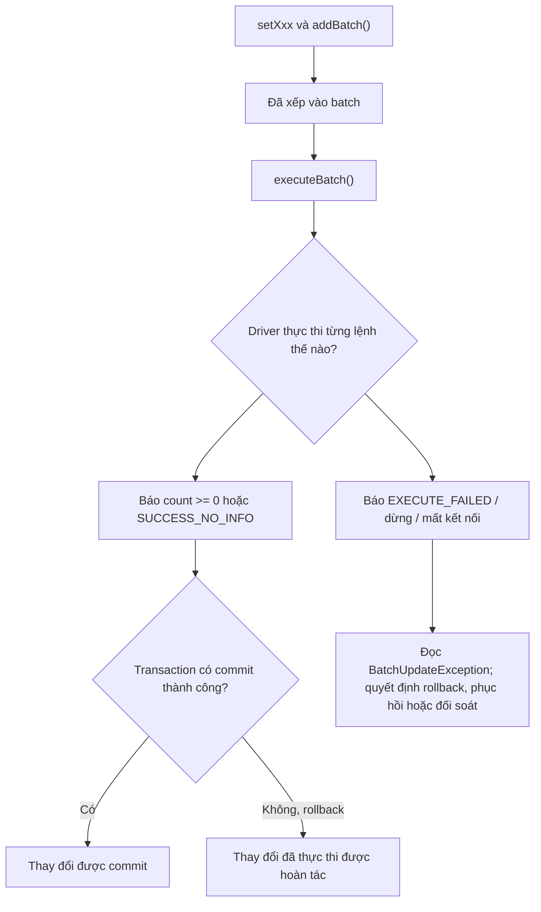

# Xử lý lô có lệnh thất bại và phần đã được thực thi trong JDBC

## 1. Bài toán: một lệnh trong batch lỗi thì những lệnh khác ra sao?

**Batch processing** trong JDBC cho phép gom nhiều lệnh SQL để giảm số lần trao đổi giữa ứng dụng Java và cơ sở dữ liệu. Với `PreparedStatement`, ứng dụng có thể gán nhiều bộ tham số qua `addBatch()`, rồi gọi `executeBatch()` một lần. Tuy nhiên, nếu một phần tử vi phạm khóa duy nhất, giá trị không hợp lệ hoặc kết nối bị ngắt, câu hỏi quan trọng là:

> Những phần tử trước hoặc sau lệnh lỗi đã được thực thi chưa, và thay đổi nào thực sự được lưu vào cơ sở dữ liệu?

Câu trả lời phụ thuộc vào **kết quả batch do driver báo**, chính sách dừng/tiếp tục khi lỗi, việc dùng **transaction** và trạng thái `commit`/`rollback`. Hai từ **đã thực thi** và **đã commit** không đồng nghĩa.

Bài thuộc chương **Xử lý theo lô** của module **JDBC**, trong phạm vi truy cập cơ sở dữ liệu quan hệ qua driver, `DataSource`, `Connection`, `PreparedStatement`, `ResultSet`, SQL tham số hóa, CRUD, transaction, xử lý lỗi và hiệu năng bằng API chuẩn. Sau bài học, bạn có thể:

1. Đọc `BatchUpdateException` và `getUpdateCounts()` để hiểu trạng thái được **driver báo cáo** cho từng lệnh.
2. Phân biệt driver **dừng ở phần tử lỗi** và driver **tiếp tục thử các phần tử còn lại**.
3. Quyết định rõ khi nào rollback toàn bộ batch, khi nào cho phép thành công từng phần.
4. Xử lý `Statement.SUCCESS_NO_INFO`, `Statement.EXECUTE_FAILED`, các phần tử không có update count và lỗi transaction.
5. Thiết kế cơ chế ghi log, kiểm thử, phân lô, retry và đối soát để tránh mất dữ liệu hoặc ghi trùng.

## 2. Batch trong JDBC vận hành như thế nào?

Giả sử ứng dụng nhập dữ liệu tồn kho vào bảng có khóa yêu cầu duy nhất:

```sql
CREATE TABLE inventory_imports (
    request_id VARCHAR(50) PRIMARY KEY,
    sku        VARCHAR(80) NOT NULL,
    quantity   INTEGER NOT NULL CHECK (quantity > 0)
);
```

Cú pháp `CREATE TABLE` ở đây có tính minh họa; cần kiểm tra chi tiết kiểu dữ liệu và ràng buộc theo hệ quản trị đang dùng. Mỗi `request_id` đại diện cho một yêu cầu nhập dữ liệu và phải là duy nhất.

Ứng dụng đưa bốn bộ tham số vào một batch:

| Vị trí trong batch | `request_id` | `sku` | `quantity` | Giả định ban đầu |
|---:|---|---|---:|---|
| 0 | `req-101` | `SKU-A` | 10 | Dự kiến hợp lệ |
| 1 | `req-102` | `SKU-B` | 5 | Dự kiến hợp lệ |
| 2 | `req-101` | `SKU-C` | 2 | Trùng khóa với phần tử 0 |
| 3 | `req-103` | `SKU-D` | 7 | Dự kiến hợp lệ |

Ví dụ ghi dữ liệu:

```java
String sql = """
        INSERT INTO inventory_imports (request_id, sku, quantity)
        VALUES (?, ?, ?)
        """;

try (PreparedStatement ps = connection.prepareStatement(sql)) {
    for (ImportItem item : items) {
        ps.setString(1, item.requestId());
        ps.setString(2, item.sku());
        ps.setInt(3, item.quantity());
        ps.addBatch();
    }

    int[] counts = ps.executeBatch();
    // Chỉ đến đây khi executeBatch() kết thúc bình thường.
}
```

Đoạn này giả định `connection` và danh sách `items` đã tồn tại, `ImportItem` là record Java mang ba giá trị trên. Nó minh họa thao tác batch; chưa xử lý transaction hay lỗi. `PreparedStatement` sử dụng dấu `?` và các setter để truyền **giá trị** đúng kiểu mà không nối dữ liệu người dùng trực tiếp vào SQL.

Vòng `addBatch()` đưa các bộ tham số vào danh sách lệnh cần thực thi; nó **không phải bằng chứng** các hàng đã được lưu. Khi gọi `executeBatch()`, driver gửi hoặc tổ chức thực thi những lệnh đó theo cách hỗ trợ. Một số driver có thể tối ưu hóa bằng cách gộp các thao tác, nên không nên dựa vào giả định “mỗi lần `addBatch()` tương ứng một lượt đi mạng”.

## 3. `executeBatch()`, `BatchUpdateException` và update counts

### 3.1. Khi batch hoàn thành bình thường

`executeBatch()` trả về `int[]`, trong đó các phần tử mô tả kết quả thực thi các lệnh được thêm vào batch. Với JDBC chuẩn, giá trị cần hiểu gồm:

| Giá trị `counts[i]` | Ý nghĩa | Có thể kết luận gì? |
|---|---|---|
| Số nguyên không âm, ví dụ `0`, `1`, `3` | Số hàng bị tác động theo báo cáo của driver | Lệnh đã được xử lý; số này **chưa xác nhận commit** |
| `Statement.SUCCESS_NO_INFO` (`-2`) | Lệnh được báo là thực thi thành công nhưng không có số hàng cụ thể | Có tín hiệu thành công; **không biết** chính xác số hàng bị tác động |
| `Statement.EXECUTE_FAILED` (`-3`) | Lệnh tương ứng thất bại | Thường thấy trong mảng từ `BatchUpdateException` khi driver tiếp tục sau lỗi |

Các hằng `SUCCESS_NO_INFO` và `EXECUTE_FAILED` nằm trong `java.sql.Statement`. **Không tính `-2` thành âm hai hàng** và không cộng `-3` vào tổng cập nhật.

Đối với lệnh `UPDATE ... WHERE id = ?`, update count bằng `0` có thể là SQL chạy thành công nhưng **không có hàng nào khớp**. Nếu nghiệp vụ yêu cầu đúng một hàng, đó là **thất bại về hợp đồng nghiệp vụ**, kể cả khi JDBC không ném lỗi. Ngược lại, với một số loại lệnh hoặc driver, `SUCCESS_NO_INFO` là hợp lệ dù ứng dụng không có số hàng cụ thể.

### 3.2. Khi có phần tử lỗi

Nếu `executeBatch()` gặp lỗi, JDBC có thể ném `java.sql.BatchUpdateException` (là một subclass của `SQLException`). Lấy thông tin bằng:

```java
try {
    int[] counts = statement.executeBatch();
    // Đánh giá counts theo hợp đồng nghiệp vụ.
} catch (BatchUpdateException failure) {
    int[] reported = failure.getUpdateCounts();
    String sqlState = failure.getSQLState();
    int vendorCode = failure.getErrorCode();

    // reported mô tả phần driver đã báo; chưa phải kết luận commit.
    throw failure;
}
```

`statement` là `PreparedStatement` đã có batch. Ví dụ cần import `java.sql.BatchUpdateException`.

Ngoài `getUpdateCounts()`, `BatchUpdateException` cung cấp `getLargeUpdateCounts()` với mảng `long[]` nếu số hàng lớn cần được biểu diễn rộng hơn; API `executeLargeBatch()` cũng dùng `long[]`. Cần thống nhất API theo quy mô dữ liệu và khả năng của driver.

**Đặc điểm quan trọng:** JDBC cho phép driver **dừng** khi gặp phần tử lỗi hoặc **tiếp tục** thử các phần tử còn lại. Hai trường hợp này có hình dạng mảng update counts khác nhau.

## 4. Hai tình huống dừng và tiếp tục sau lỗi

Với ví dụ 4 phần tử ở mục 2, giả sử lệnh thứ ba (index 2) vi phạm `PRIMARY KEY`:

### 4.1. Driver dừng khi gặp lỗi

Một tình huống báo cáo có thể là:

```text
Batch index :   0     1     2     3
Dữ liệu     : req101 req102 req101 req103

Update counts từ BatchUpdateException:
                [1,    1]
                       ^ 2 phần tử đầu được báo thành công

Phần tử index 2: lệnh gây lỗi tại điểm dừng
Phần tử index 3: chưa được thử theo chính sách dừng
```

Nếu driver thực hiện theo cơ chế dừng của JDBC, `getUpdateCounts()` có một entry cho mỗi lệnh đã thành công **trước khi** gặp lệnh thất bại. Số phần tử trong mảng nhỏ hơn tổng số lệnh được đưa vào batch.

Mảng `[1, 1]` **không có nghĩa** hai hàng đó chắc chắn đang tồn tại trong DB sau khi phương thức trả về. Nếu transaction bị rollback, cả hai thay đổi được hoàn tác. Nếu kết nối hỏng hoặc lỗi xuất hiện trong quá trình gửi, cần xác minh trạng thái thực tế trước khi đưa ra kết luận nghiệp vụ.

### 4.2. Driver tiếp tục sau lỗi

Một tình huống báo cáo khác có thể là:

```text
Batch index :   0     1      2       3
Update counts: [1,    1,    -3,      1]
                              |
                              +-- Statement.EXECUTE_FAILED
```

Khi driver tiếp tục, mảng update counts thường có một phần tử **cho mỗi lệnh trong batch**. Phần tử lỗi được đánh dấu bằng `Statement.EXECUTE_FAILED`; các phần tử thành công có số hàng hoặc `SUCCESS_NO_INFO`.

Với hệ quản trị có cơ chế “transaction bị đánh dấu thất bại sau một lỗi SQL”, các câu lệnh phía sau có thể tiếp tục báo lỗi cho đến khi rollback. Do đó mảng cụ thể hoàn toàn có thể giống `[1, 1, -3, -3]`, tùy DB, driver và chính sách thực thi. Không nên kỳ vọng phần tử 3 chắc chắn thành công chỉ vì nó hợp lệ về dữ liệu riêng lẻ.

### 4.3. Điều được và không được suy luận từ mảng

| Nhận định | Đúng hay sai? | Lý do |
|---|---|---|
| `counts[i] == 1` nghĩa là driver báo một hàng bị tác động | Đúng | Đây là update count của lệnh đó |
| `counts[i] == 1` nghĩa là hàng đã commit | **Sai** | Có thể vẫn trong transaction và bị rollback |
| `SUCCESS_NO_INFO` nghĩa là lệnh lỗi | **Sai** | Đây là tín hiệu thành công, nhưng số hàng chưa biết |
| `EXECUTE_FAILED` nghĩa là một phần tử lỗi | Đúng | Đây là mã báo lệnh thất bại |
| Mảng ngắn hơn số input luôn đồng nghĩa toàn bộ phần còn lại đã commit/rollback | **Sai** | Update counts không thay thế transaction state |
| Không có exception nghĩa là tất cả đều thỏa hợp đồng nghiệp vụ | **Sai** | Một số `UPDATE` có thể trả `0` hàng |
| Có `BatchUpdateException` thì toàn batch tự rollback | **Sai** | Phụ thuộc transaction và cơ chế DB |

Điều đặc biệt quan trọng khi phân tích lỗi là **không gắn nhãn “đã commit” chỉ từ update counts**. Kết quả thực thi là một tầng thông tin; kết quả giao dịch là tầng thông tin khác.

## 5. Ba trạng thái cần tách bạch: queued, executed và committed



- **Queued:** đã `addBatch()`; chưa có cam kết thực thi.
- **Executed:** driver/DB báo đã thực hiện hoặc có số hàng bị tác động, nhưng thay đổi có thể **chưa commit**.
- **Committed:** transaction hoàn tất thành công và DB chấp nhận ghi bền vững theo cơ chế của DB.

Một thông điệp timeout hoặc mất kết nối quanh `commit()` có thể làm ứng dụng **không biết chắc** lệnh đã được commit hay chưa, vì phản hồi từ server có thể bị mất. Trường hợp này là **unknown outcome**, không nên tự gộp vào “failed, safe to retry”.

Sự phân biệt này đặc biệt quan trọng với thao tác có tác động bên ngoài: tạo đơn hàng, ghi giao dịch tiền, cấp coupon, trừ tồn kho hoặc phát sinh khóa sinh. Retry lô tùy tiện có thể tạo bản ghi trùng hoặc tác động nghiệp vụ hai lần.

## 6. Thiết kế batch tất cả hoặc không có gì (all-or-nothing)

Khi yêu cầu nghiệp vụ là **mọi hàng cùng thành công, hoặc không hàng nào được lưu**, nên:

1. Lấy **một** `Connection` từ `DataSource`.
2. Tắt `autoCommit` trước khi gọi các lệnh ghi.
3. Thêm batch và thực thi bằng `executeBatch()`.
4. Kiểm tra update counts theo hợp đồng nghiệp vụ.
5. Chỉ gọi `commit()` sau khi mọi điều kiện thành công.
6. Nếu có lỗi, thử `rollback()` **trên chính Connection đó**; không bắt lỗi rồi commit phần còn lại.
7. Đóng `PreparedStatement` và `Connection` bằng `try-with-resources`.

### 6.1. Ví dụ Java đầy đủ

Mã dưới đây dùng Java 17+, `javax.sql.DataSource` và API JDBC chuẩn. Nó yêu cầu `Connection` được cấp với `autoCommit=true` lúc bắt đầu để tránh chiếm quyền một transaction mà caller đã mở. Với pool được cấu hình khác, cần một transaction manager có hợp đồng riêng.

```java
import javax.sql.DataSource;
import java.sql.BatchUpdateException;
import java.sql.Connection;
import java.sql.PreparedStatement;
import java.sql.SQLException;
import java.sql.Statement;
import java.util.List;
import java.util.Objects;

public final class InventoryBatchImporter {
    public record ImportItem(
            String requestId,
            String sku,
            int quantity
    ) {}

    public record BatchReceipt(
            int commands,
            long reportedAffectedRows,
            int commandsWithoutCount
    ) {}

    private static final String INSERT_SQL = """
            INSERT INTO inventory_imports (request_id, sku, quantity)
            VALUES (?, ?, ?)
            """;

    private final DataSource dataSource;

    public InventoryBatchImporter(DataSource dataSource) {
        this.dataSource = Objects.requireNonNull(dataSource);
    }

    public BatchReceipt importAll(List<ImportItem> items)
            throws SQLException {
        Objects.requireNonNull(items, "items");
        validate(items);

        if (items.isEmpty()) {
            return new BatchReceipt(0, 0, 0);
        }

        try (Connection connection = dataSource.getConnection()) {
            if (!connection.getAutoCommit()) {
                throw new SQLException(
                        "Connection đã ở một ngữ cảnh manual transaction");
            }

            connection.setAutoCommit(false);

            boolean transactionResolved = false;
            Throwable originalFailure = null;

            try {
                int[] counts;

                try (PreparedStatement ps =
                             connection.prepareStatement(INSERT_SQL)) {
                    for (ImportItem item : items) {
                        ps.setString(1, item.requestId());
                        ps.setString(2, item.sku());
                        ps.setInt(3, item.quantity());
                        ps.addBatch();
                    }

                    try {
                        counts = ps.executeBatch();
                    } catch (BatchUpdateException batchFailure) {
                        // Giữ nguyên exception và update counts để
                        // caller có thể chẩn đoán sau khi rollback.
                        throw batchFailure;
                    }
                }

                if (counts.length != items.size()) {
                    throw new SQLException(
                            "Số update counts không khớp số input");
                }

                long affectedRows = 0;
                int unknownCounts = 0;

                for (int count : counts) {
                    if (count >= 0) {
                        affectedRows += count;
                    } else if (count == Statement.SUCCESS_NO_INFO) {
                        unknownCounts++;
                    } else {
                        throw new SQLException(
                                "Batch có mã kết quả không thành công: "
                                        + count);
                    }
                }

                // Với INSERT từng hàng, kết quả 0 không phù hợp
                // với hợp đồng ví dụ này. Nếu driver không công bố
                // số hàng, SUCCESS_NO_INFO vẫn được chấp nhận.
                for (int count : counts) {
                    if (count == 0) {
                        throw new SQLException(
                                "INSERT thành công về SQL nhưng count = 0");
                    }
                }

                connection.commit();
                transactionResolved = true;

                return new BatchReceipt(
                        items.size(), affectedRows, unknownCounts);
            } catch (SQLException | RuntimeException | Error failure) {
                originalFailure = failure;

                try {
                    connection.rollback();
                    transactionResolved = true;
                } catch (SQLException rollbackFailure) {
                    failure.addSuppressed(rollbackFailure);
                }

                throw failure;
            } finally {
                // Chỉ chuyển lại autoCommit sau khi transaction
                // được giải quyết thành công (commit/rollback).
                if (transactionResolved) {
                    try {
                        connection.setAutoCommit(true);
                    } catch (SQLException resetFailure) {
                        if (originalFailure != null) {
                            originalFailure.addSuppressed(resetFailure);
                        } else {
                            throw resetFailure;
                        }
                    }
                }
            }
        }
    }

    private static void validate(List<ImportItem> items) {
        for (int i = 0; i < items.size(); i++) {
            ImportItem item = Objects.requireNonNull(
                    items.get(i), "items[" + i + "]");

            if (item.requestId() == null
                    || item.requestId().isBlank()
                    || item.requestId().length() > 50
                    || item.sku() == null
                    || item.sku().isBlank()
                    || item.sku().length() > 80
                    || item.quantity() <= 0) {
                throw new IllegalArgumentException(
                        "ImportItem không hợp lệ ở index " + i);
            }
        }
    }
}
```

**Điểm cần hiểu trong ví dụ:**

- Tất cả phần tử dùng cùng một `PreparedStatement` và một `Connection`. `executeBatch()` có thể thực thi một số câu lệnh trước khi ném `BatchUpdateException`; khối `catch` ngoài vẫn rollback **toàn transaction**.
- `validate` chỉ kiểm tra cú pháp dữ liệu cơ bản trước khi mở connection; constraint `PRIMARY KEY` tại DB vẫn là nguồn xác định duy nhất khi có cạnh tranh đồng thời. Hai item trùng `requestId` trong cùng batch cũng sẽ dẫn tới lỗi constraint nếu DB thực thi cả hai.
- Các count không âm được cộng vào `reportedAffectedRows`, còn `SUCCESS_NO_INFO` tăng `commandsWithoutCount`. Vì vậy `reportedAffectedRows` **không phải tổng chính xác** nếu `commandsWithoutCount > 0`.
- Với ví dụ `INSERT` một hàng cho mỗi input, update count `0` là tín hiệu bất thường cần kiểm tra; cách quyết định có lỗi hay không sẽ khác nếu SQL dùng `ON CONFLICT DO NOTHING` hoặc câu `UPDATE` được phép tác động 0 hàng.
- `Connection` có thể thuộc pool. Phải hoàn thành `commit`/`rollback` trước khi trả về pool. Nếu rollback thất bại, code **không** gọi `setAutoCommit(true)`, bởi thay đổi trạng thái auto-commit khi còn giao dịch chưa giải quyết có thể commit ngoài ý muốn.
- Nếu `commit()` thành công nhưng thao tác khôi phục `autoCommit` hoặc `close()` gặp lỗi, người gọi vẫn có thể thấy exception **sau khi dữ liệu đã commit**. Với hệ thống quan trọng, cần có request ID và cách đối soát riêng.

Bản thân transaction chỉ bảo đảm all-or-nothing nếu **DB engine, bảng và loại câu lệnh hỗ trợ transaction phù hợp**. Các DDL có implicit commit, thao tác bên ngoài DB hoặc bảng/engine không có transaction có thể không rollback theo mong muốn. Cần kiểm thử bằng DB thật thay vì chỉ xem code.

### 6.2. Kết quả sau rollback là gì?

Giả sử `req-101` và `req-102` được thực thi trước khi phần tử index 2 thất bại, mảng update counts ghi nhận chúng thành công. Nếu `connection.rollback()` thành công trong DB hỗ trợ transaction, các bản ghi mới do **giao dịch này** tạo ra được hoàn tác; bản ghi đã tồn tại từ transaction khác vẫn giữ nguyên.

Để kiểm chứng, mở **kết nối mới sau khi hàm kết thúc** và truy vấn theo `request_id`. Không coi việc `getUpdateCounts()` trả số dương là bằng chứng dữ liệu còn tồn tại sau rollback.

## 7. Đọc và báo cáo vị trí lỗi trong BatchUpdateException

### 7.1. Bộ phân tích trạng thái được driver báo cáo

Một chức năng chẩn đoán có thể gắn mỗi phần tử trong `getUpdateCounts()` với **vị trí input** tương ứng. Để tránh lộ dữ liệu nhạy cảm, ví dụ chỉ trả chỉ số:

```java
import java.sql.BatchUpdateException;
import java.sql.Statement;
import java.util.ArrayList;
import java.util.List;

public final class BatchDiagnostics {
    public record Report(
            int batchIndex,
            String driverStatus
    ) {}

    private BatchDiagnostics() {}

    public static List<Report> inspect(
            int submittedCommands, BatchUpdateException failure) {
        int[] counts = failure.getUpdateCounts();
        List<Report> reports = new ArrayList<>();

        for (int i = 0; i < submittedCommands; i++) {
            if (i >= counts.length) {
                reports.add(new Report(
                        i, "Không có update count từ driver"));
                continue;
            }

            int count = counts[i];
            String status;

            if (count == Statement.EXECUTE_FAILED) {
                status = "Driver báo EXECUTE_FAILED";
            } else if (count == Statement.SUCCESS_NO_INFO) {
                status = "Driver báo thành công, không rõ số hàng";
            } else if (count >= 0) {
                status = "Driver báo tác động " + count + " hàng";
            } else {
                status = "Mã trạng thái chưa được nhận diện: " + count;
            }

            reports.add(new Report(i, status));
        }

        return List.copyOf(reports);
    }
}
```

Hàm `inspect` diễn giải thông tin có trong mảng chứ **không** quyết định trạng thái commit. Ví dụ `counts = [1, 1]` với 4 input tạo báo cáo có count cho index 0–1, và “không có update count” cho 2–3. Nếu driver tuân theo chính sách dừng tại phần tử lỗi, index 2 là vị trí thất bại và 3 chưa được thử; khi mất kết nối hoặc driver tối ưu hóa batch, vẫn phải dựa vào tài liệu driver và bằng chứng DB để khẳng định điều gì đã thực sự xảy ra.

Không nên viết:

```java
// Sai: phần tử không có count bị coi chắc chắn là chưa ghi,
// hoặc count > 0 bị coi chắc chắn là đã commit.
boolean persisted = i < counts.length && counts[i] > 0;
```

Một nhãn báo cáo hữu ích hơn là **driverReportedSuccess**, **driverReportedFailure**, **notReported** và một trường riêng cho **transactionOutcome** (`COMMITTED`, `ROLLED_BACK`, `UNKNOWN`). Nếu transaction đã rollback thành công, mọi phần tử trước đó được báo thành công cũng không còn là dữ liệu mới đã commit của transaction này.

### 7.2. Xem SQLState, vendor code và chuỗi lỗi

`BatchUpdateException` là `SQLException`, nên có các API:

```java
System.out.println("SQLState: " + failure.getSQLState());
System.out.println("Vendor code: " + failure.getErrorCode());

for (SQLException e = failure;
     e != null;
     e = e.getNextException()) {
    System.out.printf(
            "Type=%s, SQLState=%s, vendor=%d%n",
            e.getClass().getSimpleName(),
            e.getSQLState(),
            e.getErrorCode());
}
```

Đoạn này giả định biến `failure` là `BatchUpdateException`, cần import `java.sql.SQLException`. Trong môi trường sản xuất, không nên `System.out` một cách tùy tiện; hãy dùng logger có request ID, tên thao tác, chỉ số batch và thông tin chẩn đoán đã loại dữ liệu nhạy cảm.

Các nhóm `SQLState` thường hữu ích gồm **`23`** (vi phạm ràng buộc), **`22`** (dữ liệu không hợp lệ/chuyển đổi), **`42`** (cú pháp hoặc quy tắc truy cập SQL), **`08`** (kết nối) và **`40`** (transaction rollback). Mã đầy đủ, phân loại exception và cách xử lý có thể khác giữa driver và DB; không được suy luận lỗi nào cũng nên retry.

Với số lượng hàng có thể vượt giới hạn `int`, cân nhắc `executeLargeBatch()` và `BatchUpdateException.getLargeUpdateCounts()`, kiểm thử driver thực tế trước khi dùng.

## 8. Khi nghiệp vụ cho phép một phần batch thành công

Không phải mọi tác vụ nhập dữ liệu đều đòi hỏi all-or-nothing. Ví dụ import 10.000 dòng CSV có thể cần ghi những dòng hợp lệ và trả báo cáo các dòng sai. Trong trường hợp đó, phải **thiết kế đơn vị commit** rõ ràng thay vì phó mặc cho hành vi tiếp tục/dừng của driver.

### 8.1. Ba chính sách phổ biến

| Chính sách | Cách triển khai | Ưu điểm | Hạn chế |
|---|---|---|---|
| **All-or-nothing cho toàn lô** | Một transaction; lỗi thì rollback toàn bộ | Đơn giản để bảo đảm đồng bộ nghiệp vụ | Một hàng xấu khiến cả lô không được lưu |
| **Từng chunk nguyên tử** | Chia thành các nhóm, mỗi nhóm một transaction | Giới hạn bộ nhớ/transaction, dễ retry nhóm đã rollback | Có thể đã commit các chunk trước khi chunk sau lỗi |
| **Từng bản ghi độc lập** | Tách transaction cho từng item; ghi trạng thái từng item | Biết rõ bản ghi nào thành công/thất bại khi có kết quả rõ ràng | Nhiều lượt DB, có thể chậm hơn; vẫn phải xử lý mất kết nối lúc commit |

Cách chọn phụ thuộc yêu cầu của dữ liệu. Với chuyển tiền hoặc các hàng phải luôn đồng bộ với nhau, chỉ rollback các phần tử lỗi là **không đủ**. Với import độc lập, chấp nhận một số hàng thành công có thể hữu ích hơn.

### 8.2. Chiến lược thử batch, rollback chunk lỗi, rồi xử lý lại từng hàng

Một cách xây dựng công cụ import chấp nhận lỗi từng dòng:

1. Chia input thành các **chunk** có kích thước giới hạn, ví dụ tối đa 200 item/chunk.
2. Mở transaction cho từng chunk, thực thi batch.
3. Nếu thành công, kiểm tra kết quả và commit chunk.
4. Nếu xảy ra `BatchUpdateException`, **rollback cả chunk** rồi đánh dấu chunk chưa được commit.
5. Sau rollback thành công, xử lý các phần tử trong chunk bằng **transaction riêng** (hoặc savepoint có hợp đồng rõ ràng) để xác định item hợp lệ và báo item lỗi.
6. Lưu trạng thái theo `request_id` ổn định; nếu kết quả commit không chắc chắn, đối soát trước khi gửi lại.

Lợi ích: không phụ thuộc việc driver đã dừng hay tiếp tục sau phần tử lỗi để quyết định **phần nào đã commit**. Chi phí: lô có lỗi có thể cần thực thi thêm nhiều câu SQL. Việc retry đơn lẻ phải tuân theo bất biến nghiệp vụ và cơ chế idempotency; không được làm lại vô điều kiện những lệnh có thể đã được commit.

**Quan trọng:** Sau một `BatchUpdateException`, một số DB (điển hình PostgreSQL) có thể đánh dấu transaction đang thất bại. Không thể cứ bắt exception rồi tiếp tục chạy `executeUpdate()` trong transaction đó mà không thực hiện rollback hợp lệ.

### 8.3. Savepoint cho phạm vi phục hồi nhỏ hơn

Nếu DB và driver hỗ trợ `Savepoint`, có thể tạo checkpoint trước batch:

```java
Savepoint beforeBatch = connection.setSavepoint();

try {
    statement.executeBatch();
} catch (BatchUpdateException failure) {
    connection.rollback(beforeBatch);
    // Batch đã được hoàn tác tới savepoint;
    // ở đây mới được quyết định thử lệnh riêng lẻ
    // hoặc thông báo lỗi, theo hợp đồng nghiệp vụ.
}
```

Đoạn này cần import `java.sql.Savepoint` và `java.sql.BatchUpdateException`. `connection` phải ở chế độ transaction tường minh (`autoCommit=false`) và `statement` là statement đã thêm batch. Chỉ tiếp tục nếu `rollback(beforeBatch)` **thành công** và trạng thái DB hợp lệ. Nếu rollback về savepoint cũng lỗi, phải để tầng điều phối cố gắng rollback toàn bộ.

`Savepoint` **không tự commit** phần trước checkpoint; transaction bên ngoài vẫn phải được commit/rollback. `Connection.getMetaData().supportsSavepoints()` có thể cung cấp tín hiệu khả năng hỗ trợ, nhưng cần kiểm thử cùng loại câu SQL và driver cụ thể. Tránh dùng savepoint như phương thức chữa mọi loại lỗi mạng/commit không rõ kết quả.

### 8.4. Vì sao không “commit những lệnh đã báo thành công” ngay?

Trường hợp một batch đã có lỗi, thao tác commit các lệnh trước đó có thể:

- Trái với yêu cầu nghiệp vụ phải nhập đủ cả bộ dữ liệu.
- Không khả thi vì DB đã đánh dấu transaction ở trạng thái lỗi và yêu cầu rollback.
- Bỏ sót lệnh chưa được thử và không phản ánh đủ kết quả của batch.
- Làm sai quan hệ giữa các hàng, ví dụ insert cha thành công nhưng insert con thất bại.
- Khó đối soát nếu driver dùng batch rewrite hoặc response không đầy đủ.

Nếu mục tiêu là nhập dữ liệu từng phần, hãy tạo **quy tắc commit rõ ràng từ đầu**, theo item hoặc chunk, và xác định cách lưu báo cáo lỗi. Không suy ra chiến lược commit từ một mảng counts tình cờ trả về.

## 9. Retry, idempotency và tính nhất quán sau lỗi

### 9.1. Có nên chạy lại cả batch?

Không có câu trả lời “luôn retry” hoặc “không bao giờ retry”. Cần phân biệt:

| Tình huống | Quyết định an toàn hơn |
|---|---|
| `UNIQUE`, `FOREIGN KEY`, `CHECK` hoặc dữ liệu sai kiểu | Sửa dữ liệu/xung đột; retry nguyên trạng thường sẽ lặp lỗi |
| Lỗi cú pháp hoặc tên cột sai | Sửa SQL/schema; không retry vô hạn |
| Deadlock hoặc lỗi serialization khi transaction rollback thành công | Có thể retry **toàn transaction mới** với giới hạn lượt và backoff, nếu nghiệp vụ cho phép |
| Mất kết nối trước khi gửi bất kỳ SQL nào | Có thể kết nối lại và thử theo chính sách |
| Mất kết nối sau `executeBatch()` hoặc quanh `commit()` | Kết quả có thể **không xác định**; cần đối soát, không gửi lại mù quáng |
| Một `UPDATE` trả count `0` | Kiểm tra hợp đồng nghiệp vụ; đôi khi là trạng thái bình thường, đôi khi là xung đột |

Dùng retry **có giới hạn** (số lần, thời gian, backoff và logging) nếu chứng minh được an toàn. Driver có thể dùng subclass `SQLTransientException`, nhưng tên class này chỉ là gợi ý khả năng tạm thời, không chứng minh một `INSERT` có thể gửi lại mà không ghi trùng.

### 9.2. Dùng khóa yêu cầu ổn định để đối soát

Bảng ví dụ có `request_id PRIMARY KEY`. Trước khi retry một batch có kết quả commit chưa rõ, hệ thống có thể kiểm tra những `request_id` tương ứng trong DB bằng một **kết nối hợp lệ mới**, rồi đối chiếu trạng thái nhập.

Tuy nhiên, chỉ kiểm tra tồn tại `request_id` vẫn chưa đủ nếu cùng khóa có thể gắn với **payload khác**. Một cơ chế idempotency chặt chẽ phải xác nhận khóa, nội dung nghiệp vụ và trạng thái xử lý thuộc cùng một yêu cầu. Nếu lệnh ghi có tác động phụ như cộng số lượng tồn kho, cần bảo đảm thao tác đó cũng không bị áp dụng hai lần.

Nếu yêu cầu hỗ trợ bỏ qua khóa trùng bằng `ON CONFLICT DO NOTHING`, `INSERT IGNORE` hoặc `MERGE`, đó là **cú pháp và ngữ nghĩa riêng DB**. Những cú pháp này có thể tạo update count `0` một cách bình thường; phải viết lại chính sách kiểm tra counts theo hợp đồng SQL cụ thể.

## 10. Batch và transaction liên quan đến hiệu năng như thế nào?

Batch giúp giảm chi phí gọi lệnh lặp lại, nhưng không phải càng nhiều phần tử trong một batch càng tốt. Những yếu tố cần cân nhắc:

- **Chunk size:** batch quá lớn có thể dùng nhiều bộ nhớ, làm transaction kéo dài, tăng thời gian giữ khóa và khó khôi phục sau lỗi. Thử các cỡ thực tế (ví dụ 100, 500, 1.000) bằng phép đo thay vì chọn một con số cố định cho mọi DB.
- **Ranh giới commit:** commit mỗi chunk làm giảm thời gian giữ transaction nhưng có nghĩa các chunk trước có thể đã được lưu khi chunk sau thất bại. Ghi rõ trạng thái mỗi chunk.
- **Batch rewrite:** một số driver có tùy chọn gộp nhiều `INSERT` thành SQL nhiều hàng; nó có thể thay đổi hiệu năng cũng như cách phân bố update counts và generated keys. Kiểm thử trên cùng driver, version và cấu hình triển khai.
- **Chỉ số và constraint:** batch có thể thất bại do `UNIQUE`, `CHECK`, `FOREIGN KEY` hoặc deadlock; giảm network round-trip không xóa được các kiểm tra dữ liệu đó.
- **Tài nguyên:** dùng `try-with-resources`, không giữ `ResultSet` hay `PreparedStatement` mở quá lâu. Với statement tái sử dụng theo chunk, `clearBatch()` giúp dọn danh sách lệnh còn giữ khi cần; hành vi reset và lỗi của driver cần được xác nhận.
- **Đo đầu-cuối:** đánh giá tốc độ hàng/giây, độ trễ, phân bổ bộ nhớ, số transaction bị rollback và số lần retry. Một thiết kế nhanh ở tình huống hoàn toàn thành công có thể rất tốn kém khi 1% input chứa lỗi.

### Generated keys trong batch

Có thể tạo `PreparedStatement` bằng `Statement.RETURN_GENERATED_KEYS` rồi gọi `getGeneratedKeys()` sau batch. Tuy nhiên, **không** mặc định mọi driver trả đủ N khóa và giữ thứ tự 1–1 với N input khi batch chứa lỗi hoặc có batch rewrite. Nếu cần liên kết chắc chắn kết quả với dữ liệu gốc, nên có khóa nghiệp vụ/mã tương quan ổn định và kiểm thử cơ chế trả khóa trên DB/driver mục tiêu.

## 11. Kiểm thử tích hợp: tạo lỗi có chủ đích

Nên dùng DB và driver gần môi trường thật, thực hiện thao tác với dữ liệu mẫu độc lập rồi kiểm tra từ một connection mới sau khi transaction đã kết thúc.

| Trường hợp | Kịch bản | Điều cần xác nhận |
|---|---|---|
| Batch toàn bộ hợp lệ | Bốn request ID khác nhau, quantity dương | Counts hợp lệ, số hàng đúng hợp đồng, commit thành công |
| Một phần tử trùng khóa | Index 2 trùng `request_id` | Nhận `BatchUpdateException`; ghi nhận counts, SQLState, vị trí lỗi và rollback |
| Lỗi ở phần tử đầu tiên | Index 0 trùng khóa | Mảng count có thể rỗng hoặc có mã lỗi tùy driver; không mặc định phần tử sau đã chạy |
| Lỗi ở phần tử cuối | Index cuối vi phạm `CHECK` | Kiểm tra các lệnh trước có count nhưng vẫn rollback khi all-or-nothing |
| Driver tiếp tục sau lỗi | Cấu hình/DB hỗ trợ | Nhận `EXECUTE_FAILED` ở phần tử lỗi và xem các phần tử sau |
| `SUCCESS_NO_INFO` | Driver hoặc dạng batch trả mã này | Không cộng `-2` vào tổng; vẫn hiểu là driver báo thành công |
| `UPDATE` khớp 0 hàng | Dùng batch `UPDATE ... WHERE id=?` | SQL có thể thành công nhưng nghiệp vụ cần quyết định count `0` |
| Batch lỗi trong transaction | Lỗi tại phần tử giữa | Sau rollback, không tồn tại bản ghi mới nào của lô |
| Import theo chunk | Chunk 1 thành công, chunk 2 thất bại | Trạng thái commit khác nhau giữa các chunk được biểu diễn rõ |
| Lỗi mất kết nối quanh commit | Fault injection trong môi trường thử | Kết quả được ghi `UNKNOWN`; không retry tạo dữ liệu trùng |
| Lỗi rollback | Giả lập lỗi hoặc dùng môi trường kiểm soát | Giữ lỗi gốc và thông tin suppressed exception |
| Retry có ID ổn định | Gửi lại yêu cầu sau khi trạng thái commit rõ | Không ghi trùng hoặc nhân đôi tác động nghiệp vụ |

### Một phép kiểm thử cụ thể

Với 4 item ở phần 2:

1. Tạo bảng `inventory_imports` trống và xác minh chưa có `req-101`, `req-102`, `req-103`.
2. Gọi `importAll(items)`; phần tử index 2 gây vi phạm khóa duy nhất nếu hai insert đầu thành công trong transaction.
3. Bắt `BatchUpdateException` hoặc `SQLException` thích hợp, xem `getUpdateCounts()` khi exception thực sự là `BatchUpdateException`; **không** yêu cầu cứng một hình dạng mảng cho mọi driver.
4. Sau khi runner rollback và đóng connection, dùng **connection mới** để kiểm tra không còn hàng mới nào của lô.
5. Sửa request ID phần tử index 2 thành `req-104`, chạy lại từ đầu và kiểm tra cả 4 hàng được lưu đúng một lần.

Trong một số hệ quản trị, kiểu exception hoặc mức chi tiết báo cáo có thể khác. Kiểm thử phải đánh giá **ngữ nghĩa dữ liệu cuối cùng** cùng với thông tin chẩn đoán, không chỉ so sánh chuỗi thông báo exception.

## 12. Checklist xử lý lô có lỗi

Khi một batch JDBC thất bại, lần lượt trả lời:

1. **Lô đang chạy trong transaction nào?** `autoCommit` hiện ra sao, ai sở hữu `commit`/`rollback`, DB có hỗ trợ transaction cho bảng/lệnh này không?
2. **Driver báo gì?** Có `BatchUpdateException` không; `getUpdateCounts()` dài bao nhiêu; có `SUCCESS_NO_INFO`, `EXECUTE_FAILED` hoặc lỗi thiếu count không?
3. **Có thể tin vào thứ tự ánh xạ input không?** Xem driver, dạng SQL, tùy chọn batch rewrite và generated keys.
4. **Nghiệp vụ yêu cầu tất cả cùng thành công hay cho phép một phần?** Chọn đơn vị commit là toàn lô, từng chunk hoặc từng bản ghi.
5. **Rollback đã thành công chưa?** Nếu thất bại hoặc mất kết nối, giữ trạng thái chưa chắc chắn và đối soát.
6. **Có được retry không?** Xem nguyên nhân, idempotency, request ID và khả năng commit đã xảy ra.
7. **Đã kiểm chứng bằng connection độc lập sau transaction chưa?** Dữ liệu thực tế mới là cơ sở xác nhận kết quả.

**Ghi nhớ:** `BatchUpdateException.getUpdateCounts()` cho biết **driver báo những lệnh nào được xử lý ra sao**, còn `commit()`/`rollback()` cùng việc kiểm tra DB xác định **những thay đổi nào còn tồn tại**. Thiết kế batch đúng phải giữ hai loại thông tin đó tách biệt và có chính sách xử lý rõ ràng khi kết quả chưa xác định.
