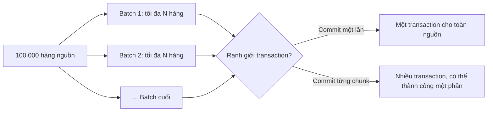

# Lựa chọn kích thước lô theo bộ nhớ và giới hạn driver trong JDBC

## Mục tiêu học tập

Trong **JDBC**, thay vì gửi từng lệnh `INSERT`, `UPDATE` hoặc `DELETE` riêng lẻ, ứng dụng Java có thể gom nhiều bộ tham số vào một lô (*batch*) rồi gọi `PreparedStatement.executeBatch()`. Cách làm này thường giảm số lượt trao đổi giữa ứng dụng và cơ sở dữ liệu, giúp nhập dữ liệu nhanh hơn. Tuy nhiên, đặt kích thước lô quá lớn có thể làm tăng mức sử dụng heap, lượng dữ liệu do driver giữ, kích thước thông điệp SQL, thời gian giữ khóa và chi phí xử lý lỗi.

Bài thuộc chương **Xử lý theo lô** giải thích cách lựa chọn `batch size` theo **ngân sách bộ nhớ** và **giới hạn thực tế của driver/DBMS**, đồng thời xác nhận lựa chọn bằng đo đạc. Nội dung sử dụng những API JDBC chuẩn như `DataSource`, `Connection`, `PreparedStatement`, `executeBatch()`, `BatchUpdateException` và các thao tác transaction.

Sau bài này, bạn có thể:

- Phân biệt số bản ghi của một **batch JDBC**, số bản ghi trong một **transaction** và số dòng trong nguồn dữ liệu đầu vào.
- Ước tính ngân sách bộ nhớ từ kích thước hàng, chi phí tham số và cách driver đệm dữ liệu.
- Tính giới hạn số hàng khi driver viết lại lô thành một câu SQL hoặc khi DBMS giới hạn số tham số, kích thước thông điệp.
- Cài đặt cách chia lô theo **hai ngưỡng**: số hàng và dung lượng ước tính, với câu SQL tham số hóa.
- Đo thông lượng, độ trễ, GC và dấu hiệu quá tải để chỉnh kích thước lô theo workload thật.
- Xử lý lỗi batch và transaction mà không nhầm thực thi thành công với commit thành công.

## 1. Batch size thực sự đo điều gì?

Một `PreparedStatement` có thể nhận nhiều bộ tham số:

```java
String sql = "INSERT INTO event_log(event_id, message) VALUES (?, ?)";

try (PreparedStatement ps = connection.prepareStatement(sql)) {
    for (Event event : events) {
        ps.setLong(1, event.id());
        ps.setString(2, event.message());
        ps.addBatch();
    }
    int[] updateCounts = ps.executeBatch();
}
```

Trong ví dụ trên, **batch size** là số lần gọi `addBatch()` được gom lại trước một lần `executeBatch()`. Nếu `events` có 100.000 dòng và chỉ gọi `executeBatch()` một lần, kích thước lô có thể là 100.000. Nếu cứ sau 500 dòng lại thực thi, mỗi lô tối đa 500 dòng.

Cần phân biệt ba phạm vi:

| Phạm vi | Mô tả | Ai điều khiển? |
| --- | --- | --- |
| **Nguồn đầu vào** | Tổng số hàng cần xử lý, ví dụ 100.000 | Nguồn file, API, `ResultSet`, iterator |
| **Batch JDBC** | Số bộ tham số chờ một lần `executeBatch()`, ví dụ 500 | Logic `addBatch()` / `executeBatch()` |
| **Transaction** | Nhóm thay đổi được xác nhận bằng `commit()` hoặc hủy bằng `rollback()` | `autoCommit`, `Connection.commit()` / `rollback()` và DBMS |

**Chia 100.000 dòng thành 200 batch không tự chia thành 200 transaction.** Với `connection.setAutoCommit(false)` và chỉ gọi `commit()` ở cuối, tất cả 200 batch vẫn có thể thuộc **một transaction lớn**. Nếu gọi `commit()` sau từng batch, bạn đang chọn nhiều transaction nhỏ hơn, kèm hệ quả về tính nguyên tử và phục hồi khi lỗi.



## 2. Vì sao một con số cố định không phù hợp mọi workload?

Cùng `batchSize = 500`, tác động khác biệt rõ:

- 500 hàng chỉ chứa hai số nguyên có thể tương đối nhỏ.
- 500 hàng chứa chuỗi vài trăm kilobyte có thể tạo bộ đệm lớn.
- 500 hàng chứa BLOB hoặc CLOB cỡ megabyte có thể vượt ngân sách bộ nhớ; việc driver nhận `InputStream` không đảm bảo nó luôn truyền dữ liệu mà không đệm.
- 500 bộ tham số cho câu `INSERT` có 3 cột khác với 500 bộ tham số cho câu `UPDATE` có 50 cột.
- Driver có thể gửi một lệnh cho mỗi bộ tham số, dùng giao thức batch riêng hoặc **viết lại** nhiều bộ thành SQL dạng nhiều hàng; giới hạn áp dụng cho từng cách khác nhau.
- Network latency cao có thể làm lô nhỏ kém hiệu quả; nhưng lô quá lớn có thể khiến timeout hoặc khóa database kéo dài.

Do đó, batch size tối ưu là **quyết định dựa trên loại hàng, driver, DBMS, cấu hình và yêu cầu nghiệp vụ**, không phải “luôn dùng 1.000” hay “càng lớn càng tốt”.

## 3. Ngân sách bộ nhớ: đừng chỉ đếm số hàng

Khi gọi `ps.addBatch()`, driver thường cần giữ đủ thông tin tham số để thực thi sau đó. Cách lưu trữ, sao chép dữ liệu, mã hóa chuỗi, giữ tham chiếu và giải phóng bộ đệm là **chi tiết triển khai của driver**.

Tổng bộ nhớ liên quan đến một batch có thể gồm:

1. Các đối tượng dữ liệu đầu vào đang còn được ứng dụng giữ.
2. Các đối tượng tham số và bộ nhớ do driver giữ giữa `addBatch()` và `executeBatch()`.
3. Bộ đệm mã hóa ký tự hoặc chuyển đổi kiểu dữ liệu.
4. Bộ đệm mạng, chuỗi SQL được viết lại hay thông điệp của giao thức.
5. Mảng kết quả `int[]`/`long[]` và ngoại lệ nếu thực thi lỗi.
6. Các bản sao hoặc hàng đợi trung gian khác, tùy framework, connection pool và driver.

Nếu đầu vào là một `List` lớn đã được tải hết vào RAM, chia JDBC batch **không làm biến mất** bộ nhớ mà `List` đang chiếm. Khi khối lượng lớn, nên lấy dữ liệu qua iterator/stream có kiểm soát và giới hạn số hàng còn tồn tại trong ứng dụng cùng lúc.

### 3.1. Ước tính ban đầu

Đặt:

- `M`: ngân sách bộ nhớ dành cho **một batch đang hoạt động**, tính theo byte.
- `R`: kích thước tham số trung bình của một hàng, tính theo byte; cần chú ý hàng lớn bất thường.
- `F`: hệ số dự phòng cho đối tượng Java, driver, mã hóa và các bản sao trung gian; phải được **đo hoặc hiệu chỉnh**.
- `N_memory`: ngưỡng số hàng ước tính từ bộ nhớ.

Một công thức định hướng:

\[
N_{\text{memory}} \approx \left\lfloor \frac{M}{R \times F} \right\rfloor
\]

Ví dụ giả định: dành **8 MiB** bộ nhớ đệm hoạt động cho một batch, kích thước tham số trung bình là **8 KiB/hàng**, và tạm dùng hệ số dự phòng **4**:

\[
N_{\text{memory}} \approx
\left\lfloor\frac{8 \times 1024 \times 1024}
{8 \times 1024 \times 4}\right\rfloor = 256
\]

**256 là số tính thử, không phải giá trị tối ưu mặc định**. Hệ số 4 trong ví dụ là giả định để bắt đầu thí nghiệm; không có hệ số chung đúng cho mọi driver. Nếu hàng có kích thước lệch nhiều, tính theo trung bình sẽ che mất nguy cơ từ hàng lớn; nên dùng ngưỡng byte riêng và quan sát phân phối kích thước.

### 3.2. Vì sao cần hai ngưỡng cùng lúc?

Chỉ giới hạn số hàng, ví dụ `500`, có thể dẫn tới lô bất ngờ rất lớn khi chứa chuỗi dài. Chỉ giới hạn byte ước tính lại có thể khiến số lượng phần tử cực lớn khi mỗi hàng rất nhỏ, gây nhiều metadata và chi phí xử lý.

Một chiến lược hữu ích là **xả batch khi đạt một trong hai ngưỡng**:

- `maxRows`: số phần tử cao nhất trong một lô.
- `maxEstimatedBytes`: tổng dung lượng tham số **ước tính** cao nhất trong một lô.

Giả sử `maxRows = 200`, `maxEstimatedBytes = 2 MiB`:

| Dữ liệu đầu vào | Ngưỡng có thể chạm trước | Kết quả |
| --- | --- | --- |
| Hàng nhỏ, mỗi hàng 100 byte ước tính | Số hàng | Xả ở khoảng 200 hàng |
| Hàng trung bình, mỗi hàng 16 KiB | Byte | Xả trước khi đủ 200 hàng |
| Một hàng đơn lẻ lớn hơn 2 MiB | Giới hạn một hàng | Từ chối với chính sách rõ ràng hoặc dùng đường xử lý riêng |
| Kích thước hàng biến thiên liên tục | Ngưỡng chạm trước thay đổi | Batch thực tế có thể khác nhau |

Cách tính byte ở phía ứng dụng chỉ là **một bộ ước lượng**. Mỗi driver có cách giữ tham số và đóng gói dữ liệu khác nhau, nên cần quan sát heap/GC và kết quả thực thi để điều chỉnh.

## 4. Giới hạn driver và DBMS: “batch lớn” có thể mang nhiều nghĩa

### 4.1. Số tham số khi driver viết lại SQL

Với câu:

```sql
INSERT INTO events (event_id, category, payload, created_at)
VALUES (?, ?, ?, ?);
```

Có **4 tham số cho mỗi hàng**. Một số driver/cấu hình có thể tối ưu batch bằng cách viết lại thành câu SQL nhiều nhóm `VALUES`:

```sql
INSERT INTO events (event_id, category, payload, created_at)
VALUES (?, ?, ?, ?),
       (?, ?, ?, ?),
       (?, ?, ?, ?);
```

Khi việc viết lại diễn ra theo kiểu này, 3 hàng tạo ra 12 dấu `?` trong một câu lệnh. Nếu một DBMS hoặc giao thức có giới hạn số bind parameter trên mỗi câu, số hàng bị chặn bởi giới hạn đó:

\[
N_{\text{params}} =
\left\lfloor\frac{P_{\max} - P_{\text{fixed}}}
{P_{\text{per row}}}\right\rfloor
\]

Trong đó `P_max` là giới hạn tham số cho câu lệnh **trên đường thực thi thật**, `P_fixed` là số tham số không nhân theo hàng, và `P_per row` là số tham số lặp lại cho mỗi hàng.

**Ví dụ chỉ để tính toán:** nếu hệ thống kiểm thử cho phép tối đa 600 bind parameters trong một câu, mỗi hàng dùng 4 tham số và không có tham số cố định, ngưỡng lý thuyết là `600 / 4 = 150` hàng. Nên để dư địa khi có tham số khác, thay đổi SQL hoặc giới hạn driver.

**Quan trọng:** không phải mọi `PreparedStatement.addBatch()` đều được viết lại thành một câu SQL. Driver có thể dùng các thông điệp protocol riêng hoặc thực thi nhiều lần; khi đó phép tính giới hạn tham số theo SQL được viết lại **có thể không áp dụng trực tiếp**. Phải kiểm tra driver, phiên bản, cấu hình rewrite và truy vấn thực tế. Không sử dụng các con số giới hạn của DBMS khác như hằng số chung cho JDBC.

### 4.2. Kích thước gói tin và câu SQL

Ngoài số tham số, các giới hạn còn có thể liên quan tới:

- Kích thước tối đa của gói tin, thông điệp hoặc câu SQL.
- Độ dài tối đa cho một giá trị hoặc một hàng.
- Số lượng bộ tham số mà driver cho phép trong một batch.
- Bộ nhớ mà driver sử dụng khi xây dựng thông điệp và khả năng streaming LOB.
- Timeout truy vấn, timeout mạng và giới hạn tài nguyên phía database.
- Khả năng tách batch tự động thành những phần nhỏ hơn.

Các ngưỡng có thể phụ thuộc cả **client và server**, từng phiên bản, giao thức và cấu hình. Một batch thực thi được ở môi trường phát triển chưa chắc có cùng giới hạn với môi trường production.

### 4.3. Transaction, khóa và độ bền dữ liệu

Một batch lớn có thể giữ connection bận lâu hơn; một **transaction lớn** có thể giữ khóa, undo/redo/WAL và trạng thái chưa commit lâu hơn. Nhưng kích thước batch và kích thước transaction là hai thông số riêng:

| Chiến lược | Bộ nhớ chờ `executeBatch()` | Ranh giới commit | Đặc điểm |
| --- | --- | --- | --- |
| Nhiều batch nhỏ, một commit cuối | Được giới hạn theo batch | Một transaction lớn | Có khả năng rollback toàn bộ DML transactional nhưng khóa/log có thể tích lũy |
| Một batch mỗi transaction | Được giới hạn theo batch | Nhiều transaction | Giảm phạm vi một lần rollback; tiến trình có thể commit một phần |
| Một batch rất lớn, commit một lần | Có thể rất lớn | Một transaction | Rủi ro heap, thông điệp và timeout cùng tăng |
| Batch nhỏ trong transaction có savepoint | Giới hạn bộ nhớ; savepoint theo DBMS | Vẫn thuộc transaction bao ngoài | Savepoint không tự commit, vẫn cần đánh giá lỗi và tài nguyên |

Nếu nghiệp vụ bắt buộc **all-or-nothing** trên toàn 100.000 dòng, chia các batch nhỏ nhưng giữ cùng transaction có thể hữu ích cho heap; tuy vậy, một transaction lớn vẫn có chi phí ở DBMS. Nếu chấp nhận nhập từng phần, có thể commit theo chunk, kèm thiết kế checkpoint, idempotency và khả năng nối tiếp sau lỗi.

## 5. Kết hợp các giới hạn thành batch size ban đầu

Sau khi xác minh driver/DBMS, hãy xem các ngưỡng khả dụng:

- `N_memory`: theo ngân sách bộ nhớ và kích thước hàng.
- `N_params`: nếu driver viết lại và thực tế có giới hạn bind.
- `N_message`: theo payload/thông điệp nếu có thể ước tính.
- `N_driver`: giới hạn hoặc mức khuyến nghị được kiểm chứng cho driver.
- `N_latency`: giá trị thực nghiệm đảm bảo thời gian mỗi batch phù hợp.
- `N_app`: giới hạn vận hành do ứng dụng đặt ra.

Chọn một điểm khởi đầu **không vượt các ngưỡng đã xác minh**, rồi thử nghiệm và hiệu chỉnh. Những ngưỡng không áp dụng hoặc chưa biết cần được đánh giá riêng; không tự gán một giá trị tưởng tượng.

```text
N đề xuất ban đầu
  = min(ngưỡng bộ nhớ,
        ngưỡng bind nếu có,
        ngưỡng message nếu có,
        ngưỡng driver nếu có,
        ngưỡng latency đã đo,
        ngưỡng do ứng dụng đặt)
```

### Ví dụ phối hợp

Giả sử một đợt nhập dữ liệu có:

- Ngân sách heap cho batch dẫn tới `N_memory = 256`.
- Driver được **quan sát là có rewrite** SQL gồm 4 tham số/hàng; hệ thống giả định giới hạn khoảng `600` bind parameters/câu, suy ra `N_params = 150`.
- Các phép thử về message/latency cho thấy nên giữ dưới `180` hàng.
- Nhóm phát triển muốn thử trước các ngưỡng tròn, dễ so sánh.

Giới hạn chặt nhất trong ví dụ là `150`. **100 hàng/batch** có thể là ứng viên khởi đầu để đo, chứ chưa phải đáp án tối ưu cuối cùng. Nếu driver không rewrite như giả định, giới hạn tham số có thể khác; cần kiểm tra lại phép tính.

## 6. Ví dụ Java hoàn chỉnh: giới hạn cả số hàng lẫn byte ước tính

Đoạn mã sau minh họa cách nhập dữ liệu vào bảng:

```sql
CREATE TABLE import_events (
    event_id BIGINT PRIMARY KEY,
    note VARCHAR(4000),
    amount DECIMAL(19, 2) NOT NULL
);
```

Giả định bảng hỗ trợ transaction. Câu `CREATE TABLE` chỉ mô tả schema chuẩn bị **trước** khi chạy mã nhập, không được đặt vào transaction xử lý dữ liệu nếu chưa kiểm tra DDL theo DBMS.

Mã dùng **Java 17+** (do `record`), `DataSource`, `PreparedStatement.addBatch()`, `executeBatch()` và `clearBatch()`. Nó giữ **một transaction cho toàn bộ dữ liệu đầu vào**, bất kể có bao nhiêu batch; nếu yêu cầu nghiệp vụ cho phép commit từng chunk, hãy áp dụng chiến lược khác như phần 8.

```java
import java.math.BigDecimal;
import java.sql.Connection;
import java.sql.PreparedStatement;
import java.sql.SQLException;
import java.sql.Statement;
import java.sql.Types;
import java.util.Objects;
import javax.sql.DataSource;

public final class BoundedBatchImporter {
    private static final String INSERT_SQL =
        "INSERT INTO import_events(event_id, note, amount) VALUES (?, ?, ?)";

    private final DataSource dataSource;

    public BoundedBatchImporter(DataSource dataSource) {
        this.dataSource = Objects.requireNonNull(dataSource);
    }

    public record ImportRow(long eventId, String note, BigDecimal amount) {
    }

    public long importAll(Iterable<ImportRow> source,
                          int maxRows,
                          long maxEstimatedBytes) throws SQLException {
        Objects.requireNonNull(source, "source");
        if (maxRows < 1 || maxEstimatedBytes < 1) {
            throw new IllegalArgumentException("Ngưỡng batch phải dương");
        }

        try (Connection connection = dataSource.getConnection()) {
            connection.setAutoCommit(false);
            long importedRows = 0;

            // Phạm vi bắt lỗi này chỉ bao quanh các bước TRƯỚC commit.
            try {
                try (PreparedStatement ps =
                         connection.prepareStatement(INSERT_SQL)) {
                    int pendingRows = 0;
                    long pendingBytes = 0;

                    for (ImportRow row : source) {
                        Objects.requireNonNull(row, "row");
                        Objects.requireNonNull(row.amount(), "amount");

                        long rowBytes = estimateRowBytes(row);
                        if (rowBytes > maxEstimatedBytes) {
                            // Với LOB/hàng rất lớn: xử lý riêng theo chính sách.
                            throw new IllegalArgumentException(
                                "Một hàng vượt ngân sách byte của batch"
                            );
                        }

                        // Xả batch TRƯỚC khi thêm hàng gây vượt ngưỡng.
                        if (pendingRows > 0
                            && (pendingRows >= maxRows
                                || pendingBytes > maxEstimatedBytes - rowBytes)) {
                            executeChecked(ps, pendingRows);
                            pendingRows = 0;
                            pendingBytes = 0;
                        }

                        ps.setLong(1, row.eventId());
                        if (row.note() == null) {
                            ps.setNull(2, Types.VARCHAR);
                        } else {
                            ps.setString(2, row.note());
                        }
                        ps.setBigDecimal(3, row.amount());
                        ps.addBatch();

                        pendingRows++;
                        pendingBytes += rowBytes;
                        importedRows++;
                    }

                    // Xả lô cuối, kể cả khi chưa chạm một ngưỡng nào.
                    if (pendingRows > 0) {
                        executeChecked(ps, pendingRows);
                    }
                } // Đóng PreparedStatement trước khi bắt đầu commit.
            } catch (SQLException | RuntimeException error) {
                try {
                    connection.rollback();
                } catch (SQLException rollbackError) {
                    error.addSuppressed(rollbackError);
                }
                throw error;
            }

            // Commit nằm ngoài catch phía trên. Nếu chính commit()
            // ném SQLException, kết quả có thể chưa xác định.
            connection.commit();
            return importedRows;
        }
    }

    private static long estimateRowBytes(ImportRow row) {
        // CHỈ là một ước lượng bảo thủ cho tham số ứng dụng.
        // 128 byte giả định cho số/metadata; 4 byte / UTF-16 code unit
        // của chuỗi. Không đo được mọi bộ đệm của JDBC driver.
        return 128L + 4L * (row.note() == null ? 0 : row.note().length());
    }

    private static void executeChecked(PreparedStatement ps,
                                       int expectedRows) throws SQLException {
        int[] counts = ps.executeBatch();

        if (counts.length != expectedRows) {
            throw new SQLException("Số kết quả batch khác số phần tử đã gửi");
        }
        for (int count : counts) {
            if (count == Statement.EXECUTE_FAILED) {
                throw new SQLException("Có phần tử batch thực thi thất bại");
            }
            // SUCCESS_NO_INFO có nghĩa là thành công nhưng không có
            // số hàng cập nhật cụ thể, không được coi là lỗi.
        }

        // executeBatch() đã thực thi batch; gọi clearBatch()
        // để làm rõ ý định không giữ lại các phần tử cũ.
        ps.clearBatch();
    }
}
```

### 6.1. Những giới hạn của ví dụ cần hiểu đúng

**Ước lượng byte chưa phải đo bộ nhớ của driver.** Công thức `128 + 4 × note.length()` cố ý đơn giản và có dự phòng cho chuỗi, nhưng không mô tả đủ `BigDecimal`, đối tượng khác, bộ nhớ driver, charset trên đường truyền, rewrite SQL hoặc message buffer. Giá trị cần điều chỉnh bằng profiling và dữ liệu sản xuất. Vì vậy **hai ngưỡng chỉ hạn chế hàng đang chờ theo bộ đếm của ứng dụng**, không bảo đảm heap thực tế luôn dưới `maxEstimatedBytes`.

**Nguồn dữ liệu cũng tiêu thụ RAM.** Tham số `Iterable<ImportRow>` cho phép nguồn phát dần từng hàng. Nếu người gọi tạo sẵn `List` vài triệu `ImportRow` thì bộ nhớ của danh sách vẫn tồn tại. Muốn xử lý thực sự theo luồng, nguồn đầu vào phải có khả năng đọc tăng dần và đóng tài nguyên khi cần.

**Không có `ResultSet` trong câu INSERT.** Truy vấn kiểm tra sau khi commit có thể dùng `PreparedStatement.executeQuery()` và `ResultSet` trên connection mới. Nếu cần đọc một `ResultSet` nguồn rồi ghi batch vào database, phải kiểm soát hai connection, fetch size, lifetime của cursor và khả năng pool cấp đủ kết nối.

**Đúng một connection, một transaction.** Nhiều lần `executeBatch()` ở đây không làm thay đổi ranh giới commit. Nếu phần tử đầu tiên của batch thứ mười nghìn lỗi, code thử rollback mọi phần thay đổi **chưa commit** trong transaction (giả định schema và engine có hỗ trợ). Điều đó có thể tốn thời gian và database log; cần đánh giá khi tổng số dòng lớn.

**Trả về số hàng đầu vào đã đưa qua `addBatch()` và hoàn tất commit**, không cộng số hàng bị ảnh hưởng từ update counts. Với `INSERT` vào bảng theo giả định, nếu tất cả batch thành công và commit được xác nhận thì đây là số bản ghi yêu cầu đã xử lý. Với `UPDATE` hoặc `DELETE`, số dòng bị ảnh hưởng có thể khác số bộ tham số; phải định nghĩa metric riêng.

**Cần có khóa/ngăn trùng khi retry.** Nếu `commit()` ném lỗi mất kết nối, database có thể đã commit dù Java không nhận được xác nhận. Không được tự động chạy lại nguồn bằng các mã yêu cầu mới; cân nhắc khóa duy nhất và đối soát kết quả trước khi retry.

### 6.2. Trường hợp một hàng vượt ngân sách

Ví dụ chủ động ném `IllegalArgumentException` khi một hàng lớn hơn `maxEstimatedBytes`. Trong hệ thống thật có thể chọn:

- Chuyển hàng đó sang đường thực thi **một hàng** với ngân sách riêng và giới hạn rõ ràng.
- Sử dụng `setBinaryStream` / `setCharacterStream` với driver hỗ trợ streaming và xác minh **driver có thực sự streaming** hay vẫn đệm trước khi gửi.
- Lưu nội dung lớn ở kho đối tượng độc lập, còn database lưu tham chiếu nếu kiến trúc cho phép.
- Từ chối hàng quá lớn theo hợp đồng dữ liệu đầu vào và báo lỗi có kiểm soát.

Không được giả định “một hàng thì chắc chắn vừa bộ nhớ” vì bản thân một BLOB có thể vượt giới hạn request hoặc driver.

## 7. BatchUpdateException và giới hạn lỗi khi xử lý lô lớn

`executeBatch()` có thể ném `BatchUpdateException`. Ngoại lệ này mang `getUpdateCounts()` hoặc `getLargeUpdateCounts()` và có thể liên kết lỗi bổ sung qua `getNextException()`.

```java
import java.sql.BatchUpdateException;
import java.sql.SQLException;
import java.sql.Statement;

try {
    int[] counts = ps.executeBatch();
    // Kiểm tra SUCCESS_NO_INFO, EXECUTE_FAILED nếu cần.
} catch (BatchUpdateException error) {
    int[] completed = error.getUpdateCounts();

    for (int i = 0; i < completed.length; i++) {
        if (completed[i] == Statement.EXECUTE_FAILED) {
            System.err.println("Batch entry " + i + " thất bại");
        }
    }

    for (SQLException current = error;
         current != null;
         current = current.getNextException()) {
        System.err.println("SQLState=" + current.getSQLState()
            + ", vendorCode=" + current.getErrorCode());
    }
    throw error;
}
```

Đây là **đoạn minh họa bên trong phương thức đã có `PreparedStatement ps`**. Trong mã production, dùng logger có kiểm soát, tránh log tham số SQL hoặc dữ liệu nhạy cảm.

Cách đọc các giá trị đặc biệt:

| Giá trị update count | Nghĩa theo JDBC |
| --- | --- |
| `0` hoặc số dương | Số hàng bị ảnh hưởng được báo cáo |
| `Statement.SUCCESS_NO_INFO` (`-2`) | Thực thi thành công nhưng không xác định chính xác số hàng |
| `Statement.EXECUTE_FAILED` (`-3`) | Phần tử batch được báo cáo thất bại |

Driver có thể dừng khi gặp lỗi hoặc tiếp tục xử lý các phần tử còn lại, nên độ dài và ý nghĩa mảng phải được đọc cùng hợp đồng JDBC và hành vi driver. **Một hàng được báo là đã thực thi không có nghĩa là đã commit.** Với transaction thủ công, cần rollback hoặc commit thích hợp; khi chính commit bị mất phản hồi, trạng thái có thể chưa xác định.

Batch quá lớn còn làm việc xác định phần tử lỗi khó khăn hơn, tăng kích thước log, số hàng phải tái xử lý và thời gian phục hồi. Đây là một lý do vận hành để giữ batch ở kích thước vừa phải.

## 8. Chọn ranh giới commit: toàn lô nhập hay từng chunk?

Kích thước lô tối ưu về bộ nhớ không tự trả lời câu hỏi: **nếu lỗi ở giữa 100.000 dòng, dữ liệu đã ghi có được giữ lại không?**

### 8.1. Một transaction cho toàn bộ đầu vào

Ưu điểm: nếu tất cả câu SQL thuộc các bảng hỗ trợ transaction, `rollback()` trước commit có thể hủy toàn bộ DML chưa commit. Nhược điểm: transaction kéo dài có thể tạo lượng WAL/undo lớn, giữ khóa và tài nguyên lâu, tăng thời gian rollback khi lỗi.

Mã phần 6 chọn cách này để minh họa rõ tính nguyên tử và phân biệt ranh giới batch với ranh giới transaction.

### 8.2. Commit sau mỗi chunk

Khi nghiệp vụ chấp nhận hoàn tất một phần, có thể định nghĩa một chunk gồm nhiều batch, rồi commit một lần cho chunk:

```text
Chunk 1: batch A, batch B -> COMMIT -> checkpoint 1
Chunk 2: batch C, batch D -> COMMIT -> checkpoint 2
Chunk 3: batch E          -> lỗi, ROLLBACK chunk 3
Kết quả: chunk 1 và 2 đã commit; chunk 3 chưa hoàn tất
```

Thiết kế này cần **idempotency**: mỗi hàng hoặc chunk có khóa ổn định, checkpoint chỉ đánh dấu hoàn tất sau khi commit được xác nhận (hoặc sau khi đối soát). Nếu một `commit()` ném lỗi, kết quả của chunk đó có thể chưa biết; không đánh dấu thất bại rồi gửi lại dữ liệu vô điều kiện.

Đừng đặt `connection.setAutoCommit(true)` trong `finally` để “dọn dẹp” khi transaction còn thay đổi chưa được xác nhận, vì việc chuyển chế độ có thể làm commit ngoài ý muốn. Việc trả connection về pool cũng cần dựa trên contract reset/rollback của pool và driver.

### 8.3. Batching không thay thế phân lô ở tầng nghiệp vụ

Một request có 50.000 hàng có thể cần:

- **Batch size 100:** giới hạn dữ liệu gửi mỗi lần `executeBatch()`.
- **Transaction chunk 2.000 hàng:** sau 20 batch, commit một chunk (nếu nghiệp vụ cho phép).
- **Checkpoint:** lưu tiến độ cho đầu vào đã commit, thường gắn với ID hoặc offset ổn định.
- **Retry:** xử lý lại có kiểm tra khóa và trạng thái, tránh nhân bản dữ liệu.

Không đồng nhất checkpoint với lần `executeBatch()`: chỉ khi transaction được xác nhận mới có căn cứ ghi nhận phần dữ liệu đã hoàn tất.

## 9. Đo đạc để tìm kích thước lô phù hợp

Một giá trị có thể vượt qua mọi giới hạn kỹ thuật nhưng vẫn chậm hơn giá trị nhỏ hơn vì driver phải giữ dữ liệu lâu hoặc database phải xử lý thông điệp quá lớn. Do đó cần benchmark bằng **cùng dữ liệu, cùng DBMS/driver, cùng cấu hình và mức đồng thời tương ứng**.

### 9.1. Cách thiết kế thử nghiệm

1. Chọn mẫu dữ liệu có kích thước gần thực tế, gồm cả phần tử dài ở percentile cao; ghi lại phân phối kích thước.
2. Bắt đầu bằng vài ứng viên vừa phải, ví dụ `50, 100, 250, 500` hàng/batch, **sau khi đã loại ứng viên vượt giới hạn được xác minh**.
3. Giữ nguyên số kết nối đồng thời, isolation, ranh giới commit, indexes, network và schema giữa các lượt thử.
4. Chạy một lượt warm-up rồi đo nhiều lượt, tránh kết luận từ duy nhất một lần chạy.
5. Đo throughput, độ trễ theo batch, heap và GC; ghi lỗi, timeout, update counts và trạng thái transaction.
6. Nếu tăng kích thước lô mà throughput không còn tăng đáng kể hoặc heap/độ trễ xấu đi, dừng mở rộng và chọn giá trị có dự phòng.

### 9.2. Các thước đo nên quan sát

| Chỉ số | Ý nghĩa | Dấu hiệu đáng chú ý |
| --- | --- | --- |
| Hàng/giây **đã commit** | Thông lượng nghiệp vụ thật | Tăng lên rồi chững hoặc giảm |
| Thời gian `executeBatch()` p50/p95/p99 | Độ trễ xử lý mỗi batch | p95 cao, timeout khi lô lớn |
| Peak heap và GC pause | Áp lực bộ nhớ JVM | Heap tăng đột biến, GC kéo dài |
| Kích thước lô thực tế (hàng/byte ước tính) | Biết ngưỡng nào đang kích hoạt | Nhiều lô chạm byte sớm hơn row |
| Kích thước message và mức sử dụng network | Đánh giá ảnh hưởng payload | Lỗi gói tin lớn, băng thông nghẽn |
| CPU và bộ nhớ database | Tải phía server | Tăng mạnh nhưng throughput không cải thiện |
| Lock wait, transaction duration | Tác động đến giao dịch khác | Khóa kéo dài hoặc tranh chấp tăng |
| Error rate và retry count | Chi phí vận hành | Hàng lỗi khó truy vết, retry nhiều |

**Chọn throughput gắn với commit**, không chỉ số lần gọi `executeBatch()`. Một chương trình đưa được 10.000 hàng/giây vào driver nhưng transaction liên tục rollback không có thông lượng thành công như mong đợi.

### 9.3. Bảng kết quả minh họa

Các số sau **chỉ là dữ liệu giả định để minh họa cách quyết định**, không đại diện benchmark của JDBC hoặc một driver cụ thể:

| Batch size | Throughput đã commit (hàng/s) | Peak heap tăng thêm | p95 executeBatch |
| ---: | ---: | ---: | ---: |
| 50 | 8.000 | 12 MiB | 12 ms |
| 100 | 13.000 | 17 MiB | 20 ms |
| 250 | 15.000 | 35 MiB | 46 ms |
| 500 | 15.200 | 75 MiB | 105 ms |

Nếu hệ thống yêu cầu p95 dưới 60 ms và ngân sách heap còn hạn chế, **250** có thể là ứng viên hợp lý hơn **500** trong bộ số liệu minh họa: thông lượng gần tương đương nhưng độ trễ và bộ nhớ thấp hơn nhiều. Đây là kết luận **cho dữ liệu giả định**, không phải khuyến nghị mặc định áp dụng cho mọi ứng dụng.

## 10. Các lỗi thường gặp

| Cách làm | Vì sao có vấn đề? | Cách sửa |
| --- | --- | --- |
| Chỉ gọi `executeBatch()` một lần cho hàng triệu bản ghi | Driver có thể giữ quá nhiều tham số/buffer | Xả định kỳ theo hàng và byte |
| Dùng một `batchSize` bất biến cho mọi loại hàng | Hàng dài và LOB làm bộ nhớ biến động lớn | Phân loại workload, thêm ngưỡng byte |
| Áp một giới hạn bind parameter cho mọi driver | Driver có thể rewrite hoặc không, cấu hình khác nhau | Xác minh đường thực thi và DBMS/driver đang dùng |
| Tính byte chỉ theo độ dài chuỗi Java mà coi là chính xác | Bỏ qua mã hóa, driver overhead, copy và buffer | Ước lượng có dự phòng, đo heap/GC |
| Đọc toàn bộ dữ liệu vào `List` trước khi batch | Bộ nhớ nguồn lớn dù batch đã nhỏ | Iterator/stream có quản lý tài nguyên |
| Trộn batch size với transaction size | Dùng batch nhỏ nhưng transaction vẫn rất dài | Xác định ranh giới commit riêng |
| Chọn số lớn nhất không gây exception | Có thể chậm hơn vì GC, timeout và lock | Benchmark throughput cùng p95/heap |
| Coi `SUCCESS_NO_INFO` là thất bại | JDBC cho phép thành công mà không có row count | Phân biệt các hằng số update count |
| Coi `executeBatch()` thành công là dữ liệu đã commit | Với `autoCommit=false`, transaction vẫn chờ commit | Đo trạng thái sau xác nhận commit |
| Retry toàn bộ sau lỗi mạng tại `commit()` | Có nguy cơ ghi trùng nếu DB đã commit | Idempotency và đối soát |
| Dồn DDL vào cùng lô DML | DDL có thể implicit commit hoặc không hỗ trợ transaction | Quản lý schema migration riêng |
| Bỏ qua đồng thời nhiều worker | Bộ nhớ tổng và kết nối tăng theo số batch đang chạy | Tính ngân sách theo concurrency |

## 11. Bài luyện tập

**Bài 1 — Ngưỡng bộ nhớ.** Một batch có ngân sách 6 MiB; tham số trung bình 4 KiB/hàng, hệ số dự phòng giả định 3. Tính `N_memory`.

*Gợi ý đáp án:* `6 × 1024 KiB / (4 KiB × 3) = 512` hàng. Đây là ngưỡng lý thuyết để bắt đầu thử.

**Bài 2 — Giới hạn bind.** Driver được xác nhận viết lại một câu `INSERT` với 5 tham số/hàng và giao thức đang dùng chấp nhận tối đa 1.000 bind parameter cho câu SQL đó, không có tham số cố định. Ngưỡng theo bind là bao nhiêu?

*Đáp án:* `floor(1.000 / 5) = 200` hàng; nên có khoảng dự phòng và kiểm tra kích thước message.

**Bài 3 — Hai ngưỡng.** `maxRows=100`, `maxEstimatedBytes=400 KiB`. Đầu vào gồm nhiều hàng cỡ 10 KiB ước tính. Batch được xả trước ngưỡng nào?

*Đáp án:* Ngưỡng byte, tối đa khoảng 40 hàng (và có thể ít hơn khi áp dụng overhead hoặc hàng khác cỡ).

**Bài 4 — Kết quả lỗi.** `executeBatch()` báo `BatchUpdateException` và `getUpdateCounts()` cho biết nhiều phần tử đã thực thi. Có thể kết luận những dòng đó đã commit không?

*Đáp án:* Không. Phải xét `autoCommit`, trạng thái transaction, rollback/commit và hành vi driver.

**Bài 5 — Batch nhỏ, transaction lớn.** 100.000 dòng được gửi qua 200 batch 500 dòng, nhưng chỉ `commit()` một lần ở cuối. Có bao nhiêu transaction do ứng dụng chủ động commit, và những tài nguyên nào vẫn có thể tích lũy?

*Đáp án:* Một transaction nếu không có ranh giới khác; dù bộ nhớ batch được giới hạn, database có thể vẫn giữ lock, WAL/undo và trạng thái transaction trong thời gian dài.

**Bài 6 — Đọc số liệu benchmark.** Hai kích thước batch có thông lượng gần bằng nhau nhưng một lựa chọn dùng gấp ba heap và p95 cao hơn. Bạn chọn ngưỡng nào khi workload phải đáp ứng SLO về độ trễ?

*Gợi ý:* Ưu tiên ứng viên đáp ứng đầy đủ SLO và ngân sách tài nguyên với khoảng dự phòng; không tối ưu chỉ theo đỉnh throughput.

## Kết luận

**Kích thước lô JDBC phải được lựa chọn theo cả số hàng, dung lượng dữ liệu và giới hạn thật của driver/DBMS**, rồi xác nhận bằng đo đạc. `PreparedStatement.addBatch()` giúp gom thao tác, nhưng dữ liệu có thể được giữ trong bộ nhớ cho đến lúc `executeBatch()`. Dùng ngưỡng **maxRows** và **maxEstimatedBytes** để khống chế lượng tham số đang chờ, đồng thời xác minh cách driver viết lại SQL, giới hạn bind, kích thước thông điệp và xử lý LOB. Cuối cùng, phân biệt rõ **batch** với **transaction**: việc xả một lô không đồng nghĩa đã commit. Chọn kích thước có dự phòng, quan sát throughput đã commit cùng heap/GC/độ trễ, và thiết kế rollback, checkpoint, retry an toàn cho nghiệp vụ của bạn.
