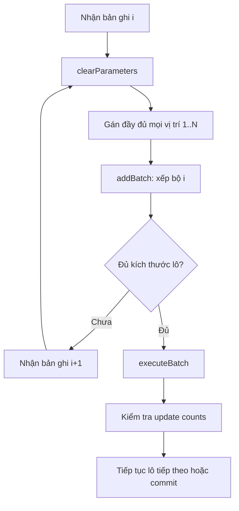

# Tái sử dụng bộ tham số mà không làm sai dữ liệu từng bản ghi trong JDBC

## 1. Bài toán: một `PreparedStatement`, nhiều bộ dữ liệu khác nhau

Trong **JDBC**, xử lý theo lô (*batch processing*) cho phép ứng dụng gửi nhiều thao tác SQL giống nhau qua một `PreparedStatement` thay vì thực thi từng hàng riêng lẻ. Đây là cách hữu ích khi nhập danh sách khách hàng, ghi các dòng hóa đơn hoặc cập nhật tồn kho hàng loạt. `DataSource` cấp kết nối, `PreparedStatement` nhận tham số, còn `executeBatch()` yêu cầu driver thực thi tập thao tác đã xếp hàng.

Lợi ích của việc **tái sử dụng cùng một `PreparedStatement`** là tránh chuẩn bị lại câu SQL cho từng bản ghi và có cơ hội giảm số lần trao đổi giữa Java và cơ sở dữ liệu. Tuy nhiên, chính việc tái sử dụng ấy tạo ra một rủi ro dễ bị bỏ qua: **tham số của bản ghi trước có thể còn được giữ lại nếu bản ghi sau không gán đủ các vị trí**.

Ví dụ, một lệnh nhập khách hàng có các tham số `(mã, tên, email, hạn_mức, ngày_đăng_ký)`:

| Bản ghi | Mã | Tên | Email | Hạn mức | Ngày đăng ký |
| --- | --- | --- | --- | --- | --- |
| A | `KH-01` | `Lan` | `lan@example.test` | `1000.00` | `2026-01-10` |
| B | `KH-02` | `Minh` | **SQL `NULL`** | `0.00` | `2026-01-11` |
| C | `KH-03` | `Mai` | `mai@example.test` | **SQL `NULL`** | `2026-01-12` |

Nếu chương trình chỉ gọi `setString(3, email)` khi email khác `null`, vị trí số 3 của bản ghi B **không được thiết lập lại**. Tùy trạng thái và driver, email của bản ghi A có thể bị dùng nhầm cho B. Tương tự, bỏ qua tham số hạn mức ở bản ghi C có thể khiến hạn mức từ B đi theo sang C. Bài học trọng tâm là: **mỗi lần gọi `addBatch()` phải đại diện cho một bộ tham số đầy đủ, độc lập về mặt dữ liệu**.

## 2. Vòng đời tham số của một `PreparedStatement`

Giả sử có câu SQL tham số hóa:

```sql
INSERT INTO customer_imports (
    external_ref, full_name, email, credit_limit, registered_on
) VALUES (?, ?, ?, ?, ?);
```

`?` được đánh số từ **1** theo JDBC. Một vòng lặp chuẩn có dạng:

```java
try (PreparedStatement ps = connection.prepareStatement(sql)) {
    for (CustomerInput row : rows) {
        ps.clearParameters();       // Bỏ các binding hiện tại.
        ps.setString(1, row.externalRef());
        ps.setString(2, row.fullName());

        if (row.email() == null) {
            ps.setNull(3, Types.VARCHAR);
        } else {
            ps.setString(3, row.email());
        }

        if (row.creditLimit() == null) {
            ps.setNull(4, Types.DECIMAL);
        } else {
            ps.setBigDecimal(4, row.creditLimit());
        }

        ps.setDate(5, java.sql.Date.valueOf(row.registeredOn()));
        ps.addBatch();              // Thêm bộ tham số vừa chuẩn bị.
    }

    int[] counts = ps.executeBatch();
}
```

Đây là đoạn minh họa bên trong một phương thức đã có `connection`, `sql`, `rows` và các import phù hợp; phần 5 sẽ trình bày ví dụ hoàn chỉnh có quản lý transaction.

Mỗi thao tác có một vai trò riêng:

| API | Tác dụng | Điều **không** làm |
| --- | --- | --- |
| `setString`, `setInt`, `setBigDecimal`, ... | Gán giá trị vào **bộ tham số hiện tại** theo chỉ số. | Không tự thêm một hàng vào batch. |
| `setNull(index, sqlType)` | Gán **SQL `NULL`** cho một tham số, với kiểu SQL tường minh. | Không đồng nghĩa bỏ qua việc gán tham số. |
| `clearParameters()` | Xóa các giá trị tham số đang được gán cho lần tiếp theo. | **Không xóa** các thao tác đã gọi `addBatch()`. |
| `addBatch()` | Thêm bộ tham số hiện tại thành một phần tử lô theo hợp đồng JDBC. | Không tự thực thi lệnh `INSERT` ngay lập tức. |
| `executeBatch()` | Gửi yêu cầu thực thi các phần tử đang xếp trong batch và trả trạng thái cập nhật. | Không tự `commit()` nếu kết nối đang ở `autoCommit=false`. |
| `clearBatch()` | Xóa **các lệnh/bộ tham số đang chờ trong batch** chưa thực thi. | Không rollback những câu SQL đã được thực thi. |

Theo mô hình API JDBC, mỗi `addBatch()` thêm **một bộ giá trị tham số đã được gán tại thời điểm đó**. Các lệnh gọi `setXXX()` ở vòng sau chuẩn bị bộ tiếp theo, không nhằm sửa các bộ đã thêm. Với dữ liệu nhị phân, LOB hoặc stream, driver có thể trì hoãn việc đọc nội dung; khi ấy phải chú ý vòng đời nguồn dữ liệu như mục 8.



## 3. Hai cách phổ biến khiến dữ liệu từng bản ghi bị trộn

### 3.1. Chỉ gán khi có giá trị, không xóa binding cũ

```java
// SAI: tham số số 3 của hàng tiếp theo có thể giữ email hàng trước.
for (CustomerInput row : rows) {
    ps.setString(1, row.externalRef());
    ps.setString(2, row.fullName());

    if (row.email() != null) {
        ps.setString(3, row.email());
    }

    ps.addBatch();
}
```

Khi `email == null`, lệnh `setString(3, ...)` bị bỏ qua chứ **không có yêu cầu đặt SQL `NULL`**. Nếu `PreparedStatement` đã có giá trị cũ ở vị trí đó, hàng mới có thể mang giá trị sai. Nếu tham số chưa từng được gán, driver có thể báo lỗi thiếu tham số. Cả hai kết quả đều không chấp nhận được.

**Đúng:** thiết lập `NULL` tường minh và gán đủ các vị trí cho mỗi hàng:

```java
ps.clearParameters();
ps.setString(1, row.externalRef());
ps.setString(2, row.fullName());
if (row.email() == null) {
    ps.setNull(3, Types.VARCHAR);
} else {
    ps.setString(3, row.email());
}
// Gán tiếp tất cả tham số khác trước khi addBatch().
```

`clearParameters()` là một **hàng rào phòng lỗi** hữu ích: nếu lập trình viên vô tình quên đặt một vị trí, driver có cơ hội phát hiện tham số chưa được gán, thay vì âm thầm tái sử dụng giá trị của hàng trước. Tuy nhiên, **chỉ `clearParameters()` chưa đủ**; vẫn phải đặt đủ các vị trí, kể cả `NULL`, cho mỗi bản ghi.

### 3.2. Nhầm `clearParameters()` với `clearBatch()`

```java
ps.setString(1, "KH-01");
// ... các vị trí khác ...
ps.addBatch();

ps.clearParameters(); // Đúng: chuẩn bị bộ mới, KH-01 vẫn đang chờ trong batch.
ps.setString(1, "KH-02");
// ... các vị trí khác ...
ps.addBatch();

// Gọi ps.clearBatch() ở đây sẽ BỎ CẢ HAI phần tử vừa xếp,
// nên không được gọi với mục đích chỉ xóa binding của KH-02.
```

`executeBatch()` hoàn thành lần thực thi và theo hợp đồng JDBC xóa danh sách các lệnh đã xếp. Thông thường không cần `clearBatch()` sau mỗi `executeBatch()` **thành công**. `clearBatch()` hữu ích khi chủ động hủy một lô chưa gửi, ví dụ do kiểm tra đầu vào không đạt và chương trình quyết định bỏ các phần tử đang chờ. Nó **không thay thế** `Connection.rollback()` khi một số lệnh đã chạy trong transaction.

## 4. `NULL`, kiểu dữ liệu và quy tắc biến đổi trước khi thêm vào lô

Với cột nullable, cần phân biệt các tình huống sau:

| Dữ liệu Java | Ý nghĩa dự định | Cách truyền JDBC |
| --- | --- | --- |
| `""` (chuỗi rỗng) | Chuỗi rỗng thực sự, nếu DBMS hỗ trợ phân biệt với `NULL`. | `setString(index, "")`. |
| `"   "` (toàn dấu cách) | Chuỗi chứa khoảng trắng; có xóa hay không phụ thuộc nghiệp vụ. | `setString(index, value)` hoặc chuẩn hóa có chủ đích. |
| `null` cho cột `VARCHAR` | SQL `NULL`. | `setNull(index, Types.VARCHAR)`. |
| `BigDecimal.ZERO` | Giá trị số `0`. | `setBigDecimal(index, BigDecimal.ZERO)`. |
| `null` cho cột `DECIMAL` | Không có hạn mức (SQL `NULL`), **không phải `0`**. | `setNull(index, Types.DECIMAL)`. |

Một số DBMS có quy tắc riêng về chuỗi rỗng (ví dụ Oracle có thể coi chuỗi rỗng kiểu ký tự là `NULL`). Ví dụ trong bài sử dụng **PostgreSQL**, nơi hai giá trị này phân biệt được; không mặc định mọi DBMS đều xử lý giống nhau.

Hãy dùng setter có kiểu tương ứng với SQL: `setBigDecimal()` cho tiền hoặc số thập phân chính xác, `setDate()` cho `DATE`, `setLong()` cho `BIGINT`. Dùng `setObject(index, value, sqlType)` cũng là lựa chọn khi đã xác định rõ SQL type và driver hỗ trợ. Tránh gửi số tiền dưới dạng chuỗi có dấu phân cách theo locale rồi nhờ DBMS tự ép kiểu trong một lô lớn: lỗi chuyển kiểu khó xác định hơn và có thể làm dừng cả batch.

**Làm sạch dữ liệu có chủ đích trước khi gọi `addBatch()`:** ví dụ, mã khách hàng có thể cần loại khoảng trắng ở hai đầu, nhưng tên hiển thị có thể cần giữ nguyên. Đừng tự động cắt độ dài, thay `null` bằng chuỗi rỗng hoặc đổi `0` thành `NULL` để “giúp batch thành công”. Những thao tác đó làm sai dữ liệu theo nghĩa nghiệp vụ, ngay cả khi JDBC không báo lỗi.

## 5. Ví dụ đầy đủ: nhập hàng loạt khách hàng an toàn

Giả sử cơ sở dữ liệu PostgreSQL có bảng sau:

```sql
CREATE TABLE customer_imports (
    external_ref  VARCHAR(40) PRIMARY KEY,
    full_name     VARCHAR(120) NOT NULL,
    email         VARCHAR(200),
    credit_limit  NUMERIC(12, 2),
    registered_on DATE NOT NULL
);
```

Mỗi khách hàng có năm giá trị tương ứng chính xác năm dấu `?`. `email` và `credit_limit` cho phép SQL `NULL`; các cột còn lại là bắt buộc. Mã sử dụng Java 17+, một `DataSource`, một `PreparedStatement`, và **một transaction bao trùm tất cả các lô nhỏ**.

```java
import javax.sql.DataSource;
import java.math.BigDecimal;
import java.sql.Connection;
import java.sql.Date;
import java.sql.PreparedStatement;
import java.sql.SQLException;
import java.sql.Statement;
import java.sql.Types;
import java.time.LocalDate;
import java.util.List;
import java.util.Objects;

public final class CustomerBatchImporter {
    private final DataSource dataSource;

    public CustomerBatchImporter(DataSource dataSource) {
        this.dataSource = Objects.requireNonNull(dataSource);
    }

    public record CustomerInput(
        String externalRef,
        String fullName,
        String email,
        BigDecimal creditLimit,
        LocalDate registeredOn
    ) {}

    private static final String INSERT_SQL =
        "INSERT INTO customer_imports " +
        "(external_ref, full_name, email, credit_limit, registered_on) " +
        "VALUES (?, ?, ?, ?, ?)";

    public int insertAll(List<CustomerInput> input, int batchSize)
            throws SQLException {
        Objects.requireNonNull(input, "input");
        if (batchSize <= 0) {
            throw new IllegalArgumentException("batchSize phải > 0");
        }

        // Đọc bản sao danh sách; record và các giá trị ví dụ đều bất biến.
        List<CustomerInput> rows = List.copyOf(input);
        for (CustomerInput row : rows) {
            validate(row);
        }
        if (rows.isEmpty()) {
            return 0;
        }

        try (Connection connection = dataSource.getConnection()) {
            // Service này sở hữu transaction riêng, không dùng transaction có sẵn.
            if (!connection.getAutoCommit()) {
                throw new SQLException("Connection không ở chế độ auto-commit ban đầu");
            }
            connection.setAutoCommit(false);

            try {
                int saved = 0;
                int pending = 0;

                try (PreparedStatement statement =
                        connection.prepareStatement(INSERT_SQL)) {

                    for (CustomerInput row : rows) {
                        statement.clearParameters();
                        bindRow(statement, row);  // Gán đủ 5 tham số.
                        statement.addBatch();
                        pending++;

                        if (pending == batchSize) {
                            checkUpdateCounts(statement.executeBatch(), pending);
                            saved += pending;
                            pending = 0;
                        }
                    }

                    if (pending > 0) {
                        checkUpdateCounts(statement.executeBatch(), pending);
                        saved += pending;
                    }
                }

                // Chỉ commit sau khi mọi lô và mọi kiểm tra đều thành công.
                connection.commit();
                return saved;
            } catch (SQLException | RuntimeException failure) {
                try {
                    connection.rollback();
                } catch (SQLException rollbackFailure) {
                    failure.addSuppressed(rollbackFailure);
                }
                throw failure;
            }
        }
    }

    private static void validate(CustomerInput row) {
        Objects.requireNonNull(row, "customer row");
        if (row.externalRef() == null || row.externalRef().isBlank()
                || row.fullName() == null || row.fullName().isBlank()
                || row.registeredOn() == null) {
            throw new IllegalArgumentException("Thiếu dữ liệu bắt buộc");
        }
    }

    private static void bindRow(PreparedStatement statement, CustomerInput row)
            throws SQLException {
        statement.setString(1, row.externalRef());
        statement.setString(2, row.fullName());

        if (row.email() == null) {
            statement.setNull(3, Types.VARCHAR);
        } else {
            statement.setString(3, row.email());
        }

        if (row.creditLimit() == null) {
            statement.setNull(4, Types.DECIMAL);
        } else {
            statement.setBigDecimal(4, row.creditLimit());
        }

        statement.setDate(5, Date.valueOf(row.registeredOn()));
    }

    private static void checkUpdateCounts(int[] counts, int expected)
            throws SQLException {
        if (counts.length != expected) {
            throw new SQLException("Số kết quả batch không khớp số bản ghi");
        }

        for (int i = 0; i < counts.length; i++) {
            int count = counts[i];
            if (count == Statement.EXECUTE_FAILED) {
                throw new SQLException("Batch thất bại ở vị trí " + i);
            }
            if (count != 1 && count != Statement.SUCCESS_NO_INFO) {
                throw new SQLException("Update count không như dự kiến: " + count);
            }
        }
    }
}
```

**Giải thích các quyết định quan trọng:**

- `bindRow()` bắt buộc xử lý **tất cả 5 vị trí** trên mỗi vòng lặp; không dùng `if (x != null) setXXX(...)` mà bỏ qua nhánh `null`.
- `clearParameters()` loại bỏ các binding hiện tại ngay trước khi gán bộ mới; các bộ đã `addBatch()` không bị mất.
- `List.copyOf(input)` tránh trường hợp một luồng khác thêm/xóa phần tử trong danh sách nguồn giữa quá trình nhập. Nó là bản sao **nông**; giả định `CustomerInput`, `String`, `BigDecimal` và `LocalDate` không bị thay đổi sau khi được đưa vào danh sách.
- Mỗi `executeBatch()` chỉ xử lý số phần tử đang chờ. Việc chia lô **không** đồng nghĩa commit từng lô: tất cả thao tác vẫn ở cùng transaction tới `connection.commit()`.
- Trước khi commit, mã kiểm tra kết quả từng lô: với `INSERT` một hàng, `1` là số hàng tác động mong muốn; `SUCCESS_NO_INFO` nghĩa là driver báo thành công nhưng không biết số hàng cụ thể. Vì ví dụ chấp nhận `SUCCESS_NO_INFO`, giá trị trả về của `insertAll()` biểu thị **số bản ghi được xếp và báo thành công theo hợp đồng batch**, không phải số hàng đã được xác minh độc lập qua `SELECT`.
- Nếu lỗi xuất hiện, kể cả khi đã hoàn thành vài lần `executeBatch()`, code yêu cầu `rollback()` toàn bộ transaction. Nếu rollback thất bại, lỗi gốc được giữ và lỗi rollback được bổ sung bằng `addSuppressed()`.

Trong ứng dụng cần hỗ trợ nhiều DBMS, hãy kiểm tra `DatabaseMetaData.supportsBatchUpdates()` và xác minh hành vi của driver. Ví dụ trên giả định một driver hỗ trợ batch cho `PreparedStatement`, không tự động fallback sang chế độ thực thi từng hàng.

## 6. Chạy thử với dữ liệu có `NULL` xen kẽ

Sau khi đã cấu hình `dataSource`, có thể gọi service như sau:

```java
CustomerBatchImporter importer = new CustomerBatchImporter(dataSource);

int imported = importer.insertAll(List.of(
    new CustomerBatchImporter.CustomerInput(
        "KH-01", "Lan", "lan@example.test",
        new BigDecimal("1000.00"), LocalDate.parse("2026-01-10")),
    new CustomerBatchImporter.CustomerInput(
        "KH-02", "Minh", null,
        new BigDecimal("0.00"), LocalDate.parse("2026-01-11")),
    new CustomerBatchImporter.CustomerInput(
        "KH-03", "Mai", "mai@example.test",
        null, LocalDate.parse("2026-01-12")),
    new CustomerBatchImporter.CustomerInput(
        "KH-04", "Hà", null,
        null, LocalDate.parse("2026-01-13"))
), 2);

System.out.println("Số bản ghi báo thành công: " + imported);
```

Đây là **hai lô nhỏ**, mỗi lô hai phần tử, cùng một `PreparedStatement`. Hãy truy vấn đọc lại để kiểm tra dữ liệu thực tế trong PostgreSQL:

```sql
SELECT external_ref, full_name, email, credit_limit, registered_on
FROM customer_imports
ORDER BY external_ref;
```

| Mã | Kết quả email mong đợi | Kết quả hạn mức mong đợi |
| --- | --- | --- |
| `KH-01` | `lan@example.test` | `1000.00` |
| `KH-02` | SQL `NULL` | `0.00` |
| `KH-03` | `mai@example.test` | SQL `NULL` |
| `KH-04` | SQL `NULL` | SQL `NULL` |

Điểm cần kiểm tra nhất là `KH-02` **không nhận email của `KH-01`**, `KH-03` **không nhận hạn mức `0.00` của `KH-02`**, và `KH-04` không kế thừa email/hạn mức từ các phần tử trước. Để phân biệt `NULL` và giá trị thực, có thể dùng `rs.getString("email") == null` và `rs.getBigDecimal("credit_limit") == null` khi đọc bằng JDBC.

Nếu lệnh nhập chạy lại cùng `external_ref`, ràng buộc `PRIMARY KEY` sẽ báo lỗi trùng mã. Trong trường hợp đó, **không coi việc retry nguyên lô là an toàn mặc định**; muốn nhập idempotent cần thiết kế khóa nghiệp vụ và chính sách upsert/đối chiếu bản ghi rõ ràng.

## 7. Đọc `executeBatch()` và xử lý lỗi theo lô

`executeBatch()` trả về `int[]` gồm các kết quả cập nhật theo hợp đồng JDBC. Ngoài các số hàng tác động không âm, cần nhận biết hai hằng số của `Statement`:

| Kết quả | Giá trị hằng | Cách hiểu |
| --- | --- | --- |
| `1`, `2`, `0`, ... | Số hàng tác động không âm | Ý nghĩa cụ thể phụ thuộc `INSERT`, `UPDATE`, `DELETE` và quy tắc nghiệp vụ. |
| `Statement.SUCCESS_NO_INFO` | `-2` | Lệnh đã thành công nhưng driver không thể cung cấp số hàng tác động. |
| `Statement.EXECUTE_FAILED` | `-3` | Lệnh thất bại; thường được thấy trong kết quả của `BatchUpdateException` khi driver tiếp tục xử lý các phần tử sau lỗi. |

Với `INSERT` từng khách hàng, mong đợi thông thường là `1`; với `UPDATE` có điều kiện, `0` có thể là tín hiệu nghiệp vụ như không tìm thấy bản ghi hoặc không đủ điều kiện. **Không dùng một quy tắc kiểm tra update counts cho mọi loại câu SQL.** Ví dụ của mục 5 chỉ áp dụng quy tắc cho `INSERT` một hàng mỗi lần.

Khi một phần tử gây lỗi SQL, driver ném `BatchUpdateException` (lớp con của `SQLException`). Theo JDBC, driver có thể **dừng tại phần tử lỗi** hoặc **tiếp tục các phần tử còn lại**. Vì thế, mảng `getUpdateCounts()` có thể chứa số kết quả thành công trước lỗi, hoặc kết quả cho nhiều phần tử gồm `EXECUTE_FAILED`.

```java
import java.sql.BatchUpdateException;
import java.sql.SQLException;
import java.sql.Statement;

try {
    int[] counts = statement.executeBatch();
    // Kiểm tra counts theo chính sách của câu SQL hiện tại.
} catch (BatchUpdateException batchError) {
    int[] partialCounts = batchError.getUpdateCounts();
    for (int i = 0; i < partialCounts.length; i++) {
        int count = partialCounts[i];
        if (count == Statement.EXECUTE_FAILED) {
            System.err.println("Phần tử lỗi được báo tại vị trí trong batch: " + i);
        }
    }
    // Báo lỗi cho ranh giới transaction để rollback; không commit phần thành công.
    throw batchError;
}
```

Mảng kết quả có thể không đủ để chỉ ra mọi bản ghi lỗi theo cách giống nhau trên mọi driver, đặc biệt khi driver tối ưu bằng cách viết lại batch thành một câu SQL lớn. Muốn phục vụ chẩn đoán, ứng dụng nên giữ **vị trí bản ghi gốc và vị trí tương đối trong từng lô** (không nhất thiết ghi toàn bộ dữ liệu nhạy cảm ra log). Tuy nhiên, không dựa vào vị trí do lỗi báo để tự ý commit các phần còn lại nếu nghiệp vụ yêu cầu *all-or-nothing*.

Sau `BatchUpdateException`, **không tiếp tục dùng lại `PreparedStatement` và các binding cũ một cách mù quáng**. Ví dụ an toàn trong mục 5 đóng statement, rollback toàn transaction, rồi để tầng service quyết định có thể thử lại một transaction mới hay không. Lỗi rollback cần được ghi nhận riêng; khi mất kết nối ở thời điểm `commit()`, trạng thái thành công có thể chưa xác định.

## 8. Tham số tham chiếu, stream và dữ liệu có thể thay đổi

Với `String`, `BigDecimal`, `LocalDate` và các giá trị bất biến, vòng lặp gán rồi `addBatch()` khá dễ suy luận. Nhưng khi binding dữ liệu lớn hoặc đối tượng có thể thay đổi, cần cẩn thận hơn:

- `setBinaryStream()`, `setCharacterStream()` hoặc API LOB có thể cho driver đọc dữ liệu **về sau**, lúc `executeBatch()`. Đừng đóng stream ngay sau `addBatch()` nếu driver vẫn cần đọc; cũng không dùng cùng một stream đã tiêu thụ cho nhiều phần tử.
- Nếu danh sách nhập chứa mảng byte, stream hoặc đối tượng mutable, `List.copyOf()` **không sao chép sâu** nội dung đó. Muốn một bản ghi không bị thay đổi bởi luồng khác, hãy tạo snapshot dữ liệu riêng phù hợp với kiểu, và quản lý tài nguyên cho tới lúc driver hoàn tất.
- Một số driver không hỗ trợ kết hợp batch với stream/LOB hoặc hỗ trợ với giới hạn. Nếu tính năng không được hỗ trợ, cần xử lý `SQLException`/`SQLFeatureNotSupportedException`, kiểm tra tài liệu driver và chọn cách thực thi đã được kiểm thử.
- Đừng tái sử dụng một đối tượng `InputStream` cho nhiều vị trí chỉ vì dùng cùng `PreparedStatement`; điểm đọc hiện tại của stream có thể đã ở cuối.

Đối với dữ liệu lớn, đôi khi lựa chọn tốt hơn là **không dùng JDBC batch cho cột stream**, mà ghi từng bản ghi trong một transaction hoặc dùng cơ chế tải dữ liệu của DBMS. Quyết định này cần dựa trên giới hạn driver, kích thước dữ liệu và bảo đảm nghiệp vụ.

## 9. Chọn kích thước lô mà không đánh đổi tính đúng đắn

Không có một kích thước lô tối ưu cho mọi môi trường. Có thể bắt đầu thử nghiệm với vài chục hoặc vài trăm phần tử mỗi lần `executeBatch()`, rồi đo thông lượng, độ trễ, bộ nhớ, thời gian giữ khóa và khả năng xử lý lỗi trên driver/DBMS đang dùng. Kích thước `batchSize` của ví dụ chỉ quyết định **khi nào flush batch**, không quyết định **khi nào commit**.

| Cách triển khai | Đặc điểm | Rủi ro cần kiểm soát |
| --- | --- | --- |
| Từng hàng gọi `executeUpdate()` | Dễ xác định hàng lỗi; nhiều lần gọi driver/DB. | Chậm khi nhập nhiều hàng; vẫn cần transaction khi muốn nguyên tử. |
| Batch không chia lô | Ít lần gọi `executeBatch()` hơn. | Batch rất lớn có thể tốn bộ nhớ và khó chẩn đoán. |
| Batch chia lô, **commit một lần** | Cân bằng kích thước batch và bảo đảm all-or-nothing. | Transaction có thể giữ tài nguyên/khóa lâu khi nhập lượng lớn. |
| Batch chia lô, **commit mỗi lô** | Transaction ngắn hơn và có thể lưu tiến độ từng phần. | Không còn nguyên tử cho toàn bộ danh sách; cần chính sách tiếp tục, retry, khử trùng lặp. |

Nếu cần trả generated keys cho từng bản ghi trong batch, phải kiểm tra khả năng `getGeneratedKeys()` và thứ tự/độ đầy đủ của kết quả trên driver cụ thể. Không suy ra ID từ update counts, không giả định mọi driver trả đủ khóa theo đúng thứ tự sau khi tối ưu batch.

## 10. Checklist kiểm thử lỗi rò rỉ tham số

Một bộ kiểm thử tích hợp nên chạy với DBMS và driver thật, dùng tập dữ liệu có giá trị xen kẽ để bắt lỗi kế thừa tham số:

| Tình huống | Kỳ vọng |
| --- | --- |
| Hàng 1 có email, hàng 2 email `null` | Hàng 2 nhận SQL `NULL`, không nhận email hàng 1. |
| Hàng 2 hạn mức `0`, hàng 3 hạn mức `null` | Hàng 3 là SQL `NULL`, không phải `0`. |
| Hai hàng có cùng kiểu nhưng giá trị khác nhau | Mỗi hàng giữ đúng giá trị gán tại lần `addBatch()` của chính nó. |
| Số hàng không chia hết `batchSize` | Phần tử cuối cùng vẫn được thực thi qua lần flush cuối. |
| Số hàng đúng bằng `batchSize` | Không gửi thêm batch rỗng hoặc nhập lặp. |
| Một phần tử vi phạm khóa duy nhất | Ném lỗi, rollback toàn transaction nếu chính sách all-or-nothing. |
| `executeBatch()` báo `SUCCESS_NO_INFO` | Không coi `-2` là số hàng tác động âm hay lỗi; xác minh theo chính sách. |
| Một phần tử thất bại giữa lô | Phân loại `BatchUpdateException`, không giả định mảng update counts có cùng hình dạng ở mọi driver. |
| Chèn dữ liệu có dấu, khoảng trắng và số thập phân | Giá trị đọc lại đúng ngữ nghĩa, không bị tự động sửa hoặc làm tròn ngoài chính sách. |
| Tạo lô với dữ liệu nhị phân hoặc stream | Mỗi phần tử đọc đúng nguồn, không bị dùng lại stream đã đóng hoặc đã đọc hết. |

Để kiểm chứng thực sự, hãy **đọc dữ liệu bằng `ResultSet`** sau khi commit, đối chiếu theo `external_ref` và so sánh từng cột; chỉ kiểm tra `executeBatch()` không đủ để chứng minh giá trị đã được ánh xạ chính xác. Đối với giao dịch đã rollback, xác nhận bảng không chứa các thay đổi dở dang. Khi nâng cấp driver hoặc bật cơ chế rewrite batch, chạy lại bộ kiểm thử để phát hiện khác biệt mới.

## 11. Những quy tắc cần nhớ

Trong JDBC batch, **tái sử dụng `PreparedStatement` không có nghĩa là tái sử dụng dữ liệu của bản ghi trước**. Trước mỗi `addBatch()`, hãy thiết lập đầy đủ mọi vị trí tham số theo đúng kiểu SQL, chủ động dùng `setNull()` cho giá trị thiếu, và có thể gọi `clearParameters()` để ngăn giá trị cũ rò rỉ. Phân biệt rõ `clearParameters()` với `clearBatch()`, kiểm tra kết quả `executeBatch()`, xử lý `BatchUpdateException` và đặt toàn bộ thao tác trong transaction nếu yêu cầu all-or-nothing. Khi dùng stream/LOB hoặc driver có tối ưu batch, cần kiểm thử riêng để bảo đảm dữ liệu **từng bản ghi** không bị sai dù câu SQL vẫn chạy thành công.
