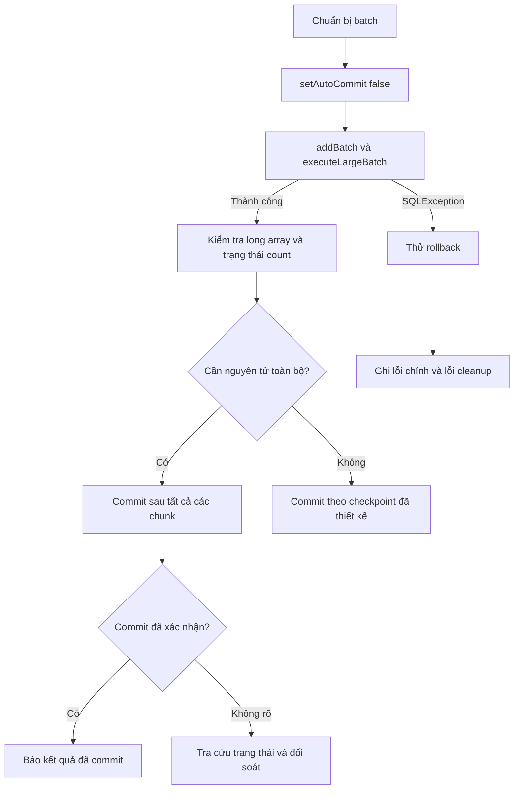

# Sử dụng số đếm lớn với các API batch tương ứng

Khi một ứng dụng Java dùng **JDBC** để cập nhật dữ liệu theo lô, hai đại lượng thường bị nhầm lẫn: **số lệnh được đưa vào batch** và **số hàng mà mỗi lệnh thực sự tác động**. Một batch chỉ có ba câu `UPDATE` vẫn có thể sửa hàng tỷ hàng nếu mỗi câu cập nhật một vùng dữ liệu lớn. Trong trường hợp đó, `int[]` của `executeBatch()` có thể không biểu diễn được số hàng thực tế của một câu lệnh. JDBC cung cấp các API **large update count** dùng `long` và `long[]` để tránh giới hạn biểu diễn của `int`.

Bài học thuộc chương **Xử lý theo lô** của module **JDBC**. Nội dung đi từ việc chọn đúng API `Statement`/`PreparedStatement`, đọc số đếm và mã trạng thái batch, xử lý `BatchUpdateException`, quản lý transaction qua `DataSource` và `Connection`, đến chia batch, hiệu năng, khả năng tương thích driver và kiểm thử. Mục tiêu là **không để mất hoặc hiểu sai số đếm lớn**, đồng thời vẫn thực hiện CRUD và xử lý lỗi theo các API JDBC chuẩn.

## 1. "Large" nói đến số hàng bị tác động, không phải kích thước batch

Giả sử chạy hai câu lệnh:

```sql
UPDATE audit_events SET archived = TRUE
WHERE created_at < DATE '2024-01-01' AND archived = FALSE;

UPDATE audit_events SET archived = TRUE
WHERE created_at >= DATE '2024-01-01'
  AND created_at < DATE '2025-01-01'
  AND archived = FALSE;
```

Nếu câu thứ nhất tác động 2.500.000.000 hàng và câu thứ hai 1.200.000.000 hàng, kết quả mong muốn là:

```text
batch có 2 câu lệnh:
counts[0] = 2_500_000_000L
counts[1] = 1_200_000_000L
tổng số hàng được báo cáo = 3_700_000_000L
```

`Integer.MAX_VALUE` chỉ bằng `2_147_483_647`. Vì vậy một **giá trị đếm của một câu lệnh** có thể vượt phạm vi `int` dù số phần tử trong batch rất nhỏ.

Ngược lại, một batch có 10.000 câu `INSERT` mà mỗi câu chèn một hàng thì các giá trị đếm riêng lẻ thường rất nhỏ; riêng tổng của nhiều batch có thể lớn dần theo thời gian. Sử dụng `long` để cộng dồn giúp tránh tràn số, nhưng `executeLargeBatch()` **không tự làm batch chạy nhanh hơn, không cấp thêm bộ nhớ, không thay đổi giới hạn kích thước mảng Java** và cũng không bảo đảm driver/DB hỗ trợ cập nhật hàng tỷ hàng.

Phân biệt:

| Đại lượng | Ví dụ | Kiểu nên dùng |
| --- | --- | --- |
| Số câu SQL đưa vào **một** batch | 500 lệnh | `int` cho chỉ số mảng/chunk |
| Số hàng bị tác động bởi **một** lệnh | 2.500.000.000 hàng | `long` |
| Kết quả của toàn bộ batch | Một số đếm cho mỗi lệnh | `long[]` |
| Tổng số hàng có số đếm **đã biết** qua nhiều batch | 3.700.000.000 hàng | `long` hoặc `BigInteger` nếu miền giá trị thực sự vượt `long` |
| Số hàng chưa biết vì driver báo `SUCCESS_NO_INFO` | Một số lệnh đã chạy nhưng không rõ số hàng | Theo dõi riêng, không cộng `-2` vào tổng |

## 2. Các API số đếm lớn tương ứng trong JDBC

Các phương thức đếm lớn nằm trong JDBC 4.2 và API Java hiện đại. So sánh các cặp:

| Tình huống | API đếm `int` | API đếm `long` | Kết quả |
| --- | --- | --- | --- |
| Thực thi một câu DML từ `Statement` | `Statement.executeUpdate(sql)` | `Statement.executeLargeUpdate(sql)` | `int` / `long` |
| Thực thi một câu DML tham số hóa | `PreparedStatement.executeUpdate()` | `PreparedStatement.executeLargeUpdate()` | `int` / `long` |
| Thực thi nhiều lệnh đã `addBatch()` | `Statement.executeBatch()` | `Statement.executeLargeBatch()` | `int[]` / `long[]` |
| Batch của `PreparedStatement` | `ps.executeBatch()` | `ps.executeLargeBatch()` | `int[]` / `long[]` |
| Đọc update count của kết quả hiện tại | `Statement.getUpdateCount()` | `Statement.getLargeUpdateCount()` | `int` / `long` |
| Đọc update counts từ lỗi batch | `BatchUpdateException.getUpdateCounts()` | `BatchUpdateException.getLargeUpdateCounts()` | `int[]` / `long[]` |

`PreparedStatement` kế thừa `Statement`, nên sử dụng trực tiếp `ps.executeLargeBatch()` sau khi gọi `ps.addBatch()` cho từng bộ tham số. Với `PreparedStatement.executeLargeUpdate()` **không truyền lại chuỗi SQL**: câu SQL đã được cung cấp khi tạo statement.

### Một lần cập nhật lớn

```java
import java.sql.Connection;
import java.sql.PreparedStatement;
import java.sql.SQLException;
import java.time.LocalDate;
import javax.sql.DataSource;

public static long archiveBefore(
        DataSource dataSource, LocalDate limit) throws SQLException {
    String sql = """
        UPDATE audit_events SET archived = TRUE
        WHERE created_at < ? AND archived = FALSE
        """;

    try (Connection con = dataSource.getConnection();
         PreparedStatement ps = con.prepareStatement(sql)) {
        ps.setObject(1, limit); // DATE, với driver hỗ trợ JDBC 4.2.
        return ps.executeLargeUpdate(); // Một long: số hàng tác động.
    }
}
```

Phương thức minh họa đặt trong một lớp Java, với schema có cột `created_at` kiểu `DATE` phù hợp ví dụ. Nếu `created_at` là `TIMESTAMP`, cần thiết kế biên thời gian và kiểu tham số tương ứng. Khi `autoCommit=true`, câu `UPDATE` đơn hoạt động theo hành vi giao dịch mặc định của kết nối; với nhiều lệnh liên quan nhau, phải chủ động quản lý transaction.

Ngoài `PreparedStatement`, `Statement.executeLargeUpdate("UPDATE ...")` phục vụ SQL tĩnh. Với dữ liệu người dùng, **ưu tiên `PreparedStatement` và các tham số `?`**, không ghép giá trị trực tiếp vào chuỗi SQL.

## 3. Đọc `long[]`: số đếm thực và hai mã đặc biệt

`executeLargeBatch()` trả về một `long[]` chứa kết quả cho các lệnh trong batch, theo thứ tự chúng được thêm vào. Giá trị không phải lúc nào cũng là số hàng cụ thể:

| Giá trị | Hằng JDBC | Ý nghĩa |
| --- | --- | --- |
| `0L`, `1L`, `2L`, ... | Không | Số hàng bị tác động **đã biết** cho lệnh tương ứng |
| `-2L` | `Statement.SUCCESS_NO_INFO` | Lệnh đã thực thi thành công nhưng driver **không cung cấp số hàng** |
| `-3L` | `Statement.EXECUTE_FAILED` | Lệnh đã thất bại; thường xuất hiện trong các update counts của `BatchUpdateException` khi driver tiếp tục batch sau lỗi |

Các hằng `Statement.SUCCESS_NO_INFO` và `Statement.EXECUTE_FAILED` có kiểu `int`, nhưng vẫn có thể **so sánh trực tiếp** với phần tử `long` của mảng kết quả.

```java
long[] counts = ps.executeLargeBatch();
for (int i = 0; i < counts.length; i++) {
    long count = counts[i];
    if (count >= 0) {
        System.out.println("Lệnh " + i + " ảnh hưởng " + count + " hàng");
    } else if (count == Statement.SUCCESS_NO_INFO) {
        System.out.println("Lệnh " + i + " thành công, chưa rõ số hàng");
    } else if (count == Statement.EXECUTE_FAILED) {
        System.out.println("Lệnh " + i + " thất bại");
    } else {
        throw new SQLException("Update count không hợp lệ: " + count);
    }
}
```

Đoạn mã nằm trong phương thức có `throws SQLException`, với `ps` và các import `java.sql.Statement`, `java.sql.SQLException` phù hợp. `executeLargeBatch()` thường **ném `BatchUpdateException` nếu có một lệnh thất bại**, nên khi đó cần xem `getLargeUpdateCounts()` trên ngoại lệ thay vì coi mảng thành công là đã được trả về.

**Không cộng thẳng mọi phần tử** trong `counts`: nếu `-2` là “thành công nhưng chưa biết”, cộng nó vào tổng sẽ làm tổng bị sai. Cũng không đổi `SUCCESS_NO_INFO` thành `1` chỉ vì bạn kỳ vọng lệnh `INSERT` thêm một hàng. Nếu cần xác minh mỗi lệnh tác động đúng một hàng, phải thiết kế cách kiểm tra phù hợp khi driver chỉ trả `SUCCESS_NO_INFO`.

## 4. Thiết kế dữ liệu minh họa và giới hạn của phép đếm

Ta cần cập nhật số lượng tồn kho của nhiều sản phẩm. Schema PostgreSQL minh họa:

```sql
CREATE TABLE products (
    id BIGINT PRIMARY KEY,
    quantity BIGINT NOT NULL CHECK (quantity >= 0)
);
```

Mỗi phần tử batch chạy cùng một câu SQL với bộ tham số khác nhau:

```sql
UPDATE products SET quantity = quantity + ? WHERE id = ?;
```

Mỗi lần cập nhật một `id` thường có update count bằng `1` nếu tìm thấy hàng và bằng `0` nếu không tìm thấy; tuy nhiên giá trị vẫn có thể là `SUCCESS_NO_INFO` nếu driver không báo số cụ thể. Để minh họa API lớn, ví dụ này **giữ `long[]` xuyên suốt** dù số hàng của từng lệnh nhỏ. Khác với trường hợp `UPDATE` trên hàng tỷ bản ghi, ở đây lợi ích chính là dùng một kiểu API thống nhất và cộng tổng an toàn.

Lưu ý thêm:

- `quantity BIGINT` có giới hạn của `BIGINT` trong DB; thay đổi bằng `quantity + ?` có thể tràn số hoặc vi phạm `CHECK`. Khi đó cả transaction cần được xử lý đúng.
- Nếu yêu cầu nghiệp vụ là “mọi `id` phải tồn tại”, chỉ nhìn tổng các update counts không đủ để chỉ ra chính xác id thiếu khi một phần tử có `SUCCESS_NO_INFO`. Cần một chính sách kiểm chứng khác hoặc một API trả về thông tin hàng bị cập nhật phù hợp với DB.
- Không nhầm **số hàng được driver báo là bị ảnh hưởng** với giá trị tăng/giảm của cột `quantity`. Cập nhật `quantity + 5` cho một hàng vẫn thường có update count là `1`, không phải `5`.

## 5. Ví dụ đầy đủ: `PreparedStatement.executeLargeBatch()` theo chunk

Ví dụ sau có thể đặt trong một file Java 17+. Nó dùng `DataSource` lấy `Connection`, mở transaction, dùng `PreparedStatement`, chia dữ liệu thành các chunk, thu thập số đếm `long` và đóng tài nguyên bằng `try-with-resources`.

```java
import java.sql.Connection;
import java.sql.PreparedStatement;
import java.sql.SQLException;
import java.sql.Statement;
import java.util.Objects;
import javax.sql.DataSource;

public final class InventoryBatchWriter {
    private InventoryBatchWriter() {}

    public record QuantityChange(long productId, long delta) {}

    public record BatchReport(
            long commandsSubmitted,
            long knownAffectedRows,
            long unknownCountCommands) {

        public boolean exactAffectedRowsKnown() {
            return unknownCountCommands == 0;
        }
    }

    private record ChunkCounts(long knownRows, long unknownCommands) {}

    private static ChunkCounts inspect(long[] counts, int expected)
            throws SQLException {
        if (counts == null || counts.length != expected) {
            throw new SQLException("Driver trả số update counts không đúng");
        }

        long knownRows = 0L;
        long unknown = 0L;
        for (long count : counts) {
            if (count >= 0L) {
                knownRows = Math.addExact(knownRows, count);
            } else if (count == Statement.SUCCESS_NO_INFO) {
                unknown = Math.addExact(unknown, 1L);
            } else if (count == Statement.EXECUTE_FAILED) {
                throw new SQLException(
                        "Batch có lệnh EXECUTE_FAILED trong kết quả");
            } else {
                throw new SQLException("Update count không hợp lệ: " + count);
            }
        }
        return new ChunkCounts(knownRows, unknown);
    }

    public static BatchReport applyChanges(
            DataSource source,
            Iterable<QuantityChange> changes,
            int chunkSize) throws SQLException {

        Objects.requireNonNull(source, "source");
        Objects.requireNonNull(changes, "changes");
        if (chunkSize <= 0) {
            throw new IllegalArgumentException("chunkSize phải lớn hơn 0");
        }

        String sql = "UPDATE products SET quantity = quantity + ? "
                   + "WHERE id = ?";

        try (Connection con = source.getConnection()) {
            boolean originalAutoCommit = con.getAutoCommit();
            boolean transactionStarted = false;
            boolean transactionEnded = false;
            Throwable primaryFailure = null;

            try {
                con.setAutoCommit(false);
                transactionStarted = true;

                long submitted = 0L;
                long known = 0L;
                long unknown = 0L;

                try (PreparedStatement ps = con.prepareStatement(sql)) {
                    int pending = 0;
                    for (QuantityChange change : changes) {
                        Objects.requireNonNull(change, "change");
                        ps.setLong(1, change.delta());
                        ps.setLong(2, change.productId());
                        ps.addBatch();
                        pending++;

                        if (pending == chunkSize) {
                            ChunkCounts result =
                                    inspect(ps.executeLargeBatch(), pending);
                            submitted = Math.addExact(submitted, pending);
                            known = Math.addExact(known, result.knownRows());
                            unknown = Math.addExact(
                                    unknown, result.unknownCommands());
                            pending = 0;
                        }
                    }

                    if (pending > 0) {
                        ChunkCounts result =
                                inspect(ps.executeLargeBatch(), pending);
                        submitted = Math.addExact(submitted, pending);
                        known = Math.addExact(known, result.knownRows());
                        unknown = Math.addExact(
                                unknown, result.unknownCommands());
                    }
                }

                con.commit();
                transactionEnded = true;
                return new BatchReport(submitted, known, unknown);

            } catch (SQLException | RuntimeException | Error failure) {
                primaryFailure = failure;
                if (transactionStarted) {
                    try {
                        con.rollback();
                        transactionEnded = true;
                    } catch (SQLException | RuntimeException | Error rollbackError) {
                        if (rollbackError != failure) {
                            failure.addSuppressed(rollbackError);
                        }
                    }
                }
                throw failure;

            } finally {
                if (transactionStarted && transactionEnded) {
                    try {
                        con.setAutoCommit(originalAutoCommit);
                    } catch (SQLException | RuntimeException | Error resetError) {
                        if (primaryFailure != null) {
                            if (resetError != primaryFailure) {
                                primaryFailure.addSuppressed(resetError);
                            }
                        } else {
                            throw resetError;
                        }
                    }
                }
            }
        }
    }
}
```

Cách sử dụng:

```java
var changes = java.util.List.of(
        new InventoryBatchWriter.QuantityChange(101L, 5L),
        new InventoryBatchWriter.QuantityChange(102L, -2L),
        new InventoryBatchWriter.QuantityChange(103L, 7L));

InventoryBatchWriter.BatchReport report =
        InventoryBatchWriter.applyChanges(dataSource, changes, 500);

System.out.println("Đã đưa vào batch: " + report.commandsSubmitted());
if (report.exactAffectedRowsKnown()) {
    System.out.println("Số hàng cập nhật: " + report.knownAffectedRows());
} else {
    System.out.println("Ít nhất " + report.knownAffectedRows()
            + " hàng có count xác định; "
            + report.unknownCountCommands()
            + " lệnh thành công nhưng không có count cụ thể");
}
```

Đoạn sử dụng giả định đã có một `DataSource dataSource` được cấu hình; với danh sách chỉ có ba phần tử, lệnh thực thi batch được gọi **một lần**. Trong ứng dụng thực tế, không nên dùng `println` cho báo cáo vận hành; có thể ghi metrics cấu trúc với nhãn phù hợp.

### Vì sao ví dụ không cộng `-2` vào tổng?

`knownAffectedRows` chỉ cộng các phần tử `>= 0`; `unknownCountCommands` đếm những lệnh thành công mà driver không cung cấp số hàng. Khi `unknownCountCommands > 0`, tổng số hàng thật **chưa được biết chính xác**, nên `knownAffectedRows` chỉ là tổng phần đã xác định, có thể coi là cận dưới nếu các số đếm đã biết phản ánh số hàng bị tác động theo hợp đồng driver.

`Math.addExact` làm lỗi tràn `long` trở nên tường minh: nó ném `ArithmeticException`, được nhánh `catch` rollback transaction. Nếu hệ thống cần cộng **hơn `Long.MAX_VALUE` hàng** trong các thống kê tích lũy lâu dài, nên dùng `BigInteger` cho phép cộng tổng; JDBC vẫn trả **mỗi** số đếm theo `long`.

### Vì sao toàn bộ các chunk ở chung một transaction?

Chia batch thành nhiều lần `executeLargeBatch()` chỉ chia lượt gửi/thi hành; **không tự tạo ranh giới commit**. Trong ví dụ, `setAutoCommit(false)` được gọi một lần và `commit()` sau tất cả các chunk. Nếu chunk thứ ba lỗi, nhánh `catch` thử rollback cả những thay đổi trước đó trong cùng transaction.

Đánh đổi là giao dịch rất lớn có thể giữ lock, undo/WAL và connection lâu. Với tác vụ khối lượng cực lớn, có thể **commit theo từng chunk** để giảm thời gian khóa, nhưng đó là **thay đổi hợp đồng atomicity**: một số chunk đã commit không thể rollback bởi lỗi chunk kế tiếp. Cần checkpoint/idempotency và cơ chế tiếp tục hoặc đối soát.

Mẫu quản lý transaction cũng phân biệt lỗi từ `commit()`, `rollback()`, khôi phục `autoCommit` và `close()`: các lỗi dọn dẹp được giữ dưới dạng `suppressed` nếu đã có lỗi chính. Nếu `rollback()` thất bại, mã tránh đổi `autoCommit` về `true` trên transaction có thể còn dang dở; với connection pool cần bảo đảm connection không an toàn được loại bỏ. Nếu `commit()` mất phản hồi, **kết quả commit có thể không xác định** dù sau đó thử rollback.

## 6. Khi nào dùng `executeLargeUpdate()` thay vì batch?

Batch phù hợp khi có **nhiều bộ tham số hoặc nhiều câu DML**. Nếu chỉ có một câu `UPDATE` tác động lượng dữ liệu lớn, dùng `executeLargeUpdate()` đơn giản hơn:

```java
String sql = "DELETE FROM audit_events WHERE id < ?";
try (Connection con = dataSource.getConnection();
     PreparedStatement ps = con.prepareStatement(sql)) {
    ps.setLong(1, threshold);
    long deleted = ps.executeLargeUpdate();
    // deleted có thể lớn hơn Integer.MAX_VALUE.
}
```

Nếu cần gom vài câu SQL **tĩnh**, `Statement` cũng có API tương ứng:

```java
try (Connection con = dataSource.getConnection();
     Statement st = con.createStatement()) {
    st.addBatch("UPDATE audit_events SET archived = TRUE "
            + "WHERE archive_bucket = 1");
    st.addBatch("UPDATE audit_events SET archived = TRUE "
            + "WHERE archive_bucket = 2");

    long[] affectedPerStatement = st.executeLargeBatch();
    // Phải kiểm tra SUCCESS_NO_INFO và lỗi, giống PreparedStatement.
}
```

Các đoạn ngắn trên minh họa **cách gọi API** và giả định schema tương ứng; để dùng trong tác vụ thay đổi nhiều bảng, cần thiết kế transaction và xử lý lỗi như mục 5. Không ghép `threshold` hoặc dữ liệu người dùng vào chuỗi SQL của `Statement`; dùng `PreparedStatement` với `?` khi có tham số.

`getLargeUpdateCount()` có ích khi xử lý API `Statement.execute()` với nhiều loại kết quả; giá trị `-1` có thể biểu thị kết quả hiện tại là `ResultSet` hoặc không còn update count, theo luồng `execute()`/`getMoreResults()`. **Không** nhầm `-1` của API này với `-2`/`-3` trong mảng kết quả batch.

## 7. `BatchUpdateException`: phải đọc `getLargeUpdateCounts()`

Khi một lệnh trong batch thất bại, JDBC có thể ném `BatchUpdateException`. Ngoại lệ này cung cấp SQLState, vendor error code, nguyên nhân/chuỗi lỗi SQL và thông tin kết quả batch đã thực hiện:

```java
import java.sql.BatchUpdateException;
import java.sql.SQLException;
import java.sql.Statement;

public static void inspectFailure(BatchUpdateException error) {
    System.err.println("SQLState: " + error.getSQLState());
    System.err.println("Vendor code: " + error.getErrorCode());

    long[] counts = error.getLargeUpdateCounts();
    if (counts == null) {
        System.err.println("Driver không cung cấp update counts");
    } else {
        for (int i = 0; i < counts.length; i++) {
            long value = counts[i];
            if (value >= 0L) {
                System.err.println(i + ": " + value + " hàng đã báo cáo");
            } else if (value == Statement.SUCCESS_NO_INFO) {
                System.err.println(i + ": thành công, không rõ count");
            } else if (value == Statement.EXECUTE_FAILED) {
                System.err.println(i + ": thực thi thất bại");
            }
        }
    }

    for (SQLException next = error.getNextException();
         next != null; next = next.getNextException()) {
        System.err.println("Lỗi SQL bổ sung: " + next.getSQLState());
    }
}
```

Lúc thực thi:

```java
try {
    long[] counts = ps.executeLargeBatch();
    // Xử lý kết quả thành công.
} catch (BatchUpdateException batchError) {
    inspectFailure(batchError);
    throw batchError; // Để tầng transaction rollback hoặc xử lý phù hợp.
}
```

**Điểm khác giữa `getUpdateCounts()` và `getLargeUpdateCounts()`:** với API đếm lớn, phải ưu tiên **`long[]`** của `getLargeUpdateCounts()`. Không đọc `getUpdateCounts()` rồi ép sang `long[]` với kỳ vọng khôi phục số hàng vượt `int`: nếu thông tin đã bị mất/tràn ở nguồn kiểu `int`, phép ép kiểu không cứu được.

Tùy driver, nếu gặp lỗi ở một lệnh:

- **Dừng tại lỗi đầu tiên:** mảng đếm thường chỉ gồm các câu đã hoàn thành trước khi lỗi, nên có thể ngắn hơn số phần tử đã `addBatch()`.
- **Tiếp tục sau lỗi:** mảng có thể có một phần tử cho mỗi câu lệnh, với `Statement.EXECUTE_FAILED` tại câu thất bại.
- **Tối ưu/rewrite batch:** driver có thể trả `SUCCESS_NO_INFO` cho các lệnh thành công và không cung cấp chi tiết hàng theo cách mong đợi.

Vì vậy không mặc định `counts.length` của ngoại lệ bằng kích thước batch, hoặc lấy chỉ số cuối trong `counts` làm chứng cứ tuyệt đối về lệnh cuối cùng đã chạy. Hãy dùng tài liệu driver/DB và kiểm thử tích hợp để hiểu chính xác dạng kết quả.

Nếu transaction rollback thành công, các update counts mô tả **việc thực thi trước rollback**, **không phải số hàng còn được commit**. Không dùng các count đó để cập nhật báo cáo thành công hoặc thanh toán như thể dữ liệu đã được xác nhận.

## 8. Transaction, rollback và kết quả commit chưa chắc chắn

Một batch có thể thay đổi hàng triệu hàng. Do đó ngoài số đếm lớn, chính sách xử lý lỗi giao dịch rất quan trọng:



Các nguyên tắc:

1. Khi `autoCommit=true`, nhiều câu SQL có thể được xác nhận độc lập; đừng coi `executeLargeBatch()` tự biến chúng thành một transaction nguyên tử.
2. Nếu muốn **tất cả cùng thành công hoặc cùng rollback**, tắt `autoCommit` trên connection đang chạy batch, thực hiện toàn bộ thao tác và `commit()` ở cuối.
3. Với `BatchUpdateException` hoặc lỗi chuyển đổi/kiểm tra kết quả, rollback toàn bộ transaction theo hợp đồng. Đọc counts để chẩn đoán, **không nhầm** chúng với các thay đổi đã commit.
4. Lỗi `rollback()` cần được gắn vào ngoại lệ ban đầu (ví dụ `addSuppressed()`), không được làm mất SQLState/stack trace ban đầu.
5. Lỗi mất kết nối hoặc timeout trong `commit()` có thể xảy ra **sau khi DB đã commit**. Không mặc định retry batch ghi; dùng `request_id`, khóa chống trùng, checkpoint và tra cứu trạng thái trước khi chạy lại.
6. Nếu transaction đã rollback hoặc connection hỏng, không sử dụng lại `PreparedStatement`/batch cũ. Tạo đơn vị công việc mới với trạng thái rõ ràng.

Ngay cả khi một batch trả đủ các update counts, điều đó **không** cho biết `commit()` có thành công hay không. Số đếm là dữ liệu về thực thi DML; tính bền vững cuối cùng phụ thuộc ranh giới transaction.

## 9. Tương thích phiên bản JDBC, JDK và driver

Các API `executeLargeBatch()`, `executeLargeUpdate()`, `getLargeUpdateCount()` và `getLargeUpdateCounts()` được đưa vào JDBC 4.2, có mặt trong Java hiện đại. Tuy nhiên, **có method trong interface không đủ để kết luận driver thực sự hỗ trợ số đếm lớn**:

- Một driver cũ có thể chưa hỗ trợ đầy đủ, trả `SQLFeatureNotSupportedException` hoặc có triển khai không phản ánh chính xác số đếm vượt `int`.
- Một số triển khai có thể dùng đường thực thi cũ rồi chuyển count sang `long`; phép chuyển từ một count vốn bị giới hạn bởi `int` **không khôi phục được giá trị đúng**.
- DB có thể áp đặt giới hạn riêng hoặc driver có hành vi khác nhau cho statement thường, prepared statement, procedure và batch được rewrite.
- Kiểu SQL, schema, phiên bản server, cài đặt driver và cấu hình batch có thể ảnh hưởng update counts thực tế.

**Quy tắc di trú:** nếu bắt buộc báo chính xác số hàng trên `Integer.MAX_VALUE`, phải xác minh trên **DB + driver + kiểu lệnh thực tế**, thay vì chỉ kiểm tra mã Java biên dịch. Có thể kiểm thử bằng một môi trường dữ liệu lớn có kiểm soát, hoặc bằng cơ chế giả lập/test double cho lớp cộng dồn kết hợp với một kiểm thử tích hợp xác nhận driver trả đúng `long` ở các trường hợp đại diện. Unit test với `long[]` lớn kiểm tra code ứng dụng, **không** chứng minh driver có khả năng đếm hơn hai tỷ hàng.

Nếu driver không hỗ trợ large counts mà nghiệp vụ **chỉ** cần số hàng nhỏ hơn `int`, có thể cân nhắc `executeBatch()` sau khi làm rõ giới hạn và ghi lại mức bảo đảm; nếu cần số đếm lớn chính xác, phải nâng cấp driver/DB hoặc đổi cách truy vấn/thống kê. Không im lặng fallback sang `int[]`.

## 10. Chia batch và điều chỉnh hiệu năng

`executeLargeBatch()` giải quyết **miền biểu diễn của số đếm**, còn hiệu năng batch vẫn phụ thuộc số lượt round-trip, số tham số, bộ nhớ, transaction log, index, lock và driver.

| Quyết định | Lợi ích | Rủi ro khi chọn sai |
| --- | --- | --- |
| Chia thành chunk vài trăm hoặc vài nghìn câu lệnh | Giới hạn bộ nhớ và kích thước request | Chunk quá nhỏ gây nhiều round-trip; quá lớn gây áp lực bộ nhớ |
| Dùng một `PreparedStatement` với `addBatch()` | Tái dùng SQL đã chuẩn bị, tránh nối SQL | Phải bind **tất cả tham số mỗi hàng** |
| Commit toàn bộ công việc sau mọi chunk | Bảo đảm atomicity cho toàn công việc trên cùng DB | Transaction kéo dài, lock và WAL/undo lớn |
| Commit theo chunk có checkpoint | Giảm phạm vi rollback, dễ tiếp tục | Không còn all-or-nothing; cần idempotency và đối soát |
| Thực thi nhiều worker song song | Có thể tăng throughput | Deadlock, contention, thứ tự, tải DB và batch trùng |
| Theo dõi `knownAffectedRows` và unknown riêng | Không báo sai tổng | Cần cách xác minh khi nghiệp vụ bắt buộc số đếm chính xác |

Không có một `chunkSize` tối ưu cho mọi hệ thống. Bắt đầu từ giá trị tương đối nhỏ phù hợp workload (ví dụ vài trăm lệnh), đo throughput, thời gian transaction, tải DB, lock wait, memory và tỷ lệ lỗi rồi điều chỉnh. Không tăng batch size chỉ vì dùng chữ `Large` trong API.

Nếu dùng connection pool, lưu ý một transaction kéo dài giữ một connection độc quyền lâu hơn và làm tăng thời gian chờ của các request khác. Với dữ liệu rất lớn, cân nhắc thao tác theo phân vùng/miền khóa, checkpoint và lịch chạy nền phù hợp với yêu cầu nhất quán.

## 11. Số đếm không phải là bằng chứng đầy đủ về kết quả nghiệp vụ

Các trường hợp dễ hiểu sai:

- **Một lệnh có count = `0`**: có thể không có bản ghi khớp `WHERE`, hoặc phụ thuộc quy tắc DB/driver về số hàng thực sự được báo cáo. Không suy ra “SQL lỗi”.
- **`SUCCESS_NO_INFO`**: lệnh đã thành công theo báo cáo driver nhưng không biết số hàng; không được gán thành 0 hoặc 1 tùy tiện.
- **Một lệnh cập nhật một hàng hai lần trong một transaction**: tổng các update counts có thể tính **hai lượt tác động**, không phải số hàng duy nhất bị thay đổi.
- **`UPDATE products SET quantity = quantity + 100`**: count là số **hàng**, không phải tổng lượng hàng tồn kho cộng thêm.
- **Trigger, stored procedure và lệnh được rewrite**: khả năng driver báo count có thể phụ thuộc DB/driver và loại statement; không mặc định count là số thực thể nghiệp vụ sinh ra.
- **`INSERT` và generated keys**: một API lớn cho update counts không tự thay đổi kiểu của khóa sinh ra; nếu cần khóa tự tăng, dùng cơ chế generated keys phù hợp và kiểm thử driver.
- **`SELECT COUNT(*)`**: đây là phép tổng hợp SQL có thể được đọc qua `ResultSet.getLong()` (hoặc kiểu khác tương ứng), **không phải** kết quả của `executeLargeBatch()`.
- **Update count và transaction commit**: count có thể được trả về trước khi transaction bị rollback; không thể dùng count để khẳng định bền vững.

Khi phải xác minh dữ liệu sau import hoặc migration, nên kết hợp update counts, khóa định danh, ràng buộc SQL và các truy vấn đối chiếu trong DB thay vì dựa duy nhất vào một tổng cộng.

## 12. Tích hợp số đếm lớn vào logging và quan sát

Thay vì chỉ log `batch completed = 500`, một tác vụ nền nên thu thập:

| Metric | Ý nghĩa |
| --- | --- |
| `batch_commands_submitted` | Tổng số bộ tham số được thêm vào các lần chạy |
| `batch_chunks_executed` | Số lần gọi `executeLargeBatch()` |
| `batch_known_affected_rows` | Tổng **các count không âm** được driver trả về |
| `batch_unknown_count_commands` | Số phần tử có `SUCCESS_NO_INFO` |
| `batch_failed_commands` | Số lệnh được báo `EXECUTE_FAILED` khi có thông tin |
| `batch_duration_ms` | Thời gian chạy batch và/hoặc commit |
| `batch_retries` | Lần thử lại, có khóa công việc ổn định |
| `batch_transaction_outcome` | Committed/rolled back/unknown theo trạng thái thực sự đã xác định |

Không ghi raw SQL có dữ liệu cá nhân, connection string chứa mật khẩu hoặc toàn bộ tham số vào log. Khi có `BatchUpdateException`, giữ SQLState, vendor code, chuỗi `getNextException()`, cause và suppressed (lỗi rollback/close) để truy vết, nhưng nên ghi tóm tắt counts thay vì tràn log bằng hàng triệu phần tử.

Đặc biệt, không báo `batch_known_affected_rows` là tổng chính xác nếu `batch_unknown_count_commands > 0`; giao diện báo cáo cần thể hiện tình trạng thiếu thông tin.

## 13. Những phản mẫu nên tránh

| Phản mẫu | Sai ở đâu | Cách làm tốt hơn |
| --- | --- | --- |
| `long[] counts = (long[]) ps.executeBatch()` | Không thể ép `int[]` thành `long[]`; sẽ `ClassCastException` | Gọi `ps.executeLargeBatch()` |
| Đổi từng `int` thành `long` rồi coi count > 2 tỷ là đúng | Thông tin có thể đã tràn ở driver/API cũ | Dùng large API ngay từ nguồn; kiểm chứng driver |
| Cộng `SUCCESS_NO_INFO` như `-2` | Tổng sai | Ghi nhận unknown riêng |
| Coi `EXECUTE_FAILED` như `0` | Che lỗi | Xử lý `BatchUpdateException`, transaction và trạng thái thất bại |
| Giả định `getLargeUpdateCounts().length == batchSize` khi lỗi | Driver có thể dừng tại lỗi đầu | Kiểm tra dữ liệu lỗi theo semantics driver |
| Coi `executeLargeBatch()` là một transaction | Batch không tự tạo all-or-nothing | Quản lý `autoCommit`/`commit`/`rollback` |
| Retry batch ngay sau `commit()` timeout | Có thể ghi dữ liệu trùng | Dùng idempotency key, checkpoint và đối soát |
| Đặt chunk size = vài triệu vì muốn count lớn | Tăng memory, lock, latency | Chia chunk phù hợp với tải và nhu cầu |
| Chỉ kiểm thử count nhỏ 0/1 | Không phát hiện cộng tràn, xử lý `-2`/`-3` | Test count vượt `int`, unknown, failed, overflow |
| Nhầm count với số thực thể duy nhất | Một hàng có thể bị tác động nhiều lần | Định nghĩa rõ metric theo lệnh và kết quả nghiệp vụ |

## 14. Kiểm thử API số đếm lớn

Kiểm thử nên có hai lớp: **unit test** cho logic đếm và **integration test** với DB/driver thật để xác nhận khả năng trả large counts và hành vi giao dịch.

### 14.1. Unit test với mảng có giá trị lớn

```java
import java.sql.Statement;

long[] counts = {
        2_500_000_000L,
        Statement.SUCCESS_NO_INFO,
        1_200_000_000L
};

long known = 0L;
int unknown = 0;
for (long count : counts) {
    if (count >= 0L) known = Math.addExact(known, count);
    else if (count == Statement.SUCCESS_NO_INFO) unknown++;
}

assert known == 3_700_000_000L;
assert unknown == 1;
```

`assert` chỉ có tác dụng khi bật `-ea`; với test thực tế, dùng assertion của framework. Đoạn code cho thấy hai số đếm đơn lẻ lớn hơn/tiệm cận phạm vi `int` có thể được cộng bằng `long` trong khi phần tử `SUCCESS_NO_INFO` phải được ghi nhận riêng.

### 14.2. Ma trận integration test

| Tình huống | Điều cần xác minh |
| --- | --- |
| Batch thành công, mọi count xác định | Mảng `long[]` đúng số phần tử/thứ tự, số đếm đúng sau commit |
| Driver trả `SUCCESS_NO_INFO` | Logic không báo tổng chính xác sai |
| Một lệnh thất bại và driver dừng | `BatchUpdateException.getLargeUpdateCounts()` có thể ngắn; transaction được rollback |
| Driver tiếp tục sau lệnh thất bại | Có `EXECUTE_FAILED` đúng vị trí theo driver; rollback đúng |
| Đầu vào null hoặc vi phạm `CHECK` | `SQLException` được giữ lại; không commit một phần khi cần atomicity |
| Transaction có nhiều chunk | Lỗi ở chunk sau rollback cả các chunk trước nếu chung transaction |
| Commit theo chunk | Có checkpoint để biết chunk nào đã commit và retry không lặp nghiệp vụ |
| Connection mất khi commit | Kết quả chưa chắc chắn; dùng khóa công việc/đối soát |
| Driver không hỗ trợ large API | Ứng dụng báo giới hạn rõ ràng hoặc sử dụng đường đi thay thế đã được phê duyệt |
| Count vượt `Integer.MAX_VALUE` | Kiểm chứng `long` thật trên workload và DB đủ lớn nếu đây là yêu cầu bắt buộc |

Nên thực hiện test với bản driver, DB, cấu hình batch rewrite và transaction isolation giống môi trường dự kiến. Việc tạo hơn hai tỷ hàng chỉ để test có thể quá tốn kém; tối thiểu unit test phải xác nhận số học `long`, và nếu sản phẩm cam kết hỗ trợ count khổng lồ thì cần bằng chứng tích hợp phù hợp với hạ tầng hoặc nhà cung cấp. Không mô tả một test `long[]` giả lập như bằng chứng driver có thể trả count thực trên hai tỷ.

## 15. Bài tập vận dụng

**Bài 1 — Chọn API:** Một tác vụ chạy ba câu `UPDATE`, mỗi câu có thể ảnh hưởng tới ba tỷ hàng. Chọn `Statement.executeBatch()` hay `Statement.executeLargeBatch()`? Giải thích kiểu kết quả và vì sao số lượng câu lệnh nhỏ không đủ để kết luận dùng `int[]` được.

**Bài 2 — Cộng counts:** Cho mảng `[2_400_000_000L, -2L, 0L, 15L]`. Hãy tính tổng các hàng có count xác định, số lệnh thành công nhưng count chưa biết và cách hiển thị báo cáo để không khẳng định sai rằng tổng cuối đã đầy đủ.

**Bài 3 — Lỗi giữa batch:** Với 5 lệnh, driver dừng ở lệnh thứ 3 và ném `BatchUpdateException`. Mô tả cách đọc `getLargeUpdateCounts()`, xử lý rollback và vì sao không được tin rằng các lệnh đầu đã commit.

**Bài 4 — Di trú mã:** Đổi một chức năng `PreparedStatement.executeBatch()` trả `int[]` sang API large. Liệt kê những thay đổi cần thiết ở biến, kiểu trả về, tổng cộng, logging, xử lý `BatchUpdateException`, test và kiểm tra driver.

**Bài 5 — Chia chunk:** Tác vụ nhập 200.000 bản ghi được chia thành chunk 500 lệnh. Nếu yêu cầu atomicity toàn bộ, nên đặt `commit()` ở đâu? Nếu commit mỗi chunk, thiết kế checkpoint và idempotency thế nào để tiếp tục sau lỗi ở chunk thứ 250?

Gợi ý: Đếm large không thay thế transaction; đếm unknown riêng; giữ ngoại lệ gốc khi rollback lỗi; với kết quả commit không xác định, kiểm tra bằng khóa công việc ổn định trước khi retry.

## 16. Checklist triển khai

1. Đã phân biệt số câu trong batch với số hàng bị tác động bởi từng câu?
2. Khi có khả năng update count vượt `Integer.MAX_VALUE`, đã dùng `executeLargeUpdate()` hoặc `executeLargeBatch()` tương ứng?
3. Giá trị trả về, DTO và phép cộng tổng dùng `long`/`long[]` xuyên suốt, không ép ngầm qua `int`?
4. Đã phân biệt count `>= 0`, `SUCCESS_NO_INFO` và `EXECUTE_FAILED`?
5. Với `BatchUpdateException`, đã ưu tiên `getLargeUpdateCounts()`, hiểu semantics stop/continue và kiểm tra SQLState/nextException?
6. `PreparedStatement` được bind **đầy đủ từng bộ tham số**, tránh để sót giá trị từ lượt trước?
7. Batch được chia chunk có kích thước kiểm soát; đã đo hiệu năng và áp lực DB/pool?
8. Ranh giới `commit`/`rollback` phản ánh đúng yêu cầu atomicity toàn bộ hay từng chunk?
9. Với lỗi commit mơ hồ hoặc retry, có khóa idempotency/checkpoint và đường đối soát?
10. Đã kiểm thử code cộng counts với giá trị lớn và kiểm chứng khả năng hỗ trợ trên DB/driver thực tế?

Trong **JDBC**, API large batch không phải một chế độ “batch cực lớn”: nó là cách **giữ số hàng bị tác động bằng kiểu `long` ở từng bước**. Khi chọn đúng `executeLargeBatch()`, đọc `getLargeUpdateCounts()`, xử lý mã `SUCCESS_NO_INFO`/`EXECUTE_FAILED`, rồi kết hợp với transaction và kiểm thử driver, ứng dụng có thể báo cáo kết quả cập nhật theo lô chính xác trong phạm vi mà hệ quản trị và driver thực sự hỗ trợ.
