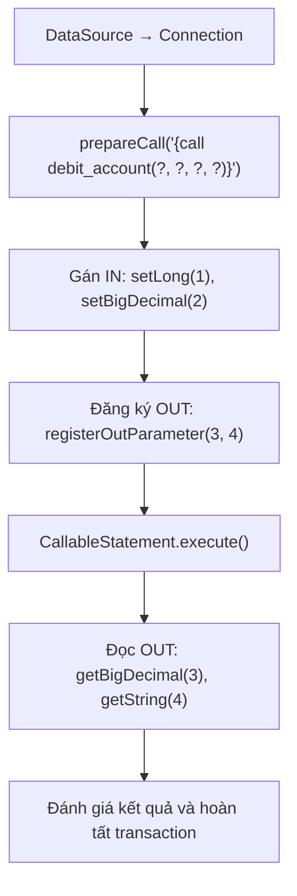

# Gán tham số IN và đăng ký tham số OUT

## 1. Vì sao thủ tục lưu trữ cần hai cách xử lý tham số?

Trong **JDBC**, ứng dụng Java có thể truy cập cơ sở dữ liệu quan hệ bằng `Connection`, gửi lệnh SQL với `PreparedStatement` và đọc dữ liệu từ `ResultSet`. Khi cơ sở dữ liệu cung cấp **stored procedure** (thủ tục lưu trữ), ứng dụng còn có thể gọi thủ tục thông qua `CallableStatement`.

Khác với một câu `SELECT` trả nhiều hàng, thủ tục có thể nhận dữ liệu đầu vào, thực hiện nhiều lệnh ở phía cơ sở dữ liệu và trả kết quả qua **tham số đầu ra**. Vì vậy, khi gọi thủ tục, ta phải phân biệt rõ:

- **IN:** ứng dụng **gán giá trị** trước khi gọi. Trong JDBC, dùng các phương thức `setLong()`, `setString()`, `setBigDecimal()`, `setNull()` hoặc `setObject()`.
- **OUT:** thủ tục **gán giá trị trả về**. Ứng dụng phải gọi `registerOutParameter()` với **kiểu JDBC tương ứng trước khi thực thi**, sau đó mới đọc bằng `getString()`, `getBigDecimal()`, `getLong()` hoặc phương thức getter phù hợp.
- **INOUT:** cùng một vị trí tham số vừa nhận giá trị vào, vừa trả giá trị ra. Ứng dụng phải thực hiện **cả hai việc**: gán bằng `setXxx()` và đăng ký bằng `registerOutParameter()`.

Ví dụ nghiệp vụ: một thủ tục trừ tiền trong tài khoản nhận **mã tài khoản và số tiền** (IN), trả về **số dư sau khi trừ** và **mã kết quả** (OUT). Ứng dụng cần đọc mã kết quả để biết trừ tiền thành công hay không mà không phải đoán từ giá trị đầu ra.

Sau bài này, bạn có thể tạo lời gọi `{call ...}`, gán các tham số IN theo đúng vị trí, đăng ký OUT theo kiểu `java.sql.Types`, xử lý `NULL`, đọc kết quả sau `execute()`, dùng INOUT và phân biệt tham số OUT với `ResultSet`. Bạn cũng sẽ biết những khác biệt cần kiểm tra giữa các hệ quản trị cơ sở dữ liệu.

## 2. Ba chế độ tham số và vòng đời một lời gọi

Giả sử thủ tục được khai báo với bốn tham số:

```sql
-- Chữ ký minh họa (cú pháp CREATE PROCEDURE tùy hệ quản trị):
debit_account(
    IN  p_account_id      BIGINT,
    IN  p_amount          DECIMAL(15,2),
    OUT p_balance_after   DECIMAL(15,2),
    OUT p_result_code     VARCHAR(24)
)
```

Các vị trí tham số trong JDBC bắt đầu từ **1**, không phải 0:

| Vị trí | Tên ở thủ tục | Chế độ | Kiểu SQL | Thao tác JDBC |
|---|---|---|---|---|
| 1 | `p_account_id` | IN | `BIGINT` | `setLong(1, accountId)` |
| 2 | `p_amount` | IN | `DECIMAL(15,2)` | `setBigDecimal(2, amount)` |
| 3 | `p_balance_after` | OUT | `DECIMAL(15,2)` | `registerOutParameter(3, Types.DECIMAL)`; sau khi gọi dùng `getBigDecimal(3)` |
| 4 | `p_result_code` | OUT | `VARCHAR(24)` | `registerOutParameter(4, Types.VARCHAR)`; sau khi gọi dùng `getString(4)` |

Quy trình thông thường:



Thứ tự gọi `setXxx()` và `registerOutParameter()` có thể thay đổi, miễn là đều thực hiện **trước `execute()`**. Điều quan trọng hơn là loại tham số, số thứ tự và kiểu SQL khai báo phải khớp chữ ký thủ tục.

`CallableStatement` là giao diện mở rộng của `PreparedStatement`, nên vẫn dùng tham số `?` thay cho nối chuỗi giá trị trực tiếp vào SQL. Việc tham số hóa **giá trị** không cho phép truyền tên thủ tục, tên bảng hoặc cấu trúc SQL tùy ý từ người dùng.

## 3. Tạo stored procedure minh họa trên MySQL

Để có ví dụ chạy được, phần này dùng **MySQL 8.0**. Cú pháp khai báo thủ tục ở PostgreSQL, SQL Server và Oracle khác nhau; phần Java sử dụng **JDBC chuẩn** và phải kiểm tra hỗ trợ của driver đang dùng.

Tạo bảng và dữ liệu thử nghiệm:

```sql
CREATE TABLE bank_accounts (
    id      BIGINT PRIMARY KEY,
    balance DECIMAL(15, 2) NOT NULL
);

INSERT INTO bank_accounts (id, balance)
VALUES (1001, 500.00);
```

Thủ tục sau nhận mã tài khoản và số tiền, chỉ trừ khi số tiền dương và số dư đủ. Hai tham số OUT luôn được gán giá trị ở các nhánh xử lý.

```sql
-- MySQL CLI / mysql client; DELIMITER là chỉ thị của công cụ,
-- không phải SQL gửi qua JDBC.
DELIMITER //

CREATE PROCEDURE debit_account(
    IN  p_account_id BIGINT,
    IN  p_amount DECIMAL(15, 2),
    OUT p_balance_after DECIMAL(15, 2),
    OUT p_result_code VARCHAR(24)
)
BEGIN
    SET p_balance_after = NULL;
    SET p_result_code = 'NOT_APPLIED';

    IF p_amount IS NULL OR p_amount <= 0 THEN
        SET p_result_code = 'INVALID_AMOUNT';
    ELSE
        UPDATE bank_accounts
        SET balance = balance - p_amount
        WHERE id = p_account_id
          AND balance >= p_amount;

        IF ROW_COUNT() = 1 THEN
            SELECT balance
            INTO p_balance_after
            FROM bank_accounts
            WHERE id = p_account_id;

            SET p_result_code = 'OK';
        END IF;
    END IF;
END //

DELIMITER ;
```

Mục đích của từng phần:

1. `p_account_id` và `p_amount` là **IN**: thủ tục dùng chúng để xác định hàng cần cập nhật và số tiền cần trừ.
2. `p_balance_after` và `p_result_code` là **OUT**: thủ tục gán kết quả trước khi kết thúc.
3. `UPDATE ... WHERE balance >= p_amount` kết hợp kiểm tra số dư với phép trừ trong **cùng một lệnh**, tránh tách riêng bước kiểm tra và ghi dựa trên một bản đọc cũ.
4. `ROW_COUNT()` ở đây là hàm của MySQL, được gọi ngay sau `UPDATE` để xem lệnh có tác động đúng một hàng hay không. Thủ tục khác hoặc hệ quản trị khác có thể dùng cách đọc update count riêng.
5. `SELECT ... INTO p_balance_after` gán biến OUT bên trong thủ tục; nó **không phải** một result set mà Java phải lặp `ResultSet.next()` để lấy số dư.
6. Thủ tục **không tự `COMMIT` hoặc `ROLLBACK`**, để connection gọi thủ tục có thể quyết định transaction theo chính sách ứng dụng.

Kết quả dự kiến trên dữ liệu ban đầu:

| Lời gọi | Mã OUT `p_result_code` | Số dư OUT `p_balance_after` | Tác động dữ liệu |
|---|---|---:|---|
| Trừ `120.00` từ tài khoản `1001` | `OK` | `380.00` | Số dư giảm từ `500.00` xuống `380.00` |
| Trừ `600.00` khi số dư chỉ còn `380.00` | `NOT_APPLIED` | `NULL` | Số dư không đổi |
| Trừ số âm hoặc `NULL` | `INVALID_AMOUNT` | `NULL` | Số dư không đổi |
| Tài khoản không tồn tại | `NOT_APPLIED` | `NULL` | Không có hàng bị tác động |

Bảng này mô tả **các lời gọi tuần tự** trên dữ liệu thử nghiệm. Giá trị thực tế còn phụ thuộc các transaction đồng thời, quyền truy cập, ràng buộc và trạng thái dữ liệu tại thời điểm chạy.

## 4. Dùng `CallableStatement` gán IN và đăng ký OUT

Ví dụ repository Java 17+ dùng `DataSource` do ứng dụng cấu hình và các API `java.sql` chuẩn:

```java
import java.math.BigDecimal;
import java.sql.CallableStatement;
import java.sql.Connection;
import java.sql.SQLException;
import java.sql.Types;
import java.util.Objects;
import javax.sql.DataSource;

public final class AccountRepository {
    private static final String DEBIT_CALL =
            "{call debit_account(?, ?, ?, ?)}";

    private final DataSource dataSource;

    public AccountRepository(DataSource dataSource) {
        this.dataSource = Objects.requireNonNull(dataSource);
    }

    public record DebitResult(String resultCode, BigDecimal balanceAfter) {}

    public DebitResult debit(long accountId, BigDecimal amount)
            throws SQLException {
        if (accountId <= 0) {
            throw new IllegalArgumentException("accountId must be positive");
        }

        try (Connection connection = dataSource.getConnection();
             CallableStatement call = connection.prepareCall(DEBIT_CALL)) {

            // IN: truyền dữ liệu, đúng vị trí và kiểu SQL.
            call.setLong(1, accountId);
            if (amount == null) {
                call.setNull(2, Types.DECIMAL);
            } else {
                call.setBigDecimal(2, amount);
            }

            // OUT: khai báo trước kiểu để driver chuẩn bị đọc đầu ra.
            call.registerOutParameter(3, Types.DECIMAL);
            call.registerOutParameter(4, Types.VARCHAR);

            // Không dùng kết quả boolean của execute() làm mã nghiệp vụ.
            call.execute();

            // Chỉ đọc OUT sau khi thực thi lời gọi.
            BigDecimal balanceAfter = call.getBigDecimal(3);
            String resultCode = call.getString(4);

            if (resultCode == null) {
                throw new SQLException("Procedure returned no result code");
            }
            switch (resultCode) {
                case "OK":
                    if (balanceAfter == null) {
                        throw new SQLException(
                                "Missing balance for successful debit");
                    }
                    break;
                case "NOT_APPLIED":
                case "INVALID_AMOUNT":
                    if (balanceAfter != null) {
                        throw new SQLException(
                                "Unexpected balance for rejected debit");
                    }
                    break;
                default:
                    throw new SQLException("Unknown procedure result code");
            }

            return new DebitResult(resultCode, balanceAfter);
        }
    }
}
```

Những điều đáng chú ý:

- `connection.prepareCall(...)` trả về `CallableStatement`; JDBC escape syntax `{call ...}` là cách diễn đạt lời gọi thủ tục theo JDBC, được driver chuyển sang cú pháp phù hợp khi hỗ trợ.
- Chỉ số tham số là **1, 2, 3, 4** theo thứ tự trong lời gọi, không nhất thiết theo tên biến Java.
- `setLong(1, ...)` và `setBigDecimal(2, ...)` gán hai tham số IN. `setNull(2, Types.DECIMAL)` là cách truyền SQL `NULL` với kiểu rõ ràng khi cần.
- `registerOutParameter(3, Types.DECIMAL)` và `registerOutParameter(4, Types.VARCHAR)` báo với driver rằng vị trí 3, 4 cần cung cấp đầu ra có kiểu tương ứng.
- `execute()` thực thi thủ tục. Giá trị `boolean` của phương thức này cho biết **kết quả đầu tiên có phải `ResultSet` hay không**, không biểu thị thủ tục đã thành công về nghiệp vụ.
- `getBigDecimal(3)` và `getString(4)` đọc các tham số OUT **sau** lời gọi. Vì `BigDecimal` và `String` là kiểu tham chiếu, getter có thể trả `null` nếu OUT là SQL `NULL`.
- Mẫu `try-with-resources` đóng cả `CallableStatement` và `Connection`. Với pool, đóng connection thường trả kết nối lại pool theo hợp đồng `DataSource`.

Ví dụ này tập trung vào **gán và đọc tham số**. Để diễn giải kết quả trên transaction nhiều bước, phải xác định ai quản lý commit/rollback. Nếu connection được cấp ở chế độ auto-commit mặc định và thủ tục không tự quản lý transaction, câu lệnh có thể được commit khi lời gọi hoàn tất theo quy tắc DB/driver. Phần 8 trình bày cách kiểm soát một transaction tường minh.

## 5. Kiểu JDBC phải khớp kiểu SQL

`registerOutParameter(index, sqlType)` nhận kiểu trong `java.sql.Types`. Đây là **kiểu SQL của tham số OUT**, không phải kiểu Java của biến sẽ nhận.

| Kiểu SQL trong thủ tục | Gán IN thường dùng | Đăng ký OUT | Đọc OUT |
|---|---|---|---|
| `INTEGER` | `setInt(i, value)` | `Types.INTEGER` | `getInt(i)` |
| `BIGINT` | `setLong(i, value)` | `Types.BIGINT` | `getLong(i)` |
| `VARCHAR` | `setString(i, value)` | `Types.VARCHAR` | `getString(i)` |
| `DECIMAL(p,s)` | `setBigDecimal(i, value)` | `Types.DECIMAL` | `getBigDecimal(i)` |
| `BOOLEAN` | `setBoolean(i, value)` | `Types.BOOLEAN` | `getBoolean(i)` |
| `DATE` | `setDate(i, value)` | `Types.DATE` | `getDate(i)` |
| `TIMESTAMP` | `setTimestamp(i, value)` | `Types.TIMESTAMP` | `getTimestamp(i)` |
| `BLOB` | `setBlob(i, value)` nếu phù hợp | `Types.BLOB` | `getBlob(i)` |

Các ví dụ minh họa kiểu phổ biến; một số hệ quản trị lưu boolean dưới dạng kiểu khác, hoặc có kiểu JSON, array, cursor, structured type riêng. Khả năng hỗ trợ tương ứng tùy driver.

### OUT kiểu số và `NULL`

Getter trả kiểu nguyên thủy như `getInt()` hoặc `getLong()` sẽ trả `0` nếu giá trị SQL là `NULL`. Để phân biệt `NULL` với số `0`, gọi `wasNull()` **ngay sau lần đọc đó**:

```java
call.registerOutParameter(3, Types.BIGINT);
call.execute();

long rawCount = call.getLong(3);
Long optionalCount = call.wasNull() ? null : rawCount;
```

Đừng gọi một getter khác giữa `getLong(3)` và `wasNull()`, vì `wasNull()` phản ánh giá trị **vừa đọc gần nhất**.

Với kiểu tham chiếu `BigDecimal`:

```java
BigDecimal balance = call.getBigDecimal(3);
if (balance == null) {
    // OUT thứ ba trả SQL NULL.
}
```

Không dùng `double` để ánh xạ tiền từ `DECIMAL` vì có nguy cơ sai số dấu phẩy động.

### Đăng ký `DECIMAL` với scale

JDBC hỗ trợ overload:

```java
call.registerOutParameter(3, Types.DECIMAL, 2);
```

Tham số thứ ba ở overload này là **scale** (số chữ số thập phân), không phải precision (tổng số chữ số). Với `DECIMAL(15,2)`, scale là `2`. Sự hỗ trợ và cách áp dụng scale phụ thuộc driver/DB; ứng dụng vẫn cần xác định quy tắc làm tròn và kiểm tra dữ liệu đầu ra nếu tính chính xác tài chính quan trọng.

JDBC phiên bản mới có các overload nhận `SQLType` như `JDBCType.DECIMAL`, nhưng nếu cần tương thích rộng với driver cũ, `java.sql.Types` là lựa chọn dễ nhận biết.

### OUT kiểu thời gian

```java
call.registerOutParameter(4, Types.TIMESTAMP);
call.execute();
java.sql.Timestamp updatedAt = call.getTimestamp(4);
java.time.LocalDateTime time = updatedAt == null
        ? null : updatedAt.toLocalDateTime();
```

`LocalDateTime` không chứa múi giờ. Nếu cột mang ngữ nghĩa “thời điểm tuyệt đối”, cần quy ước timezone/offset nhất quán giữa DB, driver và Java; không tự suy múi giờ từ một `Timestamp`.

## 6. Tham số INOUT: vừa `setXxx` vừa `registerOutParameter`

Để phân biệt rõ ba chế độ, xét một thủ tục biến đổi giá trị tính toán mà **không ghi dữ liệu vào bảng**:

```sql
-- MySQL CLI:
DELIMITER //

CREATE PROCEDURE subtract_fee(
    INOUT p_balance DECIMAL(15, 2),
    IN p_fee DECIMAL(15, 2)
)
BEGIN
    SET p_balance = p_balance - p_fee;
END //

DELIMITER ;
```

Với `INOUT p_balance` ở vị trí 1, Java phải **gán giá trị ban đầu** và **đăng ký kiểu đầu ra** ở cùng vị trí:

```java
import java.math.BigDecimal;
import java.sql.CallableStatement;
import java.sql.Connection;
import java.sql.Types;

try (Connection connection = dataSource.getConnection();
     CallableStatement call =
             connection.prepareCall("{call subtract_fee(?, ?)}")) {

    BigDecimal balanceBefore = new BigDecimal("100.00");
    BigDecimal fee = new BigDecimal("3.50");

    call.setBigDecimal(1, balanceBefore);         // IN của tham số INOUT
    call.registerOutParameter(1, Types.DECIMAL);  // OUT của cùng vị trí
    call.setBigDecimal(2, fee);                   // IN thuần

    call.execute();
    BigDecimal balanceAfter = call.getBigDecimal(1); // 96.50
}
```

Nếu chỉ gọi `setBigDecimal(1, ...)`, driver không có khai báo OUT cần thiết để truy xuất đầu ra theo giao thức JDBC. Nếu chỉ `registerOutParameter(1, ...)` mà không gán IN, thủ tục không nhận được giá trị đầu vào mong muốn. INOUT phải thỏa **cả hai hợp đồng**.

Không nên dùng thủ tục ví dụ này để tính tiền trong hệ thống thật nếu chưa kiểm tra `NULL`, số âm, scale và giới hạn số dư. Nó chỉ minh họa cơ chế truyền hai chiều.

## 7. Phân biệt OUT của procedure với giá trị trả về của function

Một **stored function** có giá trị trả về riêng, khác với OUT của procedure. JDBC escape syntax thường dùng:

```java
// Ví dụ khái niệm: giả sử DB có function calculate_fee(amount).
try (Connection connection = dataSource.getConnection();
     CallableStatement call = connection.prepareCall(
             "{? = call calculate_fee(?)}")) {

    call.registerOutParameter(1, Types.DECIMAL); // Giá trị trả về
    call.setBigDecimal(2, new BigDecimal("200.00")); // IN
    call.execute();

    BigDecimal fee = call.getBigDecimal(1);
}
```

Ở cú pháp function này, **vị trí 1 là giá trị trả về**, nên tham số IN đầu tiên nằm ở vị trí 2. Nếu dùng cú pháp `{call procedure(?, ...)}`, không có vị trí trả về đứng trước dấu `call` và việc đánh số dựa trực tiếp vào danh sách tham số.

Cơ sở dữ liệu có quy định riêng về function, procedure, tên tham số và khả năng gọi qua `CallableStatement`. Một số hệ như PostgreSQL phân biệt đáng kể giữa `CALL` cho procedure và `SELECT function(...)` cho function; JDBC driver có thể có cấu hình escape syntax đặc thù. Hãy kiểm tra cách gọi được driver hỗ trợ, không giả định mọi DB áp dụng giống ví dụ.

### Tham số có tên

Giao diện `CallableStatement` còn định nghĩa các overload như:

```java
call.setBigDecimal("p_amount", amount);
call.registerOutParameter("p_balance_after", Types.DECIMAL);
```

Đây là ví dụ API, **không bảo đảm chạy được trên mọi driver hoặc mọi dạng thủ tục**. Một số driver không hỗ trợ gọi tham số bằng tên, hoặc tên tham số mà JDBC nhận diện khác tên trong cơ sở dữ liệu. Với ứng dụng cần tính di động, gán và đăng ký **theo chỉ số** như các ví dụ trước thường dễ kiểm soát hơn.

## 8. OUT và transaction: khi nào được coi là hoàn tất?

OUT là dữ liệu do thủ tục trả về sau khi thực thi; nhận `p_result_code = 'OK'` chưa tự chứng minh mọi thay đổi đã được **commit**. Nếu nghiệp vụ gồm nhiều bước JDBC, cần điều phối transaction trên cùng một `Connection`.

Giả sử bạn muốn gọi thủ tục trong transaction do ứng dụng quản lý, không tự động xác nhận khi vừa nhận OUT. Khung xử lý sau minh họa việc **commit kết quả OK** và **rollback khi thủ tục từ chối**:

```java
import java.math.BigDecimal;
import java.sql.CallableStatement;
import java.sql.Connection;
import java.sql.SQLException;
import java.sql.Types;

// Phác họa phần thân một phương thức dịch vụ; dataSource đã được cấu hình.
try (Connection connection = dataSource.getConnection()) {
    boolean originalAutoCommit = connection.getAutoCommit();
    if (!originalAutoCommit) {
        throw new SQLException("Example expects a new auto-commit connection");
    }
    connection.setAutoCommit(false);
    boolean transactionEnded = false;

    try {
        String code;
        try (CallableStatement call = connection.prepareCall(
                "{call debit_account(?, ?, ?, ?)}")) {

            call.setLong(1, accountId);
            call.setBigDecimal(2, amount);
            call.registerOutParameter(3, Types.DECIMAL);
            call.registerOutParameter(4, Types.VARCHAR);
            call.execute();
            code = call.getString(4);
        }

        if ("OK".equals(code)) {
            connection.commit();
        } else if ("NOT_APPLIED".equals(code)
                || "INVALID_AMOUNT".equals(code)) {
            connection.rollback();
        } else {
            throw new SQLException("Unexpected procedure result");
        }
        transactionEnded = true;

    } catch (SQLException | RuntimeException error) {
        try {
            connection.rollback();
            transactionEnded = true;
        } catch (SQLException rollbackError) {
            error.addSuppressed(rollbackError);
        }
        throw error;
    } finally {
        if (transactionEnded) {
            connection.setAutoCommit(originalAutoCommit);
        }
    }
}
```

Trong hệ thống thật, đoạn này nên nằm trong một phương thức có dữ liệu đầu vào đã được xác thực, xử lý rõ giá trị OUT và đối soát khi `commit()` thất bại. Đoạn mã giả định connection không nằm trong transaction do framework quản lý và thủ tục không tự commit.

Nếu `commit()` ném lỗi do mất kết nối, **trạng thái commit có thể không rõ**; gọi rollback trong nhánh catch không bảo đảm có thể hoàn tác một commit đã hoàn tất ở server. Với giao dịch tài chính, cần mã định danh thao tác, ràng buộc chống thực hiện lặp và cơ chế đối soát, thay vì tự gọi lại vô điều kiện.

Nếu `rollback()` thất bại, không nên mù quáng bật lại auto-commit trên connection còn có thể chứa transaction dang dở, vì một số driver sẽ commit khi đổi lại chế độ auto-commit. Để transaction manager hoặc connection pool xử lý kết nối không lành mạnh theo hợp đồng của chúng.

**Quy tắc:** tham số OUT diễn tả kết quả của thủ tục; tầng dịch vụ quyết định **thành công nghiệp vụ** dựa trên cả OUT, các điều kiện nghiệp vụ và kết quả transaction.

## 9. Khi thủ tục còn trả `ResultSet` hoặc update count

Không phải stored procedure nào cũng chỉ có OUT. Một thủ tục có thể trả các hàng từ `SELECT`, các update count hoặc nhiều tập kết quả liên tiếp. `CallableStatement.execute()` vẫn có thể được dùng, nhưng cần phân biệt các kênh kết quả:

| Kênh | Cách lấy qua JDBC | Ý nghĩa |
|---|---|---|
| IN | `setXxx(index, value)` trước khi execute | Dữ liệu đưa vào thủ tục |
| OUT/INOUT | `registerOutParameter()` trước execute; `getXxx(index)` sau execute | Dữ liệu trả qua tham số |
| `ResultSet` | `getResultSet()` và `rs.next()` | Các hàng trả về từ một truy vấn trong thủ tục |
| Update count | `getUpdateCount()` | Số dòng được driver báo cho một kết quả cập nhật |
| Kết quả kế tiếp | `getMoreResults()` | Chuyển sang result set/update count kế tiếp |

Đoạn ví dụ duyệt kết quả có thể được đặt sau khi đã gán IN, đăng ký OUT và chuẩn bị `CallableStatement`:

```java
import java.sql.ResultSet;
import java.sql.SQLException;

boolean hasResultSet = call.execute();

while (true) {
    if (hasResultSet) {
        try (ResultSet rs = call.getResultSet()) {
            while (rs.next()) {
                // Đọc cột, ánh xạ từng hàng vào đối tượng Java.
            }
        }
    } else {
        int count = call.getUpdateCount();
        if (count == -1) {
            break; // Không còn kết quả cập nhật hoặc result set.
        }
        // Xử lý update count theo quy tắc nghiệp vụ.
    }
    hasResultSet = call.getMoreResults();
}

// Sau khi xử lý hết các kết quả, đọc các OUT đã đăng ký.
String code = call.getString(4);
```

Nhiều driver cho phép đọc OUT ngay sau `execute()`; một số môi trường yêu cầu tiêu thụ hoặc đóng các `ResultSet` trước khi truy xuất OUT. Việc đọc OUT sau khi xử lý hết kết quả là một lựa chọn thận trọng khi thủ tục có nhiều kết quả. Thủ tục `debit_account` ở ví dụ chính chỉ dùng `SELECT ... INTO`, không chủ động trả tập hàng cho Java.

Hãy bảo đảm không nhầm `execute() == false` với “thủ tục thất bại”: `false` chỉ cho biết kết quả đầu tiên **không phải một `ResultSet`**. Nếu thủ tục trả update count hoặc không trả tập kết quả, giá trị `false` vẫn có thể đi cùng với OUT hợp lệ.

## 10. Các lỗi thường gặp khi gán IN và đọc OUT

| Triệu chứng | Nguyên nhân có thể | Cách xử lý |
|---|---|---|
| Lỗi tham số chưa gán | Thiếu `setXxx()` cho IN hoặc phần IN của INOUT | Kiểm tra đủ mọi vị trí và thứ tự bind |
| Không đọc được OUT | Quên `registerOutParameter()` | Đăng ký đúng vị trí/kiểu trước `execute()` |
| Đọc sai giá trị | Nhầm chỉ số bắt đầu bằng 0 hoặc nhầm vị trí trả về của function | Đối chiếu chữ ký thủ tục và cú pháp call |
| `SQLException` về kiểu | `registerOutParameter` không khớp kiểu SQL, driver không hỗ trợ chuyển đổi | Dùng `Types` phù hợp; kiểm tra tài liệu driver |
| `NullPointerException` hoặc mất phân biệt null | OUT trả `NULL` nhưng code giả định luôn có giá trị | Kiểm tra null; với getter nguyên thủy gọi `wasNull()` |
| Đọc OUT trước khi gọi | Thủ tục chưa thực thi | Chỉ đọc OUT sau `execute()` hoặc `executeUpdate()` thích hợp |
| Hiểu nhầm `execute() == false` là lỗi | `boolean` chỉ biểu thị loại kết quả đầu tiên | Đọc OUT hoặc các result set/update count đúng API |
| Thiếu kết quả khi thủ tục có nhiều `SELECT` | Chỉ đọc một `ResultSet` rồi bỏ qua phần sau | Duyệt `getMoreResults()` và `getUpdateCount()` |
| Không tương thích giữa các DB | Cú pháp procedure, kiểu, tên tham số và escape call khác nhau | Đối chiếu DB/driver, kiểm thử trên môi trường đích |
| Thủ tục báo `OK` nhưng ứng dụng khác chưa thấy dữ liệu | Transaction chưa commit hoặc ở mức cô lập khác | Kiểm tra ranh giới commit/rollback, isolation |
| Kết quả OUT là số tiền bị sai | Dùng `double` hoặc làm tròn không nhất quán | Dùng `BigDecimal` và quy định rõ scale |
| Lỗi bị che hoặc lộ dữ liệu | Log nguyên SQL, giá trị IN hoặc exception message có nội dung nhạy cảm | Log mã thao tác, SQLState và loại tham số đã duyệt; không log bí mật |

### Xử lý `SQLException` an toàn

`CallableStatement` có thể ném `SQLException` khi sai chữ ký, sai kiểu tham số, thiếu quyền `EXECUTE`, thủ tục vi phạm ràng buộc hoặc có lỗi trong DB. Để chẩn đoán:

```java
try {
    call.execute();
} catch (SQLException error) {
    String sqlState = error.getSQLState();
    int vendorCode = error.getErrorCode();
    // Ghi thông tin đã kiểm soát: operationId cố định, SQLState,
    // vendorCode và kiểu tham số. Không ghi giá trị bind hay
    // error.getMessage() nguyên văn vào log chia sẻ.
    throw error;
}
```

`SQLState` và mã lỗi nhà cung cấp hỗ trợ phân loại, nhưng không đủ để tự động retry mọi trường hợp. Nếu lỗi xảy ra trong transaction, tầng gọi phải quản lý rollback; không nuốt exception rồi trả kết quả thành công.

### Kiểu tham số không phải quyền truy cập

Dù `CallableStatement` sử dụng dấu `?`, vẫn phải kiểm tra người dùng có quyền tác động đến tài khoản hoặc dữ liệu được chọn. Thủ tục chạy trong DB có thể thực hiện với quyền khác quyền của người gọi, tùy cấu hình `DEFINER`/`INVOKER` hoặc cơ chế tương ứng của hệ quản trị. Không truyền một ID tùy ý rồi cho rằng câu lệnh tham số hóa tự bảo vệ quyền truy cập.

## 11. Thực hành kiểm chứng

Sử dụng MySQL thử nghiệm và JDBC driver tương thích để thực hiện:

1. **Trừ tiền thành công.** Chèn tài khoản `1001` với số dư `500.00`. Gọi `debit(1001, new BigDecimal("120.00"))`; kiểm tra `resultCode = "OK"`, `balanceAfter = 380.00` và số dư DB được cập nhật sau commit.
2. **Số dư không đủ.** Tiếp tục trừ `600.00`. Kiểm tra OUT là `NOT_APPLIED` và `NULL`, số dư vẫn `380.00`. Lệnh có thể chạy hợp lệ mà không có hàng thỏa điều kiện.
3. **Đầu vào không hợp lệ.** Gọi với `amount = null` hoặc số âm. Xác nhận tham số IN được gán đúng kiểu và thủ tục trả `INVALID_AMOUNT`.
4. **Tài khoản không tồn tại.** Gọi với ID hợp lệ về kiểu nhưng không có hàng tương ứng. Đánh giá lý do `NOT_APPLIED` thay vì kết luận chắc chắn “số dư không đủ”.
5. **Quên đăng ký OUT.** Trong môi trường thử nghiệm, bỏ `registerOutParameter(3, Types.DECIMAL)` rồi thử đọc vị trí 3; quan sát lỗi hoặc hành vi driver, sau đó sửa lại.
6. **Sai thứ tự.** Cố tình tráo vị trí setter hoặc đăng ký sai kiểu để xem tại sao bảng ánh xạ tham số phải khớp chữ ký thủ tục.
7. **INOUT.** Gọi `subtract_fee` với `100.00` và `3.50`. Xác nhận phương thức `getBigDecimal(1)` trả `96.50` sau khi đã vừa set vừa register vị trí 1.
8. **Kiểm soát transaction.** Chạy lời gọi trừ tiền trên connection có `autoCommit = false`, đọc OUT rồi thử `rollback()` thay vì `commit()`. Xác nhận số dư trở về trạng thái trước lời gọi, với điều kiện thủ tục và DB hỗ trợ rollback như ví dụ.
9. **Kiểm thử driver.** Nếu chuyển sang hệ quản trị khác, viết thủ tục tương đương bằng cú pháp native và kiểm tra `prepareCall()`, `registerOutParameter()`, giá trị `NULL`, scale của `DECIMAL`, khả năng hỗ trợ tên tham số và các result set bổ sung.

### Câu hỏi tự đánh giá

- Vì sao hai tham số OUT ở vị trí 3 và 4 phải đăng ký kiểu trước khi gọi `execute()`?
- Đối với tham số INOUT, tại sao chỉ gọi `setBigDecimal()` là chưa đủ?
- `execute()` trả `false` có chứng minh thủ tục đã thất bại không?
- Khi OUT kiểu số nguyên trả SQL `NULL`, làm thế nào phân biệt với số `0`?
- Tại sao một hàm `{? = call ...}` có thể bắt đầu gán tham số IN tại vị trí 2?
- Nếu thủ tục trả `OK` nhưng transaction bị rollback, dữ liệu có được lưu vĩnh viễn không?

### Ghi nhớ

Trong JDBC, **IN được gán bằng `setXxx()`, OUT được khai báo bằng `registerOutParameter()`, INOUT cần cả hai thao tác trên cùng vị trí tham số**. Sau `CallableStatement.execute()`, đọc OUT bằng getter phù hợp và xử lý `NULL` đúng cách. Đánh số tham số từ 1, chọn `Types` khớp với chữ ký trong DB, phân biệt OUT với `ResultSet` và giá trị trả về của function, đồng thời kiểm soát transaction trước khi kết luận nghiệp vụ hoàn tất. Kết hợp các bước này với `DataSource`, SQL tham số hóa, kiểm tra kết quả và xử lý `SQLException` để gọi stored procedure bằng JDBC một cách rõ ràng, an toàn và có thể kiểm chứng.
