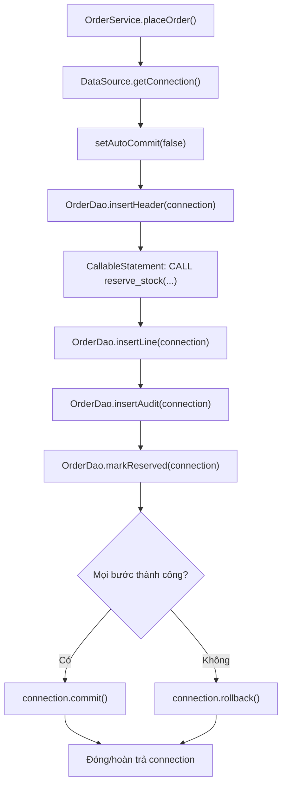

# Phối hợp thủ tục với giao dịch do ứng dụng quản lý

> **Chương:** Thủ tục lưu trữ  
> **Ngữ cảnh:** Ứng dụng Java dùng **JDBC**, `DataSource`, `CallableStatement`, `PreparedStatement` và `Connection` để kết hợp thủ tục lưu trữ với các thao tác CRUD trong cùng một giao dịch.

Một dịch vụ đặt hàng cần tạo đơn, gọi thủ tục lưu trữ để trừ tồn kho, ghi dòng hàng rồi ghi nhật ký. Thủ tục báo đã trừ kho thành công, nhưng bước ghi nhật ký lỗi. Ứng dụng có thể dùng `Connection.rollback()` để hoàn tác **tất cả** thay đổi không? Câu trả lời phụ thuộc vào việc thủ tục có chạy trên **cùng connection và transaction**, có tự `COMMIT`/`ROLLBACK` hoặc thực hiện thao tác gây implicit commit hay không, và bảng được thay đổi có dùng engine hỗ trợ transaction hay không.

Bài học này tập trung vào một quy tắc thiết kế: **service/use case của ứng dụng là chủ sở hữu giao dịch; thủ tục lưu trữ và DAO là các thành phần tham gia giao dịch đó**. Chúng thực hiện SQL nhưng không tự quyết định commit. Người học sẽ thực hành gọi thủ tục bằng JDBC, phối hợp với DAO trên một connection, bắt lỗi, rollback, kiểm tra tính nguyên tử và nhận diện các trường hợp rollback không thể bảo đảm.

Ví dụ triển khai chính sử dụng **MySQL 8.0.16+ với bảng InnoDB** và Java 17+; phiên bản này thực thi ràng buộc `CHECK` trong schema mẫu. Lệnh `CREATE PROCEDURE`, `SIGNAL`, cách dùng `DELIMITER` và các đặc điểm transaction của MySQL không được áp dụng nguyên xi cho PostgreSQL, SQL Server hoặc Oracle.

## 1. Ai sở hữu transaction khi có stored procedure?

**Stored procedure** là một đơn vị SQL được định nghĩa trong database và gọi qua `CALL` hoặc cú pháp tương đương của DBMS. Nó có thể đọc dữ liệu, cập nhật nhiều bảng, thực thi điều kiện, phát sinh lỗi và trả dữ liệu. **Việc có nhiều SQL statement trong procedure không tự bảo đảm toàn bộ use case của Java là một transaction**.

Nếu dịch vụ cần thực hiện:

1. DAO tạo đơn hàng.
2. Thủ tục giữ/trừ tồn kho.
3. DAO tạo dòng hàng.
4. DAO ghi lịch sử.
5. Service báo đơn đã được ghi nhận.

thì transaction phải bao trùm **cả năm bước nghiệp vụ liên quan đến database**, chứ không chỉ phần nằm trong procedure.

| Cách phân chia | Khi DAO ghi lịch sử bị lỗi | Tính nguyên tử |
|---|---|---|
| Mỗi DAO tự `getConnection()` và chạy auto-commit; procedure được gọi trên connection riêng | Tồn kho hoặc đơn có thể đã commit | Không đáp ứng |
| Service dùng một connection, nhưng procedure tự `COMMIT` | Các thay đổi trước lần commit của procedure có thể không rollback được | Bị phá vỡ |
| Service dùng một connection, procedure chỉ thực thi DML và phát lỗi, không kết thúc transaction | Service rollback được các DML chưa commit trên bảng hỗ trợ transaction | Phù hợp |
| Một phần nghiệp vụ gọi API HTTP hoặc DBMS khác | `Connection.rollback()` chỉ tác động tới transaction của connection đang dùng | Cần thiết kế phân tán |

**Hợp đồng trách nhiệm:**

- **Service:** xác định transaction boundary theo bất biến nghiệp vụ; lấy và đóng `Connection`; đặt `autoCommit=false`; gọi DAO/procedure; kiểm tra kết quả; `commit()` hoặc `rollback()`.
- **DAO và procedure caller:** nhận `Connection` từ service; tạo và đóng `PreparedStatement`/`CallableStatement`/`ResultSet`; truyền tham số; báo lỗi; **không commit, rollback hoặc đóng connection được mượn**.
- **Stored procedure:** thực hiện phần logic SQL đã được giao, dùng DML hỗ trợ transaction, có thể `SIGNAL` lỗi; **không tự `COMMIT`, `ROLLBACK`, đổi `autocommit` hoặc chạy DDL gây implicit commit** khi đang tham gia giao dịch của ứng dụng.
- **DBMS:** thực hiện khóa, isolation, constraint và atomic rollback theo khả năng của engine; ứng dụng phải chọn engine/đặc điểm phù hợp.



**Hai connection lấy từ cùng một `DataSource` không mặc nhiên thuộc cùng một transaction.** Với JDBC thuần, service cần truyền **đúng đối tượng `Connection` đang mang transaction** cho các DAO và lời gọi stored procedure.

## 2. Khi nào nên đặt logic trong procedure?

Thủ tục lưu trữ hữu ích nếu một thao tác gần dữ liệu cần tái sử dụng ở nhiều luồng, cần hạn chế round-trip hoặc tận dụng tính năng SQL cụ thể của DBMS. Tuy nhiên, thủ tục vẫn cần hợp đồng đầu vào, đầu ra, xử lý lỗi và transaction rõ ràng.

Trong ví dụ đặt hàng, procedure được giao **một hành động hẹp**: trừ tồn kho có điều kiện nguyên tử.

```sql
UPDATE inventory
SET available = available - ?
WHERE sku = ?
  AND available >= ?;
```

Lệnh này có ưu điểm là kiểm tra và trừ tồn kho trong cùng một câu SQL, giảm nguy cơ hai yêu cầu cùng đọc số lượng cũ rồi trừ vượt mức. Procedure kiểm tra `ROW_COUNT()` để biết có đúng một hàng được cập nhật không; nếu không, nó phát lỗi để service quyết định rollback.

Nếu chỉ có một câu SQL và không có lý do kiến trúc để dùng procedure, DAO gọi thẳng `PreparedStatement` cũng là lựa chọn hợp lệ. Bài thực hành dùng procedure nhằm làm rõ **cách phối hợp và trách nhiệm transaction**, không mặc định logic nào cũng phải chuyển vào database.

## 3. Chuẩn bị schema thử nghiệm MySQL 8.0.16+

Các bảng sau dùng **InnoDB**, bởi rollback giao dịch của ứng dụng cần engine có transaction. Đừng dùng bảng không hỗ trợ transaction rồi kỳ vọng mọi `ROLLBACK` đều hoàn tác dữ liệu.

```sql
CREATE TABLE inventory (
    sku VARCHAR(64) PRIMARY KEY,
    available INT NOT NULL CHECK (available >= 0)
) ENGINE = InnoDB;

CREATE TABLE purchase_orders (
    order_id CHAR(36) PRIMARY KEY,
    customer_ref VARCHAR(64) NOT NULL,
    status VARCHAR(16) NOT NULL
        CHECK (status IN ('PENDING', 'RESERVED'))
) ENGINE = InnoDB;

CREATE TABLE order_lines (
    order_id CHAR(36) NOT NULL,
    sku VARCHAR(64) NOT NULL,
    quantity INT NOT NULL CHECK (quantity > 0),

    PRIMARY KEY (order_id, sku),
    FOREIGN KEY (order_id) REFERENCES purchase_orders(order_id),
    FOREIGN KEY (sku) REFERENCES inventory(sku)
) ENGINE = InnoDB;

CREATE TABLE order_audit (
    audit_id BIGINT PRIMARY KEY AUTO_INCREMENT,
    order_id CHAR(36) NOT NULL,
    event_type VARCHAR(40) NOT NULL,
    FOREIGN KEY (order_id) REFERENCES purchase_orders(order_id)
) ENGINE = InnoDB;

INSERT INTO inventory (sku, available)
VALUES ('BOOK-JDBC', 8), ('BOOK-SQL', 5);
```

`order_id` được Java tạo bằng `UUID.randomUUID().toString()` để client/service biết ID trước khi ghi. Cột `CHAR(36)` minh họa dễ đọc; hệ thống thật có thể chọn biểu diễn UUID dạng nhị phân hoặc chiến lược ID khác sau khi cân nhắc chỉ mục và tương thích driver.

Thực hiện DDL **một lần khi chuẩn bị schema**. Các lệnh như `CREATE TABLE` hay `ALTER TABLE` không được đặt trong transaction đặt hàng ở mục sau: **nhiều câu DDL của MySQL gây implicit commit**, làm vô hiệu giả định rằng service có thể rollback tất cả bằng một lời gọi JDBC.

## 4. Viết procedure tham gia transaction của caller

Tạo một procedure không mở hoặc kết thúc transaction:

```sql
-- Chạy bằng mysql CLI / công cụ SQL hiểu DELIMITER.
DELIMITER $$

CREATE PROCEDURE reserve_stock(
    IN p_sku VARCHAR(64),
    IN p_quantity INT
)
SQL SECURITY INVOKER
BEGIN
    IF p_quantity IS NULL OR p_quantity <= 0 THEN
        SIGNAL SQLSTATE '45000'
            SET MESSAGE_TEXT = 'Quantity must be positive';
    END IF;

    UPDATE inventory
    SET available = available - p_quantity
    WHERE sku = p_sku
      AND available >= p_quantity;

    IF ROW_COUNT() <> 1 THEN
        SIGNAL SQLSTATE '45000'
            SET MESSAGE_TEXT = 'SKU missing or insufficient stock';
    END IF;
END$$

DELIMITER ;
```

**Giải thích:**

- `p_sku` và `p_quantity` là tham số `IN`. Giá trị sẽ được JDBC bind khi gọi, không nối vào chuỗi SQL.
- Điều kiện `available >= p_quantity` giúp ngăn trừ kho dưới 0; `CHECK (available >= 0)` bảo vệ bổ sung ở schema.
- `ROW_COUNT()` được đọc **ngay sau câu `UPDATE`**. Với `p_quantity > 0` và khóa chính `sku`, nếu dòng tồn tại và đủ hàng thì SQL thay đổi một dòng. Nếu không cập nhật được, procedure phát lỗi.
- `SIGNAL SQLSTATE '45000'` là lỗi do ứng dụng quy định ở tầng SQL trong MySQL; driver đưa lỗi lên Java dưới dạng `SQLException`. Không suy ra SQLSTATE này có cùng ý nghĩa nghiệp vụ trên mọi DBMS.
- **Không có `START TRANSACTION`, `COMMIT` hay `ROLLBACK` trong procedure.** Nó tham gia transaction do connection caller đang mang.
- `SQL SECURITY INVOKER` yêu cầu quyền của tài khoản gọi phù hợp để truy cập bảng. Nếu dùng `DEFINER`, cần kiểm soát quyền và auditing theo chính sách triển khai.

Dòng `DELIMITER $$` và `DELIMITER ;` là lệnh hỗ trợ nhập **trên mysql client** để phân biệt dấu `;` trong thân procedure; chúng **không phải SQL của server** và không được gửi nguyên dòng qua `PreparedStatement` trong JDBC. Khi triển khai migration, dùng cơ chế tạo routine đúng chuẩn của công cụ migration đang dùng.

### Chạy trực tiếp để hiểu transaction

Trong MySQL client, dùng một phiên:

```sql
START TRANSACTION;

INSERT INTO purchase_orders (
    order_id, customer_ref, status
) VALUES (
    '00000000-0000-0000-0000-000000000101',
    'CUSTOMER-A',
    'PENDING'
);

CALL reserve_stock('BOOK-JDBC', 2);

ROLLBACK;
```

Sau rollback, bản ghi đơn vừa tạo không còn và `inventory.available` của `BOOK-JDBC` trở về `8`, **miễn là không có transaction khác cùng thay đổi dữ liệu thử nghiệm**. Đây là minh họa cú pháp SQL phía MySQL client; ở ứng dụng JDBC, `connection.setAutoCommit(false)` và `connection.rollback()` thay cho việc gửi `START TRANSACTION`/`ROLLBACK` bằng chuỗi SQL.

Thử lại và thay `ROLLBACK` bằng `COMMIT` để xác nhận số tồn trở thành `6` và đơn được giữ lại. Trước mỗi lần chạy lại, cần đặt lại dữ liệu thử và tránh trùng `order_id`; không chạy hai kịch bản cùng lúc trên dữ liệu chia sẻ.

## 5. Gọi procedure bằng `CallableStatement` của JDBC

JDBC có `CallableStatement` dành cho lời gọi stored procedure hoặc callable routine. Trong ví dụ **MySQL Connector/J**, dạng escape syntax sau gửi lệnh `CALL reserve_stock` cho database:

```java
import java.sql.CallableStatement;
import java.sql.Connection;
import java.sql.SQLException;

final class InventoryProcedure {

    void reserveStock(Connection connection, String sku, int quantity)
            throws SQLException {

        try (CallableStatement statement =
                 connection.prepareCall("{call reserve_stock(?, ?)}")) {

            statement.setString(1, sku);
            statement.setInt(2, quantity);
            statement.execute();
        }
    }
}
```

Lưu ý về quyền sở hữu tài nguyên:

- Caller **truyền `Connection`**. Procedure caller chỉ đóng `CallableStatement` mà nó tạo.
- `statement.execute()` chạy trong trạng thái transaction của `connection`. Nếu service đã đặt `autoCommit=false`, các DML của procedure **chưa được commit** chỉ vì `execute()` trả về thành công.
- Nếu `SIGNAL` được thực thi, `execute()` ném `SQLException`; mã Java để exception đi lên service để rollback.
- `CallableStatement` có thể cho kết quả dạng update count, `ResultSet` hoặc OUT parameter tùy procedure/driver. Procedure mẫu không trả result set hay OUT parameter, nên caller chỉ cần biết nó hoàn tất hoặc ném lỗi.

Không được gọi:

```java
// Sai khi connection thuộc một transaction do service sở hữu.
void reserveStockWrong(Connection connection, String sku, int quantity)
        throws SQLException {

    try (CallableStatement statement =
             connection.prepareCall("{call reserve_stock(?, ?)}")) {
        statement.setString(1, sku);
        statement.setInt(2, quantity);
        statement.execute();
    }

    connection.commit(); // Vượt quyền sở hữu, phá tính nguyên tử use case.
    connection.close();  // Đóng connection mà service đang mượn.
}
```

`Statement.execute()` trả về `boolean` nói **kết quả đầu tiên là `ResultSet` hay không**, **không phải boolean thành công/thất bại**. Vì vậy `if (!statement.execute()) throw ...` là cách kiểm tra sai. Lỗi SQL được truyền bằng `SQLException`; return `false` có thể chỉ nghĩa kết quả đầu tiên là update count hoặc không có result set.

## 6. DAO và service cùng dùng một connection

Service điều phối toàn bộ nghiệp vụ đặt hàng. Các DAO dưới đây nhận `Connection` và **không tự lấy một connection thứ hai**. Tên lớp và API được minh họa đủ để dùng trong một chương trình Java 17+ khi đã có `DataSource` và schema mẫu.

### 6.1. DAO ghi đơn, dòng hàng và audit

```java
import java.sql.Connection;
import java.sql.PreparedStatement;
import java.sql.SQLException;

record NewOrder(
    String orderId,
    String customerRef,
    String sku,
    int quantity
) {}

final class OrderDao {
    void insertHeader(Connection connection, NewOrder order)
            throws SQLException {

        String sql = """
            INSERT INTO purchase_orders (
                order_id, customer_ref, status
            ) VALUES (?, ?, 'PENDING')
            """;

        try (PreparedStatement statement =
                 connection.prepareStatement(sql)) {

            statement.setString(1, order.orderId());
            statement.setString(2, order.customerRef());

            if (statement.executeUpdate() != 1) {
                throw new SQLException("Could not create order header");
            }
        }
    }

    void insertLine(Connection connection, NewOrder order)
            throws SQLException {

        String sql = """
            INSERT INTO order_lines (
                order_id, sku, quantity
            ) VALUES (?, ?, ?)
            """;

        try (PreparedStatement statement =
                 connection.prepareStatement(sql)) {

            statement.setString(1, order.orderId());
            statement.setString(2, order.sku());
            statement.setInt(3, order.quantity());

            if (statement.executeUpdate() != 1) {
                throw new SQLException("Could not create order line");
            }
        }
    }

    void insertAudit(Connection connection, String orderId)
            throws SQLException {

        String sql = """
            INSERT INTO order_audit (order_id, event_type)
            VALUES (?, 'ORDER_RESERVED')
            """;

        try (PreparedStatement statement =
                 connection.prepareStatement(sql)) {

            statement.setString(1, orderId);

            if (statement.executeUpdate() != 1) {
                throw new SQLException("Could not create order audit");
            }
        }
    }

    void markReserved(Connection connection, String orderId)
            throws SQLException {

        String sql = """
            UPDATE purchase_orders
            SET status = 'RESERVED'
            WHERE order_id = ? AND status = 'PENDING'
            """;

        try (PreparedStatement statement =
                 connection.prepareStatement(sql)) {

            statement.setString(1, orderId);

            if (statement.executeUpdate() != 1) {
                throw new SQLException("Could not finalize order status");
            }
        }
    }
}
```

Mỗi DAO dùng `try-with-resources` cho statement của riêng nó. Nếu `executeUpdate()` lỗi rồi `statement.close()` cũng lỗi, Java giữ lỗi SQL ban đầu và gắn lỗi đóng vào danh sách `suppressed`. DAO không đóng connection: service còn cần dùng nó cho những bước tiếp theo.

### 6.2. Service làm chủ transaction

```java
import java.sql.Connection;
import java.sql.SQLException;
import java.util.Objects;
import java.util.UUID;
import javax.sql.DataSource;

public final class OrderService {
    private final DataSource dataSource;
    private final OrderDao orderDao = new OrderDao();
    private final InventoryProcedure inventoryProcedure =
        new InventoryProcedure();

    public OrderService(DataSource dataSource) {
        this.dataSource = Objects.requireNonNull(dataSource);
    }

    public void placeOrder(NewOrder order) throws SQLException {
        Objects.requireNonNull(order, "order");
        Objects.requireNonNull(order.orderId(), "orderId");
        Objects.requireNonNull(order.customerRef(), "customerRef");
        Objects.requireNonNull(order.sku(), "sku");
        if (order.quantity() <= 0) {
            throw new IllegalArgumentException("quantity must be positive");
        }

        try (Connection connection = dataSource.getConnection()) {
            // Ví dụ dành cho connection sạch; framework-managed
            // transaction phải có cách tham gia riêng.
            if (!connection.getAutoCommit()) {
                throw new SQLException("Expected autoCommit=true");
            }

            connection.setAutoCommit(false);
            boolean transactionEnded = false;
            Throwable primaryFailure = null;

            try {
                orderDao.insertHeader(connection, order);

                inventoryProcedure.reserveStock(
                    connection, order.sku(), order.quantity()
                );

                orderDao.insertLine(connection, order);
                orderDao.insertAudit(connection, order.orderId());
                orderDao.markReserved(connection, order.orderId());

                // Chỉ service quyết định xác nhận toàn bộ thay đổi.
                connection.commit();
                transactionEnded = true;

            } catch (SQLException | RuntimeException | Error failure) {
                primaryFailure = failure;
                try {
                    connection.rollback();
                    transactionEnded = true;
                } catch (SQLException rollbackFailure) {
                    failure.addSuppressed(rollbackFailure);
                }
                throw failure;

            } finally {
                // Không bật lại auto-commit nếu rollback thất bại.
                // Bật lại sớm có thể commit dữ liệu còn đang chờ.
                if (transactionEnded) {
                    try {
                        connection.setAutoCommit(true);
                    } catch (SQLException resetFailure) {
                        if (primaryFailure != null) {
                            primaryFailure.addSuppressed(resetFailure);
                        } else {
                            throw resetFailure;
                        }
                    }
                }
            }
        }
    }
}
```

Ví dụ gọi:

```java
String orderId = UUID.randomUUID().toString();

NewOrder request = new NewOrder(
    orderId,
    "CUSTOMER-A",
    "BOOK-JDBC",
    2
);

OrderService service = new OrderService(dataSource);
service.placeOrder(request);
```

**Điều kiện áp dụng:** JDBC code trên giả định service là chủ transaction, connection được cấp đang ở `autoCommit=true`, và các bảng đều là InnoDB. Với connection pool, `connection.close()` thường trả proxy về pool; cấu hình pool cần bảo đảm reset hoặc loại bỏ connection lỗi. Ví dụ khôi phục `autoCommit` khi transaction đã báo kết thúc, nhưng không cố ép reset trong trường hợp rollback còn không rõ kết quả.

**Cần giữ ID qua retry:** `orderId` được tạo **một lần** ở tầng gọi. Nếu ứng dụng timeout sau `commit()`, một lần gửi lại phải dùng cùng `orderId` hoặc idempotency key ổn định và đối soát xem đơn đã tồn tại chưa; không tạo UUID mới rồi chèn lại mù quáng.

## 7. Xác minh tính nguyên tử qua ba kịch bản

Thực hiện từng kịch bản **trên database thử nghiệm riêng**, đọc trạng thái trước và sau bằng một connection khác **sau khi transaction đã kết thúc**.

### 7.1. Thành công tất cả bước

Với dữ liệu đầu vào `BOOK-JDBC = 8` và đơn `quantity = 2`:

| Bảng/dữ liệu | Trước | Sau `commit()` |
|---|---|---|
| `inventory`, `BOOK-JDBC` | `available = 8` | `available = 6` |
| `purchase_orders`, `order_id` mới | Không có | Một hàng có `status = 'RESERVED'` |
| `order_lines` của đơn | Không có | Một hàng `quantity = 2` |
| `order_audit` của đơn | Không có | Một hàng `ORDER_RESERVED` |

Gọi `CallableStatement.execute()` chỉ nói rằng lời gọi procedure đã xử lý xong; **không chứng minh riêng rằng transaction đã commit**. Chỉ sau `connection.commit()` thành công, service mới xác nhận đơn thành công theo phản hồi JDBC.

### 7.2. Procedure báo hết hàng

Gọi `reserve_stock` với `quantity = 99` khi tồn kho chỉ còn `8`. `UPDATE` trong procedure không khớp, `ROW_COUNT() = 0`, `SIGNAL SQLSTATE '45000'` khiến Java nhận `SQLException`. Service rollback:

- Bản ghi đơn hàng đã insert ở bước đầu bị hủy.
- Tồn kho vẫn là `8` (không có update thành công).
- Không có dòng hàng hoặc audit mới.

Không nên catch `SQLException` trong procedure caller rồi chỉ log và trả thành công. Làm vậy cho phép service commit một đơn `PENDING` dù bước giữ kho đã lỗi.

### 7.3. DAO lỗi **sau** khi procedure đã trừ kho

Đây là phép thử quan trọng hơn: nó chứng minh logic nằm trong procedure và logic nằm trong DAO **cùng tham gia một transaction**.

Trong một transaction thử nghiệm, tạo đơn, gọi `reserve_stock('BOOK-JDBC', 2)` thành công, sau đó cố chèn dòng hàng có `quantity = 0` để vi phạm `CHECK (quantity > 0)`:

```sql
START TRANSACTION;

INSERT INTO purchase_orders (
    order_id, customer_ref, status
) VALUES (
    '00000000-0000-0000-0000-000000000707',
    'CUSTOMER-TEST',
    'PENDING'
);

CALL reserve_stock('BOOK-JDBC', 2);

-- Lệnh này cố ý thất bại vì CHECK (quantity > 0).
INSERT INTO order_lines (order_id, sku, quantity)
VALUES (
    '00000000-0000-0000-0000-000000000707',
    'BOOK-JDBC',
    0
);

ROLLBACK;
```

Trong MySQL, việc một statement bị từ chối **không mặc nhiên rollback toàn bộ transaction**. Ở ví dụ này, người điều phối phải chủ động chạy `ROLLBACK`. Sau rollback, tồn kho trở lại `8` và đơn thử không còn. **Nếu procedure tự `COMMIT` sau khi trừ kho, rollback của caller sẽ không khôi phục được phần đã commit**.

Trên JDBC, có thể làm cùng phép thử bằng DAO test gây lỗi sau lời gọi procedure rồi kiểm tra `rollback()`. Không cần đưa SQL dữ liệu lỗi vào production để chứng minh cơ chế này.

## 8. Những điều làm transaction bị chia tách hoặc kết thúc ngoài ý muốn

### 8.1. Procedure tự `COMMIT`/`ROLLBACK`

```sql
-- Minh họa một thiết kế không phù hợp cho procedure tham gia
-- transaction do service quản lý:
CREATE PROCEDURE unsafe_reserve_stock(IN p_sku VARCHAR(64))
BEGIN
    UPDATE inventory SET available = available - 1
    WHERE sku = p_sku;
    COMMIT; -- Kết thúc giao dịch của caller trên cùng phiên.
END;
```

Ví dụ trên chỉ dùng để chỉ ra lỗi thiết kế; không triển khai procedure này. Trong MySQL, `COMMIT` trong procedure có thể xác nhận luôn những thay đổi mà DAO đã thực hiện trước `CALL` trên **cùng session**. Sau đó, service không thể dùng một `rollback()` để hoàn tác phần đã commit. Tương tự, một `ROLLBACK` từ procedure có thể hủy những thay đổi của các DAO trước đó mà service vẫn tưởng còn tồn tại.

Nếu procedure **được thiết kế chủ động làm chủ transaction riêng**, caller không thể đồng thời giả định nó chỉ tham gia transaction của ứng dụng. Phải chọn **một chủ sở hữu và một hợp đồng rõ ràng** cho mỗi use case.

### 8.2. DDL hoặc thao tác gây implicit commit

Không tạo, sửa hoặc xóa bảng trong procedure được gọi bên trong transaction ứng dụng. Ở MySQL, nhiều lệnh DDL có tác dụng **implicit commit**; phân biệt DDL phục vụ migration (chạy ở bước triển khai) với DML của transaction nghiệp vụ (chạy lúc phục vụ request).

Danh sách câu lệnh gây implicit commit thay đổi theo DBMS và phiên bản. Đừng suy luận rằng “procedure không có chữ `COMMIT`” thì chắc chắn an toàn: **mọi statement bên trong** phải được kiểm tra về khả năng kết thúc transaction.

### 8.3. Bảng hoặc engine không tham gia transaction

Nếu procedure ghi một bảng không hỗ trợ rollback, `Connection.rollback()` không thể hoàn tác đúng mọi thay đổi trong bảng đó. Kiểm tra engine của **tất cả** bảng được DAO và procedure cập nhật, bao gồm bảng audit, bảng tạm hoặc bảng do trigger thay đổi.

```sql
SELECT TABLE_NAME, ENGINE
FROM information_schema.TABLES
WHERE TABLE_SCHEMA = DATABASE()
  AND TABLE_NAME IN (
      'inventory',
      'purchase_orders',
      'order_lines',
      'order_audit'
  );
```

Kết quả kỳ vọng cho ví dụ là tất cả sử dụng `InnoDB`. Trong hệ thống thực, routine có thể gọi routine khác hoặc kích hoạt trigger; cần xem toàn bộ các thay đổi gián tiếp khi đánh giá phạm vi rollback.

### 8.4. DAO lấy connection khác

```java
// Sai: method này vô tình tạo connection mới và transaction khác.
void reserveWrong(DataSource dataSource, String sku, int quantity)
        throws SQLException {
    try (Connection separate = dataSource.getConnection();
         CallableStatement statement =
             separate.prepareCall("{call reserve_stock(?, ?)}")) {

        statement.setString(1, sku);
        statement.setInt(2, quantity);
        statement.execute();
    }
}
```

Dù sử dụng cùng `DataSource` và cùng database, connection thứ hai không tự tham gia transaction của service. Với `autoCommit=true`, procedure có thể commit trước khi DAO tạo audit thất bại. Cách sửa là **truyền `Connection` do service đang dùng** vào `InventoryProcedure`.

### 8.5. Thao tác ở ngoài database

Một procedure có thể gọi tính năng hoặc thành phần bên ngoài phạm vi transaction local, tùy DBMS. Email, HTTP, message broker và database thứ hai không tự được rollback bởi transaction trên connection MySQL. Nếu phải phát sự kiện sau khi đơn được ghi, có thể cân nhắc **transactional outbox**: DAO ghi hàng outbox trong cùng transaction, sau commit một worker gửi sự kiện với cơ chế chống xử lý trùng. Không giữ transaction mở trong lúc chờ phản hồi từ dịch vụ bên ngoài.

## 9. Kết quả `CALL`: OUT parameter, nhiều result set và update count

Một procedure có thể trả dữ liệu ngoài việc sửa bảng. JDBC cung cấp:

- `CallableStatement.registerOutParameter()` và `getXxx()` cho tham số `OUT`/`INOUT`, nếu DBMS/driver hỗ trợ.
- `CallableStatement.execute()` để chạy routine, kể cả khi có nhiều loại kết quả.
- `getResultSet()`, `getUpdateCount()` và `getMoreResults()` để duyệt nhiều result set/update count (theo khả năng driver).

### 9.1. Ví dụ OUT parameter không làm thay đổi transaction

Trong MySQL:

```sql
DELIMITER $$

CREATE PROCEDURE read_stock(
    IN p_sku VARCHAR(64),
    OUT p_available INT
)
SQL SECURITY INVOKER
BEGIN
    -- Scalar subquery trả NULL nếu không có SKU tương ứng.
    SET p_available = (
        SELECT available
        FROM inventory
        WHERE sku = p_sku
    );
END$$

DELIMITER ;
```

JDBC:

```java
import java.sql.CallableStatement;
import java.sql.Connection;
import java.sql.SQLException;
import java.sql.Types;

Integer readStock(Connection connection, String sku)
        throws SQLException {

    try (CallableStatement statement =
             connection.prepareCall("{call read_stock(?, ?)}")) {

        statement.setString(1, sku);
        statement.registerOutParameter(2, Types.INTEGER);
        statement.execute();

        int available = statement.getInt(2);
        return statement.wasNull() ? null : available;
    }
}
```

Chỉ số tham số trên JDBC bắt đầu từ **1**, không phải 0. `wasNull()` cần được đọc ngay sau lần `getInt(2)` tương ứng nếu muốn phân biệt giá trị `0` với SQL `NULL`. Câu `SELECT` bên trong procedure thấy dữ liệu theo transaction/isolation của **connection được truyền vào**, kể cả những thay đổi chưa commit do chính connection đó thực hiện.

### 9.2. Khi routine trả nhiều loại kết quả

Nếu một procedure có `SELECT` để trả dữ liệu hoặc driver báo thêm update counts, không nên mặc định `execute()` trả `true` là thành công và `false` là thất bại. Với routine trả nhiều kết quả, có thể duyệt như sau:

```java
import java.sql.CallableStatement;
import java.sql.Connection;
import java.sql.ResultSet;
import java.sql.Statement;

void consumeProcedureResults(Connection connection)
        throws java.sql.SQLException {

    try (CallableStatement statement =
             connection.prepareCall("{call reporting_procedure()}")) {

        boolean hasResultSet = statement.execute();

        while (true) {
            if (hasResultSet) {
                try (ResultSet rs = statement.getResultSet()) {
                    while (rs.next()) {
                        // Map các cột theo hợp đồng cụ thể của procedure.
                    }
                }
            } else {
                int count = statement.getUpdateCount();
                if (count == -1) {
                    break; // Không còn kết quả nào.
                }
                // count >= 0 là số hàng được driver báo (nếu có).
            }

            hasResultSet = statement.getMoreResults(
                Statement.CLOSE_CURRENT_RESULT
            );
        }
    }
}
```

`reporting_procedure()` là **tên minh họa** cho một procedure khác có trả kết quả, không phải routine được tạo trong schema bài thực hành. Trong dự án thật, thay bằng procedure thực tế và mapping đúng cột. Có driver yêu cầu xử lý hết các kết quả trước khi đọc OUT parameter; hãy kiểm tra tài liệu và thử trên phiên bản driver mục tiêu.

Một cách khác khi routine trả một tập hàng hoặc scalar là dùng `PreparedStatement` và câu SQL của DBMS (`SELECT function(...)`, `CALL ...`, v.v.); **không suy ra có một cú pháp duy nhất chạy được trên mọi hệ quản trị**.

## 10. Lỗi, rollback và tính không chắc chắn khi commit

Có ba trường hợp phải xử lý riêng:

| Tình huống | Quan sát JDBC | Phản ứng của service |
|---|---|---|
| Procedure `SIGNAL` lỗi trước commit | `CallableStatement.execute()` ném `SQLException` | Rollback toàn transaction, giữ lỗi SQL |
| SQL trong DAO sau procedure lỗi | `executeUpdate()` của DAO ném exception | Rollback cả DML trước đó của DAO lẫn procedure |
| `commit()` gặp lỗi mạng/timeout | `SQLException` nhưng chưa rõ server đã commit chưa | Thử rollback theo khả năng, ghi nhận trạng thái không xác định, đối soát bằng ID trước khi retry |

**Rollback cũng có thể lỗi.** Nếu gọi `connection.rollback()` trong `catch` rồi nó ném exception khác, lỗi này có thể che lỗi gốc nếu không xử lý. Ví dụ service ở mục 6 dùng:

```java
try {
    connection.rollback();
} catch (SQLException rollbackFailure) {
    failure.addSuppressed(rollbackFailure);
}
```

Giữ lỗi của `CALL`/DAO làm exception chính và đính kèm lỗi rollback qua `getSuppressed()`. `try-with-resources` sẽ tự lưu lỗi `close()` thành suppressed khi đã có exception chính. Một `SQLException` còn có `getSQLState()`, `getErrorCode()`, `getNextException()` và `getCause()`. Không phân loại lỗi nghiệp vụ chỉ bằng chuỗi message do procedure phát ra vì message có thể thay đổi khi nâng cấp.

Trong MySQL, `SIGNAL SQLSTATE '45000'` là lỗi do lập trình viên chủ động phát, cần map sang mã lỗi nghiệp vụ nhất quán ở service. Riêng lỗi khóa, deadlock, lock wait timeout, mất kết nối có thể cần chính sách khác. Retry transaction chỉ khi phù hợp nguyên nhân, với số lần và backoff giới hạn, **trên connection/transaction mới**, đồng thời giữ ID của cùng yêu cầu để chống tạo trùng.

Nếu `commit()` thành công nhưng `connection.close()` thất bại, thao tác có thể đã lưu dữ liệu; **đừng tạo lại đơn chỉ vì caller nhận lỗi cleanup**. Nếu `commit()` lỗi do mất kết nối, `rollback()` thành công sau đó **không luôn chứng minh** commit trước đó chưa thành công trên server. Cần đối soát `order_id` và dữ liệu nghiệp vụ đã lưu.

## 11. Transaction isolation, khóa và cạnh tranh dữ liệu

Việc service sở hữu transaction không có nghĩa procedure được miễn xử lý đồng thời. Trong ví dụ `reserve_stock`, câu `UPDATE inventory ... AND available >= ?` thực hiện kiểm tra và trừ kho trong một statement, dựa vào cơ chế khóa/transaction của InnoDB.

Nếu hai đơn cùng trừ `5` từ tồn kho `8`, về nguyên tắc **không được để cả hai cùng trừ thành công** khiến số tồn âm. Một câu `SELECT available` trước đó ở Java rồi hai lần `UPDATE` không điều kiện có thể gặp lost update hoặc oversell nếu thiếu cơ chế khóa. Câu `UPDATE` có điều kiện là một phần quan trọng của thiết kế.

Tuy nhiên, vẫn có thể xảy ra lock wait timeout hoặc deadlock khi nhiều transaction cập nhật các SKU/tài khoản theo thứ tự khác nhau. Để giảm rủi ro:

- Chọn thứ tự truy cập/khóa bản ghi thống nhất giữa các luồng.
- Giữ transaction ngắn; không gọi mạng ngoài khi đang giữ database lock.
- Cân nhắc isolation phù hợp với nghiệp vụ và đặc điểm DBMS.
- Định nghĩa cách xử lý timeout/deadlock: rollback, ghi log có ID yêu cầu, có thể retry toàn use case trong giới hạn.
- Kiểm chứng thực tế với các tình huống cạnh tranh trên MySQL/InnoDB thay vì chỉ kiểm thử tuần tự.

**Không thay đổi isolation hoặc auto-commit tùy tiện bên trong procedure.** Nếu service muốn dùng mức isolation khác, hãy cấu hình trên connection vào thời điểm phù hợp, trước khi thao tác giao dịch bắt đầu, và khôi phục theo hợp đồng connection pool khi kết thúc.

## 12. Khác biệt giữa các DBMS cần nhớ

| DBMS | Gọi routine từ JDBC | Quy tắc cần chú ý khi ứng dụng sở hữu transaction |
|---|---|---|
| **MySQL 8.0+** | `CallableStatement` với `{call procedure(?, ?)}` qua Connector/J | Procedure có thể chứa lệnh transaction; cần tránh `COMMIT`/`ROLLBACK`, DDL implicit commit và engine không hỗ trợ rollback |
| **PostgreSQL** | `CALL procedure(...)` hoặc JDBC call escape tùy cấu hình pgJDBC | Procedure có khả năng transaction control trong một số ngữ cảnh; **không thể thực hiện COMMIT/ROLLBACK trong procedure được gọi bên trong explicit transaction block**. Cấu hình `escapeSyntaxCallMode` có thể ảnh hưởng cú pháp call escape |
| **SQL Server** | `CallableStatement` / `EXEC procedure ...` theo JDBC driver | Procedure có thể thao tác transaction và ảnh hưởng transaction count/session; cần hợp đồng rõ với transaction của caller |
| **Oracle** | `CallableStatement`; syntax PL/SQL theo driver | Procedure thường tham gia transaction của session, nhưng autonomous transaction có thể commit độc lập và không bị rollback bởi caller |

Bởi vậy khi chuyển hệ quản trị, không chỉ đổi dấu `?` hoặc tên procedure: phải kiểm tra **đặc quyền, hành vi commit/rollback, tính chất DDL, kết quả OUT/result sets, SQLState/vendor error, isolation và hỗ trợ driver**.

## 13. Thiết kế quyền và triển khai routine

Stored procedure là logic được deploy vào database, do đó cần quản lý **phiên bản routine cùng schema và ứng dụng**. Một số nguyên tắc quan trọng:

- Tách migration tạo/cập nhật procedure khỏi các transaction phục vụ request.
- Chọn `SQL SECURITY INVOKER` hoặc `DEFINER` theo mô hình quyền: account ứng dụng chỉ nên có quyền cần thiết; với `DEFINER`, kiểm tra quyền được thực thi thay người gọi và quản lý tài khoản definer.
- Kiểm soát quyền `EXECUTE` trên routine; không tin một procedure tự động thay thế toàn bộ kiểm tra ủy quyền ở service.
- Khi procedure dùng dynamic SQL, tên bảng/cột và fragment SQL phải được xây dựng từ danh sách cho phép; **tham số bind chỉ thay thế giá trị**, không thay thế định danh SQL một cách tùy ý.
- Tài liệu hóa hợp đồng của routine: tham số, SQLState/điều kiện lỗi, bảng được sửa, kết quả trả về và cam kết **không kết thúc transaction của caller**.
- Kiểm thử tương thích mỗi lần đổi routine hoặc driver JDBC; một thay đổi bên trong routine có thể ảnh hưởng toàn bộ transaction dù Java không thay đổi.

## 14. Checklist và bài thực hành

| Câu hỏi đánh giá | Cách xác minh |
|---|---|
| Có đúng **một chủ transaction** cho use case không? | Kiểm tra chỗ lấy connection và gọi `commit/rollback` |
| Procedure và mọi DAO có dùng **cùng connection** không? | Theo dõi reference `Connection` được truyền qua từng lời gọi |
| Procedure có tự `COMMIT/ROLLBACK`, đổi auto-commit hoặc dùng DDL không? | Review nội dung routine và routine/trigger liên quan |
| Tất cả bảng được ghi có hỗ trợ rollback không? | Kiểm tra engine/schema và thử rollback thực tế |
| Procedure báo lỗi SQL lên caller hay bị nuốt? | Cố ý gửi quantity quá lớn, xác nhận `SQLException` và dữ liệu không đổi |
| DAO lỗi **sau** `CALL` có rollback được thay đổi của procedure không? | Cố ý gây lỗi `INSERT` sau khi trừ kho, đối chiếu tồn trước/sau |
| Service có đóng statement đúng mà không đóng connection giữa chừng không? | Kiểm tra `try-with-resources` theo quyền sở hữu |
| Commit lỗi hoặc phản hồi bị mất có xử lý retry an toàn không? | Đối soát bằng `order_id`/idempotency key ổn định |
| Các thao tác đồng thời có bảo toàn tồn kho không? | Hai transaction cùng đặt mua số lượng vượt tổng tồn; xác minh chỉ thao tác hợp lệ commit |

### Bài thực hành

1. **Tạo schema và procedure:** chuẩn bị ba bảng đơn hàng, bảng audit và `inventory` trong MySQL/InnoDB; triển khai `reserve_stock` không chứa `COMMIT`/`ROLLBACK`.
2. **Gọi từ JDBC:** tạo `CallableStatement` trên connection do service cấp, bind `sku` và `quantity`, thực hiện `CALL` và đọc lại tồn kho sau commit.
3. **Kiểm thử thiếu hàng:** đặt số lượng lớn hơn `available`; xác nhận `SIGNAL` chuyển thành `SQLException` và service rollback bản ghi đơn đã tạo trước lời gọi procedure.
4. **Kiểm thử lỗi sau procedure:** cho procedure trừ kho thành công rồi cố tình tạo dòng hàng có `quantity = 0` hoặc vi phạm khóa. Sau rollback, xác nhận cả tồn kho lẫn bảng đơn trở về trạng thái trước giao dịch.
5. **Phá hợp đồng rồi sửa:** trong môi trường thử nghiệm, thêm `COMMIT` vào một bản sao của procedure và quan sát rollback của service không còn hoàn tác được phần đã commit; sau đó bỏ `COMMIT` để khôi phục thiết kế đúng.
6. **Dùng OUT parameter:** tạo `read_stock` và gọi qua `registerOutParameter()`. Giải thích vì sao OUT parameter trả dữ liệu nhưng không đồng nghĩa transaction đã được commit.
7. **Kiểm thử đồng thời:** hai transaction cùng đặt `5` sản phẩm khi tồn còn `8`; kiểm tra invariant `available >= 0` và cách hệ thống báo lỗi.
8. **Thiết kế retry:** mô phỏng lỗi mạng gần lúc commit; mô tả cơ chế dùng cùng `order_id` để đối soát trước khi gửi lại đơn.

**Tiêu chí hoàn thành:** người học đặt được ranh giới transaction tại service, truyền cùng `Connection` cho DAO và `CallableStatement`, bảo đảm procedure không tự kết thúc giao dịch hoặc gây implicit commit, xử lý `SQLException` và rollback an toàn, phân biệt kết quả `CALL` với commit, đồng thời kiểm chứng được tính nguyên tử bằng trường hợp lỗi **trước và sau** procedure.
