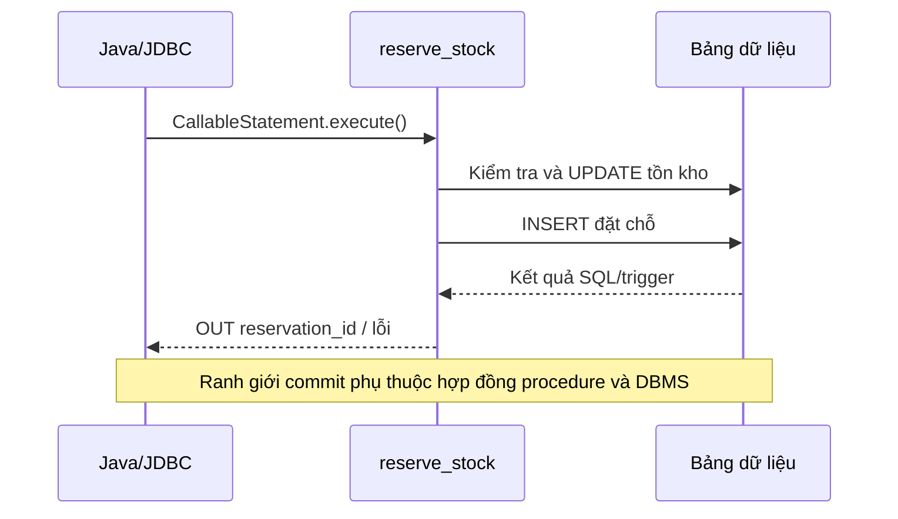
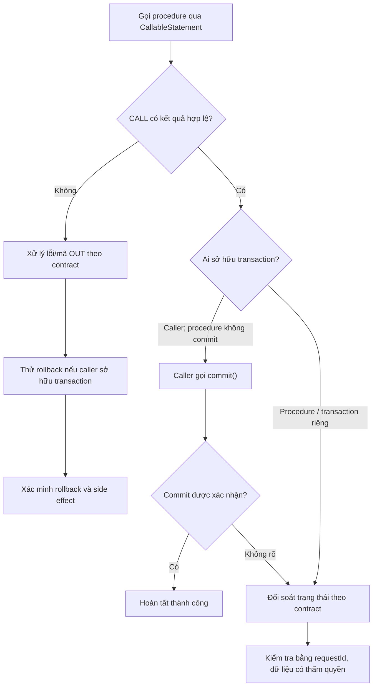

# Kiểm tra ảnh hưởng của logic và giao dịch bên trong thủ tục

## Mục tiêu học tập

Với **JDBC**, ứng dụng Java có thể gọi thủ tục lưu trữ (*stored procedure*) qua `CallableStatement` thay vì trực tiếp gửi nhiều câu `PreparedStatement`. Cách đóng gói này hữu ích khi logic nằm gần dữ liệu, cần thực thi nhiều thao tác SQL hoặc muốn cung cấp một giao diện chung cho nhiều ứng dụng. Tuy nhiên, từ phía Java, một lời gọi `CALL` trông giống **một thao tác**, còn bên trong thủ tục có thể chứa nhiều nhánh điều kiện, nhiều câu DML, xử lý ngoại lệ, lệnh DDL và thậm chí thao tác điều khiển transaction.

Chủ đề của chương **Thủ tục lưu trữ** này là **kiểm tra ảnh hưởng của logic và giao dịch bên trong thủ tục**: xác định dữ liệu nào có thể thay đổi, ai sở hữu ranh giới `commit/rollback`, điều gì được đảm bảo khi thủ tục trả về hoặc ném lỗi, và làm sao kiểm chứng hành vi bằng kết nối JDBC độc lập. Kiến thức giúp bạn kết hợp driver, `DataSource`, `CallableStatement`, `ResultSet` và giao dịch theo các API chuẩn của Java mà không nhầm kết quả lời gọi với kết quả nghiệp vụ.

Sau bài này, bạn có thể:

- Liệt kê **side effect** của thủ tục, kể cả thay đổi thông qua trigger hoặc thủ tục con.
- Xác định hợp đồng **ai điều khiển transaction**: Java hay logic bên trong database.
- Phân biệt ngoại lệ SQL, mã trạng thái `OUT`, giá trị trả về và dữ liệu thực tế được commit.
- Kiểm tra bằng thử nghiệm rollback, lỗi giữa chừng, gọi lặp và đối soát trên kết nối mới.
- Nhận diện giới hạn theo DBMS đối với `COMMIT`, `ROLLBACK`, `SAVEPOINT`, DDL và autonomous transaction.
- Thiết kế cách gọi qua `CallableStatement` có quản lý tài nguyên và xử lý lỗi rõ ràng.

## 1. Một CALL có thể che giấu nhiều thao tác

Giả sử ứng dụng đặt chỗ cho một sản phẩm bằng thủ tục `reserve_stock`. Tầng Java gửi:

```java
try (CallableStatement call =
         connection.prepareCall("{call reserve_stock(?, ?, ?, ?)}")) {
    call.setString(1, requestId);
    call.setLong(2, productId);
    call.setInt(3, quantity);
    call.registerOutParameter(4, java.sql.Types.BIGINT);
    call.execute();
    long reservationId = call.getLong(4);
}
```

Trong thủ tục, DBMS **có thể** thực hiện:

1. Kiểm tra số lượng phải dương.
2. Kiểm tra mã yêu cầu đã xử lý chưa.
3. Trừ tồn kho bằng `UPDATE ... WHERE available >= quantity`.
4. Ghi bản ghi đặt chỗ.
5. Ghi nhật ký nghiệp vụ hoặc kích hoạt trigger.
6. Trả mã đặt chỗ qua tham số `OUT`.

Sơ đồ:



Một lời gọi `CALL` được thực thi thành công **không tự chứng minh** toàn bộ nghiệp vụ đã được commit. Ở chiều ngược lại, thủ tục có thể **tự commit** trước khi trả về, nên `rollback()` của Java sau đó không còn hủy được những thay đổi đã commit.

Cần tách ba câu hỏi: thủ tục **đã chạy những câu SQL nào**, câu SQL **đã thay đổi dữ liệu nào**, và những thay đổi đó **đã được commit hay vẫn có thể rollback**.

## 2. Kiểm tra hợp đồng thủ tục trước khi tích hợp

Một tài liệu hợp đồng thủ tục nên nêu rõ:

| Thành phần | Câu hỏi cần trả lời |
| --- | --- |
| Tham số `IN` | Dữ liệu nào hợp lệ; giá trị `NULL` có được phép không; có kiểu số/chuỗi đặc thù? |
| Tham số `OUT`/`INOUT` | Trả về mã kết quả, ID, trạng thái hay chi tiết nào? |
| Bảng bị đọc/ghi | Những bảng nào bị `INSERT`, `UPDATE`, `DELETE` trực tiếp hoặc gián tiếp? |
| Nhánh nghiệp vụ | Thiếu dữ liệu, trùng khóa, tồn kho không đủ, lỗi giữa chừng xử lý ra sao? |
| Transaction | Thủ tục có `COMMIT`, `ROLLBACK`, `SAVEPOINT` hoặc điều khiển transaction không? |
| DDL và thao tác đặc thù | Có `CREATE`, `ALTER`, `TRUNCATE`, bảng tạm hoặc lệnh khóa/session không? |
| Trigger/thủ tục con | Có dữ liệu phụ, audit, counter, outbox hoặc tác động gián tiếp nào? |
| Lỗi | Có ném lỗi ra JDBC hay bắt rồi trả mã `OUT`? |
| Kết quả SQL | Một result set, nhiều result set, update count hay chỉ `OUT`? |
| Gọi lặp | Có khóa idempotency/unique request ID và xử lý cạnh tranh không? |
| Quyền thực thi | Chạy với quyền của người gọi hay người định nghĩa; có truy cập vượt phạm vi mong muốn không? |

Để kiểm chứng hợp đồng, hãy đọc định nghĩa thủ tục và những đối tượng mà nó gọi **bằng công cụ quản lý database phù hợp** trong quy trình phát triển, rồi viết phép thử tích hợp cho những hành vi quan trọng. Không suy luận từ tên như `createOrder` rằng thủ tục chỉ thêm một bảng, hoặc từ `getCustomer` rằng nó không có tác động phụ.

### Logic ẩn phía sau trigger

Một lệnh `INSERT INTO reservations` có thể kích hoạt trigger cập nhật bảng tổng hợp, ghi audit hoặc gửi thông báo qua tính năng chuyên biệt của database. Khi một thủ tục gọi thủ tục con, phạm vi tác động còn rộng hơn.

Do đó, danh sách đối tượng cần quan sát gồm **cả hiệu ứng trực tiếp và gián tiếp**. Nếu trigger ghi vào bảng hỗ trợ transaction trong cùng giao dịch, dữ liệu đó thường có thể rollback cùng giao dịch. Nếu dùng sequence, đối tượng không hỗ trợ transaction hoặc giao tiếp bên ngoài, một số hiệu ứng **có thể không rollback**.

## 3. Ai sở hữu ranh giới giao dịch?

Đây là quyết định quan trọng nhất trước khi gọi stored procedure từ JDBC.

| Mô hình | Cách hoạt động | Điều kiện để sử dụng an toàn |
| --- | --- | --- |
| **Java điều phối transaction** | Java gọi `setAutoCommit(false)`, gọi thủ tục, các SQL khác, rồi `commit()` hoặc `rollback()` | Thủ tục tham gia transaction hiện tại, không tự kết thúc nó |
| **Thủ tục điều phối transaction** | Logic trong database tự thực hiện các bước và kiểm soát commit/rollback, nếu DBMS cho phép | Không giả định Java còn sở hữu toàn bộ rollback; định nghĩa trạng thái kết quả và cách đối soát |
| **Transaction manager/framework** | Tầng transaction manager sở hữu kết nối và ranh giới | Thủ tục tuân theo contract transaction manager; tránh commit nội bộ không được thiết kế |
| **Autonomous/separate transaction** | Một phần logic ghi dữ liệu ở transaction độc lập, nếu DBMS hỗ trợ | Chấp nhận side effect có thể vẫn tồn tại khi transaction ngoài rollback |

**Cùng một `Connection` không tự đảm bảo một transaction duy nhất** nếu thủ tục bên trong có thể làm thay đổi ranh giới giao dịch, hoặc gọi tính năng có implicit commit.

### 3.1. Mô hình Java điều phối

Một contract đơn giản cho `reserve_stock` có thể là:

> Thủ tục xác thực dữ liệu, ghi tồn kho và bản ghi đặt chỗ trong transaction hiện tại của connection, trả kết quả qua `OUT` hoặc ném lỗi. Thủ tục không gọi `COMMIT`, `ROLLBACK`, DDL gây implicit commit, hoặc hoạt động bên ngoài database cần bảo đảm atomicity.

Khi contract được duy trì, service Java có thể kết hợp lời gọi thủ tục với DML khác bằng một `Connection`, rồi kết thúc tại đúng một nơi. Nếu có lỗi trước khi bắt đầu `commit()`, tầng sở hữu transaction sẽ yêu cầu `rollback()`.

### 3.2. Mô hình thủ tục tự kết thúc transaction

Một thủ tục có thể gọi `COMMIT` bên trong ở một số hệ quản trị/ngữ cảnh. Khi đó, nếu Java thực hiện DML trước khi gọi thủ tục, **chính DML trước đó có thể bị commit theo transaction hiện tại**, không chỉ các thay đổi của thủ tục.

Một ví dụ rủi ro:

```text
Java: setAutoCommit(false)
Java: UPDATE bảng A
CALL: UPDATE bảng B
CALL: COMMIT                     <-- có thể xác nhận cả A và B
Java: UPDATE bảng C (thất bại)
Java: rollback()                 <-- không hủy được A và B đã commit
```

Đây là **tình huống có điều kiện**, chỉ áp dụng khi DBMS cho phép thủ tục commit ở ngữ cảnh gọi tương ứng. Ở DBMS khác, lệnh `COMMIT` nội bộ có thể bị từ chối. Vì vậy, luôn xác minh **ngữ nghĩa thật** thay vì giả định mọi database vận hành giống nhau.

### 3.3. Sự khác biệt giữa các DBMS

- **MySQL:** stored procedure có thể sử dụng lệnh điều khiển transaction trong những ngữ cảnh được hỗ trợ; một `COMMIT` bên trong có thể kết thúc transaction mà kết nối phía Java đang dùng. Stored function và trigger có giới hạn khác với procedure.
- **PostgreSQL:** `CALL` hỗ trợ thủ tục có transaction control trong những điều kiện cụ thể, ví dụ lời gọi cấp cao nhất phù hợp. Nếu đang ở trong transaction block tường minh do caller tạo, thủ tục không thể tùy ý `COMMIT`/`ROLLBACK` như trong trường hợp cấp cao nhất.
- **Oracle Database:** transaction của lời gọi và transaction bên ngoài thường liên quan chặt chẽ; thủ tục có thể thay đổi transaction khi có lệnh điều khiển hợp lệ. Tính năng **autonomous transaction** còn cho phép một phần logic commit độc lập với transaction gọi.
- **SQL Server:** `BEGIN TRANSACTION` trong procedure không đồng nghĩa có nested transaction độc lập hoàn toàn; cần hiểu `@@TRANCOUNT`, trạng thái giao dịch và ngữ nghĩa `COMMIT`/`ROLLBACK` theo môi trường.

Các khác biệt này mang tính định hướng. **Tính chính xác cuối cùng phải kiểm chứng với DBMS, phiên bản, driver, cú pháp gọi và cách quản lý transaction thực tế**, nhất là nếu framework hoặc connection pool tham gia.

## 4. Mô hình lỗi: lỗi được ném ra hay được “nuốt” bên trong?

Trong logic thủ tục, một lỗi có thể được biểu diễn bằng nhiều cách:

| Hành vi trong procedure | JDBC nhìn thấy | Rủi ro |
| --- | --- | --- |
| Lỗi SQL được đưa ra ngoài | `CallableStatement.execute()` ném `SQLException` | Tầng Java cần biết transaction có còn sử dụng được không |
| Bắt lỗi rồi trả `OUT status='FAILED'` | Lời gọi có thể trả về bình thường | Nếu Java chỉ nhìn exception, sẽ commit nhầm nghiệp vụ thất bại |
| Bắt lỗi và tiếp tục các bước còn lại | Lời gọi có thể thành công một phần | Dữ liệu không nhất quán nếu thiếu quy tắc bù trừ |
| Bắt lỗi và tự `ROLLBACK` | Hệ quả phụ thuộc DBMS và phạm vi | Có thể rollback cả DML của caller hoặc vi phạm ngữ cảnh transaction |
| Bắt lỗi và tự `COMMIT` phần đã xong | Lời gọi có thể kết thúc bình thường | Java không thể hủy phần đã được commit |
| Lỗi kết nối khi gửi hoặc chờ kết quả | `SQLException`, timeout hoặc lỗi driver | Có thể không xác định thủ tục đã chạy hay commit đến đâu |

**Không đồng nhất việc `execute()` trả về bình thường với “đặt chỗ thành công”.** Nếu hợp đồng dùng mã trạng thái, Java phải kiểm tra mã đó và đối chiếu với dữ liệu nghiệp vụ.

Ví dụ một thủ tục trả `statusCode = 0` khi thành công và `statusCode = 1` khi từ chối vì hết tồn kho. Nếu Java bỏ qua `statusCode`, sau đó `commit()`, tầng API có thể báo sai. Nếu thủ tục đã tự commit hoặc chỉ thay đổi một phần, `rollback()` sau đó cũng không tự phục hồi mọi thứ.

### Trường hợp transaction bị đánh dấu lỗi

Một số hệ quản trị đặt transaction vào trạng thái không thể tiếp tục sau lỗi SQL cho đến khi rollback; ở hệ khác, có loại lỗi chỉ hủy câu lệnh hoặc cho phép tiếp tục. Tầng Java không nên cho rằng “đã bắt lỗi trong thủ tục là transaction vẫn khỏe”.

Cần đọc mã lỗi, trạng thái transaction và hành vi DBMS. Đối với lỗi có nguy cơ làm transaction không hợp lệ, cách xử lý an toàn thường là kết thúc transaction theo contract, không tiếp tục các câu DML tiếp theo một cách mù quáng.

## 5. Gọi procedure từ JDBC bằng CallableStatement

### 5.1. Ví dụ hợp đồng đặt chỗ

Giả sử có hai bảng nghiệp vụ:

```sql
CREATE TABLE inventory (
    product_id BIGINT PRIMARY KEY,
    available INTEGER NOT NULL
);

CREATE TABLE reservations (
    reservation_id BIGINT PRIMARY KEY,
    request_id VARCHAR(64) NOT NULL UNIQUE,
    product_id BIGINT NOT NULL,
    quantity INTEGER NOT NULL
);
```

Đây là **schema minh họa**, không có cơ chế sinh `reservation_id` chung cho mọi DBMS. Cách định nghĩa identity/sequence và thủ tục tạo ID phụ thuộc hệ quản trị. Các lệnh tạo bảng thuộc bước chuẩn bị/migration, **không đặt trong transaction nghiệp vụ** khi chưa kiểm tra ngữ nghĩa DDL.

Giả định một thủ tục do nhóm database định nghĩa:

```text
reserve_stock(
    IN  request_id      VARCHAR(64),
    IN  product_id      BIGINT,
    IN  quantity        INTEGER,
    OUT reservation_id  BIGINT
)

Hợp đồng:
- quantity phải dương; product_id phải tồn tại và đủ tồn kho.
- Cập nhật tồn kho và tạo đặt chỗ trong CÙNG transaction hiện tại.
- request_id là khóa nghiệp vụ duy nhất để ngăn yêu cầu trùng.
- Khi thành công trả reservation_id khác NULL.
- Khi thất bại, phát lỗi SQL ra caller; không che giấu lỗi.
- KHÔNG COMMIT/ROLLBACK, KHÔNG DDL, KHÔNG side effect ngoài DB.
```

Mã Java dưới đây **dựa vào hợp đồng giả định đó**. Cú pháp `{call ...}` là JDBC escape syntax; sự hỗ trợ cho tham số `OUT`, thủ tục cụ thể và kết quả có thể khác nhau giữa các driver/DBMS.

### 5.2. Ví dụ Java điều phối transaction

```java
import java.sql.CallableStatement;
import java.sql.Connection;
import java.sql.SQLException;
import java.sql.Types;
import java.util.Objects;
import javax.sql.DataSource;

public final class ReservationService {
    private final DataSource dataSource;

    public ReservationService(DataSource dataSource) {
        this.dataSource = Objects.requireNonNull(dataSource);
    }

    public long reserve(String requestId, long productId, int quantity)
            throws SQLException {
        if (requestId == null || requestId.isBlank() || quantity <= 0) {
            throw new IllegalArgumentException(
                "requestId phải có giá trị và quantity phải dương"
            );
        }

        try (Connection connection = dataSource.getConnection()) {
            // Đặt ranh giới trước câu SQL nghiệp vụ đầu tiên.
            connection.setAutoCommit(false);
            long reservationId;

            try (CallableStatement call = connection.prepareCall(
                    "{call reserve_stock(?, ?, ?, ?)}")) {
                call.setString(1, requestId);
                call.setLong(2, productId);
                call.setInt(3, quantity);
                call.registerOutParameter(4, Types.BIGINT);

                // Theo contract: procedure không trả ResultSet bổ sung.
                call.execute();

                reservationId = call.getLong(4);
                if (call.wasNull()) {
                    throw new SQLException(
                        "Thủ tục không trả reservation_id"
                    );
                }
            } catch (SQLException | RuntimeException error) {
                // Nhánh này chỉ xử lý lỗi TRƯỚC commit().
                try {
                    connection.rollback();
                } catch (SQLException rollbackError) {
                    error.addSuppressed(rollbackError);
                }
                throw error;
            }

            // Chỉ commit nếu procedure và việc đọc OUT đều hợp lệ.
            // Lỗi trong commit() có thể để lại trạng thái chưa xác định.
            connection.commit();
            return reservationId;
        }
    }
}
```

Ví dụ dùng **Java 11+** vì `String.isBlank()`. API giao dịch và `CallableStatement` là thành phần JDBC tiêu chuẩn; có thể thay `isBlank()` bằng kiểm tra khác nếu dùng Java cũ.

Những điểm cần kiểm tra trong mã:

1. `DataSource.getConnection()` cung cấp một connection sở hữu bởi service.
2. `setAutoCommit(false)` được gọi **trước** khi thực thi thủ tục.
3. `CallableStatement` dùng tham số `?` và `registerOutParameter(...)`; không nối input vào câu SQL trực tiếp.
4. `call.execute()` thực hiện thủ tục. Theo contract minh họa, đầu ra là tham số `OUT` và **không có result set** cần xử lý trước khi đọc OUT.
5. `call.getLong(4)` kết hợp `call.wasNull()` để tránh nhầm SQL `NULL` với ID 0.
6. Nếu thao tác trước commit ném lỗi, ứng dụng yêu cầu `rollback()`; lỗi rollback được gắn vào ngoại lệ gốc.
7. `commit()` đặt **ngoài** nhánh catch rollback để không suy luận rằng một lỗi tại thời điểm commit chắc chắn đã hủy thay đổi.
8. `try-with-resources` giải phóng `CallableStatement` và `Connection`; khi dùng connection pool, cần hiểu cơ chế reset/rollback của pool.

Đoạn mã **chỉ đúng về mặt transaction nếu thủ tục thực sự tuân thủ hợp đồng không tự commit/rollback** và các bảng hỗ trợ giao dịch. Đối với quy trình quan trọng, cần cơ chế nhận diện yêu cầu trùng khi retry, xử lý `SQLException` ở `commit()` và đối soát trạng thái đã ghi.

### 5.3. Nếu procedure trả nhiều kết quả

Một số procedure trả một hoặc nhiều `ResultSet`, update counts, rồi mới có tham số `OUT`. `CallableStatement.execute()` chỉ cho biết **kết quả đầu tiên có phải `ResultSet` hay không**; `false` không đồng nghĩa lỗi hoặc không còn kết quả.

Ví dụ duyệt chuỗi kết quả theo JDBC:

```java
boolean hasResultSet = call.execute();

while (true) {
    if (hasResultSet) {
        try (java.sql.ResultSet rs = call.getResultSet()) {
            while (rs.next()) {
                // Đọc cột theo contract của result set hiện tại.
            }
        }
    } else {
        int updateCount = call.getUpdateCount();
        if (updateCount == -1) {
            break; // Không còn result set hay update count.
        }
        // Có một update count; xử lý nếu hợp đồng yêu cầu.
    }

    hasResultSet = call.getMoreResults();
}

// Đọc OUT params tại thời điểm mà driver yêu cầu.
```

Đây là đoạn **minh họa bên trong phạm vi đã có `CallableStatement call`**, không phải chương trình độc lập. Một số driver yêu cầu xử lý hết result set/update counts trước khi đọc OUT; số lượng, tên cột, quyền và hình thức kết quả phải được quy định rõ trong hợp đồng. Không coi mọi update count là kết quả commit.

## 6. Kiểm tra hành vi thực tế bằng phép thử rollback

Tài liệu và review định nghĩa procedure là cần thiết, nhưng **thử nghiệm với DBMS/driver và cấu hình thực tế** mới xác nhận được ranh giới. Hãy thực hiện trên database test cách ly, dùng mã yêu cầu riêng cho mỗi phép thử và kiểm soát dữ liệu đầu vào.

### 6.1. Nguyên tắc thử

- Ghi lại trạng thái dữ liệu **trước thử nghiệm**: tồn kho, bản ghi đặt chỗ, audit/outbox liên quan.
- Dùng **mã yêu cầu duy nhất** để phân biệt thay đổi của lần thử với dữ liệu khác.
- Dùng **một connection** để chạy cả thay đổi kiểm chứng và thủ tục.
- Gọi `rollback()` một cách chủ động, khi DBMS/ngữ cảnh cho phép.
- Sau khi kết thúc transaction thử nghiệm, dùng **connection mới** đọc từ nguồn dữ liệu có thẩm quyền; tránh dùng bản sao có thể trễ.
- Đọc cả các bảng gián tiếp bị trigger hoặc thủ tục con tác động.
- Kiểm tra lỗi rollback/transaction invalid riêng, không giả định rollback luôn thành công.

### 6.2. Ví dụ chèn dấu vết trước CALL

Có thể tạo riêng bảng thử nghiệm:

```sql
CREATE TABLE procedure_tx_probe (
    probe_id VARCHAR(64) PRIMARY KEY,
    marker VARCHAR(32) NOT NULL
);
```

Giả định bảng đã được tạo và commit **trước bài thử**. Sau đó:

```java
import java.sql.CallableStatement;
import java.sql.Connection;
import java.sql.PreparedStatement;
import java.sql.SQLException;
import javax.sql.DataSource;

// Chạy trong môi trường kiểm thử. candidate_proc là procedure được kiểm tra.
static void probe(DataSource dataSource, String probeId)
        throws SQLException {
    try (Connection connection = dataSource.getConnection()) {
        connection.setAutoCommit(false);
        Throwable originalFailure = null;

        try {
            // Ghi một thay đổi do caller sở hữu trước khi gọi procedure.
            try (PreparedStatement ps = connection.prepareStatement(
                    "INSERT INTO procedure_tx_probe(probe_id, marker) "
                  + "VALUES (?, ?)")) {
                ps.setString(1, probeId);
                ps.setString(2, "BEFORE_CALL");
                ps.executeUpdate();
            }

            // Contract kiểm thử: procedure nhận một probeId.
            try (CallableStatement call = connection.prepareCall(
                    "{call candidate_proc(?)}")) {
                call.setString(1, probeId);
                call.execute();
            }

        } catch (SQLException | RuntimeException error) {
            originalFailure = error;
            throw error;
        } finally {
            // Cố tình rollback thay vì commit để quan sát độ bền dữ liệu.
            try {
                connection.rollback();
            } catch (SQLException rollbackError) {
                if (originalFailure != null) {
                    originalFailure.addSuppressed(rollbackError);
                } else {
                    throw rollbackError;
                }
            }
        }
    }
}
```

**Giả định của ví dụ:** `candidate_proc(?)` tồn tại trong database test và có logic được xác định riêng. Đoạn mã không tạo thủ tục, không có cú pháp SQL procedural dùng chung giữa DBMS. Nó chủ động đặt một `INSERT` trước lời gọi, nhờ vậy nếu thủ tục **commit transaction của caller**, dòng `probe_id` có thể vẫn tồn tại sau `rollback()`. Nếu DBMS không cho thủ tục điều khiển transaction trong ngữ cảnh đó, `CALL` có thể ném lỗi; đây cũng là kết quả cần ghi nhận.

Nếu `rollback()` ném lỗi khi **đã có ngoại lệ gốc**, ví dụ giữ lỗi rollback trong `getSuppressed()` của ngoại lệ gốc. Nếu rollback ném lỗi trong nhánh không có lỗi gốc, mã chuyển lỗi rollback lên caller. Phép thử vẫn cần **đối soát bằng kết nối mới** vì rollback được gọi không đảm bảo mọi side effect đã được hủy.

### 6.3. Đọc lại bằng kết nối mới

```java
String sql = "SELECT marker FROM procedure_tx_probe WHERE probe_id = ?";

try (Connection inspect = dataSource.getConnection();
     PreparedStatement ps = inspect.prepareStatement(sql)) {
    ps.setString(1, probeId);
    try (java.sql.ResultSet rs = ps.executeQuery()) {
        if (rs.next()) {
            System.out.println(
                "Dấu vết caller vẫn tồn tại: " + rs.getString("marker")
            );
        } else {
            System.out.println("Không thấy dấu vết caller");
        }
    }
}
```

Đối soát cả những bảng mà `candidate_proc` hoặc trigger của nó có thể sửa. Chỉ kết luận khi lần thử có môi trường cách ly, dữ liệu ban đầu đã biết, transaction đã kết thúc và nguồn kiểm tra đáng tin cậy.

| Quan sát sau kiểm thử | Kết luận có thể xem xét |
| --- | --- |
| Không còn dòng `procedure_tx_probe` và không còn thay đổi nghiệp vụ | Phù hợp với contract tham gia transaction và rollback cùng nhau |
| Dòng probe vẫn tồn tại sau rollback, thủ tục đã chạy | Có dấu hiệu một phần trước/Trong CALL đã được commit; điều tra explicit/implicit commit |
| Probe bị rollback nhưng audit của thủ tục vẫn tồn tại | Có thể có transaction độc lập hoặc hiệu ứng không rollback; cần xem cơ chế cụ thể |
| `CALL` ném lỗi rằng transaction control không hợp lệ | DBMS hoặc ngữ cảnh gọi không cho phép thủ tục commit/rollback như dự định |
| Có `SQLException` nhưng dữ liệu vẫn thay đổi | Lỗi lời gọi không chứng minh mọi thay đổi đã bị hủy |
| `rollback()` tự ném lỗi | Chưa đủ căn cứ về kết quả cuối cùng; phải đối soát và xử lý kết nối |

Một phép thử duy nhất **không chứng minh mọi nhánh nghiệp vụ**. Cần thử cả nhánh thành công, thất bại trước DML, thất bại sau DML đầu tiên và các nhánh xử lý ngoại lệ bên trong thủ tục.

## 7. Ma trận thử nghiệm logic và transaction

| Kịch bản | Đầu vào / thao tác gây lỗi | Cần kiểm tra |
| --- | --- | --- |
| Thành công | Dữ liệu hợp lệ, tồn kho đủ | Đúng một đặt chỗ, tồn kho giảm tương ứng, OUT khớp dữ liệu |
| Từ chối nghiệp vụ | Số lượng âm hoặc không đủ tồn kho | OUT/error đúng contract, không có thay đổi không mong muốn |
| Trùng mã yêu cầu | Gửi cùng `request_id` hai lần | Không tạo hai đặt chỗ; kết quả lặp được định nghĩa rõ |
| Lỗi giữa thủ tục | DML thứ nhất thành công, câu sau vi phạm ràng buộc | Khi caller rollback, các thay đổi transactional biến mất |
| Lỗi bị bắt nội bộ | Procedure trả mã `FAILED` | Java không tự coi lời gọi là thành công; dữ liệu nhất quán |
| Lỗi sau CALL | Procedure trả về, Java gặp lỗi trước commit | Rollback của caller có hủy được thay đổi của procedure không? |
| Commit nội bộ | Nếu DBMS cho phép, thủ tục tự `COMMIT` | Thay đổi trước CALL của caller có bị commit ngoài ý muốn không? |
| DDL nội bộ | Thủ tục tạo/sửa bảng hoặc dùng `TRUNCATE` | Có implicit commit, mất savepoint hay hiệu ứng nontransactional không? |
| Trigger/audit | Thủ tục ghi dữ liệu kích hoạt trigger | Audit/outbox có cùng transaction hay tách biệt? |
| Gọi đồng thời | Hai yêu cầu tranh chấp một sản phẩm | Điều kiện tồn kho, khóa, deadlock, isolation và retry |
| Mất kết nối lúc commit | Java không nhận phản hồi `commit()` | Có mã yêu cầu để đối soát trạng thái thực sự không? |

Trong các bài thử giao dịch, số lần gọi `execute()` thành công, số dòng từ `executeUpdate()` hoặc sự hiện diện của mã `OUT` không thay thế việc **đọc lại trạng thái sau commit/rollback**. Các tín hiệu có thể hữu ích để chẩn đoán, nhưng không tự cung cấp bằng chứng toàn bộ transaction đã kết thúc như mong đợi.

## 8. Các thao tác đặc thù bên trong thủ tục

### 8.1. DDL và implicit commit

Trong một số DBMS, câu như `CREATE TABLE`, `ALTER TABLE`, `DROP TABLE` hoặc `TRUNCATE` có thể khiến transaction hiện tại tự commit. Nếu procedure có những thao tác này, lời gọi `rollback()` bên ngoài có thể không hoàn tác được phần DML trước đó.

Ngược lại, có DBMS hỗ trợ transactional DDL cho nhiều câu lệnh, nhưng vẫn có loại DDL không được chạy trong transaction block hoặc có ngữ nghĩa riêng. **Không áp dụng một kết luận chung cho tất cả DBMS.**

Cách giảm rủi ro là quản lý schema bằng quy trình **migration độc lập**, và giữ transaction nghiệp vụ tập trung vào DML cần thiết.

### 8.2. Savepoint không phải transaction con độc lập

Một procedure có thể tạo savepoint nếu DBMS cho phép. `ROLLBACK TO SAVEPOINT` chỉ hủy phần thay đổi từ mốc trong transaction còn sống; nó không tương đương `COMMIT`, cũng không tạo một giao dịch độc lập có thể được xác nhận riêng.

Nếu có implicit commit hoặc commit nội bộ, savepoint trước đó có thể không còn hợp lệ. Đừng xây logic “rollback một phần rồi chắc chắn commit phần còn lại” mà không kiểm tra trường hợp lỗi và khả năng phục hồi của DBMS.

### 8.3. Autonomous transaction và nontransactional side effect

Một số DBMS có cơ chế thực hiện phần việc với transaction độc lập, ví dụ autonomous transaction cho audit. Khi transaction chính rollback, bản ghi audit **có thể vẫn được commit**.

Ngoài ra, thay đổi giá trị sequence/identity có thể không rollback như bản ghi DML; gửi message, email, gọi API hoặc ghi file cũng không mặc nhiên thuộc transaction JDBC. Không dùng “ID sequence bị nhảy số” làm bằng chứng rằng đặt chỗ đã commit.

### 8.4. Session state và connection pool

Procedure có thể thay đổi biến session, schema mặc định, cấu hình, bảng tạm hoặc các thuộc tính gắn với connection. Những thay đổi này có thể sống lâu hơn transaction và ảnh hưởng lần mượn connection tiếp theo từ pool.

Cần kiểm tra **pool reset điều gì** và driver có khôi phục trạng thái hay không. Nếu một lỗi khiến connection/session không còn đáng tin cậy, tầng quản lý kết nối phải biết cách loại bỏ thay vì đưa thẳng lại vào pool.

### 8.5. Dynamic SQL và quyền thực thi

Thủ tục có thể xây dựng SQL động. Việc Java sử dụng `CallableStatement` với `?` bảo vệ phần **truyền tham số từ Java**; nhưng nếu thủ tục tự nối chuỗi đầu vào thành SQL động không an toàn, lỗ hổng SQL injection vẫn có thể tồn tại **bên trong database**.

Hãy kiểm tra cơ chế bind parameter của ngôn ngữ procedural, quyền thực thi của người gọi/người định nghĩa và phạm vi các bảng mà thủ tục có thể truy cập. Giới hạn quyền ứng dụng theo nhu cầu thực tế.

## 9. Xử lý lỗi, retry và kết quả commit chưa xác định

Có ba tình huống cần phân biệt:

1. **Lỗi trước khi gọi `commit()`:** nếu procedure tuân thủ contract tham gia transaction của Java, tầng service yêu cầu `rollback()`. Cần kiểm tra rollback có được xác nhận hay không.
2. **Procedure tự commit:** kết quả có thể đã được lưu trước khi Java xử lý bước tiếp theo. Nếu sau đó code lỗi, rollback bên ngoài không hủy được phần đã commit. Xem lại ownership và ranh giới.
3. **Lỗi ngay trong `commit()`:** cơ sở dữ liệu có thể đã ghi nhận transaction nhưng phản hồi bị mất. `SQLException` không đủ để khẳng định đã rollback.

Với nghiệp vụ có tác động thực tế, nên dùng **mã yêu cầu duy nhất** và lưu dấu vết được commit **cùng transaction** với thay đổi nghiệp vụ. Khi cần retry, dùng **cùng mã yêu cầu** và đối chiếu payload; không tự tạo một mã mới sau timeout.



Khi gặp `SQLException`, có thể duyệt `getNextException()` để nhận thêm SQLState và mã lỗi driver; xem thêm `getCause()` và `getSuppressed()` khi cần. Những thông tin đó hỗ trợ chẩn đoán, **không thay thế bằng chứng commit**. Đặc biệt, không được retry mù quáng một procedure có thể chuyển tiền, đặt đơn, trừ tồn kho hoặc gửi hiệu ứng ngoài database nhiều lần.

## 10. Những hiểu lầm thường gặp

| Nhận định sai | Vì sao sai? | Cách tiếp cận đúng |
| --- | --- | --- |
| “Một `CALL` là một transaction nguyên tử.” | Thủ tục có thể có nhiều nhánh, DDL, commit riêng hoặc nontransactional side effect | Kiểm tra contract và ranh giới thực tế |
| “Java đã `setAutoCommit(false)` nên thủ tục không thể commit.” | Một số DBMS/ngữ cảnh cho phép commit bên trong procedure | Kiểm chứng theo DBMS/driver và quyền sở hữu |
| “`execute()` không ném lỗi nghĩa là nghiệp vụ thành công.” | Procedure có thể trả mã FAILED hoặc nuốt lỗi | Kiểm tra OUT/status và dữ liệu |
| “Procedure ném lỗi nên mọi SQL trước đó đều rollback.” | Có thể đã commit nội bộ hoặc lỗi chỉ hủy câu lệnh | Kiểm tra trạng thái và đối soát |
| “`rollback()` của Java luôn hủy cả audit.” | Audit có thể ở transaction độc lập hoặc hệ thống ngoài | Phân loại side effect |
| “Savepoint nghĩa là transaction lồng nhau độc lập.” | Savepoint không commit phần riêng biệt | Hiểu transaction boundary và DBMS |
| “PreparedStatement/CallableStatement chống mọi SQL injection.” | Dynamic SQL bên trong procedure có thể nối chuỗi thiếu an toàn | Bind parameter cả phía Java lẫn procedure |
| “Thủ tục trả ID tức là bản ghi đã commit.” | ID có thể được tạo trước commit hoặc sequence không rollback | Xác nhận trạng thái transaction |
| “Thử lại với ID mới sau lỗi commit là an toàn.” | Có thể tạo nghiệp vụ trùng khi commit đã thành công | Idempotency và đối soát |

## 11. Bài luyện tập

**Bài 1 — Phạm vi transaction.** Java gọi `setAutoCommit(false)`, thực hiện `UPDATE A` rồi gọi procedure có `COMMIT` nội bộ (giả sử DBMS cho phép). Sau đó Java `rollback()`. `UPDATE A` có chắc bị hủy không?

*Đáp án:* Không. Nếu procedure commit transaction hiện tại, phần `UPDATE A` trước đó có thể đã được commit; phải xác minh hành vi DBMS/ngữ cảnh.

**Bài 2 — OUT báo thất bại.** Procedure bắt lỗi và trả `status='FAILED'` nhưng `CallableStatement.execute()` trả bình thường. Java phải làm gì trước `commit()`?

*Đáp án:* Đọc và kiểm tra status theo contract, xử lý nhánh thất bại và rollback khi caller sở hữu transaction; không coi việc không có exception là thành công.

**Bài 3 — Đọc sau rollback.** Trong database test, Java chèn hàng probe, gọi procedure rồi rollback. Kết nối mới vẫn nhìn thấy probe. Liệt kê ít nhất hai khả năng cần điều tra.

*Gợi ý:* procedure hoặc DDL đã commit transaction; dùng bảng không hỗ trợ transaction; rollback không có hiệu lực; dữ liệu thử nghiệm bị lẫn với tác nhân khác.

**Bài 4 — Thủ tục có nhiều result set.** `call.execute()` trả `false`. Có chắc thủ tục không trả bất kỳ kết quả SQL nào không?

*Đáp án:* Không. `false` có thể nghĩa là kết quả đầu là update count hoặc không phải `ResultSet`; cần dùng `getUpdateCount()` và `getMoreResults()` theo contract.

**Bài 5 — Transaction độc lập.** Audit được procedure ghi ở transaction độc lập và commit. Transaction gọi chính rollback. Audit có còn không?

*Đáp án:* Có thể còn nếu autonomous/separate transaction đã commit thành công; không giả định cùng rollback.

**Bài 6 — Lỗi commit.** Java gọi procedure, nhận kết quả hợp lệ, rồi `commit()` ném lỗi mất kết nối. Có nên thử lại bằng `request_id` mới không?

*Đáp án:* Không. Cần giữ request ID cũ và đối soát giao dịch; commit có thể đã thành công dù Java không nhận được phản hồi.

## Kết luận

**Đánh giá stored procedure trong JDBC phải đi xa hơn việc kiểm tra `CallableStatement.execute()` có thành công hay không.** Cần xác định toàn bộ thay đổi trực tiếp và gián tiếp, cách procedure xử lý lỗi, kiểu kết quả trả về và đặc biệt là **ai sở hữu ranh giới transaction**. Một thủ tục có `COMMIT` nội bộ, DDL implicit commit hoặc transaction độc lập có thể khiến `rollback()` từ Java không còn phục hồi được nghiệp vụ. Hãy định nghĩa contract rõ ràng, kiểm tra trên DBMS/driver thực tế bằng phép thử rollback và kết nối đọc độc lập, kiểm soát `OUT`/result sets và dùng idempotency khi cần retry. Khi những điều kiện này được đáp ứng, thủ tục lưu trữ có thể trở thành thành phần đáng tin cậy trong các quy trình truy cập cơ sở dữ liệu quan hệ bằng JDBC.
