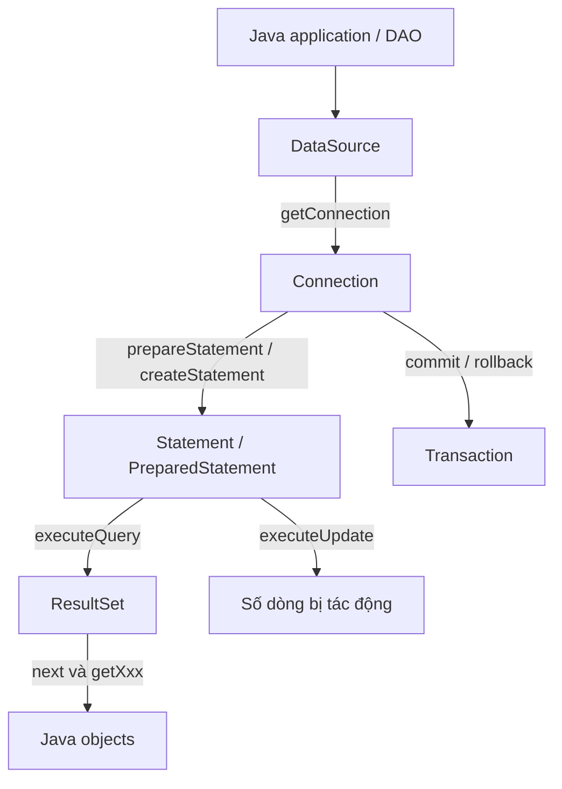
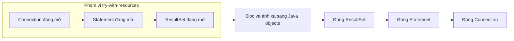

# Mối quan hệ giữa `Connection`, `Statement` và `ResultSet` trong JDBC

## 1. Bức tranh tổng thể

**JDBC (Java Database Connectivity)** là API Java để truy cập cơ sở dữ liệu quan hệ thông qua driver JDBC. Khi một chương trình cần lấy danh sách khách hàng, cập nhật số lượng tồn kho hoặc lưu một đơn hàng, ba giao diện xuất hiện thường xuyên là:

- **`Connection`**: đại diện cho một phiên làm việc/kết nối JDBC đến nguồn dữ liệu. Nó tạo statement và quản lý các thiết lập giao dịch.
- **`Statement`**: đại diện cho thao tác thực thi câu lệnh SQL trên một `Connection`. Các biến thể gồm `PreparedStatement` và `CallableStatement`.
- **`ResultSet`**: đại diện cho tập kết quả dạng bảng do một lần thực thi truy vấn trả về. Nó cho phép di chuyển con trỏ và đọc cột của dòng hiện tại.

Chúng có quan hệ tạo lập và sử dụng rõ ràng:



**Một kết nối có thể tạo nhiều statement, và mỗi statement có thể thực thi nhiều lần.** Tuy nhiên, các `ResultSet` nhận được vẫn gắn với tài nguyên của statement và kết nối đã tạo ra chúng. Không được xem chúng là các danh sách Java tồn tại độc lập.

Trong bài này, mục tiêu là hiểu **ai tạo ai, ai sở hữu thao tác gì, khi nào dữ liệu còn đọc được và khi nào phải đóng tài nguyên**. Các ví dụ dùng JDBC thuần, không phụ thuộc Spring hay thư viện ORM.

## 2. `Connection`: ngữ cảnh kết nối và giao dịch

`Connection` thuộc `java.sql`. Thông thường, ứng dụng lấy đối tượng này từ `javax.sql.DataSource`:

```java
import java.sql.Connection;
import java.sql.SQLException;
import javax.sql.DataSource;

public void inspectConnection(DataSource dataSource)
        throws SQLException {
    try (Connection connection = dataSource.getConnection()) {
        System.out.println("Auto-commit: " + connection.getAutoCommit());
        System.out.println("Isolation: " + connection.getTransactionIsolation());
        System.out.println("Read-only hint: " + connection.isReadOnly());
    } // Tự đóng hoặc trả kết nối về pool, tùy DataSource.
}
```

`DataSource` là cách lấy kết nối thông dụng trong ứng dụng. Với ví dụ nhỏ, `DriverManager.getConnection(url, user, password)` cũng trả về `Connection`. Việc driver quản lý socket, giao thức mạng hoặc kết nối thực tế như thế nào phụ thuộc triển khai; `Connection` là giao diện mà mã Java làm việc cùng.

Các trách nhiệm tiêu biểu của `Connection`:

| API | Vai trò |
| --- | --- |
| `createStatement()` | Tạo `Statement` cho SQL tĩnh |
| `prepareStatement(sql)` | Tạo `PreparedStatement` với câu SQL và tham số |
| `prepareCall(sql)` | Tạo `CallableStatement` cho lời gọi thủ tục hoặc function theo khả năng driver |
| `getAutoCommit()` / `setAutoCommit(boolean)` | Đọc/đổi chế độ tự động commit |
| `commit()` / `rollback()` | Kết thúc hoặc hủy giao dịch khi auto-commit đã tắt |
| `getTransactionIsolation()` / `setTransactionIsolation(level)` | Đọc/đặt mức cô lập giao dịch |
| `getMetaData()` | Lấy `DatabaseMetaData` để khảo sát khả năng cơ sở dữ liệu/driver |
| `close()` | Giải phóng tài nguyên của connection theo contract JDBC/DataSource |

**Không có `Connection` hợp lệ thì không thể tiếp tục dùng statement và result set phụ thuộc vào nó.** Khi dùng connection pool, `connection.close()` thường trả kết nối logic về pool thay vì đóng socket vật lý. Người gọi vẫn phải đóng `Connection` đúng lúc; không giữ reference để dùng tiếp sau khi trả pool.

### Connection và phạm vi giao dịch

Theo JDBC, connection mới thường bật **auto-commit** theo mặc định; có thể kiểm tra bằng `getAutoCommit()`. Khi auto-commit bật, mỗi SQL statement được commit khi hoàn tất theo quy tắc JDBC và driver (với câu trả kết quả, việc hoàn tất có thể gắn với việc xử lý/đóng kết quả). Vì vậy không nên mặc định một chuỗi câu SQL chạy trên cùng connection sẽ tạo ra một giao dịch nguyên tử.

Muốn các thay đổi cùng thành công hoặc cùng thất bại, phải quản lý transaction:

```java
try (Connection connection = dataSource.getConnection()) {
    connection.setAutoCommit(false);
    try {
        // Các PreparedStatement sử dụng cùng connection này.
        // Thực hiện các câu INSERT/UPDATE liên quan.
        connection.commit();
    } catch (SQLException | RuntimeException failure) {
        try {
            connection.rollback();
        } catch (SQLException rollbackError) {
            failure.addSuppressed(rollbackError);
        }
        throw failure;
    }
}
```

Đây là khuôn mẫu minh họa ranh giới transaction, không chứa SQL cụ thể. Việc đổi `autoCommit`, isolation hay đóng connection trong một hệ thống có transaction manager phải tuân theo tầng quản lý transaction của ứng dụng. Các phương thức `commit()/rollback()` dùng cho chế độ auto-commit đã tắt và một nguồn dữ liệu hỗ trợ transaction. Không chia một transaction nghiệp vụ thành nhiều connection độc lập rồi kỳ vọng mọi lệnh sẽ commit/rollback cùng nhau.

## 3. `Statement`: nơi câu SQL được thực thi

`Statement` được tạo **từ `Connection`**, không phải từ `ResultSet`. Nó mang ngữ cảnh thực thi SQL: query timeout, giới hạn số dòng, fetch size, loại `ResultSet` yêu cầu và các thiết lập khác mà driver hỗ trợ.

### Ba giao diện liên quan

| Giao diện | Khởi tạo từ `Connection` | Dùng khi nào |
| --- | --- | --- |
| `Statement` | `createStatement()` | SQL cố định, không chứa dữ liệu đầu vào thay đổi |
| `PreparedStatement` | `prepareStatement(sql)` | SQL có dấu `?` để bind dữ liệu; lựa chọn mặc định cho truy vấn nghiệp vụ có tham số |
| `CallableStatement` | `prepareCall(sql)` | Gọi stored procedure/function khi hệ quản trị và driver hỗ trợ |

`PreparedStatement` **kế thừa `Statement`**, và `CallableStatement` **kế thừa `PreparedStatement`**. Vì vậy các giao diện chuyên biệt vẫn có những khả năng chung của `Statement` nhưng bổ sung thao tác truyền tham số.

Ví dụ hai cách thực thi một truy vấn:

```java
// Câu SQL cố định, không cần tham số:
try (Statement statement = connection.createStatement();
     ResultSet rs = statement.executeQuery(
             "SELECT id, full_name FROM app_user")) {
    while (rs.next()) {
        System.out.println(rs.getLong("id")
                + ": " + rs.getString("full_name"));
    }
}

// Câu SQL có tham số được bind an toàn:
String sql = "SELECT id, full_name FROM app_user WHERE id = ?";
try (PreparedStatement statement = connection.prepareStatement(sql)) {
    statement.setLong(1, 42L);
    try (ResultSet rs = statement.executeQuery()) {
        if (rs.next()) {
            System.out.println(rs.getString("full_name"));
        }
    }
}
```

Các đoạn mã giả định biến `connection` đã được mở và còn hợp lệ. Dữ liệu do người dùng nhập **không được nối trực tiếp vào SQL**, chẳng hạn `"... WHERE id = " + userInput`. Dùng placeholder `?` và `setXxx(index, value)` giúp tách giá trị khỏi cấu trúc SQL và giảm nguy cơ SQL injection. Các chỉ số tham số JDBC bắt đầu từ **1**.

### Chọn phương thức thực thi

| Phương thức | Kết quả chính | Ví dụ sử dụng |
| --- | --- | --- |
| `executeQuery(sql)` / `PreparedStatement.executeQuery()` | `ResultSet` | `SELECT` trả tập bản ghi |
| `executeUpdate(sql)` / `PreparedStatement.executeUpdate()` | Số dòng chịu ảnh hưởng, hoặc `0` với lệnh không trả số dòng cập nhật như một số DDL | `INSERT`, `UPDATE`, `DELETE`, DDL theo hỗ trợ |
| `execute(...)` | `boolean`: `true` nếu kết quả đầu tiên là `ResultSet`, `false` nếu kết quả đầu tiên là update count hoặc không có kết quả | Câu lệnh có thể trả về nhiều kiểu kết quả |
| `executeBatch()` | Mảng update count/trạng thái batch | Gửi nhiều lệnh cập nhật đã thêm qua `addBatch()` |

Chú ý: `execute() == false` **không đồng nghĩa với câu lệnh thất bại**. Nếu sử dụng `execute()`, cần gọi `getResultSet()`, `getUpdateCount()` và khi cần `getMoreResults()` để xử lý kiểu kết quả thực tế. Phương thức được chọn còn phụ thuộc driver/hệ quản trị; không được dùng `executeQuery()` cho câu lệnh không trả `ResultSet` rồi giả định driver luôn chấp nhận.

`Statement` không tự tạo ra các đối tượng domain như `User`. Nó chỉ giao tiếp với nguồn dữ liệu và trả về kết quả theo API JDBC; phần diễn giải dòng dữ liệu là trách nhiệm của mã ứng dụng.

## 4. `ResultSet`: con trỏ và dữ liệu của lần truy vấn

Một lệnh `executeQuery()` trả `ResultSet` nếu thành công. Có thể hình dung kết quả là một bảng:

| id | full_name | active |
| ---: | --- | --- |
| 10 | An Nguyễn | true |
| 11 | Bình Trần | false |
| 12 | Chi Lê | true |

Tuy nhiên, `ResultSet` **không phải `List<User>` đã được nạp sẵn**. Nó là giao diện truy cập các dòng kết quả. Driver có thể tải trước, nhận từng khối hoặc dùng con trỏ phía máy chủ tùy cấu hình và triển khai.

Đối với `ResultSet` thông thường, con trỏ lúc bắt đầu nằm **trước dòng đầu tiên**. Phương thức `next()` di chuyển đến dòng kế tiếp và trả về `true` nếu có dòng:

```java
try (PreparedStatement statement = connection.prepareStatement(
        "SELECT id, full_name, active FROM app_user ORDER BY id");
     ResultSet rs = statement.executeQuery()) {

    while (rs.next()) {
        long id = rs.getLong("id");
        String name = rs.getString("full_name");
        boolean active = rs.getBoolean("active");
        System.out.printf("%d | %s | %s%n", id, name, active);
    }
}
```

Các bước của vòng lặp:

1. `next()` lần đầu: con trỏ chuyển từ trước kết quả đến dòng thứ nhất.
2. `getLong("id")`, `getString("full_name")` và `getBoolean("active")` đọc cột của **dòng hiện tại**.
3. `next()` lần tiếp: chuyển sang dòng kế.
4. `next()` trả `false`: không còn dòng để đọc; vòng lặp kết thúc.

Trong lúc con trỏ ở trước dòng đầu tiên hoặc sau dòng cuối, gọi `getXxx()` để đọc cột có thể gây `SQLException`. Không gọi `rs.next()` thêm lần nữa trong một phương thức mapper vốn được gọi bên trong vòng `while (rs.next())`, vì sẽ bỏ qua dòng.

### Đọc theo tên cột hay theo vị trí?

`ResultSet` hỗ trợ cả `rs.getString("full_name")` và `rs.getString(2)`. Chỉ số cột bắt đầu từ **1**, không phải 0. Đọc bằng nhãn cột thường dễ bảo trì hơn khi thay đổi thứ tự cột trong câu `SELECT`.

Nhãn cột chịu ảnh hưởng bởi alias:

```sql
SELECT id, full_name AS display_name
FROM app_user
WHERE id = ?;
```

Với câu SQL trên, dùng `rs.getString("display_name")`. Mã phụ thuộc nhãn `full_name` có thể thất bại vì nhãn trả về đã đổi. Khi ghép nhiều bảng, dùng alias rõ ràng để tránh hai cột cùng tên.

### Giá trị `NULL` và getter kiểu nguyên thủy

Các phương thức như `getLong()`, `getInt()`, `getBoolean()` trả kiểu nguyên thủy. Khi cột SQL có giá trị `NULL`, `getLong()` trả `0` và `getBoolean()` trả `false`, nên không thể tự phân biệt giá trị thật với `NULL`. Dùng `wasNull()` **ngay sau lượt đọc cột đó**:

```java
long managerIdValue = rs.getLong("manager_id");
Long managerId = rs.wasNull() ? null : managerIdValue;

String nickname = rs.getString("nickname");
// Với getString, SQL NULL được trả về dưới dạng Java null.
```

Các getter kiểu đối tượng như `getString()` hoặc `getBigDecimal()` trả `null` khi SQL `NULL`. Với kiểu ngày/giờ hoặc kiểu JDBC đặc thù, cần thiết kế ánh xạ cẩn thận và kiểm tra khả năng driver.

### Kiểu `ResultSet`, concurrency và holdability

Mặc định, statement thông thường yêu cầu `ResultSet.TYPE_FORWARD_ONLY` và `ResultSet.CONCUR_READ_ONLY`, phù hợp với cách duyệt một chiều. Có thể yêu cầu kiểu cuộn và mức concurrency khác bằng overload của `createStatement()` hoặc `prepareStatement()`:

```java
try (PreparedStatement statement = connection.prepareStatement(
        "SELECT id, full_name FROM app_user",
        ResultSet.TYPE_SCROLL_INSENSITIVE,
        ResultSet.CONCUR_READ_ONLY);
     ResultSet rs = statement.executeQuery()) {

    if (rs.last()) {
        System.out.println("Last ID: " + rs.getLong("id"));
    }
}
```

Ví dụ chỉ đúng khi driver/DB hỗ trợ kiểu kết quả này. Kiểm tra bằng `connection.getMetaData().supportsResultSetType(...)`, và có thể kiểm tra `statement.getResultSetType()` hoặc `rs.getType()` để biết kiểu thực tế. Một số driver không đáp ứng được kiểu đã yêu cầu hoặc từ chối với `SQLException`.

**Holdability** quyết định con trỏ kết quả có được giữ qua `commit()` hay không, tùy khả năng driver và cấu hình statement. Hai hằng số JDBC là `HOLD_CURSORS_OVER_COMMIT` và `CLOSE_CURSORS_AT_COMMIT`. Vì vậy không nên giả định mọi `ResultSet` luôn tồn tại sau `commit()` hoặc luôn bị đóng khi commit. Cách an toàn với luồng truy vấn thông thường là tiêu thụ dữ liệu và đóng `ResultSet` trong phạm vi rõ ràng.

## 5. Quan hệ vòng đời: ai tạo, ai đóng?

Sơ đồ phụ thuộc tài nguyên:



Các mối quan hệ đáng nhớ:

- `Connection` tạo `Statement` hoặc `PreparedStatement`. Một connection có thể dùng nhiều statement trong cùng phiên/giao dịch.
- `Statement` thực thi truy vấn để tạo `ResultSet`. **Một statement có thể được dùng lại**, nhưng theo quy tắc JDBC, việc thực thi lại statement thường đóng `ResultSet` hiện tại do chính statement đó tạo; không đọc result set cũ sau khi thực thi lại statement.
- Đóng `Statement` sẽ đóng `ResultSet` hiện tại gắn với nó. Dù thế, mã rõ ràng vẫn nên đóng riêng `ResultSet` bằng `try-with-resources`, đặc biệt để giải phóng tài nguyên sớm.
- Đóng `Connection` khiến các hoạt động trên statement/result set còn phụ thuộc nó không còn hợp lệ. Với pooled connection, gọi `close()` vẫn là bắt buộc để trả tài nguyên về pool.
- Một số API như `getGeneratedKeys()` hoặc `DatabaseMetaData.getTables()` cũng tạo `ResultSet`, dù không phải từ một lệnh `SELECT` thông thường. Chúng cũng phải được đóng.

### `try-with-resources` đúng cách

```java
try (Connection connection = dataSource.getConnection();
     PreparedStatement statement = connection.prepareStatement(sql)) {

    statement.setLong(1, requestedId);

    try (ResultSet rs = statement.executeQuery()) {
        while (rs.next()) {
            // Ánh xạ dữ liệu khi ResultSet còn mở.
        }
    } // ResultSet.close()
} // Statement.close() rồi Connection.close()
```

`try-with-resources` đóng tài nguyên theo **thứ tự ngược với thứ tự khai báo** và vẫn thực hiện đóng khi phát sinh ngoại lệ. Trong ví dụ, `ResultSet` được khai báo trong `try` lồng, nên nó đóng trước khi thoát khỏi khối statement/connection. Nếu thao tác đọc hoặc đóng ném `SQLException`, mã bên gọi cần xử lý hoặc truyền ngoại lệ phù hợp.

### Phản ví dụ: trả `ResultSet` ra khỏi phạm vi tài nguyên

```java
// SAI: trả con trỏ ra ngoài khi statement và connection đã đóng.
public ResultSet findUsers(DataSource dataSource) throws SQLException {
    try (Connection connection = dataSource.getConnection();
         Statement statement = connection.createStatement()) {
        return statement.executeQuery(
                "SELECT id, full_name FROM app_user");
    }
}
```

Lời gọi có thể nhận một `ResultSet` đã mất khả năng sử dụng. **Hãy đọc hết dữ liệu và ánh xạ sang đối tượng Java trước khi đóng tài nguyên**, hoặc thiết kế một callback nhận `ResultSet` và chạy hoàn toàn bên trong phạm vi tài nguyên đang mở.

## 6. Ví dụ đầy đủ: repository đọc nhiều bản ghi

Giả sử có bảng ví dụ:

```sql
CREATE TABLE app_user (
    id        BIGINT PRIMARY KEY,
    full_name VARCHAR(100) NOT NULL,
    active    BOOLEAN NOT NULL
);
```

Tên kiểu SQL/cú pháp DDL có thể thay đổi giữa các hệ quản trị. Mã Java 17+ dưới đây mô tả trọn vẹn đường đi từ `Connection` đến đối tượng ứng dụng:

```java
import java.sql.Connection;
import java.sql.PreparedStatement;
import java.sql.ResultSet;
import java.sql.SQLException;
import java.util.ArrayList;
import java.util.List;
import java.util.Objects;
import javax.sql.DataSource;

record User(long id, String fullName, boolean active) {}

public final class JdbcUserRepository {
    private final DataSource dataSource;

    public JdbcUserRepository(DataSource dataSource) {
        this.dataSource = Objects.requireNonNull(dataSource);
    }

    public List<User> findByActive(boolean active) throws SQLException {
        String sql = """
            SELECT id, full_name, active
            FROM app_user
            WHERE active = ?
            ORDER BY id
            """;

        List<User> users = new ArrayList<>();

        try (Connection connection = dataSource.getConnection();
             PreparedStatement statement =
                     connection.prepareStatement(sql)) {

            statement.setBoolean(1, active);

            try (ResultSet rs = statement.executeQuery()) {
                while (rs.next()) {
                    users.add(new User(
                            rs.getLong("id"),
                            rs.getString("full_name"),
                            rs.getBoolean("active")
                    ));
                }
            }
        }
        return users;
    }
}
```

Đọc luồng mã theo quan hệ:

| Bước | Đối tượng | Hành động | Kết quả |
| --- | --- | --- | --- |
| 1 | `DataSource` | `getConnection()` | Mở một phạm vi làm việc với cơ sở dữ liệu |
| 2 | `Connection` | `prepareStatement(sql)` | Tạo statement gắn với connection |
| 3 | `PreparedStatement` | `setBoolean(1, active)` | Bind dữ liệu vào placeholder thứ nhất |
| 4 | `PreparedStatement` | `executeQuery()` | Nhận `ResultSet` |
| 5 | `ResultSet` | `next()` và `getXxx()` | Đọc từng dòng đang hợp lệ |
| 6 | Mã ứng dụng | `new User(...)` | Tạo đối tượng Java độc lập |
| 7 | `try-with-resources` | `close()` theo phạm vi | Giải phóng tài nguyên JDBC |

Điểm quan trọng là **`List<User>` vẫn dùng được sau khi connection đóng**, vì danh sách chứa dữ liệu đã ánh xạ; bản thân `ResultSet` thì không còn được truy cập sau phạm vi `try`.

Ứng dụng lớn có thể tách đoạn `new User(...)` thành `RowMapper<User>` để tái sử dụng, nhưng quy tắc không đổi: bộ duyệt gọi `rs.next()`, mapper chỉ đọc dòng hiện tại.

## 7. Cập nhật dữ liệu: khi nào không có `ResultSet`?

Không phải mọi SQL statement đều trả các dòng dữ liệu. Với `UPDATE`, phần lớn trường hợp ta cần số dòng bị ảnh hưởng:

```java
public int renameUser(DataSource dataSource, long id, String name)
        throws SQLException {
    String sql = "UPDATE app_user SET full_name = ? WHERE id = ?";

    try (Connection connection = dataSource.getConnection();
         PreparedStatement statement = connection.prepareStatement(sql)) {
        statement.setString(1, name);
        statement.setLong(2, id);
        return statement.executeUpdate();
    }
}
```

Nếu kết quả là `0`, truy vấn `UPDATE` không tác động đến dòng nào theo ngữ nghĩa/driver của câu lệnh đó. Không cần tạo `ResultSet` để đọc số dòng đã cập nhật.

Một câu `INSERT` có thể tạo khóa tự sinh và trả về một **`ResultSet` khác** từ `getGeneratedKeys()`:

```java
String sql = "INSERT INTO app_user(full_name, active) VALUES (?, ?)";
try (Connection connection = dataSource.getConnection();
     PreparedStatement statement = connection.prepareStatement(
             sql, java.sql.Statement.RETURN_GENERATED_KEYS)) {

    statement.setString(1, "Mai");
    statement.setBoolean(2, true);
    statement.executeUpdate();

    try (ResultSet keys = statement.getGeneratedKeys()) {
        if (keys.next()) {
            long newId = keys.getLong(1);
            System.out.println("New ID: " + newId);
        }
    }
}
```

Ví dụ này giả định bảng được cấu hình sinh `id` tự động và driver hỗ trợ lấy khóa; bảng DDL ở mục trước chỉ định `BIGINT PRIMARY KEY` để minh họa cấu trúc, **chưa tự thiết lập cách sinh khóa**. Không được kết luận câu `INSERT` trên sẽ tạo khóa nếu chưa cấu hình identity/sequence phù hợp với hệ quản trị.

## 8. Một statement có thể có nhiều kết quả?

Có. Một số thủ tục hoặc câu SQL đặc thù có thể tạo nhiều `ResultSet`, update count hoặc chuỗi kết quả hỗn hợp. Với `Statement.execute(...)`, hãy hiểu giá trị `boolean` là **loại kết quả đầu tiên**, không phải trạng thái thành công của toàn câu lệnh.

Mô hình xử lý tổng quát:

```java
boolean hasResultSet = statement.execute(sql);

while (true) {
    if (hasResultSet) {
        try (ResultSet rs = statement.getResultSet()) {
            while (rs.next()) {
                // Đọc kết quả hiện tại.
            }
        }
    } else {
        int count = statement.getUpdateCount();
        if (count == -1) {
            break; // Không còn kết quả.
        }
        // Xử lý update count hiện tại.
    }
    hasResultSet = statement.getMoreResults();
}
```

Ví dụ yêu cầu biến `statement` còn mở và `sql` là câu lệnh hợp lệ, có thể tạo nhiều kết quả. `getMoreResults()` chuyển đến kết quả tiếp theo và theo mặc định đóng `ResultSet` hiện tại của statement; chúng ta cũng đóng `ResultSet` một cách chủ động. Một số driver/DB không hỗ trợ tất cả dạng nhiều kết quả, nên đây là luồng nâng cao cần kiểm thử riêng.

## 9. Các câu hỏi khó gặp trong ứng dụng thực tế

### Có thể chia sẻ một `Connection` cho nhiều thread không?

Không nên mặc định là an toàn. Giao diện JDBC không bảo đảm mọi driver hỗ trợ thao tác đồng thời an toàn trên cùng connection; các statement cùng connection cũng có thể ảnh hưởng đến trạng thái transaction và kết quả. Thông thường mỗi tác vụ được cấp connection theo phạm vi từ pool, rồi trả về pool khi hoàn tất. Việc chia sẻ connection phải dựa trên contract cụ thể của driver và thiết kế transaction.

### Một `Statement` có giữ được hai `ResultSet` đang đọc cùng lúc không?

Không nên dựa vào điều đó. Theo quy tắc chung, mỗi `Statement` chỉ có một `ResultSet` hiện tại. Việc thực thi lại statement thường đóng result set hiện tại; `getMoreResults()` cũng điều khiển vòng đời kết quả. Nếu cần xử lý hai truy vấn cùng lúc, cân nhắc tạo hai statement riêng trên connection phù hợp, hoặc đọc kết quả thứ nhất vào cấu trúc Java rồi mới thực thi truy vấn thứ hai. Khả năng duy trì nhiều result set còn phụ thuộc driver và phương thức JDBC được sử dụng.

### Có phải `ResultSet` luôn tải toàn bộ dữ liệu vào RAM?

Không. Driver quyết định phương thức tải/buffer dữ liệu; `setFetchSize(...)` chỉ là một **gợi ý** và không bắt buộc driver phải streaming. Khi cần đọc dữ liệu lớn, phải kiểm tra cấu hình cursor, transaction, fetch size và đặc điểm driver. Dù streaming, vẫn phải đóng `ResultSet` đúng hạn.

### Nếu `ResultSet` đã đóng thì có cần đóng `Statement` nữa không?

Có. Chúng là những tài nguyên riêng trong contract JDBC. Đóng result set không thay thế trách nhiệm đóng statement và connection. Ngoại lệ là các chế độ quản lý tài nguyên do API/driver có quy định riêng, chẳng hạn `closeOnCompletion()`, nhưng mã JDBC thông thường nên dùng `try-with-resources` rõ ràng.

### Có thể giữ statement để dùng lại nhiều lần không?

Có thể dùng một `PreparedStatement` nhiều lần khi connection còn mở bằng cách bind lại tham số và thực thi lại, nhưng **không tiếp tục đọc `ResultSet` của lần trước sau lần thực thi mới**. Không chia sẻ statement tùy tiện giữa các tác vụ bất đồng bộ. Nếu có connection pool và statement cache, việc tái sử dụng vật lý có thể do pool/driver quản lý; mã ứng dụng vẫn phải tuân thủ vòng đời logic.

## 10. Lỗi thường gặp và cách khắc phục

| Dấu hiệu | Nguyên nhân | Hướng xử lý |
| --- | --- | --- |
| `ResultSet closed`, `Statement closed` | Đọc kết quả sau khi statement/connection đã đóng hoặc thực thi lại statement | Ánh xạ kết quả trong khối `try`, không trả `ResultSet` ra ngoài |
| `Invalid cursor state` | Gọi getter trước `next()` hoặc sau khi hết dữ liệu | Kiểm tra `rs.next()` trước khi đọc |
| Bỏ qua các dòng trong kết quả | Có hai nơi cùng gọi `rs.next()` | Chỉ một vòng duyệt quản lý con trỏ |
| Lỗi tham số SQL | Nhầm vị trí tham số hoặc quên bind placeholder | Đếm dấu `?`; JDBC bắt đầu chỉ số từ 1 |
| SQL injection | Nối input trực tiếp vào chuỗi SQL | Dùng `PreparedStatement` với `setXxx()` |
| Hết connection trong pool | Quên đóng hoặc giữ connection lâu ngoài phạm vi | Dùng `try-with-resources` và giới hạn thời gian sử dụng |
| `commit()` không như kỳ vọng | Hiểu nhầm `autoCommit` hoặc dùng nhiều connection | Kiểm soát transaction trên đúng connection |
| Câu `UPDATE` không có dữ liệu để duyệt | Dùng `executeQuery()` cho câu cập nhật | Dùng `executeUpdate()` và đọc update count |
| Sai dữ liệu khi SQL `NULL` | Dùng primitive getter mà bỏ qua `wasNull()` | Kiểm tra `wasNull()` ngay sau getter |
| Kết quả truy vấn lớn gây áp lực bộ nhớ | Nạp tất cả dòng dù chỉ cần xử lý tuần tự | Thiết kế xử lý theo dòng/paging; kiểm tra khả năng fetch của driver |

## 11. Bài tập thực hành và câu hỏi tự kiểm tra

**Bài tập 1 – Tìm một bản ghi:** Viết `Optional<User> findById(DataSource ds, long id)` với `PreparedStatement`. Trả `Optional.empty()` nếu `rs.next()` là `false`, nếu có thì tạo `User` ngay trong phạm vi mở `ResultSet`. Nếu `id` là khóa chính thì một lần `next()` đủ để nhận tối đa một bản ghi.

**Bài tập 2 – Hai statement cùng một connection:** Trong một transaction, cập nhật số dư của hai tài khoản bằng hai `PreparedStatement` khác nhau trên cùng connection. Tại sao dùng chung connection và điều phối `commit()/rollback()` lại quan trọng? Nếu chuyển một statement sang connection khác, điều gì thay đổi?

**Bài tập 3 – Phát hiện lỗi:** Đọc ví dụ sau và nêu ít nhất hai vấn đề:

```java
ResultSet rs;
try (Connection c = dataSource.getConnection();
     Statement s = c.createStatement()) {
    rs = s.executeQuery("SELECT id FROM app_user");
}
while (rs.next()) {
    System.out.println(rs.getLong(1));
}
```

Gợi ý: `Statement` và `Connection` đã đóng trước khi vòng lặp bắt đầu; `ResultSet` không được quản lý bằng `try-with-resources` ở nơi nó được sử dụng.

**Câu hỏi tự kiểm tra:** Nếu thay `executeQuery()` bằng `executeUpdate()` thì kiểu kết quả thay đổi ra sao? Khi nào cần `getGeneratedKeys()`? `ResultSet` có còn hợp lệ sau khi đóng statement không? Khi nào driver có thể từ chối một loại result set đã yêu cầu?

Trục quan hệ cốt lõi là: **`Connection` cung cấp ngữ cảnh kết nối/giao dịch → `Statement` thực thi SQL trên kết nối đó → `ResultSet` cho phép duyệt và đọc kết quả của lần thực thi**. Đặt mỗi đối tượng trong một phạm vi tài nguyên rõ ràng giúp mã JDBC đúng, dễ bảo trì và dễ xác định nguyên nhân khi có lỗi.
