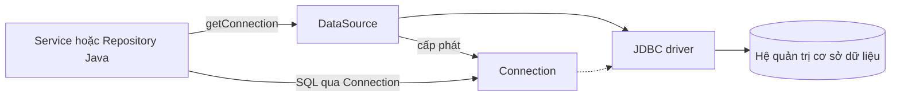
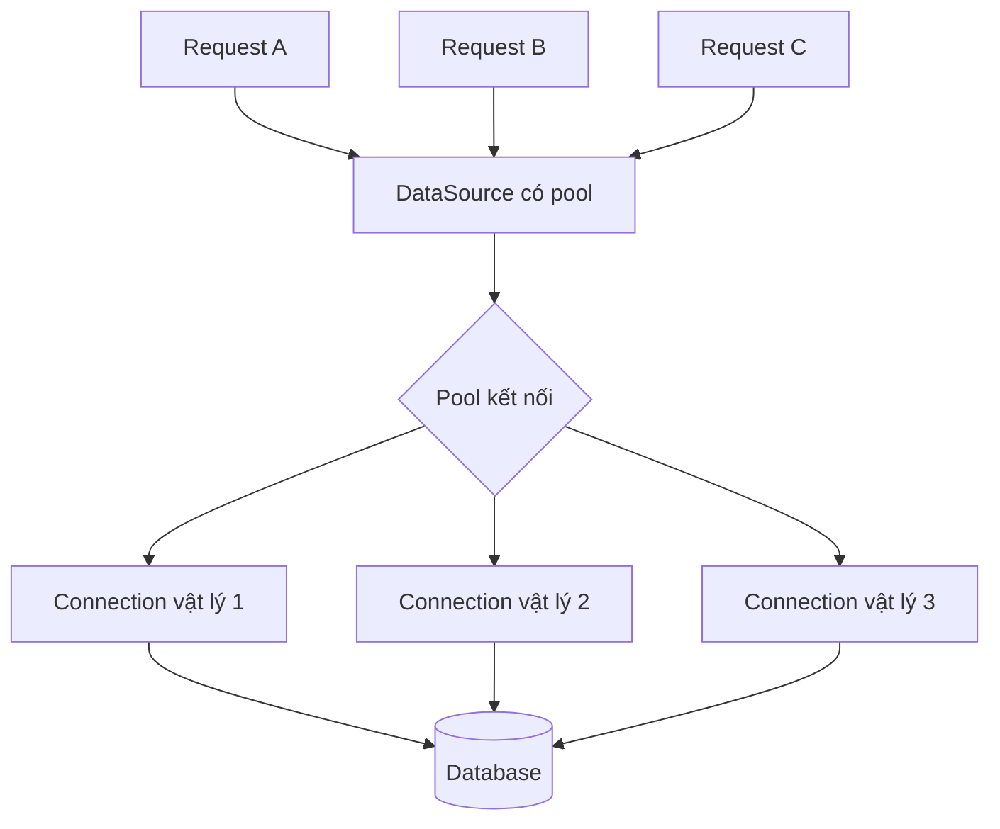
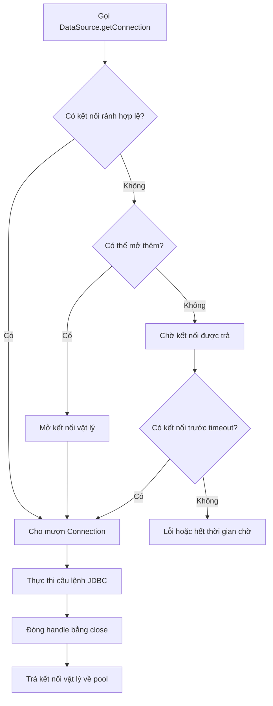
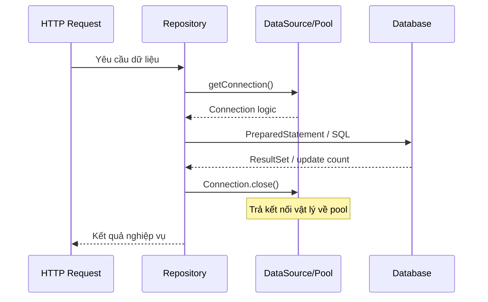

# Vai trò của `DataSource` và cơ chế cấp phát kết nối trong JDBC

## 1. Vì sao ứng dụng JDBC cần một nguồn cấp kết nối?

Một ứng dụng Java bán hàng có thể nhận hàng trăm yêu cầu xem sản phẩm và đặt hàng trong cùng khoảng thời gian. Mỗi yêu cầu cần trao đổi với cơ sở dữ liệu quan hệ để đọc sản phẩm, kiểm tra tồn kho hoặc lưu đơn hàng. Để làm việc đó bằng **JDBC (Java Database Connectivity)**, ứng dụng cần đối tượng `java.sql.Connection`.

Nếu mỗi nơi truy vấn tự biết URL, tài khoản, mật khẩu, cách mở kết nối và cấu hình timeout, mã nguồn sẽ khó bảo trì. Hơn nữa, việc tạo một kết nối vật lý mới thường tốn chi phí: thiết lập kết nối mạng, xác thực và khởi tạo phiên làm việc tại hệ quản trị cơ sở dữ liệu. Trong ứng dụng nhiều request, liên tục tạo rồi hủy kết nối có thể gây tắc nghẽn và tăng tải lên máy chủ database.

**`javax.sql.DataSource` là giao diện chuẩn của JDBC đại diện cho một nguồn cung cấp kết nối.** Mã nghiệp vụ chỉ cần gọi `dataSource.getConnection()` để nhận `Connection` và sử dụng API JDBC thông thường. Phần cấu hình kết nối, xác thực và cơ chế cấp phát được đóng gói phía sau một triển khai `DataSource`.

Điểm cần ghi nhớ ngay từ đầu: **`DataSource` không đồng nghĩa với connection pool.** Một triển khai `DataSource` có thể tạo kết nối mới mỗi lần gọi; một triển khai khác có thể quản lý và tái sử dụng nhiều kết nối qua pool.

## 2. `DataSource` đứng ở đâu trong kiến trúc JDBC?



Từ góc nhìn người viết service/repository, việc truy vấn cơ sở dữ liệu vẫn xoay quanh `Connection`, `PreparedStatement`, `ResultSet` và `SQLException`. Điểm khác biệt là **ai cung cấp `Connection`**: mã gọi `DriverManager` trực tiếp, hay một `DataSource` được cấu hình và truyền vào thành phần sử dụng.

| Thành phần | Chức năng | Điều không nên nhầm lẫn |
| --- | --- | --- |
| `DriverManager` (`java.sql`) | Chọn JDBC driver phù hợp theo JDBC URL và tạo kết nối bằng `getConnection(...)`. | Không tự cung cấp connection pool. |
| `DataSource` (`javax.sql`) | Giao diện cung cấp `Connection` cho mã ứng dụng. | Bản thân interface không bắt buộc lưu giữ hay tái sử dụng kết nối. |
| JDBC driver | Triển khai giao tiếp thực tế với PostgreSQL, MySQL, SQL Server hoặc DBMS khác. | Driver không thay thế logic nghiệp vụ hoặc SQL do ứng dụng cần viết. |
| `Connection` (`java.sql`) | Đại diện phiên giao tiếp JDBC để chuẩn bị SQL và điều khiển transaction. | Không nên coi là đối tượng toàn cục dùng chung cho mọi luồng. |
| Connection pool | Giới hạn, quản lý và tái sử dụng các kết nối vật lý. | Là chức năng của một triển khai/thư viện quản lý, không phải bảo đảm mặc định của mọi `DataSource`. |

Tên package `javax.sql` là tên chuẩn của API JDBC ngay cả trong các phiên bản Java hiện đại; không đổi thành `jakarta.sql` chỉ vì ứng dụng sử dụng một framework Jakarta khác.

## 3. Các kiểu triển khai `DataSource` thường gặp

### 3.1. `DataSource` tạo kết nối trực tiếp

Một triển khai đơn giản lưu cấu hình máy chủ, database và tài khoản. Mỗi lần gọi `getConnection()`, nó có thể nhờ JDBC driver mở **một kết nối vật lý mới**. Khi ứng dụng gọi `close()`, kết nối đó thường được đóng thực sự.

Ví dụ: một số JDBC driver cung cấp lớp `DataSource` riêng để cấu hình kết nối. Cách này có thể phù hợp cho thử nghiệm, công cụ dòng lệnh hoặc ứng dụng rất nhỏ. Nhưng chỉ thay `DriverManager` bằng một `DataSource` như vậy **chưa đủ** để giải quyết chi phí mở kết nối trong hệ thống nhiều request.

### 3.2. `DataSource` được hỗ trợ bởi connection pool

Một pool quản lý tập kết nối vật lý đang mở đến database. `getConnection()` cấp cho mã ứng dụng một **handle kết nối logic** tương ứng với một kết nối vật lý hiện có hoặc mới được tạo. Khi mã ứng dụng gọi `close()`, handle kết nối được đóng và kết nối vật lý **thường được trả về pool** để cấp lại cho request khác, tùy hợp đồng triển khai.

Các thư viện như HikariCP hoặc các hệ thống quản lý pool trong application server có thể cung cấp triển khai `DataSource` này. Nhờ cơ chế tái sử dụng, ứng dụng tránh phải thực hiện handshake và xác thực lại cho mọi truy vấn.



Sơ đồ minh họa ba kết nối, **không phải** một số lượng bắt buộc. Một pool có thể có ít hoặc nhiều kết nối hơn tùy cấu hình và tải thực tế.

### 3.3. `DataSource` do container hoặc framework quản lý

Trong ứng dụng doanh nghiệp, một application server hoặc framework có thể khởi tạo `DataSource` một lần khi ứng dụng bắt đầu, sau đó truyền cùng nguồn cấp đó cho các service/repository. Ứng dụng chỉ phụ thuộc vào interface `DataSource`, nhờ vậy dễ thay cấu hình và triển khai pool.

Trong môi trường Java EE/Jakarta EE có thể gặp cách tra cứu `DataSource` đã đăng ký qua JNDI, chẳng hạn tên `java:comp/env/jdbc/AppDb`. Tên JNDI và khả năng tra cứu phụ thuộc cấu hình container; đây không phải cách khởi tạo bắt buộc cho ứng dụng Java độc lập.

## 4. Pool cấp phát kết nối như thế nào?

Một cơ chế cấp phát pool điển hình có thể được mô tả theo các bước sau. **Thuật toán cụ thể phụ thuộc thư viện pool**, vì giao diện JDBC không quy định số kết nối tối thiểu, chính sách xếp hàng hay thời gian chờ.

1. Thành phần nghiệp vụ gọi `dataSource.getConnection()`.
2. Pool tìm một kết nối đang rảnh và còn hợp lệ; nếu có, pool cho request **mượn** kết nối đó.
3. Nếu chưa có kết nối rảnh nhưng vẫn dưới giới hạn cấu hình, pool **có thể** mở kết nối vật lý mới, hoàn tất xác thực rồi cho mượn.
4. Nếu đã đạt giới hạn và mọi kết nối đang bận, request thường **chờ** một kết nối được trả lại trong khoảng thời gian cho phép.
5. Nếu hết thời gian chờ hoặc không tạo được kết nối do lỗi database/mạng/xác thực, `getConnection()` có thể ném `SQLException` hay ngoại lệ phù hợp của triển khai.
6. Sau khi sử dụng, mã nghiệp vụ gọi `Connection.close()`. Pool thu hồi handle, kiểm tra hoặc đặt lại trạng thái cần thiết rồi đưa kết nối vật lý về danh sách sẵn sàng.



Những khái niệm sau thường xuất hiện trong cấu hình pool:

| Thuộc tính | Ý nghĩa |
| --- | --- |
| **Maximum pool size** | Số kết nối vật lý tối đa pool được phép quản lý đồng thời; giới hạn theo cấu hình thư viện. |
| **Minimum idle** | Mức số kết nối rảnh mà một số pool cố gắng duy trì; không phải tham số JDBC chung. |
| **Connection acquisition timeout** | Thời gian tối đa để một request chờ mượn được kết nối từ pool. |
| **Idle timeout** | Điều kiện/thời gian pool có thể đóng kết nối vật lý đang rảnh nhằm giảm tài nguyên. |
| **Maximum lifetime** | Tuổi thọ tối đa được cấu hình cho kết nối vật lý trước khi pool thay thế nó an toàn. |
| **Validation/health check** | Kiểm tra kết nối còn sử dụng được, thường qua khả năng kiểm tra của driver/JDBC hoặc truy vấn phù hợp. |

Các tên và cách áp dụng có thể khác nhau giữa các pool. Pool cũng có thể tạo kết nối trước, tạo dần theo tải hoặc thu hẹp số kết nối khi nhàn rỗi. Không nên suy rằng một pool kích thước tối đa 20 luôn giữ đúng 20 kết nối vật lý đang mở.

## 5. Vì sao `close()` là bước thiết yếu?

Khi nhận một `Connection` từ `DataSource`, mã gọi phải hiểu rõ **quyền sở hữu và vòng đời**: thành phần nào mượn kết nối thì thành phần đó cần bảo đảm trả lại khi sử dụng xong, trừ khi transaction manager/framework sở hữu vòng đời thay cho nó.

```java
import java.sql.Connection;
import java.sql.PreparedStatement;
import java.sql.ResultSet;
import java.sql.SQLException;
import java.util.Optional;
import javax.sql.DataSource;

public final class ProductRepository {
    private final DataSource dataSource;

    public ProductRepository(DataSource dataSource) {
        this.dataSource = dataSource;
    }

    public Optional<String> findProductName(long productId) throws SQLException {
        String sql = "SELECT name FROM products WHERE id = ?";

        try (Connection connection = dataSource.getConnection();
             PreparedStatement statement = connection.prepareStatement(sql)) {
            statement.setLong(1, productId);

            try (ResultSet result = statement.executeQuery()) {
                if (result.next()) {
                    return Optional.ofNullable(result.getString("name"));
                }
                return Optional.empty();
            }
        }
    }
}
```

Đoạn mã trên giả định bảng `products` có các cột `id` và `name` và `dataSource` đã được cấu hình trước. `PreparedStatement` giúp bind `productId` an toàn; `ResultSet` duyệt kết quả SQL. Các khối **try-with-resources** đóng kết quả, statement và kết nối kể cả khi xảy ra `SQLException`.

Đặc biệt, `return` nằm trong `try` vẫn khiến các tài nguyên được đóng trước khi phương thức kết thúc. Với `DataSource` dùng pool, điều này thường có nghĩa là **trả lại kết nối để request khác sử dụng**, tránh tình trạng pool hết kết nối vì các handle bị bỏ quên.

Không được viết một method gọi `dataSource.getConnection()` liên tục mà không đóng kết nối. Khi đó, mặc dù chương trình không có lỗi cú pháp hay SQL, lượng kết nối đang được mượn sẽ tăng dần; cuối cùng các request mới có thể phải chờ rồi timeout. Hiện tượng này thường được gọi là **connection leak**.

## 6. Cấu hình một connection pool cụ thể

Ví dụ dưới dùng **HikariCP** để minh họa một triển khai `DataSource` có pool. HikariCP là thư viện bổ sung, **không nằm sẵn trong JDBC API**. Để chạy, dự án cần có dependency HikariCP và JDBC driver tương ứng với database, chẳng hạn driver PostgreSQL. URL, user và password được lấy từ biến môi trường để tránh đặt mật khẩu thật trong mã nguồn.

```java
import com.zaxxer.hikari.HikariConfig;
import com.zaxxer.hikari.HikariDataSource;
import java.sql.SQLException;
import javax.sql.DataSource;

public final class PoolBootstrap {
    public static void main(String[] args) throws SQLException {
        HikariConfig config = new HikariConfig();
        config.setJdbcUrl(requiredEnv("DB_URL"));
        config.setUsername(requiredEnv("DB_USER"));
        config.setPassword(requiredEnv("DB_PASSWORD"));

        config.setMaximumPoolSize(10);
        config.setMinimumIdle(2);
        config.setConnectionTimeout(5_000); // mili giây
        config.setPoolName("shop-pool");

        // Minh họa ứng dụng dòng lệnh: đóng pool khi kết thúc chương trình.
        try (HikariDataSource dataSource = new HikariDataSource(config)) {
            ProductRepository repository = new ProductRepository(dataSource);
            System.out.println(repository.findProductName(1L)
                    .orElse("Khong tim thay san pham"));
        }
    }

    private static String requiredEnv(String key) {
        String value = System.getenv(key);
        if (value == null || value.isBlank()) {
            throw new IllegalStateException("Thieu bien moi truong " + key);
        }
        return value;
    }
}
```

Với PostgreSQL chạy trên máy cục bộ, `DB_URL` có thể có dạng `jdbc:postgresql://localhost:5432/shop_db`. Ví dụ cần được chỉnh theo tên database, schema và thông tin kết nối thực tế. Các giá trị `10`, `2` và `5_000` chỉ minh họa cách cấu hình, **không phải khuyến nghị mặc định** cho mọi hệ thống.

Trong ứng dụng server chạy lâu dài, pool thường được tạo **một lần khi khởi động** và dùng xuyên suốt nhiều request; framework/container sẽ quản lý việc đóng pool khi ứng dụng dừng. Nếu tạo `new HikariDataSource(...)` bên trong *mỗi* request rồi đóng ngay, ta đã bỏ đi phần lớn lợi ích của cơ chế tái sử dụng.

Lớp `ProductRepository` trong ví dụ chỉ biết kiểu `DataSource`, không biết nó được cấp bởi HikariCP hay bởi một implementation khác. Đây là ưu điểm kiến trúc: thay đổi cách cung cấp kết nối mà không phải viết lại phần mã truy vấn.

## 7. Phân biệt kết nối logic và kết nối vật lý

Giả sử pool có tối đa ba kết nối vật lý đến database:

| Thời điểm | Request A | Request B | Trạng thái pool |
| --- | --- | --- | --- |
| `t1` | `getConnection()` | | Mượn kết nối vật lý số 1. |
| `t2` | Đang truy vấn | `getConnection()` | B mượn kết nối vật lý số 2. |
| `t3` | `close()` | Đang truy vấn | Kết nối số 1 được trả về pool. |
| `t4` | | `close()` | Kết nối số 2 được trả về pool. |
| `t5` | Request C gọi `getConnection()` | | C có thể được cấp lại kết nối số 1 hoặc số 2. |

Trong mô hình pool, mỗi lần `getConnection()` có thể nhận **một wrapper/handle logic khác**, dù đằng sau là cùng một kết nối vật lý đã được dùng ở request trước. Không dựa vào `==` giữa hai object `Connection` để suy ra chúng có dùng chung phiên database hay không.

Khi trả kết nối về pool, triển khai pool thường xử lý một số trạng thái như `autoCommit`, read-only hoặc transaction isolation theo chính sách của nó. Tuy nhiên, **không nên giao lại cho pool một transaction đang mở hoặc dựa vào việc pool tự rollback mọi thay đổi**. Mã nghiệp vụ cần `commit()` hoặc `rollback()` rõ ràng và đóng kết nối đúng hạn.

Một số trạng thái phiên riêng của DBMS, bảng tạm hoặc biến cấu hình phiên có thể có quy tắc tồn tại riêng. Nếu ứng dụng thay đổi trạng thái như vậy, cần có chiến lược đặt lại trước khi kết nối được dùng cho request khác hoặc dùng tính năng của framework/pool đã bảo đảm việc dọn dẹp.

## 8. `DataSource` và ranh giới transaction

Pool **cấp và thu hồi kết nối**; nó không tự quyết định các bước nào tạo thành một transaction nghiệp vụ. Với JDBC trực tiếp, `Connection` quản lý transaction bằng `setAutoCommit`, `commit` và `rollback`.

Ví dụ dưới đây cập nhật tồn kho và ghi dòng đơn hàng trong cùng một transaction. Giả sử có bảng `products(id, stock)` và `order_lines(order_id, product_id, quantity)` cùng các ràng buộc hợp lệ:

```java
import java.sql.Connection;
import java.sql.PreparedStatement;
import java.sql.SQLException;
import javax.sql.DataSource;

public final class OrderService {
    private final DataSource dataSource;

    public OrderService(DataSource dataSource) {
        this.dataSource = dataSource;
    }

    public void reserve(long orderId, long productId, int quantity)
            throws SQLException {
        if (quantity <= 0) {
            throw new IllegalArgumentException("So luong phai duong");
        }

        String decrease = "UPDATE products SET stock = stock - ? "
                        + "WHERE id = ? AND stock >= ?";
        String addLine = "INSERT INTO order_lines "
                       + "(order_id, product_id, quantity) VALUES (?, ?, ?)";

        try (Connection connection = dataSource.getConnection()) {
            connection.setAutoCommit(false);

            try (PreparedStatement stock = connection.prepareStatement(decrease);
                 PreparedStatement line = connection.prepareStatement(addLine)) {

                stock.setInt(1, quantity);
                stock.setLong(2, productId);
                stock.setInt(3, quantity);
                if (stock.executeUpdate() != 1) {
                    throw new SQLException("San pham khong ton tai hoac het hang");
                }

                line.setLong(1, orderId);
                line.setLong(2, productId);
                line.setInt(3, quantity);
                if (line.executeUpdate() != 1) {
                    throw new SQLException("Khong ghi duoc dong don hang");
                }

                connection.commit();
            } catch (SQLException | RuntimeException error) {
                try {
                    connection.rollback();
                } catch (SQLException rollbackError) {
                    error.addSuppressed(rollbackError);
                }
                throw error;
            }
        }
    }
}
```

Toàn bộ câu lệnh dùng **cùng một `Connection`**. Nếu giảm tồn kho thành công nhưng lưu dòng đơn hàng thất bại, `rollback()` hủy thao tác giảm tồn kho chưa commit. Nếu thành công, `commit()` xác nhận cả hai thay đổi. Sau đó `close()` trả lại kết nối cho pool.

Nếu mỗi statement tự gọi `dataSource.getConnection()` rồi chạy trên hai kết nối khác nhau, không thể mặc định rằng `commit()` trên kết nối thứ nhất sẽ bao phủ câu lệnh của kết nối thứ hai. Đó là lý do các bước thuộc cùng transaction JDBC trực tiếp cần chung kết nối, trừ khi framework/transaction manager có cơ chế điều phối riêng.

Với framework quản lý transaction (ví dụ một phương thức service được quản lý transaction), cách lấy và trả kết nối có thể do framework đảm nhiệm. Khi đó hãy dùng cơ chế truy cập dữ liệu có tích hợp transaction manager của framework; **không tự ý mở một kết nối độc lập rồi kỳ vọng nó tham gia transaction đang được quản lý**.

## 9. Chia sẻ `DataSource`, không chia sẻ `Connection` tùy tiện

Một nguyên tắc kiến trúc hữu ích:

> `DataSource` đã cấu hình phù hợp được chia sẻ giữa các thành phần; mỗi đơn vị công việc mượn `Connection` khi cần và trả lại sớm nhất có thể.

Một triển khai `DataSource` dành cho môi trường đồng thời thường được thiết kế để nhiều thread gọi `getConnection()` cùng lúc. Điều này **không** biến một object `Connection` thành tài nguyên nên được chia sẻ giữa nhiều request/thread. `Connection` chứa trạng thái transaction, `autoCommit`, isolation và các statement liên quan. Chia sẻ một connection cho nhiều request có thể khiến transaction và kết quả của request này ảnh hưởng request khác.

```java
// Phù hợp: mỗi lần gọi lấy và đóng Connection trong phạm vi công việc.
public void handleRequest(DataSource dataSource) throws SQLException {
    try (Connection connection = dataSource.getConnection()) {
        // Truy vấn / cập nhật trong phạm vi của request hoặc transaction này.
    }
}

// Tránh: một trường Connection dùng chung cho mọi thread/request.
// private static Connection sharedConnection;
```

Thời gian giữ một connection càng lâu, pool càng ít khả năng phục vụ những request khác. Tránh mượn kết nối trước khi chờ người dùng nhập thông tin, gọi một API chậm không cần thiết hoặc làm xử lý CPU dài mà không dùng database.

## 10. Khi nào pool cạn kết nối, và cần xử lý thế nào?

Giả sử pool cho mượn tối đa 10 kết nối, cả 10 đều đang được sử dụng. Request thứ 11 có thể phải chờ một request khác gọi `close()`. Nếu không ai trả kết nối trước thời gian chờ cấu hình, request thứ 11 sẽ nhận lỗi cấp phát hoặc timeout.

Các nguyên nhân thường gặp gồm:

| Dấu hiệu | Nguyên nhân có thể | Hướng kiểm tra |
| --- | --- | --- |
| Số kết nối đang mượn tăng mãi | Code quên `close()` ở nhánh lỗi hoặc luồng hiếm gặp. | Kiểm tra `try-with-resources`, telemetry và leak detection của pool. |
| Thời gian chờ kết nối tăng vào giờ cao điểm | Nhu cầu đồng thời vượt năng lực pool/database hoặc query giữ kết nối quá lâu. | Đo thời gian giữ connection, query chậm, số request, pool active/idle/waiting. |
| Có nhiều connection nhưng database vẫn chậm | Database quá tải CPU, I/O, lock hoặc bị quá nhiều kết nối đồng thời. | Kiểm tra query plan, lock wait, giới hạn kết nối DB và chỉ số máy chủ. |
| `getConnection()` lỗi ngay từ đầu | Sai cấu hình URL, quyền truy cập, driver hoặc database không hoạt động. | Kiểm tra exception chain, mạng, chứng chỉ và tài khoản; không log mật khẩu. |
| Lỗi ngẫu nhiên sau thời gian nhàn rỗi | Kết nối vật lý bị database, máy chủ trung gian hoặc mạng ngắt khi rảnh. | Xác minh timeout hạ tầng, validation và chính sách vòng đời pool. |

Pool lớn hơn **không luôn làm ứng dụng nhanh hơn**. Mỗi kết nối database tiêu thụ bộ nhớ và tài nguyên phiên; nhiều truy vấn chạy cùng lúc có thể làm tăng tranh chấp CPU, I/O và khóa. Cần điều chỉnh kích thước pool dựa trên số request đồng thời **đang sử dụng database**, độ dài transaction, khả năng của DBMS và tổng số instance ứng dụng.

Ví dụ, nếu có 5 instance ứng dụng, mỗi instance cấu hình tối đa 20 connection thì riêng ứng dụng đó **có thể** đòi tới 100 kết nối vật lý. Cần tính thêm công cụ quản trị, dịch vụ khác, nhu cầu bảo trì và giới hạn `max_connections` hoặc tương đương của database.

Các chỉ số vận hành hữu ích gồm số connection **active** (đang cho mượn), **idle** (đang rảnh), **pending/waiting** (đang chờ), thời gian cấp phát, thời gian giữ kết nối và tỷ lệ timeout. Tên metric cụ thể phụ thuộc thư viện. Khi gặp lỗi timeout, tăng `maximumPoolSize` mà không hiểu lý do giữ connection quá lâu có thể chỉ chuyển tắc nghẽn sang database.

## 11. Các API JDBC liên quan dễ nhầm

Họ giao diện trong `javax.sql` còn có những tên trông gần giống nhau:

| API | Vai trò |
| --- | --- |
| `DataSource` | API phổ biến mà **ứng dụng** gọi để lấy `Connection`. |
| `ConnectionPoolDataSource` | Giao diện phục vụ **pool manager**, có thể tạo `PooledConnection`; ứng dụng thông thường không cần gọi trực tiếp. |
| `PooledConnection` | Đại diện kết nối vật lý có khả năng phát sinh sự kiện cho pool manager và cung cấp logical connection handle. |
| `XADataSource` | Nguồn hỗ trợ lấy `XAConnection` trong mô hình transaction phân tán khi môi trường/driver hỗ trợ. |

Đừng suy rằng cứ triển khai `DataSource` là tự động hỗ trợ XA transaction, hay cần lập trình viên tự thao tác `PooledConnection` để sử dụng pool. Trong ứng dụng JDBC thông thường, chỉ cần mã nghiệp vụ phụ thuộc `DataSource` và `Connection`; quản lý pool là trách nhiệm của thư viện/ứng dụng chủ.

`DataSource` cũng không phải công cụ ORM. Nó cấp một cách truy cập connection; còn chuyển `ResultSet` thành domain object, xây dựng SQL, tối ưu truy vấn, điều khiển transaction và bảo vệ dữ liệu vẫn thuộc tầng truy cập dữ liệu và nghiệp vụ của ứng dụng.

## 12. Tình huống thiết kế: từ ứng dụng thử nghiệm đến server nhiều request

Hãy xét hai hệ thống dùng cùng bảng `products`:

- **Công cụ nhập dữ liệu chạy một lần:** Có thể dùng `DriverManager` hoặc `DataSource` đơn giản để mở một connection, thực hiện công việc và đóng khi hoàn tất. Connection pool có thể không tạo ra lợi ích đáng kể.
- **API bán hàng xử lý đồng thời:** Cấu hình một `DataSource` pool cho mỗi instance ứng dụng, truyền vào repository/service, mượn connection đúng phạm vi SQL/transaction, và đóng ngay khi hoàn thành. Theo dõi tỷ lệ chờ kết nối và tổng tải trên DBMS.

Sơ đồ vòng đời một request với `DataSource` có pool:



Trong một ứng dụng có transaction manager, việc bắt đầu/kết thúc transaction và đóng connection có thể do framework điều phối ở lớp ngoài repository. Sơ đồ trên mô tả một luồng JDBC tự quản lý tài nguyên để thấy rõ nguyên lý.

## 13. Thực hành và câu hỏi tự kiểm tra

### Bài thực hành

Giả sử cần viết `CustomerRepository.findById(long id)` trên bảng `customers(id, name, email)`. Hãy viết lớp nhận `DataSource` qua constructor, dùng `PreparedStatement` với `WHERE id = ?`, trả `Optional<Customer>`, và đóng đủ `ResultSet`, `PreparedStatement`, `Connection`. Sau đó thử gọi phương thức từ nhiều request đồng thời với `DataSource` có pool: quan sát số connection active/idle, thời gian chờ, và so sánh khi một nhánh chương trình cố tình quên đóng connection trong môi trường thử nghiệm.

Tiếp theo, giả sử pool tối đa 5 connection và có 8 request cùng cần truy vấn lâu. Hãy dự đoán request nào có thể phải chờ, khi nào timeout xảy ra, và vì sao tăng pool lên 100 connection chưa chắc làm toàn hệ thống nhanh hơn.

### Câu hỏi tự kiểm tra

1. **`DataSource` và connection pool có phải một khái niệm?** Không. `DataSource` là interface cấp `Connection`; pool là một cơ chế quản lý/tái sử dụng connection mà một triển khai `DataSource` có thể cung cấp.
2. **Khi nào `Connection.close()` đóng kết nối vật lý?** Với kết nối trực tiếp, thường là lúc giải phóng phiên vật lý. Với pool, thường chỉ kết thúc handle logic và trả kết nối vật lý về pool; chi tiết do triển khai quyết định.
3. **Vì sao không giữ một `Connection` trong trường `static` dùng cho nhiều request?** Vì `Connection` mang trạng thái transaction và session; chia sẻ tùy tiện giữa các thread/request có thể gây xung đột và sai dữ liệu.
4. **Điều gì xảy ra nếu pool đạt giới hạn và không có connection rảnh?** Caller có thể phải chờ; nếu hết thời gian cho phép, thao tác cấp phát có thể thất bại bằng exception.
5. **Trong transaction gồm hai câu SQL, có nên gọi `dataSource.getConnection()` riêng cho từng câu không?** Với transaction JDBC trực tiếp, không; cần dùng cùng `Connection` để hai câu lệnh được commit/rollback cùng nhau.
6. **Khi pool hay timeout, có nên tăng ngay số kết nối tối đa?** Chưa đủ căn cứ. Trước tiên đo số kết nối active/idle/waiting, truy vấn chậm, transaction mở lâu, leak và giới hạn thực tế của DBMS.

Trong kiến trúc JDBC, `DataSource` làm rõ **điểm cấp phát kết nối**, còn connection pool làm rõ **cách quản lý và tái sử dụng kết nối vật lý**. Viết mã đúng nghĩa là lấy `Connection` khi cần, sử dụng trong ranh giới transaction thích hợp, đóng tài nguyên chắc chắn và theo dõi khả năng cấp phát khi ứng dụng chạy đồng thời.
