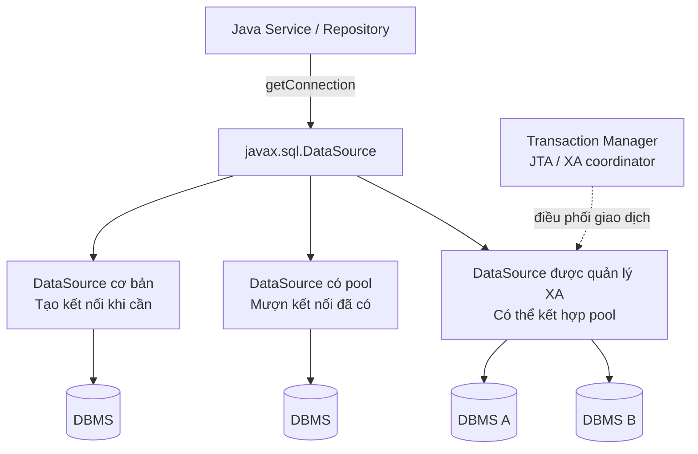
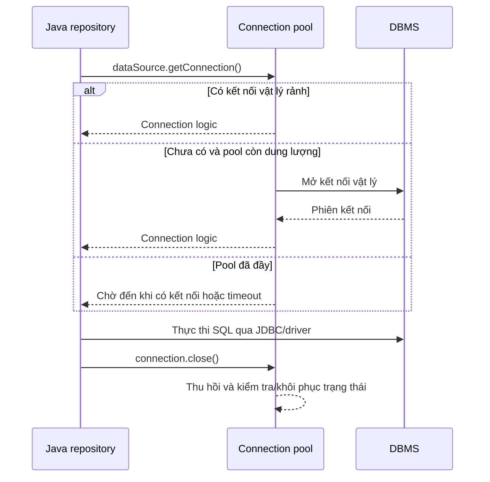
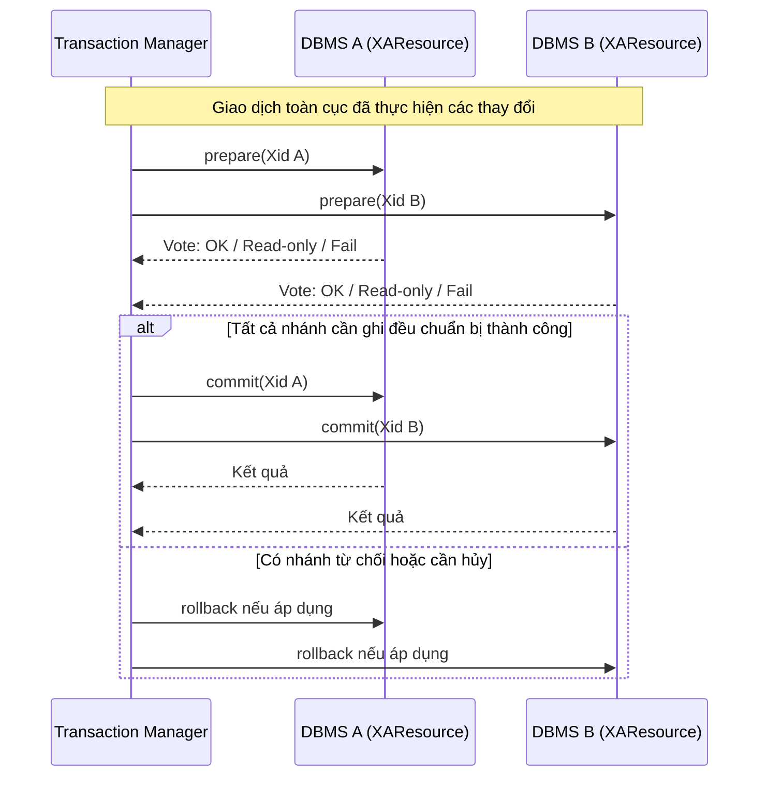

# Phân biệt DataSource thông thường, kết nối có pool và kết nối XA

Trong kiến trúc **JDBC (Java Database Connectivity)**, lớp truy cập dữ liệu của ứng dụng Java thường lấy kết nối thông qua `javax.sql.DataSource`. Tuy nhiên, hai ứng dụng cùng gọi `dataSource.getConnection()` có thể hoạt động rất khác nhau: một ứng dụng tạo kết nối vật lý mới cho mỗi lần gọi; ứng dụng khác lấy kết nối có sẵn từ **connection pool**; ứng dụng thứ ba dùng nguồn kết nối **XA** để tham gia giao dịch phân tán giữa nhiều tài nguyên.

Ba khái niệm này dễ bị nhầm lẫn vì cùng xuất hiện quanh từ “kết nối”, nhưng chúng trả lời **ba câu hỏi khác nhau**:

- **DataSource:** ứng dụng lấy `Connection` bằng giao diện nào, thay vì tự biết cách tạo từng kết nối?
- **Connection pooling:** các kết nối vật lý được tạo, cho mượn, tái sử dụng và giới hạn số lượng như thế nào?
- **XA:** ai điều phối việc xác nhận hoặc hủy thay đổi trên **nhiều tài nguyên giao dịch** như hai cơ sở dữ liệu?

Hiểu sự khác nhau này giúp chọn cấu hình đúng, tránh nhầm lẫn giữa hiệu năng kết nối và tính nhất quán giao dịch, đồng thời xác định chính xác trách nhiệm của JDBC driver, pool, transaction manager và DBMS.

## 1. Đặt DataSource, pool và XA vào kiến trúc JDBC



Sơ đồ biểu diễn **các phương án triển khai**, không phải ba lớp luôn nối tiếp nhau. Ở mọi phương án, mã nghiệp vụ có thể nhận một `Connection` qua API JDBC; cách tạo và quản lý kết nối phụ thuộc đối tượng `DataSource` được cấu hình. Một pool XA thường có hai nguồn XA riêng tương ứng với hai DBMS, cùng được transaction manager điều phối.

Cần phân biệt hai trục thiết kế độc lập:

| Trục thiết kế | Lựa chọn | Câu hỏi cần giải quyết |
|---|---|---|
| **Vòng đời kết nối** | Tạo kết nối theo yêu cầu hoặc dùng connection pool | Làm sao đáp ứng nhiều truy vấn mà không tốn chi phí kết nối liên tục? |
| **Phạm vi giao dịch** | Giao dịch cục bộ hoặc giao dịch phân tán XA | Làm sao xác nhận/hủy nhiều thay đổi thuộc cùng một đơn vị nghiệp vụ? |

Vì thế, **pool không đồng nghĩa XA**, còn **XA không tự động tạo pool**. Có thể dùng pool cho các giao dịch cục bộ; cũng có thể dùng pool chứa các kết nối XA khi ứng dụng cần cả hai khả năng.

## 2. DataSource thông thường là gì?

`javax.sql.DataSource` là giao diện chuẩn cung cấp kết nối tới một nguồn dữ liệu. Những phương thức quen thuộc là `getConnection()` và `getConnection(username, password)`. Thay vì hardcode JDBC URL và gọi `DriverManager.getConnection(...)` ở mỗi repository, ứng dụng nhận một `DataSource` đã được khởi tạo từ cấu hình:

```java
import java.sql.Connection;
import java.sql.PreparedStatement;
import java.sql.ResultSet;
import java.sql.SQLException;
import javax.sql.DataSource;

public final class ProductRepository {
    private final DataSource dataSource;

    public ProductRepository(DataSource dataSource) {
        this.dataSource = dataSource;
    }

    public String findName(long id) throws SQLException {
        String sql = "SELECT name FROM products WHERE id = ?";

        try (Connection connection = dataSource.getConnection();
             PreparedStatement statement = connection.prepareStatement(sql)) {
            statement.setLong(1, id);

            try (ResultSet results = statement.executeQuery()) {
                return results.next() ? results.getString("name") : null;
            }
        }
    }
}
```

Đoạn mã giả định bảng `products` tồn tại và `dataSource` đã được cấu hình bằng driver phù hợp. Nó sử dụng **cùng một giao diện**, bất kể `DataSource` được triển khai theo kiểu đơn giản, có pool hay XA. Việc gọi `close()` trong `try-with-resources` là bắt buộc vì ứng dụng phải trả tài nguyên theo đúng hợp đồng quản lý kết nối.

### Khi nói “DataSource thông thường” nghĩa là gì?

Trong bài này, **DataSource thông thường (không pool, không XA)** nghĩa là một triển khai `DataSource` đơn giản: mỗi lần cần kết nối, nó có thể tạo một kết nối vật lý tới DBMS, và khi ứng dụng đóng `Connection`, kết nối vật lý được đóng theo cách triển khai đó.

Đó là **một cách triển khai** của `DataSource`, chứ không phải tính chất bắt buộc của giao diện. `DataSource` *không hứa* rằng kết nối được tạo mới, được tái sử dụng hay có hỗ trợ XA. Chỉ nhìn thấy biến có kiểu `DataSource` trong Java **không thể suy ra** ứng dụng có đang dùng pool hoặc transaction manager hay không.

Ưu điểm của cách tạo kết nối trực tiếp là dễ cấu hình và dễ quan sát luồng mở–đóng, hữu ích cho ví dụ, công cụ nhỏ hoặc ứng dụng ít tải. Điểm yếu là quá trình mở kết nối vật lý có thể tốn thời gian: lập phiên mạng, xác thực, thương lượng bảo mật, khởi tạo trạng thái phiên và tiêu thụ tài nguyên phía server. Khi có nhiều yêu cầu đồng thời, mở/đóng liên tục làm tăng độ trễ và nguy cơ chạm giới hạn kết nối DBMS.

Một `Connection` vật lý có thể bị gián đoạn vì mạng hoặc DBMS; việc sử dụng `DataSource` thông thường không miễn cho ứng dụng xử lý `SQLException`, timeout và lỗi truy vấn.

## 3. DataSource có connection pool hoạt động thế nào?

**Connection pool** giữ một tập kết nối vật lý có thể tái sử dụng. Thay vì luôn tạo kết nối mới, pool cấp cho mỗi tác vụ một **kết nối logic** (thường là đối tượng bọc/proxy) liên kết với một kết nối vật lý đang rảnh. Khi ứng dụng gọi `close()` trên kết nối logic, pool thường thu hồi nó để cấp cho tác vụ khác.



Trong thực tế, pool có thể cần hủy kết nối hỏng, kiểm tra sức khỏe kết nối hoặc đóng các kết nối rảnh quá lâu. `close()` **không nhất thiết** đóng phiên TCP hay đăng xuất DBMS; nhưng nếu kết nối bị lỗi hoặc pool đang thu hẹp kích thước, nó có thể đóng kết nối vật lý. Chi tiết là trách nhiệm của implementation pool.

### Hai khái niệm “kết nối” cần tách riêng

| Loại | Ý nghĩa | Ai quản lý? |
|---|---|---|
| **Kết nối vật lý** | Phiên thực sự giữa driver và DBMS, thường có tài nguyên mạng và phiên phía server | Driver và pool |
| **Kết nối logic** | Đối tượng `Connection` ứng dụng được mượn để sử dụng tạm thời | Ứng dụng sử dụng; pool thu hồi khi `close()` |

Một pool có thể được ứng dụng sử dụng qua **chính giao diện `DataSource`**. Vì vậy, đoạn code `ProductRepository` ở trên không cần thay đổi nếu ứng dụng chuyển từ DataSource đơn giản sang DataSource có pool. Thay đổi nằm ở cấu hình và implementation của `DataSource`.

### Các cấu hình và tình huống vận hành quan trọng

- **Kích thước pool tối đa:** giới hạn số kết nối vật lý được phép mở; phải phù hợp tổng giới hạn của DBMS và số instance ứng dụng đang chạy. Tăng pool vô hạn không làm DBMS xử lý SQL nhanh hơn.
- **Số kết nối tối thiểu/rảnh:** giữ sẵn kết nối để giảm độ trễ khởi tạo, nhưng mỗi kết nối rảnh vẫn có chi phí tài nguyên.
- **Thời gian chờ lấy kết nối:** khi không còn kết nối rảnh, yêu cầu có thể chờ và cuối cùng gặp timeout; đây là lỗi thiếu tài nguyên pool, không nhất thiết là lỗi SQL.
- **Kiểm tra kết nối:** pool có thể xác minh kết nối trước khi cấp hoặc sau khi phát hiện lỗi mạng để tránh cấp lại kết nối hỏng.
- **Thời gian sống và thời gian rảnh:** pool có thể thay kết nối cũ theo chính sách hoặc giới hạn của DBMS, proxy, firewall.
- **Thu hồi trạng thái:** khi trả về pool, trạng thái như `autoCommit`, isolation level, `readOnly` hoặc transaction còn mở cần được xử lý an toàn; hành vi reset thực tế phải kiểm tra trong implementation.

Một lỗi thường gặp là **rò rỉ kết nối**: phương thức lấy `Connection` nhưng không đóng, khiến pool dần cạn. Dùng `try-with-resources`, theo dõi số kết nối đang hoạt động/nhàn rỗi và thời gian chờ cấp kết nối là những biện pháp thiết thực. **Không chia sẻ một `Connection` đang mượn cho nhiều luồng đồng thời** trừ khi có hợp đồng rất cụ thể từ driver/ứng dụng; cách thông thường là mỗi tác vụ mượn rồi trả kết nối riêng.

### Pool có bảo đảm giao dịch phân tán không?

**Không.** Một pool JDBC thông thường chỉ quản lý việc tái sử dụng kết nối. Nếu hai database đều có pool riêng, ứng dụng gọi `commit()` trên kết nối thứ nhất rồi gặp lỗi khi commit kết nối thứ hai thì vẫn có nguy cơ **chỉ một phần thay đổi được xác nhận**. Pool không tự bổ sung giao thức phối hợp giao dịch giữa hai DBMS.

## 4. XA DataSource dùng để giải quyết vấn đề gì?

**XA** là mô hình phối hợp giao dịch giữa nhiều tài nguyên có hỗ trợ giao thức XA. Trong Java, các hợp đồng quan trọng là `javax.sql.XADataSource`, `javax.sql.XAConnection` và `javax.transaction.xa.XAResource`.

Ví dụ, một tác vụ kinh doanh cần **cùng một giao dịch toàn cục** để cập nhật `orders` trên DBMS A và `balances` trên DBMS B. Nếu chỉ dùng hai giao dịch cục bộ, không thể bảo đảm mọi lỗi ở giữa các lần commit đều dẫn đến kết quả cùng thành công hoặc cùng hủy. Khi cả hai DBMS/driver có hỗ trợ XA và hệ thống có **transaction manager**, các tài nguyên có thể được điều phối trong một giao dịch phân tán.

### Những đối tượng tham gia

| Thành phần | Vai trò trong XA |
|---|---|
| `XADataSource` | Factory do driver XA cung cấp để tạo `XAConnection`; không mặc nhiên cung cấp một connection pool cho mã nghiệp vụ. |
| `XAConnection` | Kết nối có khả năng tham gia XA, cung cấp `XAResource` và `Connection` JDBC; mở rộng hợp đồng `PooledConnection`. |
| `XAResource` | Giao diện để transaction manager gửi các thao tác như `start`, `end`, `prepare`, `commit`, `rollback`, `recover` tới tài nguyên. |
| `Xid` | Định danh một giao dịch toàn cục và nhánh giao dịch do transaction manager dùng để theo dõi, phục hồi. |
| **Transaction manager / JTA coordinator** | Tạo và quản lý giao dịch toàn cục, enlist các tài nguyên, quyết định commit/rollback và thực hiện phục hồi sau sự cố. |
| **DBMS XA resource manager** | Thực thi các nhánh giao dịch, duy trì dữ liệu/log cần thiết cho việc chuẩn bị, xác nhận hoặc hủy. |

**JTA (Java Transaction API)** cung cấp hợp đồng quản lý giao dịch ở phía Java. Ứng dụng có thể gặp các API JTA trong namespace `jakarta.transaction` ở môi trường Jakarta hiện đại, hoặc `javax.transaction` trong hệ sinh thái cũ; `XAResource` và `Xid` ở package `javax.transaction.xa`. Muốn dùng giao dịch XA, cần một **transaction manager thực sự** cùng cấu hình tài nguyên XA đúng cách. Chỉ tạo một đối tượng `XADataSource` hoặc thêm annotation giao dịch không tự bảo đảm ứng dụng có giao dịch phân tán.

### XA thường kết hợp với pool như thế nào?

Một máy chủ ứng dụng hoặc bộ quản lý kết nối có thể khởi tạo `XAConnection` từ `XADataSource`, quản lý chúng trong pool và cung cấp cho repository một `DataSource` có thể lấy `Connection` thông thường. Khi có giao dịch JTA toàn cục, lớp quản lý này và transaction manager sẽ **enlist** `XAResource` tương ứng với kết nối vào giao dịch.

Nhờ vậy, mã repository có thể tiếp tục dùng `Connection`, `PreparedStatement` và `ResultSet`. Nhưng ranh giới xác nhận giao dịch do **transaction manager** điều khiển: trong một giao dịch JTA do container quản lý, ứng dụng **không nên tự gọi `commit()`, `rollback()` hay tự ý đổi `autoCommit` trên kết nối đã enlist**. Transaction manager có trách nhiệm kết thúc giao dịch, không phải mỗi repository tự kết thúc một nhánh.

Điểm cần ghi nhớ: **XA = năng lực phối hợp giao dịch**, còn **pool = năng lực tái sử dụng kết nối**. Một pool chứa XAConnection có thể cung cấp cả hai; XAConnection tự nó không có nghĩa là đã có pool hoặc đã được enlist vào giao dịch.

## 5. Hai pha commit (Two-Phase Commit) hoạt động ra sao?

Với nhiều tài nguyên có hỗ trợ XA, transaction manager thường dùng **two-phase commit (2PC)**. Đây là khái niệm cốt lõi để hiểu vì sao XA khác một DataSource bình thường:



**Pha 1 — Prepare:** transaction manager yêu cầu từng tài nguyên chuẩn bị xác nhận giao dịch. DBMS kiểm tra khả năng commit và lưu trạng thái phục vụ phục hồi; tài nguyên có thể báo thành công, chỉ đọc hoặc lỗi. Nhánh đã chuẩn bị thành công có thể phải giữ khóa hoặc tài nguyên cho đến khi biết kết quả cuối cùng.

**Pha 2 — Commit/Rollback:** nếu những nhánh cần ghi đã chuẩn bị thành công, transaction manager đưa ra quyết định commit toàn cục và gửi lệnh commit đến các tài nguyên. Nếu có nhánh không thể chuẩn bị hoặc giao dịch cần hủy, nó điều phối rollback các nhánh thích hợp.

**Phục hồi:** nếu coordinator hoặc mạng gặp sự cố sau pha prepare, một số nhánh có thể ở trạng thái **in-doubt**. Transaction manager cần nhật ký giao dịch bền vững và cơ chế `recover()`/hoàn tất giao dịch để giải quyết khi hệ thống hoạt động trở lại. XA có thể giảm nguy cơ commit lệch giữa các tài nguyên được điều phối đúng, nhưng 2PC **không làm biến mất hoàn toàn** lỗi mạng, downtime, timeout, kết quả bất định hay tình huống heuristic khi tài nguyên tự đưa ra quyết định khác với coordinator.

Đổi lại, XA thường có **thêm round-trip, ghi log, khóa và chi phí vận hành** so với giao dịch cục bộ. Một transaction manager có thể tối ưu cho trường hợp một tài nguyên, nhưng không nên chọn XA khi bài toán chỉ cần một giao dịch trên một DBMS.

## 6. Các interface JDBC liên quan: điểm khác biệt quan trọng

| Interface | Package | Ai thường dùng trực tiếp? | Tạo/trả về gì? |
|---|---|---|---|
| `DataSource` | `javax.sql` | Code ứng dụng, repository, framework | `Connection` qua `getConnection()` |
| `ConnectionPoolDataSource` | `javax.sql` | Pool manager, lớp quản lý kết nối | `PooledConnection` qua `getPooledConnection()` |
| `PooledConnection` | `javax.sql` | Pool manager | `Connection` logic, thông báo sự kiện đóng/lỗi kết nối |
| `XADataSource` | `javax.sql` | XA connection manager/container | `XAConnection` qua `getXAConnection()` |
| `XAConnection` | `javax.sql` | XA connection manager / transaction infrastructure | `Connection` JDBC cùng `XAResource`; mở rộng `PooledConnection` |
| `XAResource` | `javax.transaction.xa` | Transaction manager | Các thao tác điều phối nhánh XA (`prepare`, `commit`, `rollback`, `recover`...) |

**Đừng kết luận rằng ứng dụng có pool chỉ vì driver triển khai `ConnectionPoolDataSource`.** Một thành phần quản lý pool phải thật sự sử dụng interface đó hoặc một cơ chế tương đương để tạo, cấp phát, thu hồi và quản lý kết nối. Tương tự, `XADataSource` chỉ cung cấp năng lực XA ở mức driver; cần cấu hình transaction manager và enlistment để có giao dịch toàn cục.

## 7. So sánh trực tiếp theo mục đích sử dụng

Trong bảng này, “DataSource thông thường” có nghĩa là **triển khai không có pool và không có XA**; còn “DataSource có pool” là **pool cho giao dịch JDBC cục bộ**, để ba phương án có cùng cơ sở so sánh.

| Tiêu chí | DataSource thông thường | DataSource có pool | XA DataSource + transaction manager |
|---|---|---|---|
| **Mục tiêu chính** | Cấp kết nối qua JDBC API | Tái sử dụng và giới hạn kết nối | Điều phối giao dịch trên nhiều tài nguyên |
| **Tạo kết nối** | Thường tạo kết nối vật lý khi được yêu cầu | Mượn kết nối có sẵn, tạo thêm trong giới hạn | XAConnection được tạo qua driver; có thể được quản lý bằng pool XA |
| **Khi ứng dụng `close()`** | Thường đóng kết nối vật lý | Thường trả kết nối logic về pool | Trả kết nối qua lớp quản lý; kết thúc giao dịch toàn cục do TM điều phối |
| **Phạm vi transaction thường gặp** | Một DBMS / một `Connection` | Một DBMS / một `Connection` | Có thể nhiều DBMS/tài nguyên XA trong cùng global transaction |
| **Commit/rollback** | Ứng dụng hoặc lớp giao dịch quản lý local transaction | Tương tự local transaction | Transaction manager quản lý global commit/rollback, thường qua 2PC |
| **Chi phí chính** | Kết nối mới tốn thời gian/tài nguyên | Bộ nhớ/tài nguyên cho pool, quản lý kích thước và chờ | Cấu hình phức tạp, overhead điều phối, log và recovery |
| **Dùng khi nào** | Công cụ nhỏ, demo, ít tải | Phần lớn dịch vụ có nhiều yêu cầu đồng thời | Bài toán thật sự cần atomicity xuyên nhiều tài nguyên đều hỗ trợ XA |

Có thể kết hợp thành **bốn tình huống**: local transaction + kết nối trực tiếp; local transaction + pool; XA + kết nối không pool; XA + pool. Trong ứng dụng máy chủ, hai lựa chọn phổ biến hơn là **local + pool** và, khi thực sự cần, **XA + pool + transaction manager**.

## 8. Ví dụ giao dịch cục bộ: một DataSource và một DBMS

Giả sử bảng `accounts` có `id` và `balance DECIMAL(...)`; nghiệp vụ chuyển số tiền giữa hai tài khoản nằm **trong cùng một database**. Một `Connection` với `autoCommit=false` là đủ cho cả hai câu SQL thuộc cùng một giao dịch cục bộ. Không cần XA chỉ vì có hai câu lệnh.

```java
import java.math.BigDecimal;
import java.sql.Connection;
import java.sql.PreparedStatement;
import java.sql.SQLException;
import javax.sql.DataSource;

public void transfer(DataSource dataSource, long fromId, long toId,
                     BigDecimal amount) throws SQLException {
    if (amount.signum() <= 0 || fromId == toId) {
        throw new IllegalArgumentException("Giao dịch chuyển tiền không hợp lệ");
    }

    try (Connection connection = dataSource.getConnection()) {
        boolean originalAutoCommit = connection.getAutoCommit();
        connection.setAutoCommit(false);

        try {
            String debitSql = "UPDATE accounts SET balance = balance - ? "
                            + "WHERE id = ? AND balance >= ?";
            try (PreparedStatement debit = connection.prepareStatement(debitSql)) {
                debit.setBigDecimal(1, amount);
                debit.setLong(2, fromId);
                debit.setBigDecimal(3, amount);
                if (debit.executeUpdate() != 1) {
                    throw new SQLException("Không đủ số dư hoặc tài khoản nguồn không tồn tại");
                }
            }

            String creditSql = "UPDATE accounts SET balance = balance + ? "
                             + "WHERE id = ?";
            try (PreparedStatement credit = connection.prepareStatement(creditSql)) {
                credit.setBigDecimal(1, amount);
                credit.setLong(2, toId);
                if (credit.executeUpdate() != 1) {
                    throw new SQLException("Tài khoản đích không tồn tại");
                }
            }

            connection.commit();
        } catch (SQLException | RuntimeException error) {
            try {
                connection.rollback();
            } catch (SQLException rollbackError) {
                error.addSuppressed(rollbackError);
            }
            throw error;
        } finally {
            connection.setAutoCommit(originalAutoCommit);
        }
    }
}
```

Đây là ví dụ minh họa giao dịch JDBC cục bộ; ứng dụng thực tế còn cần đánh giá giới hạn số tiền, tính idempotent, quyền tài khoản, xử lý deadlock và trường hợp lỗi mạng khiến **kết quả commit chưa thể xác định ngay**. Nếu sử dụng transaction manager của framework, thông thường nên giao cho framework quản lý `commit`/`rollback` thay vì tự quản lý như đoạn code trên.

Đặc biệt, cùng một phương thức này có thể chạy với **DataSource thường hoặc DataSource có pool**, miễn kết nối trả về hỗ trợ giao dịch cục bộ phù hợp. Pool sẽ ảnh hưởng cách cấp phát/tái sử dụng kết nối, chứ không thay đổi số DBMS hoặc phạm vi atomicity của ví dụ.

## 9. Ví dụ cần XA: hai database trong một giao dịch nghiệp vụ

Giả sử hệ thống lưu đơn hàng trong **DBMS A** và lưu sổ kế toán trong **DBMS B**. Quy trình mong muốn là: cập nhật trạng thái đơn hàng và ghi bút toán **cùng thành công hoặc cùng hủy**.

Nếu dùng hai connection thông thường rồi lần lượt `commit()`:

```text
DBMS A: UPDATE orders ...       -> COMMIT thành công
DBMS B: INSERT accounting ...   -> COMMIT thất bại
Kết quả: Dữ liệu hai DBMS không còn cùng một trạng thái nghiệp vụ
```

Một connection pool cho A và một pool cho B **không giải quyết được** rủi ro này. Khi cả hai DBMS/driver hỗ trợ XA, phương án XA cần chuẩn bị:

1. Hai cấu hình `XADataSource` tương ứng với A và B (thường đi kèm pool XA được quản lý).
2. Một transaction manager JTA có log và cơ chế recovery phù hợp.
3. Các `XAResource` của cả hai nguồn được **enlist vào cùng global transaction**.
4. Code repository lấy connection qua `DataSource` được quản lý và thực thi SQL; transaction manager điều phối kết thúc giao dịch.

Mô hình luồng xử lý ở mức khái niệm:

```text
Transaction Manager: BEGIN global transaction
  Repository A: lấy JDBC Connection từ managed XA DataSource A; UPDATE orders
  Repository B: lấy JDBC Connection từ managed XA DataSource B; INSERT accounting
Transaction Manager: PREPARE cả hai XAResource
  Nếu đủ điều kiện: COMMIT toàn cục
  Nếu cần hủy: ROLLBACK các nhánh giao dịch
```

Đây là **mô tả hành vi**, không phải đoạn code có thể chạy nếu chỉ thay hai DataSource thành XA. Container/framework/transaction manager phải được cấu hình để tự enlist và quản lý kết nối đúng cách. Nếu một nguồn dữ liệu thực chất không hỗ trợ XA, chỉ gắn nhãn “XA” trong cấu hình không tạo được atomicity chuẩn giữa hai nguồn đó.

### Khi XA không phải lựa chọn thích hợp

Không phải mọi hệ thống tham gia nghiệp vụ đều hỗ trợ giao thức XA. Ví dụ, một REST API bên ngoài không mặc nhiên là `XAResource`: không thể rollback một lời gọi HTTP chỉ bằng cách rollback database. Với các quy trình xuyên dịch vụ, hệ thống có thể cân nhắc **Saga với bước bù trừ**, **transactional outbox**, retry có kiểm soát và xử lý idempotent. Những giải pháp này có **mô hình nhất quán và điều kiện thất bại khác** XA, nên cần thiết kế theo yêu cầu nghiệp vụ; không coi chúng là phiên bản tương đương tuyệt đối với 2PC.

## 10. Cách chọn trong các tình huống thực tế

| Bối cảnh | Phương án thường hợp lý | Lý do |
|---|---|---|
| Script chạy một lần, ít truy vấn đến một DBMS | DataSource đơn giản hoặc `DriverManager` | Cấu hình gọn, không nhất thiết cần chi phí vận hành pool. |
| REST API có nhiều request truy vấn cùng một DBMS | DataSource có pool, local transaction | Tái sử dụng kết nối; quản lý số phiên kết nối và timeout. |
| Cập nhật nhiều bảng trong **cùng một database** | Một connection/giao dịch cục bộ; có thể lấy từ pool | `commit()`/`rollback()` trên cùng transaction có thể bảo vệ nhiều câu lệnh. |
| Một nghiệp vụ cần xác nhận đồng thời **hai DBMS XA** | XA-backed DataSources + transaction manager, thường có pool XA | Cần điều phối commit/rollback qua các tài nguyên khác nhau. |
| Ghi database rồi gọi REST API ngoài | Thiết kế workflow/Saga/outbox phù hợp | REST API không tự tham gia giao dịch XA của JDBC. |
| Nhiều DBMS nhưng chấp nhận đồng bộ cuối cùng | Có thể dùng sự kiện/outbox và quy trình đối soát | Tránh chi phí XA khi yêu cầu nghiệp vụ không đòi 2PC đồng bộ. |

Khi đưa vào sản xuất, đừng chỉ kiểm tra rằng kết nối được tạo thành công. Với pool cần quan sát **active/idle/waiting connections**, thời gian lấy kết nối, lỗi validation, rò rỉ tài nguyên và giới hạn server. Với XA cần thêm **transaction timeout, log của coordinator, trạng thái in-doubt, recovery, tính tương thích DBMS/driver, khóa kéo dài** và cách xử lý sự cố một phần.

## 11. Những hiểu nhầm phổ biến

**“Biến được khai báo là `DataSource` nghĩa là có pooling.”** Sai. `DataSource` chỉ là giao diện cấp kết nối. Có pool hay không phụ thuộc implementation và cấu hình.

**“Có connection pool thì `commit()` hai database là nguyên tử.”** Sai. Pool chỉ tái sử dụng kết nối; hai `commit()` cục bộ vẫn có thể thành công/thất bại khác nhau.

**“Cứ dùng `XADataSource` là tự có transaction phân tán.”** Sai. Cần transaction manager, các tài nguyên XA hỗ trợ đúng, enlistment và cấu hình recovery.

**“XA thay thế connection pool.”** Sai. Một hệ thống XA có thể dùng pool XA để tránh liên tục tạo kết nối vật lý.

**“Gọi `close()` trên connection lấy từ pool là đóng socket ngay.”** Không nhất thiết. Thông thường nó trả logical connection về pool; pool quyết định giữ hay hủy physical connection.

**“Ứng dụng đã có JTA thì repository được tự gọi `connection.commit()`.”** Sai trong trường hợp connection đã tham gia giao dịch toàn cục do JTA quản lý. Transaction manager phải là bên điều phối commit/rollback.

**“2PC loại bỏ hoàn toàn rủi ro sự cố.”** Sai. 2PC cần log và recovery; tài nguyên có thể bị khóa lâu, giao dịch có thể in-doubt khi mạng/coordinator gặp sự cố, và vẫn có tình huống heuristic cần xử lý.

## 12. Câu hỏi tự kiểm tra

1. **Tại sao `DataSource` trong chữ ký repository không cho biết có pool hay không?** Vì `DataSource` là giao diện; việc tạo mới hay mượn kết nối tùy implementation/configuration.
2. **Điều gì xảy ra khi tất cả kết nối trong pool đều đang bận?** Tùy pool, một yêu cầu mới có thể chờ, nhận kết nối được trả về hoặc gặp timeout. Tăng pool cần cân nhắc giới hạn DBMS.
3. **Chuyển tiền giữa hai tài khoản trên cùng một DBMS có bắt buộc XA không?** Không. Một giao dịch cục bộ trên cùng connection thường đủ để thực thi các thao tác cùng commit/rollback.
4. **Vì sao hai pool riêng không đủ cho một transaction xuyên hai DBMS?** Vì pool không điều phối hai lần commit; vẫn tồn tại cửa sổ một DBMS commit thành công, DBMS kia thất bại.
5. **Ai gọi `prepare()` và quyết định commit các XAResource?** Transaction manager; driver/DBMS XA resource thực thi phần việc của tài nguyên tương ứng.
6. **Khi nào cân nhắc outbox hoặc Saga?** Khi quy trình gồm dịch vụ/tài nguyên không hỗ trợ XA, hoặc chấp nhận nhất quán cuối cùng và cần thiết kế retry/bù trừ tường minh.

**Ghi nhớ:** Trong JDBC, `DataSource` là **hợp đồng lấy kết nối**; connection pool là **cách quản lý vòng đời và tái sử dụng kết nối**; XA kết hợp transaction manager là **cơ chế điều phối giao dịch giữa nhiều tài nguyên XA**. Ba khía cạnh có thể kết hợp nhưng giải quyết những vấn đề khác nhau. Phần lớn ứng dụng truy cập một cơ sở dữ liệu có thể bắt đầu với pool và giao dịch cục bộ; chỉ bổ sung XA khi phạm vi giao dịch và yêu cầu nhất quán thực sự đòi hỏi.
