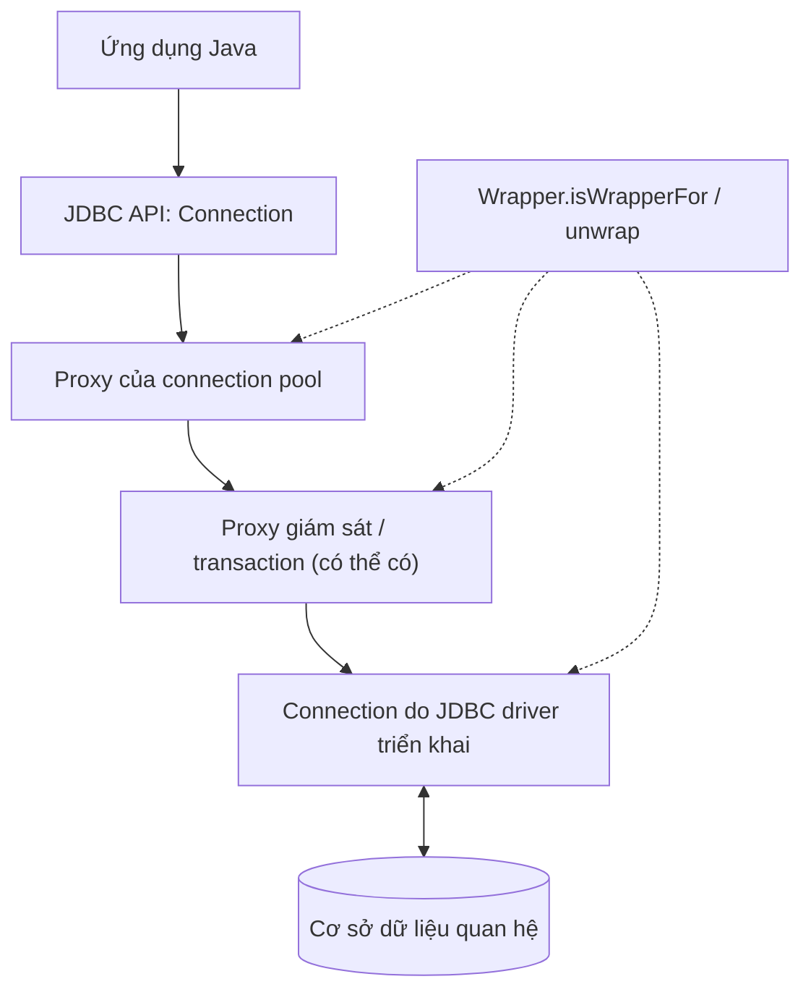
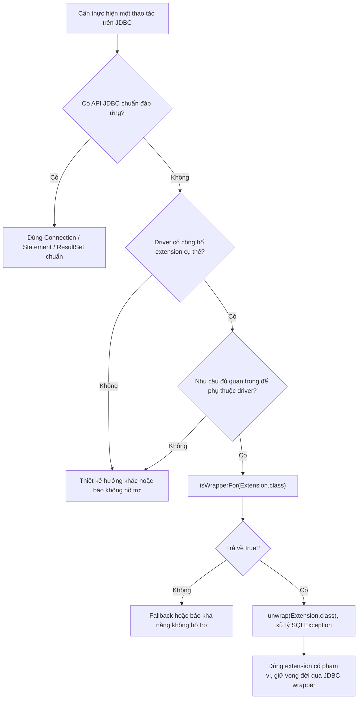
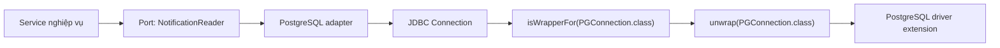

# Sử dụng `Wrapper`, `isWrapperFor` và `unwrap` khi thật sự cần trong JDBC

## 1. Vấn đề: Đối tượng JDBC có thể được bao bọc nhiều lớp

JDBC (Java Database Connectivity) là API chuẩn của Java để truy cập cơ sở dữ liệu quan hệ. Ứng dụng làm việc qua các giao diện như `Connection`, `Statement`, `PreparedStatement` và `ResultSet`, còn driver JDBC triển khai việc giao tiếp với hệ quản trị cơ sở dữ liệu. Trong ứng dụng thực tế, đối tượng trả về từ `DataSource.getConnection()` không nhất thiết chính là đối tượng kết nối do driver tạo ra.

Một connection pool có thể cung cấp **đối tượng đại diện (proxy/wrapper)** để biết khi nào ứng dụng gọi `close()` và trả kết nối vật lý về pool. Framework quản lý transaction, bộ theo dõi hiệu năng hoặc công cụ ghi log cũng có thể thêm lớp bao bọc. Vì thế, việc ép kiểu trực tiếp từ `Connection` sang giao diện riêng của driver thường không an toàn.



Sơ đồ minh họa một khả năng triển khai. Số lượng và thứ tự lớp bao bọc tùy thư viện; một ứng dụng không nhất thiết có đủ mọi lớp trong hình.

Giao diện **`java.sql.Wrapper`** cung cấp hai phương thức giúp hỏi một đối tượng JDBC xem nó có thể bộc lộ một giao diện cụ thể và, nếu có, lấy tham chiếu phù hợp:

```java
public interface Wrapper {
    <T> T unwrap(Class<T> iface) throws SQLException;
    boolean isWrapperFor(Class<?> iface) throws SQLException;
}
```

Tên `Wrapper` ở đây là **giao diện của JDBC**, không đồng nghĩa với mọi lớp Java áp dụng mẫu thiết kế Decorator. Nó giúp truy cập một giao diện bổ sung có thật ở đối tượng hiện tại hoặc đối tượng được bao bọc, đặc biệt khi cần tính năng riêng của driver.

**Nguyên tắc sử dụng:** Mã ứng dụng thông thường nên làm việc qua JDBC chuẩn. Chỉ dùng `unwrap` khi có một khả năng cụ thể thật sự cần mà hợp đồng JDBC đang dùng không cung cấp.

## 2. Những giao diện JDBC liên quan đến `Wrapper`

Nhiều đối tượng trong JDBC hỗ trợ hợp đồng `Wrapper`, trực tiếp hoặc thông qua giao diện kế thừa:

| Đối tượng thường gặp | Mục đích bình thường | Khi nào có thể cần `unwrap` |
| --- | --- | --- |
| `Connection` | Giao dịch, tạo statement, lấy metadata, đóng kết nối | Sử dụng một tính năng kết nối riêng của driver chưa có trong JDBC chuẩn |
| `Statement` / `PreparedStatement` / `CallableStatement` | Thực thi SQL và gắn tham số | Truy cập một API bổ sung của statement do driver công bố |
| `ResultSet` | Duyệt các hàng kết quả | Sử dụng một khả năng riêng của driver trên tập kết quả |
| `DatabaseMetaData`, `ResultSetMetaData`, `ParameterMetaData` | Đọc metadata theo hợp đồng chuẩn | Có nhu cầu rất cụ thể về metadata mở rộng của driver |
| `DataSource` | Cấp kết nối cho ứng dụng | Truy cập cấu hình/tính năng bổ sung do một triển khai `DataSource` cung cấp |

Ví dụ, `javax.sql.DataSource` kế thừa `CommonDataSource`; các đối tượng này có hợp đồng `Wrapper`. Tuy nhiên, **việc một đối tượng hỗ trợ `Wrapper` không bảo đảm nó hỗ trợ mọi giao diện của một driver bất kỳ**. Mỗi phép hỏi phụ thuộc đối tượng cụ thể được trả về lúc chạy.

## 3. Phân biệt `isWrapperFor` và `unwrap`

### 3.1. `isWrapperFor(Class<?> iface)`: Kiểm tra khả năng

Phương thức này trả về `true` nếu đối tượng hiện tại triển khai giao diện yêu cầu hoặc trực tiếp/gián tiếp bao bọc đối tượng có triển khai giao diện đó. Nếu không, nó trả về `false`. Phương thức cũng có thể ném `SQLException`.

```java
boolean supported = connection.isWrapperFor(SomeVendorConnection.class);
```

Trong đó `SomeVendorConnection` là **tên minh họa** cho một kiểu do driver cung cấp; đoạn mã chỉ biên dịch khi có kiểu tương ứng. Đây là bước kiểm tra khả năng, **chưa lấy** đối tượng vendor-specific.

Không được nhầm `isWrapperFor` với phép kiểm tra kiểu Java thông thường:

```java
// Kiểm tra đối tượng connection ở lớp hiện tại.
boolean directType = connection instanceof SomeVendorConnection;

// Kiểm tra khả năng bộc lộ kiểu đó qua hợp đồng JDBC Wrapper.
boolean unwrappable = connection.isWrapperFor(SomeVendorConnection.class);
```

Với proxy của pool, `directType` có thể là `false` nhưng `unwrappable` có thể là `true`. Điều này xảy ra khi proxy không trực tiếp triển khai giao diện vendor nhưng có thể truy cập delegate hỗ trợ giao diện đó.

### 3.2. `unwrap(Class<T> iface)`: Lấy tham chiếu phù hợp

`unwrap` yêu cầu một đối tượng có kiểu tương ứng với `iface`. Nếu đối tượng JDBC đang dùng trực tiếp triển khai giao diện, kết quả có thể chính là đối tượng hiện tại. Nếu có các lớp proxy, kết quả có thể là đối tượng được bao bọc ở một lớp khác.

```java
SomeVendorConnection vendor =
        connection.unwrap(SomeVendorConnection.class);
```

Nếu đối tượng không hỗ trợ yêu cầu, `unwrap` ném `SQLException` theo hợp đồng JDBC. Kiểu trả về là generic `T`, cho phép Java kiểm tra kiểu tại lúc biên dịch khi kiểu vendor có sẵn. Không nên giả định kết quả luôn là kết nối vật lý cuối cùng hoặc có cùng vòng đời với wrapper.

**Mẫu sử dụng an toàn khi tính năng là tùy chọn:**

```java
if (connection.isWrapperFor(SomeVendorConnection.class)) {
    SomeVendorConnection vendor =
            connection.unwrap(SomeVendorConnection.class);
    // Dùng tính năng vendor-specific thật sự cần thiết.
} else {
    // Dùng nhánh JDBC chuẩn hoặc báo tính năng không hỗ trợ.
}
```

Mặc dù đã gọi `isWrapperFor`, mã vẫn phải xử lý `SQLException` từ `unwrap`: đối tượng có thể bị đóng, trạng thái kết nối có thể thay đổi, hoặc driver gặp lỗi khi truy xuất delegate. Nếu chức năng **bắt buộc** phải có giao diện riêng, nhánh `else` nên báo lỗi rõ ràng thay vì âm thầm bỏ qua.

## 4. Đối tượng không giống kiểu bên ngoài: Vì sao cast trực tiếp thất bại?

Giả sử driver có giao diện riêng `DriverExtension` và kết nối vật lý triển khai giao diện này. Một pool lại trả về đối tượng proxy chỉ công bố `Connection`:

```java
Connection connection = dataSource.getConnection();

// Rủi ro: proxy có thể không triển khai DriverExtension.
DriverExtension extension = (DriverExtension) connection;
```

Lệnh ép kiểu có thể ném `ClassCastException` dù delegate bên trong thực sự hỗ trợ `DriverExtension`. Ngược lại, nếu đối tượng không thực sự hỗ trợ extension thì `unwrap` cũng không thể “tạo ra” tính năng mới.

Cách viết đúng khi cần extension:

```java
if (!connection.isWrapperFor(DriverExtension.class)) {
    throw new IllegalStateException("DriverExtension không khả dụng");
}
DriverExtension extension = connection.unwrap(DriverExtension.class);
```

`DriverExtension` chỉ là ví dụ giả định. Trong một dự án thật, phải thay bằng **giao diện cụ thể được thư viện driver công bố**, thêm dependency đúng phiên bản và kiểm tra tài liệu sử dụng của extension đó.

**Điểm khác biệt quan trọng:** `instanceof` hỏi về kiểu Java của đối tượng đang cầm; `isWrapperFor` hỏi về khả năng truy cập kiểu qua chuỗi wrapper theo hợp đồng JDBC.

## 5. Ví dụ thực tế: Dùng giao diện riêng của PostgreSQL khi thật sự cần

PostgreSQL JDBC driver có giao diện riêng `org.postgresql.PGConnection`, dùng cho những khả năng ngoài JDBC chuẩn. Một ví dụ là đọc thông báo từ cơ chế `LISTEN/NOTIFY` của PostgreSQL. JDBC chuẩn không định nghĩa một API chung tương đương để lấy các thông báo này.

Trong ứng dụng được cấu hình dùng PostgreSQL và có dependency PostgreSQL JDBC, có thể kiểm tra rồi lấy `PGConnection`:

```java
import java.sql.Connection;
import java.sql.SQLException;
import javax.sql.DataSource;
import org.postgresql.PGConnection;
import org.postgresql.PGNotification;

public class PostgresNotificationReader {
    private final DataSource dataSource;

    public PostgresNotificationReader(DataSource dataSource) {
        this.dataSource = dataSource;
    }

    public void printPendingNotifications() throws SQLException {
        try (Connection connection = dataSource.getConnection()) {
            if (!connection.isWrapperFor(PGConnection.class)) {
                throw new SQLException(
                    "Connection hiện tại không cung cấp PGConnection");
            }

            // Chỉ lấy khả năng mở rộng; vẫn quản lý vòng đời qua connection.
            PGConnection postgres = connection.unwrap(PGConnection.class);
            PGNotification[] pending = postgres.getNotifications();

            if (pending != null) {
                for (PGNotification message : pending) {
                    System.out.println(
                        message.getName() + ": " + message.getParameter());
                }
            }
        }
    }
}
```

Để cơ chế thông báo có ý nghĩa, phải có phiên đã đăng ký kênh bằng `LISTEN`, và ứng dụng cần tuân theo cách driver nhận/thăm dò thông báo, vòng đời kết nối và giao dịch. Một kết nối mới lấy từ pool **không tự nhiên đã đăng ký kênh LISTEN mong muốn**; với tác vụ lắng nghe lâu dài, cần thiết kế riêng cách giữ phiên/kết nối và không để connection bị tái sử dụng tùy ý.

Đoạn mã chủ yếu minh họa **lúc nào cần `unwrap`**: tính năng `getNotifications()` thuộc phần mở rộng `PGConnection`, không nằm trong `java.sql.Connection`. Nếu không dùng tính năng riêng này, không có lý do lấy `PGConnection` chỉ để chạy `SELECT` hoặc `UPDATE`.

**Giới hạn tính di động:** Code có import `org.postgresql.*` chỉ biên dịch khi dự án có PostgreSQL JDBC driver tương ứng; chuyển sang MySQL hay Oracle không thể trông đợi `PGConnection` tồn tại. Tầng thiết kế nên cô lập phần mở rộng này trong adapter hoặc service chuyên biệt.

## 6. Trường hợp bình thường: Dùng JDBC chuẩn là đủ

Phần lớn thao tác CRUD, quản lý transaction, batch, đọc metadata và xử lý kết quả đều có API JDBC chuẩn. Ví dụ đọc thông tin đơn hàng theo ID không cần `unwrap`:

```java
import java.sql.Connection;
import java.sql.PreparedStatement;
import java.sql.ResultSet;
import java.sql.SQLException;
import javax.sql.DataSource;

public class OrderReader {
    private final DataSource dataSource;

    public OrderReader(DataSource dataSource) {
        this.dataSource = dataSource;
    }

    public String findStatus(long orderId) throws SQLException {
        String sql = "SELECT status FROM orders WHERE id = ?";

        try (Connection connection = dataSource.getConnection();
             PreparedStatement query = connection.prepareStatement(sql)) {
            query.setLong(1, orderId);

            try (ResultSet rows = query.executeQuery()) {
                return rows.next() ? rows.getString("status") : null;
            }
        }
    }
}
```

Trong ví dụ này:

- `DataSource` cung cấp kết nối, dù là connection thật, connection từ pool hay proxy.
- `PreparedStatement` giúp gắn giá trị động và tránh nối trực tiếp dữ liệu vào SQL.
- `ResultSet` cung cấp dữ liệu ở dạng chuẩn để Java xử lý.
- `try-with-resources` đóng `ResultSet`, statement và kết nối được ứng dụng sở hữu theo thứ tự phù hợp.

Không cần biết class cụ thể của kết nối hoặc driver nào đang dùng. Đây chính là lợi ích của ranh giới trừu tượng JDBC.

## 7. Trước khi `unwrap`: Tìm tính năng chuẩn tương đương

Nhu cầu thực tế thường có sẵn API chuẩn; dùng extension quá sớm sẽ tăng độ phụ thuộc vào driver và có thể phá vỡ việc thay đổi pool/framework.

| Nhu cầu | Ưu tiên JDBC chuẩn | Chỉ cân nhắc `unwrap` khi... |
| --- | --- | --- |
| Thực thi SQL | `PreparedStatement.executeQuery/executeUpdate` | Driver cung cấp một thao tác riêng thực sự không có API tương đương |
| Kiểm tra kết nối còn dùng được | `Connection.isValid(timeout)` | Cần chẩn đoán đặc thù mà API chuẩn không trả lời |
| Xem DBMS và driver | `DatabaseMetaData.getDatabaseProductName`, `getDriverName` | Cần metadata bổ sung được driver cung cấp |
| Kiểm tra hỗ trợ batch hoặc transaction | `DatabaseMetaData.supportsBatchUpdates`, `supportsTransactions` | Có một khả năng vendor-specific khác chưa được biểu diễn |
| Tinh chỉnh lấy dữ liệu | `Statement.setFetchSize`, SQL phân trang khi phù hợp | Driver có cơ chế streaming/cursor đặc biệt và đã xác minh cần dùng |
| Quản lý giao dịch | `setAutoCommit`, `commit`, `rollback` | Cần thao tác đặc thù mà JDBC không có |
| Phân tích lỗi | `SQLException.getSQLState`, `getErrorCode`, `getNextException` | Cần thông tin chẩn đoán riêng do driver công bố |

Ví dụ kiểm tra metadata hoàn toàn theo JDBC chuẩn:

```java
try (Connection connection = dataSource.getConnection()) {
    var metadata = connection.getMetaData();
    System.out.println("DBMS: " + metadata.getDatabaseProductName());
    System.out.println("Driver: " + metadata.getDriverName());
    System.out.println("Supports batch: " +
                       metadata.supportsBatchUpdates());
}
```

Đây là công việc của `DatabaseMetaData`, không cần lấy object triển khai thực tế của driver.

## 8. Quy trình quyết định có nên dùng `unwrap`



Ba câu hỏi cần được trả lời trước khi thêm `unwrap` vào mã:

1. **Tính năng nào thiếu trong JDBC chuẩn?** Nêu rõ tên API vendor cần gọi, không chỉ nói “muốn connection gốc”.
2. **Có cần chạy trên nhiều DBMS, pool hoặc framework không?** Nếu có, thiết kế nhánh thay thế và cô lập phần phụ thuộc driver.
3. **Ai sở hữu connection và transaction?** Nếu đối tượng do pool hoặc framework cung cấp, không tự ý đóng, commit, rollback hoặc đổi cấu hình kết nối bên trong.

Đối với một thành phần bắt buộc cần extension, không nên âm thầm bỏ qua khi `isWrapperFor` trả `false`. Khi đó nên fail rõ ràng từ lúc khởi tạo hoặc khi thực thi chức năng, kèm thông báo hướng dẫn cấu hình tương ứng.

## 9. Vòng đời tài nguyên: Nguy cơ lớn nhất khi “lấy connection thật”

Khi pool cấp `Connection` proxy, đối tượng đó có thể theo dõi quyền sử dụng, trạng thái transaction, việc đóng và trả tài nguyên. `unwrap` có thể bộc lộ một đối tượng ở phía dưới lớp proxy; nếu ứng dụng thao tác trực tiếp lên delegate, nó có thể đi vòng qua một số kiểm soát của pool.

**Không làm như sau nếu không có hợp đồng thư viện cho phép:**

```java
Connection pooled = dataSource.getConnection();
VendorConnection vendor = pooled.unwrap(VendorConnection.class);

// Rủi ro: đóng hoặc điều khiển kết nối vật lý bằng tham chiếu vendor.
vendor.close();
```

Trong ví dụ, `VendorConnection` là kiểu minh họa; mục đích là chỉ ra thao tác nguy hiểm nếu delegate có phương thức `close()`. Không phải mọi extension đều có phương thức này.

**Cách quản lý đúng:**

```java
try (Connection connection = dataSource.getConnection()) {
    if (connection.isWrapperFor(VendorFeature.class)) {
        VendorFeature feature = connection.unwrap(VendorFeature.class);
        feature.performVendorOperation();
    }
    // Khi thoát scope, chỉ connection do DataSource cấp được đóng.
}
```

`VendorFeature` và `performVendorOperation()` ở đây là mã giả định, mô tả một extension **không sở hữu việc đóng connection**.

Các quy tắc cần ghi nhớ:

- **Đóng tham chiếu đã mượn ở tầng public:** Nếu pool cấp `Connection`, dùng `connection.close()` để trả về pool; không tự đóng kết nối vật lý được tìm qua `unwrap`.
- **Không giữ tham chiếu sau khi kết thúc phạm vi connection:** Delegate có thể được pool gán cho request khác. Cất nó vào singleton/static field thường gây lỗi vòng đời và rò rỉ dữ liệu.
- **Không dùng delegate để tự ý commit/rollback:** Framework quản lý transaction có thể không biết những thay đổi ngoài wrapper; hành vi có thể phá vỡ giao dịch đang diễn ra.
- **Không chuyển đối tượng JDBC sang thread khác:** Driver và proxy không mặc định an toàn cho việc thao tác đồng thời trên một connection.
- **Không giả định kết quả `unwrap` luôn là physical connection cuối cùng:** Nó là một tham chiếu thích hợp với kiểu yêu cầu theo hợp đồng driver, không phải API chuẩn để kiểm soát tầng mạng hay vòng đời bên dưới.

Ngay cả khi một driver cho phép `unwrap(Connection.class)`, việc làm này thường không đem lại khả năng nào ngoài chính `Connection` hiện có và không phải cách chuẩn để “bỏ pool”.

## 10. Xử lý lỗi và phương án thay thế

Hai phương thức `isWrapperFor` và `unwrap` đều khai báo `throws SQLException`. Không nên dùng `catch (Exception ignored)` để mặc định tính năng đã hoạt động hoặc tự động chuyển hướng mà không lưu dấu lỗi.

Một helper tổng quát cho **tính năng tùy chọn**:

```java
import java.sql.SQLException;
import java.sql.Wrapper;
import java.util.Optional;

public final class JdbcExtensionSupport {
    private JdbcExtensionSupport() {}

    public static <T> Optional<T> find(
            Wrapper wrapper, Class<T> extensionType) throws SQLException {
        if (!wrapper.isWrapperFor(extensionType)) {
            return Optional.empty();
        }
        return Optional.of(wrapper.unwrap(extensionType));
    }
}
```

Cách sử dụng (với extension thực tế do thư viện driver định nghĩa):

```java
Optional<SomeVendorFeature> maybeFeature =
        JdbcExtensionSupport.find(connection, SomeVendorFeature.class);

if (maybeFeature.isPresent()) {
    maybeFeature.get().performSpecialOperation();
} else {
    // Áp dụng phương án JDBC chuẩn hoặc thông báo không hỗ trợ.
}
```

`SomeVendorFeature` là kiểu giả định trong ví dụ này, không phải class có sẵn của JDK. Helper không làm cho extension trở nên có sẵn: nó chỉ giúp kiểm tra và lấy tham chiếu một cách rõ ràng.

Các tình huống cần phân biệt:

| Tình huống | Biểu hiện có thể gặp | Hướng xử lý |
| --- | --- | --- |
| Proxy không công bố kiểu extension | `isWrapperFor` trả `false` | Dùng fallback, kiểm tra cấu hình pool hoặc báo không hỗ trợ |
| Gọi thẳng `unwrap` với kiểu không được hỗ trợ | `SQLException` | Kiểm tra khả năng trước; xử lý lỗi rõ ràng |
| Object được đóng hoặc đường truyền không còn hợp lệ | `SQLException` tại thời điểm sử dụng | Kiểm tra vòng đời và trạng thái kết nối; tránh tái sử dụng tham chiếu cũ |
| Cast từ proxy sang kiểu driver | `ClassCastException` | Thay cast bằng hợp đồng `Wrapper` nếu được hỗ trợ |
| Extension không có trong compile classpath | Lỗi biên dịch/import | Thêm dependency đúng phiên bản hoặc bỏ nhánh đặc thù |
| Đổi phiên bản driver làm thay đổi extension | Lỗi tương thích hoặc runtime | Khóa/kiểm thử phiên bản driver và cô lập adapter |

**Không coi `isWrapperFor` là phép kiểm tra tình trạng kết nối.** Nó trả lời câu hỏi về kiểu giao diện; để kiểm tra một kết nối còn hợp lệ theo JDBC, dùng `Connection.isValid(timeout)` nếu phù hợp. Hai vấn đề độc lập.

## 11. Kiến trúc ứng dụng: Cô lập phần phụ thuộc driver

Nếu một tính năng riêng của DBMS là yêu cầu thật, nên đặt nó sau một giao diện nghiệp vụ hoặc adapter chuyên trách:



Cách này giúp mã phần lớn ứng dụng chỉ biết giao diện `NotificationReader`; phần dùng `org.postgresql.PGConnection` chỉ xuất hiện trong adapter PostgreSQL. Khi đổi DBMS hoặc pool, nhóm chịu trách nhiệm truy cập dữ liệu có thể thay adapter thay vì sửa hàng loạt service.

Nếu tính năng là **bắt buộc**, adapter nên kiểm tra hỗ trợ sớm và báo lỗi cấu hình cụ thể. Nếu tính năng **tùy chọn**, ghi rõ nhánh fallback mang ý nghĩa gì về nghiệp vụ. Ví dụ, “không có thông báo” khác với “driver không hỗ trợ đọc thông báo”; không nên đánh đồng hai trạng thái.

Việc test không nhất thiết phải dựa hoàn toàn vào kết nối thật trong mọi trường hợp: logic nghiệp vụ có thể kiểm thử qua port; phần adapter phải được kiểm chứng riêng với driver, pool và DBMS mục tiêu.

## 12. Các sai lầm thường gặp

| Sai lầm | Vì sao có vấn đề | Cách sửa |
| --- | --- | --- |
| Cast trực tiếp `(VendorConnection) connection` | Proxy thường không có cùng kiểu runtime với delegate | Dùng `isWrapperFor` và `unwrap` khi có extension |
| Luôn `unwrap` ngay sau khi lấy connection | Tạo phụ thuộc driver không cần thiết | Dùng API JDBC chuẩn trước |
| Dùng `unwrap` để lấy physical connection rồi tự `close()` | Có thể phá vỡ cơ chế pool và transaction | Chỉ đóng connection được cấp ở tầng public |
| Giữ delegate lâu hơn connection được mượn | Dễ gặp resource reuse, lỗi stale và race | Giữ extension trong cùng scope |
| Nghĩ `isWrapperFor` là kiểm tra connection khỏe mạnh | Chỉ kiểm tra khả năng bộc lộ kiểu | Sử dụng `Connection.isValid` khi cần kiểm tra kết nối |
| Nghĩ `unwrap` tự cung cấp chức năng driver khác | Phương thức chỉ bộc lộ khả năng đã có | Cần đúng driver, đúng extension và cấu hình |
| Bỏ qua `SQLException` | Che mất lỗi trạng thái hoặc cấu hình | Phân loại, log có kiểm soát và báo lỗi hợp lý |
| Viết vendor-specific code trong tất cả repository | Khó đổi DBMS, khó nâng cấp driver | Cô lập trong adapter chuyên trách |
| Dùng `instanceof` làm điều kiện duy nhất | Không nhìn thấy khả năng ở delegate phía dưới | Hỏi `isWrapperFor` theo hợp đồng JDBC |

## 13. Bài tập tư duy

**Tình huống 1.** Ứng dụng sử dụng connection pool. `connection instanceof PGConnection` trả `false`, nhưng muốn gọi API thông báo của PostgreSQL. Cần làm gì?

**Giải:** Khi đã biết kết nối thực sự dùng PostgreSQL driver và chức năng đó cần thiết, gọi `connection.isWrapperFor(PGConnection.class)`. Nếu `true`, gọi `connection.unwrap(PGConnection.class)` và xử lý `SQLException`. Đóng kết nối qua biến `connection` do pool cấp, không tự đóng delegate.

**Tình huống 2.** Một repository chỉ cần thực thi `SELECT ... WHERE id = ?`. Có nên `unwrap` để “tối ưu” truy vấn?

**Giải:** Không có lý do rõ ràng. `PreparedStatement`, tham số hóa SQL, chỉ mục phù hợp, giới hạn kết quả và profiling là những công cụ đúng cho nhu cầu này. `unwrap` không tự biến truy vấn thành nhanh hơn.

**Tình huống 3.** Code gọi `isWrapperFor(SomeExtension.class)` được `false`. Có nên dùng reflection hoặc cast cưỡng ép để tìm kết nối bên dưới?

**Giải:** Không nên dựa vào nội bộ wrapper như một giải pháp mặc định. Hãy xem tài liệu driver/pool, cấu hình tương thích hoặc thiết kế fallback. Reflection vào các trường nội bộ dễ vỡ khi nâng cấp và có thể đi vòng qua kiểm soát vòng đời.

**Tình huống 4.** Một lời gọi `unwrap` thành công hôm nay nhưng thất bại khi đổi connection pool. Có thể kết luận pool mới lỗi JDBC không?

**Giải:** Chưa đủ chứng cứ. Phải kiểm tra kiểu extension có được pool mới công bố, driver thực tế, phiên bản, cấu hình và vòng đời đối tượng. Không phải mọi tổ hợp pool/driver đều hỗ trợ cùng extension.

**Tình huống 5.** Muốn biết DBMS có hỗ trợ batch update không. Nên `unwrap` để gọi API riêng?

**Giải:** Ưu tiên `connection.getMetaData().supportsBatchUpdates()`, vì đây là API JDBC chuẩn được thiết kế cho câu hỏi đó.

## 14. Kết luận sử dụng

`java.sql.Wrapper` là cơ chế chuẩn JDBC để truy cập một giao diện được đối tượng JDBC hiện tại hoặc delegate phía dưới hỗ trợ. **`isWrapperFor` kiểm tra khả năng; `unwrap` lấy tham chiếu kiểu được yêu cầu**. Cặp phương thức này hữu ích khi connection pool hoặc proxy che mất một API *thật sự cần* của driver.

Trong hầu hết mã Java dùng JDBC để truy cập cơ sở dữ liệu quan hệ, `Connection`, `PreparedStatement`, `ResultSet` và `DatabaseMetaData` đã đáp ứng nhu cầu. Hãy giữ việc dùng extension trong phạm vi nhỏ, xử lý khi không được hỗ trợ, và quản lý kết nối qua đối tượng do `DataSource` hoặc framework cấp. Nhờ vậy, ứng dụng tận dụng được khả năng riêng khi cần mà vẫn bảo toàn ranh giới JDBC, connection pool và giao dịch.
