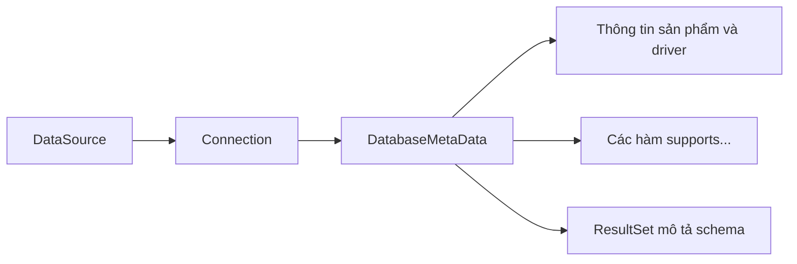
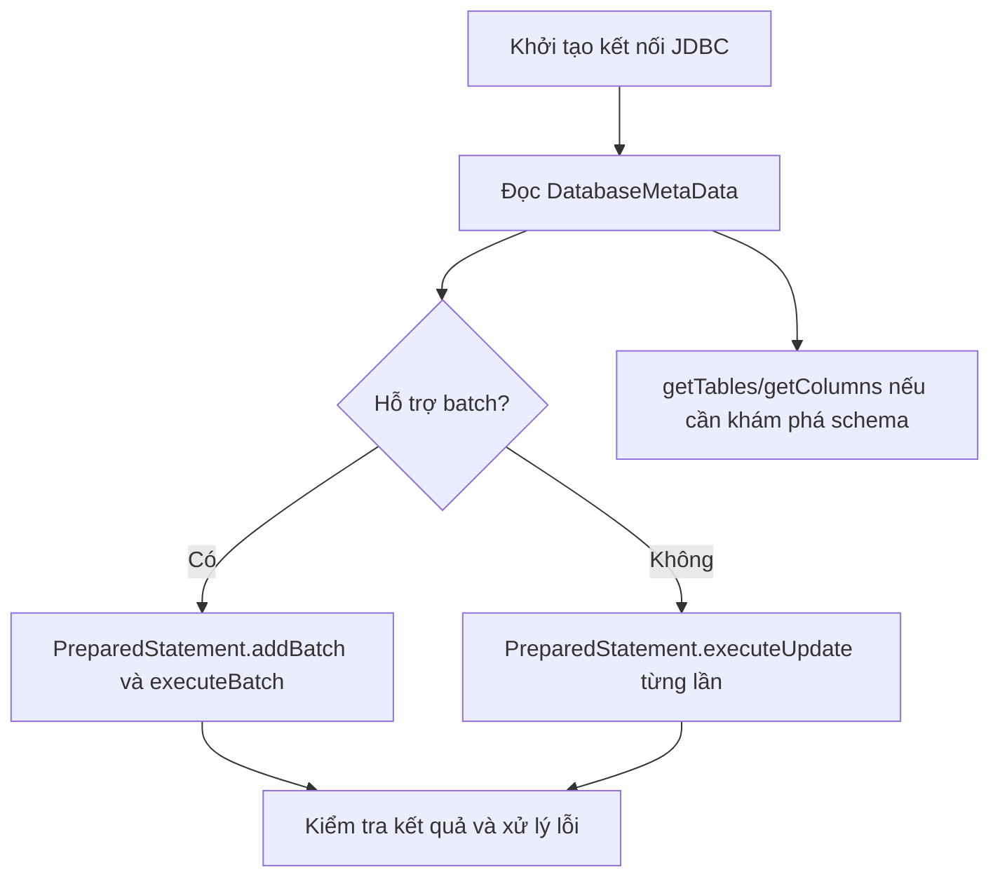

# Khám phá khả năng hệ quản trị bằng `DatabaseMetaData` trong JDBC

## 1. Vì sao ứng dụng cần hỏi cơ sở dữ liệu về khả năng của nó?

**JDBC (Java Database Connectivity)** là API Java chuẩn để làm việc với cơ sở dữ liệu quan hệ. Cùng một mã JDBC có thể kết nối đến nhiều hệ quản trị khác nhau thông qua driver tương ứng, nhưng các hệ quản trị và driver không nhất thiết hỗ trợ giống nhau về giao dịch, batch update, kiểu `ResultSet`, stored procedure hay cách tổ chức catalog/schema.

Ví dụ, một công cụ nhập dữ liệu có thể muốn gom hàng nghìn lệnh `INSERT` vào một batch; một công cụ quản trị muốn liệt kê bảng và cột; một repository muốn biết có thể yêu cầu `ResultSet` cuộn hai chiều hay không. Nếu viết cứng giả định theo tên sản phẩm, chương trình dễ hỏng khi chuyển môi trường hoặc đổi driver.

Giao diện **`java.sql.DatabaseMetaData`** cho phép ứng dụng **hỏi driver JDBC về sản phẩm cơ sở dữ liệu, các tính năng được hỗ trợ, giới hạn và cấu trúc dữ liệu** của kết nối hiện tại. Nó giúp chọn chiến lược thực thi và xây dựng công cụ khám phá schema mà ít phụ thuộc sản phẩm.

Ví dụ về câu hỏi mà `DatabaseMetaData` có thể trả lời:

- Hệ quản trị và driver đang dùng tên gì, phiên bản nào?
- Có hỗ trợ transaction, một mức isolation cụ thể, savepoint, batch update và generated keys không?
- Có thể yêu cầu `ResultSet` dạng scrollable/updatable không?
- Những bảng, cột, khóa chính và khóa ngoại nào có thể truy cập?
- Các định danh SQL có quy tắc chữ hoa/chữ thường và dấu trích dẫn như thế nào?

`DatabaseMetaData` không thực thi truy vấn nghiệp vụ và không thay thế `PreparedStatement`. Nó cũng **khác với `ResultSetMetaData`**: đối tượng thứ hai mô tả *các cột của một kết quả truy vấn cụ thể*.

## 2. Lấy `DatabaseMetaData` từ `Connection`

Luồng sử dụng cơ bản:



Mã minh họa sử dụng `DataSource` do ứng dụng đã cấu hình; nó hoạt động với JDBC thuần và không cần một framework riêng:

```java
import java.sql.Connection;
import java.sql.DatabaseMetaData;
import java.sql.SQLException;
import javax.sql.DataSource;

public final class DatabaseInfo {
    public static void printProductInfo(DataSource dataSource)
            throws SQLException {
        try (Connection connection = dataSource.getConnection()) {
            DatabaseMetaData meta = connection.getMetaData();

            System.out.println("DB: "
                    + meta.getDatabaseProductName());
            System.out.println("DB version: "
                    + meta.getDatabaseProductVersion());
            System.out.println("Driver: "
                    + meta.getDriverName());
            System.out.println("Driver version: "
                    + meta.getDriverVersion());
            System.out.printf("JDBC version: %d.%d%n",
                    meta.getJDBCMajorVersion(),
                    meta.getJDBCMinorVersion());
        }
    }
}
```

`Connection.getMetaData()` trả về thông tin liên quan đến **kết nối hiện tại**. Không có lệnh `close()` riêng cho `DatabaseMetaData`; tài nguyên cần đóng là `Connection` và từng `ResultSet` mà các phương thức metadata trả về. Nên gọi các phương thức đọc metadata trong thời gian kết nối còn hợp lệ.

Các thông tin phiên bản có ý nghĩa khác nhau:

| Phương thức | Ý nghĩa |
| --- | --- |
| `getDatabaseProductName()` | Tên hệ quản trị mà driver báo cáo |
| `getDatabaseProductVersion()` | Chuỗi phiên bản sản phẩm cơ sở dữ liệu |
| `getDriverName()` / `getDriverVersion()` | Tên và phiên bản driver JDBC |
| `getJDBCMajorVersion()` / `getJDBCMinorVersion()` | Phiên bản JDBC mà driver hỗ trợ |
| `getURL()` / `getUserName()` | URL kết nối và tên tài khoản theo driver |

Không nên ghi trực tiếp URL kết nối hoặc tài khoản vào log công khai: chúng có thể tiết lộ thông tin hạ tầng và dữ liệu cấu hình nhạy cảm. **Phiên bản JDBC của driver không đồng nghĩa với phiên bản của máy chủ cơ sở dữ liệu**.

## 3. Kiểm tra khả năng trước khi chọn cách làm

Nhóm phương thức có tên `supports...` thường trả về `boolean`. Chúng giúp ứng dụng phát hiện khả năng của sản phẩm/driver thay vì suy đoán từ tên hệ quản trị.

| Nhu cầu | Phương thức | Cách sử dụng kết quả |
| --- | --- | --- |
| Dùng transaction | `supportsTransactions()` | Xem hệ quản trị có hỗ trợ giao dịch không |
| Chọn isolation | `supportsTransactionIsolationLevel(level)` | Kiểm tra mức isolation yêu cầu có được hỗ trợ không |
| Gửi nhiều thay đổi theo batch | `supportsBatchUpdates()` | Ưu tiên `addBatch()/executeBatch()` khi phù hợp |
| Đặt điểm khôi phục giữa giao dịch | `supportsSavepoints()` | Quyết định có dùng `Connection.setSavepoint()` |
| Lấy khóa được sinh sau `INSERT` | `supportsGetGeneratedKeys()` | Xem có thể sử dụng `getGeneratedKeys()` không |
| Cuộn kết quả | `supportsResultSetType(type)` | Kiểm tra kiểu `ResultSet` như `TYPE_SCROLL_INSENSITIVE` |
| Cập nhật qua `ResultSet` | `supportsResultSetConcurrency(type, concurrency)` | Kiểm tra một cặp kiểu/concurrency cụ thể |
| Gọi stored procedure | `supportsStoredProcedures()` | Xác định hướng triển khai phù hợp |
| Dùng `FULL OUTER JOIN` | `supportsFullOuterJoins()` | Tránh tạo SQL mà hệ quản trị không hỗ trợ |

### Ví dụ: thu thập một bản ghi khả năng

Đoạn mã sau yêu cầu **Java 17+** vì sử dụng `record`:

```java
import java.sql.Connection;
import java.sql.DatabaseMetaData;
import java.sql.ResultSet;
import java.sql.SQLException;
import javax.sql.DataSource;

public final class CapabilityProbe {
    public record Capabilities(
            String product,
            String databaseVersion,
            boolean transactions,
            boolean readCommitted,
            boolean batches,
            boolean savepoints,
            boolean generatedKeys,
            boolean scrollInsensitive,
            boolean updatableScrollInsensitive,
            boolean storedProcedures) {
    }

    public static Capabilities inspect(DataSource dataSource)
            throws SQLException {
        try (Connection connection = dataSource.getConnection()) {
            DatabaseMetaData meta = connection.getMetaData();

            return new Capabilities(
                    meta.getDatabaseProductName(),
                    meta.getDatabaseProductVersion(),
                    meta.supportsTransactions(),
                    meta.supportsTransactionIsolationLevel(
                            Connection.TRANSACTION_READ_COMMITTED),
                    meta.supportsBatchUpdates(),
                    meta.supportsSavepoints(),
                    meta.supportsGetGeneratedKeys(),
                    meta.supportsResultSetType(
                            ResultSet.TYPE_SCROLL_INSENSITIVE),
                    meta.supportsResultSetConcurrency(
                            ResultSet.TYPE_SCROLL_INSENSITIVE,
                            ResultSet.CONCUR_UPDATABLE),
                    meta.supportsStoredProcedures()
            );
        }
    }
}
```

Một ứng dụng có thể gọi `CapabilityProbe.inspect(dataSource)` khi khởi tạo và lưu kết quả để quyết định dùng chức năng nào. Không nhất thiết phải gọi lại các phương thức metadata trên từng HTTP request.

**Đọc kết quả đúng ngữ cảnh:**

- `supportsTransactions() == true` không tự động bật transaction. Cần kiểm tra và cấu hình `autoCommit`, gọi `commit()/rollback()` theo yêu cầu nghiệp vụ.
- `supportsTransactionIsolationLevel(Connection.TRANSACTION_READ_COMMITTED)` hỏi **một mức isolation có được hỗ trợ không**. Nó không cho biết mức isolation hiện đang áp dụng; đọc `connection.getTransactionIsolation()` để biết trạng thái của kết nối.
- `supportsResultSetType(...)` hoặc `supportsResultSetConcurrency(...)` là thông tin về khả năng; truy vấn cụ thể vẫn có thể không tạo được kết quả cập nhật/cuộn như kỳ vọng. Kiểm tra kiểu kết quả thực nhận và xử lý `SQLException` khi yêu cầu tính năng.
- `supportsGetGeneratedKeys()` không đảm bảo mọi bảng hoặc mọi câu `INSERT` đều có khóa sinh. Cần yêu cầu khóa lúc chuẩn bị statement và kiểm tra kết quả trả về.
- Phương thức trả về `false` là tín hiệu để ứng dụng tránh phụ thuộc tính năng đó. Phương thức trả về `true` vẫn cần kết hợp xử lý lỗi tại lúc thực thi.

Ví dụ cách yêu cầu generated keys khi driver hỗ trợ:

```java
String sql = "INSERT INTO app_user(full_name, email, active) "
           + "VALUES (?, ?, ?)";

if (connection.getMetaData().supportsGetGeneratedKeys()) {
    try (var statement = connection.prepareStatement(
            sql, java.sql.Statement.RETURN_GENERATED_KEYS)) {
        statement.setString(1, "An");
        statement.setString(2, "an@example.test");
        statement.setBoolean(3, true);
        statement.executeUpdate();

        try (var keys = statement.getGeneratedKeys()) {
            if (keys.next()) {
                long generatedId = keys.getLong(1);
                System.out.println(generatedId);
            }
        }
    }
}
```

Đoạn mã này giả định bảng có khóa tự sinh do cơ sở dữ liệu cấu hình và biến `connection` đang mở. Cú pháp tạo khóa tự sinh khác nhau giữa các hệ quản trị. Trường hợp metadata báo không hỗ trợ hoặc không có khóa được trả về cần có chiến lược phù hợp với nghiệp vụ; không tự đoán khóa mới.

## 4. Dùng khả năng hỗ trợ để chọn batch hay từng lệnh

Giả sử ứng dụng nhập nhiều bản ghi người dùng. Ta có thể thử chọn thực thi batch khi metadata báo hỗ trợ, rồi chuyển sang thực thi từng lần khi không hỗ trợ:

```java
import java.sql.Connection;
import java.sql.PreparedStatement;
import java.sql.SQLException;
import java.util.List;
import javax.sql.DataSource;

public final class UserImporter {
    public record NewUser(
            long id, String fullName, String email, boolean active) {
    }

    public static void insertAll(
            DataSource dataSource, List<NewUser> users)
            throws SQLException {

        String sql = "INSERT INTO app_user "
                + "(id, full_name, email, active) VALUES (?, ?, ?, ?)";

        try (Connection connection = dataSource.getConnection();
             PreparedStatement statement =
                     connection.prepareStatement(sql)) {

            boolean useBatch =
                    connection.getMetaData().supportsBatchUpdates();

            for (NewUser user : users) {
                statement.setLong(1, user.id());
                statement.setString(2, user.fullName());
                statement.setString(3, user.email());
                statement.setBoolean(4, user.active());

                if (useBatch) {
                    statement.addBatch();
                } else {
                    statement.executeUpdate();
                }
            }

            if (useBatch && !users.isEmpty()) {
                statement.executeBatch();
            }
        }
    }
}
```

Ở đây metadata ảnh hưởng đến **chiến lược thực thi**, còn câu SQL và cách bind tham số vẫn dùng `PreparedStatement`. Tuy nhiên, batch không đảm bảo luôn nhanh hơn, và `executeBatch()` vẫn có thể ném `BatchUpdateException`. Không nên bắt lỗi batch rồi chạy lại tất cả lệnh ngay, vì một phần batch có thể đã thực thi; cần xem update counts và trạng thái transaction trước khi quyết định phục hồi.

Ví dụ cố ý không tự thay đổi `autoCommit`. Nếu yêu cầu tất cả bản ghi thành công hoặc cùng rollback, hãy xây dựng transaction rõ ràng, kiểm tra `supportsTransactions()` và xử lý `commit()/rollback()` an toàn.

## 5. Khám phá bảng và cột bằng các phương thức metadata

Ngoài nhóm `supports...`, `DatabaseMetaData` có các phương thức trả về `ResultSet` mô tả cấu trúc cơ sở dữ liệu:

| Phương thức | Thông tin cung cấp |
| --- | --- |
| `getCatalogs()` | Catalog có thể truy cập |
| `getSchemas()` | Các schema được báo cáo |
| `getTableTypes()` | Những loại đối tượng bảng mà driver công bố |
| `getTables(...)` | Bảng/view thỏa bộ lọc catalog, schema, tên, loại |
| `getColumns(...)` | Cột, kiểu SQL, kích thước, tính nullable, vị trí |
| `getPrimaryKeys(...)` | Các cột tham gia khóa chính |
| `getImportedKeys(...)` | Khóa ngoại do một bảng tham chiếu tới bảng khác |
| `getIndexInfo(...)` | Thông tin chỉ mục của bảng |
| `getTypeInfo()` | Các kiểu SQL mà hệ quản trị/driver hỗ trợ |

Những phương thức này không trả về `List<Table>` hay đối tượng domain tự động; ta vẫn đọc `ResultSet` theo **tên cột chuẩn do JDBC quy định**.

### Liệt kê các bảng

Ví dụ sau lưu các thông tin cần thiết vào `TableInfo`, để không trả `ResultSet` ra khỏi kết nối đã đóng:

```java
import java.sql.Connection;
import java.sql.DatabaseMetaData;
import java.sql.ResultSet;
import java.sql.SQLException;
import java.util.ArrayList;
import java.util.List;
import javax.sql.DataSource;

public final class TableExplorer {
    public record TableInfo(
            String catalog, String schema, String name, String type) {
    }

    public static List<TableInfo> listTables(
            DataSource dataSource) throws SQLException {

        List<TableInfo> tables = new ArrayList<>();

        try (Connection connection = dataSource.getConnection()) {
            DatabaseMetaData meta = connection.getMetaData();

            try (ResultSet rs = meta.getTables(
                    null, null, "%", new String[]{"TABLE"})) {
                while (rs.next()) {
                    tables.add(new TableInfo(
                            rs.getString("TABLE_CAT"),
                            rs.getString("TABLE_SCHEM"),
                            rs.getString("TABLE_NAME"),
                            rs.getString("TABLE_TYPE")
                    ));
                }
            }
        }
        return tables;
    }
}
```

Các đối số của `getTables(catalog, schemaPattern, tableNamePattern, types)`:

- `catalog = null`: không hạn chế theo catalog.
- `schemaPattern = null`: không hạn chế theo schema.
- `tableNamePattern = "%"`: nhận mọi tên bảng theo cú pháp pattern của metadata.
- `types = {"TABLE"}`: chỉ yêu cầu loại `TABLE`. Có thể sử dụng các loại khác được công bố qua `getTableTypes()`, ví dụ `VIEW`.

Kết quả thực tế phụ thuộc driver, quyền truy cập của tài khoản và cách hệ quản trị định nghĩa `TABLE`. Không nên mặc định danh sách này chứa mọi bảng trong toàn bộ máy chủ.

### Đọc cột của một bảng

Các cột thường dùng trong kết quả `getColumns(...)`:

| Nhãn cột metadata | Nội dung |
| --- | --- |
| `COLUMN_NAME` | Tên cột |
| `DATA_TYPE` | Mã kiểu SQL theo `java.sql.Types` |
| `TYPE_NAME` | Tên kiểu do hệ quản trị/driver báo cáo |
| `COLUMN_SIZE` | Kích thước hoặc độ chính xác theo kiểu dữ liệu |
| `NULLABLE` | `columnNoNulls`, `columnNullable` hoặc `columnNullableUnknown` |
| `IS_NULLABLE` | Dạng chữ `YES`, `NO` hoặc chuỗi rỗng khi không xác định |
| `ORDINAL_POSITION` | Vị trí của cột trong bảng, bắt đầu từ 1 |
| `COLUMN_DEF` | Giá trị mặc định nếu có và được driver báo cáo |

Ví dụ kiểm tra cấu trúc bảng `app_user`. Mã dưới đây dùng phương thức `literalPattern` để tránh nhầm dấu `_` hoặc `%` trong tên bảng thành ký tự đại diện:

```java
import java.sql.Connection;
import java.sql.DatabaseMetaData;
import java.sql.ResultSet;
import java.sql.SQLException;
import java.util.ArrayList;
import java.util.List;
import javax.sql.DataSource;

public final class ColumnExplorer {
    public record ColumnInfo(
            String name, int sqlType, String typeName,
            int nullable, int ordinalPosition) {
    }

    public static List<ColumnInfo> listColumns(
            DataSource dataSource,
            String catalog,
            String schema,
            String tableName) throws SQLException {

        List<ColumnInfo> columns = new ArrayList<>();

        try (Connection connection = dataSource.getConnection()) {
            DatabaseMetaData meta = connection.getMetaData();
            String tablePattern = literalPattern(
                    tableName, meta.getSearchStringEscape());

            try (ResultSet rs = meta.getColumns(
                    catalog, schema, tablePattern, "%")) {
                while (rs.next()) {
                    columns.add(new ColumnInfo(
                            rs.getString("COLUMN_NAME"),
                            rs.getInt("DATA_TYPE"),
                            rs.getString("TYPE_NAME"),
                            rs.getInt("NULLABLE"),
                            rs.getInt("ORDINAL_POSITION")
                    ));
                }
            }
        }

        return columns;
    }

    private static String literalPattern(
            String literal, String escape) throws SQLException {
        if (escape == null || escape.isEmpty()) {
            if (literal.contains("%") || literal.contains("_")) {
                throw new SQLException(
                        "Driver không cung cấp cách escape metadata pattern");
            }
            return literal;
        }

        StringBuilder pattern = new StringBuilder();
        for (int i = 0; i < literal.length();) {
            if (literal.startsWith(escape, i)) {
                pattern.append(escape).append(escape);
                i += escape.length();
                continue;
            }
            char ch = literal.charAt(i++);
            if (ch == '%' || ch == '_') {
                pattern.append(escape);
            }
            pattern.append(ch);
        }
        return pattern.toString();
    }
}
```

`getSearchStringEscape()` cho biết chuỗi escape dùng trong các **metadata search pattern**. Phương thức này khác với cách trích dẫn định danh SQL (`getIdentifierQuoteString()`). Trong ví dụ, nếu driver không cung cấp escape và tên có ký tự đại diện, mã báo lỗi rõ ràng để tránh trả nhầm bảng; một công cụ khám phá tổng quát có thể thay bằng cách lấy danh sách rộng hơn rồi lọc chính xác theo tên trong Java.

Khi gọi `listColumns(...)`, nên truyền `catalog`, `schema` và `tableName` lấy từ `getTables()` để hạn chế phụ thuộc quy tắc viết hoa/viết thường của tên định danh.

### Khóa chính, khóa ngoại và chỉ mục

Các phương thức khác sử dụng **tên bảng chính xác**, không phải `tableNamePattern`:

```java
DatabaseMetaData meta = connection.getMetaData();

try (ResultSet keys = meta.getPrimaryKeys(
        catalog, schema, tableName)) {
    while (keys.next()) {
        System.out.println(
                "PK column: " + keys.getString("COLUMN_NAME")
                + ", order: " + keys.getShort("KEY_SEQ"));
    }
}

try (ResultSet foreignKeys = meta.getImportedKeys(
        catalog, schema, tableName)) {
    while (foreignKeys.next()) {
        System.out.println(
                foreignKeys.getString("FKCOLUMN_NAME")
                + " -> "
                + foreignKeys.getString("PKTABLE_NAME")
                + "."
                + foreignKeys.getString("PKCOLUMN_NAME"));
    }
}
```

Giả định đoạn mã chạy khi biến `connection` đang mở và `catalog`, `schema`, `tableName` đã được xác định. `getImportedKeys()` trả về các khóa ngoại mà bảng hiện tại sử dụng để **tham chiếu sang bảng khác**. Để tìm bảng khác đang tham chiếu đến bảng hiện tại, có thể dùng `getExportedKeys(...)`.

## 6. Phân biệt `catalog`, `schema` và pattern

Ba khái niệm này dễ bị nhầm vì mỗi hệ quản trị tổ chức không gian tên khác nhau:

- **Catalog**: cấp phân loại cao hơn theo mô hình metadata JDBC, có thể tương ứng một database trong một số hệ quản trị.
- **Schema**: không gian tên chứa bảng, view và các đối tượng liên quan theo cách tổ chức của hệ quản trị.
- **Pattern**: chuỗi tìm kiếm dùng cho một số đối số như `schemaPattern`, `tableNamePattern`, `columnNamePattern`; ký tự `%` khớp nhiều ký tự, `_` khớp một ký tự.

Trong các API metadata, `null` thường biểu thị **không áp dụng ràng buộc lọc**, còn chuỗi rỗng có ý nghĩa riêng là đối tượng **không có catalog/schema** với các tham số tương ứng. Không thể thay thế `null`, `""` và `"%"` tùy tiện.

Tên đối tượng cũng có thể khác về chữ hoa/chữ thường. `storesUpperCaseIdentifiers()`, `storesLowerCaseIdentifiers()` và `storesMixedCaseIdentifiers()` giúp khảo sát quy tắc lưu trữ định danh **không được trích dẫn**. Với định danh có trích dẫn, JDBC cung cấp nhóm phương thức tương ứng `stores...QuotedIdentifiers()`. Tận dụng tên trả về từ metadata sẽ đáng tin cậy hơn tự đổi thành chữ thường hoặc chữ hoa.

`getIdentifierQuoteString()` chỉ cung cấp dấu trích dẫn định danh mà hệ quản trị báo cáo; không phải công cụ thay thế `PreparedStatement`. `PreparedStatement` bind **giá trị dữ liệu**, không bind tên bảng hoặc tên cột; khi tạo SQL động từ tên đối tượng, phải giới hạn tên được phép và xử lý quote theo sản phẩm/driver một cách an toàn.

## 7. Giới hạn của việc khám phá bằng metadata

`DatabaseMetaData` cung cấp bề mặt kiểm tra chung, nhưng cần hiểu các ranh giới sau:

1. **Driver là bên báo cáo.** Hai driver hoặc hai phiên bản driver cho cùng một máy chủ có thể khác về độ đầy đủ của metadata. Có phương thức ném `SQLException` nếu không lấy được thông tin.
2. **Quyền truy cập ảnh hưởng đến danh sách đối tượng.** Tài khoản thiếu quyền có thể không thấy một số bảng/cột hoặc không được phép thao tác dù metadata mô tả chúng.
3. **Có hỗ trợ không có nghĩa mọi câu lệnh đều dùng được.** Ví dụ, một `ResultSet` cập nhật được hay không còn phụ thuộc câu SQL, kiểu bảng và cấu hình của statement.
4. **Metadata có chi phí.** Các thao tác duyệt toàn bộ bảng, cột, index có thể tạo nhiều truy vấn hệ thống; nên giới hạn phạm vi và cache có thời hạn phù hợp thay vì quét trên mỗi request.
5. **Schema thay đổi theo thời gian.** Sau migration, bản cache có thể cũ; cần làm mới khi cần kiểm tra cấu trúc hiện tại.
6. **Không tự động bảo đảm tính portable của toàn bộ SQL.** Các phương thức hỗ trợ giúp quyết định và xử lý nhánh tương thích, nhưng cú pháp, kiểu SQL, DDL và hành vi giao dịch vẫn cần được kiểm thử trên hệ quản trị thực tế.

Khi đọc các giới hạn có dạng số, chẳng hạn `getMaxConnections()`, cần xem contract của từng phương thức: nhiều giới hạn trả về `0` khi **không xác định hoặc không có giới hạn**, không nên hiểu ngay là khả năng bằng 0.

## 8. `DatabaseMetaData`, `ResultSetMetaData` và `ParameterMetaData` khác nhau thế nào?

| API | Lấy từ đâu | Trả lời câu hỏi |
| --- | --- | --- |
| `DatabaseMetaData` | `connection.getMetaData()` | Cơ sở dữ liệu/driver có khả năng gì, có bảng và cột nào? |
| `ResultSetMetaData` | `resultSet.getMetaData()` | Kết quả **của câu truy vấn này** có mấy cột, nhãn/kiểu gì? |
| `ParameterMetaData` | `preparedStatement.getParameterMetaData()` | Các placeholder của statement có thông tin tham số nào? |

Ví dụ, để biết câu `SELECT id, email FROM app_user` đang trả về nhãn cột và kiểu gì, `ResultSetMetaData` là API phù hợp:

```java
try (PreparedStatement statement = connection.prepareStatement(
        "SELECT id, email FROM app_user");
     ResultSet rs = statement.executeQuery()) {

    java.sql.ResultSetMetaData resultMeta = rs.getMetaData();
    for (int index = 1; index <= resultMeta.getColumnCount(); index++) {
        System.out.printf("%s -> %d%n",
                resultMeta.getColumnLabel(index),
                resultMeta.getColumnType(index));
    }
}
```

Chỉ số cột JDBC bắt đầu từ **1**. Khả năng của `ParameterMetaData` còn phụ thuộc driver và statement; không nên cho rằng mọi tham số đều có kiểu chính xác trước khi bind hoặc thực thi.

## 9. Một quy trình ứng dụng thực tế

Giả sử xây dựng một công cụ import dữ liệu chạy trên nhiều hệ quản trị:

1. Mở kết nối từ `DataSource` và thu thập thông tin sản phẩm/driver bằng `DatabaseMetaData`; ghi log những thông tin không nhạy cảm.
2. Hỏi `supportsTransactions()`, `supportsBatchUpdates()` và isolation cần thiết; chọn đường xử lý được hỗ trợ.
3. Nếu cần ánh xạ dữ liệu vào bảng hiện hữu, dùng `getTables()`, `getColumns()` và `getPrimaryKeys()` để phát hiện cấu trúc.
4. Dùng `PreparedStatement` để nhập dữ liệu, quản lý transaction theo yêu cầu nghiệp vụ và xử lý lỗi tại lúc chạy.
5. Kiểm tra với driver và hệ quản trị mục tiêu, đặc biệt khi có batch, rollback, khóa tự sinh hoặc thay đổi schema.



## 10. Lỗi thường gặp và bài tập

| Lỗi | Hậu quả | Cách tránh |
| --- | --- | --- |
| Giả định mọi driver đều hỗ trợ một tính năng | Phát sinh lỗi tại môi trường khác | Kiểm tra `supports...` và xử lý lỗi khi chạy |
| Dùng `getTables()` rồi không đóng `ResultSet` | Giữ tài nguyên JDBC quá lâu | Đóng mọi `ResultSet` metadata bằng `try-with-resources` |
| Dùng `"_"` trong `tableNamePattern` như ký tự thường | Trả về nhiều đối tượng không mong muốn | Dùng `getSearchStringEscape()` hoặc lọc chính xác |
| Nhầm `null` với `""` ở catalog/schema | Lọc sai đối tượng | Đọc đúng contract tham số từng phương thức |
| Đọc danh sách schema mà không xét quyền | Thiếu bảng trong kết quả, hiểu sai về hệ thống | Kiểm tra account/permissions và môi trường |
| Lấy tên hệ quản trị làm điều kiện duy nhất cho mọi nhánh | Phụ thuộc sản phẩm và phiên bản | Ưu tiên khả năng metadata và kiểm thử thực tế |
| Ghi URL kết nối/username trực tiếp ra log | Lộ thông tin hạ tầng | Chỉ log các trường cần thiết, che thông tin nhạy cảm |

**Bài tập thực hành:**

1. Viết chương trình in tên cơ sở dữ liệu, driver và các cờ: `supportsTransactions()`, `supportsBatchUpdates()`, `supportsSavepoints()`, `supportsGetGeneratedKeys()`.
2. Dùng `getTables(null, null, "%", new String[]{"TABLE"})` để lấy bảng mà tài khoản có thể thấy; chọn một bảng và dùng `getColumns()` để in `COLUMN_NAME`, `TYPE_NAME`, `NULLABLE`, `ORDINAL_POSITION`.
3. Thử bảng có dấu gạch dưới trong tên, so sánh kết quả tìm kiếm khi truyền trực tiếp tên vào `tableNamePattern` và khi đã escape pattern đúng cách.
4. Thử hai cấu hình driver/hệ quản trị khác nhau (nếu có), ghi nhận điểm giống và khác ở khả năng giao dịch, batch hoặc hệ thống catalog/schema. Không đưa ra giả định về giá trị trả về khi chưa kiểm tra.

**Ghi nhớ:** `DatabaseMetaData` là công cụ *khám phá khả năng và cấu trúc* của kết nối JDBC. Từ dữ liệu đó, ứng dụng có thể chọn cách thực thi phù hợp, nhưng vẫn phải dùng các API JDBC tương ứng, xử lý `SQLException`, quản lý tài nguyên và kiểm chứng hành vi trên cơ sở dữ liệu thật.
