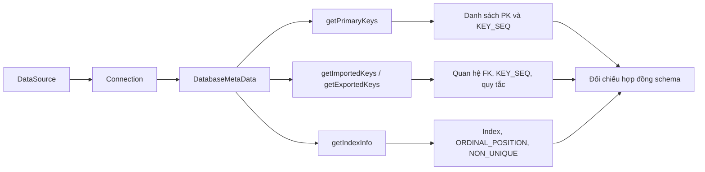

# Tra cứu khóa chính, khóa ngoại và chỉ mục bằng JDBC

## 1. Vì sao cần đọc siêu dữ liệu của cơ sở dữ liệu?

Trong một ứng dụng **JDBC**, Java có thể thực thi SQL qua `Connection`, `PreparedStatement` và đọc các hàng bằng `ResultSet`. Nhưng khi cần biết **bảng nào có khóa chính, cột nào tham chiếu bảng khác, hoặc chỉ mục nào đã tồn tại**, không nên đoán từ tên cột như `id`, `customer_id` hay dựa vào câu `SELECT *`. Thông tin cấu trúc này được cung cấp qua **`DatabaseMetaData`**.

Những tình huống cần tra cứu thực tế gồm: kiểm tra migration trước khi triển khai, viết công cụ khám phá schema, kiểm tra quan hệ khi nhập dữ liệu, phát hiện lược đồ đã thay đổi và kiểm chứng index phục vụ một truy vấn thường dùng.

Ba loại đối tượng dễ bị nhầm:

| Đối tượng | Ý nghĩa | Câu hỏi cần trả lời |
| --- | --- | --- |
| **Khóa chính** (*primary key, PK*) | Ràng buộc nhận diện duy nhất một hàng và không cho giá trị khóa là `NULL`. | Bảng có PK không? PK gồm những cột nào, theo thứ tự nào? |
| **Khóa ngoại** (*foreign key, FK*) | Ràng buộc tham chiếu từ cột ở bảng con sang khóa phù hợp của bảng cha. | Cột nào ở bảng con tham chiếu cột nào ở bảng cha? Quy tắc cập nhật/xóa ra sao? |
| **Chỉ mục** (*index*) | Cấu trúc giúp DBMS truy cập dữ liệu theo một số khóa tra cứu; có thể unique hoặc non-unique. | Có index nào, gồm những cột nào, theo thứ tự nào? |

PK và FK là **ràng buộc toàn vẹn dữ liệu**; index chủ yếu là cấu trúc truy cập và đôi khi thực thi một ràng buộc unique. Một index non-unique trên `customer_id` **không tự tạo ra FK**. Ngược lại, có FK không đồng nghĩa mọi DBMS tự sinh index trên cột tham chiếu.



## 2. Phân biệt `DatabaseMetaData` với `ResultSetMetaData`

`DatabaseMetaData` mô tả **database/schema/table và năng lực driver/DBMS**; lấy qua `connection.getMetaData()`. Trong khi đó, `ResultSetMetaData` mô tả **các cột của một kết quả truy vấn cụ thể**, lấy qua `resultSet.getMetaData()`. Ví dụ `SELECT c.id AS customer_id, COUNT(o.id) AS order_count ...` có nhãn cột và kiểu kết quả riêng; chỉ nhìn `ResultSetMetaData` không đủ để suy ra toàn bộ khóa ngoại hay index của bảng nguồn.

Các phương thức JDBC cần nhớ:

| Phương thức | Dùng cho | Kết quả chính |
| --- | --- | --- |
| `getPrimaryKeys(catalog, schema, table)` | Khóa chính của **một bảng**. | Một hàng metadata cho mỗi cột PK, gồm `COLUMN_NAME`, `KEY_SEQ`, `PK_NAME`. |
| `getImportedKeys(catalog, schema, table)` | Những FK **do bảng đang xét khai báo** để tham chiếu bảng khác. | Cặp cột con/cha và quy tắc tham chiếu. |
| `getExportedKeys(catalog, schema, table)` | Những FK **ở bảng khác** đang tham chiếu PK của bảng đang xét. | Các quan hệ đi vào bảng cha. |
| `getCrossReference(parentCatalog, parentSchema, parentTable, foreignCatalog, foreignSchema, foreignTable)` | FK từ một bảng con **cụ thể** tới một bảng cha **cụ thể**. | Quan hệ giữa hai bảng đã biết, nếu driver hỗ trợ. |
| `getIndexInfo(catalog, schema, table, unique, approximate)` | Chỉ mục của một bảng. | `INDEX_NAME`, `NON_UNIQUE`, `ORDINAL_POSITION`, `COLUMN_NAME`, `TYPE`, ... |

Các lời gọi trả về **`ResultSet` chứa các hàng mô tả**; chúng không thực thi truy vấn CRUD do người học tự viết. Vẫn cần đóng `ResultSet` bằng `try-with-resources`, xử lý `SQLException` và kiểm tra khả năng của JDBC driver khi muốn xây công cụ dùng cho nhiều DBMS.

## 3. Lược đồ ví dụ: bảng cha, bảng con và khóa ghép

Để thấy rõ thứ tự cột của khóa, sử dụng schema PostgreSQL minh họa dưới đây:

```sql
CREATE SCHEMA IF NOT EXISTS training;

CREATE TABLE training.customers (
    customer_id BIGINT PRIMARY KEY,
    email VARCHAR(200) NOT NULL UNIQUE
);

CREATE TABLE training.purchase_orders (
    order_id BIGINT PRIMARY KEY,
    customer_id BIGINT NOT NULL,
    created_at TIMESTAMP NOT NULL,
    CONSTRAINT fk_orders_customer FOREIGN KEY (customer_id)
        REFERENCES training.customers(customer_id)
        ON DELETE RESTRICT
);

CREATE TABLE training.order_items (
    order_id BIGINT NOT NULL,
    line_no INTEGER NOT NULL,
    sku VARCHAR(40) NOT NULL,
    quantity INTEGER NOT NULL CHECK (quantity > 0),
    CONSTRAINT pk_order_items PRIMARY KEY (order_id, line_no),
    CONSTRAINT fk_items_order FOREIGN KEY (order_id)
        REFERENCES training.purchase_orders(order_id)
        ON DELETE CASCADE
);

CREATE TABLE training.delivery_items (
    delivery_id BIGINT NOT NULL,
    order_id BIGINT NOT NULL,
    line_no INTEGER NOT NULL,
    CONSTRAINT pk_delivery_items PRIMARY KEY (delivery_id, order_id, line_no),
    CONSTRAINT fk_delivery_order_item FOREIGN KEY (order_id, line_no)
        REFERENCES training.order_items(order_id, line_no)
);

CREATE INDEX idx_orders_customer_created
    ON training.purchase_orders(customer_id, created_at DESC);
```

Ta có các quan hệ sau:

- `customers` là bảng cha của `purchase_orders` qua cột `customer_id`.
- `purchase_orders` là bảng cha của `order_items` qua cột `order_id`.
- `order_items` có **PK ghép** gồm `(order_id, line_no)`.
- `delivery_items` dùng **FK ghép** `(order_id, line_no)` tham chiếu cùng cặp cột ở `order_items`.
- `idx_orders_customer_created` là index nhiều cột, độc lập với việc bảng có PK/FK.

Đây là ví dụ PostgreSQL; cách đặt tên index hệ thống, cách thực thi unique và mức độ metadata được driver trả về có thể khác ở DBMS khác. Trong ví dụ Java, các tên `training`, `order_items`, `purchase_orders` đều viết thường, phù hợp cách PostgreSQL xử lý identifier không có dấu nháy kép.

## 4. Tra cứu khóa chính qua `getPrimaryKeys()`

Đọc siêu dữ liệu PK bằng API chuẩn:

```java
DatabaseMetaData meta = connection.getMetaData();
String catalog = connection.getCatalog();

try (ResultSet keys = meta.getPrimaryKeys(
        catalog, "training", "order_items")) {
    while (keys.next()) {
        System.out.printf("PK=%s, seq=%d, column=%s%n",
            keys.getString("PK_NAME"),
            keys.getShort("KEY_SEQ"),
            keys.getString("COLUMN_NAME"));
    }
}
```

Những cột metadata quan trọng:

| Cột của `ResultSet` | Ý nghĩa |
| --- | --- |
| `TABLE_CAT`, `TABLE_SCHEM`, `TABLE_NAME` | Catalog, schema và bảng chứa PK. |
| `COLUMN_NAME` | Tên một cột thuộc khóa chính. |
| `KEY_SEQ` | **Thứ tự 1-based** của cột trong PK; đặc biệt quan trọng với khóa ghép. |
| `PK_NAME` | Tên constraint PK, có thể là `NULL` nếu driver không cung cấp. |

Với `training.order_items`, thông tin mong đợi về thứ tự là:

| `KEY_SEQ` | `COLUMN_NAME` | `PK_NAME` trong ví dụ |
| --- | --- | --- |
| `1` | `order_id` | `pk_order_items` |
| `2` | `line_no` | `pk_order_items` |

**Đừng giả định thứ tự hàng do `ResultSet` metadata trả về luôn là thứ tự khai báo khóa.** Nếu muốn dựng danh sách cột của PK ghép, hãy sắp xếp theo `KEY_SEQ`, không phải theo thứ tự alphabet của `COLUMN_NAME` hoặc thứ tự cột trong bảng.

Nếu `getPrimaryKeys()` không trả hàng nào, chưa đủ căn cứ khẳng định bảng thật sự không có khóa chính: tên bảng/schema/catalog có thể sai, hoặc metadata bị hạn chế bởi driver/quyền truy cập. Có thể dùng `getTables()` để đối chiếu bảng tồn tại trước khi đưa ra kết luận, lưu ý `getTables()` nhận **pattern** với ký tự đại diện cho schema/tên bảng, khác với tham số tên bảng tường minh của `getPrimaryKeys()`.

## 5. Khóa ngoại: hiểu đúng chiều `imported` và `exported`

Hai phương thức của `DatabaseMetaData` có vẻ giống nhau nhưng trả về hai góc nhìn:

```text
customers (PK: customer_id)
          ^
          | FK từ purchase_orders.customer_id
purchase_orders (PK: order_id)
          ^
          | FK từ order_items.order_id
order_items (PK ghép: order_id, line_no)
          ^
          | FK ghép từ delivery_items.(order_id, line_no)
delivery_items
```

- Gọi **`getImportedKeys(..., "purchase_orders")`** để tìm FK `fk_orders_customer` mà bảng `purchase_orders` sở hữu, hướng **tới** `customers`.
- Gọi **`getExportedKeys(..., "customers")`** để tìm FK ở bảng `purchase_orders` đang tham chiếu khóa của `customers`.
- Gọi **`getImportedKeys(..., "delivery_items")`** để xem **hai dòng** thuộc FK ghép, tương ứng `KEY_SEQ=1` và `KEY_SEQ=2`.
- Gọi **`getExportedKeys(..., "order_items")`** để xem FK ghép từ `delivery_items` đi vào khóa của `order_items`.

```java
try (ResultSet keys = meta.getImportedKeys(
        catalog, "training", "delivery_items")) {
    while (keys.next()) {
        System.out.printf("FK=%s, seq=%d: %s.%s -> %s.%s%n",
            keys.getString("FK_NAME"),
            keys.getShort("KEY_SEQ"),
            keys.getString("FKTABLE_NAME"),
            keys.getString("FKCOLUMN_NAME"),
            keys.getString("PKTABLE_NAME"),
            keys.getString("PKCOLUMN_NAME"));
    }
}
```

Các cột metadata của khóa ngoại có vai trò:

| Cột | Diễn giải |
| --- | --- |
| `PKTABLE_CAT`, `PKTABLE_SCHEM`, `PKTABLE_NAME`, `PKCOLUMN_NAME` | Bảng/cột **được tham chiếu** (phía cha). |
| `FKTABLE_CAT`, `FKTABLE_SCHEM`, `FKTABLE_NAME`, `FKCOLUMN_NAME` | Bảng/cột **đang tham chiếu** (phía con). |
| `KEY_SEQ` | Vị trí một cặp cột trong quan hệ FK, bắt đầu từ 1. |
| `FK_NAME`, `PK_NAME` | Tên FK và PK liên quan; có thể không được cung cấp. |
| `UPDATE_RULE`, `DELETE_RULE` | Hành động khi khóa cha được cập nhật/xóa. |
| `DEFERRABILITY` | Thông tin khả năng trì hoãn kiểm tra FK, nếu được hỗ trợ. |

Đặc biệt với FK ghép, **phải ghép đúng các cặp theo `KEY_SEQ`**. Không gom cột con và cột cha thành hai danh sách độc lập rồi tự sắp xếp alphabet: cách làm đó có thể tạo nhầm quan hệ. Khi bảng có nhiều FK, cần tách các ràng buộc theo thông tin xác định của từng FK, thông thường gồm tên constraint và bảng liên quan. Nếu driver không cung cấp `FK_NAME`, phải thận trọng: không thể luôn tái dựng một cách chắc chắn nhiều FK ghép chỉ dựa vào tên bảng.

### Quy tắc cập nhật và xóa

`UPDATE_RULE` và `DELETE_RULE` là mã số chuẩn của `DatabaseMetaData`, ví dụ:

| Hằng JDBC | Ý nghĩa thường gặp |
| --- | --- |
| `importedKeyNoAction` | Không có hành động cascade; kiểm tra ràng buộc theo ngữ nghĩa DBMS. |
| `importedKeyRestrict` | Ngăn thao tác cha nếu sẽ vi phạm quan hệ; thời điểm kiểm tra có thể khác `NO ACTION`. |
| `importedKeyCascade` | Lan truyền cập nhật/xóa khóa theo ràng buộc. |
| `importedKeySetNull` | Đặt FK ở bảng con thành SQL `NULL`, nếu cột/ràng buộc cho phép. |
| `importedKeySetDefault` | Đặt FK ở bảng con về giá trị mặc định đã định nghĩa, nếu hợp lệ. |

Trong schema minh họa, `fk_orders_customer` dùng `ON DELETE RESTRICT`, còn `fk_items_order` dùng `ON DELETE CASCADE`. `getImportedKeys()` giúp xác nhận chính sách được driver báo cáo, nhưng **không tự ý thay đổi hoặc xóa dữ liệu** để kiểm chứng trên môi trường sản xuất.

## 6. Tra cứu chỉ mục với `getIndexInfo()`

Cú pháp:

```java
try (ResultSet indexes = meta.getIndexInfo(
        catalog, "training", "purchase_orders", false, false)) {
    while (indexes.next()) {
        short type = indexes.getShort("TYPE");
        if (type == DatabaseMetaData.tableIndexStatistic) {
            continue; // Hàng thống kê bảng, không phải cột index.
        }

        System.out.printf("index=%s, col=%s, pos=%d, nonUnique=%s%n",
            indexes.getString("INDEX_NAME"),
            indexes.getString("COLUMN_NAME"),
            indexes.getShort("ORDINAL_POSITION"),
            indexes.getBoolean("NON_UNIQUE"));
    }
}
```

Hai đối số boolean cuối có ý nghĩa:

- `unique=false`: **lấy cả index unique và non-unique**. `unique=true`: chỉ yêu cầu những index có giá trị duy nhất theo báo cáo metadata; không có nghĩa chỉ lấy PK.
- `approximate=false`: yêu cầu thông tin thống kê chính xác nếu driver/DBMS cung cấp; `true` cho phép thông tin xấp xỉ. Với bảng lớn, các thống kê chính xác có thể tốn chi phí; ngay cả khi dùng `false`, các giá trị thống kê còn chịu giới hạn của driver/DBMS.

Các cột cần hiểu:

| Cột | Ý nghĩa |
| --- | --- |
| `INDEX_NAME` | Tên index; có thể là `NULL` cho một số hàng metadata (đặc biệt hàng thống kê). |
| `NON_UNIQUE` | `false` nghĩa là index duy nhất theo metadata, `true` nghĩa là không unique. |
| `ORDINAL_POSITION` | Vị trí 1-based của cột trong index. |
| `COLUMN_NAME` | Cột được báo cáo cho vị trí đó; **có thể `NULL`** ở index biểu thức hoặc tùy driver. |
| `ASC_OR_DESC` | Hướng sắp xếp nếu driver báo cáo, thường `A` hoặc `D`; có thể `NULL`. |
| `TYPE` | Loại bản ghi/index theo các hằng `tableIndexStatistic`, `tableIndexClustered`, `tableIndexHashed`, `tableIndexOther`. |
| `CARDINALITY`, `PAGES` | Thống kê số lượng giá trị/hàng khác nhau, số trang hoặc thông tin phù hợp loại index; có thể không có hoặc xấp xỉ. |
| `FILTER_CONDITION` | Điều kiện lọc của partial index, nếu driver trả về. |

Với index `idx_orders_customer_created`, phần thông tin về cột **mong đợi** là `customer_id` ở vị trí 1 và `created_at` ở vị trí 2; việc cột thứ hai được ghi nhận hướng giảm dần phụ thuộc driver. PostgreSQL cũng tạo index phục vụ PK/UNIQUE, nhưng không nên giả định tên sinh tự động luôn giống nhau ở mọi môi trường.

**Không đánh đồng index với khóa:** `getIndexInfo(..., true, ...)` có thể trả về một unique index **không phải PK**; một index non-unique trên các cột FK không chứng minh có ràng buộc FK; một FK có thật có thể không có index tương ứng ở bảng con. Trình tối ưu truy vấn cũng không nhất thiết dùng index chỉ vì metadata xác nhận index tồn tại. Muốn đánh giá hiệu năng, dùng `EXPLAIN`/công cụ thực thi của DBMS trên câu SQL cụ thể.

## 7. Chương trình Java hoàn chỉnh: khảo sát một bảng

Ví dụ sau kết hợp ba nhóm API, in thông tin PK, các FK đi ra/đi vào và index. Chương trình sử dụng **Java 17+**, `DataSource` đã được cấu hình và chỉ đọc metadata, không sửa dữ liệu. Thay đổi `schema`/`table` ở lời gọi để khảo sát bảng khác.

```java
import javax.sql.DataSource;
import java.sql.Connection;
import java.sql.DatabaseMetaData;
import java.sql.ResultSet;
import java.sql.SQLException;
import java.util.ArrayList;
import java.util.Comparator;
import java.util.List;
import java.util.Objects;

public final class SchemaMetadataExplorer {
    private SchemaMetadataExplorer() {}

    private record PkPart(String name, int sequence, String column) {}

    private record IndexPart(
        String name, int position, String column,
        boolean nonUnique, String direction, String filter
    ) {}

    public static void inspect(DataSource dataSource, String schema, String table)
            throws SQLException {
        Objects.requireNonNull(dataSource, "dataSource");
        Objects.requireNonNull(schema, "schema");
        Objects.requireNonNull(table, "table");

        try (Connection connection = dataSource.getConnection()) {
            DatabaseMetaData meta = connection.getMetaData();
            String catalog = connection.getCatalog();

            System.out.printf("DBMS=%s, driver=%s, target=%s.%s%n",
                meta.getDatabaseProductName(), meta.getDriverName(),
                schema, table);

            printPrimaryKeys(meta, catalog, schema, table);
            printForeignKeys(meta, catalog, schema, table, true);
            printForeignKeys(meta, catalog, schema, table, false);
            printIndexes(meta, catalog, schema, table);
        }
    }

    private static void printPrimaryKeys(DatabaseMetaData meta,
            String catalog, String schema, String table) throws SQLException {
        List<PkPart> parts = new ArrayList<>();

        try (ResultSet rs = meta.getPrimaryKeys(catalog, schema, table)) {
            while (rs.next()) {
                parts.add(new PkPart(
                    rs.getString("PK_NAME"),
                    rs.getShort("KEY_SEQ"),
                    rs.getString("COLUMN_NAME")));
            }
        }

        parts.sort(Comparator.comparingInt(PkPart::sequence));
        System.out.println("PRIMARY KEY:");
        if (parts.isEmpty()) {
            System.out.println("  Không nhận được hàng metadata PK.");
        }
        for (PkPart part : parts) {
            System.out.printf("  name=%s seq=%d column=%s%n",
                part.name(), part.sequence(), part.column());
        }
    }

    private static void printForeignKeys(DatabaseMetaData meta,
            String catalog, String schema, String table, boolean imported)
            throws SQLException {
        System.out.println(imported ? "IMPORTED KEYS:" : "EXPORTED KEYS:");

        try (ResultSet rs = imported
                ? meta.getImportedKeys(catalog, schema, table)
                : meta.getExportedKeys(catalog, schema, table)) {
            boolean any = false;
            while (rs.next()) {
                any = true;
                System.out.printf(
                    "  FK=%s seq=%d %s.%s.%s -> %s.%s.%s " +
                    "updateRule=%d deleteRule=%d%n",
                    rs.getString("FK_NAME"),
                    rs.getShort("KEY_SEQ"),
                    rs.getString("FKTABLE_SCHEM"),
                    rs.getString("FKTABLE_NAME"),
                    rs.getString("FKCOLUMN_NAME"),
                    rs.getString("PKTABLE_SCHEM"),
                    rs.getString("PKTABLE_NAME"),
                    rs.getString("PKCOLUMN_NAME"),
                    rs.getShort("UPDATE_RULE"),
                    rs.getShort("DELETE_RULE"));
            }
            if (!any) {
                System.out.println("  Không nhận được hàng metadata FK.");
            }
        }
    }

    private static void printIndexes(DatabaseMetaData meta,
            String catalog, String schema, String table) throws SQLException {
        List<IndexPart> indexes = new ArrayList<>();

        // unique=false: xem cả unique và non-unique index.
        try (ResultSet rs = meta.getIndexInfo(
                catalog, schema, table, false, false)) {
            while (rs.next()) {
                if (rs.getShort("TYPE") ==
                        DatabaseMetaData.tableIndexStatistic) {
                    continue;
                }
                indexes.add(new IndexPart(
                    rs.getString("INDEX_NAME"),
                    rs.getShort("ORDINAL_POSITION"),
                    rs.getString("COLUMN_NAME"),
                    rs.getBoolean("NON_UNIQUE"),
                    rs.getString("ASC_OR_DESC"),
                    rs.getString("FILTER_CONDITION")));
            }
        }

        indexes.sort(Comparator
            .comparing(IndexPart::name,
                Comparator.nullsLast(String.CASE_INSENSITIVE_ORDER))
            .thenComparingInt(IndexPart::position));

        System.out.println("INDEXES:");
        if (indexes.isEmpty()) {
            System.out.println("  Không nhận được hàng metadata index.");
        }
        for (IndexPart part : indexes) {
            System.out.printf(
                "  name=%s pos=%d col=%s nonUnique=%s dir=%s filter=%s%n",
                part.name(), part.position(), part.column(),
                part.nonUnique(), part.direction(), part.filter());
        }
    }
}
```

Cách gọi trong ứng dụng đã tạo `dataSource`:

```java
SchemaMetadataExplorer.inspect(dataSource, "training", "order_items");
SchemaMetadataExplorer.inspect(dataSource, "training", "delivery_items");
SchemaMetadataExplorer.inspect(dataSource, "training", "purchase_orders");
```

Trong ví dụ, `printForeignKeys` chỉ in từng **cặp cột** do metadata trả về, không cố suy luận cấu trúc FK nếu `FK_NAME` thiếu. Để tái dựng quan hệ ghép thành đối tượng Java, cần nhóm đúng theo danh tính constraint và sắp theo `KEY_SEQ`. Các phương thức đọc đều nằm trong `try-with-resources` để trả tài nguyên về driver/pool.

## 8. Dùng metadata để phát hiện khác biệt sau migration

Lý do quan trọng để tra cứu siêu dữ liệu là kiểm tra **hợp đồng cấu trúc** mà Java phụ thuộc. Với `training.order_items`, ứng dụng mong đợi PK `(order_id, line_no)` đúng thứ tự. Có thể viết phép kiểm tra nhỏ dùng `getPrimaryKeys()` để tránh triển khai ứng dụng trên schema không tương thích:

```java
import java.sql.DatabaseMetaData;
import java.sql.ResultSet;
import java.sql.SQLException;
import java.util.ArrayList;
import java.util.List;
import java.util.Map;
import java.util.TreeMap;

static void requireOrderItemsPrimaryKey(
        DatabaseMetaData meta, String catalog) throws SQLException {
    Map<Integer, String> ordered = new TreeMap<>();

    try (ResultSet rs = meta.getPrimaryKeys(
            catalog, "training", "order_items")) {
        while (rs.next()) {
            int position = rs.getShort("KEY_SEQ");
            String duplicate = ordered.put(
                position, rs.getString("COLUMN_NAME"));
            if (duplicate != null) {
                throw new SQLException("Trùng KEY_SEQ trong metadata PK");
            }
        }
    }

    List<String> actual = new ArrayList<>(ordered.values());
    List<String> expected = List.of("order_id", "line_no");
    if (!expected.equals(actual)) {
        throw new SQLException(
            "Sai PK order_items, dự kiến " + expected + ", nhận " + actual);
    }
}
```

Đoạn này là phương thức minh họa, được đặt trong lớp tiện ích với các import tương ứng. Có thể mở rộng tương tự để so sánh FK theo bộ `(FK_NAME, bảng con, bảng cha, KEY_SEQ, FKCOLUMN_NAME, PKCOLUMN_NAME)`, rồi kiểm tra index theo `(INDEX_NAME, ORDINAL_POSITION, COLUMN_NAME, NON_UNIQUE)`.

Phải phân biệt **lệch hợp đồng** với **khác biệt driver**. Một driver có thể không trả tên FK, không mô tả expression index, hoặc thể hiện kiểu index khác; không nên vội kết luận schema sai chỉ vì một trường metadata tùy chọn là `NULL`. Nếu một ràng buộc là yêu cầu bắt buộc, hãy kiểm tra bằng thông tin đủ tin cậy của DBMS/driver mục tiêu, hoặc dùng công cụ schema migration để bổ sung xác thực.

## 9. Các bẫy khi làm việc với catalog, schema và index

### 9.1. Truyền đúng catalog, schema, tên bảng

`getPrimaryKeys()`, `getImportedKeys()`, `getExportedKeys()` và `getIndexInfo()` nhận **tên bảng tường minh**. Giá trị `null` của catalog/schema theo JDBC thường có nghĩa **không dùng tiêu chí đó để thu hẹp phạm vi**, còn chuỗi rỗng `""` chỉ chọn những đối tượng không có catalog/schema tương ứng. Các driver có thể khác nhau trong cách xử lý, vì vậy hãy quan sát giá trị từ `connection.getCatalog()`, `connection.getSchema()` và kết quả `getSchemas()`/`getTables()` của môi trường mục tiêu.

PostgreSQL thường gập identifier **không trích dẫn** thành chữ thường; identifier có dấu nháy kép có thể phân biệt chữ hoa/thường. Ví dụ bảng `"OrderItems"` không thể mặc định tra cứu bằng `"orderitems"`. `DatabaseMetaData.storesLowerCaseIdentifiers()`, `storesUpperCaseIdentifiers()` và `getIdentifierQuoteString()` giúp nhận biết quy tắc đặt tên, nhưng vẫn cần dùng tên thực tế được DBMS lưu.

### 9.2. Không suy đoán quyền truy cập hay bảng có tồn tại từ kết quả rỗng

`ResultSet` không có hàng có thể biểu thị bảng không tồn tại, bảng không có loại ràng buộc đang hỏi, tên catalog/schema không khớp hoặc driver/đặc quyền không cung cấp thông tin. Nếu phải phân biệt các tình huống, xác nhận bảng qua `getTables()` và kiểm tra quyền của tài khoản truy cập. Với `getTables()`, đối số `schemaPattern`/`tableNamePattern` sử dụng wildcard metadata; khi tên thực có `_` hoặc `%`, cần escape đúng bằng `getSearchStringEscape()` nếu muốn khớp như chuỗi tường minh.

### 9.3. Index có thể vượt quá cách biểu diễn cột đơn giản

Một số index dùng biểu thức như `lower(email)`, partial predicate như `WHERE active`, hoặc cột `INCLUDE` không thuộc khóa tìm kiếm. `getIndexInfo()` là API di động nhưng không bảo đảm mô tả **đầy đủ ngữ nghĩa** của mọi loại index đặc thù. `COLUMN_NAME` có thể là `NULL`, `FILTER_CONDITION` có thể không được báo cáo, và cách phân loại cột phụ thuộc driver. Không tự dựng lại nguyên văn `CREATE INDEX` chỉ từ tập trường metadata tối thiểu này.

### 9.4. Metadata không phải bảo đảm hiệu năng hay snapshot bất biến

Việc thấy index tồn tại không cho biết DBMS sẽ chọn index ấy cho một `SELECT` cụ thể. Hãy dùng kế hoạch truy vấn và đo đạc trong môi trường phù hợp khi tối ưu. Ngoài ra, migration có thể diễn ra đồng thời hoặc driver có thể cache metadata; tập kết quả tại một thời điểm không nên được coi là bảo đảm schema không đổi giữa lúc kiểm tra và lúc chạy nghiệp vụ.

### 9.5. Không đọc metadata liên tục trên mỗi hàng dữ liệu

Một lần `getImportedKeys()` hoặc `getIndexInfo()` có thể khiến driver truy vấn catalog hệ thống. Hãy dùng cho kiểm tra khởi động, migration, công cụ quản trị hoặc cache có chính sách làm mới rõ ràng, thay vì lặp lại trong vòng xử lý từng bản ghi CRUD. Nếu phải cache, cần vô hiệu hóa cache khi schema thay đổi.

## 10. Kịch bản kiểm thử tích hợp nên có

| Kịch bản | Kết quả cần xác minh |
| --- | --- |
| `getPrimaryKeys(..., "order_items")` | Có hai dòng: `order_id` seq 1, `line_no` seq 2. |
| `getPrimaryKeys(..., "customers")` | Có PK một cột `customer_id`. |
| `getImportedKeys(..., "purchase_orders")` | Có FK từ `purchase_orders.customer_id` tới `customers.customer_id`. |
| `getExportedKeys(..., "customers")` | Thấy quan hệ FK từ `purchase_orders` đi vào `customers`. |
| `getImportedKeys(..., "delivery_items")` | FK `fk_delivery_order_item` có hai cặp cột theo `KEY_SEQ`. |
| `getIndexInfo(..., "purchase_orders", false, false)` | Có thông tin index `idx_orders_customer_created` với thứ tự hai cột. |
| `getIndexInfo(..., "purchase_orders", true, false)` | Không coi kết quả là danh sách PK; chỉ đối chiếu những index được báo unique. |
| Tra cứu tên bảng/schema viết sai kiểu chữ | Có thể trả rỗng; xác định quy tắc identifier của DBMS. |
| Table không có PK hoặc driver không trả tên FK | Không gây `NullPointerException`; xử lý trường hợp thiếu metadata rõ ràng. |
| Sau khi thêm/bỏ index trên môi trường test | Kiểm tra thông tin metadata đổi tương ứng và cập nhật cache nếu có. |

Kiểm thử nên chạy trên đúng **JDBC driver, phiên bản DBMS và quyền truy cập** của ứng dụng. Chỉ dựa vào kết quả in ra từ một driver trên máy phát triển không đủ để khẳng định công cụ sẽ hoạt động giống nhau trên mọi hệ quản trị.

## 11. Ghi nhớ

Trong JDBC, **`DatabaseMetaData`** là cổng chuẩn để đọc khóa chính, khóa ngoại và chỉ mục. Dùng `getPrimaryKeys()` để xác định các cột PK và `KEY_SEQ`; `getImportedKeys()`/`getExportedKeys()` để xác định chiều quan hệ cha–con và cặp cột FK; `getIndexInfo()` để xem thứ tự cột index, tính unique và thông tin chỉ mục. Luôn truyền đúng catalog/schema/table, đóng các `ResultSet`, phân biệt **constraint với index**, và kiểm chứng những khác biệt driver/DBMS trước khi dùng metadata để ra quyết định về migration hoặc hiệu năng.
