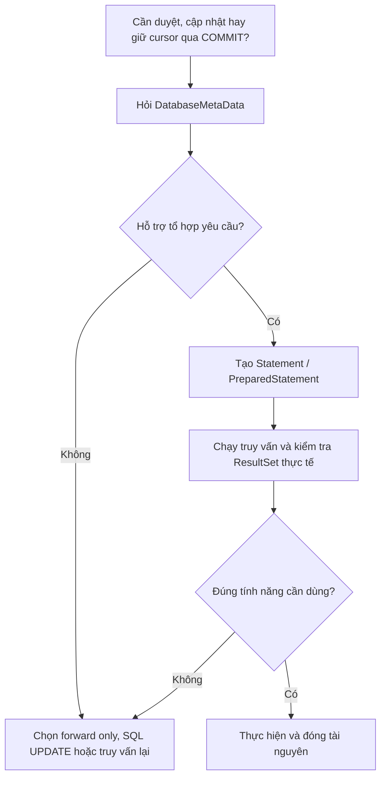

# Kiểm tra hỗ trợ loại ResultSet, khả năng cập nhật và holdability

Khi truy vấn bằng **JDBC**, `PreparedStatement.executeQuery()` trả về một `ResultSet`, nhưng không phải mọi `ResultSet` đều có cùng khả năng. Một kết quả có thể chỉ cho phép đọc tiến về phía trước, một kết quả khác cho phép di chuyển qua lại, và một số driver còn hỗ trợ sửa hàng trực tiếp bằng `ResultSet.updateRow()`. Khi `Connection.commit()` được gọi, cursor có thể bị đóng hoặc tiếp tục mở, tùy **holdability**.

Điểm khó là ứng dụng Java không nên suy luận các khả năng đó chỉ từ phiên bản JDK hoặc tên cơ sở dữ liệu. Trong chương **Siêu dữ liệu** của module **JDBC**, `DatabaseMetaData` cung cấp các phép kiểm tra hỗ trợ; `Connection` và `ResultSet` cho biết cấu hình thực tế. Bài này hướng dẫn chọn cấu hình kết quả phù hợp với truy vấn, kiểm tra tính tương thích và thiết kế phương án dự phòng khi driver không hỗ trợ loại cursor, khả năng cập nhật hoặc chế độ giữ cursor qua `commit`.

Những cơ chế này quan trọng khi sử dụng `DataSource`, `PreparedStatement` và `ResultSet` cho CRUD, xử lý dữ liệu theo lô, phân trang và transaction: cấu hình cursor sai có thể gây `SQLException`, đọc sai số hàng, giữ tài nguyên quá lâu hoặc viết code hoạt động với một driver nhưng thất bại khi đổi DB.

## 1. Ba chiều cấu hình của một ResultSet

JDBC phân biệt **type**, **concurrency** và **holdability**. Chúng trả lời ba câu hỏi riêng biệt.

| Chiều | Hằng `ResultSet` | Ý nghĩa |
| --- | --- | --- |
| **Type** | `TYPE_FORWARD_ONLY` | Duyệt từ đầu đến cuối; không giả định có thể quay về hàng trước |
| | `TYPE_SCROLL_INSENSITIVE` | Có thể điều hướng qua các hàng; nói chung không nhạy với thay đổi do giao dịch khác thực hiện sau khi mở |
| | `TYPE_SCROLL_SENSITIVE` | Có thể điều hướng; có khả năng phản ánh một số thay đổi của giao dịch khác, tùy driver và DB |
| **Concurrency** | `CONCUR_READ_ONLY` | Không dùng các phương thức cập nhật hàng qua chính `ResultSet` |
| | `CONCUR_UPDATABLE` | Có thể sử dụng một số phương thức `updateXxx()`, `updateRow()`, `insertRow()`, `deleteRow()` nếu driver và dạng truy vấn cho phép |
| **Holdability** | `CLOSE_CURSORS_AT_COMMIT` | Cursor của kết quả bị đóng khi transaction commit |
| | `HOLD_CURSORS_OVER_COMMIT` | Cursor của kết quả vẫn mở qua lần commit nếu DB và driver hỗ trợ |

Ba chiều không đồng nghĩa với nhau. Ví dụ, một `ResultSet` có thể vừa `TYPE_SCROLL_INSENSITIVE`, vừa `CONCUR_READ_ONLY`, vừa `CLOSE_CURSORS_AT_COMMIT`. Việc di chuyển đến hàng cuối **không** chứng minh kết quả có thể cập nhật; việc kết quả có thể cập nhật **không** chứng minh cursor sẽ sống qua `commit()`.

**Một lưu ý về tính “nhạy”:** `TYPE_SCROLL_INSENSITIVE` không thay thế transaction isolation hay một bảo đảm snapshot tuyệt đối; `TYPE_SCROLL_SENSITIVE` cũng không hứa mọi thay đổi của session khác đều được nhìn thấy tức thì. Khi cần hành vi hiển thị thay đổi cụ thể, phải xem thêm `DatabaseMetaData` và kiểm thử thực tế.

## 2. Những phép kiểm tra trong DatabaseMetaData

Lấy metadata qua chính connection được cấp cho công việc:

```java
try (Connection con = dataSource.getConnection()) {
    DatabaseMetaData meta = con.getMetaData();
    // Kiểm tra khả năng hỗ trợ của DB/driver hiện tại.
}
```

Các phương thức cốt lõi:

| Phương thức | Câu hỏi được trả lời |
| --- | --- |
| `supportsResultSetType(int type)` | DB/driver có hỗ trợ loại `ResultSet` này không? |
| `supportsResultSetConcurrency(int type, int concurrency)` | Với loại `type` cụ thể, DB/driver có hỗ trợ concurrency này không? |
| `supportsResultSetHoldability(int holdability)` | Có hỗ trợ giữ hoặc đóng cursor theo chế độ này không? |
| `getResultSetHoldability()` | Holdability mặc định cho result set được tạo qua connection trong môi trường đó |
| `Connection.getHoldability()` | Holdability hiện được cấu hình trên connection này |

Giá trị truyền cho `supportsResultSetType` phải là một trong ba hằng `TYPE_...`; tương tự, `concurrency` là `CONCUR_...`, `holdability` là `...CURSORS...COMMIT`.

Nên kiểm tra `supportsResultSetConcurrency(type, concurrency)` **theo cặp**. Một driver hỗ trợ `TYPE_SCROLL_INSENSITIVE` không có nghĩa là nó cũng hỗ trợ kết quả **updatable** ở loại đó.

Những câu hỏi lân cận:

- `DatabaseMetaData.ownUpdatesAreVisible(type)`, `othersUpdatesAreVisible(type)`, `updatesAreDetected(type)` có thể bổ sung thông tin về sự thay đổi nào nhìn thấy hoặc được phát hiện với một loại cursor. Đây là khả năng khái quát, vẫn cần kiểm tra truy vấn cụ thể.
- `supportsOpenCursorsAcrossCommit()` và `supportsOpenStatementsAcrossCommit()` là các phép hỏi tổng quát khác, **không thay thế** `supportsResultSetHoldability(...)` khi chọn chính xác một holdability cho `ResultSet`.
- `ResultSetMetaData.isReadOnly(column)`, `isWritable(column)`, `isDefinitelyWritable(column)` nói về **từng cột của kết quả**, không chứng minh rằng toàn bộ câu `SELECT` có thể cập nhật hàng.

## 3. Chương trình kiểm tra capability matrix

Ví dụ dưới đây chạy bằng API JDBC chuẩn và in ra các tổ hợp được báo là hỗ trợ. Nó chỉ **đọc metadata** và không sửa dữ liệu.

```java
import java.sql.Connection;
import java.sql.DatabaseMetaData;
import java.sql.ResultSet;
import java.sql.SQLException;
import javax.sql.DataSource;

public final class ResultSetCapabilities {
    private ResultSetCapabilities() {}

    private static String typeName(int value) {
        return switch (value) {
            case ResultSet.TYPE_FORWARD_ONLY -> "FORWARD_ONLY";
            case ResultSet.TYPE_SCROLL_INSENSITIVE -> "SCROLL_INSENSITIVE";
            case ResultSet.TYPE_SCROLL_SENSITIVE -> "SCROLL_SENSITIVE";
            default -> "UNKNOWN(" + value + ")";
        };
    }

    private static String holdName(int value) {
        return switch (value) {
            case ResultSet.HOLD_CURSORS_OVER_COMMIT -> "HOLD_OVER_COMMIT";
            case ResultSet.CLOSE_CURSORS_AT_COMMIT -> "CLOSE_AT_COMMIT";
            default -> "UNKNOWN(" + value + ")";
        };
    }

    public static void printCapabilities(DataSource dataSource)
            throws SQLException {
        try (Connection con = dataSource.getConnection()) {
            DatabaseMetaData meta = con.getMetaData();

            System.out.println("DB: " + meta.getDatabaseProductName()
                    + " " + meta.getDatabaseProductVersion());
            System.out.println("Driver: " + meta.getDriverName()
                    + " " + meta.getDriverVersion());

            int[] types = {
                ResultSet.TYPE_FORWARD_ONLY,
                ResultSet.TYPE_SCROLL_INSENSITIVE,
                ResultSet.TYPE_SCROLL_SENSITIVE
            };
            for (int type : types) {
                boolean typeSupported = meta.supportsResultSetType(type);
                boolean readOnly = typeSupported
                        && meta.supportsResultSetConcurrency(
                                type, ResultSet.CONCUR_READ_ONLY);
                boolean updatable = typeSupported
                        && meta.supportsResultSetConcurrency(
                                type, ResultSet.CONCUR_UPDATABLE);

                System.out.printf(
                        "%s: supported=%s, readOnly=%s, updatable=%s%n",
                        typeName(type), typeSupported, readOnly, updatable);
            }

            int[] modes = {
                ResultSet.CLOSE_CURSORS_AT_COMMIT,
                ResultSet.HOLD_CURSORS_OVER_COMMIT
            };
            for (int holdability : modes) {
                System.out.printf("%s: supported=%s%n",
                        holdName(holdability),
                        meta.supportsResultSetHoldability(holdability));
            }

            System.out.println("Driver default: "
                    + holdName(meta.getResultSetHoldability()));
            System.out.println("Connection current: "
                    + holdName(con.getHoldability()));
        }
    }
}
```

Gọi `ResultSetCapabilities.printCapabilities(dataSource)` với một `DataSource` đã cấu hình. Giá trị in ra phụ thuộc phiên bản DB, driver và cách cấu hình connection pool; không nên chép một bảng kết quả đo trên máy phát triển thành cam kết cho mọi môi trường.

Lưu ý `getResultSetHoldability()` của `DatabaseMetaData` mô tả **mặc định** do hệ thống báo cáo, còn `Connection.getHoldability()` cho biết **trạng thái hiện tại** của connection. Chúng có thể khác nhau nếu holdability của connection đã được thay đổi.

## 4. Kiểm tra hỗ trợ trước khi yêu cầu một ResultSet

Cấu hình có thể được yêu cầu bằng các overload của `Connection`:

```java
Statement st = con.createStatement(type, concurrency);
Statement stWithHold = con.createStatement(
        type, concurrency, holdability);

PreparedStatement ps = con.prepareStatement(
        sql, type, concurrency);
PreparedStatement psWithHold = con.prepareStatement(
        sql, type, concurrency, holdability);
```

Đây là **cú pháp minh họa**; trong mã thật phải đóng các đối tượng `Statement`/`PreparedStatement` bằng `try-with-resources`. Với `PreparedStatement`, SQL được truyền một lần khi chuẩn bị; các giá trị động vẫn được bind qua `?`.

Quy trình chọn cấu hình:

1. Xác định tính năng thực sự cần: chỉ đọc tuần tự, cần `absolute()`/`previous()`, cần sửa hàng qua `ResultSet`, hay cần cursor mở sau `commit()`?
2. Hỏi `DatabaseMetaData` cho đúng `type`, đúng cặp `(type, concurrency)` và `holdability` mong muốn.
3. Chọn phương án thay thế an toàn nếu metadata báo không hỗ trợ. Ví dụ, không cần cuộn ngược thì dùng `TYPE_FORWARD_ONLY`; cần sửa dữ liệu mà cursor không updatable thì dùng `UPDATE ... WHERE id = ?` qua `PreparedStatement`.
4. Tạo statement rồi thực thi truy vấn. **Kiểm tra thuộc tính thực tế** vì driver có thể điều chỉnh yêu cầu hoặc từ chối tổ hợp dù metadata báo khả năng chung.
5. Thử hành vi thực tế trên DB/driver sẽ dùng trong production, nhất là với `CONCUR_UPDATABLE` và holdability.



**Không coi metadata là bảo đảm tuyệt đối:** `supportsResultSetConcurrency(TYPE_SCROLL_INSENSITIVE, CONCUR_UPDATABLE)` có thể trả `true` nhưng câu `SELECT` có `JOIN`, `DISTINCT`, `GROUP BY` hoặc cột tính toán vẫn không updatable.

## 5. Kiểm chứng cấu hình thực tế của Statement và ResultSet

Sau khi tạo statement, JDBC có thể cung cấp cấu hình tại:

- `Statement.getResultSetType()`, `getResultSetConcurrency()`, `getResultSetHoldability()`.
- `ResultSet.getType()`, `getConcurrency()`, `getHoldability()`.
- `Statement.getWarnings()`, `Connection.getWarnings()` và `ResultSet.getWarnings()` cho thông tin cảnh báo nếu driver phát sinh.

Ví dụ **thử xin cursor cuộn được để đọc** nhưng cho phép rơi về cấu hình đọc tuần tự:

```java
import java.sql.Connection;
import java.sql.DatabaseMetaData;
import java.sql.PreparedStatement;
import java.sql.ResultSet;
import java.sql.SQLException;
import javax.sql.DataSource;

public final class CustomerBrowser {
    private CustomerBrowser() {}

    public static void printCustomers(DataSource source) throws SQLException {
        String sql = """
            SELECT id, full_name
            FROM customers
            ORDER BY id
            """;

        try (Connection con = source.getConnection()) {
            DatabaseMetaData meta = con.getMetaData();
            int type = meta.supportsResultSetConcurrency(
                    ResultSet.TYPE_SCROLL_INSENSITIVE,
                    ResultSet.CONCUR_READ_ONLY)
                    ? ResultSet.TYPE_SCROLL_INSENSITIVE
                    : ResultSet.TYPE_FORWARD_ONLY;

            try (PreparedStatement ps = con.prepareStatement(
                    sql, type, ResultSet.CONCUR_READ_ONLY);
                 ResultSet rs = ps.executeQuery()) {

                int actualType = rs.getType();
                int actualConcurrency = rs.getConcurrency();
                int actualHoldability = rs.getHoldability();

                System.out.println("Requested type: " + type);
                System.out.println("Actual type: " + actualType);
                System.out.println("Actual concurrency: "
                        + actualConcurrency);
                System.out.println("Actual holdability: "
                        + actualHoldability);

                if (actualConcurrency != ResultSet.CONCUR_READ_ONLY) {
                    throw new SQLException("ResultSet không có chế độ đọc mong muốn");
                }

                if (actualType != ResultSet.TYPE_FORWARD_ONLY) {
                    // Chỉ đọc cột khi last() thực sự tìm được hàng.
                    if (rs.last()) {
                        System.out.println("Last id: " + rs.getLong("id"));
                    }
                    rs.beforeFirst();
                }

                while (rs.next()) {
                    System.out.println(rs.getLong("id") + " "
                            + rs.getString("full_name"));
                }
            }
        }
    }
}
```

Ví dụ giả định bảng `customers(id, full_name)`. Khi kết quả rỗng, `rs.last()` trả `false`, nên đoạn mã kiểm tra kết quả trước khi đọc cột. `rs.beforeFirst()` đưa cursor trở lại đầu để vòng lặp `next()` vẫn đọc đủ các hàng.

Nếu chỉ cần duyệt một lần, việc yêu cầu `TYPE_FORWARD_ONLY` ngay từ đầu thường đơn giản và tiết kiệm hơn. Có thể dùng `setFetchSize(n)` như gợi ý cho driver về cách lấy hàng, nhưng khả năng streaming, bộ nhớ đệm và tác động của `autoCommit` phụ thuộc DB/driver.

## 6. Type: điều hướng khác nhau thế nào?

| Phương thức `ResultSet` | `TYPE_FORWARD_ONLY` | `TYPE_SCROLL_...` |
| --- | --- | --- |
| `next()` | Có | Có |
| `previous()` | Không nên dùng; có thể ném `SQLException` | Có thể dùng |
| `first()`, `last()` | Không bảo đảm hỗ trợ | Có thể dùng |
| `absolute(n)`, `relative(n)` | Không bảo đảm hỗ trợ | Có thể dùng |
| `beforeFirst()`, `afterLast()` | Không bảo đảm hỗ trợ | Có thể dùng |

Ví dụ:

```java
if (rs.getType() == ResultSet.TYPE_SCROLL_INSENSITIVE
        || rs.getType() == ResultSet.TYPE_SCROLL_SENSITIVE) {
    if (rs.absolute(10)) {
        System.out.println("Hàng thứ 10: " + rs.getLong("id"));
    }
    rs.beforeFirst();
}
```

`absolute(10)` là vị trí hàng thứ 10 **trong kết quả truy vấn**, không phải hàng có `id = 10`. Nếu có nhiều dữ liệu và chỉ muốn trang thứ 10, ưu tiên truy vấn phân trang được thiết kế cho DB (`ORDER BY` ổn định, `LIMIT/OFFSET` hoặc keyset pagination) thay vì tải hàng triệu hàng vào một `ResultSet` rồi cuộn.

Sự khác nhau giữa `SCROLL_INSENSITIVE` và `SCROLL_SENSITIVE` liên quan cách cursor quan sát thay đổi dữ liệu, không đồng nghĩa mức `READ_COMMITTED`/`REPEATABLE_READ` của transaction. Các phương thức `ownUpdatesAreVisible(type)`, `othersUpdatesAreVisible(type)`, `othersDeletesAreVisible(type)`, `updatesAreDetected(type)` giúp kiểm tra sâu hơn, nhưng kết quả thực tế vẫn phải xác minh với isolation level và DB cụ thể.

## 7. Concurrency: có thể cập nhật ResultSet nghĩa là gì?

Khi `ResultSet.getConcurrency() == ResultSet.CONCUR_UPDATABLE`, code có thể dùng các phương thức của `ResultSet` để sửa hàng hiện tại:

```java
rs.updateString("display_name", "Tên mới");
rs.updateRow();
```

`updateString()` chuẩn bị giá trị cột trong hàng hiện tại; `updateRow()` mới là thao tác yêu cầu ghi thay đổi về DB. Tương tự, `moveToInsertRow()`/`insertRow()` và `deleteRow()` có thể được hỗ trợ, nhưng không nên cho rằng mọi thao tác đều khả dụng trên mọi loại kết quả.

Khả năng updatable phụ thuộc **nhiều điều kiện cùng lúc**:

- Metadata xác nhận cặp `(type, CONCUR_UPDATABLE)` được hỗ trợ.
- Truy vấn có dạng mà driver/DB có thể ánh xạ từng hàng về bảng nguồn, thường là `SELECT` đơn giản từ một bảng, có khóa xác định hàng.
- Cột muốn cập nhật có thể ghi, người dùng DB có quyền `UPDATE`, ràng buộc dữ liệu và trigger cho phép.
- Transaction đang mở phù hợp, connection không read-only, và cursor chưa bị đóng.
- Driver thực sự tạo một `ResultSet` có `getConcurrency() == CONCUR_UPDATABLE` và cho phép thao tác với câu SQL đang xét.

**Khả năng được metadata báo hỗ trợ là điều kiện cần, chưa đủ cho một `SELECT` cụ thể.** Đừng suy từ `ResultSetMetaData.isWritable(columnIndex)` sang việc `updateRow()` chắc chắn thành công.

### Mẫu cập nhật qua ResultSet có kiểm tra

Ví dụ PostgreSQL/DB hỗ trợ updatable result set với bảng:

```sql
CREATE TABLE customers (
    id BIGINT PRIMARY KEY,
    full_name VARCHAR(120) NOT NULL,
    display_name VARCHAR(120)
);
```

```java
import java.sql.Connection;
import java.sql.DatabaseMetaData;
import java.sql.PreparedStatement;
import java.sql.ResultSet;
import java.sql.SQLException;
import java.sql.SQLFeatureNotSupportedException;
import java.util.Objects;
import javax.sql.DataSource;

public final class CustomerUpdater {
    private CustomerUpdater() {}

    public static boolean renameViaResultSet(
            DataSource source, long id, String newName)
            throws SQLException {

        Objects.requireNonNull(newName, "newName");
        try (Connection con = source.getConnection()) {
            DatabaseMetaData meta = con.getMetaData();
            int type = ResultSet.TYPE_SCROLL_INSENSITIVE;
            if (!meta.supportsResultSetType(type)
                    || !meta.supportsResultSetConcurrency(
                    type, ResultSet.CONCUR_UPDATABLE)) {
                throw new SQLFeatureNotSupportedException(
                        "Driver không hỗ trợ loại ResultSet cập nhật cần dùng");
            }

            String sql = "SELECT id, display_name "
                    + "FROM customers WHERE id = ?";
            try (PreparedStatement ps = con.prepareStatement(
                    sql, type, ResultSet.CONCUR_UPDATABLE)) {
                ps.setLong(1, id);
                try (ResultSet rs = ps.executeQuery()) {
                    if (rs.getConcurrency() != ResultSet.CONCUR_UPDATABLE) {
                        throw new SQLFeatureNotSupportedException(
                                "Truy vấn thực tế không có ResultSet updatable");
                    }
                    if (!rs.next()) {
                        return false; // Không tìm thấy id.
                    }
                    rs.updateString("display_name", newName);
                    rs.updateRow();
                    return true;
                }
            }
        }
    }
}
```

Đây là ví dụ về **kiểm tra hỗ trợ**, không phải phương án tối ưu cho mọi CRUD. Một số driver yêu cầu dạng `SELECT` đặc biệt (ví dụ cần đủ khóa, không có alias phức tạp), không hỗ trợ scroll + updatable, hoặc từ chối câu lệnh dù metadata báo có hỗ trợ chung. Trên hệ quản trị cụ thể, phải kiểm thử cả cập nhật, quyền và transaction.

Trong ứng dụng bình thường, cách cập nhật dữ liệu **dễ di chuyển giữa các driver và rõ ràng hơn** thường là SQL tham số hóa:

```java
String sql = "UPDATE customers SET display_name = ? WHERE id = ?";
try (Connection con = source.getConnection();
     PreparedStatement ps = con.prepareStatement(sql)) {
    ps.setString(1, newName);
    ps.setLong(2, id);
    boolean updated = ps.executeUpdate() == 1;
}
```

Phương án này dùng `CONCUR_READ_ONLY` khi truy vấn, còn thao tác ghi thực hiện qua `PreparedStatement`. Nó cho phép kiểm soát rõ điều kiện `WHERE`, version để chống lost update và số hàng tác động. Nếu cần read-modify-write nguyên tử, hãy dùng cùng transaction, khóa hoặc optimistic locking phù hợp thay vì chỉ kỳ vọng `CONCUR_UPDATABLE` giải quyết concurrency.

## 8. Holdability: COMMIT tác động đến cursor thế nào?

Khả năng giữ cursor sau `commit()` là một phần độc lập của cấu hình kết quả.

```text
Mở SELECT và lấy ResultSet
  |
  +-- CLOSE_CURSORS_AT_COMMIT --> COMMIT --> cursor đóng
  |
  +-- HOLD_CURSORS_OVER_COMMIT --> COMMIT --> cursor vẫn mở
                                           (nếu driver/DB hỗ trợ)
```

Với `CLOSE_CURSORS_AT_COMMIT`, không tiếp tục gọi `rs.next()` sau khi cursor đã bị đóng do commit; có thể nhận `SQLException`. Với `HOLD_CURSORS_OVER_COMMIT`, ứng dụng được phép tiếp tục duyệt sau commit, nhưng kết quả không được hứa sẽ phản ánh mọi thay đổi mới được commit bởi giao dịch khác.

**Holdability không có nghĩa là:**

- ResultSet vẫn sống sau khi `Connection.close()` hoặc ứng dụng khởi động lại.
- Cursor còn mở sau `rollback()`; hai hằng này mô tả **commit**, còn rollback có thể đóng/ảnh hưởng cursor theo driver và DB.
- Truy vấn có `CONCUR_UPDATABLE` sẽ tiếp tục sửa hàng an toàn sau khi transaction kết thúc.
- Driver không cần buffer dữ liệu, không giữ tài nguyên máy chủ hoặc không ảnh hưởng bộ nhớ.

Hệ quản trị có thể thực hiện holdability bằng cách materialize/buffer kết quả ở phía server hoặc client. Một cursor giữ qua commit vẫn có thể chiếm bộ nhớ, giữ connection hoặc tạo chi phí I/O. Với xử lý lô, tránh mở cursor qua nhiều transaction nếu có thể đọc theo trang/khóa rồi đóng sớm.

## 9. Yêu cầu holdability rõ ràng và kiểm tra trên ResultSet

Giả sử ứng dụng phải tiếp tục đọc một tập kết quả sau một `commit()` có chủ đích. Trước tiên kiểm tra khả năng được quảng bá:

```java
DatabaseMetaData meta = con.getMetaData();
boolean canHold = meta.supportsResultSetHoldability(
        ResultSet.HOLD_CURSORS_OVER_COMMIT);
```

Nếu `canHold == true`, ứng dụng có thể yêu cầu:

```java
String sql = "SELECT id, full_name FROM customers ORDER BY id";
try (PreparedStatement ps = con.prepareStatement(
        sql,
        ResultSet.TYPE_FORWARD_ONLY,
        ResultSet.CONCUR_READ_ONLY,
        ResultSet.HOLD_CURSORS_OVER_COMMIT);
     ResultSet rs = ps.executeQuery()) {

    if (rs.getHoldability() != ResultSet.HOLD_CURSORS_OVER_COMMIT) {
        throw new SQLFeatureNotSupportedException(
                "Cursor thực tế không giữ qua commit");
    }

    // Duyệt vài hàng, commit trên chính con nếu transaction yêu cầu,
    // sau đó tiếp tục rs.next() chỉ khi cursor thực tế vẫn hợp lệ.
}
```

Đoạn code trên là **mảnh minh họa**, yêu cầu `Connection con` còn mở, đã lựa chọn transaction phù hợp và có import `PreparedStatement`, `ResultSet`, `SQLFeatureNotSupportedException`. Khi viết phương thức đầy đủ, cần gọi `commit()` trên chính connection và xử lý rollback/exception hợp lý. Đừng mở transaction chỉ để thử holdability rồi quên kết thúc nó.

Trước khi gửi yêu cầu bốn tham số, cũng nên xác nhận `supportsResultSetConcurrency(TYPE_FORWARD_ONLY, CONCUR_READ_ONLY)` nếu ứng dụng muốn hành vi có kiểm chứng xuyên driver. Nếu driver báo không hỗ trợ holdability mong muốn, phương án an toàn là **đọc hết kết quả cần thiết rồi đóng cursor trước commit**, hoặc **lưu khóa/checkpoint rồi mở truy vấn mới sau commit**.

Trường hợp thường gặp là kết quả đọc trên `Connection` có `autoCommit=true`. Mốc kết thúc transaction do JDBC/driver/DB quyết định theo luồng thực thi; không tự suy từ “đã nhận ResultSet” rằng cursor có thể duyệt mãi. Đặc biệt với streaming cursor hoặc server-side cursor, cấu hình `autoCommit` và fetch size có thể ảnh hưởng mạnh đến hành vi. Hãy kiểm thử đúng mô hình giao dịch được deploy.

## 10. Mặc định connection, explicit override và vòng đời pool

JDBC cung cấp `Connection.getHoldability()` và `setHoldability(int)`. `setHoldability` thiết lập **chế độ mặc định** cho các kết quả được tạo sau đó khi statement không chỉ định rõ holdability; nó không phải lệnh đổi tính chất của một `ResultSet` đã mở.

```java
try (Connection con = dataSource.getConnection()) {
    int previous = con.getHoldability();
    if (con.getMetaData().supportsResultSetHoldability(
            ResultSet.CLOSE_CURSORS_AT_COMMIT)) {
        con.setHoldability(ResultSet.CLOSE_CURSORS_AT_COMMIT);
    }

    try {
        // Tạo và sử dụng Statement/PreparedStatement trên connection này.
    } finally {
        con.setHoldability(previous);
    }
}
```

Đoạn minh họa cho thấy ý định khôi phục cấu hình; trong production cần chú ý ngoại lệ từ `setHoldability(previous)` trong `finally` có thể che lỗi SQL ban đầu. Khi có lỗi chính, giữ nó và gắn lỗi khôi phục bằng `addSuppressed()`, tương tự xử lý `autoCommit`/transaction. Ngoài ra, **nên ưu tiên overload của `prepareStatement(..., holdability)`** nếu chỉ một câu truy vấn cần cấu hình riêng, thay vì thay đổi mặc định cho mọi statement dùng connection đó.

Với `DataSource` có pooling, việc trả logical connection về pool có thể làm trạng thái mặc định được reset hoặc kế thừa tùy pool/driver. Không giả định connection lấy ở request sau vẫn giữ `holdability` do request trước thiết lập; không chủ động thay đổi state rồi trả về pool mà thiếu chính sách khôi phục.

## 11. Xử lý SQLWarning khi driver hạ cấp yêu cầu

Khi không hỗ trợ kiểu/concurrency được yêu cầu, driver có thể:

- Ném `SQLException` hoặc `SQLFeatureNotSupportedException`.
- Chọn loại ResultSet/concurrency khác và phát `SQLWarning`.
- Có hành vi riêng tùy driver, DB, kiểu câu lệnh hoặc cấu hình connection.

Vì vậy nên đọc cảnh báo khi chuẩn bị/thực thi truy vấn có yêu cầu nâng cao:

```java
import java.sql.PreparedStatement;
import java.sql.SQLWarning;
import java.sql.SQLException;

public static void printWarnings(PreparedStatement ps)
        throws SQLException {
    for (SQLWarning warning = ps.getWarnings();
         warning != null;
         warning = warning.getNextWarning()) {
        System.out.println("SQLWarning state=" + warning.getSQLState()
                + ", message=" + warning.getMessage());
    }
}
```

Gọi `printWarnings(ps)` tại thời điểm statement còn mở và ngay sau thao tác đáng quan tâm; nhiều warning được xóa/ghi đè khi statement thực thi thao tác mới. `SQLWarning` là thông tin bổ sung; **cách xác nhận cuối cùng** vẫn là kiểm tra `rs.getType()`, `rs.getConcurrency()`, `rs.getHoldability()` và thực hiện test hành vi.

Nếu driver thực sự trả kết quả `TYPE_FORWARD_ONLY`, đừng tiếp tục gọi `beforeFirst()`/ `absolute()` dù lúc tạo statement đã yêu cầu `TYPE_SCROLL_INSENSITIVE`. Tương tự, nếu concurrency thực tế là read-only thì không thử `updateRow()`.

## 12. Đưa metadata vào thiết kế phương án dự phòng

| Nhu cầu nghiệp vụ | Cấu hình ưu tiên | Nếu không hỗ trợ |
| --- | --- | --- |
| Duyệt 100.000 bản ghi một lần | `FORWARD_ONLY + READ_ONLY` | Kiểm tra fetch/streaming của driver, chia trang khi cần |
| Cho người dùng chuyển hàng trước/sau trong một kết quả nhỏ | `SCROLL_INSENSITIVE + READ_ONLY` | Giữ dữ liệu đã đọc ở ứng dụng hoặc truy vấn phân trang |
| Quan sát thay đổi từ transaction khác qua cùng cursor | `SCROLL_SENSITIVE` nếu thực sự cần và được kiểm chứng | Chạy lại truy vấn tại thời điểm cần dữ liệu mới |
| Sửa hàng hiện tại bằng API ResultSet | `CONCUR_UPDATABLE` với truy vấn đủ điều kiện | `UPDATE ... WHERE id = ?` qua `PreparedStatement` |
| Duyệt tiếp sau `commit()` | `HOLD_CURSORS_OVER_COMMIT` | Đọc hết trước commit, lưu checkpoint rồi truy vấn lại |
| Đảm bảo dữ liệu không đổi trong luồng kiểm toán | Chọn isolation/locking theo nghiệp vụ | Không dựa riêng vào `SCROLL_INSENSITIVE` |

Điều quan trọng: **lựa chọn phương án dự phòng phải giữ đúng nghĩa nghiệp vụ**. Ví dụ, thay `SCROLL_SENSITIVE` bằng `SCROLL_INSENSITIVE` mà vẫn hứa màn hình tự thấy mọi cập nhật là thay đổi hợp đồng. Hãy đổi luồng đọc sang truy vấn lại và thông báo cho lớp gọi nếu tính năng quan sát thay đổi là bắt buộc.

## 13. Hiệu năng và tác động của loại cursor

Không có loại ResultSet nào luôn tốt nhất. Đánh đổi tùy khối lượng dữ liệu, tốc độ mạng, mức concurrency và driver.

| Quyết định | Lợi ích có thể có | Chi phí/rủi ro |
| --- | --- | --- |
| `TYPE_FORWARD_ONLY` | Phù hợp xử lý tuần tự, dễ streaming | Không thể điều hướng ngược một cách di động |
| `TYPE_SCROLL_INSENSITIVE` | Dễ đọc lại hàng, `absolute()`, `last()` | Có thể buffer nhiều dữ liệu hoặc cần cursor server |
| `TYPE_SCROLL_SENSITIVE` | Có thể phản ánh một số thay đổi ngoài transaction | Mức hỗ trợ khác nhau, khó dự đoán nhất quán |
| `CONCUR_UPDATABLE` | Sửa hàng theo API ResultSet | Giới hạn query, quyền, khóa, concurrency và tính di động |
| `HOLD_CURSORS_OVER_COMMIT` | Đọc tiếp qua commit | Giữ tài nguyên, có thể materialize/đệm |
| Fetch size lớn | Có thể giảm số lượt lấy dữ liệu | Có thể tăng bộ nhớ tiêu thụ |

Đối với batch import/export lớn, thường bắt đầu bằng `TYPE_FORWARD_ONLY + CONCUR_READ_ONLY`, dùng SQL `UPDATE`/batch riêng khi cần ghi. Đừng chuyển sang scrollable chỉ để đếm số hàng bằng `last(); getRow()`: thao tác này có thể buộc driver tải toàn bộ kết quả. Nếu cần tổng số hàng, hãy thiết kế `SELECT COUNT(*)` thích hợp hoặc metadata/thống kê riêng, lưu ý chi phí và tính nhất quán của phép đếm.

Khi có transaction dài, cursor holdable có thể giữ connection quá lâu và khiến pool cạn, ảnh hưởng đến cả các request không liên quan. Đóng `ResultSet`, statement và connection sớm bằng `try-with-resources`, đặt timeout/fetch size phù hợp với driver và quan sát hiệu năng thực tế.

## 14. Những hiểu nhầm thường gặp

| Hiểu nhầm | Điều cần sửa |
| --- | --- |
| “JDBC phiên bản mới thì mọi ResultSet đều scrollable” | Hỏi `supportsResultSetType`, kiểm tra `getType()` và driver thực tế |
| “Driver hỗ trợ scrollable thì cũng cho update” | Hỏi đúng cặp `supportsResultSetConcurrency(type, concurrency)` |
| “Đã yêu cầu `CONCUR_UPDATABLE` nên mọi `SELECT` sửa được” | Dạng query, khóa, quyền và khả năng thật của cursor vẫn quyết định |
| “`TYPE_SCROLL_SENSITIVE` là transaction isolation cao” | Type và isolation là hai khái niệm khác nhau |
| “`HOLD_CURSORS_OVER_COMMIT` giữ ResultSet sau `rollback()` hoặc `close()`” | Holdability nói về `commit()`; connection đóng thì tài nguyên không còn hợp lệ |
| “Holdability được hỗ trợ nghĩa là dùng không tốn tài nguyên” | Driver có thể buffer/materialize hoặc giữ cursor |
| “`getResultSetHoldability()` của metadata là trạng thái của mọi cursor đã mở” | Kiểm tra `Connection.getHoldability()` và `ResultSet.getHoldability()` riêng |
| “`ResultSetMetaData.isWritable` là đủ để cho phép cập nhật hàng” | Phải kiểm tra concurrency, truy vấn và `updateRow()` thực tế |
| “Nếu driver downgrade thì code vẫn chạy như yêu cầu ban đầu” | Kiểm tra cấu hình thực tế và `SQLWarning` |
| “Có thể cuộn ResultSet để phân trang hàng triệu bản ghi” | Xem xét phân trang SQL, giới hạn dữ liệu tải vào bộ nhớ |
| “Thay holdability bằng `setAutoCommit(true)` là xong” | Transaction và cursor có vòng đời riêng, cần cân nhắc commit implicit |

## 15. Kiểm thử trên DB và driver thật

`DatabaseMetaData` cho biết một khả năng **được công bố**. Kiểm thử tích hợp mới chứng minh tổ hợp `type/concurrency/holdability` hoạt động với câu truy vấn, quyền, isolation level và phiên bản driver mà ứng dụng sử dụng.

### Ma trận kiểm tra cần có

| Ca kiểm thử | Điều cần xác minh |
| --- | --- |
| Duyệt `TYPE_FORWARD_ONLY` | `next()` đọc đúng từng hàng, không bắt buộc API cuộn |
| Yêu cầu `TYPE_SCROLL_INSENSITIVE` | Nếu metadata hỗ trợ, kiểm tra `rs.getType()`, `absolute()`, `previous()`, `beforeFirst()` |
| Yêu cầu `TYPE_SCROLL_SENSITIVE` | Kiểm tra thực tế thay đổi nhìn thấy theo loại truy vấn/isolation; không suy luận từ tên |
| Xin `CONCUR_UPDATABLE` | `rs.getConcurrency()` và `updateRow()` thành công với bảng đủ điều kiện |
| `SELECT` có `JOIN` hoặc tổng hợp | Không giả định updatable dù metadata báo hỗ trợ loại này |
| Quyền `SELECT` có, `UPDATE` không | Đọc được nhưng thao tác cập nhật thất bại đúng cách |
| `CLOSE_CURSORS_AT_COMMIT` | Sau `commit()`, cursor không còn được tiếp tục theo hợp đồng |
| `HOLD_CURSORS_OVER_COMMIT` | Nếu có hỗ trợ, tiếp tục đọc được sau `commit()` trên connection còn mở |
| `rollback()` khi cursor đang mở | Xác định hành vi thực tế; không suy ra từ hai hằng holdability |
| Driver hạ cấp type/concurrency | Code phát hiện cấu hình thực tế và chọn fallback |
| Connection lấy từ pool ở request mới | Default holdability và state được thiết lập đúng theo policy |
| Tập kết quả lớn | Quan sát fetch size, bộ nhớ, lock và thời gian giữ connection |

Kiểm thử nên dùng cùng phiên bản JDK, JDBC driver, DB server, chế độ kết nối và cấu hình pool như production. Khi nâng cấp driver, chạy lại những ca kiểm tra tương ứng vì một tính năng hỗ trợ chung có thể đổi cách triển khai.

### Bài kiểm tra hành vi holdability

Trên một connection thực sự hỗ trợ `HOLD_CURSORS_OVER_COMMIT`:

1. Tắt `autoCommit`, chuẩn bị `PreparedStatement` với holdability mong muốn, mở `ResultSet` và đọc một vài hàng.
2. Xác minh `rs.getHoldability()` trả `HOLD_CURSORS_OVER_COMMIT`.
3. Gọi `commit()` trên **chính connection đó**, sau đó thử `rs.next()` trên kết quả vẫn mở.
4. Lặp lại với `CLOSE_CURSORS_AT_COMMIT` để so sánh; ghi nhận exception/behavior driver.
5. Đóng kết quả, statement, connection; kiểm tra cả nhánh lỗi rollback/close và việc pool tái sử dụng connection.

Không nên thử bằng cách gọi `commit()` trên một connection khác: transaction, holdability và cursor đang xét đều gắn với connection đã tạo ra ResultSet.

## 16. Bài tập áp dụng

**Bài 1 — Capability matrix.** Viết chương trình dùng `DatabaseMetaData` để in hỗ trợ của ba loại ResultSet, hai concurrency, hai holdability và mặc định trên connection. Chạy với hai bản JDBC driver và giải thích các khác biệt.

**Bài 2 — Giảm cấp tính năng.** Một trình xem dữ liệu muốn `TYPE_SCROLL_INSENSITIVE` nhưng driver chỉ cung cấp `TYPE_FORWARD_ONLY`. Thiết kế chức năng “xem trang tiếp/trang trước” dựa trên SQL phân trang mà không dựa vào `absolute()`.

**Bài 3 — Updatable result set.** Tạo bảng có khóa chính, viết `SELECT id, display_name ...` với `CONCUR_UPDATABLE` và thử `updateString()` + `updateRow()`. Nếu driver không hỗ trợ, thay bằng `UPDATE ... WHERE id = ?` tham số hóa. Giải thích vì sao `isWritable()` không đủ kết luận.

**Bài 4 — COMMIT khi còn duyệt dữ liệu.** Trình xuất báo cáo phải commit một transaction khác trong khi đang duyệt kết quả. Chọn `HOLD_CURSORS_OVER_COMMIT` hay thiết kế truy vấn lại theo khóa/checkpoint? So sánh tính di động, lock, bộ nhớ và rủi ro đọc dữ liệu thay đổi.

**Bài 5 — Metadata không khớp thực tế.** `supportsResultSetConcurrency(TYPE_SCROLL_INSENSITIVE, CONCUR_UPDATABLE)` trả `true`, nhưng câu `SELECT` có `JOIN` cho result set read-only. Hãy giải thích vì sao không mâu thuẫn, cách phát hiện và cách sửa luồng cập nhật.

## 17. Checklist trước khi đưa tính năng ResultSet vào ứng dụng

- [ ] Đã xác định chính xác tính năng cần: duyệt tuần tự, cuộn ngược, cập nhật qua cursor hay giữ cursor sau commit?
- [ ] Kiểm tra `supportsResultSetType(type)` và `supportsResultSetConcurrency(type, concurrency)` theo đúng tổ hợp?
- [ ] Kiểm tra `supportsResultSetHoldability(holdability)` và mặc định/hiện tại qua metadata và connection?
- [ ] Sau khi thực thi, xác nhận `ResultSet.getType()`, `getConcurrency()`, `getHoldability()` phù hợp?
- [ ] Xem `SQLWarning` nếu driver điều chỉnh yêu cầu, không giả định metadata là bảo đảm cho từng truy vấn?
- [ ] Nếu cần updatable, đã xác nhận dạng SQL, khóa, quyền, transaction và kiểm thử `updateRow()` trên DB thật?
- [ ] Có fallback rõ ràng, ví dụ `PreparedStatement UPDATE`, phân trang SQL hoặc mở truy vấn mới sau commit?
- [ ] Không nhầm scroll sensitivity với transaction isolation hoặc holdability với duy trì cursor sau rollback/close?
- [ ] Đã quản lý vòng đời ResultSet/Statement/Connection và khôi phục state khi dùng connection pool?
- [ ] Đã kiểm thử hành vi và hiệu năng với driver, DB, isolation và dữ liệu đủ lớn theo môi trường triển khai?

Trong **JDBC**, `DatabaseMetaData` là nơi bắt đầu để **khám phá** khả năng của ResultSet; `ResultSet` và kiểm thử hành vi mới là nơi **xác nhận** khả năng đó trên một câu truy vấn cụ thể. Khi phân biệt rõ type, concurrency và holdability, kiểm tra trước khi yêu cầu, xác minh sau khi tạo và chủ động thiết kế fallback, ứng dụng tránh được lỗi cursor không hỗ trợ, thao tác cập nhật không hợp lệ và sự cố khi commit giữa lúc đang đọc dữ liệu.
