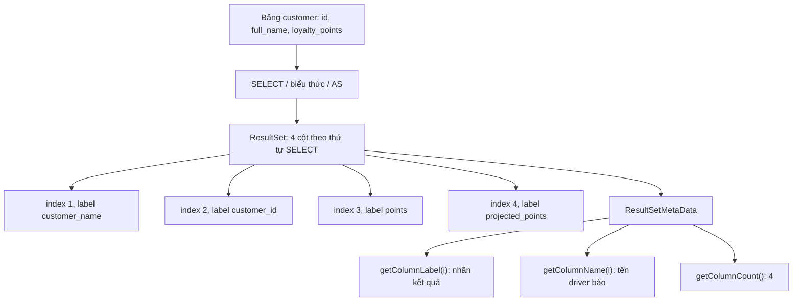

# Phân biệt tên cột gốc, bí danh và vị trí cột kết quả trong JDBC

Khi truy vấn dữ liệu quan hệ bằng **JDBC**, kết quả của câu `SELECT` không nhất thiết giữ nguyên tên và thứ tự cột của bảng. Một cột có thể được đặt **bí danh** bằng `AS`, cùng một cột gốc có thể xuất hiện nhiều lần, hoặc một cột kết quả có thể được tạo từ biểu thức mà không có cột gốc tương ứng. Vì vậy, ứng dụng cần phân biệt rõ ba thông tin:

1. **Tên cột gốc** (*column name*): tên của cột mà driver có thể xác định từ biểu thức truy vấn, thường được truy xuất bằng `ResultSetMetaData.getColumnName(int)`.
2. **Nhãn/bí danh của cột kết quả** (*column label*): tên trình bày mà câu SQL chọn cho cột, thường lấy bằng `ResultSetMetaData.getColumnLabel(int)`.
3. **Vị trí cột trong `ResultSet`** (*column index*): thứ tự của cột trong danh sách kết quả `SELECT`, bắt đầu từ **1**, không phải vị trí trong bảng và cũng không phải chỉ số bắt đầu từ 0 của mảng Java.

Bài học thuộc chương **Siêu dữ liệu** của module **JDBC**. Ta dùng `DataSource`, `Connection`, `PreparedStatement`, `ResultSet` và `ResultSetMetaData` để đọc các thông tin đó, sau đó áp dụng khi ánh xạ kết quả SQL thành đối tượng Java, xây báo cáo động và xử lý kết quả từ các câu `JOIN`.

> **Quy tắc quan trọng:** Khi truy xuất một giá trị theo tên, chẳng hạn `rs.getString("customer_name")`, chuỗi đó được hiểu là **nhãn cột kết quả**. Với một cột đã có `AS`, dùng chính bí danh được công bố; đừng mặc định tên vật lý của bảng vẫn được driver hỗ trợ như một khóa truy xuất.

## 1. Một câu SELECT tạo ra “bảng kết quả” mới

Giả sử cơ sở dữ liệu có bảng:

```sql
CREATE TABLE customer (
    id BIGINT PRIMARY KEY,
    full_name VARCHAR(120) NOT NULL,
    loyalty_points INTEGER
);
```

Cột vật lý của bảng được khai báo theo thứ tự:

| Vị trí trong định nghĩa bảng | Tên cột vật lý | Kiểu SQL |
|---:|---|---|
| 1 | `id` | `BIGINT` |
| 2 | `full_name` | `VARCHAR(120)` |
| 3 | `loyalty_points` | `INTEGER` |

Bây giờ ứng dụng chạy truy vấn:

```sql
SELECT
    c.full_name AS customer_name,
    c.id AS customer_id,
    c.loyalty_points AS points,
    c.loyalty_points + 10 AS projected_points
FROM customer AS c
WHERE c.id = ?;
```

Câu `SELECT` này trả về **bốn cột** theo thứ tự mà ứng dụng chỉ định, dù bảng chỉ có ba cột vật lý:

| Vị trí trong ResultSet | Biểu thức SELECT | Nhãn cột kết quả (`getColumnLabel`) | Cột gốc nếu xác định được |
|---:|---|---|---|
| 1 | `c.full_name` | `customer_name` | `full_name` |
| 2 | `c.id` | `customer_id` | `id` |
| 3 | `c.loyalty_points` | `points` | `loyalty_points` |
| 4 | `c.loyalty_points + 10` | `projected_points` | Không có một cột vật lý duy nhất |

Ở bảng trên, cột cuối là **biểu thức tính toán**. JDBC vẫn cho truy xuất nó ở vị trí `4` hoặc bằng nhãn `projected_points`, nhưng không có tên cột vật lý đơn lẻ nào tương ứng. Với biểu thức, view, subquery hoặc các phép biến đổi phức tạp, giá trị `getColumnName()` có thể rỗng, là tên tổng hợp, hoặc mang ý nghĩa riêng của driver.

**Điều có thể dự đoán từ SQL:** danh sách nhãn `customer_name`, `customer_id`, `points`, `projected_points` và thứ tự 1–4. **Điều không nên giả định tuyệt đối:** driver của mọi hệ quản trị sẽ trả cùng một tên gốc cho `getColumnName()` khi cột được đặt bí danh hoặc đến từ biểu thức.

### Sơ đồ ánh xạ



## 2. Ba API cốt lõi của ResultSetMetaData

Sau khi chạy `PreparedStatement.executeQuery()`, gọi:

```java
ResultSetMetaData metadata = rs.getMetaData();
```

Các phương thức liên quan trực tiếp tới chủ đề:

| API | Trả về | Dùng khi nào? |
|---|---|---|
| `getColumnCount()` | Số cột **trong kết quả truy vấn**. | Duyệt toàn bộ cột của một `ResultSet` động. |
| `getColumnLabel(int column)` | Nhãn gợi ý của cột; thông thường là bí danh `AS` nếu có, nếu không là tên cột kết quả. | Hiển thị tiêu đề, xây cấu trúc kết quả theo nhãn, xác minh hợp đồng alias. |
| `getColumnName(int column)` | Tên cột theo thông tin driver có thể cung cấp. | Khi cần tham khảo tên gốc của cột đơn giản; phải kiểm tra hành vi driver. |
| `getColumnType(int column)` | Mã kiểu SQL trong `java.sql.Types`. | Chọn cách đọc/định dạng dữ liệu. |
| `getColumnTypeName(int column)` | Tên kiểu SQL do DBMS/driver cung cấp. | Chẩn đoán hoặc hiển thị metadata kỹ thuật. |
| `getTableName(int column)` | Tên bảng nếu có thể xác định; có thể là chuỗi rỗng. | Tham khảo nguồn gốc cột, không thay thế schema inspection. |

Các phương thức nhận tham số `column` ở trên đều sử dụng **chỉ số từ 1 đến `getColumnCount()`**. Gọi `getColumnLabel(0)` hoặc `getColumnName(count + 1)` là sai chỉ số và thường dẫn tới `SQLException`.

Đáng chú ý: `ResultSetMetaData` mô tả **các cột được trả về bởi câu SQL đang thực thi**, không liệt kê toàn bộ cột của các bảng có tham gia truy vấn.

### Tên gốc có luôn xác định được?

Không. Chuẩn JDBC mô tả `getColumnName(int)` là tên của cột được chỉ định, nhưng việc suy ra nguồn gốc vật lý phụ thuộc thông tin mà DBMS và driver cung cấp. Một số driver trả alias ở cả `getColumnName` lẫn `getColumnLabel`; một số phân biệt tên gốc với alias cho cột đơn giản. Với `COUNT(*)`, `CASE`, hàm tổng hợp, biểu thức tính toán hoặc kết quả từ view, có thể không tồn tại tên cột vật lý tương ứng.

Do đó, **không dùng `getColumnName()` làm cơ sở bắt buộc để ánh xạ DTO một cách độc lập với driver**. Khi chính ứng dụng kiểm soát SQL, hãy đặt alias ổn định và dùng `getColumnLabel()` hoặc getter theo nhãn.

## 3. Ví dụ JDBC hoàn chỉnh: đọc label, name và index

Ví dụ sau dùng chính câu SQL ở phần 1. `DataSource` được cung cấp từ cấu hình ứng dụng; kết quả chứa tối đa một khách hàng vì `id` là khóa chính. Cần có bảng `customer` và ít nhất một hàng hợp lệ để thấy dữ liệu in ra.

```java
import java.sql.Connection;
import java.sql.PreparedStatement;
import java.sql.ResultSet;
import java.sql.ResultSetMetaData;
import java.sql.SQLException;
import javax.sql.DataSource;

public final class ColumnMetadataDemo {
    private ColumnMetadataDemo() {
    }

    public static void inspectCustomer(DataSource dataSource, long id)
            throws SQLException {

        String sql =
                "SELECT "
                + "c.full_name AS customer_name, "
                + "c.id AS customer_id, "
                + "c.loyalty_points AS points, "
                + "c.loyalty_points + 10 AS projected_points "
                + "FROM customer AS c "
                + "WHERE c.id = ?";

        try (Connection connection = dataSource.getConnection();
             PreparedStatement ps = connection.prepareStatement(sql)) {

            ps.setLong(1, id); // Bind điều kiện bằng tham số SQL.

            try (ResultSet rs = ps.executeQuery()) {
                ResultSetMetaData md = rs.getMetaData();
                int columnCount = md.getColumnCount();

                System.out.println("Số cột kết quả: " + columnCount);

                for (int column = 1; column <= columnCount; column++) {
                    String label = md.getColumnLabel(column);
                    String name = md.getColumnName(column);
                    int jdbcType = md.getColumnType(column);
                    String typeName = md.getColumnTypeName(column);

                    System.out.printf(
                            "%d: label=%s, name=%s, JDBC type=%d (%s)%n",
                            column, label, name, jdbcType, typeName
                    );
                }

                if (rs.next()) {
                    // Đọc bằng nhãn AS đã định nghĩa trong SELECT:
                    String customerName = rs.getString("customer_name");
                    long customerId = rs.getLong("customer_id");

                    int pointsValue = rs.getInt("points");
                    Integer points =
                            rs.wasNull() ? null : pointsValue;

                    int projectedValue = rs.getInt("projected_points");
                    Integer projectedPoints =
                            rs.wasNull() ? null : projectedValue;

                    System.out.println("Khách hàng: " + customerId);
                    System.out.println("Tên: " + customerName);
                    System.out.println("Điểm: " + points);
                    System.out.println("Điểm dự kiến: " + projectedPoints);
                }
            }
        }
    }
}
```

Với dòng dữ liệu `(id=17, full_name='An', loyalty_points=50)`, bốn **nhãn** mà SQL quy định sẽ lần lượt là `customer_name`, `customer_id`, `points` và `projected_points`. Đối với `name`, chương trình sẽ in **giá trị thực tế của driver**; không nên viết bài kiểm thử cứng rằng cột số 4 phải có tên gốc cụ thể. Đối với dữ liệu, số điểm dự kiến là `60`.

Trong ví dụ, `loyalty_points` cho phép SQL `NULL`. Khi `loyalty_points IS NULL`, phép cộng `NULL + 10` thông thường vẫn là `NULL`; hai lệnh `getInt(...)` sẽ trả `0` cho giá trị null theo JDBC và `rs.wasNull()` giúp phân biệt `NULL` với điểm bằng 0. Hãy gọi `wasNull()` **ngay sau getter** cần kiểm tra, trước getter khác.

### Vì sao gọi metadata trước `rs.next()`?

Thông tin cấu trúc kết quả có thể được lấy từ `ResultSet.getMetaData()` **không cần di chuyển đến bản ghi đầu tiên**. Vì thế, ứng dụng vẫn có thể biết số lượng cột, alias và kiểu SQL khi truy vấn trả **0 hàng**.

Ngược lại, các lệnh đọc giá trị `rs.getString(...)` hoặc `rs.getInt(...)` yêu cầu con trỏ đang trỏ đến một hàng hợp lệ, thường là sau khi `rs.next()` trả `true`.

## 4. Đọc theo vị trí và đọc theo nhãn

JDBC hỗ trợ hai cách truy xuất giá trị từ `ResultSet`:

```java
// Theo vị trí trong SELECT, bắt đầu từ 1:
String nameByIndex = rs.getString(1);
long idByIndex = rs.getLong(2);

// Theo nhãn kết quả đã được đặt bằng AS:
String nameByLabel = rs.getString("customer_name");
long idByLabel = rs.getLong("customer_id");
```

Các dòng trên minh họa trong ngữ cảnh `ResultSet` đã có bản ghi hiện tại, với câu SQL ở phần 3. Với truy vấn đó, hai cặp giá trị tương ứng nhau.

| Tiêu chí | Theo chỉ số `rs.getXxx(int)` | Theo nhãn `rs.getXxx(String)` |
|---|---|---|
| Cơ sở định danh | Thứ tự cột trong **danh sách `SELECT`**. | Nhãn/alias của cột kết quả. |
| Chỉ số bắt đầu | `1`. | Không có chỉ số; truyền chuỗi. |
| Thay đổi thứ tự `SELECT` | Dễ đọc nhầm cột nếu giữ nguyên index. | Thường không đổi khi alias vẫn giữ nguyên. |
| Thay alias `AS` | Chỉ số vẫn truy cập đúng vị trí nếu vị trí không đổi. | Phải cập nhật mã hoặc hợp đồng tên nhãn. |
| Truy vấn động không biết trước alias | Hữu ích: duyệt từ `1` tới `getColumnCount()`. | Có thể kết hợp với metadata để lấy nhãn. |
| Khả năng diễn đạt nghiệp vụ | `rs.getString(3)` khó biết ý nghĩa nếu không xem SQL. | `rs.getString("customer_name")` rõ ý định hơn. |

**Vị trí cột trong `ResultSet` không phải vị trí vật lý của cột trong bảng.** Nếu đổi thứ tự các biểu thức trong `SELECT`, thứ tự cột kết quả đổi theo. Không dùng `DatabaseMetaData` hoặc lệnh mô tả schema để suy ra chỉ số đọc của một truy vấn cụ thể.

### Ví dụ đổi thứ tự SELECT

Hai truy vấn trả thông tin tương đương nhưng vị trí khác nhau:

```sql
-- A: full_name ở index 1, id ở index 2
SELECT full_name AS customer_name, id AS customer_id
FROM customer;

-- B: id ở index 1, full_name ở index 2
SELECT id AS customer_id, full_name AS customer_name
FROM customer;
```

Ở truy vấn B, `rs.getString(1)` sẽ lấy dữ liệu từ cột `customer_id` (và còn có thể phụ thuộc phép chuyển kiểu driver), không phải tên khách hàng. Trong khi đó, `rs.getString("customer_name")` vẫn đúng theo nhãn được công bố.

Chỉ số thích hợp khi đoạn mã cố ý xử lý từng cột theo thứ tự và được viết cùng câu SQL. Nhãn thích hợp cho ánh xạ trường cụ thể, đặc biệt khi nhiều người có thể chỉnh sửa thứ tự biểu thức `SELECT`.

## 5. Truy xuất bằng tên: JDBC dùng column label

Nhiều phương thức `ResultSet` có cả hai overload:

```java
rs.getString(1);              // columnIndex
rs.getString("customer_name"); // columnLabel
rs.getObject(4);              // columnIndex
rs.getObject("projected_points"); // columnLabel
```

Tên tham số kiểu `String` trong API là **`columnLabel`**. Nếu SQL có:

```sql
SELECT full_name AS customer_name
FROM customer;
```

thì nhãn được định nghĩa là `customer_name`. Đoạn mã:

```java
rs.getString("customer_name"); // Dựa trên hợp đồng của SELECT.
```

là cách rõ ràng để đọc dữ liệu. Không nên phụ thuộc vào việc:

```java
rs.getString("full_name");     // Không được giả định luôn hợp lệ sau AS.
```

Một số driver có thể vẫn nhận tên gốc trong một số trường hợp; driver khác có thể báo `SQLException` vì không tìm thấy nhãn đó. Việc dựa vào khả năng ngoài hợp đồng của nhãn `AS` khiến mã thiếu tính di động.

### `ResultSet.findColumn(String)`

Nếu cần chuyển nhãn sang vị trí cột:

```java
int position = rs.findColumn("customer_name"); // Với SELECT mẫu: 1.
String value = rs.getString(position);
```

`findColumn` trả **vị trí 1-based** của cột mang nhãn được cung cấp, hoặc ném `SQLException` khi không tìm thấy. Nó không trả thứ tự cột vật lý trong bảng.

Khi truy vấn dùng alias rõ ràng và duy nhất, `findColumn` hữu ích để kiểm tra cấu trúc trước khi xử lý. Với nhãn trùng nhau, truy xuất theo nhãn trở nên mơ hồ; hãy đặt alias khác nhau thay vì cố tận dụng quy tắc chọn cột trùng nhãn.

### Tên cột có phân biệt chữ hoa/chữ thường?

JDBC quy định tên/nhãn dùng trong nhiều phương thức truy cập cột theo tên có ngữ nghĩa không phân biệt chữ hoa chữ thường. Tuy vậy, DBMS có quy tắc biến đổi định danh không được trích dẫn (`unquoted identifiers`) và giữ kiểu chữ cho định danh được trích dẫn (`quoted identifiers`), nên chuỗi nhãn được driver báo và cách hiển thị có thể khác nhau. Để dễ duy trì, hãy đặt alias thống nhất như `customer_id`, `customer_name` và dùng chính chuỗi đó trong Java, thay vì chủ động trộn các kiểu chữ hoặc tận dụng các trường hợp trùng tên chỉ khác hoa/thường.

## 6. JOIN và hai cột có cùng nhãn

Bài toán thường gặp nhất là `JOIN` hai bảng cùng có cột `id`.

Giả sử có thêm bảng:

```sql
CREATE TABLE sales_order (
    id BIGINT PRIMARY KEY,
    customer_id BIGINT NOT NULL,
    total_amount DECIMAL(12, 2) NOT NULL
);
```

Nếu truy vấn:

```sql
SELECT c.id, o.id, c.full_name
FROM customer AS c
JOIN sales_order AS o ON o.customer_id = c.id
WHERE o.id = ?;
```

hai cột đầu đều có thể mang **nhãn `id`**. Khi gọi `rs.getLong("id")`, ánh xạ từ tên sang vị trí là mơ hồ về ý nghĩa nghiệp vụ; theo quy ước JDBC, nếu nhiều cột có cùng tên/nhãn, cột khớp đầu tiên được dùng, vì thế mã có thể âm thầm lấy `customer.id` thay vì `sales_order.id`.

**Giải pháp: đặt alias rõ ràng và không trùng:**

```sql
SELECT
    c.id AS customer_id,
    o.id AS order_id,
    c.full_name AS customer_name,
    o.total_amount AS order_total
FROM customer AS c
JOIN sales_order AS o ON o.customer_id = c.id
WHERE o.id = ?;
```

Khi đó:

```java
long customerId = rs.getLong("customer_id");
long orderId = rs.getLong("order_id");
String customerName = rs.getString("customer_name");
java.math.BigDecimal total = rs.getBigDecimal("order_total");
```

Không nên dựa vào `SELECT c.*, o.*` khi ánh xạ theo nhãn, vì các bảng có thể có nhiều cột trùng tên. Việc thêm cột mới vào bảng còn làm thay đổi số lượng và thứ tự cột của `ResultSet`, khiến mã đọc theo index dễ gãy.

### Phát hiện nhãn trùng bằng metadata

Với truy vấn động dùng cho xuất báo cáo hoặc ánh xạ thành `Map<String, Object>`, có thể kiểm tra các nhãn trước khi đọc từng hàng:

```java
import java.sql.ResultSetMetaData;
import java.sql.SQLException;
import java.util.HashSet;
import java.util.Locale;
import java.util.Set;

// rs là ResultSet đã được tạo từ câu SELECT.
ResultSetMetaData md = rs.getMetaData();
Set<String> normalizedLabels = new HashSet<>();

for (int column = 1; column <= md.getColumnCount(); column++) {
    String label = md.getColumnLabel(column);
    if (label == null || label.isEmpty()) {
        throw new SQLException("Cột " + column + " không có nhãn hợp lệ");
    }

    String normalized = label.toLowerCase(Locale.ROOT);
    if (!normalizedLabels.add(normalized)) {
        throw new SQLException("Nhãn cột bị trùng: " + label);
    }
}
```

Đây là chính sách **chủ động từ chối** nhãn trùng, phù hợp với bộ ánh xạ mà mỗi nhãn phải là một khóa duy nhất. Nó không phải quy tắc bắt buộc của JDBC: bản thân một `ResultSet` có thể hợp lệ dù chứa nhiều cột có cùng label. Nếu cần giữ các cột trùng nhãn để hiển thị, hãy lưu danh sách theo **vị trí** hoặc cấu trúc gồm `index + label`, thay vì ép vào một `Map` mà khóa trùng sẽ ghi đè giá trị.

## 7. Cột tính toán, hàm tổng hợp và literal

Không phải mọi cột xuất hiện trong kết quả đều là cột của bảng. Ví dụ:

```sql
SELECT
    COUNT(*) AS total_orders,
    SUM(total_amount) AS total_value
FROM sales_order
WHERE customer_id = ?;
```

`total_orders` và `total_value` là **nhãn của hai biểu thức tổng hợp**, không phải tên cột vật lý. `getColumnLabel(1)` và `getColumnLabel(2)` dựa trên alias rõ ràng; `getColumnName(...)` có thể trả thông tin khác nhau tùy driver.

Tương tự:

```sql
SELECT
    42 AS answer,
    CASE WHEN loyalty_points >= 100 THEN 'VIP' ELSE 'STANDARD' END
        AS customer_tier
FROM customer;
```

Không có cột vật lý tên `answer` hay `customer_tier`. Chúng vẫn có vị trí và label trong `ResultSet` như mọi cột khác.

**Vì vậy, không nên đặt logic ánh xạ động theo giả định rằng `getColumnName(i)` luôn là tên trường trong một bảng.** Đối với báo cáo, truy vấn tổng hợp hoặc dữ liệu dẫn xuất, dùng `getColumnLabel(i)` làm tiêu đề là tự nhiên hơn.

Nếu người viết SQL **không đặt alias** cho biểu thức, nhãn mặc định thường được DBMS/driver tạo ra theo quy tắc riêng, có thể khó đọc hoặc thay đổi giữa các phiên bản. Hãy viết `AS total_orders`, `AS customer_tier` để cung cấp hợp đồng ổn định.

## 8. Siêu dữ liệu kết quả khác siêu dữ liệu schema

JDBC có hai nhóm API thường bị nhầm:

- **`ResultSetMetaData`**: mô tả các **cột kết quả** của một câu SQL cụ thể.
- **`DatabaseMetaData`**: mô tả khả năng của driver/DBMS và **cấu trúc cơ sở dữ liệu** như bảng, cột, khóa, schema.

Ví dụ, để xem tên cột thực sự của bảng `customer` theo metadata của DBMS, ta có thể dùng `DatabaseMetaData.getColumns(...)`:

```java
import java.sql.Connection;
import java.sql.DatabaseMetaData;
import java.sql.ResultSet;
import java.sql.SQLException;
import javax.sql.DataSource;

public final class TableColumnInspector {
    private TableColumnInspector() {
    }

    public static void printCustomerColumns(DataSource dataSource)
            throws SQLException {

        try (Connection connection = dataSource.getConnection()) {
            DatabaseMetaData db = connection.getMetaData();

            try (ResultSet columns = db.getColumns(
                    null, // catalog: không lọc
                    null, // schemaPattern: không lọc
                    "customer", // tableNamePattern
                    null // columnNamePattern: tất cả cột
            )) {
                while (columns.next()) {
                    String tableName = columns.getString("TABLE_NAME");
                    String physicalName =
                            columns.getString("COLUMN_NAME");
                    int tableOrdinal =
                            columns.getInt("ORDINAL_POSITION");

                    System.out.printf(
                            "%s.%s ở vị trí schema %d%n",
                            tableName, physicalName, tableOrdinal
                    );
                }
            }
        }
    }
}
```

Các nhãn `TABLE_NAME`, `COLUMN_NAME` và `ORDINAL_POSITION` trong đoạn này thuộc **ResultSet do `DatabaseMetaData.getColumns` trả về**, theo hợp đồng metadata của JDBC. `ORDINAL_POSITION` ở đây biểu thị thứ tự cột trong **định nghĩa bảng**, không phải vị trí cột trong `SELECT` thông thường.

Cần chú ý rằng `getColumns` dùng **name pattern** và chịu quy tắc catalog/schema/case của DBMS. Nếu tên bảng được lưu thành `CUSTOMER` thay vì `customer`, có thể phải điều chỉnh `tableNamePattern`, catalog và schema. `DatabaseMetaData` cho biết các cột vật lý và đặc điểm schema nhưng không tự ánh xạ chính xác một biểu thức tính toán `CASE` hay `COUNT(*)` trở lại một cột nguồn.

| Mục tiêu | API phù hợp |
|---|---|
| Câu SELECT này trả bao nhiêu cột? | `rs.getMetaData().getColumnCount()` |
| Vị trí 3 của SELECT mang nhãn gì? | `rs.getMetaData().getColumnLabel(3)` |
| Giá trị cột có alias `customer_name` ở hàng hiện tại? | `rs.getString("customer_name")` |
| Bảng `customer` có cột vật lý nào? | `connection.getMetaData().getColumns(...)` |
| Cột `full_name` đứng thứ mấy trong định nghĩa bảng? | `ORDINAL_POSITION` từ `DatabaseMetaData.getColumns(...)` |
| Biểu thức `COUNT(*) AS total_orders` có nhãn gì? | `ResultSetMetaData.getColumnLabel(...)` |

## 9. Cách ánh xạ dữ liệu vào DTO hoặc API response

Với câu SQL do ứng dụng kiểm soát, hãy coi các alias là **hợp đồng đầu ra** giữa tầng SQL và Java.

```java
// SQL ổn định:
String sql = "SELECT id AS customer_id, "
           + "full_name AS customer_name "
           + "FROM customer WHERE id = ?";

// Bên trong vòng while (rs.next()):
long id = rs.getLong("customer_id");
String name = rs.getString("customer_name");
```

Điều này giúp duy trì mã khi thay đổi thứ tự SELECT. Đồng thời, nếu tái cấu trúc CSDL từ `full_name` sang một biểu thức ghép `first_name` + `last_name`, tầng SQL có thể tiếp tục xuất ra alias `customer_name`, giúp hợp đồng phía Java ít bị thay đổi hơn. Cú pháp nối chuỗi khi ghép tên phụ thuộc DBMS; ý tưởng ở đây là **giữ tên đầu ra ổn định**, không phải một cú pháp SQL cụ thể.

### Trường hợp báo cáo động

Khi người dùng chọn các trường xuất báo cáo và ứng dụng không biết trước danh sách cột, có thể duyệt theo vị trí:

```java
import java.sql.ResultSet;
import java.sql.ResultSetMetaData;
import java.sql.SQLException;
import java.util.ArrayList;
import java.util.List;

// rs đã được lấy từ một PreparedStatement hợp lệ.
ResultSetMetaData md = rs.getMetaData();
int columnCount = md.getColumnCount();

List<String> headers = new ArrayList<>();
for (int i = 1; i <= columnCount; i++) {
    headers.add(md.getColumnLabel(i));
}

while (rs.next()) {
    List<Object> values = new ArrayList<>();
    for (int i = 1; i <= columnCount; i++) {
        values.add(rs.getObject(i));
    }

    // headers và values có cùng thứ tự SELECT.
    System.out.println(headers);
    System.out.println(values);
}
```

Cách này vẫn giữ được hai cột trùng nhãn vì **dữ liệu được lưu dạng danh sách theo vị trí**. Nếu cần xuất CSV, Excel hoặc JSON, ứng dụng còn phải định nghĩa cách chuyển đổi kiểu SQL, xử lý `NULL` và trùng tên. Ví dụ JSON object yêu cầu key duy nhất; khi đó nên từ chối hoặc đổi alias trùng trước khi xuất.

Gọi `ResultSetMetaData` **một lần cho cấu trúc truy vấn** thường đủ; tránh truy vấn lại thông tin cột hoặc tìm kiếm label liên tục trong mỗi vòng lặp lớn khi không cần thiết.

### Xử lý thay đổi hợp đồng SQL

Giả sử API Java dùng `rs.getString("customer_name")`. Nếu một người sửa SQL thành:

```sql
SELECT full_name AS display_name FROM customer;
```

thì code Java cũng phải được cập nhật. Đây là **thay đổi hợp đồng alias**, dù tên cột vật lý vẫn là `full_name`. Để giảm lỗi, các nhóm nên thống nhất tên nhãn và có kiểm tra tích hợp với truy vấn thực tế.

Một kiểm tra đơn giản có thể dùng `findColumn` để xác minh các nhãn mong đợi sau `executeQuery()`, kể cả khi câu truy vấn trả 0 hàng:

```java
ResultSetMetaData md = rs.getMetaData();
if (md.getColumnCount() != 2) {
    throw new SQLException("Projection của truy vấn đã thay đổi");
}

rs.findColumn("customer_id");
rs.findColumn("customer_name");
// Ném SQLException nếu driver không tìm được nhãn.
```

Tuy nhiên, nếu truy vấn có cột trùng nhãn, `findColumn` không đủ để phát hiện sự mơ hồ. Khi yêu cầu tính duy nhất, dùng kiểm tra metadata như phần 6.

## 10. Những nhầm lẫn phổ biến

| Nhầm lẫn | Hậu quả | Cách xử lý |
|---|---|---|
| Nghĩ `getColumnName(i)` luôn bằng bí danh `AS` | Mã ánh xạ có thể phụ thuộc driver hoặc thất bại với biểu thức. | Dùng `getColumnLabel(i)` khi cần nhãn kết quả. |
| Nghĩ `getColumnName(i)` luôn là tên vật lý tuyệt đối | Không đúng chắc chắn với view, expression, join hoặc driver khác nhau. | Xác minh driver; dùng `DatabaseMetaData` khi cần schema. |
| Dùng index 0 vì mảng Java bắt đầu từ 0 | JDBC ném lỗi chỉ số cột không hợp lệ. | Duyệt từ `1` tới `getColumnCount()`. |
| Dùng `ORDINAL_POSITION` của bảng để đọc `ResultSet` | SELECT có thể đổi thứ tự hoặc tính thêm cột. | Dựa vào thứ tự projection thực tế trong SELECT. |
| Dùng `getString("full_name")` dù SQL đã viết `AS customer_name` | Có driver không tìm thấy nhãn `full_name`. | Đọc bằng `customer_name`. |
| `SELECT c.id, o.id` rồi `getLong("id")` | Nhãn trùng khiến không rõ đang lấy ID nào. | Dùng `AS customer_id`, `AS order_id`. |
| Dùng `SELECT *` trong DTO ổn định | Thay đổi schema có thể đổi cột/thứ tự, trùng nhãn khi JOIN. | Liệt kê projection và alias rõ ràng. |
| Nghĩ `getColumnCount()` là số cột của bảng | COUNT chỉ phản ánh số cột của kết quả truy vấn. | Dùng `DatabaseMetaData.getColumns` để xem schema. |
| Lấy giá trị `getInt` sau SQL `NULL` mà không gọi `wasNull()` | Không phân biệt `NULL` với số 0. | Kiểm tra `wasNull()` ngay sau getter. |
| Dùng tên alias từ request nối trực tiếp vào SQL | Tên định danh không được bind như giá trị; có nguy cơ SQL injection. | Chọn alias/biểu thức từ allowlist phía ứng dụng. |

### Bí danh động và an toàn SQL

`PreparedStatement` bảo vệ **giá trị** được truyền qua `?`, ví dụ `WHERE id = ?`. Placeholder không dùng để thay **tên cột**, **tên bảng** hoặc **bí danh `AS`**. Vì vậy, nếu UI cho phép chọn cột hiển thị, ứng dụng phải ánh xạ lựa chọn hợp lệ sang những biểu thức SQL đã biết, thay vì ghép chuỗi tùy ý do người dùng gửi.

Ví dụ:

```java
// Chỉ định cột từ danh sách cố định ở phía ứng dụng.
String selectedExpression;
switch (field) {
    case "name":
        selectedExpression = "full_name AS customer_name";
        break;
    case "points":
        selectedExpression = "loyalty_points AS points";
        break;
    default:
        throw new IllegalArgumentException("Trường không được hỗ trợ");
}

// Sau khi kiểm soát expression, vẫn bind các giá trị WHERE bằng ?.
String sql = "SELECT " + selectedExpression
           + " FROM customer WHERE id = ?";
```

Đoạn mã chỉ minh họa cách chọn một trong những chuỗi SQL tin cậy. Không nên cho `field` tham gia trực tiếp vào `SELECT` hay `AS` nếu chưa qua allowlist.

## 11. Thực hành kiểm chứng với JDBC

Hãy làm các bài thử trên CSDL kiểm thử và driver mà ứng dụng thực sự sử dụng. Kết quả `getColumnName`, kiểu SQL và định danh có thể khác nhau giữa các hệ quản trị, nên nên **ghi nhận giá trị thật** thay vì đoán.

### Bài 1 — Tên gốc và alias

Tạo bảng `customer`, thêm một hàng, chạy:

```sql
SELECT id AS customer_id, full_name AS customer_name
FROM customer
WHERE id = ?;
```

Duyệt `ResultSetMetaData` và in `getColumnLabel(i)`, `getColumnName(i)` cho từng cột. Ghi lại driver và phiên bản DBMS. Giải thích vì sao code đọc `rs.getString("customer_name")` nên dựa vào label thay vì giả định driver nhận `"full_name"`.

### Bài 2 — Đổi thứ tự cột

Chạy lần lượt:

```sql
SELECT id AS customer_id, full_name AS customer_name FROM customer;
SELECT full_name AS customer_name, id AS customer_id FROM customer;
```

So sánh `getColumnCount()`, `getColumnLabel(1)`, `getColumnLabel(2)`. Thử đọc bằng chỉ số và bằng label; ghi nhận cách index thay đổi trong khi alias giữ nguyên.

### Bài 3 — Biểu thức không có tên gốc

Chạy:

```sql
SELECT COUNT(*) AS total_customers FROM customer;
```

In `getColumnName(1)`, `getColumnLabel(1)` và `getColumnType(1)`. Không ép `getColumnName(1)` phải là chuỗi cố định nào; hãy xem driver thực tế báo gì, còn label mong đợi là `total_customers`.

### Bài 4 — JOIN sinh nhãn trùng

Tạo bảng `sales_order` và truy vấn `SELECT c.id, o.id`. Kiểm tra nhãn ở vị trí 1 và 2, sau đó chạy `rs.findColumn("id")` và quan sát vị trí tìm thấy. Sửa câu SQL thành `c.id AS customer_id, o.id AS order_id`, rồi xác nhận hai nhãn đã phân biệt rõ ràng.

### Bài 5 — Phân biệt ResultSetMetaData và DatabaseMetaData

Với bảng `customer`, đọc `ORDINAL_POSITION` qua `DatabaseMetaData.getColumns` rồi chạy `SELECT full_name, id` và lấy vị trí trong `ResultSet`. Giải thích vì sao thứ tự hai nguồn metadata không nhất thiết giống nhau.

### Bài 6 — Truy vấn không trả hàng

Dùng `WHERE id = ?` với `id` không tồn tại. Gọi `rs.getMetaData()` trước `rs.next()` và in label/count. Sau đó thử `rs.next()`: kỳ vọng `false`, nhưng metadata vẫn mô tả được projection.

### Bài 7 — Kết quả động, NULL và nhãn trùng

Tạo công cụ in tiêu đề theo `getColumnLabel` và dữ liệu theo `getObject(index)`. Thử cột `loyalty_points` có `NULL`, thử hai cột cùng alias, và định nghĩa chính sách rõ ràng cho xuất JSON object: đổi alias, từ chối hoặc dùng danh sách theo vị trí.

## 12. Câu hỏi tự kiểm tra

**1. `getColumnLabel(2)` khác `getColumnName(2)` ở đâu?**

`getColumnLabel(2)` lấy nhãn của cột **kết quả thứ hai**, thường là bí danh `AS`; `getColumnName(2)` lấy tên cột theo thông tin driver cung cấp. Với expression hoặc driver khác nhau, tên gốc có thể không xác định rõ.

**2. Nếu bảng có cột `id` ở vị trí vật lý 1, nhưng `SELECT full_name, id`, `rs.getLong(1)` có lấy ID không?**

Không. Vị trí 1 của `ResultSet` là `full_name`, không phải `id`. Để lấy ID, dùng vị trí 2 hoặc nhãn `id` nếu SQL không đặt alias khác.

**3. `rs.getString("customer_name")` tra cứu tên bảng hay bí danh?**

Tra cứu **nhãn cột của kết quả SQL**. Trong `SELECT full_name AS customer_name`, nhãn là `customer_name`.

**4. `SELECT COUNT(*) AS total` có cột gốc tên `total` không?**

Không. `total` là bí danh của biểu thức tổng hợp. `getColumnLabel(1)` cho nhãn này, còn `getColumnName(1)` phụ thuộc driver và cách metadata được công bố.

**5. Có thể gọi `ResultSetMetaData` khi truy vấn trả 0 hàng không?**

Có. Metadata mô tả projection của truy vấn, không phụ thuộc có hàng dữ liệu hay không.

**6. Vì sao `SELECT c.id, o.id` rồi `rs.getLong("id")` nguy hiểm?**

Vì hai cột cùng nhãn `id`. Truy xuất theo nhãn có thể chọn cột khớp đầu tiên, không phản ánh chắc ý định cần customer ID hay order ID. Hãy đặt alias riêng.

**7. `DatabaseMetaData.getColumns` có thay `ResultSetMetaData` được không?**

Không. Một API mô tả cột trong schema, API kia mô tả cột của **kết quả truy vấn**, có thể có alias, biểu thức và thứ tự khác hẳn.

## 13. Checklist cho mã DAO và công cụ đọc kết quả

- SQL có liệt kê projection rõ ràng và đặt alias duy nhất cho các cột dễ trùng khi `JOIN`?
- Mã DTO dùng `rs.getXxx("alias")` theo hợp đồng ổn định, không dựa vào khả năng driver tìm cột gốc sau `AS`?
- Khi đọc kết quả động, vòng lặp dùng chỉ số **từ 1 tới `getColumnCount()`** và lấy tiêu đề bằng `getColumnLabel(i)`?
- Có tránh suy diễn cột vật lý từ `getColumnName(i)` đối với hàm tổng hợp, biểu thức, view hoặc driver chưa được kiểm chứng?
- Với cùng một bảng, có phân biệt `ORDINAL_POSITION` trong metadata schema với chỉ số cột của `ResultSet`?
- Cột trùng nhãn có chính sách xử lý, đặc biệt khi xuất dữ liệu thành `Map` hoặc JSON object?
- Với các giá trị SQL `NULL`, getter primitive có dùng `wasNull()` khi nghiệp vụ cần phân biệt giá trị vắng mặt với 0?
- Dữ liệu trong điều kiện SQL đã được bind bằng `PreparedStatement`; lựa chọn tên cột/alias động có qua allowlist?
- Các thay đổi alias và projection có được xác minh bằng bài kiểm thử tích hợp với DBMS/driver thật?

**Ghi nhớ:** `getColumnLabel(i)` cho biết **tên cột kết quả mà SQL công bố**, `getColumnName(i)` cho biết **tên cột mà driver báo**, còn `i` là **vị trí 1-based trong danh sách SELECT**, không phải thứ tự cột vật lý của bảng. Với DTO, hãy chọn alias ổn định và truy xuất theo nhãn; với báo cáo động, duyệt metadata và giá trị theo cùng vị trí; khi cần khảo sát schema, dùng `DatabaseMetaData` thay vì suy đoán từ một kết quả truy vấn.
