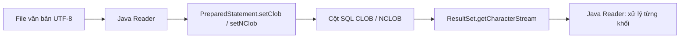

# Phân biệt String, luồng ký tự, CLOB và NCLOB

## 1. Bốn khái niệm ở bốn tầng khác nhau

Trong ứng dụng **JDBC**, dữ liệu văn bản có thể chỉ là một ghi chú vài chục ký tự, nhưng cũng có thể là nội dung tài liệu dài hàng chục MB. Khi dữ liệu tăng kích thước, việc hiểu rõ **kiểu dữ liệu Java**, **cách truyền dữ liệu qua JDBC** và **kiểu cột của cơ sở dữ liệu** quan trọng hơn việc chỉ chọn phương thức đọc trả về một chuỗi.

Bốn tên gọi thường gặp không cùng một loại khái niệm:

| Tên | Bản chất | Dùng khi |
| --- | --- | --- |
| `String` | Đối tượng chứa một chuỗi ký tự Java trong bộ nhớ | Tiêu đề, mô tả ngắn, hoặc văn bản có kích thước đã giới hạn |
| `Reader` / luồng ký tự | API Java **đọc ký tự tuần tự** từ nguồn | Truyền hoặc xử lý văn bản lớn theo từng khối, không cần tự giữ toàn bộ chuỗi |
| `CLOB` | Kiểu dữ liệu SQL **Character Large Object**; trong Java có giao diện `java.sql.Clob` | Lưu nội dung văn bản lớn theo bộ ký tự được DBMS quy định |
| `NCLOB` | Kiểu dữ liệu SQL **National Character Large Object**; Java có `java.sql.NClob` | Lưu văn bản lớn theo **national character set** của DBMS khi DBMS hỗ trợ |

Ví dụ: file `content.txt` chứa văn bản UTF-8 có thể được Java mở thành `Reader`, sau đó JDBC ghi nội dung đó vào cột `CLOB` hoặc `NCLOB`. `Reader` là **phương tiện truyền**, còn `CLOB/NCLOB` là **kiểu dữ liệu/lớp biểu diễn giá trị ở phía cơ sở dữ liệu**.



**Một `String` lớn không tự biến thành CLOB**, và **một `CLOB` cũng không nhất thiết được nạp toàn bộ vào `String`**. Cách đọc/ghi, đặc tính driver và kiểu cột quyết định tài nguyên tiêu thụ.

## 2. `String`: đơn giản nhưng có chi phí bộ nhớ

`String` là đối tượng bất biến chứa nội dung văn bản Java. Những thao tác sau đều làm ứng dụng có hoặc tạo ra toàn bộ nội dung trong bộ nhớ:

```java
String note = "Tài liệu ngắn";

try (PreparedStatement ps = connection.prepareStatement(
        "INSERT INTO notes (note_id, content) VALUES (?, ?)")) {
    ps.setLong(1, 101L);
    ps.setString(2, note);
    ps.executeUpdate();
}
```

Đây là cách phù hợp cho văn bản nhỏ hoặc đã được giới hạn kích thước. Đối với dữ liệu vài chục MB hoặc nhiều tài liệu đồng thời:

- `String` lớn phải được giữ trong heap Java trong suốt thời gian sử dụng.
- `getString(...)` tạo ra nội dung kiểu `String` ở phía ứng dụng; việc đọc hàng loạt tài liệu vào `List<String>` có thể tiêu thụ nhiều bộ nhớ.
- Việc chuyển đổi từ byte sang ký tự, tạo bản sao, ghép chuỗi hoặc ghi log toàn bộ nội dung có thể làm tăng thêm lượng cấp phát.
- Driver có thể phải dùng bộ đệm riêng trong khi chuyển `String` sang định dạng mạng hoặc dạng lưu trữ của DBMS.

Không có một ngưỡng kích thước duy nhất mà tại đó `String` “sai”. Hãy đánh giá dựa trên kích thước dữ liệu tối đa, số yêu cầu đồng thời, ngân sách heap, khả năng streaming của driver và giới hạn cột SQL.

## 3. `Reader` không phải `InputStream` và không phải một kiểu SQL

Java có hai họ luồng thường gặp:

| API Java | Đơn vị dữ liệu | Ví dụ |
| --- | --- | --- |
| `Reader` / `Writer` | Ký tự Java | `FileReader`, `BufferedReader`, `InputStreamReader` |
| `InputStream` / `OutputStream` | Byte | `FileInputStream`, `BufferedInputStream` |

Với văn bản UTF-8 ở trên đĩa, có thể chuyển **byte đã mã hóa** thành **ký tự Java** bằng:

```java
import java.io.Reader;
import java.nio.charset.StandardCharsets;
import java.nio.file.Files;
import java.nio.file.Path;

Path path = Path.of("article-utf8.txt");

try (Reader reader =
         Files.newBufferedReader(path, StandardCharsets.UTF_8)) {
    char[] buffer = new char[8192];
    int count;

    while ((count = reader.read(buffer)) != -1) {
        // Xử lý buffer[0 .. count-1], không cần String toàn bộ file.
    }
}
```

`Reader` là **luồng ký tự**, nên `8192` trong đoạn mã trên là số phần tử `char`, **không phải 8192 byte UTF-8**. Nếu nguồn là dữ liệu nhị phân cần giữ nguyên từng byte, hãy dùng `InputStream` và kiểu SQL nhị phân thích hợp, thường là `BLOB`.

Một `Reader` có thể lấy dữ liệu từ file, mạng, `StringReader`, đối tượng `Clob` hoặc `ResultSet`. Nó mô tả **cách tiêu thụ nội dung** chứ không quyết định DBMS sẽ dùng `VARCHAR`, `CLOB` hay `NCLOB` để lưu.

## 4. Unicode: `NCLOB` không đồng nghĩa “CLOB không hỗ trợ tiếng Việt”

Khái niệm *national character set* thuộc mô hình kiểu SQL và cách DBMS tổ chức bộ ký tự; nó **không** phải lời hứa rằng mọi `CLOB` chỉ chứa ASCII.

- Java biểu diễn văn bản bằng `String`/`char` theo mô hình **UTF-16 code units**; một ký tự Unicode ngoài BMP có thể cần **hai `char`** (cặp surrogate).
- `Reader` chuyển các `char` tới JDBC; driver và DBMS chịu trách nhiệm mã hóa/chuyển đổi phù hợp với cột đích.
- `CLOB` lưu dữ liệu ký tự theo **character set của cơ sở dữ liệu** hoặc quy tắc mà DBMS sử dụng cho kiểu đó.
- `NCLOB` lưu dữ liệu ký tự theo **national character set** ở những DBMS thực sự có phân biệt nhóm kiểu này, chẳng hạn Oracle.
- Nếu cơ sở dữ liệu đã được cấu hình bằng character set Unicode phù hợp (ví dụ Oracle database character set `AL32UTF8`), cột `CLOB` có thể lưu tiếng Việt, emoji và các ký tự Unicode được hỗ trợ. Không cần chọn `NCLOB` chỉ vì nội dung có tiếng Việt.

Ví dụ:

```java
String text = "Việt Nam 🌏";

int utf16Units = text.length();
int unicodeCodePoints =
        text.codePointCount(0, text.length());
int utf8Bytes = text.getBytes(
        java.nio.charset.StandardCharsets.UTF_8).length;
```

Ba số này có thể **khác nhau**. `length()` trên `String` đếm UTF-16 code units, không đếm byte lưu trữ hay “ký tự người dùng nhìn thấy”. Các kết quả đo độ dài của SQL `CLOB/NCLOB` cũng cần đối chiếu với quy tắc character set và DBMS cụ thể; không tự suy giới hạn byte từ số `char` Java.

Đối với ứng dụng đa ngôn ngữ, câu hỏi đúng là: **kiểu cột, bộ ký tự, quy tắc chuyển đổi của driver và yêu cầu truy vấn thực tế có đáp ứng nội dung không?** Không chỉ nhìn tên `CLOB` hay `NCLOB`.

## 5. API JDBC đọc và ghi văn bản: chọn đúng cặp

Các phương thức sau thường được sử dụng với `PreparedStatement`, `CallableStatement` và `ResultSet`:

| Tình huống | Ghi từ Java vào SQL | Đọc từ SQL sang Java |
| --- | --- | --- |
| Chuỗi ngắn `CHAR/VARCHAR` | `setString(index, value)` | `getString(column)` |
| Kiểu ký tự quốc gia `NCHAR/NVARCHAR` | `setNString(index, value)` | `getNString(column)` |
| Truyền ký tự tuần tự theo cột văn bản | `setCharacterStream(index, reader)` hoặc overload có chiều dài | `getCharacterStream(column)` |
| Truyền ký tự quốc gia tuần tự | `setNCharacterStream(index, reader)` | `getNCharacterStream(column)` |
| Giá trị SQL `CLOB` | `setClob(index, reader)` hoặc `setClob(index, clob)` | `getClob(column)` → `Clob.getCharacterStream()` |
| Giá trị SQL `NCLOB` | `setNClob(index, reader)` hoặc `setNClob(index, nclob)` | `getNClob(column)` → `NClob.getCharacterStream()` |

Một số driver cũng cho phép gọi trực tiếp `ResultSet.getCharacterStream(...)` trên cột `CLOB` và `getNCharacterStream(...)` trên cột `NCLOB`, giúp tránh phải cầm đối tượng `Clob/NClob`. Đây là cách được dùng trong ví dụ đọc ở mục 7.

Khi chọn:

1. **Theo kiểu cột SQL trước:** nếu cột thực sự là `CLOB`, `setClob` và `getClob` là các API diễn đạt ý định trực tiếp. Với `NCLOB`, cân nhắc `setNClob`/`getNClob`.
2. **Theo nhu cầu bộ nhớ:** dùng `Reader` để xử lý từng khối thay vì chủ động tạo `String` rất lớn.
3. **Theo hợp đồng driver:** không phải tất cả overload hoặc kiểu quốc gia được mọi driver hỗ trợ. `SQLFeatureNotSupportedException` là dấu hiệu cần kiểm tra driver, DBMS và mapping thực tế.
4. **Theo dữ liệu gốc:** chọn đúng charset khi đọc file thành `Reader`. Nếu đọc file UTF-8 bằng charset không khớp, dữ liệu có thể sai **trước khi đến JDBC**.

Những overload có `long length` như `setCharacterStream(index, reader, long length)` hoặc `setClob(index, reader, long length)` hữu ích khi driver cần biết độ dài. **Chiều dài ở các API luồng ký tự được hiểu theo đơn vị ký tự của hợp đồng JDBC**, không lấy trực tiếp `Files.size(path)` (số byte của file UTF-8) làm độ dài. Nếu không biết trước độ dài, ưu tiên overload không truyền `length` khi driver hỗ trợ.

## 6. Schema ví dụ dùng cả `CLOB` và `NCLOB`

Để minh họa rõ ràng, các mục sau chọn **Oracle Database** vì Oracle phân biệt `CLOB` với `NCLOB` trong schema:

```sql
CREATE TABLE article_documents (
    document_id NUMBER(19) PRIMARY KEY,
    title VARCHAR2(200 CHAR) NOT NULL,
    body CLOB,
    localized_body NCLOB
);
```

Ở đây:

- `title` là chuỗi ngắn, đọc/ghi bằng `String`.
- `body` là tài liệu lớn lưu trong `CLOB`.
- `localized_body` là tài liệu lớn theo *national character set* lưu trong `NCLOB`.
- Hai cột lớn cho phép `NULL`; ứng dụng phải quyết định `NULL` khác gì một tài liệu rỗng.

Đây là **schema minh họa kỹ thuật**, không có nghĩa ứng dụng thực tế cần lưu một bản dịch vào `NCLOB`. Trong cơ sở dữ liệu Oracle dùng character set Unicode phù hợp, có thể thiết kế nhiều bản dịch trong `CLOB`. Chọn `NCLOB` khi hợp đồng dữ liệu và cấu hình DBMS yêu cầu, không phải vì “chữ nước ngoài thì bắt buộc NCLOB”.

## 7. Ví dụ JDBC hoàn chỉnh: nạp từ file và xuất ra file

Ví dụ Java 17+ sau nhận hai file **UTF-8**, ghi vào một hàng Oracle bằng `PreparedStatement` rồi cung cấp phương thức xuất các cột lớn thành file UTF-8. `DataSource` đã được cấu hình với Oracle JDBC driver; người gọi chịu trách nhiệm chọn đường dẫn file được phép truy cập.

```java
import java.io.IOException;
import java.io.Reader;
import java.io.Writer;
import java.nio.charset.StandardCharsets;
import java.nio.file.Files;
import java.nio.file.Path;
import java.sql.Connection;
import java.sql.PreparedStatement;
import java.sql.ResultSet;
import java.sql.SQLException;
import javax.sql.DataSource;

public final class ArticleDocumentRepository {
    private final DataSource dataSource;

    public ArticleDocumentRepository(DataSource dataSource) {
        this.dataSource = dataSource;
    }

    public void insert(
            long documentId,
            String title,
            Path bodyUtf8,
            Path localizedUtf8)
            throws SQLException, IOException {
        String sql = """
                INSERT INTO article_documents
                    (document_id, title, body, localized_body)
                VALUES (?, ?, ?, ?)
                """;

        // Reader phải còn mở cho đến khi executeUpdate() kết thúc.
        try (Reader body = Files.newBufferedReader(
                     bodyUtf8, StandardCharsets.UTF_8);
             Reader localized = Files.newBufferedReader(
                     localizedUtf8, StandardCharsets.UTF_8);
             Connection connection = dataSource.getConnection();
             PreparedStatement statement =
                     connection.prepareStatement(sql)) {

            statement.setLong(1, documentId);
            statement.setString(2, title);
            statement.setClob(3, body);
            statement.setNClob(4, localized);

            if (statement.executeUpdate() != 1) {
                throw new SQLException(
                        "Không ghi được đúng một tài liệu");
            }
        }
    }

    public void export(
            long documentId,
            Path bodyOutput,
            Path localizedOutput)
            throws SQLException, IOException {
        String sql = """
                SELECT body, localized_body
                FROM article_documents
                WHERE document_id = ?
                """;

        try (Connection connection = dataSource.getConnection();
             PreparedStatement statement =
                     connection.prepareStatement(sql)) {

            statement.setLong(1, documentId);

            try (ResultSet rs = statement.executeQuery()) {
                if (!rs.next()) {
                    throw new IllegalArgumentException(
                            "Không tìm thấy documentId: " + documentId);
                }

                // Đọc hết stream thứ nhất trước khi gọi getter thứ hai:
                // một số driver đóng stream cũ khi đọc cột kế tiếp.
                try (Reader body = rs.getCharacterStream("body")) {
                    if (body != null) {
                        try (Writer output = Files.newBufferedWriter(
                                bodyOutput, StandardCharsets.UTF_8)) {
                            copyCharacters(body, output);
                        }
                    }
                }

                try (Reader localized =
                             rs.getNCharacterStream("localized_body")) {
                    if (localized != null) {
                        try (Writer output = Files.newBufferedWriter(
                                localizedOutput, StandardCharsets.UTF_8)) {
                            copyCharacters(localized, output);
                        }
                    }
                }
            }
        }
    }

    private static void copyCharacters(
            Reader source, Writer destination) throws IOException {
        char[] chunk = new char[8192];
        int length;

        while ((length = source.read(chunk)) != -1) {
            destination.write(chunk, 0, length);
        }
    }
}
```

Ví dụ sử dụng:

```java
ArticleDocumentRepository repository =
        new ArticleDocumentRepository(dataSource);

repository.insert(
        42L,
        "Hướng dẫn sử dụng",
        Path.of("content-vi-utf8.txt"),
        Path.of("content-international-utf8.txt"));

repository.export(
        42L,
        Path.of("exported-body.txt"),
        Path.of("exported-localized.txt"));
```

**Điều cần quan sát:**

- `setString` nhận `title` đã nằm trong bộ nhớ dưới dạng `String`, phù hợp chuỗi ngắn.
- `Files.newBufferedReader(..., UTF_8)` chuyển nội dung file từ byte UTF-8 sang ký tự Java. `setClob`/`setNClob` nhận `Reader`; ứng dụng **không cần** gọi `Files.readString` hoặc dựng toàn bộ tài liệu thành một `String`.
- `executeUpdate` diễn ra **khi hai `Reader` vẫn mở**. Một số driver chỉ bắt đầu đọc `Reader` lúc thực thi câu lệnh; đóng nguồn trước đó sẽ khiến thao tác thất bại hoặc ghi thiếu.
- `getCharacterStream("body")` và `getNCharacterStream("localized_body")` cho phép đọc từng khối. Trong cùng một hàng, mã đọc xong một stream trước khi yêu cầu stream của cột còn lại để tránh tác dụng phụ khi driver đóng luồng đang mở lúc chuyển cột.
- `copyCharacters` dùng bộ đệm cố định `char[8192]` và không chủ động giữ toàn bộ nội dung trong heap Java.
- `try-with-resources` đóng `Reader`, `Writer`, `ResultSet`, `PreparedStatement` và `Connection` theo đúng phạm vi. Khi dùng connection pool, đóng `Connection` thường có nghĩa **trả kết nối về pool**.

Ví dụ cố ý cho phép cả hai cột lớn là `NULL`. Nếu một cột là SQL `NULL`, getter stream trả `null` và phương thức trên **không tạo file đầu ra tương ứng**. Ứng dụng thực tế có thể chọn chính sách khác (tạo file rỗng, trả mã “không có dữ liệu” hoặc bắt buộc giá trị), nhưng phải chọn rõ ràng.

**Lưu ý về tính nhất quán của file đích:** `Files.newBufferedWriter` mặc định tạo file nếu chưa tồn tại và ghi đè/truncate nội dung có sẵn. Nếu đọc LOB lỗi giữa chừng, file đích có thể chỉ chứa **một phần dữ liệu**. Khi xuất file quan trọng, nên ghi vào file tạm trong thư mục đích, xác minh hoàn tất rồi đổi tên theo cơ chế phù hợp; đồng thời kiểm tra quyền đường dẫn và giới hạn dung lượng. Mẫu trên tập trung vào API JDBC nên chưa triển khai quy trình xuất file nguyên tử.

## 8. `Clob` và `NClob`: đối tượng JDBC đại diện cho LOB

Bên cạnh việc lấy `Reader` trực tiếp từ `ResultSet`, JDBC có thể trả đối tượng `Clob` hoặc `NClob`:

```java
import java.io.Reader;
import java.sql.Clob;
import java.sql.NClob;

// Giả định rs đang trỏ tới đúng hàng và Connection còn mở.
Clob body = rs.getClob("body");
NClob localized = rs.getNClob("localized_body");

try {
    if (body != null) {
        try (Reader reader = body.getCharacterStream()) {
            // Đọc từng khối từ reader, không gọi getSubString trên toàn LOB.
        }
    }
    if (localized != null) {
        try (Reader reader = localized.getCharacterStream()) {
            // Đọc dữ liệu quốc gia theo hợp đồng của driver.
        }
    }
} finally {
    if (body != null) {
        body.free();
    }
    if (localized != null) {
        localized.free();
    }
}
```

`java.sql.NClob` kế thừa giao diện `Clob`; nhiều thao tác như `length()`, `getCharacterStream()`, `getSubString(...)` và `free()` có cùng cách dùng. Sự phân biệt chủ yếu nằm ở **kiểu SQL đích và đường chuyển đổi ký tự mà driver/DBMS yêu cầu**.

Những API này có ý nghĩa:

| API | Ý nghĩa và cảnh báo |
| --- | --- |
| `Clob.getCharacterStream()` | Lấy `Reader` để đọc nội dung theo từng phần |
| `Clob.length()` | Lấy độ dài ký tự theo hợp đồng của `Clob`; trả `long`, không phải kích thước byte UTF-8 |
| `Clob.getSubString(long pos, int length)` | Lấy một đoạn thành `String`; vị trí `pos` **bắt đầu từ 1** |
| `Clob.free()` | Yêu cầu driver giải phóng tài nguyên của đối tượng LOB; sau đó không tiếp tục sử dụng đối tượng |
| `Connection.createClob()` / `createNClob()` | Có thể tạo đối tượng LOB rỗng để ghi rồi truyền vào SQL; cần driver hỗ trợ |

**`Clob` không phải lúc nào cũng là dữ liệu đã nằm trong heap.** Một số driver trả locator hoặc proxy tới dữ liệu ở DBMS; những driver khác có thể dùng bộ đệm phía client. Vì thế, đối tượng `Clob` có thể phụ thuộc kết nối và vòng đời transaction. **Đọc xong LOB trước khi commit/đóng kết nối**, trừ khi tài liệu driver bảo đảm hành vi khác.

Đoạn mã `free()` trên minh họa ý định giải phóng tài nguyên. Trong mã production, nếu có nhiều LOB, nên tổ chức cleanup sao cho lỗi giải phóng LOB này không ngăn giải phóng LOB còn lại, và không làm mất ngoại lệ đọc dữ liệu ban đầu. `Clob`/`NClob` không phải các tài nguyên `AutoCloseable` thông thường, nên không đưa thẳng chúng vào `try-with-resources`.

Không nên dùng `getSubString(1, (int) clob.length())` cho nội dung lớn: cách đó có thể materialize toàn bộ LOB thành một `String` và còn có nguy cơ ép `long` về `int` gây tràn hoặc cắt bớt chiều dài.

## 9. JDBC streaming không đồng nghĩa driver luôn dùng ít bộ nhớ

Mẫu ở mục 7 làm **mức tiêu thụ bộ nhớ ở phần code Java ứng dụng** gần như không tăng theo kích thước nội dung do chỉ đọc/ghi từng khối. Tuy vậy, tổng mức tiêu thụ bộ nhớ và thời gian còn phụ thuộc:

1. **Driver có hỗ trợ streaming thật hay không.** Có driver cần biết trước độ dài, đệm toàn bộ nội dung hoặc ánh xạ LOB qua cơ chế locator riêng.
2. **DBMS lưu và truyền LOB như thế nào.** Một số DBMS có cơ chế lưu riêng, phân đoạn, nén hoặc truy cập qua nhiều lượt mạng; không phải mọi truy vấn CLOB đều đọc dữ liệu theo cùng cách.
3. **Transaction và thời gian sống kết nối.** Giữ một `ResultSet`/LOB mở lâu có thể giữ tài nguyên DBMS hoặc transaction trong thời gian đọc file lớn.
4. **Bộ đệm mạng, charset, kiểm tra và nén.** Có thể phát sinh bản sao dữ liệu hoặc chi phí CPU ngoài vòng lặp `Reader.read`.
5. **Số thao tác đồng thời.** Một truy vấn 20 MB có thể chạy được nhưng hàng trăm truy vấn cùng lúc có thể vượt giới hạn heap, kết nối hoặc băng thông.

Nếu ứng dụng phải xử lý hàng trăm MB, hãy đo **heap, tốc độ đọc, thời gian giữ connection, số round-trip và thông lượng** trên đúng driver/DBMS thực tế. Không công bố bảo đảm “O(1) bộ nhớ toàn hệ thống” chỉ vì đã dùng `Reader`.

### Đừng chỉ tăng `fetchSize` để giải quyết LOB

`Statement.setFetchSize(...)` thường là gợi ý cho driver về số **hàng** đọc mỗi đợt từ `ResultSet`, không phải kích thước từng khối ký tự của một CLOB. Với truy vấn trả nhiều hàng chứa LOB, `fetchSize` có thể ảnh hưởng cách driver phân lô hàng, nhưng **không** thay thế lựa chọn API streaming.

Khi xuất hàng loạt tài liệu lớn, tránh `SELECT *` và chỉ đọc những cột cần thiết. Nếu giao diện chỉ cần tên, ngày tạo và 100 ký tự xem trước, thường nên có cột tóm tắt hoặc truy vấn cắt đoạn theo cú pháp DBMS phù hợp thay vì tải toàn bộ LOB về để tự cắt.

## 10. Tương thích giữa các hệ quản trị

Tên kiểu SQL và khả năng ánh xạ sang `Clob`/`NClob` **không đồng nhất** giữa các DBMS:

| DBMS | Lưu văn bản lớn thường gặp | Điều cần xác minh khi dùng JDBC |
| --- | --- | --- |
| **Oracle Database** | `CLOB`, `NCLOB` | Database character set vs national character set; locator LOB và phương thức `setNClob/getNClob` |
| **PostgreSQL** | `text`, `varchar`; cơ chế large object riêng `oid` | `text` **không phải** một cột `CLOB` tiêu chuẩn; không mặc định `getClob` sẽ đọc `text` như Oracle CLOB |
| **MySQL** | `TINYTEXT`, `TEXT`, `MEDIUMTEXT`, `LONGTEXT` | Giới hạn kích thước và charset/collation của cột; không mặc định có `NCLOB` SQL độc lập |
| **SQL Server** | `varchar(max)`, `nvarchar(max)` | `nvarchar(max)` phục vụ dữ liệu Unicode nhưng không tương đương đơn giản với việc DBMS có kiểu `NCLOB`; kiểm tra getter/setter driver |
| **SQLite** | Giá trị có storage class `TEXT` | Không có tách biệt kiểu `CLOB`/`NCLOB` như Oracle; kiểm tra giới hạn kích thước và mapping driver |

Trong hệ thống đa DBMS, thiết kế repository có thể cần cách truy cập khác nhau:

- Ở PostgreSQL, `TEXT` thường đọc/ghi thuận tiện bằng `setString/getString` hoặc các API stream được driver hỗ trợ. Cơ chế large object qua `oid` có quy tắc transaction và API riêng; không hoán đổi một cách máy móc với `text`.
- Ở SQL Server, `nvarchar(max)` là một lựa chọn Unicode lớn thường gặp; sử dụng các API ký tự quốc gia khi driver hỗ trợ, thay vì giả định kiểu SQL `NCLOB` tồn tại.
- Ở Oracle, phân biệt `CLOB` và `NCLOB` là khác biệt thật trong schema và bộ ký tự; tránh thay đổi kiểu cột chỉ nhằm sửa lỗi **đọc file sai charset**.

**Nguyên tắc:** quyết định dựa trên **schema cụ thể + driver cụ thể**, không chỉ trên tên phương thức JDBC. Mã `setNClob` biên dịch được trên JDK hiện tại không có nghĩa mọi DBMS sẽ xử lý cột đích đúng mong đợi.

## 11. `NULL`, tài liệu rỗng và dữ liệu lỗi

Ba tình huống thường bị nhầm:

| Trường hợp | Ý nghĩa | Cách JDBC thường xử lý |
| --- | --- | --- |
| SQL `NULL` | Không có giá trị trong cột | `getString`/`getCharacterStream`/`getClob` trả `null`; ghi bằng `setNull` với kiểu SQL phù hợp |
| Chuỗi rỗng `""` hoặc LOB độ dài 0 | Có giá trị nhưng nội dung không chứa ký tự | `Reader` có thể trả ngay `-1`; hỗ trợ phân biệt phụ thuộc DBMS |
| Văn bản lớn hợp lệ | Có nội dung | Dùng stream, kiểm tra hết dữ liệu và lỗi I/O |

Riêng **Oracle**, chuỗi ký tự rỗng ở một số kiểu có thể được coi như `NULL`. Với `CLOB` rỗng, Oracle có thể dùng giá trị LOB rỗng thực sự theo cơ chế của DBMS; không mặc định cách biểu diễn của `VARCHAR2` và `CLOB` giống nhau. Cần thử nghiệm chính xác trên schema sử dụng.

Khi ghi `NULL` bằng `PreparedStatement`:

```java
import java.sql.Types;

// Theo đúng kiểu SQL của cột đích.
statement.setNull(3, Types.CLOB);
statement.setNull(4, Types.NCLOB);
```

Nếu mục tiêu là LOB rỗng **không phải NULL**, dùng cách tạo giá trị rỗng được driver/DBMS hỗ trợ hoặc truyền `Reader` rỗng và xác minh kết quả; không giả định mọi kiểu cột/driver xem hai trường hợp là một.

### Tính toàn vẹn Unicode và mã hóa đầu vào

Với file UTF-8, hãy đọc bằng một `Reader` dùng đúng charset. Khi nguồn có byte UTF-8 không hợp lệ, hành vi báo lỗi/thay ký tự phụ thuộc decoder và cấu hình; ứng dụng yêu cầu bảo toàn nguyên bản cần thiết lập chính sách lỗi mã hóa rõ ràng.

Với văn bản Java, `char` có thể chứa surrogate không ghép đôi. Nếu đầu vào có chuỗi UTF-16 không hợp lệ hoặc ranh giới cắt đi giữa cặp surrogate, driver có thể thay thế hoặc từ chối ký tự. Khi thực hiện xử lý từng khối theo `char[]`, **không coi mỗi phần tử `char` là một Unicode code point hoàn chỉnh**.

Nếu yêu cầu lưu chính xác mọi byte như chữ ký số, dữ liệu nén hoặc tệp không thuộc định dạng văn bản, **`BLOB`/`InputStream`** thường phù hợp hơn `CLOB`/`Reader`, vì chuyển mã ký tự không đảm bảo giữ nguyên chuỗi byte đầu vào.

## 12. Chi phí giao dịch và lỗi giữa chừng

Streaming không loại bỏ yêu cầu quản lý transaction:

- Nếu tải một tài liệu lớn và cập nhật nhiều hàng metadata, các câu SQL thuộc một nghiệp vụ cần dùng **cùng `Connection` và một transaction**; `commit` sau khi mọi bước thành công, `rollback` khi có lỗi.
- Nếu `Reader` phát sinh `IOException` trong khi driver đang đọc dữ liệu, câu lệnh có thể thất bại; cần đánh giá trạng thái transaction và chủ động rollback khi đang quản lý thủ công.
- Nếu mất kết nối đúng lúc `commit`, kết quả có thể chưa xác định. Với thao tác nạp lại có thể xảy ra nhiều lần, nên có **idempotency key** hoặc ràng buộc dữ liệu phù hợp để đối chiếu, không thử lại mù quáng.
- Nếu driver dùng locator để đọc `Clob`, không nên trả đối tượng `Clob` ra khỏi repository rồi đóng `Connection`; thao tác đọc sau đó có thể lỗi vì đã mất tài nguyên mà locator phụ thuộc.
- Với truyền dữ liệu lớn, cần quan tâm timeout câu lệnh, timeout mạng, bộ nhớ đệm, kích thước gói tin và ngưỡng lưu trữ trên DBMS.

Ví dụ `insert` ở mục 7 dùng một `INSERT` trong chế độ `autoCommit` theo cấu hình kết nối và chỉ minh họa stream. Nếu nghiệp vụ phải tạo bản ghi, cập nhật chỉ mục tài liệu và ghi lịch sử trong một đơn vị, **không mở Connection mới riêng cho từng bước**; thay vào đó bao toàn bộ bước bằng một transaction nhất quán.

## 13. Bảng quyết định lựa chọn API

| Nhu cầu | Nên bắt đầu với | Tránh |
| --- | --- | --- |
| Lưu tiêu đề 100 ký tự | `String` + `setString` vào `VARCHAR` | LOB chỉ để lưu vài ký tự |
| Đọc văn bản ngắn để hiển thị | `getString` | Viết hệ thống streaming phức tạp không cần thiết |
| Ghi tài liệu lớn đã có ở file UTF-8 | `Files.newBufferedReader` + `setClob` nếu cột là `CLOB` | `Files.readString` cho toàn bộ tài liệu lớn |
| Xuất CLOB lớn ra file | `getCharacterStream` hoặc `getClob().getCharacterStream()` | `getString` nếu không đủ ngân sách heap |
| Ghi/đọc cột `NCLOB` thực sự | `setNClob`/`getNClob` hoặc luồng ký tự quốc gia | Giả định mọi DBMS có `NCLOB` |
| Lưu dữ liệu Unicode trên Oracle `AL32UTF8` | Xem xét `CLOB` và yêu cầu schema thật | Tự mặc định tiếng Việt bắt buộc `NCLOB` |
| Giữ nguyên toàn bộ byte của file | `InputStream` + kiểu `BLOB` phù hợp | Đổi byte sang `Reader` rồi hy vọng byte xuất ra y nguyên |
| Lấy danh sách hàng có metadata + LOB | Chỉ SELECT cột cần, stream các LOB được yêu cầu | Tải tất cả LOB vào `List<String>` |

## 14. Kiểm thử với dữ liệu và driver thật

Một bộ kiểm thử tích hợp trên chính DBMS/driver dùng trong sản phẩm nên có các trường hợp:

1. **Tiếng Việt có dấu, emoji và nhiều hệ chữ:** lưu rồi đọc lại, so sánh nội dung sau khi đã áp dụng quy tắc chuẩn hóa Unicode của ứng dụng (nếu có).
2. **Nội dung vượt ngưỡng chuỗi ngắn:** ghi/đọc file lớn hơn giới hạn `VARCHAR`, kiểm tra `CLOB/NCLOB` không bị cắt cụt và không phát sinh `OutOfMemoryError`.
3. **Nội dung rỗng và SQL `NULL`:** xác minh cách driver phân biệt và quy tắc xuất file.
4. **Ranh giới buffer:** thử nội dung dài hơn nhiều lần `8192` ký tự; có emoji hoặc dấu tổ hợp ngay quanh ranh giới khối đọc để phát hiện lỗi cắt ký tự khi xử lý.
5. **Nguồn dữ liệu lỗi:** file không mở được, mất kết nối khi đang đọc stream, filesystem hết dung lượng khi xuất; đảm bảo tài nguyên được đóng.
6. **Nhiều tài liệu đồng thời:** kiểm tra heap, số kết nối đang dùng, băng thông và tốc độ khi số request tăng.
7. **Khác biệt driver:** xác minh `setClob(Reader)`, `setNClob(Reader)`, `getNCharacterStream`, `getNClob` và các overload có `long length` trên phiên bản triển khai.
8. **Vòng đời locator:** thử đọc `Clob` trước/sau `commit` hoặc đóng kết nối **trong môi trường test** để hiểu giới hạn, không dựa vào giả định.
9. **Giới hạn DBMS:** kiểm tra giới hạn kích thước cột, storage quota và thời gian xử lý cho kích thước lớn nhất được hỗ trợ.

Để kiểm tra **nội dung văn bản**, có thể băm nội dung sau khi chuẩn hóa và mã hóa theo một charset thống nhất (ví dụ UTF-8) ở cả hai đầu. Nếu mục tiêu kiểm thử là bảo toàn **byte gốc**, hãy dùng BLOB thay vì kỳ vọng CLOB giữ lại encoding byte ban đầu.

## 15. Checklist cần nhớ

Trước khi dùng `String`, `Reader`, `CLOB` hoặc `NCLOB` trong JDBC:

1. **Xác định giới hạn kích thước thực tế** và số thao tác đồng thời.
2. **Phân biệt Java và SQL:** `String` là giá trị trong heap; `Reader` là cách đọc; `CLOB/NCLOB` là kiểu SQL/đối tượng JDBC.
3. **Chọn kiểu SQL theo DBMS:** có phải `CLOB`, `NCLOB`, `TEXT` hay `nvarchar(max)` thực sự hay không?
4. **Xác định bộ ký tự và quy tắc chuyển đổi:** file UTF-8, UTF-16 Java, database charset, national character set.
5. **Chọn đúng API:** `setString/getString` cho văn bản nhỏ; `setClob/getCharacterStream` cho CLOB lớn; `setNClob/getNCharacterStream` khi schema và driver yêu cầu.
6. **Giữ stream và kết nối sống đủ lâu** cho đến khi đọc/ghi LOB hoàn tất; đóng tài nguyên, `free()` đối tượng LOB khi thích hợp.
7. **Không nhầm byte và ký tự** khi truyền chiều dài luồng ký tự.
8. **Dự kiến lỗi I/O và transaction**, cũng như file xuất chỉ được ghi một phần khi có lỗi.
9. **Đo và kiểm thử trên driver thật**, vì `Reader` trong code không đảm bảo driver không đệm nội dung.

**Ghi nhớ:** `String`, luồng ký tự, `CLOB` và `NCLOB` không phải bốn tên thay thế cho cùng một kiểu. `String` biểu diễn giá trị văn bản trong Java, `Reader` truyền dữ liệu từng phần, `CLOB` lưu văn bản lớn theo bộ ký tự của DBMS và `NCLOB` là biến thể *national character* nơi được hỗ trợ. Với JDBC, kết hợp **đúng kiểu cột, đúng phương thức stream, đúng charset và đúng vòng đời transaction/kết nối** sẽ giúp xử lý văn bản lớn một cách chính xác, có kiểm soát bộ nhớ và dễ bảo trì.
