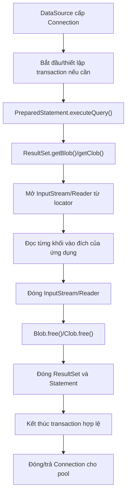

# Quản lý vòng đời locator LOB và kết nối liên quan trong JDBC

## Mục tiêu học tập

Trong **JDBC**, ứng dụng Java truy cập cơ sở dữ liệu quan hệ qua driver, `DataSource` và `Connection`; thực thi SQL tham số hóa bằng `PreparedStatement` và đọc dữ liệu bằng `ResultSet`. Với cột dữ liệu lớn như tài liệu, ảnh, âm thanh hoặc nội dung văn bản dài, JDBC còn cung cấp `Blob`, `Clob` và `NClob`. Một số driver biểu diễn những giá trị này bằng **LOB locator**: đối tượng hoặc mã tham chiếu tới dữ liệu nằm ở database, thay vì luôn nạp toàn bộ byte hay ký tự vào heap Java.

Locator giúp làm việc với dữ liệu lớn nhưng có yêu cầu vòng đời riêng. Một `Blob` còn tồn tại dưới dạng biến Java **không có nghĩa** dữ liệu vẫn đọc được sau khi `ResultSet`, transaction hoặc `Connection` liên quan đã kết thúc. Hành vi chính xác phụ thuộc DBMS, driver, loại locator và cách driver materialize dữ liệu. Nếu quản lý sai, ứng dụng có thể gặp lỗi “LOB locator invalid”, stream bị đóng sớm, kết nối bị giữ quá lâu, rò rỉ tài nguyên hoặc tăng bộ nhớ đột biến.

Bài thuộc chương **Dữ liệu lớn** giúp bạn:

- Phân biệt dữ liệu LOB với locator, cũng như `Blob`, `Clob`, `NClob` và các stream liên quan.
- Xác định quyền sở hữu và vòng đời của `ResultSet`, `Statement`, `Connection`, transaction, locator và stream.
- Đọc LOB tăng dần bằng `InputStream` hoặc `Reader`, không cần biến toàn bộ LOB thành `byte[]` hay `String`.
- Gọi `free()` đúng thời điểm, đóng stream trước khi giải phóng locator, và giữ nguyên lỗi chính nếu cleanup gặp lỗi.
- Xử lý tải lên bằng `PreparedStatement.setBinaryStream(...)` và hiểu khác biệt so với tạo `Blob` bằng `Connection.createBlob()`.
- Thiết kế cách truyền dữ liệu giữa database và tệp/API với connection pool, transaction và cơ chế xử lý lỗi phù hợp.

## 1. LOB locator là gì?

**LOB** (*Large Object*) là loại dữ liệu dành cho nội dung lớn. Trong JDBC có các interface chính:

| API JDBC | Loại nội dung | Cách đọc tăng dần | Giải phóng |
| --- | --- | --- | --- |
| `java.sql.Blob` | Dữ liệu nhị phân, ví dụ tệp PDF hoặc ảnh | `getBinaryStream()` trả `InputStream` | `free()` |
| `java.sql.Clob` | Dữ liệu ký tự | `getCharacterStream()` trả `Reader` | `free()` |
| `java.sql.NClob` | Dữ liệu ký tự quốc gia theo khả năng của DBMS | Kế thừa `Clob.getCharacterStream()` | Kế thừa `free()` |
| `java.sql.SQLXML` | Dữ liệu XML có API riêng | `getBinaryStream()`, `getCharacterStream()` hoặc cách biểu diễn khác | `free()` |

`SQLXML` có quy tắc và trạng thái riêng, được nhắc để tránh nhầm lẫn; trọng tâm của bài là locator `Blob`/`Clob`/`NClob`.

Ví dụ bảng:

```sql
-- Cú pháp kiểu dữ liệu LOB có thể khác nhau tùy DBMS.
CREATE TABLE stored_documents (
    document_id BIGINT PRIMARY KEY,
    filename VARCHAR(255) NOT NULL,
    binary_content BLOB,
    text_content CLOB
);
```

Khi chạy `ResultSet.getBlob("binary_content")`, driver có thể:

1. Trả một đối tượng giữ **locator** tham chiếu tới nội dung trên server.
2. Trả đối tượng đã **materialize** nội dung vào bộ nhớ hoặc bộ đệm local.
3. Kết hợp nhiều cách lưu/đọc tùy kích thước giá trị và cấu hình.

Vì vậy, interface `Blob` **không bảo đảm** locator luôn là “con trỏ remote” và cũng **không bảo đảm** dữ liệu đã được tải về hết. Ứng dụng cần lập trình theo **hợp đồng JDBC**, đồng thời kiểm tra tài liệu của đúng driver/DBMS về thời hạn sử dụng locator và cách streaming.

### Locator không giống bản sao độc lập

Một `Blob` lấy từ `ResultSet` có thể phụ thuộc vào session, transaction hoặc các tài nguyên JDBC vẫn mở. Nếu lưu tham chiếu đó trong một DTO rồi trả cho controller sau khi repository đã đóng `Connection`, luồng đọc sau có thể thất bại.

```java
// Cách thiết kế dễ lỗi khi caller đọc sau khi connection đã đóng:
Blob findBlob(long documentId) throws SQLException {
    try (Connection c = dataSource.getConnection();
         PreparedStatement ps = c.prepareStatement(
             "SELECT binary_content FROM stored_documents WHERE document_id = ?")) {
        ps.setLong(1, documentId);
        try (ResultSet rs = ps.executeQuery()) {
            if (!rs.next()) {
                return null;
            }
            return rs.getBlob(1); // Caller nhận Blob sau khi ResultSet/Connection đóng.
        }
    }
}
```

Đừng dựa vào việc ví dụ này “vẫn chạy” trên một driver đã materialize dữ liệu. **Giải pháp di động hơn là tiêu thụ LOB trong khi connection và phạm vi giao dịch còn hợp lệ**, rồi chỉ trả về dữ liệu đã được sao chép sang tài nguyên do ứng dụng thực sự sở hữu.

## 2. Sơ đồ vòng đời và thứ tự giải phóng

Một quy trình đọc LOB điển hình:



Thứ tự **đóng stream → `free()` locator → đóng `ResultSet`/`Statement` → kết thúc transaction → trả connection** là mẫu quản lý thận trọng. Một driver có thể cho phép thứ tự khác, nhưng ứng dụng không nên dựa vào các hành vi đó nếu muốn dễ chuyển DBMS.

| Tài nguyên | Ai tạo/lấy? | Thời điểm cần giữ | Cách kết thúc |
| --- | --- | --- | --- |
| `Connection` | `DataSource.getConnection()` | Trong suốt thao tác SQL và quá trình đọc locator | `close()`; thường là trả kết nối cho pool |
| Transaction | Tầng sở hữu `Connection` | Khi driver/DBMS yêu cầu locator còn nằm trong transaction | `commit()` hoặc `rollback()` đúng ngữ nghĩa |
| `PreparedStatement` | `Connection.prepareStatement()` | Ít nhất tới khi hoàn tất đọc kết quả | `close()`, thường bằng try-with-resources |
| `ResultSet` | `executeQuery()` | Cho tới khi đã lấy và tiêu thụ LOB theo điều kiện driver | `close()` |
| `Blob`/`Clob`/`NClob` | `ResultSet.getBlob/getClob/getNClob` hoặc `Connection.createBlob/createClob/createNClob` | Tới khi đọc/ghi nội dung xong | `free()` nếu interface hỗ trợ và đã lấy được đối tượng |
| `InputStream`/`Reader` | `getBinaryStream()/getCharacterStream()` | Cho tới khi sao chép xong hoặc hủy | `close()`, trước khi `free()` locator |
| Đích `OutputStream`/`Writer` | Thường do caller cung cấp | Theo hợp đồng API gọi | Caller quyết định đóng; hàm repository thường không đóng tài nguyên của caller |

**Lưu ý:** `Blob` và `Clob` không triển khai `AutoCloseable` trong API JDBC chuẩn; không thể viết trực tiếp `try (Blob blob = ...)`. Chúng có phương thức `free()`. Phần sau dùng một lớp bọc `AutoCloseable` để đảm bảo giải phóng và giữ thông tin ngoại lệ.

### Thời điểm transaction hết hạn có thể quan trọng

Một số DBMS/driver gắn thời hạn sử dụng locator với transaction: sau `commit()` hoặc `rollback()`, locator có thể không còn dùng được, kể cả connection chưa đóng. Nơi khác có thể hỗ trợ locator còn hợp lệ trong những điều kiện nhất định.

Do đó, **không commit ở giữa quá trình đọc** chỉ vì đã lấy được đối tượng `Blob`; hãy hoàn tất đọc, đóng stream, giải phóng locator rồi mới kết thúc transaction theo hợp đồng của hệ thống. Nếu query chạy ở chế độ `autoCommit=true`, khả năng dùng locator sau khi statement hoàn tất cần được xác nhận với driver. Với driver yêu cầu transaction mở để stream LOB, bạn có thể cần `setAutoCommit(false)` trước truy vấn và kết thúc transaction **sau khi đọc xong**.

## 3. Đọc BLOB theo khối khi Connection còn mở

Đây là ví dụ Java 11+ dùng `DataSource` và `PreparedStatement`. Hàm `copyBinaryContent(...)` sao chép dữ liệu BLOB vào một `OutputStream` do tầng gọi sở hữu. Nó **không** tạo một `byte[]` có kích thước bằng cả LOB.

```java
import java.io.IOException;
import java.io.InputStream;
import java.io.OutputStream;
import java.sql.Blob;
import java.sql.Connection;
import java.sql.PreparedStatement;
import java.sql.ResultSet;
import java.sql.SQLException;
import java.util.Objects;
import javax.sql.DataSource;

public final class DocumentRepository {
    private static final int BUFFER_SIZE = 64 * 1024;
    private final DataSource dataSource;

    public DocumentRepository(DataSource dataSource) {
        this.dataSource = Objects.requireNonNull(dataSource);
    }

    // OutputStream do caller sở hữu: repository không đóng output.
    public long copyBinaryContent(long documentId, OutputStream output)
            throws SQLException, IOException {
        Objects.requireNonNull(output, "output");

        String sql = """
            SELECT binary_content
              FROM stored_documents
             WHERE document_id = ?
            """;

        try (Connection connection = dataSource.getConnection()) {
            // Mở transaction thủ công để hỗ trợ driver cần locator
            // sống trong một transaction. Hãy đối chiếu DBMS thực tế.
            connection.setAutoCommit(false);

            long copiedBytes;
            try {
                try (PreparedStatement ps = connection.prepareStatement(sql)) {
                    ps.setLong(1, documentId);

                    try (ResultSet rs = ps.executeQuery()) {
                        if (!rs.next()) {
                            throw new SQLException(
                                "Không tìm thấy tài liệu: " + documentId
                            );
                        }

                        Blob blob = rs.getBlob("binary_content");
                        if (blob == null) {
                            throw new SQLException(
                                "binary_content là SQL NULL"
                            );
                        }

                        // BlobHandle được đóng SAU InputStream vì
                        // try-with-resources đóng theo thứ tự ngược.
                        try (BlobHandle handle = new BlobHandle(blob);
                             InputStream input = blob.getBinaryStream()) {
                            byte[] buffer = new byte[BUFFER_SIZE];
                            long total = 0;
                            int count;

                            while ((count = input.read(buffer)) != -1) {
                                output.write(buffer, 0, count);
                                total += count;
                            }
                            copiedBytes = total;
                        }
                    }
                }
            } catch (SQLException | IOException | RuntimeException error) {
                // Hủy transaction đọc nếu đã có lỗi trước lúc kết thúc.
                try {
                    connection.rollback();
                } catch (SQLException rollbackError) {
                    error.addSuppressed(rollbackError);
                }
                throw error;
            }

            // Transaction chỉ đọc: rollback cũng là cách kết thúc
            // phạm vi đọc mà không xác nhận bất kỳ DML nào.
            connection.rollback();
            return copiedBytes;
        }
    }

    private static final class BlobHandle implements AutoCloseable {
        private final Blob blob;

        private BlobHandle(Blob blob) {
            this.blob = Objects.requireNonNull(blob);
        }

        @Override
        public void close() throws SQLException {
            blob.free();
        }
    }
}
```

Trong dự án dùng Java 8, có thể thay text block bằng chuỗi SQL thông thường. Các API `Blob`, `ResultSet` và `PreparedStatement` là API JDBC chuẩn.

### 3.1. Tại sao dùng BlobHandle?

`Blob.free()` giải phóng tài nguyên mà driver/DBMS có thể giữ để phục vụ LOB. Nếu đọc stream ném `IOException` và tiếp đó `free()` cũng ném `SQLException`, cấu trúc `try-with-resources` của lớp bọc giúp **giữ ngoại lệ chính**; ngoại lệ khi cleanup được Java gắn vào `getSuppressed()`.

Vì tài nguyên được khai báo theo thứ tự `BlobHandle` **trước** `InputStream`, chúng được đóng theo thứ tự ngược lại: **InputStream trước, BlobHandle sau**. Điều này tránh gọi `free()` khi stream còn đang được dùng.

Ngay cả nếu `blob.getBinaryStream()` thất bại trong lúc khởi tạo tài nguyên thứ hai, Java vẫn đóng `BlobHandle` đã khởi tạo thành công. Đoạn mã cũng giữ `ResultSet`, `PreparedStatement` và `Connection` mở cho tới khi việc sao chép kết thúc.

### 3.2. Transaction đọc và connection pool

Ví dụ cố ý dùng `setAutoCommit(false)` để giảm phụ thuộc vào việc driver có cho locator tồn tại sau khi một câu `SELECT` auto-commit hoàn tất hay không. Vì transaction này **chỉ đọc**, gọi `rollback()` sau khi tiêu thụ LOB là một cách kết thúc transaction hợp lệ. Nó không phải quy tắc chung bắt buộc cho mọi truy vấn đọc: với driver/DBMS khác, bạn có thể dùng `autoCommit=true` khi đã kiểm chứng vòng đời locator.

Nếu service **đã có transaction bao ngoài**, repository nên nhận `Connection` từ tầng gọi và không tự ý `commit()`, `rollback()` hoặc `close()`. Khi đó chính tầng gọi phải giữ transaction và connection còn hợp lệ cho tới khi copy xong.

Đoạn mã ví dụ giữ một connection trong suốt quá trình ghi ra `output`. Nếu `output` là kết nối mạng HTTP chậm, luồng JDBC và connection có thể bị giữ lâu. Khi lượng người dùng đồng thời cao, cần đánh giá chiến lược **spool sang tệp tạm hoặc kho lưu trữ do ứng dụng sở hữu**, sau đó đóng connection sớm rồi mới phục vụ client. Sao chép theo luồng vẫn tiết kiệm heap, nhưng **không tự giải phóng connection sớm**.

### 3.3. OutputStream không nằm trong JDBC transaction

Nếu `output.write(...)` gặp `IOException` sau khi đã ghi một nửa nội dung, JDBC không thể thu hồi các byte đã gửi cho client hoặc đã ghi vào tệp. Dù transaction đọc rollback, đầu ra bên ngoài vẫn có thể dở dang.

Với tệp cần nguyên vẹn, có thể ghi vào **tệp tạm** và chỉ đổi tên/publish sau khi copy, đóng stream, xác minh checksum và hoàn tất các bước cần thiết. Khả năng thay tên nguyên tử phụ thuộc filesystem/cách lưu trữ. Với HTTP response, cần thiết kế cách ứng dụng báo lỗi hoặc cắt kết nối khi truyền thất bại, không giả định có thể thay một response đã bắt đầu gửi thành response JSON lỗi hoàn chỉnh.

## 4. Đọc CLOB, NCLOB và nội dung văn bản lớn

`Clob` trả một `Reader` thay vì `InputStream`. Dùng bộ đệm ký tự giúp tránh tạo một `String` khổng lồ trên heap.

Ví dụ dưới đây minh họa phần xử lý **khi `ResultSet` đang mở** và đã lấy được một `Clob` khác `null`:

```java
Clob clob = rs.getClob("text_content");
if (clob != null) {
    try (ClobHandle handle = new ClobHandle(clob);
         java.io.Reader reader = clob.getCharacterStream()) {

        char[] buffer = new char[16 * 1024];
        int n;
        while ((n = reader.read(buffer)) != -1) {
            writer.write(buffer, 0, n);
        }
    }
}

// Một lớp hỗ trợ đặt trong class sở hữu đoạn code:
private static final class ClobHandle implements AutoCloseable {
    private final java.sql.Clob clob;

    ClobHandle(java.sql.Clob clob) {
        this.clob = java.util.Objects.requireNonNull(clob);
    }

    @Override
    public void close() throws java.sql.SQLException {
        clob.free();
    }
}
```

Đoạn mã là **mảnh minh họa**: `rs` và `writer` phải được tạo, còn hợp lệ và quản lý vòng đời từ phía gọi. `Writer` thuộc quyền sở hữu của caller, nên helper trên không tự đóng `writer`. Tương tự `BlobHandle`, lớp `ClobHandle` bảo đảm `free()` được gọi sau khi đóng `Reader`.

Với `NClob`, có thể dùng `ResultSet.getNClob(...)` và `getCharacterStream()` tương tự, nếu driver/DBMS hỗ trợ. Đừng suy đoán cách mã hóa Unicode chỉ từ việc interface tên là `NClob`; cách lưu trữ ở database và việc chuyển đổi sang `char` trong Java tùy khả năng hệ thống.

### Không dùng getSubString() cho toàn bộ CLOB lớn

`Clob.getSubString(long pos, int length)` yêu cầu một lượng ký tự và trả `String`. Với dữ liệu rất lớn, việc đọc toàn bộ trong một lần có thể tiêu thụ heap đáng kể; API còn dùng `int` cho độ dài lấy ra. Tương tự, `Blob.getBytes(long pos, int length)` trả một `byte[]` nên không phù hợp nếu mục tiêu là truyền một LOB nhiều gigabyte qua một bộ đệm nhỏ.

Trong JDBC, vị trí `pos` của nhiều API truy cập LOB là **đánh số từ 1**, khác chỉ số mảng Java từ 0. Nếu cần truy cập một đoạn, hãy kiểm tra giới hạn `length()` và khả năng hỗ trợ của driver; không lạm dụng `length()` khi chỉ cần stream hết dữ liệu, vì một số driver phải gọi thêm về database để xác định độ dài.

## 5. Đọc bằng ResultSet.getBinaryStream(): không có Blob tường minh

Có thể đọc cột nhị phân trực tiếp qua `ResultSet.getBinaryStream(...)`:

```java
try (ResultSet rs = ps.executeQuery()) {
    if (rs.next()) {
        try (java.io.InputStream input =
                 rs.getBinaryStream("binary_content")) {
            if (input != null) {
                byte[] buffer = new byte[64 * 1024];
                int n;
                while ((n = input.read(buffer)) != -1) {
                    output.write(buffer, 0, n);
                }
            }
        }
    }
}
```

Ở đây không có đối tượng `Blob` do ứng dụng nhận được nên không có `blob.free()` tương ứng. Nhưng **stream vẫn gắn với ResultSet/Statement/Connection** theo khả năng của driver. Không trả stream ra ngoài rồi đóng `ResultSet` ngay.

Với stream lấy trực tiếp từ `ResultSet`, JDBC còn có quy tắc quan trọng: **đọc hết stream trước khi gọi getter lấy giá trị cột khác trên cùng ResultSet**, vì một lời gọi getter tiếp theo có thể đóng stream đang mở. Tương tự, gọi `rs.next()` hoặc đóng `ResultSet` trong khi đang truyền nội dung có thể làm stream hết hiệu lực. Nếu cần đọc metadata khác, hãy lấy metadata cần thiết **trước khi** mở stream của cột LOB và thực hiện từng hàng theo thứ tự rõ ràng.

So sánh hai cách:

| Cách đọc | Ưu điểm | Điều cần quản lý |
| --- | --- | --- |
| `rs.getBlob(...)` rồi `blob.getBinaryStream()` | Có API LOB như `length()`, `getBytes()`, `free()` khi cần | Locator, stream, tài nguyên JDBC và transaction |
| `rs.getBinaryStream(...)` | Đọc trực tiếp từ cột, ít đối tượng API hơn | Vòng đời stream và `ResultSet`, thứ tự gọi getter |
| `rs.getBytes(...)` | Tiện cho payload nhỏ | Có thể tạo một mảng byte lớn tương ứng toàn giá trị |

Không có cách nào luôn tối ưu cho mọi driver. Khi dữ liệu lớn, hãy kiểm tra bộ nhớ thực tế, tốc độ đọc, số vòng trao đổi và khả năng streaming của chính driver đang dùng.

## 6. Ghi BLOB: giữ nguồn InputStream đến lúc lệnh hoàn tất

Khi tải một tệp lên bảng có cột LOB, có thể dùng `PreparedStatement.setBinaryStream(...)` để truyền nội dung mà không cần đọc toàn bộ vào `byte[]` trước.

Ví dụ cập nhật cột `binary_content` của một hàng đã tồn tại. Tệp nguồn được giả định ổn định về kích thước trong lúc tải:

```java
import java.io.IOException;
import java.io.InputStream;
import java.nio.file.Files;
import java.nio.file.Path;
import java.sql.Connection;
import java.sql.PreparedStatement;
import java.sql.SQLException;
import java.util.Objects;
import javax.sql.DataSource;

public final class DocumentUploader {
    private final DataSource dataSource;

    public DocumentUploader(DataSource dataSource) {
        this.dataSource = Objects.requireNonNull(dataSource);
    }

    public void replaceContent(long documentId, Path source)
            throws SQLException, IOException {
        Objects.requireNonNull(source, "source");

        try (Connection connection = dataSource.getConnection()) {
            connection.setAutoCommit(false);

            try {
                // Phải đảm bảo file không đổi giữa Files.size và lúc đọc.
                long length = Files.size(source);

                try (InputStream input = Files.newInputStream(source);
                     PreparedStatement ps = connection.prepareStatement(
                         "UPDATE stored_documents "
                       + "SET binary_content = ? WHERE document_id = ?")) {

                    ps.setBinaryStream(1, input, length);
                    ps.setLong(2, documentId);

                    if (ps.executeUpdate() != 1) {
                        throw new SQLException(
                            "Không tìm thấy đúng một tài liệu cần cập nhật"
                        );
                    }
                }
            } catch (SQLException | IOException | RuntimeException error) {
                // Xử lý các lỗi TRƯỚC khi gọi commit.
                try {
                    connection.rollback();
                } catch (SQLException rollbackError) {
                    error.addSuppressed(rollbackError);
                }
                throw error;
            }

            // Lỗi ngay tại commit() có thể để lại kết quả chưa xác định.
            connection.commit();
        }
    }
}
```

### Những điểm cần nhớ khi ghi stream

- `InputStream` phải **còn mở đến khi `executeUpdate()` hoàn tất**. Không đóng stream ngay sau `setBinaryStream(...)`, vì driver có thể chỉ bắt đầu đọc nội dung khi thực thi câu lệnh.
- Tham số `length` là số byte mà ứng dụng khai báo cho nguồn. Nếu nguồn thay đổi trong lúc đọc, driver có thể nhận thiếu/thừa dữ liệu hoặc báo lỗi; nên dùng tệp ổn định hoặc giao thức nguồn có độ dài nhất quán.
- `setBinaryStream(...)` không bảo đảm driver luôn truyền dữ liệu từng khối mà không đệm. Driver có thể buffer một phần hoặc toàn bộ; hãy đo và kiểm tra tài liệu driver.
- `connection.commit()` được gọi sau khi `PreparedStatement` và stream nguồn đã đóng thành công. Khi ném lỗi từ chính `commit()`, không thể mặc định rằng database chưa ghi nhận thay đổi.
- Đối với CLOB, có các API như `setCharacterStream(...)`, `setClob(...)` hoặc `setNClob(...)` tương ứng, tùy kiểu cột và khả năng của driver.
- Khi `source` là dữ liệu tải lên qua HTTP hoặc stream mạng, đường đọc có thể chậm làm transaction và connection kéo dài; cân nhắc spool trước khi mở transaction ghi nếu yêu cầu vận hành cho phép.

### Khi nào dùng Connection.createBlob()?

`Connection.createBlob()` tạo đối tượng `Blob` do ứng dụng sở hữu theo JDBC. Một hướng tiếp cận là gọi `blob.setBinaryStream(1)` để ghi nội dung vào blob tạm, rồi dùng `PreparedStatement.setBlob(...)`. Nhưng cách này có thêm một đối tượng LOB cần `free()` và có thể dùng nhiều bộ nhớ hoặc tài nguyên driver. Không phải driver nào cũng hỗ trợ mọi thao tác tạo/sửa locator như nhau.

Nếu chỉ muốn gắn một nguồn đọc dữ liệu lớn vào tham số SQL, **`setBinaryStream(...)` thường đơn giản hơn về vòng đời đối tượng**. Chỉ dùng `createBlob()` khi có nhu cầu cụ thể và đã kiểm chứng driver; nếu dùng, đảm bảo đóng `OutputStream` từ `setBinaryStream(1)`, gọi `execute...()` trong lúc Blob còn hợp lệ và `free()` sau khi xử lý xong.

## 7. Điều gì xảy ra khi locator bị sử dụng sau khi đóng tài nguyên?

Một số tình huống dễ gây lỗi:

| Tình huống | Vì sao rủi ro? | Cách xử lý |
| --- | --- | --- |
| Trả `Blob` từ repository rồi đóng connection | Locator có thể phụ thuộc session/transaction đã đóng | Copy dữ liệu bên trong repository hoặc chuyển quyền sở hữu connection có hợp đồng rõ ràng |
| `commit()` rồi mới đọc `Blob` | Locator có thể hết hiệu lực khi transaction kết thúc | Đọc và `free()` trước commit/rollback |
| Gọi `blob.free()` trước khi đọc hết stream | Có thể làm stream không còn hợp lệ | Đóng/đọc hết stream trước, sau đó mới `free()` |
| Không gọi `free()` trên locator đã lấy | Có thể giữ bộ nhớ hoặc tài nguyên ở client/server | Dùng `finally` hoặc wrapper `AutoCloseable` |
| Đóng `ResultSet` rồi giữ `getBinaryStream()` | Stream có thể hết hiệu lực | Tiêu thụ khi ResultSet còn mở |
| Gọi getter khác khi stream trực tiếp của `ResultSet` đang mở | JDBC có thể đóng stream hiện tại | Đọc các cột metadata trước, rồi stream LOB |
| Dùng `getBytes()`/`getSubString()` cho LOB rất lớn | Tạo mảng hoặc chuỗi lớn trên heap | Đọc qua stream/reader với buffer cố định |
| Dùng `byte[]` chung cho nhiều yêu cầu song song và giữ trong cache | Mức sử dụng heap tăng theo số yêu cầu | Giới hạn đồng thời, tránh giữ bản sao không cần thiết |
| Chờ client HTTP nhận dữ liệu rất lâu trong khi giữ connection | Pool có thể thiếu connection cho request khác | Spool và đóng connection sớm, giới hạn lưu lượng |
| Nuốt lỗi `IOException` khi truyền tệp | Có thể báo thành công với nội dung thiếu | Báo lỗi, xử lý output dở dang và đối soát |
| Đóng connection rồi mới `free()` locator | Cleanup có thể không còn dùng được | Ưu tiên `free()` khi connection còn hợp lệ |

`Blob.free()` và `Clob.free()` làm đối tượng LOB được đánh dấu đã giải phóng theo hợp đồng JDBC; **không tiếp tục sử dụng đối tượng sau khi `free()`**. Với driver có xử lý tài nguyên remote, việc giải phóng có thể tạo hoạt động bổ sung, nhưng vẫn cần gọi khi phù hợp. Không nên coi garbage collection là cơ chế quản lý vòng đời LOB.

## 8. Trách nhiệm sở hữu Connection khi có nhiều tầng ứng dụng

Khi tách service, repository và controller, hãy quy định rõ **tầng nào giữ và đóng connection**.

### 8.1. Repository sao chép nội dung và trả về kết quả độc lập

Đây là mẫu trong `copyBinaryContent(...)`:

- Repository tự lấy connection và chịu trách nhiệm `close()`.
- Repository dùng `OutputStream` do caller truyền vào nhưng **không đóng output**.
- Repository tiêu thụ stream và giải phóng locator trước khi đóng connection.
- Giá trị trả về là số byte đã sao chép, không phải locator hay stream còn phụ thuộc JDBC.

Mẫu này dễ quản lý tài nguyên, nhưng thời gian chiếm connection dài bằng thời gian sao chép sang output.

### 8.2. Service sở hữu transaction và truyền Connection xuống repository

Khi một nghiệp vụ gồm nhiều câu DML, service có thể mở transaction rồi gọi repository:

```java
void processDocument(Connection connection, long documentId)
        throws SQLException, IOException {
    // Dùng đúng connection đang được service quản lý.
    // Repository không tự commit, rollback hoặc close connection.
    // Đảm bảo mọi LOB stream và locator được giải phóng
    // trước khi tầng service kết thúc transaction.
}
```

Không để repository đóng connection mà tầng service còn cần. Ngược lại, nếu repository trả về một đối tượng giữ `Blob` hoặc `InputStream` cho service dùng sau, cần cơ chế quản lý **ownership** thật rõ: service phải biết thời điểm đóng stream, `free()`, kết thúc transaction và trả connection. Với API công khai hoặc nhiều tầng bất đồng bộ, kiểu thiết kế đó dễ rò rỉ hơn việc sao chép dữ liệu vào tài nguyên độc lập.

### 8.3. Stream bất đồng bộ cần đặc biệt thận trọng

Ví dụ một HTTP framework nhận `InputStream` rồi truyền dữ liệu **sau khi phương thức controller đã trả về**. Nếu connection nằm trong `try-with-resources` của phương thức đã kết thúc, stream có thể bị đóng trước khi framework đọc.

Giải pháp có thể là:

- Thực hiện sao chép **đồng bộ trong thời gian tài nguyên JDBC đang mở** và quản lý backpressure rõ ràng.
- Spool LOB sang tệp tạm hoặc bộ lưu trữ khác trước, sau đó truyền độc lập với database.
- Nếu framework hỗ trợ luồng tài nguyên có callback đóng, thiết kế một scope sở hữu connection, result set, locator và stream, với xử lý hủy/bỏ dở chắc chắn.

Không dùng đối tượng `Blob` như một “token có thể lưu mãi” để truy cập LOB từ thread khác, trừ khi driver và thiết kế đồng thời bảo đảm điều đó.

## 9. Kiểm soát bộ nhớ, connection pool và tải đồng thời

Sử dụng buffer 64 KiB không có nghĩa ứng dụng chỉ dùng 64 KiB cho mỗi request: còn bộ nhớ driver, bộ đệm output, HTTP framework, dữ liệu metadata, row cache, và có thể bản sao toàn bộ LOB do driver tạo.

Một cách ước lượng sơ bộ:

\[
M_{\text{buffer}} \approx N_{\text{concurrent}} \times B_{\text{per stream}}
\]

Ví dụ, 80 lượt truyền đồng thời × 64 KiB buffer do ứng dụng cấp = khoảng 5 MiB cho **các buffer của ứng dụng**, chưa tính bộ nhớ của driver và những thành phần khác. Nếu mỗi request còn giữ một connection đến database trong suốt thời gian truyền, pool phải chịu đồng thời 80 connection hoặc có cơ chế giới hạn hợp lý.

Các yếu tố quan sát:

| Chỉ số | Dấu hiệu cần theo dõi |
| --- | --- |
| Số connection đang mượn / thời gian giữ connection | Tăng khi truyền LOB chậm hoặc request bị treo |
| Heap và GC | Driver materialize LOB, buffer đầu vào/đầu ra quá lớn |
| Số stream/locator còn mở | Rò rỉ do quên `close()` hoặc `free()` |
| Độ trễ truy vấn và đọc LOB | Phân biệt thời gian SQL với thời gian copy |
| Network throughput và timeout | Stream không hoàn tất, lỗi giữa chừng |
| Thời gian transaction và lock wait | Transaction đọc/ghi tồn tại lâu ngoài dự kiến |

Đừng dùng một kết quả benchmark trên LOB vài kilobyte để suy ra hành vi với LOB hàng trăm megabyte. Cần thử kích thước đại diện, số yêu cầu đồng thời và driver/DBMS đúng môi trường thực tế.

## 10. Phép thử vòng đời locator trên database kiểm thử

Phép thử tích hợp nhằm trả lời **driver của bạn** cho phép dùng locator đến thời điểm nào, và ứng dụng có quản lý tài nguyên đúng khi có lỗi hay không. Chạy trên database/schema test, không dùng bảng nghiệp vụ thật.

### 10.1. Kịch bản cơ bản

1. Tạo một hàng có BLOB nhỏ biết trước và một hàng có BLOB lớn, cùng một hàng có giá trị SQL `NULL`.
2. Dùng một `Connection` và một `PreparedStatement` để truy vấn.
3. Lấy `Blob`, mở stream và đọc hết khi `ResultSet`/connection còn mở; kiểm tra kích thước hoặc checksum.
4. Đóng stream, gọi `free()`, đóng `ResultSet` và `Statement` rồi kết thúc transaction và connection.
5. Lặp với `Clob` và `Reader`; xác nhận đúng ký tự Unicode và số ký tự đầu ra.

**Kết quả mong đợi:** dữ liệu đọc ra đúng; các tài nguyên được giải phóng dù không có dữ liệu hoặc khi gặp ngoại lệ. Không nên biến việc gọi một phương thức trên locator **sau `free()`** thành hành vi production; theo JDBC, việc dùng lại đối tượng đã giải phóng là không hợp lệ.

### 10.2. Các phép thử giới hạn vòng đời

| Tình huống | Điều cần ghi nhận |
| --- | --- |
| Lấy `Blob` rồi đóng `ResultSet` trước khi đọc | Driver báo lỗi hay locator vẫn dùng được? Không dựa vào trường hợp thành công để thiết kế không portable |
| Lấy `Blob` rồi `commit()` trước khi stream | Locator có còn hợp lệ hay không theo driver/DBMS? |
| Dùng `autoCommit=true` thay vì false | Cách driver cấp và giữ locator có khác không? |
| Đọc một nửa stream, hủy tác vụ | `close()`, `free()`, `rollback()` và trả connection có chạy đầy đủ? |
| `OutputStream` bị lỗi khi ghi | Ngoại lệ gốc có được giữ, tài nguyên DB có được giải phóng? |
| `Blob.free()` thất bại trong cleanup | Ngoại lệ cleanup có bị giữ qua `getSuppressed()`? |
| Ghi LOB qua `setBinaryStream(...)` | Driver có đệm toàn bộ nội dung? Heap/p95 thay đổi ra sao? |
| Nhiều lượt đọc đồng thời | Pool có bị cạn hoặc transaction kéo dài bất thường không? |

Những thử nghiệm phụ thuộc DBMS không nhằm tìm “lối tắt” sử dụng locator sau khi đóng tài nguyên, mà để xác minh **giới hạn cần tôn trọng** và lựa chọn thiết kế có thể vận hành an toàn.

### 10.3. Kiểm tra chính xác nội dung

Không chỉ kiểm tra số byte. Với BLOB, nên tính một checksum/hash trên luồng nguồn và luồng đầu ra trong môi trường test. Với CLOB, so sánh cả các ký tự nhiều byte, ký tự ngoài BMP, dấu tiếng Việt và trường hợp rỗng.

Lưu ý `Clob.length()` trả độ dài ký tự theo cách biểu diễn LOB/JDBC, không nhất thiết bằng số byte của một lần mã hóa UTF-8. Nếu cần xuất một CLOB ra HTTP hoặc tệp UTF-8, `Writer` chịu trách nhiệm chuyển ký tự thành byte theo charset được chỉ định; cần đo riêng số byte truyền thực tế.

## 11. Những quy tắc thiết kế giúp tránh lỗi dài hạn

- **Không giữ locator lâu hơn các tài nguyên JDBC cần để đọc nó.** Nếu phải dùng dữ liệu sau đó, copy sang tệp, object storage hoặc cấu trúc ứng dụng độc lập.
- **Gọi `free()` rõ ràng** với `Blob`/`Clob`/`NClob` đã lấy được, và đóng stream trước.
- **Không đóng connection khi stream còn đang đọc.** Đóng theo trình tự tài nguyên, chú ý khi có callback bất đồng bộ.
- **Không giả định driver luôn streaming.** Xác minh bộ nhớ và hành vi qua dữ liệu lớn thực tế.
- **Không nhầm `rollback()` với thu hồi output.** Đã gửi một phần dữ liệu tới client thì DB không thể hoàn tác việc truyền.
- **Giữ quyền sở hữu tài nguyên nhất quán.** Hàm chỉ nhận `OutputStream` từ caller thường không nên đóng nó; hàm tự lấy connection phải bảo đảm trả connection.
- **Phân biệt lỗi đọc/ghi với lỗi commit.** Khi upload LOB, lỗi tại `commit()` có thể khiến kết quả transaction chưa xác định; cần đối soát thay vì retry mù quáng.
- **Đặt giới hạn vận hành.** Giới hạn request size, đồng thời, timeout và số connection mượn; theo dõi heap, GC, transaction duration và tỷ lệ truyền lỗi.

## 12. Bài luyện tập

**Bài 1 — Locator bị trả ra ngoài.** Repository thực hiện `rs.getBlob(...)`, trả `Blob` rồi đóng `Connection` trong `finally`. Vì sao code có thể thất bại tại controller?

*Đáp án:* `Blob` có thể là locator còn phụ thuộc connection/session/transaction đã đóng; controller đang dùng tài nguyên đã hết hiệu lực. Nên tiêu thụ LOB trước khi đóng hoặc chuyển ownership rõ ràng.

**Bài 2 — Thứ tự đóng.** Trong `try-with-resources`, nếu muốn đóng `InputStream` trước rồi gọi `Blob.free()`, nên khai báo wrapper `BlobHandle` hay `InputStream` trước?

*Đáp án:* Khai báo `BlobHandle` trước `InputStream`; Java đóng tài nguyên theo thứ tự ngược với thứ tự khai báo.

**Bài 3 — SQL NULL.** Cột `binary_content` là `NULL`. `rs.getBlob(...)` trả về gì và ứng dụng nên làm gì?

*Đáp án:* Trả `null`. Quyết định theo hợp đồng nghiệp vụ: báo thiếu nội dung, bỏ qua hoặc trả trạng thái phù hợp; không gọi `getBinaryStream()` trên `null`.

**Bài 4 — Stream và ResultSet.** Bạn lấy `rs.getBinaryStream("binary_content")` rồi gọi `rs.getString("filename")` trong lúc đang đọc. Điều gì có thể xảy ra?

*Đáp án:* Getter tiếp theo có thể làm stream hiện tại bị đóng. Đọc metadata trước khi mở stream và hoàn tất stream trước khi chuyển cột/hàng.

**Bài 5 — Truyền file lớn.** Một API tải 200 MB dữ liệu sang client rất chậm, mỗi request giữ một connection. Vì sao dùng buffer 64 KiB vẫn có thể khiến pool cạn?

*Đáp án:* Bộ nhớ buffer nhỏ nhưng connection vẫn bị chiếm trong suốt thời gian truyền. Nên giới hạn số lượt đồng thời hoặc spool dữ liệu sang đích độc lập rồi trả connection sớm.

**Bài 6 — Commit upload.** Mã `setBinaryStream(...)` và `executeUpdate()` thành công, nhưng `connection.commit()` ném lỗi mạng. Có được mặc định upload thất bại và thử lại với ID mới không?

*Đáp án:* Không. Database có thể đã commit; cần dùng mã yêu cầu/định danh ổn định, đối soát và retry an toàn.

## Kết luận

Trong JDBC, **vòng đời LOB locator phải được quản lý cùng vòng đời stream, `ResultSet`, `PreparedStatement`, transaction và `Connection`**. Một đối tượng `Blob` hoặc `Clob` không phải bản sao độc lập có thể dùng vô thời hạn. Hãy đọc dữ liệu khi phạm vi JDBC còn hợp lệ, dùng `InputStream`/`Reader` theo khối, đóng stream trước khi gọi `free()`, rồi mới kết thúc transaction và trả connection về pool. Khi cần truyền dữ liệu ra bên ngoài hoặc xử lý bất đồng bộ, định nghĩa rõ quyền sở hữu tài nguyên và thời điểm giải phóng. Kiểm chứng hành vi của driver/DBMS với dữ liệu lớn thật, đặc biệt về transaction-scoped locator, đệm dữ liệu, lỗi giữa luồng và tải đồng thời, để ứng dụng vừa đúng dữ liệu vừa kiểm soát tốt bộ nhớ và kết nối.
