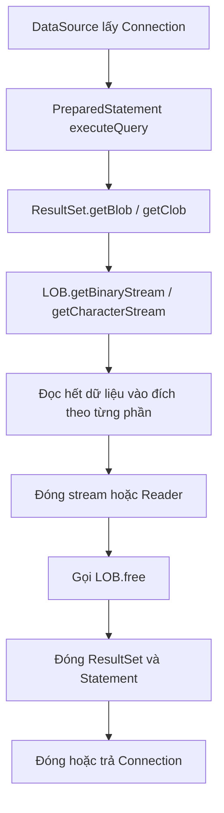

# Sử dụng `free()` để giải phóng tài nguyên LOB khi phù hợp trong JDBC

## 1. LOB là gì và vì sao cần giải phóng tài nguyên?

Trong **JDBC**, một ứng dụng Java có thể lưu và đọc dữ liệu lớn từ cơ sở dữ liệu quan hệ: ảnh, tệp đính kèm, bản PDF, văn bản dài hoặc tài liệu XML. Những dữ liệu như vậy thường được gọi là **LOB** (*Large Object*). JDBC cung cấp các interface `Blob` (*Binary Large Object*), `Clob` (*Character Large Object*) và `NClob` (*National Character Large Object*) để làm việc với nội dung tương ứng; `SQLXML` là API liên quan cho tài liệu XML.

Khi lấy một đối tượng `Blob` hoặc `Clob` từ `ResultSet`, không nên mặc định rằng Java đã sao chép toàn bộ dữ liệu về RAM. Tùy driver và DBMS, đối tượng có thể giữ dữ liệu trong bộ nhớ, bộ đệm, một **locator** trỏ tới LOB phía máy chủ hoặc những tài nguyên tạm khác. Những tài nguyên đó có thể còn tồn tại trong khi đối tượng JDBC vẫn đang được sử dụng.

Vì vậy, câu hỏi không chỉ là "đã đóng `ResultSet` và `Connection` chưa?" mà còn là: **LOB đã được dùng xong chưa, và liệu việc gọi `free()` có giúp giải phóng tài nguyên sớm, đúng phạm vi hay không?**

| Kiểu JDBC | Dữ liệu thường gặp | Cách đọc theo luồng | Giải phóng tài nguyên |
| --- | --- | --- | --- |
| `java.sql.Blob` | Ảnh, dữ liệu nhị phân, tệp đính kèm | `getBinaryStream()` | `blob.free()` |
| `java.sql.Clob` | Văn bản dài, nội dung tài liệu | `getCharacterStream()` | `clob.free()` |
| `java.sql.NClob` | Văn bản Unicode theo kiểu quốc gia của DBMS | `getCharacterStream()` | `nclob.free()` (kế thừa `Clob`) |
| `java.sql.SQLXML` | Tài liệu XML theo kiểu SQL XML | `getBinaryStream()`, `getCharacterStream()` hoặc `getSource()` tùy khả năng | `sqlxml.free()` |

`free()` có ý nghĩa **giải phóng tài nguyên gắn với đối tượng JDBC**, không phải xóa dữ liệu trong bảng. Nó cũng không tương đương `Connection.rollback()` hay `Connection.commit()`.

## 2. Phân biệt ba cấp vòng đời: stream, LOB và kết nối

Một đoạn mã đọc LOB có thể đồng thời quản lý ba loại tài nguyên:

1. **Stream/reader** để đọc nội dung (`InputStream` hoặc `Reader`). Đóng bằng `close()` hoặc `try-with-resources`.
2. **Đối tượng LOB** (`Blob`, `Clob`, `NClob`). Giải phóng khi hết cần dùng bằng `free()`.
3. **Tài nguyên JDBC bao quanh** (`ResultSet`, `PreparedStatement`, `Connection`). Đóng bằng `try-with-resources`; với pool, `Connection.close()` thường là trả kết nối về pool.



Thứ tự thông thường là **đọc hết và đóng stream trước, gọi `free()` sau, rồi mới đóng `ResultSet` và `Connection`**. Không gọi `free()` khi vẫn cần đọc tiếp stream hoặc sử dụng nội dung LOB. Sau khi gọi `free()`, đối tượng LOB **không còn hợp lệ để truy cập nội dung**; theo hợp đồng JDBC, các phương thức truy cập sau đó có thể ném `SQLException`.

`try-with-resources` áp dụng trực tiếp cho `InputStream`, `Reader`, `ResultSet`, `Statement` và `Connection` vì những loại này triển khai `AutoCloseable`. **`Blob` và `Clob` không triển khai `AutoCloseable` trong API JDBC chuẩn**, nên không thể viết `try (Blob b = rs.getBlob(1))` như với một stream. Thông thường ta dùng `try/finally` để bảo đảm `free()` được gọi ngay cả khi sao chép dữ liệu gặp lỗi.

## 3. `free()` thực hiện những gì và không bảo đảm điều gì?

Các phương thức `Blob.free()`, `Clob.free()` và `SQLXML.free()` yêu cầu driver giải phóng tài nguyên mà nó đang giữ cho đối tượng tương ứng. `NClob` thừa hưởng `free()` từ `Clob`. Trong quá trình thực hiện, `free()` có thể ném `SQLException` khi việc giải phóng gặp lỗi.

**Những điều được phép kỳ vọng:**

- Sau khi đọc/ghi LOB xong, ứng dụng có thể yêu cầu driver giải phóng tài nguyên **sớm hơn** thay vì chờ đối tượng không còn được tham chiếu hoặc chờ đóng kết nối.
- Nếu driver dùng locator, temporary LOB hoặc bộ đệm, việc giải phóng đúng lúc có thể giảm áp lực lên tài nguyên liên quan; hiệu quả cụ thể phụ thuộc DBMS/driver.
- Trong vòng lặp xử lý rất nhiều LOB, mỗi đối tượng nên được hoàn tất và giải phóng trước khi chuyển sang đối tượng tiếp theo nếu không cần giữ lại.

**Những điều không được suy diễn:**

- Gọi `blob.free()` **không chạy `DELETE` hoặc `UPDATE`** để xóa cột BLOB khỏi một hàng đã lưu.
- `free()` **không tự commit hoặc rollback transaction**.
- `free()` **không nhất thiết làm giảm heap Java ngay lập tức**; quá trình thu hồi bộ nhớ còn liên quan đến garbage collector và cách driver cấp phát.
- Mọi DBMS **không bắt buộc** dùng cùng cơ chế LOB. Với dữ liệu nhị phân được lưu dưới dạng cột thông thường, API đọc trực tiếp bằng stream có thể phù hợp hơn việc tạo `Blob`.
- Không thể thay `InputStream.close()` bằng `Blob.free()` và mặc nhiên cho rằng stream đang mở đã được xử lý đúng. Cần quản lý cả hai loại tài nguyên.

## 4. Ví dụ đầy đủ: đọc BLOB và CLOB theo luồng rồi `free()`

Giả sử có bảng logic `documents` gồm các cột `document_id`, `binary_payload` và `text_body`. Kiểu cột phù hợp có thể là `BLOB`/`CLOB` hoặc kiểu tương đương tùy DBMS. Trong PostgreSQL chẳng hạn, `bytea` và cơ chế *large object* dùng `oid` có hợp đồng driver khác nhau; không nên giả định `getBlob()` hoạt động giống nhau cho mọi kiểu cột. Ví dụ Java dưới đây **đòi hỏi driver hỗ trợ `getBlob()`/`getClob()` trên các cột được chọn**.

Service đọc **một** hàng, chuyển dữ liệu sang hai đích do caller cung cấp mà không nạp toàn bộ LOB vào một `byte[]` hoặc `String` lớn. Luồng đọc và tài nguyên LOB được quản lý rõ ràng:

```java
import javax.sql.DataSource;
import java.io.IOException;
import java.io.InputStream;
import java.io.OutputStream;
import java.io.Reader;
import java.io.Writer;
import java.sql.Blob;
import java.sql.Clob;
import java.sql.Connection;
import java.sql.PreparedStatement;
import java.sql.ResultSet;
import java.sql.SQLException;
import java.util.Objects;

public final class DocumentExportService {
    private final DataSource dataSource;

    public DocumentExportService(DataSource dataSource) {
        this.dataSource = Objects.requireNonNull(dataSource);
    }

    public void exportDocument(
            long documentId, OutputStream binaryTarget, Writer textTarget)
            throws SQLException, IOException {
        Objects.requireNonNull(binaryTarget, "binaryTarget");
        Objects.requireNonNull(textTarget, "textTarget");

        String sql =
            "SELECT binary_payload, text_body " +
            "FROM documents WHERE document_id = ?";

        try (Connection connection = dataSource.getConnection();
             PreparedStatement statement = connection.prepareStatement(sql)) {
            statement.setLong(1, documentId);

            try (ResultSet rows = statement.executeQuery()) {
                if (!rows.next()) {
                    throw new SQLException(
                        "Không tìm thấy tài liệu id=" + documentId);
                }

                // Lấy và giải phóng từng LOB ngay sau khi dùng xong.
                Blob blob = rows.getBlob("binary_payload");
                if (blob != null) {
                    copyBlobAndFree(blob, binaryTarget);
                }

                Clob clob = rows.getClob("text_body");
                if (clob != null) {
                    copyClobAndFree(clob, textTarget);
                }
            }
        }

        // binaryTarget và textTarget thuộc sở hữu caller,
        // nên service KHÔNG đóng chúng.
    }

    private static void copyBlobAndFree(Blob blob, OutputStream target)
            throws SQLException, IOException {
        Throwable primary = null;

        try (InputStream source = blob.getBinaryStream()) {
            source.transferTo(target); // Java 9+, sao chép theo luồng.
        } catch (SQLException | IOException | RuntimeException | Error failure) {
            primary = failure;
            throw failure;
        } finally {
            try {
                blob.free();
            } catch (SQLException freeFailure) {
                if (primary != null) {
                    primary.addSuppressed(freeFailure);
                } else {
                    throw freeFailure;
                }
            }
        }
    }

    private static void copyClobAndFree(Clob clob, Writer target)
            throws SQLException, IOException {
        Throwable primary = null;

        try (Reader source = clob.getCharacterStream()) {
            source.transferTo(target); // Java 10+, sao chép ký tự theo luồng.
        } catch (SQLException | IOException | RuntimeException | Error failure) {
            primary = failure;
            throw failure;
        } finally {
            try {
                clob.free();
            } catch (SQLException freeFailure) {
                if (primary != null) {
                    primary.addSuppressed(freeFailure);
                } else {
                    throw freeFailure;
                }
            }
        }
    }
}
```

Ví dụ sử dụng với hai luồng tệp đã do caller quản lý:

```java
DocumentExportService service = new DocumentExportService(dataSource);

try (OutputStream binaryFile = java.nio.file.Files.newOutputStream(binaryPath);
     Writer textFile = java.nio.file.Files.newBufferedWriter(
         textPath, java.nio.charset.StandardCharsets.UTF_8)) {
    service.exportDocument(1001L, binaryFile, textFile);
}
```

`binaryPath` và `textPath` trong ví dụ là các đối tượng `java.nio.file.Path` được caller lựa chọn. Khi dùng đường dẫn do người dùng nhập, cần kiểm tra quyền và vị trí ghi tệp để tránh ghi ngoài thư mục được phép. `exportDocument()` không đóng đích đầu ra vì caller có thể cần tiếp tục ghi hoặc kiểm tra lỗi khi đóng.

### Vì sao mã gọi `free()` trong `finally`?

Lỗi có thể phát sinh ở nhiều nơi: `getBinaryStream()`, `Reader.read()`, `transferTo()`, `InputStream.close()` hoặc `Writer` đích. Nếu chỉ gọi `free()` sau một phép sao chép thành công, đối tượng LOB có thể bị bỏ lại khi một bước trước đó ném `IOException` hoặc `SQLException`.

Trong ví dụ, nếu sao chép thất bại, biến `primary` giữ **ngoại lệ gốc**. Nếu `free()` cũng thất bại, mã đính kèm lỗi dọn dẹp bằng `primary.addSuppressed(freeFailure)` và ném lại lỗi ban đầu. Nếu sao chép thành công mà `free()` thất bại, `SQLException` của `free()` được truyền ra caller; đó là sự cố giải phóng tài nguyên cần được ghi nhận.

Đoạn mã giải phóng `Blob` trước khi gọi `rows.getClob(...)`, nên không giữ đồng thời cả hai locator khi không cần thiết. Nếu cần lấy nhiều LOB cùng lúc, hãy thiết kế `finally` riêng cho **mỗi** đối tượng để lỗi ở đối tượng này không làm bỏ sót việc giải phóng đối tượng kia.

## 5. Cách xử lý `NULL` và LOB rỗng

Giữa **SQL `NULL`** và **LOB có độ dài 0** có khác biệt nghiệp vụ. Với cột cho phép null, `rows.getBlob(...)` hoặc `rows.getClob(...)` có thể trả về `null`. Khi đó **không có đối tượng để gọi `free()`**:

```java
Blob avatar = rows.getBlob("avatar_data");
if (avatar == null) {
    // Cột là SQL NULL; không có Blob object để giải phóng.
} else {
    try {
        long length = avatar.length(); // Có thể là 0 nếu LOB rỗng.
        System.out.println("Kích thước BLOB: " + length);
    } finally {
        avatar.free();
    }
}
```

`length()` trả về `long`: đừng ép ngay thành `int` rồi cấp một mảng bằng kích thước LOB khi tệp có thể rất lớn. `Blob.getBytes(1, (int) blob.length())` có thể tạo mảng lớn và thậm chí sai khi dữ liệu vượt giới hạn số nguyên. Nếu chỉ cần truyền dữ liệu ra tệp hoặc qua mạng, dùng **`getBinaryStream()`**; với CLOB dùng **`getCharacterStream()`**.

Các getter từ `ResultSet` có quy tắc `wasNull()` riêng. Với getter trả về **đối tượng**, việc kiểm tra `getBlob(...) == null` hoặc `getClob(...) == null` thường đủ để phân nhánh; nếu phải áp dụng một giao thức ánh xạ chung, có thể dùng `rows.wasNull()` ngay sau getter tương ứng.

## 6. Khi nào gọi `free()` cho LOB do ứng dụng tạo?

Ngoài LOB đọc qua `ResultSet`, JDBC cho phép tạo LOB tạm thời qua `Connection.createBlob()` hoặc `Connection.createClob()` nếu driver hỗ trợ. Chúng có thể giữ bộ nhớ hoặc tài nguyên phía database ngay cả trước khi lưu vào bảng.

Ví dụ logic ghi BLOB được tạo ở phía ứng dụng:

```java
// connection và input đã được tạo trước đoạn mã này.
Blob temporaryBlob = connection.createBlob();
Throwable primary = null;

try {
    try (OutputStream lobOutput = temporaryBlob.setBinaryStream(1)) {
        input.transferTo(lobOutput);
    }

    try (PreparedStatement statement = connection.prepareStatement(
            "UPDATE documents SET binary_payload = ? WHERE document_id = ?")) {
        statement.setBlob(1, temporaryBlob);
        statement.setLong(2, documentId);
        statement.executeUpdate();
    }
} catch (SQLException | IOException | RuntimeException | Error failure) {
    primary = failure;
    throw failure;
} finally {
    try {
        temporaryBlob.free();
    } catch (SQLException freeFailure) {
        if (primary != null) {
            primary.addSuppressed(freeFailure);
        } else {
            throw freeFailure;
        }
    }
}
```

Đoạn mã là **một phần** của nghiệp vụ có `Connection connection`, `InputStream input` và `long documentId` được cấp trước đó; cần thêm các import JDBC/IO phù hợp. Trách nhiệm `commit()`/`rollback()` ở tầng sở hữu transaction. Quan trọng nhất là: chỉ `free()` **sau khi statement đã sử dụng xong đối tượng `temporaryBlob`**, không gọi trước `executeUpdate()`. `free()` không tự quyết định transaction thành công.

`Connection.createBlob()`, `Blob.setBinaryStream()` và việc dùng đối tượng Blob làm tham số có thể chịu giới hạn từ driver. Với nhiều tình huống ghi tệp lớn, có thể **không cần tạo `Blob`** mà truyền trực tiếp stream cho statement:

```java
// Cách khác: truyền luồng trực tiếp; không có Blob object để gọi free().
try (InputStream input = java.nio.file.Files.newInputStream(sourcePath);
     PreparedStatement statement = connection.prepareStatement(
         "UPDATE documents SET binary_payload = ? WHERE document_id = ?")) {
    statement.setBinaryStream(1, input); // Phụ thuộc hỗ trợ của driver.
    statement.setLong(2, documentId);
    statement.executeUpdate();          // Giữ input mở tới khi lệnh hoàn tất.
}
```

Với cách truyền stream trực tiếp, **đóng stream** mới là trách nhiệm chính; **không có đối tượng `Blob` nào được tạo** để gọi `free()`. Không nên thêm `createBlob()` chỉ với mục đích được gọi `free()` sau đó.

## 7. Những trường hợp gọi `free()` quá sớm gây lỗi

### 7.1. Giải phóng trước khi đọc hết stream

```java
Blob blob = rows.getBlob("binary_payload");
InputStream stream = blob.getBinaryStream();
blob.free(); // SAI: nội dung và stream có thể không còn sử dụng được.
stream.transferTo(target);
stream.close();
```

Đây là ví dụ **sai có chủ đích**. Driver có thể hủy locator/bộ đệm khi `free()`, khiến `transferTo()` lỗi hoặc dữ liệu đọc không đầy đủ. Giải pháp là đóng stream **sau khi đọc xong**, rồi gọi `free()`.

### 7.2. Giải phóng trước khi statement dùng xong LOB

```java
Blob blob = connection.createBlob();
// ... ghi nội dung vào blob ...
statement.setBlob(1, blob);
blob.free();            // SAI: statement chưa execute.
statement.executeUpdate();
```

Việc binding `Blob` lên `PreparedStatement` không đảm bảo driver đã đọc và truyền toàn bộ nội dung vào database. Đừng giải phóng đối tượng khi statement vẫn có thể cần nó. Sau `executeUpdate()` và khi đã hoàn tất sử dụng statement, mới giải phóng LOB tạm.

### 7.3. Trả đối tượng LOB ra ngoài phạm vi sở hữu kết nối

```java
Blob loadBlob(DataSource source) throws SQLException {
    try (Connection connection = source.getConnection();
         PreparedStatement ps = connection.prepareStatement(
             "SELECT binary_payload FROM documents WHERE document_id = 1");
         ResultSet rs = ps.executeQuery()) {
        if (!rs.next()) {
            return null;
        }
        return rs.getBlob(1); // Nguy hiểm: connection/ResultSet sắp đóng.
    }
}
```

Đây cũng là ví dụ **không nên áp dụng**: Blob có thể là locator phụ thuộc vào connection hoặc transaction, nên việc dùng nó bên ngoài `try-with-resources` có thể thất bại. Giải pháp là **đọc/chuyển nội dung trong phạm vi kết nối còn mở**, hoặc định nghĩa API streaming nhận callback để xử lý ngay trong phạm vi đó.

## 8. LOB, transaction và connection pool

Một số DBMS gắn hiệu lực của locator LOB với transaction hoặc connection đã cấp phát nó. Vì vậy, thời điểm gọi `commit()`, `rollback()` và `Connection.close()` có thể ảnh hưởng khả năng đọc một `Blob`/`Clob` dù Java vẫn còn tham chiếu đến đối tượng.

| Thời điểm | Cách xử lý khuyến nghị |
| --- | --- |
| Vừa nhận LOB từ `ResultSet` | Đọc dữ liệu trong phạm vi `ResultSet` và `Connection` còn hợp lệ. |
| Đang đọc stream | Giữ LOB sống; không `free()` trước khi đọc xong. |
| Đã đọc và đóng stream | Gọi `free()` nếu có đối tượng LOB và không còn dùng nữa. |
| Trước khi commit/rollback | Nếu không còn cần LOB, hoàn tất và giải phóng nó; tránh để locator đang được sử dụng. |
| Sau khi connection được trả về pool | Không giữ và sử dụng lại locator của request trước. |
| Khi gặp lỗi đọc/ghi LOB | Giữ lỗi gốc, dọn stream và `free()` trong đường `finally`; rollback nếu nghiệp vụ transaction yêu cầu. |

**Phân biệt rõ hai loại thao tác:** `free()` là giải phóng tài nguyên của **đối tượng LOB**; `rollback()` là hoàn tác thay đổi trong **transaction**. Có lỗi đọc BLOB không tự động làm DBMS rollback toàn transaction, và gọi `free()` không sửa được transaction đã thất bại. Nếu nghiệp vụ sử dụng transaction thủ công (`connection.setAutoCommit(false)`), ranh giới transaction vẫn cần `commit()`/`rollback()` tường minh.

Với kết nối mượn từ pool, việc `connection.close()` thường chỉ trả kết nối về pool. Vì vậy, khi xử lý hàng nghìn đối tượng LOB trong một request, giải phóng mỗi LOB ngay sau khi dùng có thể giúp giảm thời gian chiếm tài nguyên so với giữ mọi đối tượng đến cuối request. Tuy nhiên, hiệu quả đo được phụ thuộc driver: một số triển khai không tạo locator/tài nguyên độc lập và `free()` có thể ít khác biệt về bộ nhớ.

## 9. `NClob` và `SQLXML`: áp dụng cùng tư duy vòng đời

`NClob` mở rộng `Clob`, nên vẫn có `free()`. Nếu driver/DBMS hỗ trợ cột tương ứng, ứng dụng có thể dùng `ResultSet.getNClob()` và `NClob.getCharacterStream()`:

```java
NClob localizedText = rows.getNClob("localized_text");
if (localizedText != null) {
    try (Reader reader = localizedText.getCharacterStream()) {
        reader.transferTo(targetWriter);
    } finally {
        localizedText.free();
    }
}
```

`SQLXML` là interface riêng, **không phải phân lớp của `Blob` hoặc `Clob`**, nhưng cũng định nghĩa `free()`. Khi đọc XML, cần bảo đảm nguồn `Stream`/`Source` đã được tiêu thụ xong trước khi giải phóng đối tượng `SQLXML`. Trong ứng dụng có xử lý XML bằng parser, còn phải cấu hình parser an toàn, ví dụ hạn chế external entities để tránh XXE; `SQLXML.free()` không giải quyết các vấn đề bảo mật khi phân tích XML.

```java
SQLXML sqlxml = rows.getSQLXML("xml_body");
if (sqlxml != null) {
    try (Reader reader = sqlxml.getCharacterStream()) {
        reader.transferTo(targetWriter);
    } finally {
        sqlxml.free();
    }
}
```

Hai đoạn trên minh họa vòng đời bình thường. Khi yêu cầu bảo toàn nguyên nhân lỗi nếu đồng thời **đọc thất bại và `free()` thất bại**, nên dùng mẫu `primary` + `addSuppressed()` từ mục 4 thay vì `finally` đơn giản làm ngoại lệ dọn dẹp che mất lỗi gốc. `SQLXML`, `NClob` và các overload getter/setter có thể không được hỗ trợ ở mọi driver; cần kiểm tra khả năng thực tế và xử lý `SQLException` phù hợp.

## 10. Các lỗi thường gặp và cách khắc phục

| Sai lầm | Hệ quả | Cách sửa |
| --- | --- | --- |
| Không gọi `free()` khi đã sử dụng xong một LOB lớn | Locator/bộ đệm có thể bị giữ lâu tùy driver. | Gọi `free()` trong `finally` sau khi đóng stream. |
| Gọi `free()` trước khi đọc hoặc trước khi `executeUpdate()` hoàn tất | Stream/LOB có thể mất hiệu lực hoặc statement không đọc được dữ liệu. | Chỉ giải phóng sau lần sử dụng cuối. |
| Chỉ gọi `free()`, không đóng `InputStream` hoặc `Reader` | Stream còn tài nguyên và có thể chưa hoàn tất việc đọc. | Dùng `try-with-resources` cho stream trước `free()`. |
| Cố viết `try (Blob blob = ...)` | Không biên dịch vì `Blob` không phải `AutoCloseable`. | Dùng `try/finally`, hoặc adapter `AutoCloseable` do ứng dụng tự thiết kế. |
| Bỏ qua SQL `NULL` và luôn gọi `free()` | Gặp `NullPointerException` khi cột không có LOB. | Kiểm tra getter trả `null` trước khi dùng. |
| Gọi `getBytes()` với kích thước toàn bộ BLOB lớn | Tăng áp lực heap; có thể tràn giới hạn `int`. | Đọc từng phần bằng `getBinaryStream()`. |
| `free()` ném lỗi làm mất ngoại lệ đọc chính | Khó chẩn đoán nguyên nhân thực sự. | Giữ lỗi chính và dùng `addSuppressed()` cho lỗi cleanup. |
| Trả `Blob` ra ngoài sau khi đóng connection | Locator có thể không còn hợp lệ. | Xử lý/stream trong phạm vi kết nối còn sống. |
| Hiểu `free()` là `DELETE` hoặc rollback | Dữ liệu có thể vẫn tồn tại trong database. | Dùng SQL DML/transaction riêng theo yêu cầu nghiệp vụ. |
| Giả định BLOB/CLOB giống nhau trên mọi DBMS | Lỗi getter hoặc ngữ nghĩa tài nguyên không như kỳ vọng. | Kiểm thử driver, kiểu cột và transaction thực tế. |

## 11. Kiểm thử và đo lường hiệu quả giải phóng LOB

Muốn đánh giá `free()` có phù hợp, cần kiểm thử **đúng driver/DBMS và kích thước dữ liệu dự kiến**. Bộ kịch bản mẫu:

| Kịch bản | Kết quả cần kiểm tra |
| --- | --- |
| `Blob` và `Clob` có nội dung | Sao chép đủ số byte/ký tự; đóng stream rồi gọi `free()`. |
| Cột LOB là SQL `NULL` | Không tạo stream hoặc gọi `free()` trên `null`. |
| LOB rỗng | Có thể nhận `length() == 0`, không tự coi là SQL `NULL`. |
| Stream ném `IOException` giữa chừng | Đã cố giải phóng LOB; caller nhận lỗi gốc. |
| `Blob.free()` ném `SQLException` trong khi đọc cũng lỗi | Lỗi đọc là nguyên nhân chính, lỗi cleanup nằm trong `getSuppressed()`. |
| `Blob.free()` ném lỗi sau khi đọc thành công | Caller biết việc giải phóng thất bại qua `SQLException`. |
| Đọc nhiều LOB liên tiếp | Không giữ tham chiếu LOB/stream cũ; theo dõi heap và tài nguyên server nếu DBMS có công cụ. |
| Chuyển đổi từ đọc LOB sang stream trực tiếp từ `ResultSet` | So sánh tính đúng đắn và mức sử dụng tài nguyên trên driver mục tiêu. |
| `commit()` hoặc đóng ResultSet trong khi locator còn được dùng | Thử trong môi trường test để hiểu giới hạn vòng đời do DBMS quy định. |

Đo **mức sử dụng bộ nhớ**, độ trễ, số kết nối đang dùng, số locator/temp LOB hoặc tài nguyên server (nếu DBMS cung cấp) trước và sau nhiều lần đọc. Đừng chỉ dựa vào một lần đo heap để kết luận `free()` có tác dụng hoặc vô dụng: GC, driver buffering và pool đều ảnh hưởng số liệu. Kiểm thử tính đúng đắn trước, sau đó đánh giá hiệu năng.

Với dữ liệu rất lớn, cần đặc biệt chú ý **backpressure** khi truyền sang mạng, giới hạn kích thước được phép, timeout, và việc hủy thao tác nếu client ngắt kết nối. Một `IOException` khi ghi đích không có nghĩa DBMS đã xóa LOB; việc dọn stream/LOB vẫn cần thực hiện, còn transaction được quyết định ở tầng quản lý nghiệp vụ.

## 12. Quy tắc thực hành cần nhớ

Trong JDBC, `Blob`, `Clob` và `NClob` có thể đại diện cho tài nguyên lớn nằm trong Java hoặc ở DBMS. **Gọi `free()` khi không còn cần đối tượng LOB** là cách yêu cầu driver giải phóng tài nguyên một cách tường minh; điều này đặc biệt hữu ích khi xử lý nhiều LOB hoặc kết nối còn được giữ mở. Luôn đọc/ghi xong, **đóng stream trước**, sau đó `free()` và cuối cùng đóng các tài nguyên JDBC bao quanh. Nếu gặp lỗi, bảo toàn nguyên nhân gốc và gắn lỗi giải phóng vào `getSuppressed()`. Không nhầm `free()` với xóa dữ liệu hay rollback, và không gọi `free()` cho những luồng trực tiếp mà không hề có đối tượng LOB. Hiệu quả thực tế cần được kiểm chứng trên driver, DBMS, kiểu cột và phạm vi transaction của ứng dụng.
