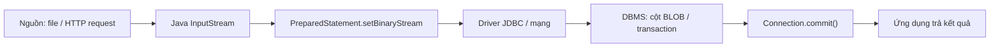
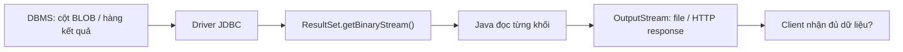

# Xử lý lỗi giữa chừng trong lúc truyền dữ liệu

> **Chương:** Dữ liệu lớn  
> **Ngữ cảnh:** Ứng dụng Java sử dụng **JDBC** với `DataSource`, `PreparedStatement`, `ResultSet` và transaction để ghi, đọc tệp hoặc tập kết quả lớn từ cơ sở dữ liệu quan hệ.

Một người dùng tải tệp 200 MB lên ứng dụng Java. Ở khoảng MB thứ 130, đường truyền tới cơ sở dữ liệu bị ngắt; hoặc dữ liệu được lưu vào database nhưng kết nối đứt ngay khi `commit()`. Trong chiều ngược lại, Java đang đọc `BLOB` bằng `ResultSet.getBinaryStream()` và đã ghi 40 MB vào HTTP response thì client ngắt kết nối. Những tình huống này khác nhau: lỗi có thể xuất hiện ở **nguồn đọc, driver JDBC, database hoặc đích ghi**, và mỗi vị trí dẫn tới quyết định rollback, retry và dọn tài nguyên khác nhau.

Bài học tập trung vào **phát hiện, khoanh vùng và xử lý lỗi giữa chừng trong luồng dữ liệu lớn**. Mục tiêu là giữ tính nhất quán của dữ liệu trong database, phân biệt dữ liệu đã commit với dữ liệu mới truyền một phần, tránh rò rỉ kết nối/stream, và không vô tình nhân đôi thao tác khi retry. Ví dụ chính dùng **MySQL 8.0.16+ với InnoDB** và Java 17+; API JDBC là tiêu chuẩn Java, còn mức độ streaming thật sự, kích thước gói, timeout và các tùy chọn driver phải kiểm tra trên môi trường triển khai.

## 1. Một luồng truyền dữ liệu có nhiều điểm có thể lỗi

Với chiều upload tệp:



Với chiều download:



Các điểm lỗi cần phân biệt:

| Vị trí lỗi | Dấu hiệu thường thấy | Câu hỏi phải trả lời |
|---|---|---|
| `InputStream` nguồn bị lỗi | `IOException` hoặc `SQLException` do driver bọc lỗi đọc nguồn | Database đã nhận được bao nhiêu? Transaction có còn hoạt động không? |
| Kết nối Java ↔ DBMS đứt | `SQLException`, SQLState nhóm kết nối nếu driver cung cấp | Statement có chạy hết chưa? Có thể rollback bằng connection này không? |
| Database từ chối dữ liệu | Ràng buộc, dữ liệu quá lớn, hết dung lượng hoặc timeout | Statement bị từ chối hay transaction đã ở trạng thái lỗi? |
| `ResultSet` / luồng BLOB lỗi khi đọc | `SQLException` khi lấy dữ liệu, `IOException` khi đọc stream | Đầu ra đã được ghi bao nhiêu byte trước khi lỗi? |
| `OutputStream` đích lỗi | `IOException`, ví dụ client đóng kết nối hoặc ổ đĩa đầy | Đích có bản sao chưa hoàn chỉnh cần xóa hoặc đánh dấu thất bại không? |
| `commit()` gặp lỗi | `SQLException` ngay tại ranh giới commit | Database đã commit nhưng phản hồi bị mất, hay transaction thật sự chưa commit? |
| `close()` / `rollback()` cũng lỗi | Suppressed exception hoặc lỗi cleanup riêng | Có đang che mất lỗi truyền dữ liệu ban đầu không? |

**Ba trạng thái không được đồng nhất:**

1. Java đã đọc hết nguồn.
2. Driver/database đã thực thi câu lệnh và trả kết quả.
3. Transaction đã được **commit** và bên nhận đã nhận **đủ** dữ liệu.

`executeUpdate()` thành công không đồng nghĩa transaction thủ công đã commit. Trong chiều download, `OutputStream.write()` trả về thành công cũng không chứng minh client ở xa đã nhận, lưu và xác thực toàn bộ tệp.

## 2. Các API JDBC dành cho dữ liệu lớn

| Chiều | API tiêu biểu | Điều kiện cần chú ý |
|---|---|---|
| Ghi nhị phân | `PreparedStatement.setBinaryStream(index, InputStream, longLength)` | Giữ stream mở đến khi driver sử dụng xong; chiều dài phải đúng |
| Ghi nhị phân không biết trước chiều dài | `setBinaryStream(index, InputStream)` | Hỗ trợ và cách xử lý bộ nhớ phụ thuộc driver |
| Ghi văn bản lớn | `setCharacterStream(index, Reader, longLength)` | Độ dài được hiểu theo **ký tự** theo API, không mặc nhiên theo byte UTF-8 |
| Đọc nhị phân | `ResultSet.getBinaryStream(column)` | Đọc khi `ResultSet`/`Statement`/`Connection` còn hiệu lực |
| Đọc văn bản | `ResultSet.getCharacterStream(column)` | Tránh chuyển toàn bộ CLOB thành một `String` khổng lồ |
| BLOB locator | `ResultSet.getBlob(column)` rồi `Blob.getBinaryStream()` | Phải quản lý vòng đời `Blob` và gọi `free()` khi thích hợp |
| Tập kết quả nhiều hàng | `setFetchSize(n)`, `TYPE_FORWARD_ONLY` | Fetch size thường là **gợi ý**; hỗ trợ cursor/streaming phụ thuộc driver và transaction |

**API trả stream không tự bảo đảm bộ nhớ O(1).** Một driver có thể buffer dữ liệu trước khi trả `InputStream` hoặc trong lúc truyền dữ liệu lên server. `setFetchSize(200)` chỉ liên quan đến số hàng driver gợi ý lấy theo lần, không có nghĩa một cột BLOB 200 MB sẽ được chia thành các gói ứng dụng 200 byte. Khi cần cam kết mức sử dụng bộ nhớ, hãy kiểm thử chính xác driver, cấu hình và kiểu cột thực tế.

### 2.1. Chiều dài khai báo phải là chiều dài thật

```java
long byteLength = Files.size(path);

try (InputStream source = Files.newInputStream(path);
     PreparedStatement ps = connection.prepareStatement(sql)) {

    ps.setBinaryStream(1, source, byteLength);
    ps.executeUpdate();
}
```

Với stream nhị phân, `byteLength` là **số byte**, không phải số ký tự hay số MB. Nếu khai báo nhỏ hơn nguồn, có thể dữ liệu bị bỏ phần cuối; nếu khai báo lớn hơn lượng byte thực sự đọc được, driver có thể báo lỗi hoặc xử lý khác tùy triển khai. **Không giả định driver sẽ luôn tự xác thực độ dài theo cách ứng dụng mong muốn.**

Nếu nguồn có thể thay đổi giữa `Files.size(path)` và lúc driver đọc stream, chiều dài đã đo có thể không còn đúng. Với hệ thống nhận file upload, hãy coi dữ liệu đã được đưa vào khu vực staging ổn định, được giới hạn kích thước và không bị thay đổi trong suốt quá trình lưu là một điều kiện của phép thử.

### 2.2. `InputStream` và `Reader` không tương đương

Văn bản “Tổng số: 42” có số ký tự khác số byte khi mã hóa UTF-8 vì tiếng Việt dùng nhiều byte cho một số ký tự. Không lấy `byte[].length` rồi truyền làm chiều dài cho `setCharacterStream(...)`. Với nội dung mà byte gốc có ý nghĩa (ảnh, PDF, file ZIP, dữ liệu mã hóa), sử dụng **nhị phân**. Với CLOB cần giữ ngữ nghĩa văn bản, dùng `Reader`/`getCharacterStream()`, lựa chọn charset và chuẩn hóa rõ ràng ở nơi chuyển đổi.

## 3. Quy tắc sở hữu stream, statement và connection

Mỗi tài nguyên cần có một chủ sở hữu rõ ràng:

| Tài nguyên | Ai mở trong ví dụ | Ai đóng |
|---|---|---|
| File `InputStream` đọc dữ liệu upload | DAO upload hoặc service staging | Thành phần mở file đó |
| `Connection` | Service/use case lấy từ `DataSource` | Service khi transaction kết thúc |
| `PreparedStatement` | DAO thực hiện SQL | DAO qua `try-with-resources` |
| `ResultSet` | DAO thực hiện `SELECT` | DAO qua `try-with-resources` |
| `InputStream` từ `ResultSet.getBinaryStream()` | DAO tải dữ liệu | Đóng trong khi result set còn mở, theo contract driver |
| HTTP `OutputStream` do framework cung cấp | HTTP framework | Framework hoặc tầng chủ response; DAO chỉ ghi và **không tự đóng** |
| File `OutputStream` tới tệp tạm | Tầng download file | Tầng mở file |

**Không đóng source stream trước `executeUpdate()`.** Phần lớn driver có thể đọc stream trong khi chạy statement; một số có thể trì hoãn việc tiêu thụ tới thời điểm thực thi. Dạng sau là sai:

```java
InputStream source;
try (InputStream file = Files.newInputStream(path)) {
    source = file;
}
ps.setBinaryStream(1, source, length);
ps.executeUpdate(); // Source đã đóng trước khi driver cần đọc.
```

Cũng không giữ `InputStream` trả về từ `ResultSet` sau khi đã đóng `ResultSet` hoặc chuyển cursor sang hàng khác nếu driver không bảo đảm stream tồn tại độc lập. Thực hành an toàn: **đọc xong stream của hàng hiện tại trước khi gọi `rs.next()`**, và chỉ đóng result set/statement/connection sau khi hoàn tất đọc.

`try-with-resources` tự đóng theo **thứ tự ngược** với lúc khai báo và giữ lỗi `close()` thành *suppressed exception* khi thân `try` đã ném lỗi. Nó giúp tránh che lỗi truyền dữ liệu ban đầu bằng lỗi dọn tài nguyên.

## 4. Chuẩn bị dữ liệu thử nghiệm MySQL

Sử dụng bảng `InnoDB` để transaction rollback được thay đổi SQL của upload:

```sql
CREATE TABLE stored_documents (
    document_id CHAR(36) PRIMARY KEY,
    file_name VARCHAR(255) NOT NULL,
    content_length BIGINT NOT NULL CHECK (content_length >= 0),
    sha256_hex CHAR(64) NOT NULL,
    content LONGBLOB NOT NULL,
    created_at TIMESTAMP NOT NULL DEFAULT CURRENT_TIMESTAMP
) ENGINE = InnoDB;
```

Mỗi hàng lưu:

- `document_id`: định danh do ứng dụng tạo và giữ **ổn định qua retry**.
- `file_name`: thông tin hiển thị, không dùng trực tiếp làm đường dẫn ghi file của server.
- `content_length`: chiều dài byte mà ứng dụng kỳ vọng.
- `sha256_hex`: giá trị SHA-256 của byte nguồn để đối soát toàn vẹn.
- `content`: dữ liệu nhị phân thực tế.

MySQL `LONGBLOB` có giới hạn kiểu dữ liệu rất lớn, nhưng **giới hạn thực tế** còn bị chi phối bởi `max_allowed_packet`, driver, RAM, disk, timeout, kích thước row/result và cấu hình server. Đừng suy ra có thể upload hàng GB qua một statement chỉ vì tên cột là `LONGBLOB`.

Ví dụ dùng MySQL **8.0.16+** vì ràng buộc `CHECK` được thực thi ở các phiên bản này. Khi kiểm thử một database khác, thay `LONGBLOB`, `SHA2` và câu SQL tương ứng theo dialect của DBMS.

### Đo byte ngay trong database

```sql
SELECT document_id,
       content_length,
       OCTET_LENGTH(content) AS stored_bytes,
       SHA2(content, 256) AS stored_sha256
FROM stored_documents
WHERE document_id = ?;
```

Trong MySQL, `OCTET_LENGTH(content)` cho số byte của BLOB; `SHA2(content, 256)` tính SHA-256 trên nội dung lưu. Hai phép kiểm này có thể phát hiện **nội dung lưu khác nguồn**. Chúng cũng buộc database xử lý dữ liệu BLOB và có thể tốn I/O/CPU với tệp lớn; cân nhắc chiến lược kiểm tra theo độ quan trọng dữ liệu, không gọi chúng vô điều kiện trên mọi request production mà chưa đo chi phí.

## 5. Upload an toàn qua JDBC: ghi, xác minh, rồi commit

Ví dụ sau coi `Path file` là **bản staging đã ổn định**, được lưu trên filesystem mà ứng dụng tin cậy. Đây là cách có thể replay khi gặp lỗi giữa chừng. Nếu chỉ có HTTP request body không thể đọc lại, muốn retry phải thiết kế staging hoặc giao thức upload phân đoạn riêng (mục 9).

Các bước:

1. Lấy kích thước và tính SHA-256 trên file staging trước khi mở transaction.
2. Lấy một `Connection`; đặt `autoCommit=false`.
3. Mở `InputStream`, bind bằng `setBinaryStream()` và gọi `executeUpdate()`.
4. Đóng stream và statement, sau đó (trong cùng transaction) đối chiếu byte length và hash đã được database lưu.
5. Chỉ gọi `commit()` sau khi các bước thành công; nếu một bước ném lỗi, rollback và giữ thông tin cleanup.

### 5.1. Mã Java có xử lý lỗi giữa chừng

```java
import java.io.IOException;
import java.io.InputStream;
import java.nio.file.Files;
import java.nio.file.Path;
import java.security.MessageDigest;
import java.security.NoSuchAlgorithmException;
import java.sql.Connection;
import java.sql.PreparedStatement;
import java.sql.ResultSet;
import java.sql.SQLException;
import java.util.HexFormat;
import java.util.Objects;
import java.util.UUID;
import javax.sql.DataSource;

public final class LargePayloadDao {
    private final DataSource dataSource;

    public LargePayloadDao(DataSource dataSource) {
        this.dataSource = Objects.requireNonNull(dataSource);
    }

    public void uploadFile(UUID documentId, Path file, String fileName)
            throws SQLException, IOException {
        Objects.requireNonNull(documentId);
        Objects.requireNonNull(file);
        Objects.requireNonNull(fileName);

        // File phải là snapshot ổn định; service xác thực đường dẫn
        // và giới hạn upload trước khi gọi phương thức này.
        long size = Files.size(file);
        String expectedSha = sha256File(file);

        String insertSql = """
            INSERT INTO stored_documents (
                document_id, file_name, content_length, sha256_hex, content
            ) VALUES (?, ?, ?, ?, ?)
            """;

        String verifySql = """
            SELECT OCTET_LENGTH(content) AS byte_count,
                   SHA2(content, 256) AS sha256
            FROM stored_documents
            WHERE document_id = ?
            """;

        try (Connection connection = dataSource.getConnection()) {
            if (!connection.getAutoCommit()) {
                throw new SQLException("Expected an idle connection");
            }

            connection.setAutoCommit(false);
            Throwable primaryFailure = null;
            boolean transactionEnded = false;

            try {
                // Stream còn mở trong suốt quá trình executeUpdate().
                try (InputStream input = Files.newInputStream(file);
                     PreparedStatement insert =
                         connection.prepareStatement(insertSql)) {

                    insert.setString(1, documentId.toString());
                    insert.setString(2, fileName);
                    insert.setLong(3, size);
                    insert.setString(4, expectedSha);
                    insert.setBinaryStream(5, input, size);

                    if (insert.executeUpdate() != 1) {
                        throw new SQLException("Insert affected != 1 row");
                    }
                }

                // Đọc trong cùng transaction, trước commit.
                try (PreparedStatement verify =
                         connection.prepareStatement(verifySql)) {
                    verify.setString(1, documentId.toString());

                    try (ResultSet rs = verify.executeQuery()) {
                        if (!rs.next()) {
                            throw new SQLException("Inserted row not found");
                        }

                        long storedSize = rs.getLong("byte_count");
                        String storedSha = rs.getString("sha256");

                        if (storedSize != size ||
                            !expectedSha.equalsIgnoreCase(storedSha)) {
                            throw new SQLException(
                                "Uploaded bytes differ from staging file"
                            );
                        }
                    }
                }

                connection.commit();
                transactionEnded = true;

            } catch (SQLException | IOException | RuntimeException failure) {
                primaryFailure = failure;

                try {
                    connection.rollback();
                    transactionEnded = true;
                } catch (SQLException rollbackFailure) {
                    failure.addSuppressed(rollbackFailure);
                }

                throw failure;

            } finally {
                // Không bật autoCommit=true nếu rollback chưa rõ kết quả:
                // việc đổi chế độ có thể commit transaction còn mở.
                if (transactionEnded) {
                    try {
                        connection.setAutoCommit(true);
                    } catch (SQLException resetFailure) {
                        if (primaryFailure != null) {
                            primaryFailure.addSuppressed(resetFailure);
                        } else {
                            throw resetFailure;
                        }
                    }
                }
            }
            // try-with-resources đóng/trả connection về pool.
        }
    }

    private static String sha256File(Path file) throws IOException {
        MessageDigest digest = newSha256();
        byte[] buffer = new byte[64 * 1024];

        try (InputStream input = Files.newInputStream(file)) {
            int count;
            while ((count = input.read(buffer)) != -1) {
                digest.update(buffer, 0, count);
            }
        }

        return HexFormat.of().formatHex(digest.digest());
    }

    private static MessageDigest newSha256() {
        try {
            return MessageDigest.getInstance("SHA-256");
        } catch (NoSuchAlgorithmException ex) {
            throw new IllegalStateException("SHA-256 unavailable", ex);
        }
    }
}
```

Cách gọi:

```java
UUID id = UUID.randomUUID();
Path stagingFile = Path.of("/staging/upload-123.bin");

// Giữ nguyên id nếu cần đối soát hoặc retry cùng một request.
LargePayloadDao dao = new LargePayloadDao(dataSource);
dao.uploadFile(id, stagingFile, "report.bin");
```

Đường dẫn trên chỉ là ví dụ; trong hệ thống thật, file staging được tạo và quản lý bởi ứng dụng, không sử dụng đường dẫn do người dùng đưa vào mà chưa xác thực. Đảm bảo file **không thay đổi trong lúc hash và upload**: ví dụ chuyển file đã nhận xong sang thư mục staging riêng, giới hạn quyền ghi, hoặc dùng snapshot phù hợp. Nếu file thay đổi, phép xác minh sau `INSERT` có thể phát hiện sai khác và rollback, nhưng staging bất biến vẫn là thiết kế tốt hơn.

**Ý nghĩa của phép xác minh:** mã chủ động kiểm tra `OCTET_LENGTH` và `SHA2` để tránh coi một `executeUpdate()` thành công là bằng chứng rằng database lưu đúng mọi byte. Đổi lại, server phải đọc nội dung để tính hash. Với luồng dữ liệu lớn thường xuyên, cân nhắc chiến lược tính hash khi nhận dữ liệu, các cơ chế xác thực gốc/đích và chi phí đọc lại trên database; lựa chọn phụ thuộc yêu cầu toàn vẹn và throughput.

### 5.2. Khi source stream lỗi trong lúc driver đọc

Có thể xảy ra hai đường exception:

- `Files.newInputStream()`/`InputStream.close()` ném **`IOException`** từ phía Java.
- `PreparedStatement.executeUpdate()` ném **`SQLException`** vì driver phát hiện lỗi khi đang đọc stream hoặc ghi lên database. Exception này có thể chứa nguyên nhân I/O bên dưới qua `getCause()` hoặc chuỗi lỗi driver.

Vì thế code bắt **cả `SQLException` và `IOException`**. Không giả định mọi lỗi đọc stream đều xuất hiện trực tiếp dưới dạng `IOException` ở điểm gọi `executeUpdate()`. Khi điều tra, xem `SQLException.getSQLState()`, `getNextException()`, `getCause()` và `getSuppressed()`.

Nếu connection còn dùng được, rollback để loại bỏ mọi thay đổi chưa commit. Nếu rollback cũng thất bại, giữ rollback failure dưới dạng suppressed và xem transaction là **chưa xác định trạng thái**. Không kết luận chắc chắn “database chưa có gì” chỉ vì Java thấy exception.

### 5.3. Những giới hạn của ví dụ

- Đoạn mã minh họa dùng **một statement** chèn BLOB vào bảng InnoDB và transaction do chính DAO này sở hữu. Trong use case có nhiều DAO, hãy chuyển quyền sở hữu connection/commit/rollback lên **service**, và để DAO chỉ nhận connection được cấp.
- File có thể vượt giới hạn gói/driver/server; việc chia `InputStream` thành buffer 64 KB ở Java không tự giải quyết giới hạn `max_allowed_packet` hoặc cơ chế truyền blob của driver.
- Nếu `connection.commit()` trả lỗi do mạng, có khả năng server đã commit. Lần retry phải dùng **cùng `documentId`**, kiểm tra row đã tồn tại và đối chiếu checksum/size trước khi quyết định gửi lại.
- Nếu `commit()` thành công nhưng `Connection.close()` thất bại, dữ liệu đã có thể được lưu đúng; lỗi cleanup **không chứng minh upload thất bại**.
- Các API của driver có thể buffer phần hoặc toàn bộ BLOB; muốn xác minh bộ nhớ thực tế, đo heap và I/O trong môi trường đại diện.

## 6. Download: dữ liệu đã gửi đi không thể rollback bằng JDBC

Khi đọc từ database rồi truyền sang file hoặc HTTP response, cần tách **rollback database** khỏi **đầu ra bên ngoài**. `Connection.rollback()` không xóa những byte đã được ghi vào `OutputStream`.

Ví dụ:

```text
DB BLOB (100 MB)
    │
    ├── 40 MB đọc thành công
    │
    ├── 40 MB ghi vào HTTP response
    │
    └── client ngắt mạng / OutputStream.write() ném IOException
           ↓
      HTTP response đã có dữ liệu một phần.
      JDBC rollback KHÔNG lấy lại 40 MB đó.
```

Mẫu đọc nên dùng một buffer có kích thước giới hạn, không tạo `byte[]` bằng đúng kích thước BLOB hoặc gọi `getBytes()` cho toàn bộ nội dung lớn.

### 6.1. Đọc từng khối, kiểm tra byte length và SHA-256

Thêm phương thức sau vào `LargePayloadDao` ở mục 5; dùng lại helper `newSha256()` đã định nghĩa:

```java
public void writeTo(UUID documentId, OutputStream destination)
        throws SQLException, IOException {
    Objects.requireNonNull(documentId);
    Objects.requireNonNull(destination);

    String sql = """
        SELECT content, content_length, sha256_hex
        FROM stored_documents
        WHERE document_id = ?
        """;

    try (Connection connection = dataSource.getConnection();
         PreparedStatement ps = connection.prepareStatement(sql)) {

        ps.setString(1, documentId.toString());

        try (ResultSet rs = ps.executeQuery()) {
            if (!rs.next()) {
                throw new java.io.FileNotFoundException(
                    "Document not found: " + documentId
                );
            }

            long expectedLength = rs.getLong("content_length");
            String expectedSha = rs.getString("sha256_hex");
            MessageDigest digest = newSha256();

            long written = 0;
            byte[] buffer = new byte[64 * 1024];

            // Đóng InputStream khi ResultSet còn mở.
            try (InputStream source = rs.getBinaryStream("content")) {
                if (source == null) {
                    throw new IOException("Unexpected SQL NULL content");
                }

                int count;
                while ((count = source.read(buffer)) != -1) {
                    destination.write(buffer, 0, count);
                    digest.update(buffer, 0, count);
                    written += count;
                }
            }

            String actualSha =
                HexFormat.of().formatHex(digest.digest());

            if (written != expectedLength ||
                !actualSha.equalsIgnoreCase(expectedSha)) {
                throw new IOException(
                    "Downloaded content failed integrity check"
                );
            }
        }
    }
    // Không đóng destination: caller/framework là chủ sở hữu.
}
```

Các import bổ sung của phương thức: `java.io.OutputStream` (những import khác đã có trong lớp ở mục 5). Phương thức đọc dữ liệu khi `ResultSet` và `Connection` còn mở, đóng stream sau khi đọc xong, nhưng **không đóng `destination`** vì đích có thể là response của HTTP framework.

Điểm cần hiểu: kiểm tra hash ở **cuối luồng** mới chứng minh nội dung đầy đủ. Nếu đã gửi byte lên socket rồi mới phát hiện mismatch, những byte đó có thể đã đến client; server không thể thu hồi. Một HTTP endpoint cần cân nhắc các chiến lược khác nhau:

- **Phát trực tiếp:** ít phải lưu tạm, thường giảm độ trễ bắt đầu truyền; nếu lỗi giữa chừng, kết nối có thể bị ngắt và client phải coi download thất bại.
- **Staging trước khi phát:** đọc đầy đủ và xác minh nội dung vào tệp tạm hoặc object staging, sau đó mới bắt đầu gửi cho client. Đổi lại cần đủ dung lượng, một lượt I/O bổ sung và quản lý vòng đời tệp tạm.
- **Giao thức có checksum phía client:** gửi checksum/length đáng tin cậy qua metadata và yêu cầu client chỉ xác nhận file hoàn tất sau khi đối chiếu. Server vẫn phải xử lý các lỗi truyền và retry theo giao thức.

**`writeTo()` là phương thức streaming tới destination, không bảo đảm đầu ra có tính nguyên tử.** Nó phù hợp khi caller biết xử lý destination bị ghi dở; ví dụ cần ghi file tải xuống để sử dụng nội bộ, ưu tiên ghi vào tệp tạm rồi chỉ công bố sau khi xác minh.

### 6.2. Ghi vào file tạm rồi công bố khi thành công

Ví dụ dùng `writeTo()` để tránh cho người dùng nhìn thấy **tệp đích chưa hoàn chỉnh**:

```java
import java.io.OutputStream;
import java.io.IOException;
import java.nio.file.Files;
import java.nio.file.Path;
import java.nio.file.StandardCopyOption;
import java.sql.SQLException;
import java.util.UUID;

void downloadToFile(
        LargePayloadDao dao,
        UUID documentId,
        Path target
) throws SQLException, IOException {

    Path finalPath = target.toAbsolutePath();
    Path directory = finalPath.getParent();

    // Tạo tệp tạm trong cùng directory để hỗ trợ atomic rename.
    Path temp = Files.createTempFile(
        directory, ".download-", ".part"
    );

    try {
        try (OutputStream output = Files.newOutputStream(temp)) {
            dao.writeTo(documentId, output);
        }

        // Chỉ công bố sau khi stream và checksum hoàn thành.
        Files.move(
            temp, finalPath,
            StandardCopyOption.ATOMIC_MOVE,
            StandardCopyOption.REPLACE_EXISTING
        );
    } finally {
        // Nếu truyền dữ liệu/rename thất bại, không để lại file .part.
        Files.deleteIfExists(temp);
    }
}
```

`ATOMIC_MOVE` có thể không được filesystem hỗ trợ; trong trường hợp đó `Files.move()` ném `AtomicMoveNotSupportedException`. Ứng dụng phải quyết định có chấp nhận cách công bố không nguyên tử hay báo lỗi và giữ nguyên file cũ; **không tự động bỏ kiểm tra**. Thư mục đích cần được kiểm soát quyền và dung lượng; không trực tiếp sử dụng path do client gửi khi chưa kiểm tra.

**Phân biệt hai tài nguyên:** `try-with-resources` đóng `OutputStream` là tệp tạm do hàm này tạo. `LargePayloadDao.writeTo()` chỉ ghi vào output đã được mượn và không đóng nó. Trật tự này cho phép đảm bảo tệp tạm đã đóng trước khi đổi tên.

## 7. Lỗi đọc tập kết quả lớn giữa chừng

Truyền dữ liệu lớn không chỉ là một cột BLOB. Một truy vấn trả hàng triệu hàng có thể làm lỗi khi đang gọi `ResultSet.next()` hoặc khi serialization ra CSV/JSON gặp `IOException`.

Ví dụ đọc nhiều hàng:

```java
String sql = """
    SELECT document_id, file_name, content_length
    FROM stored_documents
    ORDER BY document_id
    """;

try (Connection connection = dataSource.getConnection();
     PreparedStatement ps = connection.prepareStatement(
         sql,
         ResultSet.TYPE_FORWARD_ONLY,
         ResultSet.CONCUR_READ_ONLY
     )) {

    ps.setFetchSize(200);

    try (ResultSet rs = ps.executeQuery()) {
        while (rs.next()) {
            String id = rs.getString("document_id");
            long length = rs.getLong("content_length");

            // Ghi một dòng CSV/JSON qua writer có kiểm soát.
            // writer.write(...) có thể ném IOException.
        }
    }
}
```

`setFetchSize(200)` là một gợi ý JDBC cho số **hàng**; nó không bảo đảm driver không buffer toàn bộ kết quả. Ví dụ với **PostgreSQL JDBC**, cursor-based fetching thường yêu cầu `autoCommit=false`, `TYPE_FORWARD_ONLY` và fetch size dương để driver lấy từng nhóm hàng; phiên bản/cấu hình driver và SQL phải phù hợp. MySQL Connector/J có các cơ chế cấu hình khác, chẳng hạn cursor fetching theo driver, nên không bê nguyên điều kiện của PostgreSQL sang MySQL.

**Nếu stream nhiều hàng đứt giữa chừng:**

1. Ghi nhận hàng hoặc ID cuối **đã được xử lý thành công** ở đích, không chỉ hàng cuối đọc từ database.
2. Đóng `ResultSet`/`PreparedStatement`/`Connection` theo quyền sở hữu.
3. Đánh dấu kết quả xuất ra là chưa hoàn chỉnh; không coi phần dữ liệu đã gửi là một snapshot đủ.
4. Nếu cần tiếp tục, dùng giao thức hỗ trợ checkpoint và thứ tự ổn định, ví dụ **keyset pagination** với khóa duy nhất.
5. Đối với dữ liệu thay đổi trong khi export, phải chọn isolation/snapshot hoặc watermark phù hợp; chỉ tiếp tục bằng `WHERE id > lastId` có thể bỏ lỡ dữ liệu mới chèn hoặc dữ liệu bị đổi khóa theo điều kiện nghiệp vụ.

Giữ một server-side cursor mở hàng phút hoặc hàng giờ có thể tăng áp lực connection pool và giữ snapshot/lock tùy DBMS. Với export rất lớn, cân nhắc chia phiên đọc thành chunk có checkpoint, nhất quán dữ liệu theo mức yêu cầu và tách riêng quá trình phát cho client.

## 8. Phân biệt nguyên nhân lỗi với lỗi dọn tài nguyên

Khi lỗi giữa chừng, hoạt động dọn dẹp cũng có thể lỗi:

```text
executeUpdate() -> SQLException: connection reset
   ├─ rollback() -> SQLException: transaction status unavailable
   └─ close()    -> SQLException: failed to return connection
```

Nếu `rollback()` được gọi trực tiếp trong `catch` mà không xử lý lỗi của chính nó, nó có thể **che mất exception ban đầu**:

```java
// SAI: rollback() ném lỗi sẽ che original.
catch (SQLException original) {
    connection.rollback();
    throw original;
}
```

Giữ primary và bổ sung cleanup:

```java
catch (SQLException | IOException failure) {
    try {
        connection.rollback();
    } catch (SQLException rollbackFailure) {
        failure.addSuppressed(rollbackFailure);
    }
    throw failure;
}
```

`try-with-resources` xử lý lỗi `close()` bằng cơ chế suppressed khi đã có exception chính. Với `SQLException`, giữ `SQLState`, mã lỗi vendor, `getNextException()`, `getCause()` và `getSuppressed()` khi log. Không chỉ log `ex.getMessage()` hoặc tạo exception mới làm mất cause.

Ví dụ in thông tin lỗi:

```java
static void reportFailure(Throwable failure) {
    System.err.println("Primary: " + failure);

    if (failure instanceof SQLException sql) {
        System.err.printf(
            "SQLState=%s vendorCode=%d%n",
            sql.getSQLState(), sql.getErrorCode()
        );
        for (SQLException next = sql.getNextException();
             next != null;
             next = next.getNextException()) {
            System.err.println("Linked SQL error: " + next);
        }
    }

    for (Throwable suppressed : failure.getSuppressed()) {
        System.err.println("Cleanup failure: " + suppressed);
    }

    if (failure.getCause() != null) {
        System.err.println("Cause: " + failure.getCause());
    }
}
```

Đây là helper minh họa; code production nên giới hạn độ dài log/cây exception và tránh ghi token, dữ liệu người dùng hoặc byte của file vào log.

**Đừng tự kết luận lỗi `close()` nghĩa upload chưa commit.** Nếu `commit()` đã trả về thành công trước đó, lỗi khi close là một lỗi khác. Nếu lỗi nằm ở `commit()` hoặc đứt kết nối ở sát thời điểm đó, trạng thái database có thể không rõ và cần đối soát.

## 9. Retry và tiếp tục upload: phải phân biệt thao tác lặp lại được hay không

Có ba nguồn dữ liệu upload thông dụng:

| Nguồn | Có thể đọc lại từ đầu? | Chiến lược khi lỗi |
|---|---|---|
| File staging bất biến trên disk | Có, nếu file vẫn tồn tại và không đổi | Mở `InputStream` mới, dùng cùng ID yêu cầu, đối soát trạng thái trước khi gửi lại |
| `ByteArrayInputStream` với byte[] đã giữ trong RAM | Có | Chỉ phù hợp với dữ liệu có giới hạn; không nên giữ payload quá lớn trong heap |
| HTTP request body đang chảy trực tiếp | Thường không | Không thể “rewind” tùy ý; cần client gửi lại hoặc upload protocol có staging/chunk |
| Stream từ nguồn bên ngoài | Phụ thuộc API của nguồn | Cần offset/resume token, kiểm tra toàn vẹn hoặc lưu tạm có quota |

### 9.1. Không tái sử dụng stream đã đọc dở

`InputStream` thường có trạng thái vị trí đọc. Sau khi driver đọc 130 MB rồi ném lỗi, **không thể gọi lại `executeUpdate()` với cùng object stream và mong nó tự quay về byte đầu tiên**. Ngay cả `mark/reset` cũng không được hỗ trợ bởi mọi stream; `markSupported()` có thể là `false`, và giới hạn `readlimit` có thể không phù hợp tệp lớn.

Muốn retry từ đầu, cần **nguồn replayable**: mở lại file staging bất biến, yêu cầu client gửi lại đầy đủ, hoặc dùng giao thức upload phân đoạn.

### 9.2. Retry sau khi không rõ `commit()`

Giả sử database đã nhận đủ BLOB và commit, nhưng phản hồi về Java bị mất. Client chỉ thấy timeout. Nếu lần retry **tạo `document_id` mới**, database có thể chứa hai bản sao dù người dùng chỉ gửi một yêu cầu.

Quy trình có kiểm soát:

1. Gắn **ID yêu cầu/ID tài liệu ổn định** ngay khi nhận upload; lưu cùng checksum và kích thước nguồn đã xác định.
2. Khi gặp lỗi sau hoặc gần `commit()`, dùng connection mới tra cứu `document_id`.
3. Nếu hàng tồn tại và checksum/length khớp, coi đây là kết quả đã lưu của cùng yêu cầu theo hợp đồng idempotency.
4. Nếu hàng tồn tại nhưng nội dung/metadata khác, báo xung đột, **không tự ghi đè**.
5. Nếu chưa thấy hàng, quyết định retry từ đầu với nguồn replayable và **cùng ID**. Trạng thái “chưa thấy” cần đánh giá theo isolation và khả năng transaction trước vẫn đang xử lý; cần timeout/reconciliation phù hợp.

`PRIMARY KEY (document_id)` ngăn cùng ID tạo hai hàng, nhưng **không đủ** để nhận diện mọi request trùng nhau khi client tạo ID khác. Hệ thống thực tế nên có idempotency key của request hoặc cơ chế mapping riêng.

### 9.3. Upload phân đoạn muốn resume phải có giao thức riêng

Một JDBC `setBinaryStream()` không tự cung cấp offset/resume khi đường truyền giữa client và server bị mất. Muốn nhận file hàng GB theo từng phần, ứng dụng có thể thiết kế:

```text
upload_id
  ├─ part 0 (offset 0, length, checksum)
  ├─ part 1 (offset N, length, checksum)
  ├─ part 2 (...)
  └─ finalize (xác minh đủ part + checksum toàn file)
```

Các chunk có thể được staging trên filesystem/object storage hoặc bảng riêng. Mỗi part cần có ID và offset duy nhất, giới hạn kích thước, checksum và trạng thái hoàn tất. Sau khi đủ part, tiến hành **finalize** để công bố một tài liệu hoàn chỉnh. Nếu chunk được commit riêng, rollback của transaction cuối **không xóa các chunk đã commit trước đó**; cần trạng thái `UPLOADING`/`COMPLETE`, quy trình cleanup của upload bỏ dở và quy tắc idempotency.

Không mặc định nối BLOB bằng một vòng `UPDATE content = CONCAT(content, ?)` là giải pháp tối ưu: nó có thể buộc DBMS đọc/ghi lại giá trị lớn qua nhiều lần, tạo áp lực transaction log và làm tăng độ trễ. So sánh lưu LOB trong database với object storage tùy khả năng mở rộng và yêu cầu toàn vẹn thực tế.

## 10. Kiểm soát timeout, bộ nhớ và backpressure

Lỗi giữa chừng thường đến từ giới hạn vận hành chứ không chỉ code:

- **`PreparedStatement.setQueryTimeout(seconds)`:** có thể yêu cầu driver áp giới hạn thời gian thực thi SQL. Cơ chế hủy statement và trạng thái transaction khi timeout phụ thuộc driver/DBMS; timeout không thay thế rollback và reconciliation.
- **Network/socket timeout:** tránh giữ connection bị treo vô hạn. Khi network timeout, kết quả statement/commit có thể không rõ; xử lý theo cách bảo thủ.
- **Kích thước packet/server:** với MySQL cần xem `max_allowed_packet` và các giới hạn cột/statement; tránh chỉ tăng packet lên rất lớn mà không cân nhắc tiêu thụ RAM.
- **Heap Java:** tránh `Files.readAllBytes()` hay `ResultSet.getBytes()` trên payload hàng trăm MB nếu không có giới hạn và lý do cụ thể.
- **Connection pool:** một stream lớn giữ connection lâu; định mức số luồng song song, timeout, hàng đợi và throughput để tránh làm cạn pool.
- **Backpressure:** nếu đích ghi chậm, luồng đọc từ database có thể giữ connection lâu. Với HTTP download, cần cơ chế hủy và đóng tài nguyên khi client disconnect.
- **Giới hạn đầu vào:** xác nhận Content-Length nếu có, nhưng **không tin tuyệt đối** header từ client; đếm byte thực nhận, áp quota và chống upload vô hạn.
- **Đồng thời:** nhiều upload lớn cùng lúc có thể gây áp lực disk, redo log, replication và bandwidth; nên đo dưới tải đại diện thay vì đo một upload đơn.

Một buffer `64 KiB` trong Java giúp giới hạn **bộ nhớ do vòng lặp Java kiểm soát**, nhưng không chứng minh driver/database hay HTTP framework không buffer thêm. Các phép đo cần bao gồm heap, native memory nếu có, disk spill, latency, connection occupancy và CPU dùng để hash.

## 11. Ma trận xử lý khi truyền lỗi

| Lỗi xảy ra ở đâu? | Nguồn/dữ liệu nào còn đáng tin? | Hành động ưu tiên |
|---|---|---|
| Client ngắt giữa upload trước khi tạo SQL | File staging chưa hoàn chỉnh | Xóa/đánh dấu upload dở; không đưa vào bảng tài liệu hoàn chỉnh |
| `InputStream` lỗi khi driver gửi BLOB | Số byte đã tới database không rõ | Bắt IOException/SQLException; rollback nếu connection còn hoạt động; không commit |
| DBMS từ chối vì packet/constraint/space | Statement không đạt yêu cầu | Rollback transaction; ghi SQLState/vendor code; kiểm tra quota và cấu hình |
| Driver báo `executeUpdate()` thành công, checksum DB lệch | Hàng đang nằm trong transaction nhưng không đạt toàn vẹn | Ném lỗi, rollback và kiểm tra nguồn staging |
| `commit()` timeout hoặc mất kết nối | Kết quả lưu trên DB có thể chưa rõ | Dùng ID ổn định để đối soát trên connection mới trước khi retry |
| `ResultSet.getBinaryStream()`/`read()` lỗi | Destination có thể đã chứa một phần | Đóng JDBC resources; đánh dấu download hỏng; xóa file tạm nếu dùng |
| HTTP `OutputStream.write()` lỗi | Byte trước đó có thể đã rời server | Dừng đọc, đóng resource, không cố gửi JSON lỗi trong response đã bắt đầu |
| File output đầy hoặc `close()` lỗi | Tệp tạm không nên được công bố | Giữ nguyên file đích, xóa file tạm theo chính sách và báo lỗi |
| Rollback/close lỗi sau lỗi chính | Trạng thái connection đáng nghi | Giữ lỗi ban đầu, đính kèm suppressed; để pool loại bỏ/reset connection lỗi |

**Không có một câu lệnh `rollback()` nào hoàn tác đồng thời database, filesystem tạm, HTTP response đã gửi và hệ thống bên ngoài.** Các tài nguyên ngoài database cần cleanup/reconciliation riêng, hoặc thiết kế trạng thái để chỉ công bố dữ liệu khi hoàn chỉnh.

## 12. Kiểm thử lỗi giữa chừng theo từng lớp

Kiểm thử cần xác nhận cả **kết quả dữ liệu** lẫn **quyền sở hữu tài nguyên**. Một mock `PreparedStatement` có thể giúp kiểm tra logic xử lý exception nhưng không chứng minh driver thực sự truyền BLOB từng phần hoặc database rollback đúng.

| Kịch bản | Cách tạo lỗi ở môi trường thử nghiệm | Điều cần xác nhận |
|---|---|---|
| Upload bình thường | File bất biến kích thước nhỏ và lớn | Byte length/hash khớp, chỉ một hàng được commit |
| Source lỗi sau N byte | `InputStream` thử nghiệm ném `IOException` sau N byte | Service/DAO không commit; lỗi được giữ, resource đóng |
| Stream không đủ chiều dài đã khai báo | Stream kết thúc sớm | Driver/cơ chế xác minh phát hiện sai lệch; không công bố tài liệu hỏng |
| Server từ chối payload lớn | Hạn mức packet/test configuration được kiểm soát | `SQLException` được log, rollback và không retry vô hạn |
| Constraint violation sau khi đọc stream | Cố chèn trùng `document_id` | Không có bản sao mới; xác minh nội dung cũ khi retry |
| Database disconnect giữa statement | Môi trường mạng test/chaos control | Bắt SQLException, đóng tài nguyên, đối soát state |
| Mất phản hồi quanh commit | Fault injection trên mạng hoặc wrapper có kiểm soát | Không tạo hai tài liệu; ID/idempotency ổn định |
| HTTP client disconnect khi tải | `OutputStream` thử nghiệm ném `IOException` sau N byte | DAO đóng ResultSet/statement/connection; không báo file hoàn chỉnh |
| Output file đầy | `OutputStream` thử nghiệm fail trong `write()` | Tệp đích chưa công bố, tệp tạm dọn phù hợp |
| Lỗi khi `close()` | Test `AutoCloseable` ném lỗi khi đóng | Lỗi body giữ làm primary, close nằm trong `getSuppressed()` |
| Nhiều hàng lớn | Query với cursor/fetch size trên driver thật | Bộ nhớ, thời gian giữ connection và checkpoint đạt mục tiêu |

### Mô phỏng `InputStream` lỗi sau một số byte

Dưới đây là ví dụ Java nhỏ, độc lập với database, để tạo nguồn ném `IOException` giữa chừng:

```java
import java.io.FilterInputStream;
import java.io.IOException;
import java.io.InputStream;

final class FailAfterInputStream extends FilterInputStream {
    private long remaining;

    FailAfterInputStream(InputStream delegate, long goodBytes) {
        super(delegate);
        this.remaining = goodBytes;
    }

    @Override
    public int read() throws IOException {
        if (remaining <= 0) {
            throw new IOException("Injected source failure");
        }

        int value = super.read();
        if (value != -1) {
            remaining--;
        }
        return value;
    }

    @Override
    public int read(byte[] buffer, int offset, int length)
            throws IOException {
        if (length == 0) {
            return 0;
        }
        if (remaining <= 0) {
            throw new IOException("Injected source failure");
        }

        int allowed = (int) Math.min((long) length, remaining);
        int count = super.read(buffer, offset, allowed);

        if (count > 0) {
            remaining -= count;
        }
        return count;
    }
}
```

Ví dụ sử dụng để thử logic:

```java
try (InputStream source = new FailAfterInputStream(
        Files.newInputStream(stagingFile), 1024 * 1024L)) {

    // Dùng source làm đầu vào setBinaryStream(...).
    // Dữ liệu đọc quá 1 MiB sẽ phát sinh lỗi có chủ đích.
}
```

Đây là *test double* cho kiểm thử, không dùng trong upload bình thường. Driver có thể chuyển lỗi đọc stream thành `SQLException`; test cần chấp nhận cơ chế báo lỗi thực tế nhưng vẫn kiểm tra **transaction không được commit khi việc truyền chưa hoàn chỉnh** và resource đã đóng.

Để kiểm thử download, tạo một `OutputStream` test từ chối `write()` sau N byte. Sau lỗi, xác nhận vòng đọc dừng, `ResultSet` và `Connection` được đóng/hoàn trả về pool, và file/response không bị đánh dấu hoàn tất.

## 13. Bài thực hành

1. **Chuẩn bị:** tạo `stored_documents` trên MySQL 8.0.16+/InnoDB. Dùng một file staging nhỏ để chạy `uploadFile()` và truy vấn `OCTET_LENGTH(content)`/`SHA2(content,256)`, đối chiếu với Java.
2. **Phân biệt lỗi giữa chừng:** dùng `FailAfterInputStream` để gây lỗi sau một số byte khi driver đang đọc. Ghi nhận exception gốc, SQLState/cause nếu có, suppressed exception và trạng thái bảng sau rollback.
3. **Kiểm thử stream không replayable:** thử gọi lại trên cùng `InputStream` đã đọc dở và giải thích vì sao không thể coi đó là retry từ đầu. Thiết kế cách mở nguồn mới từ staging.
4. **Mô phỏng output lỗi:** gọi `writeTo()` với một `OutputStream` bị fail sau 1 MiB. Xác định byte nào có thể đã ghi và lý do `Connection.rollback()` không thu hồi chúng.
5. **Ghi tệp an toàn:** triển khai `downloadToFile()` bằng tệp tạm, checksum, kiểm tra chiều dài và atomic rename. Gây lỗi trước khi rename để chứng minh file đích không bị thay thế bằng file dở.
6. **Xử lý commit không rõ kết quả:** tạo ID tài liệu ổn định, giả lập mất phản hồi ở cuối upload; mô tả quy trình tra cứu bằng ID và hash/size trước khi retry.
7. **Kiểm thử dữ liệu lớn:** upload/download một tệp vài trăm MB trong môi trường thử nghiệm; đo heap, thời gian giữ connection, throughput, CPU hash và memory của database/driver. So sánh với cách `Files.readAllBytes()`.
8. **Thiết kế chunk/resume:** vẽ schema upload_id, part_no, offset, checksum, trạng thái `UPLOADING`/`COMPLETE` và quy trình dọn chunk bỏ dở. Chỉ ra thao tác nào thuộc transaction database và dữ liệu nào vẫn có thể tồn tại sau rollback.
9. **So sánh CLOB/BLOB:** giải thích vì sao `setCharacterStream(..., length)` phải dùng độ dài ký tự, còn `setBinaryStream(..., length)` dùng byte; thử dữ liệu tiếng Việt UTF-8 để thấy khác biệt.

**Tiêu chí hoàn thành:** người học xác định được lỗi xảy ra ở nguồn, JDBC/DBMS hay đích trong quá trình truyền dữ liệu lớn; quản lý đúng vòng đời stream, statement, result set và connection; chủ động rollback trước commit, đối soát khi commit không rõ kết quả; kiểm tra kích thước/checksum; xử lý file/HTTP output bị ghi một phần; và thiết kế retry hoặc resume tránh dữ liệu trùng, thiếu hay bị công bố khi chưa hoàn chỉnh.
