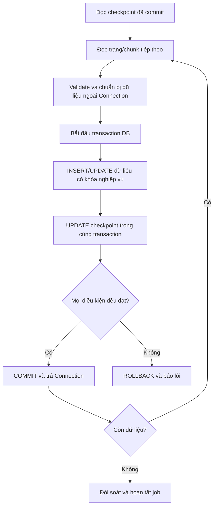
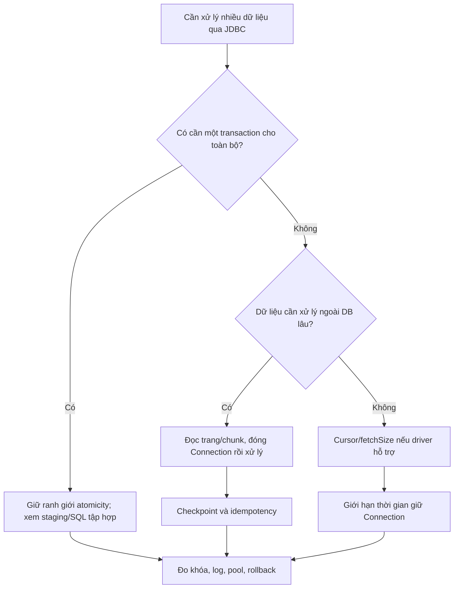

# Phối hợp dữ liệu lớn với giao dịch và thời gian giữ kết nối

Khi ứng dụng Java xử lý hàng trăm nghìn bản ghi, tệp lớn hoặc dữ liệu nhị phân qua **JDBC**, vấn đề không chỉ nằm ở tốc độ truy vấn. Một vòng lặp đọc dữ liệu kéo dài có thể chiếm `Connection` trong nhiều phút; một giao dịch ghi hàng triệu dòng có thể giữ khóa lâu, tạo lượng transaction log lớn và làm cạn kết nối trong pool. Ngược lại, chia công việc thành nhiều phần mà không quản lý checkpoint có thể dẫn đến thiếu hoặc trùng dữ liệu sau sự cố.

Trong chương **Dữ liệu lớn** của module JDBC, bài này tập trung vào sự phối hợp giữa **cách lấy dữ liệu**, **ranh giới transaction**, **thời gian giữ kết nối** và **khả năng khôi phục công việc**. Các kỹ thuật sử dụng API chuẩn như `DataSource`, `Connection`, `PreparedStatement`, `ResultSet`, `setFetchSize()`, `executeBatch()`, `commit()` và `rollback()`; đồng thời chỉ rõ những khác biệt cần kiểm chứng trên driver và hệ quản trị cơ sở dữ liệu (DBMS).

## 1. Phân biệt ba khoảng thời gian

Ba khái niệm sau liên quan nhưng không giống nhau:

| Khái niệm | Bắt đầu khi nào? | Kết thúc khi nào? | Rủi ro nếu quá dài |
| --- | --- | --- | --- |
| **Thời gian giữ kết nối** (*connection hold time*) | Ứng dụng mượn `Connection` từ `DataSource`/pool. | `Connection.close()`, thường là trả kết nối về pool. | Cạn pool; request khác phải chờ kết nối. |
| **Thời gian transaction** | Một giao dịch DB bắt đầu theo chế độ auto-commit và quy tắc DBMS. | `commit` hoặc `rollback` (hoặc hoàn tất statement trong auto-commit). | Khóa/phiên bản dữ liệu cũ, áp lực log, khó phục hồi khi lỗi. |
| **Thời gian sử dụng ResultSet/cursor** | Thực thi truy vấn và bắt đầu lấy kết quả. | Đọc xong hoặc đóng `ResultSet`/`Statement`. | Giữ tài nguyên driver/server, bộ nhớ và thường cả kết nối; đôi khi giữ transaction. |

Ví dụ dễ gặp:

```text
Mượn Connection
    │
    ├── SELECT hàng triệu bản ghi
    │      └── for (rs.next()) {
    │             gọi HTTP API; xử lý ảnh; ghi file từ xa
    │          }
    │
    └── close Connection

=> Một request giữ kết nối DB trong suốt thời gian chờ HTTP/I/O.
```

Ngay cả khi truy vấn SQL chỉ chạy nhanh, việc đọc `ResultSet` chậm hoặc giữ connection trong lúc chờ dịch vụ khác vẫn khiến pool bị chiếm. Khi `autoCommit=false`, transaction có thể mở trong toàn bộ thời gian đó; hành vi khóa và giữ snapshot tùy DBMS.

**Nguyên tắc nền tảng:** mượn `Connection` **muộn nhất có thể**, hoàn tất công việc DB **sớm nhất có thể**, rồi trả kết nối **trước khi** thực hiện những bước CPU/I/O độc lập với DB. Nhưng không hy sinh tính nguyên tử của nghiệp vụ chỉ để giảm thời gian giao dịch: những SQL bắt buộc thành công cùng nhau vẫn phải được đặt trong một transaction phù hợp.

## 2. Chọn mô hình đọc: gom toàn bộ, cursor hay phân trang

| Mô hình | Ưu điểm | Chi phí và điều kiện phù hợp |
| --- | --- | --- |
| `rs.next()` rồi thêm tất cả vào một `List` | Đơn giản; giải phóng kết nối sau khi đọc xong. | Dễ tràn heap nếu số hàng hoặc kích thước một hàng lớn. Chỉ phù hợp dữ liệu đã có giới hạn rõ ràng. |
| Duyệt `ResultSet` theo luồng với `setFetchSize` | Giảm lượng dữ liệu được nạp vào bộ nhớ nếu driver thực sự áp dụng fetch theo từng đợt. | `ResultSet` và `Connection` phải còn mở suốt vòng lặp; cursor có thể giữ transaction/snapshot lâu. |
| **Phân trang keyset** theo khóa đã sắp xếp | Mỗi lần chỉ giữ kết nối khi đọc một trang nhỏ, sau đó đóng và xử lý ngoài DB. | Nhiều câu truy vấn hơn; cần khóa sắp xếp ổn định, checkpoint và hiểu dữ liệu có thể thay đổi giữa các trang. |
| Đọc/ghi qua công cụ bulk hoặc staging của DBMS | Có thể tối ưu nạp/xuất lượng lớn theo công cụ của DBMS. | Phụ thuộc driver, DBMS, định dạng, quyền và ngữ nghĩa transaction riêng. |

Không có kỹ thuật duy nhất tốt nhất. Nếu cần xử lý vài triệu bản ghi với các lời gọi API bên ngoài, **phân trang và trả connection giữa các trang** thường an toàn vận hành hơn giữ một cursor mở đến hết công việc. Nếu chỉ cần chạy một phép tổng hợp, nên để DBMS thực thi `COUNT`/`SUM`/`GROUP BY` thay vì chuyển toàn bộ hàng về Java.

### Vì sao OFFSET lớn thường là lựa chọn kém?

Kiểu phân trang:

```sql
SELECT id, amount
FROM ledger_events
ORDER BY id
OFFSET 500000 ROWS FETCH NEXT 200 ROWS ONLY;
```

có thể buộc DBMS bỏ qua lượng lớn hàng trước khi trả một trang. Khi có thêm/xóa dữ liệu giữa các trang, vị trí tương đối thay đổi và có thể gây đọc lặp hoặc bỏ sót bản ghi. Cú pháp `OFFSET`/`FETCH` cũng khác nhau giữa các DBMS.

Phân trang theo khóa (*keyset pagination*) dựa trên giá trị cuối trang trước:

```sql
SELECT id, amount
FROM ledger_events
WHERE id > ?
ORDER BY id;
```

Phương án này dùng chỉ mục trên `id` hiệu quả hơn trong nhiều tình huống, nhưng cần giới hạn kích thước trang bằng cú pháp `FETCH FIRST`/`LIMIT`/`TOP` tương ứng DBMS hoặc bằng `Statement.setMaxRows(...)`; giới hạn phía JDBC không đảm bảo DBMS tự động tối ưu việc quét dữ liệu như mệnh đề giới hạn phía SQL.

## 3. Ví dụ đọc từng trang: đóng Connection trước khi xử lý lâu

Giả sử bảng sự kiện có lược đồ minh họa:

```sql
CREATE TABLE ledger_events (
    id BIGINT PRIMARY KEY,
    event_code VARCHAR(100) NOT NULL,
    amount DECIMAL(18, 2) NOT NULL
);
```

Lớp sau chỉ đọc **một trang hữu hạn**. Khi phương thức trả `List`, `ResultSet`, `PreparedStatement` và `Connection` đã được đóng. Việc gửi dữ liệu đến API hoặc tạo báo cáo có thể thực hiện **sau đó**, không chiếm kết nối DB.

```java
import java.math.BigDecimal;
import java.sql.Connection;
import java.sql.PreparedStatement;
import java.sql.ResultSet;
import java.sql.SQLException;
import java.util.ArrayList;
import java.util.List;
import java.util.Objects;
import javax.sql.DataSource;

public final class EventPageReader {
    private final DataSource dataSource;

    public EventPageReader(DataSource dataSource) {
        this.dataSource = Objects.requireNonNull(dataSource);
    }

    public long highestIdAtStart() throws SQLException {
        String sql = "SELECT COALESCE(MAX(id), 0) FROM ledger_events";
        try (Connection connection = dataSource.getConnection();
             PreparedStatement ps = connection.prepareStatement(sql);
             ResultSet rs = ps.executeQuery()) {
            return rs.next() ? rs.getLong(1) : 0L;
        }
    }

    public List<Event> readAfter(long lastId, long upperId, int pageSize)
            throws SQLException {
        if (lastId < 0 || upperId < lastId
                || pageSize <= 0 || pageSize > 1000) {
            throw new IllegalArgumentException("Phạm vi trang không hợp lệ");
        }

        String sql = "SELECT id, event_code, amount "
                   + "FROM ledger_events "
                   + "WHERE id > ? AND id <= ? ORDER BY id";

        List<Event> page = new ArrayList<>(pageSize);
        try (Connection connection = dataSource.getConnection();
             PreparedStatement ps = connection.prepareStatement(
                     sql, ResultSet.TYPE_FORWARD_ONLY,
                     ResultSet.CONCUR_READ_ONLY)) {
            ps.setLong(1, lastId);
            ps.setLong(2, upperId);
            ps.setMaxRows(pageSize);  // Giới hạn kết quả theo JDBC.
            ps.setFetchSize(Math.min(pageSize, 200)); // Chỉ là gợi ý.
            ps.setQueryTimeout(30);  // Giây; driver có thể giới hạn hỗ trợ.

            try (ResultSet rs = ps.executeQuery()) {
                while (rs.next()) {
                    page.add(new Event(
                            rs.getLong("id"),
                            rs.getString("event_code"),
                            rs.getBigDecimal("amount")));
                }
            }
        }
        return page;
    }

    public static final class Event {
        public final long id;
        public final String code;
        public final BigDecimal amount;

        public Event(long id, String code, BigDecimal amount) {
            this.id = id;
            this.code = Objects.requireNonNull(code);
            this.amount = Objects.requireNonNull(amount);
        }
    }
}
```

Một đoạn điều phối minh họa:

```java
EventPageReader reader = new EventPageReader(dataSource);
long lastId = 0;
long upperId = reader.highestIdAtStart();

while (lastId < upperId) {
    List<EventPageReader.Event> page =
            reader.readAfter(lastId, upperId, 200);
    if (page.isEmpty()) {
        break;
    }

    // Thực hiện xử lý tốn thời gian sau khi Connection đã đóng.
    for (EventPageReader.Event event : page) {
        processEvent(event); // Xem phần checkpoint/idempotency bên dưới.
    }
    lastId = page.get(page.size() - 1).id;
}
```

Đoạn điều phối là **minh họa thuật toán** cho khóa `id` nguyên dương, trong đó `highestIdAtStart()` lấy giới hạn trên ở đầu job và `processEvent(...)` là logic nghiệp vụ do ứng dụng cung cấp. Không lưu `lastId` vào checkpoint bền vững nếu trang chưa xử lý xong thành công. Nếu ID có thể âm hoặc nguồn không tuân theo thứ tự tăng, cần chọn khóa/checkpoint khác phù hợp.

**Điểm mạnh:** mỗi lần đọc xong một trang, kết nối được trả pool. Các bước xử lý bên ngoài không cần giữ một transaction JDBC mở. Kích thước trang được giới hạn nên bộ nhớ cũng bị chặn theo số hàng (trong ví dụ, các cột đều là dữ liệu kích thước vừa phải).

**Giới hạn rất quan trọng:** khóa `id` tăng dần và `upperId` giúp giới hạn phạm vi tại thời điểm bắt đầu, nhưng **không bảo đảm snapshot nhất quán** qua nhiều transaction. Một bản ghi có `id <= upperId` vẫn có thể bị sửa hoặc xóa giữa các trang; hàng mới có ID nhỏ được chèn muộn có thể bị bỏ sót. Muốn ảnh chụp ổn định, cần cơ chế nhất quán của DBMS (snapshot/export), cột trạng thái bất biến, hoặc đưa danh sách ID/đầu vào vào staging ở một thời điểm xác định. Không đánh đổi tính đúng đắn của job chỉ bằng cách chọn keyset.

## 4. Khi cần stream một ResultSet lớn

JDBC cung cấp `Statement.setFetchSize(int rows)` và `ResultSet.setFetchSize(int rows)` để **gợi ý** số hàng driver nên lấy mỗi đợt:

```java
try (Connection connection = dataSource.getConnection();
     PreparedStatement ps = connection.prepareStatement(
             "SELECT id, event_code FROM ledger_events ORDER BY id",
             ResultSet.TYPE_FORWARD_ONLY,
             ResultSet.CONCUR_READ_ONLY)) {

    ps.setFetchSize(500); // Hint, không phải giới hạn tổng số hàng.
    try (ResultSet rs = ps.executeQuery()) {
        while (rs.next()) {
            long id = rs.getLong(1);
            String code = rs.getString(2);
            // Chỉ xử lý nhanh, không chờ HTTP hay thao tác từ xa.
        }
    }
}
```

**Phân biệt `fetchSize` và `maxRows`:**

| API | Mục đích |
| --- | --- |
| `setFetchSize(500)` | Gợi ý driver lấy nhiều hàng theo từng đợt, **không giới hạn số hàng toàn bộ**. |
| `setMaxRows(500)` | Giới hạn tối đa số hàng `ResultSet` có thể chứa, **không đồng nghĩa driver chỉ đọc 500 hàng từ server**. |
| `setQueryTimeout(30)` | Yêu cầu giới hạn thời gian thực thi statement theo driver; **không phải bảo đảm thời hạn tuyệt đối cho toàn job**. |

Hành vi stream phụ thuộc driver/DBMS:

- **PostgreSQL JDBC:** cơ chế cursor theo `fetchSize > 0` thường cần `autoCommit=false` cùng các điều kiện khác của driver. Khi đó transaction đọc có thể kéo dài suốt quá trình tiêu thụ cursor và giữ snapshot lâu. Nếu bật lại auto-commit, driver có thể nạp kết quả theo cách khác; phải kiểm tra tài liệu của đúng phiên bản driver.
- **MySQL Connector/J:** có các chế độ truy xuất theo luồng và cursor với tùy chọn driver riêng; không suy luận rằng `setFetchSize(500)` luôn kích hoạt cơ chế cursor giống PostgreSQL.
- **Các driver khác:** có thể nạp trước nhiều dữ liệu hoặc bỏ qua hint. Chỉ đo bộ nhớ thực, mạng và hành vi server trên môi trường triển khai mới xác nhận cơ chế stream.

Trong một vòng lặp `ResultSet`, tuyệt đối tránh các thao tác chờ dài không liên quan trực tiếp đến DB, đặc biệt là yêu cầu HTTP đồng bộ, nhập liệu người dùng, nén file dung lượng lớn hoặc retry không giới hạn. Nếu bắt buộc stream vì kích thước từng hàng rất lớn, hãy quản lý thời gian giữ kết nối như **một tài nguyên có ngân sách**, không chỉ dựa vào giới hạn bộ nhớ Java.

## 5. Ghi dữ liệu lớn: batch nhỏ chưa chắc là transaction nhỏ

`PreparedStatement.addBatch()` và `executeBatch()` giảm overhead khi ghi nhiều hàng, nhưng **độ lớn của batch không quyết định độ dài transaction**.

```text
Phương án A:
  BEGIN
    executeBatch(500)
    executeBatch(500)
    ... 2.000 lần
  COMMIT
  => Một transaction rất lớn, có thể giữ khóa/log lâu.

Phương án B:
  BEGIN → executeBatch(500) → COMMIT → trả Connection
  BEGIN → executeBatch(500) → COMMIT → trả Connection
  ...
  => Nhiều transaction ngắn; cần checkpoint và khôi phục từng chunk.
```

| Quyết định | Được gì? | Đánh đổi |
| --- | --- | --- |
| Commit một lần sau toàn bộ dữ liệu | All-or-nothing cho toàn bộ đợt nếu DBMS và lệnh hỗ trợ. | Transaction lâu, tài nguyên lớn, rollback đắt. |
| Commit từng chunk | Transaction ngắn, giảm thời gian chiếm kết nối giữa các chunk, dễ checkpoint. | Không còn all-or-nothing cho toàn bộ đợt; chunk trước đã commit khi chunk sau lỗi. |
| Bulk loader/staging | Có thể tối ưu đường truyền/ghi cho tập dữ liệu rất lớn. | Phụ thuộc DBMS và cách tổ chức transaction/validation; cần đối soát kết quả. |

**Chọn ranh giới commit theo bất biến nghiệp vụ, không theo một con số “tối ưu” cố định.** Chia giao dịch chuyển tiền thành hai transaction vì muốn giảm khóa có thể làm mất tính nguyên tử; trái lại, nhập báo cáo độc lập theo từng trang có thể commit từng trang nếu có khóa nghiệp vụ và cơ chế retry phù hợp.

## 6. Ví dụ JDBC: ghi từng chunk và trả kết nối sau commit

Giả sử cần ghi các sự kiện vào bảng:

```sql
CREATE TABLE imported_events (
    source_id BIGINT PRIMARY KEY,
    amount DECIMAL(18, 2) NOT NULL
);
```

Mỗi chunk dưới đây chứa một số hàng hữu hạn (ví dụ 200). Phương thức **không mở Connection khi kiểm tra đầu vào**, mở một transaction cho chunk, kiểm tra `executeBatch()`, rồi `commit` hoặc `rollback` và trả connection. Việc điều phối đọc file, xây chunk và gọi dịch vụ ngoài nằm bên ngoài phương thức này.

```java
import java.math.BigDecimal;
import java.sql.Connection;
import java.sql.PreparedStatement;
import java.sql.SQLException;
import java.sql.Statement;
import java.util.List;
import java.util.Objects;
import javax.sql.DataSource;

public final class EventChunkWriter {
    private final DataSource dataSource;

    public EventChunkWriter(DataSource dataSource) {
        this.dataSource = Objects.requireNonNull(dataSource);
    }

    public void writeChunk(List<ImportRow> rows) throws SQLException {
        Objects.requireNonNull(rows, "rows");
        if (rows.isEmpty()) {
            return;
        }
        if (rows.size() > 500) {
            throw new IllegalArgumentException("Chunk quá lớn cho ví dụ");
        }
        for (ImportRow row : rows) {
            Objects.requireNonNull(row, "row");
            if (row.sourceId <= 0 || row.amount == null) {
                throw new IllegalArgumentException("Dữ liệu không hợp lệ");
            }
        }

        String sql = "INSERT INTO imported_events (source_id, amount) "
                   + "VALUES (?, ?)";

        try (Connection connection = dataSource.getConnection()) {
            // Ví dụ tự quản lý transaction, không chạy dưới transaction manager.
            if (!connection.getAutoCommit()) {
                throw new SQLException("Yêu cầu Connection ban đầu autoCommit=true");
            }
            connection.setAutoCommit(false);

            boolean finished = false;
            Throwable primaryFailure = null;
            try {
                try (PreparedStatement ps = connection.prepareStatement(sql)) {
                    for (ImportRow row : rows) {
                        ps.setLong(1, row.sourceId);
                        ps.setBigDecimal(2, row.amount);
                        ps.addBatch();
                    }

                    int[] counts = ps.executeBatch();
                    if (counts.length != rows.size()) {
                        throw new SQLException("Thiếu kết quả cho một số hàng");
                    }
                    for (int i = 0; i < counts.length; i++) {
                        int n = counts[i];
                        if (n != 1 && n != Statement.SUCCESS_NO_INFO) {
                            throw new SQLException(
                                    "Lệnh số " + i + " có kết quả " + n);
                        }
                    }
                }

                connection.commit();
                finished = true;
            } catch (SQLException | RuntimeException failure) {
                primaryFailure = failure;
                try {
                    connection.rollback();
                    finished = true;
                } catch (SQLException rollbackFailure) {
                    failure.addSuppressed(rollbackFailure);
                }
                throw failure;
            } finally {
                if (finished) {
                    try {
                        // Chỉ reset auto-commit khi transaction đã kết thúc.
                        connection.setAutoCommit(true);
                    } catch (SQLException resetFailure) {
                        if (primaryFailure != null) {
                            primaryFailure.addSuppressed(resetFailure);
                        } else {
                            throw resetFailure;
                        }
                    }
                }
                // Nếu trạng thái transaction chưa chắc chắn, không tự ép
                // autoCommit=true; pool cần loại/reset kết nối có lỗi.
            }
        }
    }

    public static final class ImportRow {
        public final long sourceId;
        public final BigDecimal amount;

        public ImportRow(long sourceId, BigDecimal amount) {
            this.sourceId = sourceId;
            this.amount = amount;
        }
    }
}
```

**Điểm đáng học trong ví dụ:**

1. `DataSource` chỉ được gọi sau khi dữ liệu chunk đã sẵn sàng. Cần chuẩn hóa định dạng số, kiểm tra độ chính xác và quy tắc nghiệp vụ khác trước khi gửi SQL nếu có thể.
2. `setAutoCommit(false)` bắt đầu cách quản lý transaction thủ công; một lô `executeBatch()` chưa tương đương một lần commit.
3. `Statement.SUCCESS_NO_INFO` (`-2`) được chấp nhận trong ví dụ vì đây là `INSERT` một hàng với khóa `source_id` độc nhất, nhưng nó **không cho biết chính xác số hàng**. Nếu nghiệp vụ bắt buộc xác nhận chính xác số hàng được ghi, cần chiến lược kiểm tra riêng hoặc từ chối kết quả đó.
4. `BatchUpdateException` là `SQLException`: nhánh bắt lỗi rollback cả chunk, không tự động commit những phần tử được báo đã chạy.
5. Chỉ sau khi `commit()` thành công, phương thức mới trở về bình thường. Nếu `commit()` mất kết nối, trạng thái commit có thể **không rõ**; ném lỗi và rollback tiếp không thể chứng minh “chưa ghi gì”. Do đó muốn retry cần ràng buộc khóa nguồn/idempotency.
6. `try-with-resources` đóng `PreparedStatement` và `Connection`; reset trạng thái session/pool phải tuân theo thư viện connection pool mà ứng dụng dùng.

**Lưu ý về phạm vi:** `writeChunk` bảo đảm nguyên tử **trong một chunk** khi DBMS hỗ trợ transaction, không bảo đảm tất cả các chunk của cả đợt nguyên tử. Việc dùng nhiều `Connection` song song cho các chunk có thể tăng throughput nhưng cũng tăng cạnh tranh khóa, tải I/O và sử dụng pool; không mở luồng vô hạn.

## 7. Checkpoint và idempotency: điều kiện để chạy lại an toàn

Giả sử một job xử lý 10.000 sự kiện với kích thước chunk 200, đã commit các chunk đầu rồi mất kết nối trước khi báo hoàn tất. Nếu khởi chạy từ đầu và `INSERT` lại toàn bộ, sẽ gặp lỗi trùng khóa hoặc tạo bản ghi lặp nếu lược đồ không bảo vệ. Nếu chỉ lưu “đã đi đến ID nào” **trước khi** ghi xong dữ liệu, lần chạy lại có thể bỏ sót hàng.

Một thiết kế thường dùng:



Nếu dữ liệu và checkpoint nằm trong **cùng cơ sở dữ liệu có transaction**, cập nhật checkpoint **trong cùng transaction với các hàng đã xử lý** giúp tránh trạng thái “đã đánh dấu xong nhưng dữ liệu chưa được ghi”. Ví dụ ở mức SQL:

```sql
-- Chạy cùng transaction với INSERT/UPDATE của chunk.
UPDATE import_progress
SET last_source_id = ?
WHERE job_id = ?
  AND last_source_id = ?;
```

Điều kiện `last_source_id = ?` cho phép phát hiện một worker khác đã thay đổi checkpoint; kiểm tra `executeUpdate() == 1` trước khi `commit`. Tùy yêu cầu, có thể bổ sung version/lease để chỉ một worker sở hữu job. Bảng checkpoint phải được thiết kế và khởi tạo riêng; ví dụ này minh họa ý tưởng, không phải lược đồ chung cho mọi job.

Với job gửi email, gọi HTTP API hay ghi lên một hệ thống khác, **transaction JDBC không bao bọc được hiệu ứng bên ngoài**. Có thể cần transactional outbox, queue, khóa idempotency ở đích và retry có giới hạn. Thuật ngữ “exactly once” chỉ nên dùng khi đã chứng minh cả đường dữ liệu và side effect đều có cơ chế kiểm soát phù hợp.

### Phân biệt lỗi commit với lỗi trước commit

| Vị trí lỗi | Kết luận an toàn |
| --- | --- |
| Lỗi SQL trước `commit`, `rollback` thành công | Các thay đổi chưa commit thuộc transaction này đã bị rollback (với DBMS hỗ trợ giao dịch). |
| `BatchUpdateException` nhưng vẫn ở transaction đang mở | Không tự coi số đếm dương là đã được commit. |
| `commit` mất kết nối hoặc timeout | Kết quả có thể chưa xác định; kiểm tra bằng idempotency/khóa nguồn hoặc truy vấn trạng thái trước khi retry. |
| Chunk đã `commit`, chunk tiếp theo lỗi | Chunk trước vẫn tồn tại; việc khôi phục phải dựa vào checkpoint/ràng buộc, không thể rollback tất cả bằng kết nối mới. |

## 8. BLOB/CLOB và dữ liệu kích thước rất lớn

Một bản ghi đơn lẻ cũng có thể rất lớn, ví dụ một tệp đính kèm `BLOB` hoặc nội dung văn bản `CLOB`. Việc gọi `ResultSet.getBytes(...)` cho một tệp nhiều trăm MB có thể tạo mảng lớn trong heap. `PreparedStatement.setBinaryStream(...)` và `ResultSet.getBinaryStream(...)` cho phép làm việc với stream khi driver/DBMS hỗ trợ:

```java
import java.io.InputStream;
import java.nio.file.Files;
import java.nio.file.Path;
import java.sql.Connection;
import java.sql.PreparedStatement;
import javax.sql.DataSource;

// sourceFile và dataSource phải được cấu hình/kiểm tra từ trước.
try (InputStream in = Files.newInputStream(sourceFile);
     Connection connection = dataSource.getConnection();
     PreparedStatement ps = connection.prepareStatement(
             "INSERT INTO attachments (id, content) VALUES (?, ?)")) {
    ps.setLong(1, attachmentId);
    ps.setBinaryStream(2, in); // JDBC 4.0 có overload không cần length.
    ps.executeUpdate();
}
```

Đây là **đoạn thân phương thức**: `sourceFile`, `attachmentId` và `dataSource` được khai báo ở phạm vi ngoài, bảng `attachments` có cột dữ liệu nhị phân phù hợp. Overload không khai báo độ dài không được mọi driver tối ưu giống nhau; một số driver cần độ dài chính xác hoặc có thể đệm dữ liệu. Stream phải **còn mở cho đến khi statement thực thi xong**, không được trả về `InputStream` gắn với `ResultSet` rồi đóng kết nối trước khi đọc.

**Thách thức với LOB:** nếu dữ liệu nguồn nằm trên mạng chậm, việc truyền từ nguồn qua `InputStream` vào DB trong cùng lệnh có thể **giữ kết nối DB suốt thời gian đọc nguồn**. Khi phù hợp với kiến trúc, cân nhắc nạp nguồn về bộ lưu trữ tạm an toàn trước khi mượn connection, hoặc đưa nội dung lớn vào object storage và chỉ lưu định danh/metadata trong DB. Cần xem xét tính nguyên tử giữa DB và nơi lưu file, dọn tệp tạm, quyền truy cập và bảo mật.

Nếu đọc `BLOB` ra một tệp:

- `getBinaryStream(...)` có thể giúp tránh giữ toàn bộ tệp trong RAM.
- Việc copy stream tới đích chậm vẫn giữ `ResultSet` và `Connection` mở đến hết quá trình đọc, trừ khi đã sao lưu dữ liệu ra vùng trung gian.
- Không dùng `ResultSet.getBytes(...)` để “tiện” với tệp có thể rất lớn; không lưu `Blob`/`Clob` hoặc stream JDBC dùng ngoài vòng đời connection nếu chưa có bảo đảm cụ thể của driver.

## 9. Giới hạn thời gian, áp lực pool và giám sát

Khi ứng dụng chạy cùng lúc nhiều tác vụ lớn, tổng số connection đang bị giữ có thể làm cạn pool, ngay cả khi DBMS vẫn còn CPU rảnh. Những chỉ số có ích:

| Chỉ số | Ý nghĩa |
| --- | --- |
| **Thời gian mượn/giữ Connection** | Khoảng từ `DataSource.getConnection()` đến `close()`; cần phân biệt thời gian chờ mượn và thời gian đã mượn. |
| **Thời gian transaction** | Khoảng DBMS coi transaction đang mở; lưu ý trạng thái “idle in transaction” nếu có. |
| **Kết nối active/idle/pending** | Cho biết pool có bị giữ hết và số request phải chờ. |
| **Độ dài truy vấn, thời gian chờ khóa và deadlock** | Phân biệt chậm do SQL/khóa với chậm do Java xử lý từng hàng. |
| **Số hàng/giây và byte/giây** | Đo throughput cả công đoạn, không chỉ thời gian gọi `executeBatch()`. |
| **Số chunk đã commit, lỗi, retry và checkpoint** | Biết job đã tiến đến đâu và có đang xử lý lặp dữ liệu hay không. |
| **Heap/GC và kích thước bộ đệm** | Phát hiện giữ toàn bộ `List` hoặc `byte[]` lớn vô tình. |

`Statement.setQueryTimeout(seconds)` có thể yêu cầu DB giới hạn thời gian thực thi statement, nhưng không phải deadline chắc chắn cho **toàn bộ job** hoặc thời gian chờ I/O ở mọi driver. Nhiều pool còn có **connection acquisition timeout** (thời gian chờ lấy connection), khác với query timeout và transaction timeout. Các timeout driver/network/DBMS khác nhau phải được xem như những lớp riêng; không giả định một cấu hình đủ bảo vệ toàn hệ thống.

Mẫu thời gian nên đo bằng đồng hồ đơn điệu, ví dụ `System.nanoTime()` trong phần giám sát ứng dụng, không dùng timestamp đồng hồ máy để tính chính xác độ dài thao tác. Tránh ghi toàn bộ tham số SQL hoặc nội dung LOB nhạy cảm vào log. Khi connection bị hỏng hoặc trạng thái commit chưa chắc chắn, tuân thủ cơ chế loại/reset kết nối của connection pool đang dùng.

### Kích thước chunk nên chọn thế nào?

Không có công thức “500 là tối ưu” cho mọi DBMS. Bắt đầu từ một kích thước vừa phải, chẳng hạn 100–500 hàng đối với dữ liệu kích thước nhỏ, sau đó đo:

- p95/p99 thời gian giữ connection và thời gian commit;
- số transaction/giây, thông lượng hàng/giây, CPU, heap, network, I/O;
- thời gian chờ khóa, kích thước transaction log/WAL và mức độ tranh chấp pool;
- tỷ lệ batch lỗi, thời gian rollback và hiệu quả của checkpoint khi chạy lại.

Một chunk 100 hàng nhưng mỗi hàng chứa `BLOB` 20 MB không còn là “nhỏ”. Với dữ liệu có kích thước không đồng đều, giới hạn **cả số hàng và số byte ước tính**. Nếu nghiệp vụ đòi atomicity của toàn bộ lô, không tùy tiện chia commit; có thể dùng staging và một bước áp dụng cuối theo quy tắc DBMS.

## 10. Checklist triển khai và những bẫy thường gặp

| Sai lầm | Hệ quả | Cách tránh |
| --- | --- | --- |
| Mượn `Connection` trước khi đọc/giải nén tệp lớn. | Chiếm pool trong thời gian xử lý không cần DB. | Chuẩn bị/validate dữ liệu trước khi lấy connection. |
| Gọi HTTP ở trong vòng lặp `rs.next()`. | Kéo dài tuổi thọ cursor, connection, đôi khi transaction. | Đọc từng trang, đóng JDBC, sau đó mới gọi dịch vụ. |
| Tin `setFetchSize(200)` có nghĩa chỉ đọc 200 hàng. | Dễ quên giới hạn bộ nhớ và thời gian giữ connection. | Hiểu fetch size là hint; dùng keyset + giới hạn trang khi phù hợp. |
| Giữ transaction nhiều giờ vì chia `executeBatch` thành từng phần. | Giao dịch vẫn dài nếu chưa `commit`. | Phân biệt batch size với ranh giới transaction. |
| Commit từng chunk dù nghiệp vụ cần tất cả cùng thành công. | Có thể lưu trạng thái nửa chừng không hợp lệ. | Thiết kế transaction theo bất biến nghiệp vụ; cân nhắc staging. |
| Lưu checkpoint trước khi dữ liệu tương ứng được commit. | Có thể bỏ sót hàng sau sự cố. | Lưu dữ liệu và checkpoint trong cùng transaction nếu khả thi. |
| Retry `INSERT` vô điều kiện sau lỗi commit. | Có thể nạp trùng do không biết commit đã thành công chưa. | Dùng khóa nguồn duy nhất, idempotency và kiểm tra trạng thái. |
| Dùng `OFFSET` rất lớn trên bảng liên tục thay đổi. | Tốn công bỏ qua hàng, có thể đọc trùng/bỏ sót. | Keyset pagination với khóa ổn định hoặc snapshot phù hợp. |
| Dùng `getBytes()` cho BLOB rất lớn. | Cấp phát mảng lớn, nguy cơ OOM. | Stream hoặc lưu nội dung ngoài DB theo thiết kế. |
| Thay đổi `autoCommit`/isolation tùy tiện trên connection của framework. | Xung đột với transaction manager, khó phục hồi trạng thái pool. | Để đúng thành phần sở hữu transaction điều khiển connection. |

### Sơ đồ quyết định ngắn



## 11. Bài tập thực hành

**Tình huống:** một ứng dụng JDBC đọc 2 triệu bản ghi đơn hàng, gọi dịch vụ vận chuyển cho mỗi đơn rồi lưu trạng thái xử lý. Pool có giới hạn số connection, thời gian API vận chuyển không ổn định. Sau khi chạy được một phần, job có thể bị dừng và được khởi động lại.

Hãy trả lời:

1. Có nên mở một `ResultSet` cho toàn bộ 2 triệu hàng rồi gọi API vận chuyển trong mỗi vòng `rs.next()` không? Vì sao?
2. `setFetchSize(500)` có bảo đảm rằng kết nối sẽ được trả về pool sau mỗi 500 hàng không?
3. Nếu dùng keyset pagination theo `id`, cần lưu giá trị nào làm checkpoint và cần chú ý điều gì khi dữ liệu đang bị sửa/xóa?
4. Khi cập nhật 200 đơn trong một transaction, nếu lệnh thứ 150 lỗi và 149 lệnh trước đã có số đếm dương, có nên `commit` không nếu nghiệp vụ cần cả 200 đơn thành công cùng nhau?
5. Nếu transaction thứ nhất đã commit thành công nhưng job chết trước khi ghi checkpoint, làm thế nào để chạy lại không gửi hai lần cùng một lệnh vận chuyển?
6. Nếu cần lưu file đính kèm lớn từ mạng vào `BLOB`, ngoài bộ nhớ heap cần đo thêm thời gian chiếm tài nguyên nào?

**Đáp án định hướng:** (1) Không nên: gọi API lâu trong lúc giữ cursor/connection làm nghẽn pool; ưu tiên đọc trang ngắn rồi xử lý ngoài DB. (2) Không, fetch size chỉ gợi ý cách lấy hàng; kết nối được giữ đến khi ứng dụng đóng tài nguyên. (3) Lưu `lastId` của trang **đã xử lý thành công**, có thể thêm `upperId` hoặc snapshot; keyset không bảo đảm dữ liệu bất biến qua các transaction. (4) Nếu cần all-or-nothing trong chunk, rollback; số đếm không đồng nghĩa commit. (5) Dùng checkpoint gắn với cập nhật DB trong cùng transaction và cơ chế idempotency/outbox ở đường gọi vận chuyển; checkpoint DB đơn thuần không thể làm API ngoài trở thành nguyên tử. (6) Đo thời gian giữ `Connection`, thời gian transaction, tốc độ nguồn mạng và khả năng driver đệm dữ liệu.

**Ghi nhớ:** Với dữ liệu lớn, **khả năng stream không đồng nghĩa giữ kết nối ngắn**, và **batch nhỏ không đồng nghĩa transaction nhỏ**. Dùng `DataSource` để mượn/trả connection đúng lúc, chọn phân trang hoặc cursor có chủ đích, đặt `commit`/`rollback` theo bất biến nghiệp vụ, quản lý checkpoint và idempotency khi chia chunk, rồi đo cả thời gian giữ connection, thời gian giao dịch và tài nguyên của pool trên DBMS/driver thực tế.
