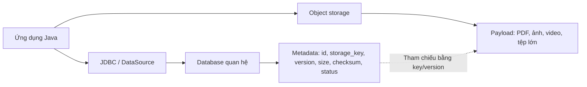
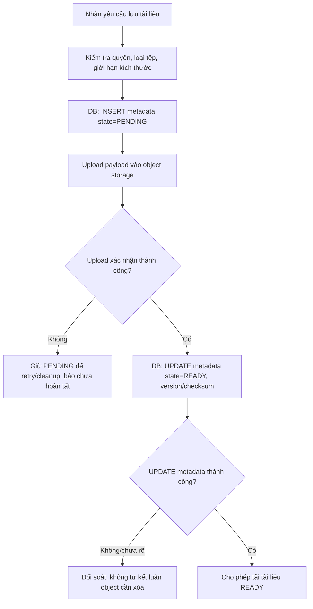

# Đánh giá lưu dữ liệu trong cơ sở dữ liệu hoặc lưu ngoài và giữ tham chiếu

## 1. Bài toán lưu dữ liệu lớn trong ứng dụng JDBC

Ứng dụng Java sử dụng **JDBC** có thể lưu dữ liệu có cấu trúc vào cơ sở dữ liệu quan hệ qua `DataSource`, `Connection` và `PreparedStatement`, sau đó đọc bằng `ResultSet`. Với dữ liệu lớn như ảnh, PDF, tệp video, bản sao tài liệu hoặc nội dung văn bản dài, kiến trúc sư còn phải quyết định **lưu chính nội dung trong database** hay **lưu nội dung ở hệ thống lưu trữ bên ngoài và chỉ giữ tham chiếu trong database**.

Hai phương án đều hợp lý trong những tình huống khác nhau:

1. **Lưu trong DB:** nội dung nhị phân nằm ở cột `BLOB`/`VARBINARY` (hoặc kiểu tương ứng); nội dung văn bản dài có thể dùng `CLOB`/`TEXT`. JDBC đọc/ghi qua `setBinaryStream()`, `getBinaryStream()`, `setCharacterStream()` hoặc `getCharacterStream()`.
2. **Lưu ngoài DB:** nội dung được tải lên object storage hoặc hệ thống tệp do ứng dụng quản lý; bảng quan hệ giữ `document_id`, `storage_key`, phiên bản đối tượng, kích thước, checksum, trạng thái và metadata cần thiết. JDBC chỉ quản lý hàng metadata và tham chiếu.

Ví dụ nghiệp vụ: một hệ thống lưu chứng từ hợp đồng. Dữ liệu giao dịch (khách hàng, hợp đồng, trạng thái phê duyệt) cần truy vấn bằng SQL; tệp đính kèm có thể lớn vài MB hoặc hơn. Khi quy mô tăng, nếu mọi lần sao lưu, nhân bản và truy vấn đều phải đi qua một database chứa toàn bộ nội dung nhị phân, chi phí vận hành có thể khác đáng kể so với lưu tệp trên object storage.

**Mục tiêu học tập:** biết các tiêu chí quyết định giữa hai phương án; sử dụng JDBC streaming để thao tác BLOB; thiết kế tham chiếu an toàn khi lưu ngoài DB; xử lý nhất quán giữa hai hệ thống không dùng chung transaction; và đánh giá hiệu năng, bảo mật, sao lưu, khôi phục, xóa dữ liệu.

## 2. Phân biệt dữ liệu nghiệp vụ, metadata và nội dung lớn

Hãy tách ba loại thông tin:

- **Dữ liệu nghiệp vụ:** tài liệu thuộc hợp đồng nào, người sở hữu, quyền đọc, trạng thái duyệt, thời hạn lưu giữ.
- **Metadata của tệp:** kích thước byte, kiểu nội dung đã kiểm tra, checksum, thời điểm tạo, trạng thái sẵn sàng, phiên bản lưu trữ.
- **Nội dung (payload):** các byte thực tế của PDF, ảnh, video hoặc nội dung văn bản lớn.

Nếu lưu payload trong DB, cả ba có thể được quản lý trong cùng một hệ quản trị. Nếu lưu ngoài, bảng vẫn cần các thuộc tính giúp liên kết tệp với nghiệp vụ; **không chỉ lưu một URL tùy ý**.



Kiến trúc này đặt trách nhiệm truy vấn và quan hệ vào DB; nơi lưu payload chịu trách nhiệm lưu byte, độ bền, sao chép và truyền tải. Kết nối giữa hai bên là **tham chiếu có kiểm soát**, thường là một khóa đối tượng bất biến do ứng dụng sinh.

## 3. Bảng so sánh hai phương án

| Tiêu chí | Payload trong DB | Payload ngoài DB, giữ tham chiếu |
|---|---|---|
| Transaction cùng dữ liệu nghiệp vụ | Có thể dùng một transaction DB cho metadata và payload khi storage engine hỗ trợ. | Không có transaction JDBC bao trùm object storage; phải thiết kế trạng thái và phục hồi. |
| Truy vấn SQL | Metadata và một số kiểu dữ liệu có thể truy vấn tại DB. | SQL chỉ truy vấn metadata; không trực tiếp tìm kiếm byte trong object storage. |
| Dung lượng DB, bản sao và backup | Payload làm tăng kích thước DB, log, bản sao và thời gian sao lưu/khôi phục. | DB nhỏ hơn; payload cần chiến lược backup/retention và phục hồi riêng. |
| Truy cập nội dung | Có thể đọc stream qua JDBC. | Có thể tải qua SDK, gateway hoặc URL ký có thời hạn. |
| Khả năng mở rộng tải tệp | Tăng tải I/O và mạng qua DB/connection pool. | Có thể tách tải nội dung khỏi DB, tận dụng object storage/CDN khi phù hợp. |
| Chi phí vận hành | Đơn giản hóa nhất quán nhưng có thể đắt khi dung lượng lớn. | Có thêm metadata, vòng đời đối tượng, quyền truy cập và đối soát hai hệ thống. |
| Khả năng chia sẻ qua API | Backend thường đọc từ DB rồi truyền về client. | Có thể cho client tải trực tiếp bằng URL ký ngắn hạn sau khi kiểm tra quyền. |
| Xóa và khôi phục | Có thể rollback thay đổi DB chưa commit; backup phục hồi theo một hệ thống. | Xóa DB và xóa đối tượng là hai bước; cần xử lý tệp mồ côi hoặc tham chiếu hỏng. |
| Độ trễ | Phù hợp với nội dung nhỏ/vừa và số lần truy cập hạn chế, tùy tải DB. | Hiệu quả với nội dung lớn hoặc phân phối tệp, nhưng có thêm lượt truy cập qua hệ thống ngoài. |
| Bảo mật | Tận dụng quyền DB, mã hóa và kiểm soát truy cập ứng dụng. | Cần thêm chính sách bucket/container, object key, URL ký, mã hóa và quyền truy cập storage. |

**Không có ngưỡng MB phổ quát.** Một ứng dụng chỉ lưu vài tệp 20 MB và đòi hỏi transaction đơn giản có thể chọn DB; hệ thống lưu hàng triệu video hoặc phân phối tệp cho người dùng thường nghiêng về lưu ngoài. Quyết định dựa trên dung lượng tổng, tần suất đọc/ghi, yêu cầu nhất quán, backup, giới hạn DB và chi phí đo được.

## 4. Phương án A: lưu BLOB/CLOB ngay trong database

Với dữ liệu nhị phân, có thể lưu cả thông tin tệp và payload vào một bảng. Ví dụ dưới đây dùng cú pháp `BLOB` tương thích với một số hệ quản trị như MySQL; PostgreSQL thường dùng `BYTEA` cho byte nhị phân lưu trực tiếp, còn giới hạn kích thước/cơ chế LOB của mỗi DB khác nhau.

```sql
CREATE TABLE document_blobs (
    id           BIGINT PRIMARY KEY,
    filename     VARCHAR(255) NOT NULL,
    content_type VARCHAR(150) NOT NULL,
    byte_size    BIGINT NOT NULL,
    payload      BLOB NOT NULL,
    created_at   TIMESTAMP NOT NULL
);
```

Riêng MySQL, kiểu `BLOB` thông thường có giới hạn dung lượng tương đối nhỏ (khoảng 64 KiB); dữ liệu lớn hơn cần xem xét `MEDIUMBLOB` hoặc `LONGBLOB`, cũng như giới hạn cấu hình/driver. PostgreSQL dùng kiểu `BYTEA` với giới hạn và cơ chế lưu trữ riêng. Vì vậy, **không lấy lược đồ minh họa này làm bằng chứng mọi file lớn đều vừa một cột `BLOB`**.

Khi lưu nội dung trong bảng, dữ liệu nghiệp vụ và payload có thể được cập nhật cùng transaction JDBC, ví dụ:

```text
BEGIN TRANSACTION
  INSERT INTO documents ...
  INSERT INTO document_blobs ... (payload)
  UPDATE document_status ...
COMMIT
```

Nếu các bảng và lệnh đều tuân theo cơ chế transaction của DB, `rollback()` hoàn tác phần chưa commit của cả metadata và payload. Đây là ưu điểm lớn khi tính nhất quán là yêu cầu quan trọng và dung lượng tệp còn phù hợp khả năng DB.

Tuy nhiên, bảng chứa payload lớn có thể khiến transaction log, sao lưu, nhân bản, I/O và việc di chuyển dữ liệu nặng hơn. Mức ảnh hưởng phụ thuộc storage engine, cấu hình, kiểu dữ liệu và cách driver xử lý stream.

### 4.1. Ghi dữ liệu bằng `PreparedStatement.setBinaryStream()`

```java
import java.io.InputStream;
import java.sql.Connection;
import java.sql.PreparedStatement;
import java.sql.SQLException;
import javax.sql.DataSource;

public final class BlobDocumentRepository {
    private final DataSource dataSource;

    public BlobDocumentRepository(DataSource dataSource) {
        this.dataSource = dataSource;
    }

    public void insert(
            long id, String filename, String contentType,
            long byteSize, InputStream source) throws SQLException {

        if (id <= 0 || byteSize < 0 || source == null) {
            throw new IllegalArgumentException("Invalid document input");
        }

        String sql = """
                INSERT INTO document_blobs
                    (id, filename, content_type, byte_size,
                     payload, created_at)
                VALUES (?, ?, ?, ?, ?, CURRENT_TIMESTAMP)
                """;

        try (Connection connection = dataSource.getConnection();
             PreparedStatement ps = connection.prepareStatement(sql)) {
            ps.setLong(1, id);
            ps.setString(2, filename);
            ps.setString(3, contentType);
            ps.setLong(4, byteSize);
            ps.setBinaryStream(5, source, byteSize);

            int inserted = ps.executeUpdate();
            if (inserted != 1) {
                throw new SQLException(
                        "Expected exactly one inserted document");
            }
        }
        // InputStream do phía gọi sở hữu; phương thức không tự đóng source.
    }
}
```

Điểm cần hiểu:

1. `setBinaryStream(5, source, byteSize)` cho driver luồng đọc byte và kích thước đã biết. Driver có thể thực sự truyền theo luồng, dùng bộ đệm hoặc tệp tạm tùy cách triển khai; tên API không bảo đảm mức sử dụng RAM luôn cố định.
2. `executeUpdate() == 1` kiểm tra đúng một hàng chèn. Nếu `autoCommit = false`, phải chờ transaction owner `commit()` rồi mới coi dữ liệu được lưu bền vững.
3. Không đọc toàn bộ tệp bằng `Files.readAllBytes()` hoặc `InputStream.readAllBytes()` khi mục tiêu là tiết kiệm bộ nhớ với payload lớn.
4. Kiểm tra giới hạn kích thước, định dạng tệp, quyền ghi và kích thước thực tế. `byteSize` phải phản ánh số byte mà stream cung cấp; lỗi thiếu hoặc thừa byte cần được phát hiện theo hợp đồng ứng dụng/driver.
5. Ví dụ giả định tầng gọi đã xác thực và chuẩn hóa `filename`, `contentType`. Không tin MIME type chỉ từ khai báo của trình duyệt và không dùng tên gốc của tệp làm đường dẫn hệ thống.

### 4.2. Đọc BLOB qua `ResultSet.getBinaryStream()`

```java
import java.io.IOException;
import java.io.InputStream;
import java.io.OutputStream;
import java.sql.Connection;
import java.sql.PreparedStatement;
import java.sql.ResultSet;
import java.sql.SQLException;

// Phương thức thêm trong BlobDocumentRepository.
public boolean streamTo(long id, OutputStream destination)
        throws SQLException, IOException {
    String sql = "SELECT payload FROM document_blobs WHERE id = ?";

    try (Connection connection = dataSource.getConnection();
         PreparedStatement ps = connection.prepareStatement(sql)) {
        ps.setLong(1, id);

        try (ResultSet rs = ps.executeQuery()) {
            if (!rs.next()) {
                return false;
            }
            try (InputStream data = rs.getBinaryStream("payload")) {
                if (data == null) {
                    throw new SQLException("Unexpected NULL payload");
                }
                data.transferTo(destination);
            }
        }
        return true;
    }
}
```

`getBinaryStream()` cho phép lấy dữ liệu theo luồng. **Phải đọc hết stream khi `ResultSet`, `PreparedStatement` và `Connection` còn mở**; không trả một `InputStream` phụ thuộc connection đã đóng ra ngoài repository. `destination` do phía gọi sở hữu nên ví dụ không đóng nó.

Đoạn này minh họa đường đọc; ứng dụng thật phải kiểm tra quyền truy cập tài liệu trước khi truyền byte và xử lý trường hợp kết nối client ngắt giữa chừng. Với `BLOB`/`CLOB` qua `getBlob()` hoặc `getClob()`, còn cần quan tâm vòng đời tài nguyên LOB và phương thức `free()` theo JDBC/driver.

### 4.3. Nội dung văn bản dài: `CLOB` và stream ký tự

Nếu dữ liệu là văn bản lớn cần giữ **ký tự**, không phải tệp nhị phân cần lưu nguyên byte, JDBC có các API:

```java
// Nếu cột long_text là CLOB hoặc kiểu văn bản tương ứng.
ps.setCharacterStream(2, reader, characterCount);

// Sau khi SELECT:
try (java.io.Reader reader = rs.getCharacterStream("long_text")) {
    // Đọc ký tự thành từng phần; không bắt buộc nạp toàn bộ vào String.
}
```

Lưu ý `characterCount` là số **ký tự**, không phải số byte UTF-8. Với PDF, ảnh, video hoặc tệp cần giữ chính xác từng byte, dùng đường nhị phân, không chuyển qua `Reader`/`Writer`.

## 5. Phương án B: chỉ giữ tham chiếu trong DB

Với object storage, payload không nằm trong hàng SQL. Thay vào đó, bảng cần mô tả đủ thông tin để tìm, xác nhận, kiểm soát quyền và quản lý vòng đời đối tượng.

```sql
CREATE TABLE document_objects (
    id              VARCHAR(36) PRIMARY KEY,
    storage_key     VARCHAR(300) NOT NULL UNIQUE,
    storage_version VARCHAR(180),
    byte_size       BIGINT NOT NULL,
    sha256_hex      CHAR(64),
    content_type    VARCHAR(150) NOT NULL,
    state           VARCHAR(20) NOT NULL,
    created_at      TIMESTAMP NOT NULL,
    updated_at      TIMESTAMP NOT NULL
);
```

Bảng trên chỉ là lược đồ minh họa; với hệ thống thực có thể bổ sung owner/tenant, ID hợp đồng, thông tin kiểm tra malware, retention, phân loại dữ liệu và ràng buộc `CHECK` cho trạng thái.

| Thuộc tính | Công dụng |
|---|---|
| `id` | Định danh tài liệu để các bảng nghiệp vụ và API tham chiếu. |
| `storage_key` | Khóa nội bộ dùng để tìm object; không nhất thiết là URL công khai. |
| `storage_version` | Phiên bản/định danh phiên bản nếu storage cung cấp versioning. |
| `byte_size` | Kiểm tra giới hạn, đối soát và hiển thị dung lượng. |
| `sha256_hex` | Kiểm tra toàn vẹn nội dung nếu được tính và xác minh từ byte thực tế. |
| `content_type` | Gợi ý định dạng phục vụ tải xuống; không phải chứng cứ đủ để tin nội dung an toàn. |
| `state` | Điều khiển vòng đời `PENDING`, `READY`, `FAILED`, `DELETING`, ... |
| `created_at`, `updated_at` | Phục vụ truy vết, dọn dữ liệu lỗi hoặc chính sách lưu giữ. |

Nên tạo `storage_key` **ngẫu nhiên, khó đoán và ổn định theo nội dung** (ví dụ `documents/<uuid>`), không dùng đường dẫn từ filename do người dùng nhập. Đối tượng nên được coi là **bất biến**; khi thay nội dung, tạo key hoặc phiên bản mới thay vì âm thầm ghi đè byte mà hàng DB chưa được cập nhật.

**Không lưu URL truy cập có chữ ký (signed URL) dài hạn** làm tham chiếu DB. URL ký có thể hết hạn hoặc chứa quyền truy cập tạm thời; hãy giữ key nội bộ và sinh URL ngắn hạn sau khi kiểm tra quyền nếu kiến trúc cho phép.

## 6. Vấn đề nhất quán: transaction JDBC không bao gồm object storage

Đây là khác biệt khó nhất giữa hai phương án.

Nếu thao tác theo trình tự:

```text
1. Upload file lên object storage.
2. INSERT metadata tham chiếu file vào database.
```

và bước 2 thất bại, file đã tồn tại trong object storage nhưng **không có hàng DB tham chiếu**: đó là **orphan object** (đối tượng mồ côi).

Nếu làm ngược:

```text
1. INSERT metadata vào database.
2. Upload file lên object storage.
```

và bước 2 thất bại, database có một **dangling reference** (tham chiếu không dẫn đến payload khả dụng).

`Connection.rollback()` chỉ hoàn tác công việc trong transaction JDBC, **không xóa nội dung đã upload**. Tương tự, `commit()` không khiến object storage tự động xác nhận theo cơ chế ACID của database.

### 6.1. Dùng trạng thái trung gian để không công bố tài liệu chưa sẵn sàng

Một cách làm thực dụng:



Ý nghĩa của từng trạng thái:

- **`PENDING`:** bản ghi đã tồn tại nhưng payload chưa được xác nhận là khả dụng cho người dùng. Truy vấn phục vụ tải xuống **không trả các hàng này**.
- **`READY`:** ứng dụng đã nhận biên nhận upload, lưu metadata hoàn chỉnh và xác nhận DB ghi nhận trạng thái sẵn sàng.
- **`FAILED` hoặc trạng thái chờ dọn:** tùy thiết kế, thể hiện upload không thể hoàn tất sau retry. Không tự động xóa tham chiếu cần phục hồi khi trạng thái ở DB còn chưa rõ.
- **`DELETING`:** đánh dấu đối tượng sẽ bị xóa; job nền thử xóa tệp thật rồi hoàn tất xóa metadata. Để tránh xóa nhầm dữ liệu còn sử dụng, cần xét số tham chiếu, versioning và chính sách retention.

### 6.2. Những sự cố cần tính trước

| Sự cố | Trạng thái có thể có | Hướng xử lý |
|---|---|---|
| `INSERT PENDING` thất bại | Không có metadata và chưa upload | Trả lỗi; không gọi upload. |
| Upload thất bại sau khi PENDING đã commit | Hàng `PENDING`, tệp có thể chưa có hoặc chỉ upload một phần | Retry có kiểm soát hoặc dọn tệp tạm bằng tác vụ đối soát. |
| Upload thành công, `UPDATE READY` thất bại | Có tệp nhưng DB còn `PENDING` | Đối soát bằng key, checksum/size và trạng thái DB; không mở tải xuống. |
| Mất kết nối lúc cập nhật `READY` | Không rõ DB đã commit READY hay chưa | Đọc lại trạng thái qua kết nối mới trước khi quyết định retry/xóa. |
| DB đã `READY` nhưng storage không truy cập được | Tham chiếu tạm thời bị hỏng hoặc storage lỗi | Retry đọc, cảnh báo vận hành và phục hồi; không trả nội dung giả. |
| Yêu cầu xóa giữa lúc upload đang chạy | Có thể tranh chấp giữa trạng thái và tệp mới | Dùng khóa trạng thái, phiên bản, điều kiện `WHERE` và dọn theo vòng đời. |

Phương án này **không tạo transaction phân tán** giữa DB và object storage. Nó quản lý nhất quán theo quy trình nhiều bước và có thể phục hồi. Hệ thống lớn thường thêm hàng đợi công việc, outbox, job dọn orphan, đối soát định kỳ và kiểm tra idempotency để hoàn thiện.

## 7. Ví dụ Java: metadata JDBC và adapter object storage

JDBC không định nghĩa API object storage. Ứng dụng phải dùng SDK hoặc giao diện chuyên biệt cho dịch vụ lưu tệp, sau đó kết hợp với JDBC quản lý metadata.

Để ví dụ không phụ thuộc nhà cung cấp, ta định nghĩa hợp đồng adapter. Bản triển khai `ObjectStorage` chịu trách nhiệm truyền dữ liệu, xác thực kết quả, xác minh số byte/checksum, và xử lý khóa/phiên bản theo hệ thống lưu trữ đã chọn.

```java
import java.io.IOException;
import java.io.InputStream;

interface ObjectStorage {
    UploadReceipt put(String key, InputStream source, long expectedSize)
            throws IOException;

    InputStream open(String key, String version)
            throws IOException;

    void delete(String key, String version)
            throws IOException;
}

record UploadReceipt(String version, long bytesWritten, String sha256Hex) {}
```

Đây là **giao diện minh họa**, không phải API JDBC có sẵn. `sha256Hex` phải là digest SHA-256 của byte dữ liệu đã gửi và được adapter tính/xác minh đúng; **không mặc định dùng ETag của storage thay SHA-256**, vì ETag có thể phụ thuộc multipart upload hoặc cơ chế nhà cung cấp.

### 7.1. Ghi PENDING, upload, rồi chuyển READY

```java
import java.io.IOException;
import java.io.InputStream;
import java.sql.Connection;
import java.sql.PreparedStatement;
import java.sql.SQLException;
import java.sql.Types;
import java.util.Objects;
import java.util.UUID;
import javax.sql.DataSource;

public final class ExternalDocumentService {
    private final DataSource dataSource;
    private final ObjectStorage storage;

    public ExternalDocumentService(
            DataSource dataSource, ObjectStorage storage) {
        this.dataSource = Objects.requireNonNull(dataSource);
        this.storage = Objects.requireNonNull(storage);
    }

    public String upload(
            String contentType, long size, InputStream source)
            throws SQLException, IOException {
        if (source == null || contentType == null
                || contentType.isBlank() || size < 0) {
            throw new IllegalArgumentException("Invalid upload input");
        }

        // Trên thực tế: kiểm tra quyền, MIME, giới hạn size,
        // quét an toàn và ràng buộc nghiệp vụ trước khi công bố.
        String id = UUID.randomUUID().toString();
        String key = "documents/" + id;

        // Bước 1: tạo metadata PENDING.
        // Ví dụ giả định DataSource cấp kết nối ở auto-commit.
        String insert = """
                INSERT INTO document_objects
                    (id, storage_key, storage_version,
                     byte_size, sha256_hex, content_type,
                     state, created_at, updated_at)
                VALUES (?, ?, NULL, ?, NULL, ?,
                        'PENDING', CURRENT_TIMESTAMP, CURRENT_TIMESTAMP)
                """;
        try (Connection connection = dataSource.getConnection();
             PreparedStatement ps = connection.prepareStatement(insert)) {
            if (!connection.getAutoCommit()) {
                throw new SQLException("Expected auto-commit connection");
            }
            ps.setString(1, id);
            ps.setString(2, key);
            ps.setLong(3, size);
            ps.setString(4, contentType);
            if (ps.executeUpdate() != 1) {
                throw new SQLException("Cannot create PENDING metadata");
            }
        }

        // Bước 2: upload dữ liệu. JDBC không thể rollback bước này.
        // Khi lỗi, bản ghi PENDING được giữ để đối soát/cleanup.
        UploadReceipt receipt = storage.put(key, source, size);
        if (receipt == null || receipt.bytesWritten() != size
                || receipt.sha256Hex() == null
                || !receipt.sha256Hex().matches("[a-fA-F0-9]{64}")) {
            throw new IOException("Upload verification failed");
        }

        // Bước 3: chỉ chuyển READY sau khi adapter xác nhận upload.
        String update = """
                UPDATE document_objects
                SET storage_version = ?,
                    sha256_hex = ?,
                    state = 'READY',
                    updated_at = CURRENT_TIMESTAMP
                WHERE id = ?
                  AND storage_key = ?
                  AND state = 'PENDING'
                """;

        try (Connection connection = dataSource.getConnection();
             PreparedStatement ps = connection.prepareStatement(update)) {
            if (!connection.getAutoCommit()) {
                throw new SQLException("Expected auto-commit connection");
            }
            if (receipt.version() == null) {
                ps.setNull(1, Types.VARCHAR);
            } else {
                ps.setString(1, receipt.version());
            }
            ps.setString(2, receipt.sha256Hex());
            ps.setString(3, id);
            ps.setString(4, key);
            if (ps.executeUpdate() != 1) {
                throw new SQLException("Cannot mark document READY");
            }
        }
        return id;
    }
}
```

Các giới hạn cần hiểu trước khi dùng ví dụ vào sản phẩm:

1. Cả hai câu SQL chạy trên connection riêng ở chế độ auto-commit, nên `PENDING` được lưu trước khi bắt đầu upload. **Không có transaction duy nhất** bao trùm DB và object storage.
2. Trường `contentType` được truyền vào chỉ để minh họa hợp đồng. Trước khi công bố nội dung, hệ thống phải kiểm tra loại nội dung thật, giới hạn byte, chính sách tải lên và quyền người dùng.
3. `ObjectStorage.put(...)` phải xác thực dữ liệu truyền và byte count. Nếu service chỉ tin kích thước do client báo mà không đếm byte thực, thông tin `byte_size` không đủ đáng tin.
4. Khi upload bị gián đoạn, `PENDING` có thể tồn tại lâu; job nền dùng thời gian cập nhật và trạng thái để retry, đánh dấu lỗi hoặc dọn object tạm. Không cần xóa tệp ngay trong `catch`, vì có thể không biết lệnh `UPDATE READY` đã commit hay chưa.
5. Nếu storage không hỗ trợ versioning, `storage_version` có thể null, nhưng key phải tránh bị ghi đè bởi người dùng hoặc một lần tải lại không mong đợi. Adapter nên hỗ trợ điều kiện tạo mới hoặc kiểm tra tính bất biến.
6. Chỉ công bố tài liệu khi metadata `READY`. Ví dụ chưa triển khai phần xác thực người dùng, quét malware, outbox, job đối soát hoặc chính sách idempotency; những thành phần đó cần thiết tùy yêu cầu vận hành.

### 7.2. Đọc tài liệu đã READY

Để tìm tệp, truy vấn metadata qua JDBC rồi dùng adapter mở object. Hai thao tác xảy ra ở hai hệ thống khác nhau:

```java
import java.io.IOException;
import java.io.InputStream;
import java.io.OutputStream;
import java.sql.Connection;
import java.sql.PreparedStatement;
import java.sql.ResultSet;
import java.sql.SQLException;

// Phương thức bổ sung cho ExternalDocumentService.
public boolean download(String id, OutputStream destination)
        throws SQLException, IOException {
    String sql = """
            SELECT storage_key, storage_version
            FROM document_objects
            WHERE id = ? AND state = 'READY'
            """;

    String key;
    String version;
    try (Connection connection = dataSource.getConnection();
         PreparedStatement ps = connection.prepareStatement(sql)) {
        ps.setString(1, id);
        try (ResultSet rs = ps.executeQuery()) {
            if (!rs.next()) {
                return false;
            }
            key = rs.getString("storage_key");
            version = rs.getString("storage_version");
        }
    }

    // Trước khi trả byte phải kiểm tra quyền truy cập tài liệu.
    // Giao diện này giả định tầng gọi đã kiểm tra quyền.
    try (InputStream source = storage.open(key, version)) {
        source.transferTo(destination);
    }
    return true;
}
```

Không dùng key do client tự cung cấp để gọi `storage.open()`. API nên nhận một **document ID** và tra cứu metadata có kiểm tra quyền/tenant. Hệ thống thật có thể phải xác minh checksum khi tải, xử lý lỗi storage và ngắt truyền dữ liệu theo chính sách.

`destination` do phía gọi sở hữu và không bị đóng trong ví dụ. Không lưu URL signed vào DB; nếu muốn tải trực tiếp từ storage, backend cần xác thực quyền, phát URL ký có thời hạn ngắn và hạn chế chia sẻ ngoài ý muốn.

## 8. Cách xóa và cập nhật nội dung khi lưu ngoài

### 8.1. Xóa là quy trình nhiều bước

Giả sử người dùng yêu cầu xóa tài liệu. Nếu làm:

```text
DELETE FROM document_objects WHERE id = ?;
storage.delete(key);
```

và việc xóa object thất bại, DB đã mất tham chiếu; payload có thể còn tồn tại vô thời hạn. Làm ngược lại cũng có nguy cơ DB giữ tham chiếu tới object đã bị xóa.

Một quy trình thường dễ phục hồi hơn:

1. Trong DB, đánh dấu tài liệu `DELETING`; API ngừng cung cấp cho người dùng.
2. Job nền nhận key/version đã được cấp quyền dọn, gọi storage để xóa hoặc áp dụng chính sách retention.
3. Khi xác nhận dọn xong, cập nhật `DELETED` hoặc xóa metadata theo chính sách kiểm toán.
4. Nếu storage tạm lỗi, retry theo idempotency; không xóa nhầm phiên bản đang được tài liệu khác tham chiếu.

Nếu có **nhiều tài liệu tham chiếu chung một object** theo content-addressable storage, không được xóa payload khi vẫn còn tham chiếu hợp lệ. Dùng tham chiếu đếm hoặc quy trình garbage collection có bảo vệ tranh chấp; không chỉ kiểm tra `COUNT(*)` không khóa rồi xóa một cách tùy tiện.

### 8.2. Thay nội dung nên tạo phiên bản hoặc key mới

Khi một tài liệu được thay nội dung:

```text
Upload object mới với key/version mới
  -> xác minh byte/size/checksum
  -> UPDATE metadata sang key/version mới bằng điều kiện trạng thái/phiên bản
  -> công bố phiên bản mới
  -> chỉ dọn object cũ sau khi chắc chắn không còn tham chiếu
```

Đừng ghi đè object cũ trước khi DB đổi tham chiếu; nếu metadata chưa commit, người đọc có thể gặp nội dung mới nhưng bản ghi còn mô tả phiên bản cũ. Với ứng dụng có concurrent updates, thêm cột version vào metadata và dùng `UPDATE ... WHERE version = ?` để phát hiện xung đột.

## 9. Bảo mật, toàn vẹn và quản trị dữ liệu

### 9.1. Quyền truy cập

Lưu ngoài không có nghĩa object phải công khai. Hãy:

- Giữ bucket/container ở chế độ riêng tư mặc định và cấp quyền tối thiểu cho dịch vụ.
- Luôn xác minh người gọi có quyền với **document ID và tenant/owner** trước khi mở object hoặc phát URL ký.
- Không tin đường dẫn, storage key hay URL gửi lên từ client làm nguồn sự thật; tham chiếu nằm trong DB và được kiểm tra.
- Tránh chấp nhận URL tùy ý do người dùng cung cấp rồi để backend tải từ đó; đây có thể tạo nguy cơ SSRF và truy cập tài nguyên nội bộ.
- Dùng khóa mã hóa, chính sách truy cập và audit phù hợp với yêu cầu dữ liệu. Không ghi signed URL, token, thông tin kết nối hoặc dữ liệu tệp nhạy cảm vào log chung.

### 9.2. Kiểm tra nội dung và checksum

`content_type` và đuôi filename do client cung cấp chỉ là đầu vào; kiểm tra MIME thực tế hoặc định dạng phù hợp, giới hạn kích thước và quét malware nếu nghiệp vụ yêu cầu. Tránh thực thi hoặc render trực tiếp tệp chưa được kiểm tra.

`SHA-256` giúp phát hiện thay đổi nội dung khi bạn có digest được tính từ byte thực và có thể xác minh lại với dữ liệu đọc. Nó không thay thế xác thực người dùng, chữ ký số hoặc ràng buộc tính toàn vẹn ở DB.

Khi tài liệu quan trọng cần chống sửa trái phép, có thể sử dụng checksum, phiên bản bất biến, encryption, audit và chính sách retention phù hợp. Với nội dung thay đổi, cập nhật checksum và version trong metadata theo quy trình bảo vệ nhất quán.

### 9.3. Backup và khôi phục

Lưu trong DB thuận tiện cho việc sao lưu metadata và payload cùng một nguồn, nhưng backup có thể lớn. Lưu ngoài giúp tách tải backup DB khỏi payload, nhưng phục hồi cần **phối hợp hai hệ thống**:

- Bản DB khôi phục phải tham chiếu đến các object/version còn tồn tại.
- Nếu object storage được dọn theo retention trước ngày phục hồi DB, bản DB cũ có thể trỏ đến tệp đã bị xóa.
- Nếu storage rollback về thời điểm khác DB, cần đối soát tham chiếu và phiên bản.
- Kiểm thử phục hồi thực tế, không chỉ xem sao lưu của từng hệ thống có trạng thái “thành công”.

Với yêu cầu tuân thủ xóa dữ liệu, phải xác định chính sách trên bản sao, phiên bản object, cache, CDN và nhật ký; xóa hàng DB không bảo đảm mọi byte ở storage/bản sao đã biến mất ngay.

## 10. Hiệu năng: streaming, pool và phân trang metadata

### 10.1. Streaming không đồng nghĩa miễn phí bộ nhớ

`setBinaryStream()`/`getBinaryStream()` cho phép ứng dụng viết theo hướng streaming, nhưng driver có thể buffer dữ liệu hoặc yêu cầu chế độ cursor/connection cụ thể. Với object storage, SDK có thể đệm một phần hoặc dùng multipart upload. Cần đo trên môi trường thật:

| Chỉ số | Ý nghĩa |
|---|---|
| Kích thước payload trung bình/tối đa | Ảnh hưởng RAM, storage, thời gian upload và giới hạn API |
| Throughput đọc/ghi | Dung lượng byte/s truyền qua DB hoặc object storage |
| Thời gian p95/p99 | Độ trễ người dùng khi tải tệp lớn |
| Thời gian chiếm connection | Streaming từ DB lâu có thể chiếm connection pool, tăng thời gian chờ CRUD khác |
| Kích thước transaction log | Payload lớn có thể tăng chi phí log, replication và recovery |
| Chi phí lưu trữ và egress | DB thường có mô hình chi phí khác object storage/CDN |
| Tỷ lệ retry, pending và orphan | Chỉ số đặc biệt quan trọng khi lưu ngoài DB |

Khi dùng DB lưu BLOB, tránh giữ transaction mở xuyên suốt thời gian người dùng tải một tệp rất lớn nếu không cần; nhưng cũng phải giữ các tài nguyên JDBC cần thiết cho đến khi đọc stream xong. Nếu nhiều người tải đồng thời, có thể gây áp lực lên DB pool. Với lưu ngoài, backend có thể truy vấn metadata qua JDBC rồi để storage/gateway truyền payload nhằm giải phóng connection DB sớm hơn.

### 10.2. Không trộn payload vào truy vấn danh sách

Truy vấn hiển thị danh sách tài liệu chỉ nên lấy metadata:

```sql
SELECT id, filename, content_type, byte_size, created_at
FROM document_blobs
WHERE created_at >= ?
ORDER BY created_at DESC, id DESC;
```

Tránh `SELECT *` khiến các cột BLOB bị trả về dù màn hình chỉ cần tên và kích thước. Thêm phân trang và chỉ mục trên các cột dùng để lọc/sắp xếp nếu phù hợp. Với hệ thống lưu ngoài, bảng metadata thường nhỏ hơn nội dung rất nhiều, giúp truy vấn danh sách dễ tối ưu hơn.

**Batch không phải giải pháp cho mọi tệp lớn:** `PreparedStatement.addBatch()` có thể có ích với nhiều dòng metadata hoặc nhiều lệnh nhỏ, nhưng batch rất lớn chứa BLOB có thể làm tăng bộ nhớ và áp lực lên driver. Khi upload tệp, cần xem xét song song có giới hạn, retry, timeout và quota thay vì chỉ tăng batch size.

## 11. Ma trận quyết định theo tình huống

| Tình huống | Xu hướng lựa chọn | Lý do |
|---|---|---|
| Tệp nhỏ/vừa, cần commit nguyên tử với một nghiệp vụ SQL | Lưu trong DB | Transaction và backup cùng DB đơn giản hơn nếu dung lượng phù hợp |
| Tệp video/ảnh lớn, lượng truy cập hoặc phân phối cao | Lưu ngoài | Tách băng thông và lưu trữ payload khỏi DB; hỗ trợ phân phối qua storage/CDN |
| Rất nhiều tệp không thường được truy vấn nội dung | Lưu ngoài | DB giữ metadata và quan hệ, storage tối ưu hóa byte |
| Nội dung văn bản dài cần tìm kiếm bằng SQL | Cân nhắc DB hoặc công cụ tìm kiếm chuyên dụng | Cần đánh giá kiểu CLOB/TEXT, indexing và mức truy vấn thực tế |
| Yêu cầu xóa/khôi phục nhất quán đơn giản, ít hệ thống | DB có thể thuận lợi | Không phát sinh bài toán dọn object mồ côi ở hệ thống thứ hai |
| Đã có object storage, CDN, lifecycle và pipeline bảo mật | Lưu ngoài thường thuận lợi | Tận dụng hạ tầng sẵn có nhưng vẫn cần quản lý trạng thái và tham chiếu |
| Chứng từ nhạy cảm, audit và retention nghiêm ngặt | Phụ thuộc kiến trúc kiểm soát | Cả hai đều có thể an toàn nếu thiết kế quyền, mã hóa, backup và quy trình xóa đúng |

**Cách chọn thực tế:** thống kê quy mô byte, tần suất đọc/ghi, nhu cầu tìm kiếm, transaction, độ trễ mục tiêu, chi phí lưu trữ/truyền tải và yêu cầu phục hồi. Sau đó triển khai thử hai đường với dữ liệu đại diện và đo. Đừng quyết định chỉ dựa trên nhận định “BLOB luôn chậm” hoặc “object storage luôn rẻ hơn”.

## 12. Bài thực hành tự kiểm chứng

### Thực hành A — Lưu BLOB trực tiếp

1. Tạo `document_blobs` trong database thử nghiệm bằng kiểu cột nhị phân phù hợp với DB của bạn.
2. Dùng `setBinaryStream()` chèn một tệp thử, ghi nhận số dòng từ `executeUpdate()`; kiểm tra tên, MIME và dung lượng qua các cột metadata.
3. Dùng `getBinaryStream()` tải lại tệp thành file thử; so sánh byte hoặc checksum với nguồn.
4. Lặp lại trong transaction có `setAutoCommit(false)` rồi `rollback()`; xác nhận hàng và payload chưa commit đều bị hoàn tác.
5. Tăng kích thước thử nghiệm theo từng mức; quan sát thời gian upload, thời gian giữ connection và bộ nhớ khi driver dùng streaming.

### Thực hành B — Lưu ngoài DB với tham chiếu

1. Tạo bảng `document_objects`. Thay `ObjectStorage` bằng adapter test lưu tệp trên thư mục tạm an toàn (hoặc một object store thử nghiệm) với key do ứng dụng sinh.
2. Thử upload thành công: `PENDING` → ghi payload → `READY`; chỉ tải những hàng có trạng thái `READY`.
3. Giả lập lỗi storage ngay sau `INSERT PENDING`; xác nhận metadata chưa `READY` và không có API nào công bố payload.
4. Giả lập upload thành công nhưng `UPDATE READY` lỗi. Xác nhận object có thể tồn tại; viết quy trình đối soát dựa trên `storage_key`, checksum, kích thước và trạng thái DB.
5. Thử xóa bằng `DELETING` và job dọn. Kiểm tra retry an toàn khi storage trả lỗi tạm thời.
6. Thử hai yêu cầu thay cùng một tài liệu; bảo đảm mỗi phiên bản dùng key riêng hoặc kiểm tra `version` ở metadata để tránh ghi đè.

### Câu hỏi tự đánh giá

- Ưu điểm lớn nhất của lưu BLOB trong DB khi cập nhật cùng metadata nghiệp vụ là gì?
- Vì sao `Connection.rollback()` không thể thu hồi một object đã upload lên hệ thống ngoài?
- Vì sao nên có trạng thái `PENDING` và chỉ công bố `READY`?
- Tại sao `storage_key` nên do hệ thống sinh thay vì dùng filename gốc hoặc URL do client gửi?
- Trong trường hợp DB mất kết nối khi cập nhật `READY`, tại sao không nên xóa ngay object?
- Những chỉ số nào cần đo trước khi khẳng định hai phương án có hiệu năng hoặc chi phí khác nhau?
- Vì sao phục hồi DB và object storage từ hai mốc thời gian khác nhau có thể tạo tham chiếu hỏng?

### Ghi nhớ

Khi làm việc với **dữ liệu lớn trong JDBC**, hãy quyết định rõ nơi lưu byte và nơi lưu quan hệ nghiệp vụ. **Lưu BLOB/CLOB trong database** giúp quản lý nội dung và metadata cùng transaction, nhưng có thể gia tăng tải và chi phí database. **Lưu payload ngoài database và giữ tham chiếu** giúp tách dung lượng/truyền tải khỏi SQL, nhưng phát sinh bài toán nhất quán giữa hai hệ thống. Dùng JDBC để quản lý metadata và trạng thái, dùng adapter/SDK chuyên biệt để lưu byte, chỉ công bố dữ liệu đã xác nhận `READY` và có quy trình retry/đối soát/dọn dữ liệu mồ côi. Kết hợp kiểm soát quyền, checksum, versioning, retention và đo hiệu năng để chọn kiến trúc phù hợp thay vì áp dụng một quy tắc tuyệt đối.
