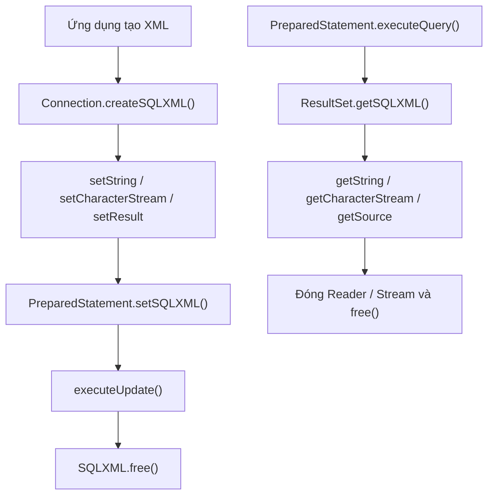

# Đọc ghi SQLXML và quản lý tài nguyên liên quan trong JDBC

Trong JDBC, kiểu **`java.sql.SQLXML`** biểu diễn một giá trị XML được lưu trong cơ sở dữ liệu. Khi ứng dụng cần lưu cấu hình có cấu trúc, tài liệu XML hoặc trao đổi dữ liệu với hệ thống dùng XML, `SQLXML` giúp truyền và nhận giá trị qua các API có kiểu như `PreparedStatement.setSQLXML(...)` và `ResultSet.getSQLXML(...)`. Ngoài việc đọc, ghi, lập trình viên còn phải quản lý **vòng đời của đối tượng `SQLXML`, các stream/reader/writer, statement, result set và kết nối**.

Bài học thuộc chương **Kiểu SQL nâng cao** của module **JDBC**. Ta sẽ dùng `DataSource` để lấy kết nối, `PreparedStatement` để truyền tham số an toàn, `ResultSet` để đọc dữ liệu, cùng `Connection.createSQLXML()`, `SQLXML.setString()/getString()`, `setCharacterStream()/getCharacterStream()`, `setResult()/getSource()` và `free()`. Mục tiêu là nắm được cách xử lý dữ liệu XML đúng kiểu và đóng tài nguyên có thể kiểm tra được.

> **Ý chính:** `SQLXML` là **một đối tượng JDBC có tài nguyên cần giải phóng**, không phải `String` dùng chung vô hạn. Khi tạo hoặc nhận `SQLXML`, hãy sử dụng nó trong phạm vi kết nối/kết quả phù hợp và gọi `free()` trong `finally` sau khi đã đọc, ghi hoặc truyền thành công.

## 1. `SQLXML` giải quyết vấn đề gì?

Giả sử bảng `integration_document` chứa XML của một đơn hàng:

```xml
<order id="1001">
  <customer>42</customer>
  <items>
    <item sku="BOOK-A" quantity="2"/>
  </items>
</order>
```

Một ứng dụng có thể lưu XML thành `VARCHAR` hoặc `CLOB`; tuy nhiên, khi CSDL có **kiểu XML chuyên dụng**, `SQLXML` cho phép làm việc với kiểu dữ liệu đó thông qua hợp đồng JDBC và driver.

Phân biệt những thành phần thường xuất hiện:

| Thành phần | Vai trò |
|---|---|
| Kiểu cột SQL như `XML` hoặc tên tương đương do DBMS cung cấp | Xác định cách CSDL lưu, kiểm tra và truy vấn giá trị XML. |
| `java.sql.SQLXML` | Đối tượng Java/JDBC đại diện cho một giá trị XML và cung cấp API truy cập nội dung XML. |
| `Connection.createSQLXML()` | Tạo đối tượng `SQLXML` mới để ứng dụng ghi nội dung trước khi truyền vào SQL. |
| `PreparedStatement.setSQLXML(index, xml)` | Bind giá trị `SQLXML` vào placeholder `?` của câu SQL. |
| `ResultSet.getSQLXML(index/label)` | Lấy đối tượng `SQLXML` từ cột kết quả. Có thể trả `null` nếu giá trị SQL là `NULL`. |
| `SQLXML.free()` | Yêu cầu giải phóng tài nguyên mà đối tượng XML đang nắm giữ. Không thay thế `Connection.close()`. |
| `java.sql.Types.SQLXML` | Mã kiểu SQL dùng trong metadata hoặc khi bind `NULL` có kiểu, với driver hỗ trợ. |

`SQLXML` được bổ sung từ JDBC 4.0. Không phải DBMS nào cũng có cột XML chuyên dụng, và không phải driver nào cũng triển khai mọi phương thức liên quan đến `SQLXML` giống nhau. Ví dụ SQL trong bài giả định một hệ quản trị hỗ trợ kiểu cột `XML`; cần điều chỉnh schema và driver theo môi trường thật.

### Khi nào nên cân nhắc SQLXML?

- Hệ thống phải giữ nguyên một tài liệu XML làm bản ghi nghiệp vụ hoặc thông điệp tích hợp.
- CSDL có kiểu XML và có nhu cầu truy vấn, xác thực hay lập chỉ mục XML bằng chức năng của DBMS.
- JDBC driver hỗ trợ bind và đọc XML dưới dạng `SQLXML`, tránh ép toàn bộ dữ liệu thành chuỗi SQL tự ghép.

Nếu dữ liệu vốn có cấu trúc bảng rõ ràng và cần truy vấn quan hệ thường xuyên, thiết kế cột quan hệ vẫn có thể phù hợp hơn. Không nên chọn XML chỉ vì có lớp `SQLXML`; kiểu lưu phải phản ánh yêu cầu dữ liệu và khả năng quản trị.

## 2. Hai chiều làm việc: tạo để ghi và nhận để đọc

Có hai đường đi phổ biến:



**Chiều ghi:**

1. Lấy một `Connection`.
2. Tạo đối tượng `SQLXML` bằng `connection.createSQLXML()`.
3. Ghi dữ liệu qua một cách được driver hỗ trợ, ví dụ `setString(xmlText)`.
4. Bind đối tượng bằng `preparedStatement.setSQLXML(parameterIndex, sqlxml)`.
5. Thực thi SQL, đồng thời thực hiện `commit()` nếu ứng dụng đang quản lý transaction thủ công.
6. Gọi `sqlxml.free()` khi đã dùng xong và đóng statement, kết nối.

**Chiều đọc:**

1. Chạy câu `SELECT` bằng `PreparedStatement`.
2. Di chuyển con trỏ `ResultSet` tới một hàng bằng `rs.next()`.
3. Lấy `SQLXML` bằng `rs.getSQLXML("payload")` hoặc `getSQLXML(columnIndex)`.
4. Nếu giá trị không `null`, đọc nội dung bằng một phương thức phù hợp.
5. Đóng stream (nếu có), gọi `sqlxml.free()` rồi đóng `ResultSet`, `PreparedStatement` và `Connection`.

**Không dùng lại một `SQLXML` sau `free()`.** Tùy cách driver quản lý vòng đời, đối tượng còn có thể phụ thuộc vào kết nối hoặc `ResultSet` đã tạo ra nó; vì thế tránh trả đối tượng `SQLXML` ra khỏi phương thức DAO sau khi các tài nguyên JDBC đã đóng.

## 3. Chuẩn bị bảng minh họa

Ví dụ SQL:

```sql
CREATE TABLE integration_document (
    document_id BIGINT PRIMARY KEY,
    payload XML
);
```

Cú pháp trên mang tính minh họa theo ý tưởng kiểu SQL `XML`. **Không có một DDL XML chạy giống nhau trên mọi CSDL**:

| Hệ quản trị | Điều cần xác minh |
|---|---|
| PostgreSQL | Có kiểu `xml`; cần kiểm tra cách PostgreSQL JDBC driver hỗ trợ `SQLXML`, kiểm tra XML và chuyển kiểu khi bind. |
| SQL Server | Có kiểu `xml`; cách làm việc với `SQLXML` phụ thuộc Microsoft JDBC Driver và cấu hình môi trường. |
| Oracle Database | Có kiểu `XMLTYPE` và API riêng; cần xác minh cách bind/đọc XML bằng driver Oracle tương ứng. |
| MySQL | Không có kiểu cột XML chuyên dụng tương đương; có thể lưu dạng văn bản, nhưng không mặc định `getSQLXML/setSQLXML` hỗ trợ như CSDL có kiểu XML. |
| Các DBMS khác | Tên kiểu, loại XML, giới hạn dung lượng và hỗ trợ driver có thể khác; kiểm tra tài liệu sản phẩm. |

**Không trộn DDL vào transaction ghi dữ liệu của bài thực hành** khi chưa hiểu hành vi DBMS. Một số hệ quản trị có thể commit ngầm khi chạy `CREATE TABLE`; tạo bảng trước rồi mới chạy các thao tác `INSERT`/`SELECT`.

Để thử các ví dụ, giả định:

- `DataSource dataSource` đã được cấu hình với driver tương thích.
- Bảng `integration_document` tồn tại và cột `payload` nhận XML.
- Tài khoản kết nối có quyền `INSERT`, `SELECT` và `UPDATE` cần thiết.
- Dữ liệu XML đầu vào là tài liệu hợp lệ theo quy tắc của CSDL.

## 4. Ghi XML nhỏ bằng `setString()`

Đối với tài liệu XML nhỏ, `SQLXML.setString(...)` là cách trực quan nhất để ghi nội dung. Sử dụng `PreparedStatement` để tránh ghép nội dung XML trực tiếp vào câu SQL:

```java
import java.sql.Connection;
import java.sql.PreparedStatement;
import java.sql.SQLException;
import java.sql.SQLXML;
import javax.sql.DataSource;

public final class XmlWriter {
    private XmlWriter() {
    }

    public static void insert(
            DataSource dataSource,
            long documentId,
            String xmlText
    ) throws SQLException {
        String sql =
                "INSERT INTO integration_document (document_id, payload) "
                + "VALUES (?, ?)";

        try (Connection connection = dataSource.getConnection();
             PreparedStatement ps = connection.prepareStatement(sql)) {

            SQLXML sqlxml = connection.createSQLXML();
            try {
                sqlxml.setString(xmlText);

                ps.setLong(1, documentId);
                ps.setSQLXML(2, sqlxml);
                ps.executeUpdate();

            } finally {
                sqlxml.free();
            }
        }
    }
}
```

Ví dụ gọi phương thức:

```java
String xml = "<order id=\"1001\">"
        + "<customer>42</customer>"
        + "<items><item sku=\"BOOK-A\" quantity=\"2\"/></items>"
        + "</order>";

XmlWriter.insert(dataSource, 1001L, xml);
```

**Vì sao phải theo đúng thứ tự?**

1. `connection.createSQLXML()` tạo một đối tượng XML mới phù hợp với driver/kết nối.
2. `sqlxml.setString(xmlText)` đưa nội dung vào đối tượng **trước khi bind**.
3. `ps.setSQLXML(2, sqlxml)` bind dữ liệu XML vào tham số thứ hai, không biến nội dung XML thành một phần cấu trúc SQL.
4. `ps.executeUpdate()` yêu cầu CSDL thực hiện câu `INSERT`.
5. `sqlxml.free()` được gọi trong `finally` dù thực thi thành công hoặc phát sinh `SQLException`.
6. `try-with-resources` đóng `PreparedStatement` và `Connection`.

`SQLXML` không phải một `AutoCloseable` chuẩn như `Connection`, `Statement` hoặc `ResultSet`; vì vậy **không thể** thay `free()` bằng `try (SQLXML xml = ...)`. Dùng `finally` để giải phóng rõ ràng.

Ví dụ trên dùng auto-commit theo cấu hình của kết nối. Nếu thao tác ghi XML phải thành công cùng những câu `INSERT/UPDATE` khác, dùng `connection.setAutoCommit(false)` và một lần `commit()` sau khi mọi bước thành công, hoặc `rollback()` nếu có lỗi.

### Một đối tượng SQLXML chỉ đại diện cho một giá trị

Sau khi đã cấp dữ liệu cho `SQLXML` bằng một phương thức ghi và bind/excute, đừng dùng lại đối tượng đó để ghi một nội dung XML thứ hai. Khi cần ghi nhiều bản ghi, có thể tạo một `SQLXML` mới cho mỗi giá trị, rồi giải phóng sau khi thao tác của bản ghi kết thúc. Một số driver còn áp dụng ràng buộc chỉ được khởi tạo hoặc đọc dữ liệu một lần đối với từng thể hiện; cách làm an toàn là **một vòng đời rõ ràng cho một giá trị**.

## 5. Đọc XML từ ResultSet bằng `getSQLXML()`

`ResultSet.getSQLXML(...)` trả về đối tượng `SQLXML` cho cột được chọn. Nếu SQL chứa `NULL`, phương thức trả `null`; không cần gọi `rs.wasNull()` chỉ để phân biệt trường hợp này.

```java
import java.sql.Connection;
import java.sql.PreparedStatement;
import java.sql.ResultSet;
import java.sql.SQLException;
import java.sql.SQLXML;
import javax.sql.DataSource;

public final class XmlReader {
    private XmlReader() {
    }

    public static String findById(DataSource dataSource, long documentId)
            throws SQLException {

        String sql = "SELECT payload FROM integration_document "
                + "WHERE document_id = ?";

        try (Connection connection = dataSource.getConnection();
             PreparedStatement ps = connection.prepareStatement(sql)) {

            ps.setLong(1, documentId);

            try (ResultSet rs = ps.executeQuery()) {
                if (!rs.next()) {
                    // Không tồn tại dòng dữ liệu.
                    return null;
                }

                SQLXML sqlxml = rs.getSQLXML("payload");
                if (sqlxml == null) {
                    // Có dòng nhưng giá trị cột là SQL NULL.
                    return null;
                }

                try {
                    return sqlxml.getString();
                } finally {
                    sqlxml.free();
                }
            }
        }
    }
}
```

Trong ví dụ, `null` được dùng cho cả hai trường hợp “không có bản ghi” và “cột `payload` là SQL `NULL`”. Đó là lựa chọn đơn giản để trình bày API; nếu nghiệp vụ cần phân biệt hai trạng thái, DAO nên trả kiểu kết quả phù hợp như `Optional` cho sự tồn tại bản ghi và một trường nullable cho XML.

`rs.getSQLXML("payload")` dùng **nhãn cột trong kết quả SQL**, không phải tên bảng. Nếu `SELECT payload AS document_xml`, hãy gọi `rs.getSQLXML("document_xml")`. Cũng có thể gọi `rs.getSQLXML(1)` vì JDBC đánh số cột kết quả từ **1**.

**Lưu ý:** Không lấy `SQLXML` ở trong `try (ResultSet ...)` rồi trả thẳng nó cho tầng dịch vụ sau khi `ResultSet` và `Connection` đã đóng. Khi dữ liệu không lớn, trả về `String` hoặc đối tượng miền đã parse; khi dữ liệu lớn, xử lý stream ngay trong phạm vi tài nguyên còn mở.

## 6. Khi XML lớn: dùng character stream

`getString()` tạo một chuỗi Java chứa toàn bộ nội dung XML và có thể tốn bộ nhớ khi tài liệu rất lớn. `SQLXML` cung cấp:

- `setCharacterStream()`: lấy một `Writer` để ghi dữ liệu XML vào đối tượng SQLXML.
- `getCharacterStream()`: lấy một `Reader` để đọc nội dung XML từ đối tượng SQLXML.
- `setBinaryStream()` / `getBinaryStream()`: làm việc với luồng byte; cần xử lý đúng encoding.

**Ưu tiên stream ký tự** khi tác vụ chỉ cần XML dạng văn bản và tránh được nhầm lẫn về charset. Tuy nhiên, không phải driver nào cũng stream trực tiếp từ/to máy chủ; driver có thể vẫn đệm toàn bộ tài liệu. Hãy đo với driver thật trước khi khẳng định ưu thế bộ nhớ.

### Ghi XML thông qua `Writer`

```java
import java.io.IOException;
import java.io.Reader;
import java.io.Writer;
import java.sql.Connection;
import java.sql.PreparedStatement;
import java.sql.SQLException;
import java.sql.SQLXML;
import javax.sql.DataSource;

// Hàm nhận Reader còn mở; caller chịu trách nhiệm đóng nguồn Reader.
public static void insertFromReader(
        DataSource dataSource,
        long documentId,
        Reader source
) throws SQLException, IOException {

    String sql = "INSERT INTO integration_document "
            + "(document_id, payload) VALUES (?, ?)";

    try (Connection connection = dataSource.getConnection();
         PreparedStatement ps = connection.prepareStatement(sql)) {

        SQLXML sqlxml = connection.createSQLXML();
        try {
            // Hoàn tất ghi và đóng Writer trước khi executeUpdate().
            try (Writer target = sqlxml.setCharacterStream()) {
                char[] buffer = new char[8192];
                int length;
                while ((length = source.read(buffer)) != -1) {
                    target.write(buffer, 0, length);
                }
            }

            ps.setLong(1, documentId);
            ps.setSQLXML(2, sqlxml);
            ps.executeUpdate();

        } finally {
            sqlxml.free();
        }
    }
}
```

Lưu ý mã ví dụ đặt phương thức trong một lớp thích hợp và đã có đầy đủ `import` ở đầu đoạn. Luồng `source` là đối tượng do **caller cấp**, nên hàm không chủ động đóng nó; còn `target` là `Writer` được lấy từ `SQLXML`, phải đóng khi ghi xong.

Một số driver có thể sử dụng cơ chế ghi XML khác nhau. Nếu `setCharacterStream()` không được hỗ trợ, driver có thể ném `SQLFeatureNotSupportedException` hoặc `SQLException`. Chuyển sang `setString()` khi tài liệu đủ nhỏ, hoặc sử dụng phương án XML riêng của DBMS đã được kiểm chứng.

### Đọc XML và xử lý ngay, không trả Reader đã mất kết nối

```java
import java.io.IOException;
import java.io.Reader;
import java.sql.ResultSet;
import java.sql.SQLXML;

// rs đã trỏ vào một hàng hợp lệ và còn mở.
SQLXML sqlxml = rs.getSQLXML("payload");
if (sqlxml != null) {
    try {
        try (Reader reader = sqlxml.getCharacterStream()) {
            char[] buffer = new char[8192];
            int n;
            while ((n = reader.read(buffer)) != -1) {
                // Xử lý ngay trong vòng đời ResultSet và Connection.
                // Ví dụ: đưa buffer[0..n) tới bộ phân tích XML dạng stream.
            }
        }
    } finally {
        sqlxml.free();
    }
}
```

Đoạn này là một **mảnh mã minh họa** và có thể phát sinh `SQLException` hoặc `IOException`; phương thức bao ngoài phải xử lý hoặc khai báo các ngoại lệ phù hợp.

Điểm quan trọng không phải kích thước buffer cụ thể mà là **thứ tự giải phóng**: đọc stream trong khi `ResultSet`/`Connection` còn hợp lệ, đóng `Reader`, gọi `SQLXML.free()`, rồi mới đóng các tài nguyên JDBC bên ngoài.

### Đọc/ghi nhị phân và khai báo encoding

`XML` có thể chứa khai báo như:

```xml
<?xml version="1.0" encoding="UTF-8"?>
<message><text>Xin chào</text></message>
```

Nếu dùng `setBinaryStream()`, các **byte** phải được mã hóa phù hợp với khai báo XML. Đừng gửi byte UTF-8 trong khi tài liệu khai báo một encoding khác. Với `setString()` hoặc `setCharacterStream()`, ứng dụng làm việc với ký tự Java; driver/DBMS đảm nhiệm chuyển đổi tương ứng, nhưng vẫn cần bảo đảm nội dung XML hợp lệ.

Khi xử lý dữ liệu lớn bằng stream, chú ý:

1. Tài liệu nguồn có thể chứa encoding declaration cần nhất quán với dữ liệu byte thực tế.
2. `SQLXML.getBinaryStream()` có thể trả dữ liệu theo encoding do driver quy định; không nên tự ép `new String(bytes)` theo charset mặc định hệ thống.
3. Nếu bộ phân tích XML cần xử lý trực tiếp byte, dùng parser XML có khả năng nhận biết encoding, với cấu hình bảo mật phù hợp.
4. Kiểm tra xem driver có hỗ trợ streaming thực sự hay phải đệm trước khi gửi dữ liệu.

## 7. Chuyển đổi XML bằng `Source` và `Result`

JDBC hỗ trợ tích hợp với các API XML của Java qua hai phương thức:

- `SQLXML.getSource(Class<T extends Source>)`: lấy dữ liệu XML ở dạng một `Source` để đọc.
- `SQLXML.setResult(Class<T extends Result>)`: lấy một `Result` để ghi nội dung XML.

Trong `javax.xml.transform`, những kiểu thường gặp là:

| Kiểu | Dùng cho | Lưu ý |
|---|---|---|
| `DOMSource` / `DOMResult` | Đọc/ghi cây DOM. | Có thể giữ toàn bộ tài liệu trong bộ nhớ. |
| `SAXSource` / `SAXResult` | Xử lý theo mô hình sự kiện SAX. | Cần parser/handler thích hợp. |
| `StreamSource` / `StreamResult` | Đọc/ghi luồng ký tự hoặc byte. | Có thể phù hợp khi muốn xử lý tuyến tính. |
| `StAXSource` / `StAXResult` | Làm việc với XML streaming API của Java. | Phụ thuộc hỗ trợ của driver và cách cấp reader/writer. |

Driver có thể chỉ hỗ trợ một tập con các kiểu `Source/Result`. Nếu không hỗ trợ kiểu yêu cầu, có thể nhận `SQLFeatureNotSupportedException` hoặc ngoại lệ JDBC/XML liên quan. Tránh giả định mọi cách chuyển đổi đều chạy giống nhau trên mọi CSDL.

### Ví dụ lấy `DOMSource` để duyệt XML nhỏ

Đoạn dưới minh họa cách lấy `Source` sau khi đã nhận `SQLXML` từ một `ResultSet`:

```java
import javax.xml.transform.Source;
import javax.xml.transform.dom.DOMSource;
import org.w3c.dom.Document;

SQLXML sqlxml = rs.getSQLXML("payload");
if (sqlxml != null) {
    try {
        Source source = sqlxml.getSource(DOMSource.class);
        DOMSource dom = (DOMSource) source;

        org.w3c.dom.Node node = dom.getNode();
        if (node instanceof Document) {
            Document document = (Document) node;
            String rootTag = document.getDocumentElement().getTagName();
            System.out.println("Root tag: " + rootTag);
        }
    } finally {
        sqlxml.free();
    }
}
```

Đoạn này giả định `rs` đang trỏ vào một hàng hợp lệ, driver hỗ trợ `DOMSource` và dữ liệu đủ nhỏ để DOM. `DOMSource.getNode()` trả về `Node`; không mặc định trong mọi driver nó phải là `Document`.

**Cảnh báo bảo mật quan trọng:** Việc yêu cầu `getSource(DOMSource.class)` có thể khiến driver tự parse XML. Với XML không đáng tin cậy, ứng dụng thường **không kiểm soát được toàn bộ cấu hình parser bên trong driver**. Cần xem tài liệu driver về cách vô hiệu hóa entity ngoài/DTD; nếu không có bảo đảm an toàn, hãy lấy dữ liệu dạng stream/`String` rồi parse bằng parser **do ứng dụng cấu hình an toàn**.

### Ghi XML từ `Result`

`setResult(...)` phù hợp khi ứng dụng đã có cơ chế tạo XML bằng DOM/SAX/StAX hoặc `Transformer`. Mẫu khái niệm:

```java
import javax.xml.transform.Transformer;
import javax.xml.transform.TransformerFactory;
import javax.xml.transform.dom.DOMSource;
import javax.xml.transform.stream.StreamResult;

// connection còn mở; document là DOM Document do ứng dụng tạo.
// Code trong phạm vi xử lý SQLException và TransformerException.
SQLXML sqlxml = connection.createSQLXML();
try {
    StreamResult target = sqlxml.setResult(StreamResult.class);
    Transformer transformer = TransformerFactory
            .newInstance()
            .newTransformer();
    transformer.transform(new DOMSource(document), target);

    ps.setSQLXML(1, sqlxml);
    ps.executeUpdate();
} finally {
    sqlxml.free();
}
```

Đây là **mảnh mã** để minh họa cách dùng `setResult()`, chưa bao gồm toàn bộ khai báo biến, tạo DOM và cấu hình `TransformerFactory`. `document` cần là DOM hợp lệ; `ps` là một `PreparedStatement` đã có placeholder phù hợp với kiểu XML. Nếu driver không hỗ trợ `StreamResult`, chọn phương thức ghi được hỗ trợ.

Đối với dữ liệu XML đến từ nguồn bên ngoài, cả parser và transformer phải được cấu hình bảo mật. Không xem `DOMSource` hay `Transformer` tự động an toàn khi xử lý entity, DTD hoặc tài nguyên bên ngoài.

## 8. Phân biệt `free()`, `close()` và `commit()`

Ba thao tác có trách nhiệm khác nhau:

| Thao tác | Tác động | Không có tác dụng gì? |
|---|---|---|
| `SQLXML.free()` | Giải phóng tài nguyên mà đối tượng `SQLXML` đang nắm giữ. | Không commit hoặc rollback dữ liệu. |
| `Reader.close()` / `Writer.close()` | Đóng tài nguyên luồng ký tự tương ứng. | Không thay thế `SQLXML.free()` hoặc `Connection.close()`. |
| `ResultSet.close()` / `Statement.close()` | Đóng cursor và tài nguyên thực thi câu SQL. | Không có nghĩa mọi giá trị SQLXML đã được ứng dụng giải phóng đúng lúc. |
| `Connection.close()` | Đóng/trả kết nối về pool; vòng đời transaction chưa kết thúc còn tùy driver/pool. | Không phải cơ chế rollback tường minh đáng tin cậy. |
| `Connection.commit()` | Xác nhận transaction chưa commit trên kết nối. | Không tự đóng Reader, SQLXML, ResultSet hoặc Statement. |
| `Connection.rollback()` | Yêu cầu hủy thay đổi chưa commit của transaction hiện tại. | Không thu hồi mọi tài nguyên XML phía Java thay cho `free()`. |

**Đóng các tài nguyên theo trình tự hợp lý:**

```text
Khi GHI:
Connection mở
  ├─ Statement mở
  │    └─ SQLXML đã tạo
  │         ├─ Ghi XML xong; đóng Writer nếu đã dùng
  │         ├─ setSQLXML(...); executeUpdate()
  │         └─ SQLXML.free()
  └─ Commit/rollback tùy transaction; đóng Statement và Connection

Khi ĐỌC:
Connection mở
  └─ Statement mở
       └─ ResultSet mở
            └─ SQLXML từ getSQLXML()
                 ├─ Đọc XML; đóng Reader/InputStream nếu đã dùng
                 └─ SQLXML.free()
            └─ Đóng ResultSet
       └─ Đóng Statement
  └─ Đóng Connection
```

Trong code thực tế, có thể đóng `Statement` bằng try-with-resources sau khi xử lý xong `SQLXML`. Không dùng `sqlxml.free()` **trước khi** driver đã tiêu thụ giá trị cần ghi và câu lệnh liên quan hoàn tất. Không giữ `Reader` hoặc `SQLXML` ở trường static để các luồng khác sử dụng sau khi tài nguyên JDBC đã đóng.

### Cần tránh che mất ngoại lệ gốc khi dọn tài nguyên

Mã `try { ... } finally { xml.free(); }` bảo đảm có nỗ lực giải phóng ngay cả khi ghi/đọc lỗi. Nếu `free()` cũng ném `SQLException`, ngoại lệ từ việc dọn tài nguyên có thể thay thế ngoại lệ gốc. Với hệ thống cần lưu nguyên nhân đầu tiên, có thể dùng phương pháp gắn lỗi giải phóng vào *suppressed exceptions*:

```java
// Minh họa cho trường hợp thao tác chính ném SQLException:
SQLException primary = null;
try {
    // Thao tác JDBC có thể phát sinh SQLException.
    ps.setSQLXML(2, sqlxml);
    ps.executeUpdate();
} catch (SQLException e) {
    primary = e;
    throw e;
} finally {
    try {
        sqlxml.free();
    } catch (SQLException freeError) {
        if (primary != null) {
            primary.addSuppressed(freeError);
        } else {
            throw freeError;
        }
    }
}
```

Đoạn ví dụ tập trung vào `SQLException`; nếu mã chính có thể ném cả `RuntimeException`, phương thức dọn tài nguyên cần chính sách xử lý tương ứng. Với nhiều tài nguyên `AutoCloseable`, `try-with-resources` có cơ chế tự lưu lỗi đóng dưới dạng suppressed; `SQLXML` lại cần gọi `free()` theo API riêng.

## 9. SQLXML và transaction: hai trách nhiệm độc lập

Một transaction JDBC được điều khiển trên `Connection`. Việc dùng `SQLXML` **không** làm thay đổi quy tắc atomicity của các thao tác ghi dữ liệu.

Ví dụ ghi XML và ghi một bản ghi audit bắt buộc cùng thành công:

```sql
CREATE TABLE document_audit (
    audit_id BIGINT PRIMARY KEY,
    document_id BIGINT NOT NULL,
    action VARCHAR(40) NOT NULL
);
```

```java
import java.sql.Connection;
import java.sql.PreparedStatement;
import java.sql.SQLException;
import java.sql.SQLXML;
import javax.sql.DataSource;

public static void insertWithAudit(
        DataSource dataSource,
        long documentId,
        long auditId,
        String xmlText
) throws SQLException {

    String insertDocument = "INSERT INTO integration_document "
            + "(document_id, payload) VALUES (?, ?)";
    String insertAudit = "INSERT INTO document_audit "
            + "(audit_id, document_id, action) VALUES (?, ?, ?)";

    try (Connection connection = dataSource.getConnection()) {
        connection.setAutoCommit(false);

        try {
            try (PreparedStatement docPs =
                         connection.prepareStatement(insertDocument);
                 PreparedStatement auditPs =
                         connection.prepareStatement(insertAudit)) {

                SQLXML sqlxml = connection.createSQLXML();
                try {
                    sqlxml.setString(xmlText);
                    docPs.setLong(1, documentId);
                    docPs.setSQLXML(2, sqlxml);
                    if (docPs.executeUpdate() != 1) {
                        throw new SQLException("Không tạo được tài liệu");
                    }
                } finally {
                    sqlxml.free();
                }

                auditPs.setLong(1, auditId);
                auditPs.setLong(2, documentId);
                auditPs.setString(3, "CREATED");
                if (auditPs.executeUpdate() != 1) {
                    throw new SQLException("Không tạo được audit");
                }
            }

            // Điểm xác nhận chung của hai INSERT.
            connection.commit();

        } catch (SQLException | RuntimeException failure) {
            try {
                connection.rollback();
            } catch (SQLException rollbackError) {
                failure.addSuppressed(rollbackError);
            }
            throw failure;
        }
    }
}
```

Điểm cần nhớ:

- Hai `PreparedStatement` được tạo từ cùng **một `Connection`**.
- `setAutoCommit(false)` được gọi trước khi ghi; chỉ `commit()` sau khi cả hai `INSERT` thành công.
- `sqlxml.free()` giải phóng tài nguyên XML ngay sau khi kết thúc câu ghi tài liệu, **không làm commit**.
- Nếu câu ghi audit thất bại, `rollback()` yêu cầu hoàn tác thay đổi tài liệu chưa commit trên CSDL hỗ trợ transaction.
- Nếu chính `commit()` bị lỗi kết nối, ứng dụng có thể không biết chắc DBMS đã commit hay chưa. Cần idempotency/đối soát đối với thao tác có thể bị thử lại.

Nếu CSDL không hỗ trợ kiểu `XML` hoặc driver không hỗ trợ `setSQLXML()`, ứng dụng phải điều chỉnh cách lưu trước khi dùng đoạn mã này. Ngoài ra, nếu cột XML có ràng buộc schema hoặc kích thước, câu `INSERT` có thể thất bại do dữ liệu XML không đáp ứng điều kiện đó.

## 10. XML không đáng tin cậy: tính hợp lệ và bảo mật

Lưu XML từ người dùng hoặc dịch vụ bên ngoài cần phân biệt ba vấn đề:

1. **Well-formed XML:** dữ liệu có cú pháp XML hợp lệ, các thẻ đóng đúng và phần tử gốc hợp lệ. DBMS có kiểu `XML` thường kiểm tra một số tính hợp lệ của dữ liệu khi ghi.
2. **Schema validation:** tài liệu có tuân thủ XSD/DTD hay quy tắc nghiệp vụ không? Không phải cột XML nào cũng tự kiểm tra XSD; nhiều DBMS chỉ lưu XML well-formed.
3. **An toàn khi parse:** XML có thể chứa DOCTYPE, external entity hoặc cấu trúc gây tốn tài nguyên. Parser không được cấu hình an toàn có thể dẫn tới XXE hoặc *entity expansion* quá mức.

`SQLXML` **không tự là một bộ lọc an ninh XML**. Việc dùng `PreparedStatement` bảo vệ cấu trúc câu SQL khi bind dữ liệu, nhưng không ngăn nội dung XML độc hại ảnh hưởng parser lúc đọc, chuyển đổi hoặc kiểm tra.

### Mẫu parse XML bằng parser do ứng dụng kiểm soát

Nếu cần chuyển XML nhận được sang DOM, có thể đọc stream rồi cấu hình `DocumentBuilderFactory` để từ chối DTD và tham chiếu bên ngoài. Ví dụ sử dụng một parser hỗ trợ các tính năng cấu hình:

```java
import java.io.Reader;
import javax.xml.XMLConstants;
import javax.xml.parsers.DocumentBuilderFactory;
import org.xml.sax.InputSource;
import org.w3c.dom.Document;

public static Document parseTrustedStructure(Reader xmlReader)
        throws Exception {

    DocumentBuilderFactory factory =
            DocumentBuilderFactory.newInstance();

    factory.setNamespaceAware(true);
    factory.setXIncludeAware(false);
    factory.setExpandEntityReferences(false);
    factory.setFeature(XMLConstants.FEATURE_SECURE_PROCESSING, true);

    // Từ chối hoàn toàn DOCTYPE, tránh tải external entity/DTD.
    factory.setFeature(
            "http://apache.org/xml/features/disallow-doctype-decl", true);
    factory.setFeature(
            "http://xml.org/sax/features/external-general-entities", false);
    factory.setFeature(
            "http://xml.org/sax/features/external-parameter-entities", false);

    // Không cho parser dùng URL/file ngoài làm nguồn DTD/schema.
    factory.setAttribute(XMLConstants.ACCESS_EXTERNAL_DTD, "");
    factory.setAttribute(XMLConstants.ACCESS_EXTERNAL_SCHEMA, "");

    return factory.newDocumentBuilder()
            .parse(new InputSource(xmlReader));
}
```

Tên phương thức `parseTrustedStructure` nhấn mạnh việc ứng dụng kiểm soát parser, **không** có nghĩa XML đầu vào vốn đáng tin. Các parser khác nhau có thể từ chối một số tính năng; hãy **fail closed** (báo lỗi thay vì bỏ qua cấu hình bảo vệ). Bản mẫu dùng `throws Exception` để minh họa đủ loại lỗi cấu hình/parse; ứng dụng thực tế nên bắt và chuyển đổi ngoại lệ có chủ đích.

Để dùng với SQLXML, mở `Reader` trong phạm vi còn `ResultSet` và `Connection`, gọi parser, đóng reader rồi `free()`. Với XML rất lớn, DOM có thể tiêu tốn nhiều bộ nhớ; cân nhắc parser streaming (SAX hoặc StAX) đã được cấu hình chống truy cập thực thể bên ngoài.

### Giới hạn kích thước và xử lý nội dung

Ngoài XXE, cần có giới hạn kích thước tài liệu, độ sâu lồng nhau và khối lượng xử lý phù hợp với ứng dụng. Không xây SQL bằng cách nối trực tiếp nội dung XML vào câu `INSERT`. Nếu cần truy vấn XPath/XQuery với dữ liệu đầu vào động, phải kiểm tra cách tham số hóa của DBMS để tránh injection ở lớp biểu thức XML.

Không nên ghi nguyên nội dung tài liệu XML chứa dữ liệu cá nhân hoặc bí mật vào log lỗi; ghi ID bản ghi, kích thước, nguyên nhân và thông tin driver đủ để chẩn đoán.

## 11. Khả năng hỗ trợ và các lỗi thường gặp

| Tình huống | Vì sao có vấn đề | Cách xử lý |
|---|---|---|
| `connection.createSQLXML()` không hỗ trợ | Driver/DBMS không triển khai kiểu SQLXML hoặc không hỗ trợ create. | Kiểm tra phiên bản driver, kiểu cột; cân nhắc API vendor hoặc lưu văn bản theo schema phù hợp. |
| Gọi `getSQLXML()` trên cột văn bản thông thường | Driver có thể không chuyển đổi `VARCHAR/CLOB` thành `SQLXML`. | Đọc bằng getter phù hợp với kiểu cột; không đoán chuyển kiểu. |
| Gọi `setString()` hai lần trên cùng `SQLXML` | Một thể hiện SQLXML không phải vùng nhớ XML tùy ý có thể ghi lại vô hạn. | Mỗi giá trị tạo một đối tượng SQLXML mới, ghi một lần rồi sử dụng và `free()`. |
| Gọi `free()` ngay sau `setSQLXML()` nhưng trước `executeUpdate()` | Driver có thể chưa tiêu thụ giá trị; việc free sớm làm hỏng bind. | Giữ SQLXML cho đến khi thực thi xong câu lệnh liên quan. |
| Trả `SQLXML` hoặc `Reader` từ DAO đã đóng kết nối | Tài nguyên nền hoặc cursor có thể không còn hợp lệ. | Chuyển thành String/domain object hoặc xử lý stream khi còn trong vòng đời JDBC. |
| Quên đóng `Reader/Writer` | Rò rỉ tài nguyên, dữ liệu ghi có thể chưa flush hoàn tất. | Dùng try-with-resources cho stream và `free()` cho SQLXML. |
| Quên `SQLXML.free()` vì đã đóng `Connection` | Bỏ qua cơ chế giải phóng do interface cung cấp. | Luôn có `finally` sau khi nhận/tạo SQLXML. |
| Coi `free()` là rollback | Tài nguyên Java/JDBC và giao dịch DB là hai trách nhiệm khác. | Sử dụng `Connection.commit()/rollback()` theo nghiệp vụ. |
| Dùng `getString()` cho XML rất lớn | Có thể chiếm nhiều bộ nhớ ở Java. | Đánh giá `getCharacterStream()`/`getSource()` và đo hành vi streaming thật. |
| Dùng `getSource(DOMSource.class)` cho XML lạ mà không xét parser | Có nguy cơ XXE hoặc quá tải khi parse không được kiểm soát. | Parser cấu hình an toàn, giới hạn input hoặc API XML được driver chứng nhận an toàn. |
| Dùng byte stream với encoding không khớp khai báo XML | Parser có thể đọc sai ký tự hoặc từ chối tài liệu. | Đồng bộ charset, khai báo XML và cách giải mã. |
| Nghĩ dùng cột XML thì tự được kiểm tra XSD | Nhiều hệ chỉ bảo đảm XML well-formed hoặc yêu cầu cấu hình schema riêng. | Xác minh chính sách validation của DBMS và thêm kiểm tra nghiệp vụ. |
| Để `autoCommit=true` khi ghi XML và audit nhiều bước | Câu đầu có thể đã commit trước khi câu thứ hai thất bại. | Tắt auto-commit và quản lý một transaction trên cùng Connection. |

### Phân loại ngoại lệ

- `SQLException` thường đến từ JDBC driver, kết nối, thao tác bind hoặc việc DBMS từ chối tài liệu XML.
- `SQLFeatureNotSupportedException` là một loại `SQLException` khi driver không hỗ trợ một API/feature; một số driver có thể báo lỗi theo dạng khác.
- `IOException` có thể xuất hiện khi đọc/ghi `Reader`/`Writer`.
- Parser/transformer có thể ném `SAXException`, `ParserConfigurationException` hoặc `TransformerException`.
- Lỗi nghiệp vụ như XML sai quy tắc ứng dụng có thể cần exception riêng ở tầng dịch vụ.

Không nên che mất ngoại lệ gốc bằng lỗi đóng tài nguyên. Với transaction thủ công, nếu thao tác thất bại trước commit, cố gắng `rollback()` và lưu lỗi rollback dưới dạng suppressed để chẩn đoán.

## 12. Thực hành kiểm chứng với JDBC

Nên thực hành trên DBMS và driver hỗ trợ SQLXML, dùng cơ sở dữ liệu kiểm thử độc lập.

**Bài 1 — Ghi và đọc XML nhỏ.** Tạo bảng `integration_document` với kiểu cột mà DBMS hỗ trợ. Gọi `XmlWriter.insert(...)` để ghi một tài liệu XML. Sau đó gọi `XmlReader.findById(...)` để đọc lại, phân tích các phần tử và thuộc tính. So sánh theo **nội dung XML có ý nghĩa**, không ép chuỗi phải giống từng byte vì DBMS có thể thay đổi khoảng trắng hoặc cách chuẩn hóa XML.

**Bài 2 — SQL NULL.** Chèn một hàng có `payload IS NULL` bằng cách bind:

```java
import java.sql.Types;

// ps là PreparedStatement tương ứng cột payload kiểu XML.
ps.setNull(2, Types.SQLXML);
```

Kiểm tra `rs.getSQLXML("payload") == null`. Nếu driver không hỗ trợ cách bind này, xem phương thức tương ứng được tài liệu hóa; không nhầm `null` với chuỗi XML rỗng hoặc XML văn bản `"<null/>"`.

**Bài 3 — Giải phóng tài nguyên.** Tạo `SQLXML`, ghi chuỗi, bind và execute; gọi `free()` trong `finally`. Thử cố ý gọi `getString()` sau `free()` trên môi trường kiểm thử và ghi nhận lỗi/không khả dụng; không xây ứng dụng phụ thuộc vào hành vi sau `free()`.

**Bài 4 — Streaming.** Dùng `setCharacterStream()` với một tài liệu lớn được tạo có kiểm soát, rồi đọc qua `getCharacterStream()`. Đo dung lượng heap và thời gian xử lý; kiểm tra có sự khác biệt so với `getString()` không. Kết luận chỉ dựa trên driver/DBMS đang dùng.

**Bài 5 — Unsupported feature.** Thử `sqlxml.getSource(DOMSource.class)`, `sqlxml.setResult(StreamResult.class)` và `getBinaryStream()` trong các kịch bản độc lập. Ghi lại phương thức nào được hỗ trợ, loại ngoại lệ nào xảy ra nếu không hỗ trợ.

**Bài 6 — Rollback giao dịch.** Viết XML và audit trong cùng transaction, cố tình gây lỗi khóa trùng ở bảng audit. Nếu bảng/engine hỗ trợ giao dịch và rollback thành công, kiểm tra bản ghi XML mới cũng không tồn tại sau lỗi.

**Bài 7 — XML không an toàn.** Sử dụng một tài liệu kiểm thử có `DOCTYPE` và external entity vô hại trong môi trường cách ly. Đảm bảo parser do ứng dụng cấu hình từ chối tài liệu đó, không tải file hoặc URL bên ngoài. Đừng thực hiện thử nghiệm tải tài nguyên ngoài trên dữ liệu sản xuất.

### Câu hỏi tự kiểm tra

1. **Vì sao `SQLXML` cần `free()` dù đã có `Connection.close()`?** — Vì `SQLXML` có hợp đồng giải phóng tài nguyên riêng; đóng kết nối không thay thế thao tác dọn SQLXML đúng lúc.
2. **Khi nào nên dùng `getString()` và khi nào nên thử `getCharacterStream()`?** — `getString()` đơn giản cho XML nhỏ; stream phù hợp để xử lý tuần tự tài liệu lớn, nhưng hiệu quả thực tế còn tùy driver.
3. **`PreparedStatement.setSQLXML(...)` có xác nhận transaction không?** — Không. Đây chỉ là bind giá trị; transaction được điều khiển bằng `Connection` và auto-commit/commit/rollback.
4. **Có được gọi `free()` trước `ps.executeUpdate()` không?** — Không nên, vì driver có thể còn cần nội dung khi thực thi câu lệnh.
5. **`rs.getSQLXML(...)` trả `null` nghĩa là gì?** — Giá trị SQL của cột là `NULL`; khác với việc truy vấn không có hàng, cần kiểm tra bằng `rs.next()`.
6. **Vì sao không nên parse XML lạ bằng DOMSource mà không kiểm tra driver?** — Driver có thể tự cấu hình parser, khiến ứng dụng không kiểm soát được DTD/XXE và tiêu thụ tài nguyên.
7. **Nếu hệ quản trị không có kiểu XML chuyên dụng, dùng `SQLXML` có bắt buộc không?** — Không. Có thể lưu văn bản/LOB theo schema phù hợp và dùng getter/setter của kiểu đó, đồng thời tự kiểm tra XML ở tầng ứng dụng.

## 13. Checklist khi xây DAO/repository

- Cột SQL thực sự có kiểu XML mà driver hỗ trợ, hoặc ứng dụng đã chọn rõ phương thức lưu khác?
- `SQLXML` được tạo bằng `Connection.createSQLXML()` hoặc nhận từ `ResultSet.getSQLXML()`, và luôn được `free()` sau khi sử dụng?
- `SQLXML` có được giữ sống đến sau `executeUpdate()` khi ghi, và không bị trả ra ngoài khi `ResultSet/Connection` đã đóng khi đọc?
- Với stream, `Reader/Writer/InputStream/OutputStream` có được đóng trước khi `free()`, và encoding XML có được quản lý rõ ràng?
- Dữ liệu SQL được bind qua `PreparedStatement`; XML có được kiểm tra về độ tin cậy, kích thước, cú pháp và bảo mật parser?
- Nếu cần parse thành DOM hoặc dùng `Source/Result`, driver có hỗ trợ subtype yêu cầu và parser/transformer đã được cấu hình an toàn?
- Khi XML và các bản ghi liên quan cần cùng thành công, có cùng một `Connection` và transaction rõ ràng không?
- Lỗi `SQLException`, lỗi luồng, lỗi XML và lỗi rollback có được giữ đủ thông tin để chẩn đoán, không làm mất ngoại lệ gốc?
- Thực hành ghi–đọc, SQL `NULL`, tài liệu lớn và rollback đã được kiểm tra trên chính DBMS/driver sẽ triển khai?

**Ghi nhớ:** Dùng `Connection.createSQLXML()` để tạo giá trị XML cần ghi, `PreparedStatement.setSQLXML()` để truyền vào SQL, `ResultSet.getSQLXML()` để nhận kết quả và các API `getString()/setString()`, stream hoặc `Source/Result` để xử lý nội dung. **Đóng stream, gọi `SQLXML.free()` và kết thúc transaction riêng biệt bằng commit/rollback.** Việc phân biệt rõ nội dung XML, tài nguyên JDBC và ranh giới giao dịch giúp ứng dụng Java xử lý kiểu SQL nâng cao an toàn, có thể kiểm chứng và dễ bảo trì.
