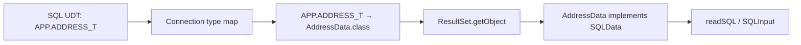

# Ánh xạ kiểu tùy chỉnh qua type map của Connection

## 1. Khi một cột SQL không phải kiểu vô hướng thông thường

Trong **JDBC**, việc đọc các cột `INTEGER`, `VARCHAR` hoặc `DECIMAL` thường khá trực tiếp: `ResultSet.getInt`, `getString` hoặc `getBigDecimal` trả về kiểu dữ liệu Java tương ứng. Tuy nhiên, một số hệ quản trị cơ sở dữ liệu cho phép định nghĩa **kiểu dữ liệu có tên do người dùng tạo** (*user-defined type*, UDT), chẳng hạn kiểu `ADDRESS_T` gồm hai thuộc tính đường và mã bưu chính.

Giả sử cột `address` chứa một giá trị SQL kiểu `APP.ADDRESS_T`:

```text
SQL: APP.ADDRESS_T
    ├── STREET       VARCHAR2(200 CHAR)
    └── POSTAL_CODE  VARCHAR2(32 CHAR)

Java: AddressData
    ├── street       String
    └── postalCode   String
```

Một câu hỏi thực tế là: khi gọi `rs.getObject("address")`, JDBC nên trả về một `java.sql.Struct` tổng quát hay một đối tượng `AddressData` do ứng dụng tự định nghĩa?

**Type map của `Connection`** chính là cơ chế chuẩn JDBC dùng để liên kết **tên kiểu SQL có tên** với **lớp Java tùy chỉnh**, thường là lớp triển khai `java.sql.SQLData`. Cơ chế này không tự động áp dụng cho mọi kiểu đặc biệt như JSON, UUID, enum hoặc kiểu của từng DBMS.



Bài này tập trung vào **ánh xạ kiểu tùy chỉnh** bằng các API chuẩn `Connection.getTypeMap()`, `setTypeMap(...)`, `SQLData`, `SQLInput` và `SQLOutput`, đồng thời chỉ ra giới hạn tương thích giữa driver và DBMS.

## 2. Kiểu SQL có tên và đối tượng Java không phải một thứ

Cần phân biệt ba lớp khái niệm:

| Tầng | Thành phần | Vai trò |
| --- | --- | --- |
| **Cơ sở dữ liệu** | `CREATE TYPE ... AS OBJECT` (Oracle), SQL `STRUCTURED TYPE` hoặc `DISTINCT TYPE` theo DBMS | Định nghĩa kiểu có tên và tập thuộc tính/quy tắc dữ liệu |
| **JDBC chuẩn** | `Struct`, `SQLData`, `SQLInput`, `SQLOutput` và type map | Giao tiếp giữa giá trị SQL và đối tượng Java |
| **Ứng dụng** | `AddressData`, `CustomerProfile`, repository, service | Đưa dữ liệu vào mô hình Java theo nghiệp vụ |

Hai cách xử lý giá trị SQL structured thường gặp:

1. **Không ánh xạ tùy chỉnh:** driver trả đối tượng `Struct`; ứng dụng đọc tên kiểu bằng `getSQLTypeName()` và mảng thuộc tính bằng `getAttributes()`.
2. **Có ánh xạ tùy chỉnh:** map liên kết tên SQL với một lớp `SQLData`; khi driver hỗ trợ, JDBC khởi tạo lớp đó và gọi `readSQL(...)` để điền dữ liệu.

Vì vậy, `Struct` là **biểu diễn tổng quát** của giá trị SQL structured type, còn `SQLData` là hợp đồng để **ánh xạ nó sang lớp Java do ứng dụng định nghĩa**.

Type map **không** thay đổi định nghĩa cột, không tự sinh bảng hay type trong DBMS, và cũng không phải một cơ chế ORM quản lý entity. Nó chỉ điều khiển việc chuyển đổi dữ liệu ở ranh giới JDBC khi driver hỗ trợ mapping tương ứng.

## 3. Các API cốt lõi của type map

`Connection` định nghĩa:

```java
Map<String, Class<?>> getTypeMap() throws SQLException;
void setTypeMap(Map<String, Class<?>> map) throws SQLException;
```

Ý nghĩa:

- **Key** là **tên kiểu SQL có tên**, thường ở dạng được DBMS/driver xác định như `APP.ADDRESS_T`.
- **Value** là một lớp Java, ví dụ `AddressData.class`, có khả năng nhận giá trị của kiểu SQL đó theo hợp đồng driver; với cách ánh xạ chuẩn, lớp triển khai `SQLData`.
- `getTypeMap()` lấy bản đồ kiểu của kết nối hiện tại; `setTypeMap(...)` đặt bản đồ dùng cho các phép ánh xạ tiếp theo trên chính kết nối đó.
- Mỗi `Connection` có trạng thái type map riêng. Việc cấu hình map cho kết nối A **không** tự cấu hình cho kết nối B trong connection pool.

Ví dụ:

```java
import java.sql.Connection;
import java.sql.SQLException;
import java.util.HashMap;
import java.util.Map;

// Giả định đang có Connection connection.
Map<String, Class<?>> original =
        new HashMap<>(connection.getTypeMap());

Map<String, Class<?>> updated = new HashMap<>(original);
updated.put("APP.ADDRESS_T", AddressData.class);

connection.setTypeMap(updated);

// Những phép getObject phù hợp trên Connection này có thể dùng map mới.
// Phải khôi phục cấu hình trước khi trả connection về pool.
try {
    // Đọc dữ liệu, xử lý trong phạm vi ngắn ...
} finally {
    connection.setTypeMap(original);
}
```

Đoạn trên minh họa API; phần ví dụ hoàn chỉnh phía dưới còn sử dụng một cách **không làm thay đổi trạng thái connection**, bằng overload `ResultSet.getObject(column, map)`.

**Không sửa trực tiếp map trả về từ `getTypeMap()` rồi mặc định việc sửa đó đã có hiệu lực.** Hãy tạo bản sao và gọi `setTypeMap` theo hợp đồng JDBC. Đồng thời tránh thay thế toàn bộ map cũ bằng một map chỉ có một phần tử: như vậy có thể vô tình loại bỏ những ánh xạ đã được cấu hình khác.

## 4. `SQLData`: khai báo cách đọc và ghi kiểu tùy chỉnh

Giao diện `java.sql.SQLData` cung cấp ba phương thức:

| Phương thức | Mục đích |
| --- | --- |
| `getSQLTypeName()` | Cho JDBC biết lớp Java tương ứng với tên kiểu SQL nào |
| `readSQL(SQLInput stream, String typeName)` | Đọc các thuộc tính của giá trị SQL theo thứ tự định nghĩa |
| `writeSQL(SQLOutput stream)` | Ghi các thuộc tính Java theo thứ tự SQL khi driver cần chuyển giá trị về DBMS |

`SQLInput` có các hàm như `readString`, `readInt`, `readBigDecimal` và `readObject`. `SQLOutput` có các hàm đối ứng `writeString`, `writeInt`, `writeBigDecimal`, `writeObject`...

**Thứ tự thuộc tính là hợp đồng bắt buộc.** Nếu type SQL định nghĩa `(street, postal_code)` nhưng `readSQL` lại đọc `postal_code` trước `street`, hai trường cùng kiểu `String` có thể bị tráo mà JDBC không báo lỗi.

Một lớp ánh xạ chuẩn thường cần **public no-argument constructor** để driver có thể khởi tạo qua reflection. Các thành phần không thể thay đổi như Java `record` với thành phần final không phải lựa chọn thuận tiện để JDBC gọi `readSQL` và điền lần lượt từng trường. Có thể đọc qua lớp `SQLData` mutable rồi chuyển sang record bất biến ở tầng ứng dụng.

## 5. Ví dụ end-to-end trên Oracle Database

Phần này chọn **Oracle Database** để minh họa loại SQL object có tên. Cần dùng driver Oracle JDBC hỗ trợ ánh xạ SQL object type qua `SQLData`; **không** giả định cùng mã SQL và mapping chạy nguyên xi trên PostgreSQL, MySQL hoặc SQL Server.

### 5.1. Khai báo SQL object type và bảng

Giả sử kết nối bằng schema `APP`, hai câu DDL sau được thực thi riêng:

```sql
CREATE TYPE address_t AS OBJECT (
    street       VARCHAR2(200 CHAR),
    postal_code  VARCHAR2(32 CHAR)
);

CREATE TABLE customer_profiles (
    customer_id NUMBER(19) PRIMARY KEY,
    address     address_t
);

INSERT INTO customer_profiles (customer_id, address)
VALUES (
    101,
    address_t('Đường Nguyễn Huệ, TP.HCM', '700000')
);

INSERT INTO customer_profiles (customer_id, address)
VALUES (102, NULL);
```

Khi nằm trong schema `APP`, tên kiểu SQL đầy đủ là `APP.ADDRESS_T` (nếu dùng tên định danh Oracle thông thường không có dấu nháy kép). Trong JDBC, hãy xác minh tên thực bằng metadata hoặc `Struct.getSQLTypeName()` thay vì đoán chữ hoa/chữ thường hoặc schema.

**Đừng thực hiện DDL như một phần của transaction cập nhật thông thường:** nhiều DBMS, trong đó có Oracle, có thể commit ngầm khi chạy DDL. Mẫu dữ liệu này nên được chuẩn bị bằng migration/schema setup trước khi chạy Java.

### 5.2. Lớp Java triển khai `SQLData`

Ví dụ mã đầy đủ cho `AddressData.java`:

```java
import java.sql.SQLData;
import java.sql.SQLInput;
import java.sql.SQLOutput;
import java.sql.SQLException;

public final class AddressData implements SQLData {
    public static final String SQL_TYPE_NAME = "APP.ADDRESS_T";

    private String street;
    private String postalCode;

    // Driver có thể cần constructor public không tham số.
    public AddressData() {}

    public AddressData(String street, String postalCode) {
        this.street = street;
        this.postalCode = postalCode;
    }

    @Override
    public String getSQLTypeName() {
        return SQL_TYPE_NAME;
    }

    @Override
    public void readSQL(SQLInput input, String typeName)
            throws SQLException {
        // Phải đúng thứ tự khai báo: street, postal_code.
        street = input.readString();
        postalCode = input.readString();
    }

    @Override
    public void writeSQL(SQLOutput output)
            throws SQLException {
        // Cùng thứ tự như CREATE TYPE ở DBMS.
        output.writeString(street);
        output.writeString(postalCode);
    }

    public String street() {
        return street;
    }

    public String postalCode() {
        return postalCode;
    }
}
```

`readSQL` được driver gọi sau khi tìm thấy ánh xạ tên kiểu. Tham số `typeName` là tên SQL do driver cung cấp, hữu ích để kiểm tra/ghi chẩn đoán; ví dụ này dùng một lớp cho một kiểu nên không cần nhánh chuyển đổi. `writeSQL` chuẩn bị dữ liệu khi ứng dụng chuyển đối tượng `SQLData` ngược về SQL UDT, **nếu driver hỗ trợ** đường ghi đó.

Hai thuộc tính `street` và `postalCode` dùng `String` vì cả hai được khai báo `VARCHAR2`. Nếu SQL có `NUMBER(p,s)` thì có thể dùng `readBigDecimal`/`writeBigDecimal` thay vì tự ép sang `double` gây mất độ chính xác.

### 5.3. Đọc bằng `getObject(column, map)` mà không đổi Connection

Phương thức `ResultSet.getObject(String columnLabel, Map<String,Class<?>> map)` cho phép cung cấp **type map ngay tại lần đọc**. Đây thường là lựa chọn dễ quản lý khi repository lấy kết nối từ `DataSource` hoặc pool và không muốn thay đổi cấu hình kết nối dùng chung.

```java
import java.sql.Connection;
import java.sql.PreparedStatement;
import java.sql.ResultSet;
import java.sql.SQLException;
import java.util.HashMap;
import java.util.Map;
import java.util.Optional;
import javax.sql.DataSource;

public final class CustomerAddressRepository {
    private final DataSource dataSource;

    public CustomerAddressRepository(DataSource dataSource) {
        this.dataSource = dataSource;
    }

    public Optional<AddressData> findAddress(long customerId)
            throws SQLException {
        String sql = """
                SELECT address
                FROM customer_profiles
                WHERE customer_id = ?
                """;

        try (Connection connection = dataSource.getConnection();
             PreparedStatement ps = connection.prepareStatement(sql)) {
            Map<String, Class<?>> map =
                    new HashMap<>(connection.getTypeMap());
            map.put(AddressData.SQL_TYPE_NAME, AddressData.class);

            ps.setLong(1, customerId);

            try (ResultSet rs = ps.executeQuery()) {
                if (!rs.next()) {
                    return Optional.empty();
                }

                Object value = rs.getObject("address", map);

                if (value == null) {
                    return Optional.empty();
                }
                if (!(value instanceof AddressData address)) {
                    throw new SQLException(
                            "Driver không trả AddressData từ APP.ADDRESS_T");
                }
                return Optional.of(address);
            }
        }
    }
}
```

Ví dụ gọi:

```java
CustomerAddressRepository repository =
        new CustomerAddressRepository(dataSource);

Optional<AddressData> address = repository.findAddress(101L);
address.ifPresent(a ->
        System.out.println(a.street() + " / " + a.postalCode()));
```

Lưu ý trong thiết kế:

1. `setLong` truyền `customerId` như tham số; không ghép dữ liệu người dùng vào SQL.
2. `map` là **bản sao** của cấu hình trên kết nối, giữ các mapping sẵn có và chỉ bổ sung `APP.ADDRESS_T`.
3. `getObject("address", map)` yêu cầu ánh xạ cho lần đọc cụ thể; nếu driver hỗ trợ cơ chế chuẩn, giá trị được đọc thành `AddressData`.
4. Giá trị SQL `NULL` được trả thành `null`, còn hàng không tồn tại cũng dẫn tới `Optional.empty()` trong ví dụ đơn giản này. Nếu nghiệp vụ cần phân biệt “không tìm thấy khách hàng” và “khách hàng có địa chỉ NULL”, hãy thiết kế kiểu kết quả biểu diễn hai trường hợp riêng.
5. `try-with-resources` đóng `ResultSet`, `PreparedStatement` và `Connection`. Với connection pool, đóng `Connection` theo hợp đồng thường có nghĩa trả nó về pool.

Đoạn mã này yêu cầu Java 17 trở lên để dùng SQL text block và pattern matching `instanceof`. **Sự tồn tại của API `getObject(..., map)` không bảo đảm driver hỗ trợ ánh xạ `SQLData`**; `SQLFeatureNotSupportedException` hoặc một đối tượng `Struct` thay vì `AddressData` đều cần được xử lý theo driver thực tế.

## 6. Ánh xạ mặc định qua `Connection.setTypeMap(...)`

Khi nhiều câu lệnh trên một kết nối đều đọc cùng SQL UDT, có thể thiết lập type map trực tiếp cho kết nối:

```java
import java.sql.Connection;
import java.sql.PreparedStatement;
import java.sql.ResultSet;
import java.sql.SQLException;
import java.util.HashMap;
import java.util.Map;

// Giả định connection đang mở và AddressData đã được khai báo.
Map<String, Class<?>> previous =
        new HashMap<>(connection.getTypeMap());
Map<String, Class<?>> selected = new HashMap<>(previous);
selected.put(AddressData.SQL_TYPE_NAME, AddressData.class);

connection.setTypeMap(selected);
try {
    try (PreparedStatement ps = connection.prepareStatement(
            "SELECT address FROM customer_profiles WHERE customer_id = ?")) {
        ps.setLong(1, 101L);

        try (ResultSet rs = ps.executeQuery()) {
            if (rs.next()) {
                Object value = rs.getObject(1); // Dùng type map của Connection.
                if (value instanceof AddressData address) {
                    System.out.println(address.street());
                }
            }
        }
    }
} finally {
    connection.setTypeMap(previous);
}
```

**Khác nhau giữa hai cách:**

| Cách | Phạm vi ảnh hưởng | Khi phù hợp |
| --- | --- | --- |
| `getObject(column, map)` | Chỉ lần gọi getter đó | Repository cần mapping cục bộ, tránh thay đổi trạng thái kết nối |
| `Connection.setTypeMap(map)` rồi `getObject(column)` | Những phép chuyển đổi tiếp theo trên kết nối, theo hỗ trợ driver | Có nhiều điểm đọc cùng UDT trong cùng phạm vi kết nối được kiểm soát |

**Lưu ý với connection pool:** Cấu hình `type map` là một phần trạng thái JDBC của `Connection`. Nếu một kết nối đã được mượn từ pool bị thay đổi map rồi trả lại mà không khôi phục, request sau có thể nhận một cấu hình khác dự kiến. Vì thế nên ưu tiên overload per-call, hoặc luôn khôi phục map ở `finally` với xử lý lỗi phù hợp.

Trong ví dụ tối giản ở trên, nếu `setTypeMap(previous)` trong `finally` ném lỗi, nó có thể che lỗi đọc ban đầu. Mã production nên bảo toàn lỗi gốc bằng cơ chế `addSuppressed` hoặc một scope quản lý trạng thái kết nối; kết nối có trạng thái không khôi phục được cần được loại khỏi pool theo chính sách của pool. Không nên tùy ý thay type map khi một `Connection` đang được nhiều luồng sử dụng.

## 7. Ghi một đối tượng UDT: `SQLData` hay `Struct`?

**Đọc** kiểu tùy chỉnh và **ghi** kiểu tùy chỉnh là hai hướng chuyển đổi. `SQLData.writeSQL(...)` mô tả cách ghi thuộc tính Java, nhưng việc truyền đối tượng `SQLData` trực tiếp cho driver vẫn phụ thuộc hỗ trợ driver/DBMS.

### 7.1. Truyền lớp `SQLData` nếu driver hỗ trợ

```java
AddressData address =
        new AddressData("Lê Lợi, Quận 1", "700000");

try (PreparedStatement ps = connection.prepareStatement(
        "UPDATE customer_profiles SET address = ? WHERE customer_id = ?")) {
    ps.setObject(1, address, java.sql.Types.STRUCT);
    ps.setLong(2, 101L);
    int updated = ps.executeUpdate();
}
```

Đây là **mẫu API cần kiểm thử trên driver cụ thể**, không phải bảo đảm `setObject(..., Types.STRUCT)` nhận mọi lớp `SQLData`. Một số driver cần kiểu object riêng hoặc một đối tượng `Struct` do kết nối tạo.

### 7.2. Tạo `Struct` bằng JDBC

JDBC có `Connection.createStruct(sqlTypeName, attributes)`:

```java
import java.sql.Connection;
import java.sql.PreparedStatement;
import java.sql.SQLException;
import java.sql.Struct;
import java.sql.Types;

public final class AddressStructWriter {
    private AddressStructWriter() {}

    public static int updateAddress(
            Connection connection,
            long customerId,
            String street,
            String postalCode) throws SQLException {
        // Attributes phải đúng thứ tự SQL type: street, postal_code.
        Struct address = connection.createStruct(
                "APP.ADDRESS_T",
                new Object[] {street, postalCode});

        try (PreparedStatement ps = connection.prepareStatement(
                "UPDATE customer_profiles SET address = ? WHERE customer_id = ?")) {
            ps.setObject(1, address, Types.STRUCT);
            ps.setLong(2, customerId);
            return ps.executeUpdate();
        }
    }
}
```

`Struct` là cách diễn đạt cấu trúc tổng quát mà không cần `SQLData`, nhưng `createStruct` và đường ghi `Struct` cũng có thể không được một số driver hỗ trợ; với Oracle, hãy xác minh phiên bản driver và kiểu object SQL tương ứng.

Trong các thao tác cập nhật nhiều bảng, dùng **cùng `Connection` và transaction** để bảo đảm nguyên tử. Type map chỉ xử lý chuyển kiểu dữ liệu, **không** tự mở, commit hoặc rollback giao dịch.

## 8. Khi driver không hỗ trợ type map: đọc `Struct` thủ công

Một lựa chọn khác là lấy giá trị SQL dưới dạng `Struct`:

```java
import java.sql.Struct;
import java.sql.SQLException;

// Giả định rs đang trỏ tới hàng có address và driver trả Struct.
Object value = rs.getObject("address");
if (value instanceof Struct struct) {
    String sqlType = struct.getSQLTypeName();
    Object[] attrs = struct.getAttributes();

    if (attrs.length != 2) {
        throw new SQLException(
                "Số thuộc tính ADDRESS_T không đúng hợp đồng");
    }

    String street = (String) attrs[0];
    String postalCode = (String) attrs[1];

    AddressData address = new AddressData(street, postalCode);
    System.out.println(sqlType + ": " + address.street());
}
```

**Ưu điểm:** Ánh xạ thủ công cho phép kiểm soát từng thuộc tính mà không phụ thuộc cơ chế tự tạo lớp `SQLData`.

**Giới hạn:** Phải tự xác thực thứ tự, số lượng và kiểu thuộc tính. Trình điều khiển có thể trả một kiểu đối tượng chuyên biệt thay vì `Struct`; có driver không triển khai đầy đủ `getAttributes`. Các kiểu SQL lồng nhau, `ARRAY`, số thời gian hoặc `NULL` làm mã chuyển đổi phức tạp hơn. Nếu dùng ép kiểu `(String)` ở ví dụ, cần khớp chắc chắn metadata; nếu schema thay đổi thì nên báo lỗi rõ ràng thay vì ép kiểu mù quáng.

Ngoài ra, `Struct.getAttributes(Map<String,Class<?>>)` cho phép cung cấp map khi một thuộc tính bên trong là UDT có tên khác. Đây là công cụ hữu ích cho **nested structured types** khi driver hỗ trợ, không chỉ cho thuộc tính hai `String` đơn giản.

## 9. Kiểu riêng của DBMS không luôn được hỗ trợ qua type map

Tên gọi “SQL type tùy chỉnh” trong một dự án có thể bao gồm nhiều nhóm rất khác nhau:

| Trường hợp | Có nên mặc định dùng `Connection.setTypeMap`? | Ghi chú |
| --- | --- | --- |
| SQL structured type/object type có tên, có mapping `SQLData` | **Có thể**, nếu driver hỗ trợ | Trường hợp chính của bài |
| SQL distinct type có tên | **Có thể**, tùy driver và đặc tả DBMS | Kiểm tra mapping và chuyển kiểu thực tế |
| PostgreSQL composite type | **Không mặc định** | pgJDBC thường có cơ chế `PGobject`/chuyển đổi riêng; không tự giả định hỗ trợ `SQLData` như Oracle |
| PostgreSQL `jsonb`, `uuid`, enum | **Không mặc định** | Thường cần kiểu `OTHER`, getter/setter phù hợp hoặc API đặc thù driver |
| MySQL `JSON` | **Không mặc định** | Không tương đương SQL object UDT cho type map chuẩn |
| SQL Server table-valued parameter | **Không mặc định** | Có API và cấu trúc tham số riêng theo driver |
| SQL `ARRAY` / giá trị mảng | **Không mặc định** | Xem `java.sql.Array` và API `createArrayOf`; driver hỗ trợ khác nhau |
| Java enum hoặc JSON DTO phía ứng dụng | **Không** | Chỉ là kiểu Java; cần quyết định SQL type và cách serialize riêng |

Type map **không phải registry chung cho mọi serializer/deserializer**. Ví dụ thêm `map.put("JSONB", MyJsonData.class)` không đồng nghĩa `ResultSet.getObject` cho cột PostgreSQL `jsonb` sẽ tự trả `MyJsonData`.

Đối với các kiểu riêng:

1. Xem **kiểu thực tế** của cột và JDBC type mà driver báo.
2. Thử API chuẩn `getObject`, `getObject(...,map)`, `Struct` hoặc `SQLData` khi phù hợp.
3. Khi chuẩn không đủ, dùng API/documentation của driver hoặc chuyển đổi tường minh ở repository.
4. Tránh tạo phụ thuộc driver một cách ngầm định trong toàn bộ tầng domain; cô lập logic chuyển đổi theo repository/adapter.

## 10. Tên kiểu, schema và vòng đời triển khai

Một nguyên nhân phổ biến của lỗi type map là **key không trùng với tên SQL type mà driver dùng**. Trong Oracle, `APP.ADDRESS_T` có thể khác `ADDRESS_T` nếu ánh xạ yêu cầu tên đầy đủ. Trong DBMS có quoted identifiers, chữ hoa/thường có thể trở nên quan trọng.

Có thể kiểm tra tên SQL type thật bằng `Struct.getSQLTypeName()`, hoặc tra metadata của DBMS/driver. Những điểm cần nhớ:

- Không để tên kiểu/schema tùy ý từ input người dùng đi vào câu SQL hay map cấu hình. Hãy dùng **danh sách cho phép** hoặc cấu hình được kiểm soát.
- Tên key như `APP.ADDRESS_T` nên là hằng số hoặc cấu hình nhất quán, không tự đoán bằng cách thêm schema hiện tại ở mọi nơi.
- Khi **đổi thứ tự thuộc tính** của SQL UDT, `SQLData.readSQL/writeSQL` phải được cập nhật đồng bộ. Đây là thay đổi hợp đồng dữ liệu, không phải chỉ đổi tên trường Java.
- Khi **thêm thuộc tính**, phải cân nhắc tương thích giữa database schema, driver, lớp Java và phiên bản ứng dụng đang chạy song song.
- Nếu metadata trả một SQL type khác so với dự kiến, nên báo lỗi chuyển đổi rõ ràng để phát hiện sai schema; đừng âm thầm đọc bằng vị trí của kiểu khác.

### Xem metadata của SQL UDT

JDBC `DatabaseMetaData` có các API kiểm tra UDT và thuộc tính:

```java
import java.sql.Connection;
import java.sql.DatabaseMetaData;
import java.sql.ResultSet;
import java.sql.SQLException;
import java.sql.Types;

public final class SqlTypeInspector {
    private SqlTypeInspector() {}

    public static void inspect(Connection connection)
            throws SQLException {
        DatabaseMetaData meta = connection.getMetaData();

        try (ResultSet udts = meta.getUDTs(
                null, "APP", "ADDRESS_T",
                new int[] {Types.STRUCT})) {
            while (udts.next()) {
                System.out.println(
                        "UDT: " + udts.getString("TYPE_NAME")
                        + ", JDBC type: " + udts.getInt("DATA_TYPE"));
            }
        }

        try (ResultSet attrs = meta.getAttributes(
                null, "APP", "ADDRESS_T", "%")) {
            while (attrs.next()) {
                System.out.printf(
                        "%d: %s (%s)%n",
                        attrs.getInt("ORDINAL_POSITION"),
                        attrs.getString("ATTR_NAME"),
                        attrs.getString("TYPE_NAME"));
            }
        }
    }
}
```

Không phải driver nào cũng trả đầy đủ `getUDTs`/`getAttributes`. Có thể gặp kết quả rỗng do tham số catalog/schema, quyền truy cập metadata, kiểu SQL không được driver phân loại thành `Types.STRUCT` hoặc hạn chế implementation. **DDL/migration thực tế và tài liệu driver vẫn là nguồn xác minh chính.**

## 11. Transaction, pool và quản lý lỗi

Ánh xạ type map không thay thế các nguyên tắc JDBC cơ bản:

| Tình huống | Nguyên tắc |
| --- | --- |
| Đọc một UDT | Đóng `ResultSet`, `PreparedStatement` và `Connection` đúng thời điểm |
| Chỉnh `setTypeMap` trên kết nối pool | Khôi phục trạng thái map hoặc dùng map per-call; không để request sau kế thừa |
| Ghi UDT và cập nhật các bảng liên quan | Dùng một `Connection`, `autoCommit=false` nếu cần transaction nguyên tử |
| SQL `NULL` ở cột UDT | `getObject` có thể trả `null`; không ép kiểu trước khi kiểm tra |
| Thuộc tính bên trong UDT bằng `NULL` | `readString`/`readBigDecimal` thường trả `null`; getter số nguyên nguyên thủy cần kiểm tra `SQLInput.wasNull()` |
| Lỗi driver không hỗ trợ tính năng | Bắt `SQLFeatureNotSupportedException` khi thích hợp, kiểm tra API thay thế |
| Lỗi ở thời điểm commit | Kết quả transaction có thể chưa rõ; cần đối chiếu bằng khóa nghiệp vụ trước khi retry |

Một lớp `SQLData` không nên tự ý mở connection mới trong `readSQL` để tra cứu các thuộc tính khác: như vậy sẽ có tác dụng phụ về hiệu năng và ranh giới transaction, thậm chí có thể làm phát sinh vòng gọi. Hãy giữ `readSQL/writeSQL` tập trung vào **chuyển đổi thuộc tính tuần tự**, và đưa logic nghiệp vụ vào service/repository.

Nếu phải ghi địa chỉ cùng một đơn hàng và lịch sử chỉnh sửa, hãy để **service sở hữu transaction**, các repository nhận cùng `Connection` hoặc đi qua transaction manager tương ứng. Một phương thức `setObject` thất bại không chứng minh mọi SQL khác trong transaction đã rollback; cần xử lý `commit/rollback` theo hợp đồng của DBMS.

## 12. Kiểm thử ánh xạ với driver thật

Để biết type map hoạt động như mong đợi, kiểm thử tích hợp trên DBMS và driver mục tiêu cần bao gồm:

| Ca kiểm thử | Kỳ vọng |
| --- | --- |
| Đọc hàng `101` có `APP.ADDRESS_T` | `getObject(column,map)` trả `AddressData` với hai thuộc tính đúng |
| Đọc hàng `102` có địa chỉ SQL `NULL` | Không phát sinh `ClassCastException`; trả `null`/`Optional.empty()` đúng hợp đồng |
| Đọc kiểu `Struct` không custom map | `getSQLTypeName` và `getAttributes` trả dữ liệu đúng hoặc phát hiện driver không hỗ trợ |
| Viết lại UDT qua `createStruct` | Hai thuộc tính được lưu đúng thứ tự, không bị đảo `street` và `postal_code` |
| Viết trực tiếp đối tượng `SQLData` | Chỉ thành công nếu driver hỗ trợ đường ghi; nếu không, có fallback rõ ràng |
| Chuỗi Unicode và dấu tiếng Việt | Giá trị không bị lỗi mã hóa qua VARCHAR2 / JDBC |
| Hai kết nối có map khác nhau | Không có ảnh hưởng chéo trong connection pool |
| Lỗi khi khôi phục `setTypeMap` | Lỗi được ghi nhận; không trả kết nối bị ô nhiễm cấu hình mà không xử lý |
| Thay đổi thứ tự thuộc tính SQL UDT | Test phát hiện sai mapping trước khi phát hành |
| Nested UDT và thuộc tính `NULL` | `SQLInput.readObject`, `Struct.getAttributes(map)` và null được xử lý đúng nếu dùng |
| Driver không hỗ trợ `getObject(..., map)` | Repository báo lỗi có ngữ cảnh hoặc chuyển sang adapter được hỗ trợ |

**Kiểm thử mock `ResultSet` không đủ** để xác nhận driver thật có gọi `SQLData.readSQL`, tự tạo lớp có constructor rỗng hay hỗ trợ `Connection.createStruct`. Các tính năng UDT phụ thuộc nhiều vào driver, kiểu SQL và phiên bản DBMS.

Với `BigDecimal`, ngày giờ, giá trị Unicode hoặc thuộc tính lồng nhau, nên kiểm tra **cả giá trị SQL lẫn đối tượng Java sau khi round-trip**. Đừng chỉ xác minh `getObject` không ném lỗi: hai chuỗi bị tráo vị trí vẫn có thể là hai `String` hợp lệ nhưng sai dữ liệu.

## 13. Checklist áp dụng

Trước khi sử dụng type map của `Connection` trong dự án JDBC:

1. **Xác định SQL type thật:** UDT có tên hay chỉ là kiểu riêng/JSON/enum? DBMS nào hỗ trợ?
2. **Đọc hợp đồng thuộc tính:** tên schema, thứ tự, kiểu và khả năng `NULL` của từng thuộc tính.
3. **Triển khai `SQLData`:** constructor công khai không tham số, `getSQLTypeName`, `readSQL`, `writeSQL` đúng thứ tự.
4. **Cấu hình map rõ ràng:** lấy bản sao `getTypeMap`, thêm đúng tên type SQL và lớp Java tương ứng.
5. **Chọn phạm vi:** dùng `getObject(column, map)` nếu có thể; nếu `setTypeMap`, khôi phục trạng thái khi xong.
6. **Kiểm tra giá trị trả về:** xử lý SQL `NULL`, xác thực `instanceof` và đưa ra lỗi rõ nếu driver trả `Struct` thay vì `SQLData`.
7. **Chọn đường ghi có hỗ trợ:** `setObject` với `SQLData` hoặc `Connection.createStruct`, nhưng thử nghiệm trên driver thật.
8. **Quản lý transaction, connection pool, lỗi và metadata:** không để logic chuyển kiểu chi phối ranh giới nghiệp vụ.
9. **Kiểm thử round-trip và schema evolution:** lỗi đảo thuộc tính, Unicode, null, nested type và phiên bản driver.

**Ghi nhớ:** Type map của `Connection` là cơ chế JDBC giúp kết nối **tên kiểu SQL tùy chỉnh** với **lớp Java triển khai `SQLData`** khi driver hỗ trợ. Dùng `SQLInput/SQLOutput` để chuyển thuộc tính theo đúng thứ tự; dùng `ResultSet.getObject(column, map)` khi muốn ánh xạ cục bộ hoặc `setTypeMap` khi quản lý chặt chẽ trạng thái kết nối. Không coi type map là bộ chuyển đổi vạn năng cho mọi kiểu SQL nâng cao: luôn xác minh hợp đồng UDT, cách driver xử lý `Struct` và kết quả thực tế trên DBMS mục tiêu.
