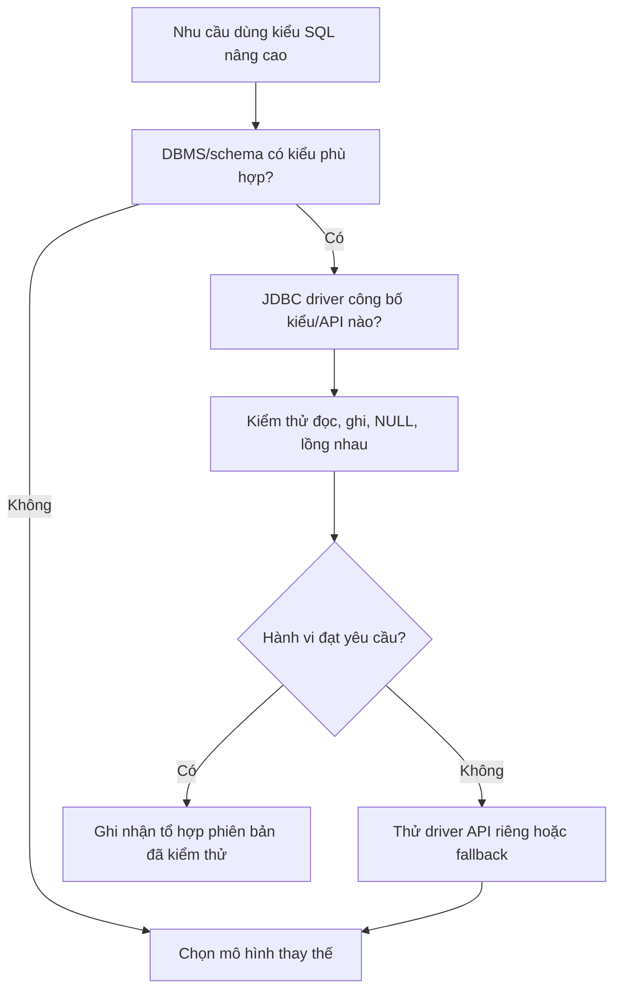
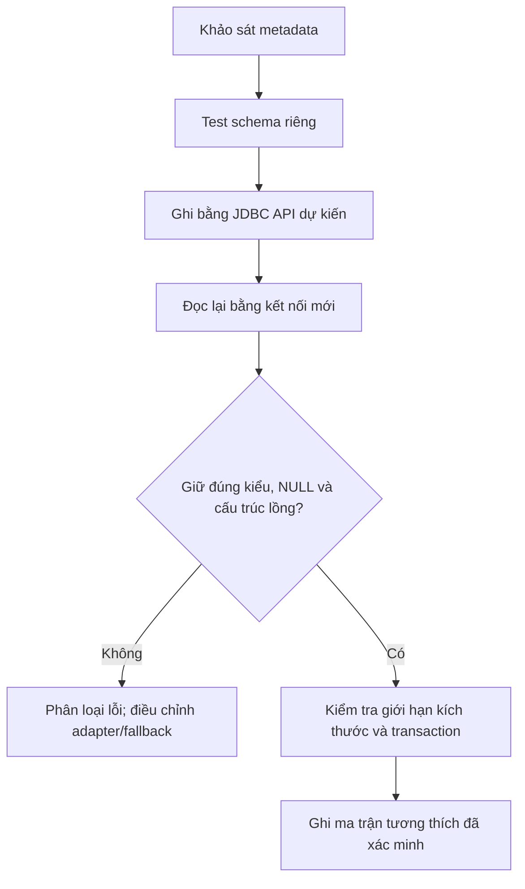

# Kiểm tra hỗ trợ trước khi dùng cấu trúc lồng hoặc kiểu đặc thù

## Mục tiêu học tập

Trong **JDBC**, các thao tác CRUD thường truyền và đọc các kiểu cơ bản như số, chuỗi, ngày giờ qua `PreparedStatement` và `ResultSet`. Nhưng khi cơ sở dữ liệu lưu **mảng**, **kiểu cấu trúc có nhiều thuộc tính**, **kiểu tự định nghĩa**, **XML**, **JSON**, **UUID** hoặc các kiểu đặc thù khác, thao tác ánh xạ không còn đơn giản là gọi `getString()` rồi `setString()`. Ngay cả khi DBMS có kiểu dữ liệu đó, **driver JDBC chưa chắc hỗ trợ đầy đủ API tiêu chuẩn để tạo, gắn tham số, đọc hoặc ánh xạ dữ liệu lồng nhau**.

Bài thuộc chương **Kiểu SQL nâng cao** tập trung vào một kỹ năng nền tảng: **kiểm tra hỗ trợ trước khi thiết kế ứng dụng phụ thuộc kiểu SQL đặc thù**. Ta sẽ kết hợp thông tin về schema, `DatabaseMetaData`, `ResultSetMetaData`, các API `Array`/`Struct`/`SQLXML`, kiểm thử thực tế và chiến lược dự phòng. Cách làm này phù hợp với mục tiêu sử dụng JDBC chuẩn qua driver, `DataSource`, truy vấn tham số hóa và xử lý lỗi mà không gắn chặt ứng dụng vào giả định sai về một DBMS.

Sau bài học, bạn có thể:

- Phân biệt **DBMS hỗ trợ kiểu SQL**, **driver ánh xạ kiểu đó** và **API JDBC thực sự thao tác được**.
- Dùng `DatabaseMetaData.getTypeInfo()`, `getColumns()` và các API metadata liên quan để khảo sát khả năng hỗ trợ.
- Dùng `ResultSetMetaData` và phép thử trên database cách ly để xác minh kiểu dữ liệu **thực sự trả về**.
- Kiểm tra `Connection.createArrayOf()`, `createStruct()`, `ResultSet.getArray()`, `getObject()` và cách giải phóng tài nguyên.
- Quyết định khi nào dùng cơ chế JDBC chuẩn, API riêng của driver hoặc mô hình dữ liệu thay thế.
- Lập ma trận tương thích và kiểm thử round-trip cho dữ liệu lồng, `NULL`, kích thước lớn và trường hợp không được hỗ trợ.

## 1. “Có kiểu dữ liệu trong database” chưa đồng nghĩa “JDBC hỗ trợ”

Giả sử bảng `customer_profiles` có cột `tags` kiểu mảng chuỗi và cột `address` kiểu cấu trúc gồm đường, thành phố, mã vùng. Trên một DBMS có những kiểu này, SQL có thể đọc/ghi chúng bình thường. Tuy vậy, từ ứng dụng Java vẫn phải giải quyết những câu hỏi:

1. Driver báo cột là `Types.ARRAY`/`Types.STRUCT` hay `Types.OTHER`?
2. `ResultSet.getArray("tags")` có chạy được không?
3. `Connection.createArrayOf("VARCHAR", ...)` có tạo mảng thích hợp để `PreparedStatement.setArray(...)` không?
4. Kiểu cấu trúc `address` có được trả thành `java.sql.Struct` hay một lớp riêng của driver?
5. Mảng chứa cấu trúc hoặc cấu trúc có thuộc tính lồng có được hỗ trợ ở cả chiều đọc và chiều ghi?
6. Khi một API không hỗ trợ, driver trả `SQLFeatureNotSupportedException`, một `SQLException` khác, hay cung cấp cách làm riêng?
7. Trên connection pool và trong transaction, đối tượng SQL trả về còn hợp lệ đến khi nào?

Không có một cờ duy nhất trả lời tất cả. **Khả năng hỗ trợ là tổ hợp theo từng kiểu dữ liệu, thao tác, DBMS, phiên bản driver và cách cấu hình.**



### Ba lớp xác minh

| Lớp | Điều cần kiểm tra | Bằng chứng phù hợp |
| --- | --- | --- |
| **DBMS và schema** | Có kiểu dữ liệu, UDT, mảng hoặc extension? Cú pháp tạo/lưu giá trị? | Tài liệu DBMS theo phiên bản, định nghĩa schema, truy vấn metadata |
| **Driver và JDBC API** | Driver báo mã `Types` nào, có triển khai `Array`/`Struct`/`SQLXML` và phương thức tạo đối tượng không? | Tài liệu driver, `DatabaseMetaData`, ngoại lệ từ API |
| **Đường thực thi thật** | Đọc/ghi round-trip có đúng giá trị và không mất `NULL` hay cấu trúc lồng? | Integration test với DBMS/driver/cấu hình sản xuất tương ứng |

Một kết quả tốt ở lớp trước **không bảo đảm** lớp sau. Ví dụ driver liệt kê một type trong `getTypeInfo()` nhưng `createArrayOf()` vẫn không hỗ trợ thao tác tạo giá trị thuộc type đó.

## 2. Những kiểu nâng cao thường gặp và mức độ di động

| Nhóm kiểu | API JDBC đáng xem | Câu hỏi tương thích |
| --- | --- | --- |
| Mảng SQL (*ARRAY*) | `java.sql.Array`, `getArray()`, `setArray()`, `createArrayOf()` | DBMS có mảng không? Tên kiểu phần tử là gì? Có mảng lồng không? |
| Kiểu cấu trúc (*STRUCT*) | `java.sql.Struct`, `getAttributes()`, `createStruct()` | UDT có thực sự là SQL STRUCT? Driver có tạo và giải mã được không? |
| Kiểu người dùng định nghĩa (*UDT*) | `getUDTs()`, `getAttributes()`, `SQLData`, `getTypeMap()` | Ánh xạ tự động hay cần mapping tùy DBMS/driver? |
| XML | `java.sql.SQLXML`, `getSQLXML()`, `setSQLXML()`, `free()` | DBMS/driver có type XML và API tương ứng không? |
| JSON / JSONB | Thường là `getObject()`, `setObject()` hoặc API đặc thù | Không có một cách bind JSON chuẩn, thống nhất cho mọi driver/DBMS |
| UUID, enum, range, spatial, kiểu extension | `getObject()`, `setObject()`; đôi khi `Types.OTHER` hoặc lớp riêng | Kiểu Java nào được trả về? Cần cast SQL hoặc adapter không? |
| Kiểu tham chiếu SQL | `java.sql.Ref` và APIs liên quan | DBMS/driver có hỗ trợ SQL REF hay chỉ quan hệ FK thông thường? |
| Nhị phân/ký tự lớn | `Blob`, `Clob`, `NClob` | Locator, streaming và vòng đời connection/transaction ra sao? |

**Đặc biệt lưu ý:** một cột JSON không tự động tương đương `Struct`; một mảng JSON không tự động tương đương SQL `ARRAY`; và một bảng con quan hệ một-nhiều không phải SQL `ARRAY` theo nghĩa type system. Những mô hình này có cú pháp, khả năng tìm kiếm, ràng buộc và cách ánh xạ khác nhau.

## 3. Khảo sát type catalog bằng DatabaseMetaData

`Connection.getMetaData()` cung cấp `DatabaseMetaData`, nơi JDBC công bố thông tin về database và khả năng driver. Một phép khảo sát thường bắt đầu với:

- `getDatabaseProductName()` và `getDatabaseProductVersion()` để biết DBMS/phiên bản.
- `getDriverName()` và `getDriverVersion()` để ghi lại môi trường tương thích.
- `getTypeInfo()` để lấy các kiểu SQL mà database/driver công bố.
- `getColumns(...)` để biết **kiểu thực tế của cột** trong bảng.
- `getUDTs(...)` và `getAttributes(...)` khi cần khám phá user-defined types và các thuộc tính được driver công bố.

### 3.1. Ví dụ Java khảo sát thông tin kiểu

```java
import java.sql.Connection;
import java.sql.DatabaseMetaData;
import java.sql.ResultSet;
import java.sql.SQLException;
import java.sql.Types;
import javax.sql.DataSource;

public final class SqlTypeDiscovery {
    public static void inspect(DataSource dataSource) throws SQLException {
        try (Connection connection = dataSource.getConnection()) {
            DatabaseMetaData meta = connection.getMetaData();

            System.out.println(
                "DBMS: " + meta.getDatabaseProductName()
                + " / " + meta.getDatabaseProductVersion()
            );
            System.out.println(
                "Driver: " + meta.getDriverName()
                + " / " + meta.getDriverVersion()
            );

            try (ResultSet types = meta.getTypeInfo()) {
                while (types.next()) {
                    int jdbcType = types.getInt("DATA_TYPE");
                    if (jdbcType == Types.ARRAY
                            || jdbcType == Types.STRUCT
                            || jdbcType == Types.DISTINCT
                            || jdbcType == Types.JAVA_OBJECT
                            || jdbcType == Types.SQLXML
                            || jdbcType == Types.OTHER) {
                        System.out.printf(
                            "type=%s, jdbcCode=%d, createParams=%s%n",
                            types.getString("TYPE_NAME"),
                            jdbcType,
                            types.getString("CREATE_PARAMS")
                        );
                    }
                }
            }
        }
    }
}
```

**Ý nghĩa chính:** `DATA_TYPE` là mã kiểu JDBC từ `java.sql.Types`, còn `TYPE_NAME` là tên kiểu do DBMS/driver công bố. Thông tin tên kiểu quan trọng khi SQL phải dùng cú pháp hoặc tên kiểu cụ thể; mã `Types.OTHER` thường là dấu hiệu cần tìm hiểu thêm chứ **không đồng nghĩa kiểu không dùng được**.

Đây là đoạn kiểm tra metadata, **không chứng minh** rằng mọi API tương ứng sẽ chạy. Chẳng hạn, `getTypeInfo()` có thể liệt kê một loại `ARRAY` nhưng driver không triển khai `Connection.createArrayOf()` cho loại phần tử bạn định dùng.

### 3.2. Kiểm tra chính xác cột trong schema

Để biết cột `tags` của bảng `customer_profiles` được driver nhận diện như thế nào:

```java
try (Connection c = dataSource.getConnection()) {
    DatabaseMetaData meta = c.getMetaData();

    try (ResultSet cols = meta.getColumns(
            c.getCatalog(),
            null,                    // schemaPattern: chỉnh theo môi trường
            "customer_profiles",     // tableNamePattern
            "tags"                   // columnNamePattern
    )) {
        while (cols.next()) {
            System.out.printf(
                "column=%s, jdbcCode=%d, dbType=%s, nullable=%d%n",
                cols.getString("COLUMN_NAME"),
                cols.getInt("DATA_TYPE"),
                cols.getString("TYPE_NAME"),
                cols.getInt("NULLABLE")
            );
        }
    }
}
```

Các tham số tên bảng và tên cột là **pattern**, chịu ảnh hưởng của quy tắc viết hoa/thường và namespace của DBMS. Nếu không có kết quả, đừng kết luận driver không hỗ trợ kiểu đó: trước hết kiểm tra catalog, schema, quyền đọc metadata, cách đặt dấu nháy của tên đối tượng và việc DBMS có biến đổi case khi tạo bảng hay không.

`getColumns()` phản ánh cách driver báo cột cụ thể; cột có tên kiểu như `jsonb` nhưng mã `Types.OTHER` vẫn có thể đọc/ghi qua API riêng. Ngược lại, cột được báo `Types.ARRAY` không bảo đảm mọi phần tử hoặc mọi cấu trúc lồng đều được ánh xạ tốt.

### 3.3. Khám phá UDT và thuộc tính STRUCT

Nếu DBMS định nghĩa kiểu cấu trúc tên `ADDRESS_TYPE`, có thể thử:

```java
try (Connection c = dataSource.getConnection()) {
    DatabaseMetaData meta = c.getMetaData();

    try (ResultSet udts = meta.getUDTs(
            c.getCatalog(),
            null,
            "ADDRESS_TYPE",
            new int[] { Types.STRUCT, Types.DISTINCT, Types.JAVA_OBJECT }
    )) {
        while (udts.next()) {
            System.out.printf(
                "UDT=%s, typeCode=%d%n",
                udts.getString("TYPE_NAME"),
                udts.getInt("DATA_TYPE")
            );
        }
    }

    try (ResultSet attrs = meta.getAttributes(
            c.getCatalog(), null, "ADDRESS_TYPE", "%"
    )) {
        while (attrs.next()) {
            System.out.printf(
                "attribute=%s, jdbcCode=%d, typeName=%s%n",
                attrs.getString("ATTR_NAME"),
                attrs.getInt("DATA_TYPE"),
                attrs.getString("ATTR_TYPE_NAME")
            );
        }
    }
}
```

Một số driver không hỗ trợ đầy đủ phần metadata UDT hoặc chỉ trả một phần; hãy đối chiếu với định nghĩa schema và tài liệu driver. **Không có kết quả metadata chưa đủ để kết luận UDT không tồn tại.** Với cấu trúc lồng, còn cần kiểm tra kiểu từng thuộc tính và khả năng Java đọc/ghi những thuộc tính đó.

## 4. Kiểm tra kiểu ở chính ResultSet mà ứng dụng sử dụng

Metadata cấp catalog cho biết **schema định nghĩa gì**; còn `ResultSetMetaData` cho biết driver nhận diện **các cột trong kết quả truy vấn cụ thể** như thế nào. Đây là bước quan trọng khi truy vấn có `CAST`, biểu thức tính toán, hàm trả về kiểu đặc thù hoặc view.

```java
String sql = "SELECT tags, address FROM customer_profiles WHERE id = ?";

try (Connection c = dataSource.getConnection();
     java.sql.PreparedStatement ps = c.prepareStatement(sql)) {
    ps.setLong(1, 101L);

    try (ResultSet rs = ps.executeQuery()) {
        java.sql.ResultSetMetaData columns = rs.getMetaData();

        for (int i = 1; i <= columns.getColumnCount(); i++) {
            System.out.printf(
                "label=%s, jdbcCode=%d, typeName=%s, javaClass=%s%n",
                columns.getColumnLabel(i),
                columns.getColumnType(i),
                columns.getColumnTypeName(i),
                columns.getColumnClassName(i)
            );
        }
    }
}
```

Chú ý:

- Chỉ số cột JDBC bắt đầu từ **1**, không phải 0.
- `getColumnTypeName()` thường hữu ích khi `getColumnType()` trả `Types.OTHER`.
- `getColumnClassName()` là thông tin driver công bố cho `ResultSet.getObject()` mặc định; không nên hiểu nó là cam kết rằng mọi lời gọi `getObject(index, SomeClass.class)` đều hỗ trợ.
- Nếu cần biết đối tượng thực tế, lấy một **hàng kiểm thử** và ghi nhận `getObject(...).getClass().getName()` chỉ sau khi kiểm tra giá trị không phải `null`.
- `PreparedStatement.getParameterMetaData()` có thể hữu ích nhưng khả năng cung cấp thông tin đúng cho tham số kiểu phức tạp phụ thuộc driver. Không dùng nó thay thế kiểm thử bind thực tế.

Với kiểu đặc thù, kết quả có thể là `java.sql.Array`, `java.sql.Struct`, `String`, `byte[]`, lớp riêng của driver hoặc một kiểu Java khác. Không ép kiểu cứng trước khi xác minh.

## 5. SQL ARRAY: cần kiểm tra cả chiều đọc và chiều ghi

### 5.1. Chiều ghi: createArrayOf và setArray

Giả sử **DBMS kiểm thử thực sự hỗ trợ** bảng `profile_tags(profile_id, tags)` với cột `tags` là SQL array của chuỗi. Sau khi xác nhận **tên SQL của kiểu phần tử** là `VARCHAR` đối với môi trường đó, một ví dụ JDBC chuẩn có thể là:

```java
import java.sql.Array;
import java.sql.Connection;
import java.sql.PreparedStatement;
import java.sql.SQLException;
import javax.sql.DataSource;

public final class SqlArrayWriter {
    public static int insertTags(DataSource dataSource, long profileId,
                                 String[] tags) throws SQLException {
        try (Connection c = dataSource.getConnection()) {
            // "VARCHAR" là tên kiểu PHẦN TỬ trong DBMS giả định.
            // Driver cụ thể có thể cần tên kiểu khác.
            Array array = c.createArrayOf("VARCHAR", tags);
            try {
                try (PreparedStatement ps = c.prepareStatement(
                        "INSERT INTO profile_tags(profile_id, tags) "
                      + "VALUES (?, ?)")) {
                    ps.setLong(1, profileId);
                    ps.setArray(2, array);
                    return ps.executeUpdate();
                }
            } finally {
                array.free();
            }
        }
    }
}
```

Giới hạn và điều kiện:

- Tham số thứ nhất của `createArrayOf(baseTypeName, elements)` là **tên kiểu phần tử** mà driver/DBMS chấp nhận, không nhất thiết là tên cột array hoặc chuỗi `"VARCHAR[]"`.
- `elements` là một Java array; driver quyết định hỗ trợ loại phần tử, chuyển đổi kiểu, `null` và array nhiều chiều ra sao.
- `PreparedStatement.setArray(...)` gắn SQL `ARRAY` theo API JDBC, nhưng việc driver có triển khai thành công vẫn cần phép thử.
- `java.sql.Array` **không triển khai `AutoCloseable`**: nếu tạo được đối tượng, cần gọi `free()` để giải phóng tài nguyên có thể liên quan.
- Ví dụ dùng một câu `INSERT` độc lập ở chế độ auto-commit của connection được cấp. Nếu thao tác này nằm trong nghiệp vụ nhiều câu, tầng điều phối phải dùng cùng connection và transaction thích hợp; không đóng connection trong repository nhận từ caller.

Mã minh họa dùng `finally` nên `array.free()` chạy cả khi `executeUpdate()` lỗi. Nếu cleanup cũng lỗi, nó có thể che ngoại lệ trước đó; trong hệ thống production có thể dùng wrapper `AutoCloseable` hoặc lưu lỗi cleanup như suppressed để giữ đủ chẩn đoán.

### 5.2. Chiều đọc: getArray và getArray()

Đối với cùng schema đã được kiểm chứng, code đọc có thể như sau:

```java
import java.sql.Array;
import java.sql.Connection;
import java.sql.PreparedStatement;
import java.sql.ResultSet;
import java.sql.SQLException;
import java.util.ArrayList;
import java.util.List;
import javax.sql.DataSource;

public final class SqlArrayReader {
    public static List<String> readTags(DataSource ds, long profileId)
            throws SQLException {
        String sql =
            "SELECT tags FROM profile_tags WHERE profile_id = ?";

        try (Connection c = ds.getConnection();
             PreparedStatement ps = c.prepareStatement(sql)) {
            ps.setLong(1, profileId);

            try (ResultSet rs = ps.executeQuery()) {
                if (!rs.next()) {
                    return List.of(); // Chính sách ví dụ: không có hàng.
                }

                Array array = rs.getArray("tags");
                if (array == null) {
                    return List.of(); // Chính sách ví dụ: SQL NULL.
                }

                try {
                    Object value = array.getArray();
                    if (!(value instanceof Object[] elements)) {
                        throw new SQLException(
                            "Driver không trả mảng object như mong đợi"
                        );
                    }

                    List<String> result = new ArrayList<>();
                    for (Object element : elements) {
                        if (element != null && !(element instanceof String)) {
                            throw new SQLException(
                                "Kiểu phần tử ARRAY không phải String"
                            );
                        }
                        result.add((String) element);
                    }
                    // Trả danh sách sao chép; không giữ locator Array.
                    return java.util.Collections.unmodifiableList(result);
                } finally {
                    array.free();
                }
            }
        }
    }
}
```

Ví dụ sử dụng **Java 17+** cho pattern matching `instanceof`. Trong dữ liệu này, `Object[]` được kỳ vọng vì phần tử là chuỗi, nhưng driver có thể cung cấp representation khác cho mảng số nguyên hoặc kiểu tùy biến. Hãy kiểm tra đúng loại phần tử trước khi dùng lại mẫu. `unmodifiableList` ở đây giữ được phần tử `null`; `List.copyOf(...)` sẽ ném lỗi nếu danh sách chứa `null`.

**Quan trọng:** “không có hàng”, “cột SQL `NULL`” và “mảng rỗng” là ba trạng thái khác nhau. Ví dụ cố ý trả cùng danh sách rỗng cho hai trạng thái đầu để đơn giản hóa API. Trong nghiệp vụ cần phân biệt, hãy trả một kết quả có trạng thái rõ ràng, ví dụ `Optional<List<String>>` cho hàng hiện hữu hoặc DTO có cờ presence.

`Array.getArray()` có thể materialize toàn bộ phần tử trong bộ nhớ. Với array lớn, `Array.getResultSet()` là một lựa chọn JDBC để duyệt thành phần theo dạng hàng nếu driver hỗ trợ, nhưng **không được mặc định** nó streaming mà không đệm. Phải đóng `ResultSet` mà `getResultSet()` trả về trước khi gọi `array.free()`.

### 5.3. NULL và cấu trúc lồng

Các trường hợp cần thử riêng:

| Giá trị SQL hoặc phần tử | Điều cần kiểm tra |
| --- | --- |
| Toàn cột `tags IS NULL` | `getArray()` có trả `null` không? Có cần phân biệt với mảng rỗng không? |
| SQL array rỗng | Chiều dài 0 có round-trip đúng không? |
| Phần tử trong array là SQL `NULL` | Driver giữ `null` tại đúng vị trí không? |
| Array rất dài | Có vượt bộ nhớ hoặc giới hạn giao thức không? |
| Mảng lồng / mảng nhiều chiều | DBMS và driver có hỗ trợ cả tạo, bind, đọc không? |
| Array của SQL STRUCT | Phần tử có được ánh xạ thành `Struct` đúng không? |
| Driver trả lớp Java riêng | Có cần adapter hay API riêng không? |

Cơ chế hỗ trợ **mảng một chiều gồm chuỗi** không bảo đảm **mảng lồng chứa STRUCT** cũng được hỗ trợ.

## 6. SQL STRUCT và kiểu tự định nghĩa

`java.sql.Struct` biểu diễn SQL structured type gồm một hoặc nhiều thuộc tính. API cơ bản:

- `Struct.getSQLTypeName()`: tên type.
- `Struct.getAttributes()`: trả các giá trị thuộc tính theo thứ tự được định nghĩa.
- `Connection.createStruct(typeName, attributes)`: yêu cầu tạo SQL structured value.
- `PreparedStatement.setObject(...)`: có thể dùng để gắn `Struct` trên driver hỗ trợ.

Giả sử một DBMS **đã hỗ trợ UDT tên `ADDRESS_TYPE`** với các thuộc tính lần lượt `street`, `city`, `postal_code`. Đây là minh họa về ý tưởng, **không có cú pháp `CREATE TYPE` chung** cho tất cả DBMS.

```java
// Ví dụ bên trong phạm vi connection/statement đang hợp lệ.
java.sql.Struct address = connection.createStruct(
    "ADDRESS_TYPE",
    new Object[] { "12 Main St", "Hà Nội", "100000" }
);

try (java.sql.PreparedStatement ps = connection.prepareStatement(
        "UPDATE customer_profiles SET address = ? WHERE id = ?")) {
    ps.setObject(1, address);
    ps.setLong(2, 101L);
    ps.executeUpdate();
}
```

**Đây không phải đoạn code bảo đảm chạy với mọi driver.** Có driver không hỗ trợ `createStruct()` hoặc yêu cầu cách khai báo/cast type khác; nếu đã tạo giá trị SQL, cách bind cũng phải được kiểm tra thực tế. Không hoán đổi thứ tự thuộc tính dựa vào tên field Java mà chưa xác nhận định nghĩa UDT.

Chiều đọc:

```java
Object raw = rs.getObject("address");
if (raw instanceof java.sql.Struct address) {
    System.out.println("SQL type: " + address.getSQLTypeName());
    Object[] values = address.getAttributes();
    // Đọc values theo thứ tự UDT đã được xác minh.
} else if (raw == null) {
    // Cột SQL NULL.
} else {
    // Driver đang trả một kiểu Java khác; xem tài liệu/adapter.
}
```

`Struct.getAttributes()` có thể trả thuộc tính lồng: một thuộc tính có thể là `Array` hoặc `Struct` khác, hoặc kiểu Java do driver cung cấp. Khi đi sâu, phải giải mã **theo schema** và giới hạn độ sâu/kích thước, thay vì ép mọi thuộc tính về `String`. Nếu nhận được `java.sql.Array` lồng, hãy giải phóng nó bằng `free()` đúng thời điểm; `Struct` không có phương thức `free()` trong JDBC chuẩn.

### 6.1. Mapping UDT sang SQLData

JDBC có interface `SQLData` và type map của `Connection` (`getTypeMap()`/`setTypeMap()`) để hỗ trợ ánh xạ một số SQL UDT thành lớp Java tùy biến. Tuy nhiên, không phải DBMS/driver nào cũng hỗ trợ đầy đủ cơ chế này, đặc biệt với các loại UDT riêng.

Nếu dùng `SQLData`, cần đảm bảo:

1. `getSQLTypeName()` của lớp Java khớp tên SQL UDT phù hợp.
2. `readSQL(...)` và `writeSQL(...)` xử lý thuộc tính đúng thứ tự và đúng kiểu.
3. Type map được cấu hình trên đúng `Connection` và không làm rò rỉ trạng thái sang lần mượn kết nối khác trong pool.
4. Đường đọc, ghi, `NULL` và cấu trúc lồng đều được kiểm thử trên driver thật.

**Không chọn SQLData chỉ vì đã có interface.** Khi driver cung cấp adapter đơn giản hơn hoặc ứng dụng chỉ cần một DTO, cách chuyển đổi từ `Struct.getAttributes()` trong phạm vi hợp lệ có thể dễ kiểm soát hơn.

## 7. JSON, UUID, XML và kiểu riêng của DBMS

### 7.1. JSON/JSONB không có một binding chung cho mọi DBMS

Một DBMS có thể cung cấp SQL `JSON` hoặc `JSONB`, nhưng JDBC có thể báo cột qua `Types.OTHER` hoặc một mã khác. Một số driver đọc thành `String`, số khác dùng wrapper riêng. Việc gọi `ps.setString(...)` có thể thành công hoặc bị từ chối khi cột đòi giá trị JSON typed, tùy DBMS và cú pháp ép kiểu.

Có thể cần một trong các hướng:

- Gắn giá trị bằng `setObject(...)` với kiểu Java hoặc SQL type mà driver tài liệu hóa.
- Dùng SQL cast được kiểm soát, ví dụ `CAST(? AS <kiểu JSON hợp lệ của DBMS>)`, với **tên kiểu cố định, không lấy từ đầu vào người dùng**.
- Dùng một lớp adapter riêng cho từng DBMS hoặc khai báo khả năng hỗ trợ của driver.
- Lưu JSON dưới kiểu chuỗi khi thiết kế hệ thống cho phép, chấp nhận các khác biệt về ràng buộc và truy vấn.

Chỉ chuyển JSON thành chuỗi là **chưa đủ** để bảo đảm DBMS chấp nhận nội dung hoặc sử dụng đúng indexing/operator của JSON typed. Cũng cần kiểm tra validation, Unicode, số, thời gian và giá trị `null` trong JSON so với SQL `NULL`.

### 7.2. UUID, enum, range và spatial

Các kiểu đặc thù khác có thể được trả qua `getObject()` dưới dạng `java.util.UUID`, `String`, `byte[]`, wrapper vendor hoặc dữ liệu hình học chuyên dụng. JDBC không bảo đảm mọi kiểu extension được ánh xạ thành cùng một lớp Java ở mọi driver.

Một chiến lược là **cô lập lớp chuyển đổi** tại tầng persistence:

```java
Object raw = rs.getObject("external_id");

if (raw == null) {
    // SQL NULL theo contract.
} else if (raw instanceof java.util.UUID id) {
    // Sử dụng UUID do driver trả về.
} else if (raw instanceof String text) {
    java.util.UUID id = java.util.UUID.fromString(text);
    // Chỉ chuyển đổi khi định dạng được xác nhận.
} else {
    throw new java.sql.SQLException(
        "Kiểu external_id chưa được adapter hỗ trợ: "
        + raw.getClass().getName()
    );
}
```

Đoạn trên chỉ minh họa nhánh phân loại; trong mã thực, hàm adapter phải **trả kết quả** cho caller và xử lý định dạng sai theo contract. Không dùng `toString()` của bất kỳ wrapper nào để âm thầm thay thế biểu diễn chuẩn của UUID/range/spatial.

### 7.3. SQLXML là một trường hợp có interface riêng

JDBC có `SQLXML`, nhưng DBMS/driver phải hỗ trợ nó. Nếu được hỗ trợ, đọc qua `ResultSet.getSQLXML(...)` và giải phóng bằng `SQLXML.free()`:

```java
java.sql.SQLXML xml = rs.getSQLXML("xml_payload");
if (xml != null) {
    try {
        // getCharacterStream() nếu driver hỗ trợ.
        try (java.io.Reader reader = xml.getCharacterStream()) {
            // Đọc/parse nội dung khi ResultSet/Connection còn hợp lệ.
        }
    } finally {
        xml.free();
    }
}
```

Nếu parse XML thành đối tượng Java, cần cấu hình parser an toàn để tránh các rủi ro như XXE, giới hạn độ lớn và độ sâu. `SQLXML.getString()` dễ dùng hơn cho nội dung nhỏ nhưng có thể materialize toàn bộ XML trên heap.

### 7.4. SQL NULL và setNull cho kiểu phức tạp

Không có giá trị nào cũng có thể gắn bằng `ps.setObject(index, null)` một cách di động. Có những trường hợp nên xác định mã type và tên SQL type:

```java
// Ví dụ, chỉ áp dụng khi driver/DBMS đã được xác minh.
ps.setNull(2, java.sql.Types.ARRAY);

// Đối với UDT cụ thể, một số driver cần tên SQL type.
ps.setNull(3, java.sql.Types.STRUCT, "ADDRESS_TYPE");
```

`PreparedStatement.setNull(int, int, String)` và các overload của `setObject(...)` mang thông tin về kiểu, nhưng việc driver chấp nhận mã JDBC và tên SQL type nào vẫn phải được kiểm thử. Không lấy tên type/identifier từ request rồi nối trực tiếp vào câu SQL.

## 8. Phân biệt không hỗ trợ API với lỗi dữ liệu hoặc lỗi quyền

Khi thử một kiểu nâng cao, lỗi có thể xuất hiện vì nhiều nguyên nhân:

| Tín hiệu | Diễn giải cần xem xét | Cách xử lý |
| --- | --- | --- |
| `SQLFeatureNotSupportedException` | Driver không hỗ trợ phương thức/tính năng đang gọi | Chọn API khác hoặc fallback |
| `SQLException` với SQLState thuộc lớp `0A` (nếu có) | Có thể là feature not supported | Đối chiếu tài liệu driver và lỗi vendor |
| Lỗi cú pháp SQL | Kiểu/cast/cú pháp không hợp DBMS | Sửa SQL hoặc thay mô hình, không quy ngay thành lỗi driver |
| Lỗi không tìm thấy type | Tên type, schema, quyền hoặc extension chưa phù hợp | Kiểm tra type name và namespace |
| Lỗi chuyển đổi kiểu | Java object hoặc SQL value không tương thích | Kiểm tra kiểu phần tử, thuộc tính, `NULL` |
| Lỗi quyền | Người dùng database không có quyền type/bảng | Kiểm tra quyền và vai trò, tránh tăng quyền vô điều kiện |
| Lỗi tài nguyên/giới hạn | Mảng quá lớn, LOB đệm quá nhiều hoặc giới hạn thông điệp | Giảm kích thước/chọn mô hình khác |
| `getObject()` trả lớp riêng vendor | Driver dùng representation đặc thù | Adapter có kiểm thử và dependency rõ |

Không nên viết:

```java
try {
    // Gọi thao tác với SQL ARRAY/STRUCT.
} catch (SQLException ignored) {
    // Sai: coi tất cả lỗi là "không hỗ trợ" và nuốt lỗi.
}
```

Một lỗi `SQLException` có thể là vi phạm ràng buộc, lỗi kết nối hoặc transaction đã thất bại, không phải giới hạn tính năng. Với thao tác **ghi**, không tự thử lại ngay bằng một kiểu lưu trữ khác khi trạng thái commit chưa xác định; cần giữ transaction nhất quán và biết dữ liệu có thể đã được ghi hay chưa.

## 9. Quy trình kiểm tra năng lực bằng phép thử round-trip

Metadata là bước **khám phá**. Trước khi quyết định dùng kiểu phức tạp trong production, nên chạy phép thử tích hợp có kiểm soát trên DBMS/driver tương ứng.

### 9.1. Trình tự kiểm tra đề xuất

1. **Định nghĩa nhu cầu nghiệp vụ:** mảng, cấu trúc lồng, JSON, UUID hay XML thực sự giải quyết bài toán nào? Có cần truy vấn thuộc tính bên trong không?
2. **Ghi nhận phiên bản:** DBMS, driver JDBC, Java runtime, loại schema/type và cấu hình quan trọng.
3. **Khảo sát metadata:** `getTypeInfo()`, `getColumns()`, `getUDTs()`, `ResultSetMetaData` theo khả năng hỗ trợ.
4. **Chuẩn bị dữ liệu test:** một schema cách ly, có hàng hợp lệ, `NULL`, rỗng, giá trị Unicode và giá trị lớn.
5. **Kiểm thử đọc:** `getArray()`/`getObject()`/`getSQLXML()` trả object nào, nội dung/kiểu nested có đầy đủ không?
6. **Kiểm thử ghi:** `createArrayOf()`/`createStruct()`/`setObject()` hoặc API riêng; đọc lại trên connection độc lập và so sánh giá trị.
7. **Kiểm thử lỗi:** kiểu phần tử sai, tên UDT sai, thiếu quyền, kích thước vượt giới hạn, `NULL` và đối tượng đã được `free()`.
8. **Kiểm thử transaction và pool:** rollback việc ghi, commit thành công, cleanup đối tượng JDBC và reset trạng thái connection.
9. **Tạo danh sách hỗ trợ có chứng cứ:** công bố type/API có thể dùng và fallback theo phiên bản driver/DBMS.



**Không thử bằng DDL nguy hiểm trên database sản xuất.** Nếu cần tạo SQL UDT, array column hoặc extension để kiểm thử, dùng database/schema riêng đã có quyền và cơ chế dọn dẹp. Với ứng dụng đang chạy, thay đổi schema phải đi qua quy trình migration phù hợp.

### 9.2. Ma trận tối thiểu

| Trường hợp | Đọc | Ghi | Round-trip | Cần ghi nhận |
| --- | --- | --- | --- | --- |
| SQL ARRAY chuỗi ngắn | `getArray()` | `createArrayOf()` / `setArray()` | So sánh thứ tự/phần tử | Tên kiểu phần tử |
| Array rỗng | Kiểm tra chiều dài 0 | Tạo mảng rỗng | Không biến thành SQL `NULL` | Hành vi driver |
| Array chứa `NULL` | Giữ vị trí null | Gắn mảng có null | Không mất phần tử | Ràng buộc DBMS |
| SQL STRUCT đơn giản | `getObject()`/`Struct` | `createStruct()`/`setObject()` | So sánh thuộc tính | Tên SQL UDT, thứ tự |
| Array của STRUCT | Đọc lồng | Ghi lồng | So sánh nhiều tầng | Giới hạn depth/type |
| JSON/JSONB | Kiểu Java thật | Bind/cast đã xác minh | So sánh ngữ nghĩa JSON | Khác biệt SQL NULL/JSON null |
| UUID | Class thực tế | Adapter/driver bind | Giữ nguyên giá trị | Vendor class/encoding |
| XML | `SQLXML`/Reader | `setSQLXML()` | Unicode, parse an toàn | `free()` và kích thước |
| Giá trị rất lớn | Streaming/bộ nhớ | Message limits | Đúng toàn bộ dữ liệu | Heap/GC/timeouts |

Cùng một ô “Có” trong bảng chỉ có ý nghĩa khi ghi kèm **phiên bản và phương thức thực tế đã dùng**. Ví dụ, `getObject()` đọc được JSON không có nghĩa `setObject()` với `String` sẽ ghi lại được JSON.

## 10. Thiết kế fallback khi kiểu đặc thù không đáp ứng

Khi một kiểu SQL lồng không được hỗ trợ đầy đủ, không nhất thiết phải ép mọi môi trường dùng chung một lời gọi JDBC.

### Phương án A — Chuẩn hóa thành các bảng quan hệ

Ví dụ thay SQL array `tags` bằng bảng con:

```sql
CREATE TABLE profile_tags_relational (
    profile_id BIGINT NOT NULL,
    position_in_list INTEGER NOT NULL,
    tag VARCHAR(255) NOT NULL,
    PRIMARY KEY (profile_id, position_in_list)
);
```

Khi đọc, dùng SQL chuẩn với `PreparedStatement`, `ResultSet` và gom các hàng theo khóa cha. Mô hình này không phụ thuộc khả năng JDBC `createArrayOf()`, đồng thời cho phép index/ràng buộc trên từng hàng con; đổi lại cần JOIN hoặc truy vấn bổ sung.

### Phương án B — Cột JSON với adapter riêng

Phù hợp khi schema có JSON và cần giữ cấu trúc linh hoạt. Khi đó, tách các khác biệt DBMS/driver vào một adapter chuyên trách và kiểm thử:

- Cách serialize/deserialize, kiểm tra dữ liệu hợp lệ.
- SQL NULL khác với JSON `null`.
- Bind parameter phù hợp kiểu cột, cast và extension.
- Truy vấn/index theo key nếu nghiệp vụ cần.

Đừng gọi JSON là “hoàn toàn portable” chỉ vì Java có thư viện JSON; **SQL JSON operators, casting và driver mapping vẫn khác nhau**.

### Phương án C — Đối tượng nghiệp vụ phẳng ở tầng persistence

Chuyển SQL `STRUCT` thành nhiều cột bình thường như `street`, `city`, `postal_code`, rồi tạo Java record/DTO trong code. Phương án này dễ hỗ trợ JDBC cơ bản nhưng có thể mất ngữ nghĩa UDT ở cấp database; cân nhắc ràng buộc, migration và query plan.

### Phương án D — Driver-specific adapter

Nếu type đặc thù là yêu cầu không thể thay thế (spatial, range, enum, custom UDT), đặt phụ thuộc vendor vào một lớp nhỏ có giao diện Java chung. Ví dụ, cùng nghiệp vụ `saveValue(...)`, mỗi adapter đảm nhận bind/cast/getObject thích hợp. Những nơi còn lại của ứng dụng không trực tiếp phụ thuộc class vendor.

**Lựa chọn dựa trên yêu cầu nghiệp vụ và chi phí**, không phải mặc định rằng kiểu phức tạp là tốt hơn hay kém hơn bảng quan hệ chuẩn hóa.

## 11. Những sai lầm dễ mắc

| Giả định sai | Hậu quả | Cách sửa |
| --- | --- | --- |
| “Database có SQL ARRAY, vậy `createArrayOf()` chắc chắn hoạt động.” | Lỗi runtime hoặc driver không hỗ trợ | Kiểm thử chính phương thức trên driver thật |
| “`getTypeInfo()` liệt kê kiểu là đã hỗ trợ đọc/ghi đầy đủ.” | Metadata không phản ánh mọi đường thực thi | Test round-trip, nested, null |
| “`Types.OTHER` nghĩa là không đọc được.” | Bỏ qua tính năng driver cung cấp | Kiểm tra `TYPE_NAME`, `getObject()` và docs |
| “JSON array chính là `java.sql.Array`.” | Ép kiểu sai | Phân biệt JSON với SQL ARRAY |
| “`getObject()` luôn trả cùng Java class trên mọi driver.” | `ClassCastException` | Adapter/kiểm tra kiểu thực tế |
| “Mảng rỗng, SQL NULL và không có hàng là một.” | Mất trạng thái nghiệp vụ | Mô hình hóa sự khác biệt rõ ràng |
| “Mọi `Struct.getAttributes()` đều là chuỗi.” | Sai kiểu và mất giá trị lồng | Dựa vào schema/metadata và kiểm thử |
| “Dùng `getArray().getArray()` luôn tiết kiệm heap.” | Materialize dữ liệu lớn | Kiểm tra kích thước, getResultSet, streaming thực |
| “Có lỗi `SQLException` nghĩa là tính năng không được hỗ trợ.” | Nuốt lỗi dữ liệu/quyền/transaction | Phân loại exception, SQLState, vendor code |
| “Có thể truyền tên SQL type từ request vào SQL cast.” | Rủi ro SQL injection qua identifier | Danh sách type cố định/whitelist |
| “Không cần `free()` vì GC sẽ dọn.” | Giữ tài nguyên JDBC/driver | Giải phóng `Array`/`SQLXML` đúng vòng đời |
| “Đã chạy ở dev nên production cùng hành vi.” | Sai phiên bản/cấu hình/driver | Ghi ma trận và chạy integration test |

## 12. Bài luyện tập

**Bài 1 — Metadata hay proof?** `DatabaseMetaData.getTypeInfo()` trả một hàng `Types.ARRAY`. Kết luận nào hợp lệ về `Connection.createArrayOf()`?

*Đáp án:* Chỉ biết database/driver công bố một kiểu array; chưa thể kết luận `createArrayOf()` hỗ trợ tên kiểu phần tử, giá trị và cấu hình bạn cần. Phải thử thực tế.

**Bài 2 — SQL NULL.** Trong bảng `profile_tags`, một hàng có `tags IS NULL` và hàng khác có mảng rỗng. Vì sao `List.of()` trả về cho cả hai có thể chưa phù hợp?

*Đáp án:* Hai trạng thái có thể mang ý nghĩa nghiệp vụ khác nhau. API cần tách “không có giá trị” khỏi “mảng hiện hữu nhưng rỗng” khi yêu cầu.

**Bài 3 — UDT lồng.** Driver trả `Struct` cho địa chỉ, trong đó một thuộc tính là `Array`. Khi đọc xong, cần lưu ý gì?

*Đáp án:* Giải mã theo schema, không ép toàn bộ về chuỗi; giải phóng các đối tượng `Array` đã nhận qua `free()` khi không còn dùng và khi connection còn hợp lệ.

**Bài 4 — JSON riêng.** Ứng dụng cũ đọc JSON từ database thành `String`. Có thể tự khẳng định `PreparedStatement.setString()` sẽ ghi được vào cột JSON typed trên mọi DBMS không?

*Đáp án:* Không. Có thể cần cast/adapter riêng và kiểm thử cú pháp, loại tham số cùng DBMS/driver.

**Bài 5 — Driver nâng cấp.** Cùng một schema, `getObject()` cho cột UUID thay đổi từ `String` sang `java.util.UUID` sau khi cập nhật driver. Làm gì để giảm rủi ro?

*Đáp án:* Dùng lớp adapter, kiểm tra kiểu trả về và kiểm thử round-trip theo tổ hợp driver/DBMS; không ép kiểu cứng từ đầu.

**Bài 6 — Khi nào nên fallback?** Một DBMS hỗ trợ `ARRAY<STRUCT>` nhưng driver đang dùng không thể bind hoặc đọc ổn định kiểu lồng. Nêu hai phương án.

*Gợi ý:* Chuẩn hóa thành bảng con có khóa và thứ tự, hoặc dùng adapter riêng của driver nếu có hỗ trợ đáng tin cậy; có thể cân nhắc JSON typed khi đáp ứng yêu cầu nghiệp vụ và kiểm thử đầy đủ.

## Kết luận

**Kiểm tra hỗ trợ kiểu SQL nâng cao trong JDBC là một quy trình, không phải một câu hỏi có/không.** Bắt đầu từ DBMS và schema, đọc `DatabaseMetaData` và `ResultSetMetaData`, rồi kiểm chứng **cả chiều đọc lẫn chiều ghi** bằng phép thử round-trip với dữ liệu `NULL`, rỗng, lồng nhau và kích thước thực tế. Các interface chuẩn như `Array`, `Struct` và `SQLXML` hữu ích nhưng không bảo đảm mọi driver triển khai đầy đủ. Khi khả năng hỗ trợ không đạt yêu cầu, chọn fallback quan hệ, JSON có adapter hoặc lớp tích hợp riêng cho driver, đồng thời bảo toàn transaction, quyền truy cập và vòng đời tài nguyên. Cách tiếp cận này giúp ứng dụng Java dùng kiểu dữ liệu mạnh khi có lợi, mà vẫn duy trì độ tin cậy và khả năng chuyển đổi môi trường.
