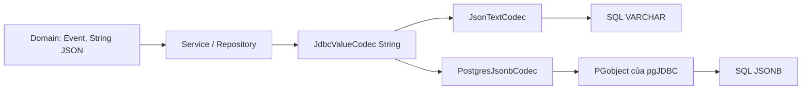

# Thiết kế lớp chuyển đổi để cô lập phụ thuộc nhà cung cấp trong JDBC

## 1. Bài toán: cùng một giá trị nghiệp vụ, nhiều cách biểu diễn SQL

Trong **JDBC**, các kiểu cơ bản như `INTEGER`, `VARCHAR` hay `DECIMAL` thường có API tương đối trực tiếp: `PreparedStatement.setInt()`, `setString()`, `setBigDecimal()` và những getter tương ứng từ `ResultSet`. Nhưng ở các **kiểu SQL nâng cao** — JSON/JSONB, UUID, ARRAY, kiểu enum do DBMS định nghĩa, XML, dữ liệu không gian, khoảng thời gian hoặc kiểu thời gian có offset — phần chuyển đổi có thể phụ thuộc **driver và hệ quản trị cơ sở dữ liệu (DBMS)**.

Ví dụ, một ứng dụng lưu thông tin sự kiện dưới dạng JSON:

- PostgreSQL hỗ trợ `jsonb`; driver pgJDBC có thể dùng `org.postgresql.util.PGobject` để gán tham số cho kiểu riêng này.
- Một hệ thống khác lưu nội dung JSON ở cột `VARCHAR`, khi ấy `setString()` và `getString()` thường phù hợp.
- Một DBMS thứ ba có kiểu JSON và quy tắc ép kiểu riêng. Cùng nội dung JSON nhưng **không thể giả định** cùng một cách binding sẽ làm việc với mọi loại cột.

Nếu để `PGobject`, tên kiểu `jsonb` hoặc `Types.OTHER` xuất hiện trong domain, service và nhiều DAO, việc đổi driver sẽ kéo theo sửa đổi lan rộng. Mục tiêu của **lớp chuyển đổi (codec/adapter)** là đặt những hiểu biết đó vào một ranh giới nhỏ; repository vẫn dùng các API JDBC chuẩn, còn nghiệp vụ chỉ làm việc với giá trị Java.

Quan trọng: cô lập phụ thuộc API **không** đồng nghĩa mọi DBMS có ngữ nghĩa lưu trữ giống nhau. Thay nhà cung cấp có thể vẫn yêu cầu migration, đổi câu SQL đặc thù và kiểm tra lại hiệu năng.



## 2. Ranh giới trách nhiệm của ba lớp

| Lớp | Nên biết | Không nên biết |
| --- | --- | --- |
| **Domain** | Mã sự kiện, nội dung JSON và các quy tắc nghiệp vụ. | `PGobject`, `Types.OTHER`, cách driver tạo SQL ARRAY. |
| **Repository JDBC** | Câu SQL, vị trí dấu `?`, `Connection`, `PreparedStatement`, `ResultSet`. | Cách tạo lớp Java riêng của driver cho một giá trị. |
| **Codec tại infrastructure** | Đọc/ghi một giá trị, SQL `NULL`, kiểu SQL tương ứng và API driver cần thiết. | Khi nào chấp nhận đơn hàng, commit hay retry toàn transaction. |

Ví dụ các khác biệt cần cô lập:

| Kiểu trong schema | Kiểu Java/domain có thể chọn | Vấn đề phụ thuộc |
| --- | --- | --- |
| PostgreSQL `JSONB`, JSON lưu dạng chữ | `String` JSON hoặc cây JSON của ứng dụng | `PGobject` so với `setString()`, chuẩn hóa JSON và cách kiểm tra hợp lệ. |
| `UUID`, `CHAR(36)`, `BINARY(16)` | `java.util.UUID` | Cách encode/decode chuỗi hay byte và quy tắc byte order. |
| SQL `ARRAY` | `List<T>` | `Connection.createArrayOf()`, tên kiểu phần tử, vòng đời `java.sql.Array`. |
| Enum riêng của DBMS | Java `enum` hoặc mã chuỗi | Tên type SQL, giá trị được cho phép và migration. |
| `SQLXML` hoặc XML trong CLOB | `String` hoặc mô hình XML | Getter, parser, stream, `free()` và mức hỗ trợ driver. |
| Thời gian có offset | `OffsetDateTime` hoặc `Instant` | Ngữ nghĩa offset/zone, khả năng JDBC 4.2, độ chính xác thời gian. |
| Kiểu không gian, IP, range | Value object nghiệp vụ | Lớp driver, hệ tọa độ/định dạng và toán tử SQL riêng. |

Không nên để một utility tổng quát xử lý mọi `Types.OTHER` như JSONB: mã loại JDBC này có thể được dùng cho **nhiều kiểu đặc thù khác nhau**. Cần biết cột, schema và driver đang dùng, không chỉ một số nguyên trong metadata.

## 3. Một interface chuyển đổi nhỏ và có kiểu

Đặt contract sau trong phần mã chỉ phụ thuộc `java.sql`:

```java
import java.sql.PreparedStatement;
import java.sql.ResultSet;
import java.sql.SQLException;

public interface JdbcValueCodec<T> {
    void bind(PreparedStatement statement, int parameterIndex, T value)
            throws SQLException;

    T read(ResultSet result, int columnIndex) throws SQLException;
}
```

Hợp đồng này cố ý giới hạn ở **một giá trị**:

1. `bind()` luôn gán vị trí được yêu cầu, **kể cả khi value là Java `null`**; nó không chạy `executeUpdate()`, `addBatch()` hoặc `commit()`.
2. `read()` đọc một cột của hàng hiện tại, trả về giá trị Java tương ứng và giữ nguyên khác biệt giữa SQL `NULL` và một giá trị hợp lệ.
3. Khi không thể chuyển đổi đúng, codec ném `SQLException` (hoặc lớp con thích hợp). Không im lặng trả chuỗi rỗng hay đối tượng mặc định.

Interface dùng chỉ số cột 1-based để ví dụ ngắn gọn. Một phiên bản khác có thể nhận `columnLabel` hoặc tách `ParameterBinder<T>` và `ColumnReader<T>`. Chỉ mở rộng khi thực sự có nhu cầu, tránh tạo framework phức tạp.

### Hai schema minh họa, không tương đương tuyệt đối

Phương án PostgreSQL với JSONB:

```sql
CREATE TABLE app_events (
    event_id BIGINT PRIMARY KEY,
    metadata JSONB NULL
);
```

Phương án khác **chủ động** lưu nội dung JSON dưới dạng văn bản:

```sql
CREATE TABLE app_events (
    event_id BIGINT PRIMARY KEY,
    metadata VARCHAR(8192) NULL
);
```

Đây là **hai phương án riêng**, không chạy cả hai `CREATE TABLE` trên cùng schema. Cột văn bản không mặc nhiên xác nhận JSON hợp lệ và có giới hạn độ dài; PostgreSQL JSONB có cơ chế lưu, chuẩn hóa, truy vấn và đánh chỉ mục riêng. Mục tiêu codec là cô lập cách giao tiếp với JDBC chứ không xóa bỏ những khác biệt này.

## 4. Domain và repository không biết `PGobject`

Giữ nội dung JSON dưới dạng `String` để ví dụ tập trung vào ranh giới JDBC; việc kiểm tra cấu trúc JSON thuộc tầng nghiệp vụ hoặc thành phần chuyên trách:

```java
public record Event(long id, String metadataJson) {}
```

Repository nhận `Connection` do service sở hữu, nhờ vậy nhiều thao tác có thể cùng tham gia một transaction. Cả `INSERT` và `SELECT` chỉ gọi interface chung:

```java
import java.sql.Connection;
import java.sql.PreparedStatement;
import java.sql.ResultSet;
import java.sql.SQLException;
import java.util.Objects;
import java.util.Optional;

public final class EventRepository {
    private final JdbcValueCodec<String> jsonCodec;

    public EventRepository(JdbcValueCodec<String> jsonCodec) {
        this.jsonCodec = Objects.requireNonNull(jsonCodec);
    }

    public void insert(Connection connection, Event event)
            throws SQLException {
        Objects.requireNonNull(connection, "connection");
        Objects.requireNonNull(event, "event");

        String sql =
            "INSERT INTO app_events (event_id, metadata) VALUES (?, ?)";

        try (PreparedStatement ps = connection.prepareStatement(sql)) {
            ps.setLong(1, event.id());
            jsonCodec.bind(ps, 2, event.metadataJson());

            if (ps.executeUpdate() != 1) {
                throw new SQLException("Không chèn được đúng một sự kiện");
            }
        }
    }

    public Optional<Event> findById(Connection connection, long eventId)
            throws SQLException {
        Objects.requireNonNull(connection, "connection");

        String sql =
            "SELECT event_id, metadata FROM app_events WHERE event_id = ?";

        try (PreparedStatement ps = connection.prepareStatement(sql)) {
            ps.setLong(1, eventId);

            try (ResultSet rs = ps.executeQuery()) {
                if (!rs.next()) {
                    return Optional.empty();
                }

                Event event = new Event(
                    rs.getLong(1),
                    jsonCodec.read(rs, 2)
                );
                if (rs.next()) {
                    throw new SQLException("Kết quả khóa chính không duy nhất");
                }
                return Optional.of(event);
            }
        }
    }
}
```

`EventRepository` không import lớp riêng của driver. Nó chỉ biết rằng tham số/cột số 2 được chuyển đổi bởi `JdbcValueCodec<String>`. Các giá trị vẫn được **tham số hóa** bằng `PreparedStatement`, không nối trực tiếp JSON vào SQL.

Nếu muốn dùng `addBatch()`, repository vẫn phải bind **đủ mọi vị trí ở mỗi bản ghi**, kể cả SQL `NULL`. Codec không được bỏ qua binding khi một giá trị là `null` hoặc chuỗi rỗng, vì có thể khiến tham số của bản ghi trước được tái sử dụng.

## 5. Adapter thuần JDBC cho cột văn bản

Đây là lựa chọn khi schema thật sự dùng `VARCHAR`:

```java
import java.sql.PreparedStatement;
import java.sql.ResultSet;
import java.sql.SQLException;
import java.sql.Types;

public final class JsonTextCodec implements JdbcValueCodec<String> {
    @Override
    public void bind(PreparedStatement ps, int index, String json)
            throws SQLException {
        if (json == null) {
            ps.setNull(index, Types.VARCHAR);
        } else {
            ps.setString(index, json);
        }
    }

    @Override
    public String read(ResultSet rs, int index) throws SQLException {
        return rs.getString(index); // SQL NULL -> Java null.
    }
}
```

Adapter này **không được mặc nhiên dùng cho mọi kiểu JSON riêng của mọi DBMS**. Có nơi chấp nhận `setString()` và ép kiểu ngầm; có nơi cần cú pháp cast hoặc đối tượng driver. Nếu cột là `CLOB`, có thể phải dùng `setCharacterStream()` và `getCharacterStream()`, xử lý vòng đời tài nguyên riêng. Vì vậy “dùng JDBC chuẩn” vẫn phải gắn với **hợp đồng kiểu cột** cụ thể.

## 6. Adapter PostgreSQL JSONB bằng `PGobject`

Đặt mã sau ở module hạ tầng có dependency vào **pgJDBC** (thư viện chứa `org.postgresql.util.PGobject`). Đây là chỗ phụ thuộc vendor có chủ đích:

```java
import java.sql.PreparedStatement;
import java.sql.ResultSet;
import java.sql.SQLException;
import java.sql.Types;
import org.postgresql.util.PGobject;

public final class PostgresJsonbCodec implements JdbcValueCodec<String> {
    @Override
    public void bind(PreparedStatement ps, int index, String json)
            throws SQLException {
        if (json == null) {
            ps.setNull(index, Types.OTHER);
            return;
        }

        PGobject parameter = new PGobject();
        parameter.setType("jsonb");
        parameter.setValue(json);
        ps.setObject(index, parameter);
    }

    @Override
    public String read(ResultSet rs, int index) throws SQLException {
        Object raw = rs.getObject(index);
        if (raw == null) {
            return null;
        }
        if (raw instanceof PGobject value
                && "jsonb".equalsIgnoreCase(value.getType())) {
            return value.getValue();
        }
        throw new SQLException(
            "Kiểu giá trị JSONB không như mong đợi: "
                + raw.getClass().getName());
    }
}
```

`bind()` tạo một `PGobject` **mới cho mỗi lần gán**, thay vì tái sử dụng một đối tượng mutable khi batch nhiều hàng. `setNull(index, Types.OTHER)` phù hợp với ví dụ PostgreSQL và kiểu đặc thù này; codec cho nhà cung cấp khác có thể cần một SQL type khác.

`read()` kiểm tra rõ lớp và tên kiểu do pgJDBC trả về. Nếu một phiên bản driver trả `String` hoặc kiểu khác, adapter sẽ báo lỗi, giúp phát hiện sai khác của hợp đồng đã chọn. Có thể thay bằng `rs.getString(index)` khi đã **kiểm chứng** phiên bản pgJDBC mục tiêu hỗ trợ đọc JSONB theo cách đó; không vì vậy mà thêm `instanceof PGobject` rải rác vào repository.

**Khác biệt ngữ nghĩa:** PostgreSQL JSONB có thể chuẩn hóa khoảng trắng, thứ tự khóa và một số biểu diễn JSON. Chuỗi đọc lại không được bảo đảm giống từng ký tự với chuỗi đã gửi. Nếu nghiệp vụ cần giữ nguyên byte để ký số, so sánh bằng checksum văn bản hay tái tạo tài liệu nguyên bản, cần chọn mô hình lưu trữ khác hoặc lưu thêm bản gốc.

## 7. Chọn codec ở điểm khởi tạo, không trong từng repository

Hai cách dựng repository dành cho hai schema riêng:

```java
// Trường hợp app_events.metadata có kiểu JSONB ở PostgreSQL:
EventRepository pgRepository =
    new EventRepository(new PostgresJsonbCodec());

// Trường hợp một môi trường khác dùng cột VARCHAR:
EventRepository textRepository =
    new EventRepository(new JsonTextCodec());
```

Chọn **một** adapter phù hợp với schema đang kết nối. Service lấy connection qua `DataSource`, sử dụng và đóng kết nối đúng vòng đời:

```java
import javax.sql.DataSource;
import java.sql.Connection;
import java.sql.SQLException;

static void saveEvent(
        DataSource source, EventRepository repository, Event event)
        throws SQLException {
    try (Connection connection = source.getConnection()) {
        repository.insert(connection, event);
    }
}
```

Ví dụ trên chỉ thực hiện **một INSERT**. Nếu nghiệp vụ gồm nhiều thao tác phải nguyên tử, service cần `setAutoCommit(false)`, `commit()` và `rollback()` trên **cùng connection**. Codec không tự lấy connection, không commit và không retry một phần nghiệp vụ.

Có thể dùng `DatabaseMetaData` để kiểm chứng môi trường khi khởi động:

```java
try (Connection connection = dataSource.getConnection()) {
    var meta = connection.getMetaData();
    System.out.println("DBMS=" + meta.getDatabaseProductName());
    System.out.println("Driver=" + meta.getDriverName());
}
```

Thông tin này giúp phát hiện việc cấu hình `PostgresJsonbCodec` nhưng thực tế kết nối tới DBMS khác. **Không tự động chuyển sang `JsonTextCodec` sau lỗi**: fallback âm thầm có thể thay đổi tính đúng đắn của dữ liệu. Việc lựa chọn phải dựa trên driver, loại cột, migration và chính sách nghiệp vụ đã định nghĩa.

## 8. Phân biệt SQL NULL, JSON null và dữ liệu không hợp lệ

Codec phải có hợp đồng rõ ràng cho các trường hợp dễ nhầm:

| Giá trị đầu vào | Cột `VARCHAR` dùng `JsonTextCodec` | Cột `JSONB` dùng `PostgresJsonbCodec` |
| --- | --- | --- |
| Java `null` | SQL `NULL` qua `setNull(..., Types.VARCHAR)`. | SQL `NULL` qua `setNull(..., Types.OTHER)`. |
| Java `"null"` | Chuỗi có bốn ký tự `null`. | Giá trị **JSON null**, khác SQL `NULL`. |
| Java `"{}"` | Chuỗi chứa hai dấu ngoặc nhọn. | Đối tượng JSON rỗng. |
| Java `""` | Chuỗi rỗng có thể hợp lệ trong cột văn bản. | Không phải cú pháp JSON hợp lệ; DBMS sẽ từ chối. |
| Java `"{invalid}"` | Có thể được lưu nếu không có bộ kiểm tra JSON riêng. | DBMS sẽ từ chối giá trị JSONB sai cú pháp. |

Không được thay Java `null` bằng `"null"` hay `"{}"` chỉ để lược nhánh `if`: đó là **thay đổi ngữ nghĩa dữ liệu**. Ở chiều đọc, `ResultSet.getObject() == null` nghĩa là SQL `NULL`; một `PGobject` có `getValue()` là `"null"` lại biểu diễn JSON null.

Nếu domain sử dụng cây JSON của một thư viện, có thể đặt bước parse/serialize ở tầng ứng dụng, rồi giao chuỗi JSON đã hợp lệ cho codec JDBC. Không nên để codec âm thầm nuốt lỗi parse và trả `{}`: làm như vậy che dữ liệu lỗi và khiến kết quả nghiệp vụ sai.

### Đọc metadata để phát hiện lệch kiểu

`ResultSetMetaData` có thể giúp kiểm tra schema hoặc câu `SELECT` đang trả kiểu gì:

```java
try (ResultSet rows = statement.executeQuery()) {
    var columns = rows.getMetaData();
    for (int i = 1; i <= columns.getColumnCount(); i++) {
        System.out.printf("column=%s jdbcType=%d dbType=%s%n",
            columns.getColumnLabel(i),
            columns.getColumnType(i),
            columns.getColumnTypeName(i));
    }
}
```

`Types.OTHER` có thể được driver dùng cho JSONB, enum, UUID hoặc kiểu đặc thù khác. `getColumnTypeName()` cũng phản ánh tên kiểu riêng của DBMS. Metadata hữu ích cho chẩn đoán nhưng **không đủ** để suy ra an toàn cách dùng `setObject()` hoặc `getObject()`; vẫn phải kiểm thử đọc/ghi thực tế.

## 9. Mở rộng sang UUID và ARRAY

### 9.1. UUID dưới dạng ký tự

Một `UUID` trong domain có thể lưu ở kiểu `uuid` riêng của PostgreSQL, `CHAR(36)` hoặc `BINARY(16)` trên hệ khác. Với cột dạng ký tự đã thống nhất biểu diễn, adapter thuần JDBC có thể viết:

```java
import java.sql.PreparedStatement;
import java.sql.ResultSet;
import java.sql.SQLException;
import java.sql.SQLDataException;
import java.sql.Types;
import java.util.UUID;

public final class TextUuidCodec implements JdbcValueCodec<UUID> {
    @Override
    public void bind(PreparedStatement ps, int index, UUID id)
            throws SQLException {
        if (id == null) {
            ps.setNull(index, Types.CHAR);
        } else {
            ps.setString(index, id.toString());
        }
    }

    @Override
    public UUID read(ResultSet rs, int index) throws SQLException {
        String raw = rs.getString(index);
        if (raw == null) {
            return null;
        }
        try {
            return UUID.fromString(raw);
        } catch (IllegalArgumentException invalid) {
            throw new SQLDataException(
                "UUID không hợp lệ trong kết quả JDBC", invalid);
        }
    }
}
```

Adapter này dành cho **cột dạng ký tự**; không dùng nguyên xi cho cột `uuid` riêng hoặc `BINARY(16)` mà chưa kiểm thử. Với PostgreSQL, adapter khác có thể sử dụng `setObject(index, uuid)` và `getObject(index, UUID.class)` nếu driver mục tiêu hỗ trợ. Với `BINARY(16)`, phải định nghĩa cách sắp thứ tự byte khi mã hóa và giải mã, không tự đoán từ chuỗi UUID.

### 9.2. ARRAY và vòng đời tài nguyên

Với cột mảng được driver hỗ trợ, JDBC định nghĩa `Connection.createArrayOf()` và đối tượng `java.sql.Array`. Ví dụ PostgreSQL có cột `tags TEXT[]`:

```java
// connection, statement và List<String> tags đã được tạo.
java.sql.Array parameter =
    connection.createArrayOf("text", tags.toArray(String[]::new));
try {
    statement.setArray(1, parameter);
    statement.executeUpdate();
} finally {
    parameter.free();
}
```

Tên phần tử `"text"`, khả năng hỗ trợ mảng lồng nhau và xử lý phần tử null phụ thuộc DBMS/driver. Với ARRAY, hàm bind thường cần thêm `Connection` để tạo đối tượng SQL, và có thể phải **giữ `Array` sống tới khi statement thực thi xong**. Có thể mở rộng một interface chuyên dụng nhận connection và callback thực thi; không nên ép mọi codec đơn giản chịu vòng đời tài nguyên phức tạp này.

Đặc biệt với `executeBatch()`, không được giải phóng `Array` quá sớm nếu driver còn đọc bộ tham số vào thời điểm thực thi. Hãy kiểm tra tài liệu và thử nghiệm driver cụ thể. Nếu DBMS không có ARRAY, chuyển sang bảng quan hệ `event_tags(event_id, tag)` là thay đổi **mô hình dữ liệu**, không chỉ thay một dòng `setArray()`.

Các kiểu `SQLXML`, `Blob`, `Clob` cũng có vòng đời tài nguyên riêng với `free()`; cần đọc/ghi hoàn tất trước khi giải phóng. Tầng codec hoặc adapter có thể chịu trách nhiệm cleanup nhưng phải bảo đảm lỗi cleanup không che mất lỗi đọc/ghi chính.

## 10. Cô lập cách chuyển đổi không có nghĩa cô lập toàn bộ SQL dialect

Codec giải quyết cách bind và đọc **một giá trị**. Nó không thay thế mọi khác biệt giữa các nhà cung cấp:

- **DDL:** PostgreSQL `JSONB`, dạng văn bản `VARCHAR`, UUID hay ARRAY là các kiểu cột khác nhau; chuyển đổi có thể cần migration dữ liệu.
- **Truy vấn:** toán tử JSON, phép tìm trong mảng, hàm xử lý thời gian hoặc phép lọc trên dữ liệu không gian có thể có cú pháp riêng.
- **Index và hiệu năng:** JSONB có thể được index hoặc tìm kiếm khác với chuỗi JSON; thay cách lưu có thể làm một truy vấn vốn chạy trong database phải tải về Java.
- **Generated keys:** một số DBMS có cú pháp `RETURNING` riêng; JDBC có `getGeneratedKeys()` nhưng mức hỗ trợ và hành vi có thể khác.
- **Ràng buộc:** cột kiểu JSON đặc thù có thể kiểm tra cú pháp tại DBMS; cột văn bản thì không tự có cùng bảo đảm.

Khi cần hỗ trợ nhiều DBMS, có thể tách thêm thành phần `SqlDialect` ở infrastructure để chọn các câu SQL phù hợp. `JdbcValueCodec` chỉ chuyển giá trị; `SqlDialect` cung cấp SQL đặc thù; service quyết định transaction. Tách rõ trách nhiệm giúp dễ sửa hơn một codec vừa chọn `JOIN`, vừa mở connection, vừa commit, vừa bind dữ liệu.

## 11. Xử lý lỗi đúng ranh giới và kiểm thử hợp đồng

Khi dữ liệu/driver không đúng hợp đồng, adapter nên ném `SQLException` rõ ràng thay vì trả giá trị mặc định. `TextUuidCodec` chuyển lỗi parse thành `SQLDataException` có `cause`; `PostgresJsonbCodec` báo kiểu đọc bất ngờ để phát hiện khác biệt driver/schema. Nếu driver không hỗ trợ API như `getObject(index, UUID.class)` hoặc `createArrayOf()`, có thể nhận `SQLFeatureNotSupportedException` hay `SQLException` khác; không nên retry liên tục mà phải xem xét adapter hoặc lược đồ.

Lỗi query timeout, deadlock hoặc mất kết nối cần được xử lý ở **tầng sở hữu transaction**. Khi một nghiệp vụ ghi nhiều hàng gặp lỗi, service phải rollback nếu cần nguyên tử; nếu rollback thất bại, giữ ngoại lệ gốc và đính kèm lỗi cleanup bằng `addSuppressed()`. Codec không tự commit hoặc retry một bước của nghiệp vụ. Không ghi nguyên văn JSON có token hay dữ liệu cá nhân vào log.

Unit test có thể kiểm tra repository gọi `bind()` và `read()` ở đúng chỉ số. Nhưng mock `PreparedStatement`/`ResultSet` **không thể chứng minh** PostgreSQL chấp nhận `PGobject` và driver đọc lại đúng lớp. Hãy chạy integration test trên đúng driver, DBMS và migration:

| Trường hợp | `JsonTextCodec` / `VARCHAR` | `PostgresJsonbCodec` / `JSONB` |
| --- | --- | --- |
| Ghi/đọc `{"active":true}` | Đọc lại nội dung văn bản. | Đọc lại JSONB, so sánh theo ngữ nghĩa JSON. |
| Java `null` | SQL `NULL`. | SQL `NULL`. |
| Chuỗi `"null"` | Văn bản `null`. | JSON null, khác SQL `NULL`. |
| JSON không hợp lệ | Có thể được lưu nếu không có validator riêng. | DBMS phải từ chối cú pháp sai. |
| Khác thứ tự khóa/whitespace | Có thể giữ nguyên cách viết. | Không giả định giữ nguyên từng ký tự. |
| Schema đổi sai kiểu | Test schema hoặc câu lệnh phát hiện sai khác. | Codec/test phải báo lỗi rõ ràng. |
| Nâng cấp JDBC driver | Kiểm tra setter/getter và giới hạn cột. | Kiểm tra cách bind và lớp `PGobject` được trả về. |
| Nhiều hàng batch | Kiểm tra binding đủ tham số, kể cả SQL `NULL`. | Kiểm tra tạo đối tượng mới và dữ liệu của từng hàng. |

Với JSONB, nếu đã có bộ parse JSON thì nên so sánh **cây JSON**, không so sánh từng byte. Với UUID/ARRAY cần test thêm `NULL`, kiểu phần tử, thứ tự, dữ liệu sai và vòng đời `free()`. Khi nâng cấp driver hoặc chuyển DBMS, chạy lại bộ integration test để phát hiện lỗi chuyển đổi mới.

## 12. Sai lầm thường gặp và checklist triển khai

| Sai lầm | Hậu quả | Cách khắc phục |
| --- | --- | --- |
| Import `PGobject` khắp domain và service. | Khóa nghiệp vụ vào pgJDBC. | Giới hạn phụ thuộc trong adapter. |
| Coi mọi `Types.OTHER` là JSONB. | Đọc nhầm UUID, enum và kiểu riêng khác. | Kiểm tra schema và driver cụ thể. |
| Dùng `setString()` cho mọi kiểu JSON. | Sai kiểu hoặc ép kiểu ngoài ý muốn. | Codec phù hợp từng kiểu cột. |
| Bỏ qua `bind()` khi Java `null`. | Thiếu binding hoặc rò rỉ tham số batch trước. | Luôn gán `setNull()` đúng SQL type. |
| Coi JSON null và SQL `NULL` giống nhau. | Sai dữ liệu lưu và truy vấn. | Có hợp đồng null riêng. |
| Tái sử dụng `PGobject` mutable qua các hàng. | Rủi ro sai giá trị giữa batch. | Tạo đối tượng mới mỗi lần bind. |
| Nuốt lỗi parse JSON rồi trả `{}`. | Che dữ liệu hỏng. | Giữ lỗi có nguyên nhân. |
| Chỉ thay codec khi đổi DBMS. | SQL, DDL, index chưa tương thích. | Quản lý SQL dialect và migration đồng bộ. |
| Cho codec tự commit hoặc retry. | Phá transaction của cả nghiệp vụ. | Để service sở hữu transaction. |
| Tự động fallback khi driver không hỗ trợ. | Đổi ngữ nghĩa dữ liệu âm thầm. | Fail fast hoặc lựa chọn rõ ràng có kiểm thử. |

Quy trình khi thêm một kiểu SQL nâng cao:

1. Xác định kiểu domain và **ý nghĩa `null`**.
2. Kiểm tra cột SQL, ràng buộc, default, phiên bản DBMS/driver.
3. Xây interface bind/read nhỏ, không rò rỉ lớp riêng của nhà cung cấp.
4. Viết adapter theo kiểu lưu trữ và chọn **tường minh** tại composition root.
5. Giữ `Connection` và transaction tại service; repository chỉ gọi codec.
6. Test dữ liệu bình thường, `NULL`, giá trị sai, batch và trường hợp schema drift.
7. Chạy lại integration test và đo hiệu năng khi đổi driver, DBMS hoặc DDL.

## 13. Ghi nhớ

Trong JDBC, **codec/adapter** cô lập cách một kiểu SQL nâng cao được chuyển đổi giữa Java và database. Domain giữ giá trị nghiệp vụ; repository sử dụng `Connection`, `PreparedStatement` và `ResultSet` qua `JdbcValueCodec<T>`; adapter mới biết `setObject()`, `setNull()`, `PGobject` hoặc kiểu dữ liệu riêng của driver. Khả năng thay đổi codec không làm JSONB, JSON dạng văn bản, UUID hay ARRAY trở thành các kiểu lưu trữ tương đương. Một giải pháp đúng cần **hợp đồng schema rõ ràng, lựa chọn adapter có chủ đích, quản lý transaction độc lập và integration test trên driver/DBMS thực tế**.
