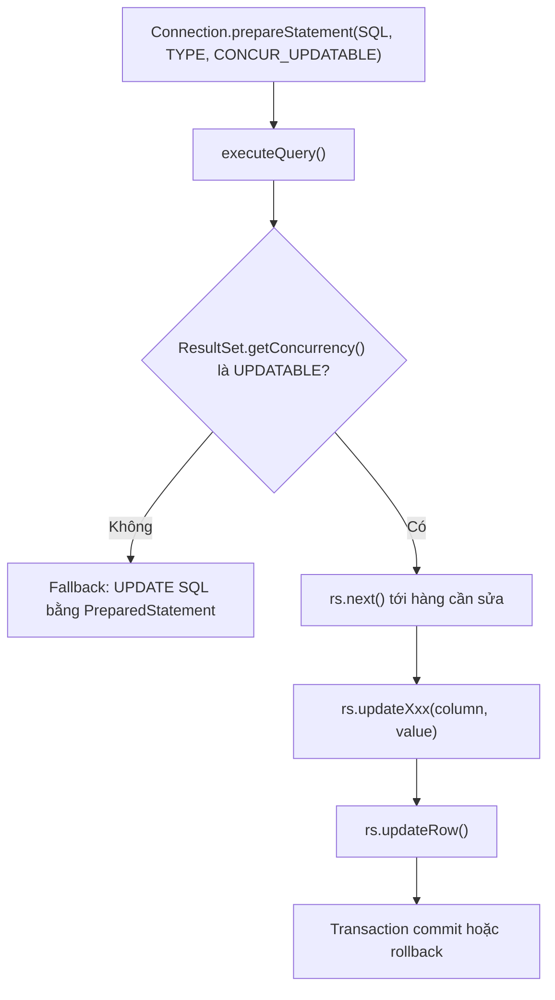

# Cập nhật hàng qua ResultSet có khả năng cập nhật

## 1. Từ ResultSet chỉ đọc đến ResultSet có thể cập nhật

Khi làm việc với **JDBC**, lập trình viên thường dùng `DataSource` để lấy `Connection`, dùng `PreparedStatement` thực thi SQL và duyệt `ResultSet` bằng `next()` để ánh xạ từng hàng sang đối tượng Java. Trong phần lớn mã ứng dụng, `ResultSet` chỉ đóng vai trò **đọc dữ liệu**: muốn thay đổi một hàng, ta viết câu `UPDATE` hoặc `DELETE` riêng rồi kiểm tra số dòng bị tác động.

JDBC còn cung cấp **ResultSet có khả năng cập nhật** (*updatable ResultSet*). Với loại này, ứng dụng có thể di chuyển con trỏ đến một hàng, gọi `updateString()`, `updateInt()`, `updateBigDecimal()`… trên các cột của hàng hiện tại, rồi dùng `updateRow()` để gửi thay đổi tới cơ sở dữ liệu. Các thao tác liên quan như `insertRow()` và `deleteRow()` cũng thuộc giao diện `ResultSet`.

Ví dụ, thay vì:

```sql
UPDATE support_tickets
SET title = ?
WHERE id = ?;
```

ứng dụng có thể đọc một hàng của `support_tickets` qua `ResultSet` có `CONCUR_UPDATABLE`, cập nhật cột `title` trên con trỏ rồi gọi `rs.updateRow()`.

Tính năng này hữu ích trong một số công cụ quản trị dữ liệu, màn hình sửa từng hàng hoặc chương trình JDBC cần thao tác trực tiếp trên cursor. Tuy nhiên, **không phải driver, câu SELECT hay kiểu ResultSet nào cũng cập nhật được**. Với CRUD nghiệp vụ cần điều kiện `WHERE` chính xác, kiểm soát đồng thời hoặc khả năng di động cao, một câu `UPDATE` tham số hóa vẫn thường là lựa chọn rõ ràng hơn.

**Mục tiêu bài học:** tạo và kiểm tra `CONCUR_UPDATABLE`, cập nhật hàng bằng `updateXxx()` và `updateRow()`, quản lý thay đổi đang chờ, xử lý transaction và lỗi, nhận biết giới hạn driver/câu SQL, và quyết định khi nào nên thay bằng `PreparedStatement.executeUpdate()`.

## 2. Hai thuộc tính độc lập: kiểu con trỏ và khả năng cập nhật

Khi tạo statement, JDBC cho phép yêu cầu **kiểu con trỏ** (*result set type*) và **mức cập nhật** (*concurrency*) riêng biệt.

| Hằng JDBC | Ý nghĩa | Lưu ý |
|---|---|---|
| `ResultSet.TYPE_FORWARD_ONLY` | Con trỏ chủ yếu duyệt tiến bằng `next()` | Có driver vẫn cho phép cập nhật, driver khác yêu cầu cursor có khả năng cuộn. |
| `ResultSet.TYPE_SCROLL_INSENSITIVE` | Có thể yêu cầu di chuyển tới các hàng trước/sau; thường không phản ánh tự động thay đổi của transaction khác | Không bảo đảm snapshot hoặc hành vi làm mới giống nhau trên mọi DB. |
| `ResultSet.TYPE_SCROLL_SENSITIVE` | Có khả năng phản ánh một số thay đổi từ nguồn dữ liệu theo hỗ trợ của driver | Tốn tài nguyên hơn và không đồng nghĩa được cập nhật. |
| `ResultSet.CONCUR_READ_ONLY` | Chỉ đọc qua cursor | Là chế độ thường gặp khi không yêu cầu cập nhật. |
| `ResultSet.CONCUR_UPDATABLE` | Cho phép yêu cầu cập nhật hàng qua cursor | Chỉ thực sự có hiệu lực nếu driver và câu truy vấn hỗ trợ. |

Ví dụ yêu cầu vừa cuộn được vừa cập nhật được:

```java
String sql = """
        SELECT id, tenant_id, title, status
        FROM support_tickets
        WHERE id = ? AND tenant_id = ?
        """;

try (PreparedStatement statement = connection.prepareStatement(
        sql,
        ResultSet.TYPE_SCROLL_INSENSITIVE,
        ResultSet.CONCUR_UPDATABLE)) {
    statement.setLong(1, ticketId);
    statement.setLong(2, tenantId);

    try (ResultSet rs = statement.executeQuery()) {
        // Xác nhận mức concurrency thực tế trước khi updateRow().
        if (rs.getConcurrency() != ResultSet.CONCUR_UPDATABLE) {
            throw new SQLException("ResultSet is not updatable");
        }
        // Duyệt và cập nhật hàng ở các mục tiếp theo.
    }
}
```

Ví dụ này giả định `connection`, `ticketId`, `tenantId` đã được khai báo và các kiểu JDBC được import. `PreparedStatement` vẫn là lựa chọn phù hợp để truyền điều kiện `WHERE` an toàn qua dấu `?`.

**Quan trọng:** tham số `TYPE_SCROLL_INSENSITIVE` và `CONCUR_UPDATABLE` là **yêu cầu gửi cho driver**, không phải cam kết tuyệt đối. Một số driver có thể giảm khả năng (*downgrade*) hoặc ném `SQLException` nếu không hỗ trợ. Vì thế cần kiểm tra metadata trước khi dùng và kiểm tra `rs.getConcurrency()` sau khi thực thi.



## 3. Kiểm tra năng lực driver bằng DatabaseMetaData

Trước khi phụ thuộc vào updatable cursor, có thể kiểm tra khả năng của tổ hợp driver và cơ sở dữ liệu:

```java
import java.sql.Connection;
import java.sql.DatabaseMetaData;
import java.sql.ResultSet;
import java.sql.SQLException;
import javax.sql.DataSource;

public static boolean canUseUpdatableScrollResultSet(DataSource dataSource)
        throws SQLException {
    try (Connection connection = dataSource.getConnection()) {
        DatabaseMetaData meta = connection.getMetaData();
        int type = ResultSet.TYPE_SCROLL_INSENSITIVE;

        return meta.supportsResultSetType(type)
                && meta.supportsResultSetConcurrency(
                        type, ResultSet.CONCUR_UPDATABLE);
    }
}
```

- `supportsResultSetType(type)` cho biết driver báo hỗ trợ kiểu cursor đó hay không.
- `supportsResultSetConcurrency(type, CONCUR_UPDATABLE)` hỏi driver có báo hỗ trợ mức cập nhật với **kiểu cursor cụ thể** hay không.
- `rs.getType()` và `rs.getConcurrency()` giúp xác nhận trạng thái thực tế của một `ResultSet` sau khi mở.

Ví dụ `supportsResultSetConcurrency(TYPE_SCROLL_INSENSITIVE, CONCUR_UPDATABLE) == true` **không chứng minh** mọi câu `SELECT` đều cập nhật được. Các điều kiện như thiếu khóa duy nhất, dùng phép nối bảng, truy vấn tổng hợp hoặc quyền SQL có thể khiến câu lệnh cụ thể bị từ chối hay bị chuyển thành chỉ đọc.

JDBC còn cung cấp metadata liên quan:

```java
boolean ownUpdatesVisible =
        meta.ownUpdatesAreVisible(ResultSet.TYPE_SCROLL_INSENSITIVE);
boolean updatesDetected =
        meta.updatesAreDetected(ResultSet.TYPE_SCROLL_INSENSITIVE);
boolean othersUpdatesVisible =
        meta.othersUpdatesAreVisible(ResultSet.TYPE_SCROLL_INSENSITIVE);
```

Các cờ này diễn tả khả năng quan sát hoặc phát hiện cập nhật trên loại cursor, **không phải hợp đồng khóa hay ngăn lost update**. Giá trị có thể thay đổi giữa driver; nếu ứng dụng cần tính nhất quán mạnh, phải kiểm tra ở mức SQL và transaction thay vì dựa vào tên `SCROLL_SENSITIVE`.

## 4. SQL nào thường phù hợp với updatable ResultSet?

Ví dụ bảng dùng trong bài:

```sql
CREATE TABLE support_tickets (
    id        BIGINT PRIMARY KEY,
    tenant_id BIGINT NOT NULL,
    title     VARCHAR(200) NOT NULL,
    status    VARCHAR(20) NOT NULL
);

INSERT INTO support_tickets(id, tenant_id, title, status)
VALUES
    (101, 7, 'Không đăng nhập được', 'OPEN'),
    (102, 7, 'Cần đổi hóa đơn', 'OPEN'),
    (103, 8, 'Không nhận thông báo', 'OPEN');
```

Để tăng cơ hội được hỗ trợ, nên bắt đầu bằng câu truy vấn:

```sql
SELECT id, tenant_id, title, status
FROM support_tickets
WHERE id = ? AND tenant_id = ?;
```

Đặc điểm của truy vấn này là lấy dữ liệu từ **một bảng cơ sở**, chọn **khóa chính `id`** và các cột cần sửa, không dùng `JOIN` hay phép tổng hợp. Đây là dạng dễ ánh xạ từ hàng kết quả về hàng gốc.

Những dạng SQL thường có thể bị driver/DB hạn chế cập nhật:

| Truy vấn | Vấn đề |
|---|---|
| `SELECT COUNT(*) FROM support_tickets` | Hàng kết quả là giá trị tổng hợp, không phải một bản ghi gốc. |
| `SELECT status, COUNT(*) ... GROUP BY status` | Một hàng kết quả đại diện nhiều hàng gốc. |
| `SELECT DISTINCT status FROM support_tickets` | Một giá trị có thể đến từ nhiều bản ghi. |
| `SELECT ... FROM support_tickets JOIN users ...` | Có thể không xác định được một hàng và bảng đích duy nhất. |
| `SELECT title FROM support_tickets` không có ID | Driver có thể không có đủ khóa để nhận diện hàng cần cập nhật. |
| View hoặc biểu thức như `UPPER(title)` | Khả năng cập nhật view/cột tính toán phụ thuộc DB và driver. |

Một số hệ quản trị hỗ trợ thêm nhiều dạng updatable views hoặc truy vấn phức tạp, nhưng không được giả định. Trước khi thiết kế nghiệp vụ dựa vào cursor, hãy kiểm thử đúng SQL, quyền truy cập và phiên bản driver đang triển khai.

**Cẩn trọng với tên cột:** khi `JOIN` hoặc có các cột trùng tên, `rs.updateString("title", ...)` có thể mơ hồ. Với các truy vấn cần alias, driver phải hỗ trợ ánh xạ alias đó về cột cơ sở; nếu không chắc, nên dùng `UPDATE ... WHERE ...` thông thường.

## 5. Các bước cập nhật một hàng và vòng đời thay đổi

Khi con trỏ đã nằm tại một hàng hợp lệ, quy trình cơ bản:

```java
if (rs.next()) {
    String oldTitle = rs.getString("title");

    // Sửa bộ đệm của hàng hiện tại trong ResultSet.
    rs.updateString("title", "Đã xác nhận lỗi đăng nhập");

    // Gửi cập nhật của hàng hiện tại xuống cơ sở dữ liệu.
    rs.updateRow();
}
```

Giữa `updateString()` và `updateRow()`, thay đổi thường chỉ là **giá trị đang chờ trên ResultSet**, chưa phải thay đổi DML đã gửi. Sau `updateRow()` thành công, thay đổi được áp dụng trong transaction của kết nối. Nếu `autoCommit = false`, nó **chưa bền vững** cho đến khi transaction commit.

| Lệnh | Tác động chính | Có thay thế `commit()` không? |
|---|---|---|
| `rs.updateString("title", value)` | Đặt giá trị mới cho cột của hàng hiện tại ở phía cursor | Không |
| `rs.updateInt("quantity", value)` | Đặt giá trị số nguyên sẽ cập nhật | Không |
| `rs.updateNull("note")` | Đặt giá trị cột thành SQL `NULL` | Không |
| `rs.updateRow()` | Gửi các cột đã cập nhật của hàng hiện tại xuống DB | Không |
| `rs.cancelRowUpdates()` | Hủy các thay đổi **chưa được gửi qua `updateRow()`** của hàng hiện tại | Không |
| `rs.refreshRow()` | Yêu cầu làm mới hàng hiện tại từ DB nếu driver hỗ trợ | Không |
| `connection.rollback()` | Hoàn tác các thay đổi chưa commit của transaction | Không |
| `connection.commit()` | Xác nhận transaction thành công | Có, ở phạm vi transaction DB |

### Hủy thay đổi đang chờ

```java
// Con trỏ đang ở hàng hợp lệ.
rs.updateString("title", "Tiêu đề nháp");
rs.cancelRowUpdates(); // Không gửi tiêu đề nháp xuống database.

rs.updateString("title", "Tiêu đề cuối cùng");
rs.updateRow();        // Bây giờ mới gửi cập nhật.
```

`cancelRowUpdates()` **không phải rollback transaction**. Nếu `updateRow()` đã chạy thành công, việc gọi `cancelRowUpdates()` sau đó không đảm bảo hoàn tác SQL đã thực thi; cần `connection.rollback()` khi transaction chưa commit và bạn muốn hủy thay đổi.

### Làm mới hàng

```java
rs.refreshRow();
String currentTitle = rs.getString("title");
```

`refreshRow()` có thể có giới hạn theo kiểu cursor, transaction isolation và driver. Nó có thể bỏ các thay đổi đang chờ chưa `updateRow()`; cần đọc hợp đồng driver và chỉ gọi ở thời điểm có chủ đích. Quan trọng hơn, **đọc lại hàng không tự tạo ra điều kiện kiểm tra phiên bản trong lần ghi tiếp theo**.

## 6. Ví dụ JDBC đầy đủ: cập nhật tiêu đề ticket

Ví dụ sau dùng `DataSource`, `PreparedStatement` và `ResultSet.CONCUR_UPDATABLE` để cập nhật **một hàng**. Nó chủ động kiểm soát transaction, kiểm tra khả năng hỗ trợ và phát hiện trường hợp driver không cấp cursor cập nhật được.

```java
import java.sql.Connection;
import java.sql.DatabaseMetaData;
import java.sql.PreparedStatement;
import java.sql.ResultSet;
import java.sql.SQLException;
import java.util.Objects;
import javax.sql.DataSource;

public final class TicketRepository {
    private static final String SQL = """
            SELECT id, tenant_id, title, status
            FROM support_tickets
            WHERE id = ? AND tenant_id = ?
            """;

    private final DataSource dataSource;

    public TicketRepository(DataSource dataSource) {
        this.dataSource = Objects.requireNonNull(dataSource);
    }

    public boolean renameTicket(long id, long tenantId, String newTitle)
            throws SQLException {
        if (id <= 0 || tenantId <= 0 || newTitle == null
                || newTitle.isBlank() || newTitle.length() > 200) {
            throw new IllegalArgumentException("Invalid ticket input");
        }

        try (Connection connection = dataSource.getConnection()) {
            DatabaseMetaData md = connection.getMetaData();
            int type = ResultSet.TYPE_SCROLL_INSENSITIVE;
            int concurrency = ResultSet.CONCUR_UPDATABLE;
            if (!md.supportsResultSetConcurrency(type, concurrency)) {
                throw new SQLException("Updatable ResultSet not supported");
            }

            // Ví dụ sở hữu connection, không tham gia transaction ngoài.
            boolean originalAutoCommit = connection.getAutoCommit();
            if (!originalAutoCommit) {
                throw new SQLException(
                        "This example expects an auto-commit connection");
            }
            connection.setAutoCommit(false);
            boolean ended = false;

            try {
                boolean found;
                try (PreparedStatement ps = connection.prepareStatement(
                        SQL, type, concurrency)) {
                    ps.setLong(1, id);
                    ps.setLong(2, tenantId);

                    try (ResultSet rs = ps.executeQuery()) {
                        if (rs.getConcurrency() != concurrency) {
                            throw new SQLException(
                                    "Driver supplied a read-only ResultSet");
                        }
                        if (!rs.next()) {
                            found = false;
                        } else {
                            rs.updateString("title", newTitle);
                            rs.updateRow();
                            found = true;
                        }
                    }
                }

                if (found) {
                    connection.commit();
                } else {
                    connection.rollback(); // Kết thúc transaction trống.
                }
                ended = true;
                return found;
            } catch (SQLException | RuntimeException error) {
                try {
                    connection.rollback();
                    ended = true;
                } catch (SQLException rollbackError) {
                    error.addSuppressed(rollbackError);
                }
                throw error;
            } finally {
                // Chỉ phục hồi auto-commit sau commit/rollback thành công.
                // Bật auto-commit khi transaction còn dang dở có thể
                // dẫn đến commit ngoài ý muốn.
                if (ended) {
                    connection.setAutoCommit(originalAutoCommit);
                }
            }
        }
    }
}
```

**Diễn giải kết quả:**

- `true`: một hàng đã được duyệt, `updateRow()` thực thi thành công và lời gọi `commit()` hoàn tất. Đây là ví dụ cập nhật tiêu đề đơn giản; nó **không** kiểm tra điều kiện trạng thái tại thời điểm ghi.
- `false`: không có hàng nào trong kết quả truy vấn theo `id` và `tenant_id`. Điều này có thể do không tồn tại hoặc không nằm trong tenant được phép truy cập.
- `SQLException`: driver từ chối updatable cursor, xảy ra lỗi ràng buộc, kết nối, update hay transaction.

Trong mã này, `try-with-resources` đóng `ResultSet` rồi `PreparedStatement` trước khi commit/rollback; giúp không giữ cursor sau khi transaction kết thúc. `Connection` được đóng khi thoát phương thức, thường trả về pool. Nếu rollback thất bại, không nên tự khôi phục auto-commit trên connection không còn bảo đảm trạng thái; việc xử lý kết nối lỗi thuộc về tầng quản lý kết nối/pool.

**Không xem đây là phương pháp ngăn ghi đè đồng thời.** Nếu người dùng A và B cùng đọc tiêu đề cũ trước khi sửa, việc A và B gọi `updateRow()` có thể tạo hành vi khác nhau tùy cơ chế khóa của DB, thời điểm cursor được mở và driver. Để thực hiện một điều kiện trạng thái/phiên bản tại thời điểm ghi, mục 9 trình bày câu `UPDATE` thông thường có điều kiện rõ ràng hơn.

## 7. Kiểm tra trạng thái hàng sau cập nhật

JDBC cung cấp một số phương thức cho biết trạng thái của hàng hiện tại:

```java
boolean updated = rs.rowUpdated();
boolean inserted = rs.rowInserted();
boolean deleted = rs.rowDeleted();
```

Nhưng không được coi chúng là cơ chế xác nhận universal. Driver có thể không phát hiện hoặc không cung cấp đầy đủ trạng thái cập nhật đối với kiểu cursor cụ thể; các phương thức này có thể ném `SQLException` khi không được hỗ trợ. Metadata như `updatesAreDetected(type)`, `insertsAreDetected(type)` và `deletesAreDetected(type)` có thể giúp kiểm tra trước.

`updateRow()` trả kiểu `void`, **không phải số dòng bị tác động** như `PreparedStatement.executeUpdate()`. Vì vậy, bạn không thể viết:

```java
// Không hợp lệ: updateRow() không trả int.
// int count = rs.updateRow();
```

Nếu nghiệp vụ đòi hỏi chắc chắn *đúng một hàng*, đối chiếu phiên bản/tenant/trạng thái hoặc trả kết quả chi tiết, SQL `UPDATE ... WHERE ...` với update count có hợp đồng dễ kiểm chứng hơn.

### Lưu ý về hàng vừa sửa và vị trí con trỏ

Ngay sau `updateRow()`, khả năng đọc lại các cột trong cursor và việc nhìn thấy cập nhật từ transaction khác phụ thuộc loại cursor, driver và isolation. Có thể sử dụng `refreshRow()` nếu được hỗ trợ, hoặc mở một truy vấn `SELECT` mới trong cùng transaction để đối chiếu. Không giả định `ResultSet.TYPE_SCROLL_INSENSITIVE` tự đồng bộ mọi thay đổi sau mỗi lệnh.

## 8. Các thao tác liên quan: thêm và xóa hàng từ cursor

Mặc dù chủ đề chính là **cập nhật hàng hiện có**, cần phân biệt với hai thao tác liên quan của `ResultSet`.

### 8.1. Thêm hàng qua `moveToInsertRow()` và `insertRow()`

Với một cursor cập nhật được, JDBC hỗ trợ chuyển sang vùng nhập hàng mới:

```java
// Ví dụ cursor được mở trên bảng support_tickets
// và hỗ trợ thêm hàng; ID do ứng dụng cung cấp.
rs.moveToInsertRow();
rs.updateLong("id", 200L);
rs.updateLong("tenant_id", 7L);
rs.updateString("title", "Cần hỗ trợ cấu hình");
rs.updateString("status", "OPEN");
rs.insertRow();
rs.moveToCurrentRow();
```

Thao tác này **không giống** cập nhật một hàng đã có: `moveToInsertRow()` đặt cursor ở vùng chèn đặc biệt; `insertRow()` thực hiện lệnh thêm hàng, và `moveToCurrentRow()` đưa con trỏ về vị trí trước đó. Driver cần hỗ trợ thêm hàng và phải cung cấp đủ các cột bắt buộc; khóa trùng hoặc vi phạm ràng buộc sẽ tạo lỗi.

Khi DB tự sinh khóa, việc lấy generated key sau `insertRow()` không nhất thiết có cùng hành vi với `PreparedStatement.RETURN_GENERATED_KEYS`. Với nghiệp vụ cần lấy ID mới chắc chắn, thường nên dùng `INSERT` bằng `PreparedStatement` và `getGeneratedKeys()` hoặc cú pháp SQL được DB hỗ trợ.

### 8.2. Xóa hàng hiện tại

```java
if (rs.next()) {
    rs.deleteRow();
}
```

`deleteRow()` xóa hàng cursor đang đứng nếu được hỗ trợ. Hành vi vị trí con trỏ sau khi xóa và cách phát hiện hàng đã xóa có thể khác nhau theo driver; tránh tiếp tục đọc các cột của hàng đã xóa mà không định vị lại.

Với xóa nghiệp vụ, câu `DELETE FROM ... WHERE id = ? AND tenant_id = ? AND status = ?` kèm `executeUpdate()` thường tốt hơn vì mọi điều kiện được thể hiện rõ và có thể kiểm tra số hàng bị xóa.

### So sánh các lệnh trên ResultSet

| Hành động | API | Điều kiện chính |
|---|---|---|
| Cập nhật hàng đã đọc | `updateXxx()` rồi `updateRow()` | Con trỏ ở hàng hiện tại, cursor cập nhật được |
| Hủy cập nhật đang chờ | `cancelRowUpdates()` | Chưa gọi `updateRow()` cho thay đổi cần hủy |
| Làm mới hàng | `refreshRow()` | Driver hỗ trợ khả năng làm mới |
| Thêm hàng | `moveToInsertRow()`, `updateXxx()`, `insertRow()` | Cấu trúc truy vấn và driver cho phép insert |
| Xóa hàng | `deleteRow()` | Con trỏ ở hàng hợp lệ và hỗ trợ delete |
| Hoàn tác thao tác đã thực thi | `Connection.rollback()` | Cùng transaction, thay đổi chưa commit |

## 9. Updatable ResultSet không thay thế optimistic locking

Một ví dụ dễ dẫn đến hiểu sai: người dùng chỉ được chuyển ticket từ `OPEN` sang `RESOLVED`. Mã Java có thể đọc `status` từ cursor, kiểm tra bằng `if`, rồi gọi `rs.updateString("status", "RESOLVED")` và `rs.updateRow()`.

```java
// Có nguy cơ bất nhất nếu trạng thái đổi sau lúc đọc
// và trước khi updateRow(), tùy DB/driver/isolation:
if ("OPEN".equals(rs.getString("status"))) {
    rs.updateString("status", "RESOLVED");
    rs.updateRow();
}
```

Đây là kiểu **kiểm tra rồi hành động**. Không có `WHERE status = 'OPEN'` tường minh tại thời điểm ghi; driver có thể tạo câu cập nhật theo khóa, khóa hàng hoặc cơ chế khác. Vì thế không được dựa vào đoạn code này để bảo vệ chắc chắn quy tắc chuyển trạng thái trong mọi môi trường.

Khi yêu cầu mạnh hơn, dùng SQL cập nhật có điều kiện:

```sql
UPDATE support_tickets
SET status = 'RESOLVED'
WHERE id = ?
  AND tenant_id = ?
  AND status = 'OPEN';
```

Sau đó kiểm tra `PreparedStatement.executeUpdate()` bằng `0`/`1`; nếu `0`, không thể tự khẳng định nguyên nhân là ticket không tồn tại, sai tenant hay trạng thái đã thay đổi.

### Thêm cột phiên bản để phát hiện yêu cầu ghi lỗi thời

Nếu ứng dụng cần **optimistic locking** nhằm tránh hai người cùng sửa một bản ghi dựa trên snapshot cũ, bảng có thể có cột `version BIGINT NOT NULL` do mọi đường ghi nhất quán cập nhật. Khi đó:

```sql
-- Giả sử support_tickets đã có cột version BIGINT NOT NULL.
UPDATE support_tickets
SET title = ?,
    version = version + 1
WHERE id = ?
  AND tenant_id = ?
  AND version = ?;
```

Với `expectedVersion` lấy từ bản người dùng đã đọc, một lần cập nhật thành công tăng version và làm yêu cầu cũ không còn khớp. Đây là cơ chế rõ ràng hơn so với chỉ dùng `rs.refreshRow()` hoặc tin rằng `CONCUR_UPDATABLE` tự phát hiện mọi xung đột.

Ví dụ JDBC:

```java
String sql = """
        UPDATE support_tickets
        SET title = ?, version = version + 1
        WHERE id = ? AND tenant_id = ? AND version = ?
        """;

try (PreparedStatement ps = connection.prepareStatement(sql)) {
    ps.setString(1, newTitle);
    ps.setLong(2, id);
    ps.setLong(3, tenantId);
    ps.setLong(4, expectedVersion);

    int count = ps.executeUpdate();
    if (count == 0) {
        // Bản ghi không còn thỏa điều kiện hoặc không thuộc phạm vi truy cập.
    } else if (count == 1) {
        // Cập nhật một hàng trong transaction hiện tại.
    } else {
        throw new SQLException("Unexpected update count: " + count);
    }
}
```

Đoạn code trên giả định `connection` và các tham số đã được khai báo, đồng thời bảng có cột `version`. Nếu nó đang chạy trong transaction nhiều bước, cần commit đúng ranh giới transaction mới coi nghiệp vụ hoàn tất.

## 10. Hiệu năng, vòng đời tài nguyên và tính di động

Khi chọn updatable `ResultSet`, không chỉ xem API có chạy được mà còn đánh giá cách driver thực thi:

- **Chi phí con trỏ:** cursor cuộn được/cập nhật được có thể cần bộ đệm, khóa, đọc thêm cột khóa chính hoặc cơ chế truy vấn bổ sung. `TYPE_SCROLL_INSENSITIVE` không bảo đảm bộ nhớ cố định.
- **Vòng đời kết nối:** một `ResultSet` gắn với `Statement` và `Connection`; giữ cursor lâu trong lúc chờ người dùng nhập liệu có thể chiếm connection pool hoặc kéo dài transaction/khóa.
- **Giao tiếp với DB:** `updateRow()` có thể cần round-trip riêng, driver có thể tạo lệnh SQL nội bộ; không mặc định nhanh hơn `PreparedStatement.executeUpdate()`.
- **Khóa:** updatable không đồng nghĩa tự động `SELECT ... FOR UPDATE`, và cũng không bảo đảm locking nhất quán giữa các driver. Khi cần khóa bi quan, xác định rõ cơ chế và mức cô lập DB.
- **Tài nguyên ResultSet:** đóng `ResultSet`, `PreparedStatement` và `Connection` đúng thời điểm; đọc dữ liệu xong trước khi đóng connection.
- **Quyền:** lệnh `SELECT` có thể được cấp quyền trong khi `UPDATE` bị từ chối; cursor không thể vượt qua quyền DB.
- **Bảo mật:** tham số hóa giá trị `WHERE` bằng `PreparedStatement`, kiểm tra tenant/chủ sở hữu từ ngữ cảnh xác thực. Đừng tin tham số ID do người dùng tự nhập là bằng chứng được phép cập nhật.
- **Kiểm thử tương thích:** phiên bản DB, driver và cấu hình connection pool có thể thay đổi khả năng cập nhật. Metadata là kiểm tra ban đầu, còn thực thi SQL mẫu mới xác nhận hành vi cần thiết.

### Khi nào nên chọn cách nào?

| Nhu cầu | Cách thường phù hợp | Lý do |
|---|---|---|
| Công cụ sửa dữ liệu đơn giản từng hàng, driver đã được kiểm thử | Updatable `ResultSet` | Thao tác trực tiếp trên hàng của cursor |
| CRUD nghiệp vụ với kiểm tra trạng thái/tenant/phiên bản | `UPDATE ... WHERE ...` với `PreparedStatement` | Diễn đạt điều kiện tại thời điểm ghi, kiểm tra update count |
| Cập nhật số lượng hoặc tiền không được âm | `UPDATE ... SET ... WHERE điều kiện` | Để DB kiểm tra và thay đổi trong cùng câu SQL |
| Cập nhật nhiều hàng một lần | `UPDATE` theo tập hoặc JDBC batching | Tránh giữ cursor rồi cập nhật từng hàng nếu không cần |
| Cần tính di động giữa nhiều RDBMS/driver | SQL DML tường minh | Ít phụ thuộc khả năng updatable cursor |
| Cần kiểm soát giao dịch nhiều bước | Cùng `Connection` và transaction owner | `updateRow()` không thay thế `commit()/rollback()` |

**Không nên dùng `ResultSet.updateRow()` như một “lối tắt” để né SQL hoặc transaction.** Với ứng dụng hiện đại, nó là một công cụ JDBC bổ sung có giá trị trong hoàn cảnh phù hợp, còn câu SQL cập nhật tường minh thường dễ kiểm tra, ghi log và tối ưu hóa hơn.

## 11. Lỗi thường gặp và cách chẩn đoán

| Vấn đề | Nguyên nhân phổ biến | Cách xử lý |
|---|---|---|
| `SQLException` khi gọi `updateRow()` | ResultSet chỉ đọc hoặc truy vấn không đáp ứng điều kiện updatable | Kiểm tra `supportsResultSetConcurrency(...)` và `rs.getConcurrency()` |
| Đọc/ghi khi con trỏ chưa ở hàng | Quên `rs.next()` hoặc đã rời khỏi hàng hợp lệ | Gọi `next()`/định vị cursor rồi mới cập nhật |
| Đổi cột bằng `updateString()` nhưng DB không đổi | Chưa gọi `updateRow()` | Thực thi `updateRow()` và commit nếu cần |
| `cancelRowUpdates()` không hoàn tác | Đã gọi `updateRow()` hoặc đã commit | Dùng `rollback()` cho transaction còn mở; sau commit cần thao tác bù |
| `refreshRow()` không thấy cập nhật mới | Giới hạn driver/type/isolation hoặc thay đổi từ connection khác chưa commit | Kiểm tra loại cursor, transaction và DB thực tế |
| `SELECT JOIN` không cập nhật được | Không ánh xạ rõ được hàng kết quả về bản ghi đích | Chọn một bảng/khóa chính hoặc dùng `UPDATE` tường minh |
| Lỗi ràng buộc khi cập nhật | Giá trị mới vi phạm `NOT NULL`, `UNIQUE`, khóa ngoại, độ dài cột | Bắt `SQLException`, rollback theo transaction và sửa dữ liệu |
| Hai người cùng ghi đè | Cursor cập nhật được nhưng không kiểm tra phiên bản hoặc trạng thái tại lúc ghi | Dùng optimistic locking hoặc locking/isolation phù hợp |
| Bật `autoCommit` sau khi rollback thất bại | Connection có thể còn transaction chưa kết thúc | Không tự commit; loại bỏ/đánh dấu kết nối lỗi theo pool/driver |
| Coi `rowUpdated()` là update count | API trả trạng thái có thể không được hỗ trợ; `updateRow()` không trả số dòng | Dùng `executeUpdate()` nếu cần `0`/`1` chính xác |

Với lỗi JDBC, có thể xem `SQLException.getSQLState()`, `getErrorCode()`, loại exception và chuỗi `getNextException()`. Không log giá trị bind, nội dung khách hàng hoặc toàn bộ thông điệp DB nếu có nguy cơ chứa dữ liệu nhạy cảm.

## 12. Bài thực hành tự kiểm chứng

Trên database thử nghiệm với JDBC driver của dự án:

1. **Khảo sát năng lực:** gọi `supportsResultSetType(TYPE_SCROLL_INSENSITIVE)` và `supportsResultSetConcurrency(TYPE_SCROLL_INSENSITIVE, CONCUR_UPDATABLE)`. Ghi nhận kết quả; thử một loại cursor khác nếu driver không hỗ trợ loại đang chọn.
2. **Cập nhật thành công:** tạo dữ liệu mẫu `support_tickets`, gọi `renameTicket(101, 7, "Đã xác định nguyên nhân")`. Sau commit, truy vấn lại bằng `SELECT` và kiểm tra tiêu đề mới.
3. **Không tìm thấy:** gọi `renameTicket` với ID không tồn tại hoặc tenant khác; xác nhận trả `false` và không có hàng nào bị sửa.
4. **Chưa `updateRow()`:** mở updatable cursor trên một hàng, gọi `updateString()` nhưng không gọi `updateRow()`; hủy thay đổi đang chờ bằng `cancelRowUpdates()` và xác minh DB không đổi.
5. **Rollback transaction:** mở connection với `autoCommit = false`, gọi `updateRow()` rồi `rollback()`; xác nhận DB giữ giá trị cũ.
6. **Thử truy vấn không cập nhật được:** dùng `SELECT COUNT(*)` hoặc truy vấn `GROUP BY` và yêu cầu `CONCUR_UPDATABLE`; quan sát driver từ chối, downgrade hoặc ném lỗi. Không giả định một kết quả duy nhất cho mọi DB.
7. **Cạnh tranh:** cho hai connection đọc cùng ticket, thử ghi thay đổi bằng cursor và quan sát khóa/lỗi/giá trị cuối. Sau đó áp dụng câu `UPDATE ... WHERE version = ?` và kiểm tra cơ chế phát hiện phiên bản cũ.
8. **Bổ sung quyền:** dùng tài khoản DB chỉ có `SELECT` hoặc trạng thái tenant khác; xác nhận không thể dùng updatable cursor để vượt quyền cập nhật.

### Câu hỏi tự đánh giá

- Khác biệt giữa `ResultSet.TYPE_SCROLL_INSENSITIVE` và `ResultSet.CONCUR_UPDATABLE` là gì?
- Tại sao `supportsResultSetConcurrency(...)` trả `true` vẫn chưa đủ để bảo đảm mọi câu `SELECT` đều cập nhật được?
- `rs.updateString()` có thay đổi cơ sở dữ liệu ngay không? Khi nào cần gọi `rs.updateRow()`?
- Vì sao `cancelRowUpdates()` khác `Connection.rollback()`?
- `updateRow()` có trả về số dòng bị ảnh hưởng như `executeUpdate()` không?
- Nếu người dùng cần đổi trạng thái từ `OPEN` sang `RESOLVED` mà không ghi đè cập nhật đồng thời, nên ưu tiên kiểm tra bằng cơ chế nào?
- Tại sao không nên giữ updatable cursor mở suốt thời gian người dùng chỉnh sửa biểu mẫu?

### Ghi nhớ

Trong JDBC, **ResultSet cập nhật được** là cursor có `CONCUR_UPDATABLE` do driver hỗ trợ, cho phép gọi `updateXxx()` trên hàng đang chọn rồi `updateRow()` để gửi thay đổi. Hãy kiểm tra `DatabaseMetaData.supportsResultSetConcurrency(...)`, xác nhận `rs.getConcurrency()`, chọn truy vấn đơn giản có khóa chính và quản lý `Connection`/transaction đúng cách. `cancelRowUpdates()` chỉ hủy thay đổi đang chờ, còn `rollback()` hoàn tác thay đổi chưa commit. Nếu nghiệp vụ yêu cầu điều kiện cập nhật chính xác, chống lost update và số dòng ảnh hưởng rõ ràng, **`PreparedStatement` với `UPDATE ... WHERE ...` và `executeUpdate()`** thường là phương án đáng tin cậy hơn.
