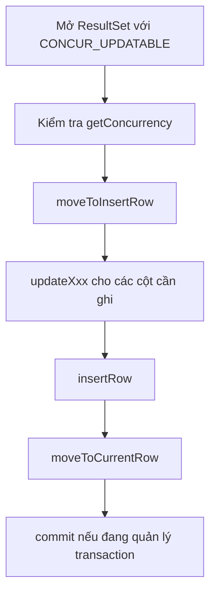

# Thêm, xóa và làm mới hàng qua API ResultSet

Trong JDBC, `ResultSet` thường được dùng để **đọc** dữ liệu: gọi `executeQuery()`, di chuyển con trỏ bằng `next()` rồi lấy giá trị qua `getString()`, `getLong()` hoặc `getObject()`. Tuy nhiên, JDBC còn định nghĩa **ResultSet có thể cập nhật** (*updatable ResultSet*), cho phép sửa, **thêm**, **xóa** và **làm mới** một hàng trực tiếp thông qua API của `ResultSet` khi driver và câu truy vấn hỗ trợ.

Bài thuộc chương **ResultSet nâng cao** của module **JDBC**. Trọng tâm là `moveToInsertRow()`, `insertRow()`, `deleteRow()` và `refreshRow()`, đồng thời phân biệt các thao tác này với `updateXxx()`/`updateRow()`. Ví dụ sử dụng `DataSource`, `Connection`, `PreparedStatement`, `ResultSet` và transaction chuẩn JDBC để bạn hiểu **điều kiện sử dụng, tác động lên dữ liệu và giới hạn khi triển khai thực tế**.

> **Quy tắc quan trọng:** Không phải mọi `ResultSet` đều sửa được dữ liệu. Một truy vấn trả về `ResultSet` không đồng nghĩa driver cho phép gọi `insertRow()` hoặc `deleteRow()`. Luôn yêu cầu đúng chế độ, kiểm tra khả năng hỗ trợ và có phương án dự phòng bằng SQL `INSERT`/`DELETE` tham số hóa.

## 1. ResultSet đọc được và ResultSet cập nhật được khác nhau thế nào?

JDBC phân biệt hai nhóm thuộc tính khi tạo `Statement` hoặc `PreparedStatement`:

| Nhóm | Giá trị tiêu biểu | Ý nghĩa |
| --- | --- | --- |
| **Loại con trỏ** (*result set type*) | `TYPE_FORWARD_ONLY` | Thường di chuyển tiến bằng `next()`; không có khả năng cuộn ngược như một cursor scrollable. |
| | `TYPE_SCROLL_INSENSITIVE` | Có thể di chuyển qua lại; khả năng nhìn thấy thay đổi từ transaction khác bị giới hạn theo đặc tính driver. |
| | `TYPE_SCROLL_SENSITIVE` | Có thể di chuyển qua lại và có khả năng phản ánh một số thay đổi; mức độ nhìn thấy thực tế phụ thuộc driver/DBMS. |
| **Khả năng cập nhật** (*concurrency*) | `CONCUR_READ_ONLY` | Không cho dùng các thao tác ghi hàng qua `ResultSet`. |
| | `CONCUR_UPDATABLE` | Cho phép yêu cầu sửa/thêm/xóa hàng nếu **truy vấn cụ thể** và driver hỗ trợ. |

Hai nhóm thuộc tính **độc lập về mục đích**. Một `ResultSet` scrollable không mặc nhiên là updatable; ngược lại, khả năng updatable không đồng nghĩa nó nhìn thấy tức thì mọi thay đổi đồng thời từ kết nối khác.

Ví dụ yêu cầu một `ResultSet` cuộn được và cập nhật được:

```java
String sql = "SELECT id, full_name, email FROM contacts";
try (Connection connection = dataSource.getConnection();
     PreparedStatement ps = connection.prepareStatement(
             sql,
             ResultSet.TYPE_SCROLL_INSENSITIVE,
             ResultSet.CONCUR_UPDATABLE);
     ResultSet rs = ps.executeQuery()) {

    System.out.println("Kiểu thực tế: " + rs.getType());
    System.out.println("Concurrency thực tế: " + rs.getConcurrency());
}
```

Đoạn mã này nằm trong ngữ cảnh đã có `dataSource` và các import JDBC cần thiết. Một số driver có thể **hạ cấp** (*downgrade*) yêu cầu về `CONCUR_READ_ONLY` hoặc kiểu khác, có thể phát sinh `SQLWarning`, hoặc ném `SQLException`. Vì vậy cần đọc `rs.getConcurrency()` và `rs.getType()` thay vì coi hai tham số truyền vào `prepareStatement` là bảo đảm cuối cùng.

### Điều kiện để truy vấn có thể cập nhật

Một truy vấn đơn giản chọn các cột từ **một bảng**, có **khóa chính hoặc định danh hàng** và đủ cột cần sửa thường có khả năng được driver hỗ trợ cao hơn:

```sql
SELECT id, full_name, email
FROM contacts
WHERE id = ?;
```

Ngược lại, những truy vấn sau thường không phù hợp với `ResultSet` updatable, tùy DBMS:

- `JOIN` nhiều bảng, `UNION`, `DISTINCT`, `GROUP BY` hoặc hàm tổng hợp;
- Cột tính toán hoặc biểu thức không ánh xạ rõ về một cột có thể ghi;
- Không có khóa/định danh hàng để driver tạo câu `UPDATE`/`DELETE` tương ứng;
- View chỉ đọc hoặc truy vấn bị hạn chế bởi quyền của tài khoản kết nối.

Không có quy tắc SQL chung rằng “cứ `SELECT` một bảng là chắc chắn updatable”. Một số driver yêu cầu thêm cú pháp như `FOR UPDATE`, chọn đủ khóa chính hoặc dùng loại con trỏ khác; một số không hỗ trợ thao tác chèn/xóa qua `ResultSet` ngay cả khi hỗ trợ truy vấn thông thường.

## 2. Kiểm tra hỗ trợ trước khi dùng

`DatabaseMetaData` cung cấp các API hỏi driver/DBMS có hỗ trợ kết hợp loại cursor và khả năng cập nhật hay không:

```java
import java.sql.Connection;
import java.sql.DatabaseMetaData;
import java.sql.ResultSet;
import java.sql.SQLException;
import javax.sql.DataSource;

public final class UpdatableResultSetSupport {
    public static void inspect(DataSource dataSource) throws SQLException {
        try (Connection connection = dataSource.getConnection()) {
            DatabaseMetaData md = connection.getMetaData();

            int type = ResultSet.TYPE_SCROLL_INSENSITIVE;
            int concurrency = ResultSet.CONCUR_UPDATABLE;

            System.out.println("Hỗ trợ loại cursor: "
                    + md.supportsResultSetType(type));
            System.out.println("Hỗ trợ loại + concurrency: "
                    + md.supportsResultSetConcurrency(type, concurrency));
            System.out.println("Thấy cập nhật do chính cursor thực hiện: "
                    + md.ownUpdatesAreVisible(type));
            System.out.println("Thấy hàng do chính cursor chèn: "
                    + md.ownInsertsAreVisible(type));
            System.out.println("Phát hiện hàng bị xóa: "
                    + md.deletesAreDetected(type));
        }
    }
}
```

`supportsResultSetConcurrency(type, concurrency)` rất hữu ích để kiểm tra khả năng chung, nhưng **chưa chứng minh truy vấn cụ thể có thể cập nhật**. Sau khi mở `ResultSet`, vẫn phải kiểm tra `getConcurrency()` và xử lý `SQLException` khi gọi các phương thức ghi.

Các API như `ownInsertsAreVisible(type)`, `ownDeletesAreVisible(type)`, `updatesAreDetected(type)` hoặc `deletesAreDetected(type)` nói về **khả năng quan sát/phát hiện thay đổi của result set**. Chúng không phải lời hứa rằng bản ghi tự xuất hiện tại vị trí đang duyệt sau `insertRow()` hoặc rằng `rowDeleted()` luôn trả `true` trên mọi driver.

### Đọc lại chế độ thực tế

Trong ví dụ thực hành, nên có một hàm bảo vệ:

```java
import java.sql.ResultSet;
import java.sql.SQLException;

static void requireUpdatable(ResultSet rs) throws SQLException {
    if (rs.getConcurrency() != ResultSet.CONCUR_UPDATABLE) {
        throw new SQLException(
                "ResultSet thực tế không hỗ trợ CONCUR_UPDATABLE");
    }
}
```

Đây là đoạn hàm Java đặt bên trong một lớp. Nếu driver không hỗ trợ, ứng dụng có thể chuyển sang `PreparedStatement` chứa SQL `INSERT`, `UPDATE` hoặc `DELETE`, thay vì tiếp tục gọi `insertRow()` rồi thất bại khó hiểu.

## 3. Lược đồ và các thao tác cần phân biệt

Ta dùng một bảng mẫu:

```sql
CREATE TABLE contacts (
    id BIGINT PRIMARY KEY,
    full_name VARCHAR(120) NOT NULL,
    email VARCHAR(255) NOT NULL
);
```

Ví dụ chủ động truyền `id` khi chèn để không phải phụ thuộc quy tắc khóa sinh riêng DBMS. Trong ứng dụng thật, `id` có thể là cột tự sinh, nhưng lúc đó cách thao tác trên updatable `ResultSet` và đọc lại khóa sinh cần kiểm tra riêng với driver; không mặc định `ResultSet.insertRow()` hoạt động giống `PreparedStatement.getGeneratedKeys()`.

Các phương thức cần nhớ:

| Thao tác | API | Vị trí cursor | Tác động chính |
| --- | --- | --- | --- |
| **Chuẩn bị chèn** | `moveToInsertRow()` | Chuyển đến hàng chèn đặc biệt (*insert row*). | Chưa chèn vào DB; chuẩn bị bộ giá trị cho hàng mới. |
| **Gán cột ở hàng chèn** | `updateLong(...)`, `updateString(...)`, ... | Đang ở insert row. | Gán giá trị cho bộ đệm của hàng mới. |
| **Chèn** | `insertRow()` | Đang ở insert row. | Yêu cầu DB chèn hàng từ bộ giá trị đã cung cấp. |
| **Trở về cursor cũ** | `moveToCurrentRow()` | Sau thao tác chèn. | Trả cursor về vị trí trước khi gọi `moveToInsertRow()`. |
| **Xóa** | `deleteRow()` | Phải đang ở một hàng thực sự. | Yêu cầu DB xóa hàng hiện tại. |
| **Làm mới** | `refreshRow()` | Phải đang ở một hàng thực sự, không phải insert row. | Cố gắng lấy lại giá trị hàng từ DB theo ngữ nghĩa driver/isolation. |
| **Sửa hàng đang có** | `updateXxx(...)` rồi `updateRow()` | Đang ở hàng thật. | Chuẩn bị giá trị thay đổi, sau đó gửi cập nhật cho hàng hiện tại. |

`updateXxx(...)` chỉ đặt giá trị ở bộ đệm của `ResultSet`. Khi đang ở **insert row**, dùng `insertRow()` để chèn; khi đang ở **hàng hiện tại**, dùng `updateRow()` để áp dụng thay đổi. Gọi `updateString()` rồi bỏ qua `insertRow()`/`updateRow()` **không phải cách ghi dữ liệu bền vững**.

## 4. Thêm một hàng: moveToInsertRow và insertRow

Trình tự chuẩn:



Ví dụ cụ thể:

```java
String sql = "SELECT id, full_name, email FROM contacts";

try (PreparedStatement ps = connection.prepareStatement(
             sql,
             ResultSet.TYPE_SCROLL_INSENSITIVE,
             ResultSet.CONCUR_UPDATABLE);
     ResultSet rs = ps.executeQuery()) {

    if (rs.getConcurrency() != ResultSet.CONCUR_UPDATABLE) {
        throw new SQLException("Cursor không cho phép chèn hàng");
    }

    rs.moveToInsertRow();
    rs.updateLong("id", 101L);
    rs.updateString("full_name", "Nguyễn Minh");
    rs.updateString("email", "minh@example.test");
    rs.insertRow();
    rs.moveToCurrentRow();
}
```

Đoạn mã này giả định `connection` đang mở, có quyền `INSERT` và truy vấn `SELECT` đủ đơn giản để driver hỗ trợ updatable `ResultSet`. Nó dùng truy vấn không lọc chỉ cho **bài thực hành với bảng nhỏ**; trong ứng dụng có nhiều hàng, cần cân nhắc chi phí tải `ResultSet` và giải pháp `INSERT` qua `PreparedStatement`.

**Những chi tiết dễ bỏ sót:**

1. `moveToInsertRow()` di chuyển đến vùng đệm của hàng chèn, **không** di chuyển đến một hàng đã tồn tại trong bảng.
2. Cần cung cấp giá trị cho các cột bắt buộc, trừ những cột được DBMS tự tạo hoặc có default thích hợp. Vi phạm `NOT NULL`, khóa chính, khóa ngoại hoặc quyền sẽ tạo `SQLException`.
3. `insertRow()` thực hiện chèn. Nếu transaction đang bật `autoCommit=false`, thay đổi vẫn thuộc transaction cho đến khi `commit()`.
4. `moveToCurrentRow()` đưa con trỏ về vị trí trước khi chèn, nhưng không bảo đảm hàng vừa chèn xuất hiện trong tập các hàng đang được duyệt. Sự xuất hiện/phát hiện hàng chèn phụ thuộc `ResultSet` type, DBMS và driver.
5. Sau lỗi ở `insertRow()`, tài nguyên có thể được đóng bằng `try-with-resources`; nếu transaction đang mở, phải `rollback()` theo chính sách của caller. Không nên giả định kết quả nửa chừng sẽ tự biến mất.

Nếu cần chèn nhiều hàng hoặc lấy generated keys, `PreparedStatement` với `INSERT` tham số hóa và `Statement.RETURN_GENERATED_KEYS` (khi driver hỗ trợ) thường dễ kiểm soát hơn.

## 5. Xóa hàng: deleteRow

`deleteRow()` tác động đến **hàng hiện tại** của `ResultSet`. Muốn xóa đúng liên hệ `id = 202`, truy vấn trước bằng khóa chính và chỉ xóa sau khi `rs.next()` đã đưa con trỏ vào hàng đó:

```java
String sql = "SELECT id, full_name, email "
           + "FROM contacts WHERE id = ?";

try (PreparedStatement ps = connection.prepareStatement(
             sql,
             ResultSet.TYPE_SCROLL_INSENSITIVE,
             ResultSet.CONCUR_UPDATABLE)) {
    ps.setLong(1, 202L);

    try (ResultSet rs = ps.executeQuery()) {
        if (rs.getConcurrency() != ResultSet.CONCUR_UPDATABLE) {
            throw new SQLException("Cursor không cho phép xóa hàng");
        }
        if (rs.next()) {
            rs.deleteRow();
            // Nếu DBMS/transaction cho phép, hàng id=202 đã được xóa.
        } else {
            // Không có hàng phù hợp: không gọi deleteRow().
        }
    }
}
```

**Lưu ý sau khi xóa:** trạng thái cursor ngay sau `deleteRow()` có thể khác nhau theo loại `ResultSet` và driver. Không tiếp tục giả định `getString(...)` trên hàng vừa xóa vẫn trả dữ liệu hợp lệ, cũng không tự coi `rs.rowDeleted()` là cách xác nhận xóa di động giữa mọi driver. Nếu cần duyệt tiếp, hãy đặt vị trí cursor theo cơ chế được driver hỗ trợ hoặc mở truy vấn mới.

Xóa qua `ResultSet` vẫn chịu ràng buộc DBMS. Khóa ngoại có thể ngăn xóa; trigger có thể có tác động phụ; transaction khác có thể giữ khóa khiến lệnh chờ hoặc thất bại. Nếu chỉ cần xóa theo khóa chính, SQL rõ ràng thường dễ diễn đạt hơn:

```sql
DELETE FROM contacts WHERE id = ?;
```

Với `PreparedStatement.executeUpdate()`, kết quả `0` nghĩa là không có hàng nào khớp, `1` nghĩa là một hàng được báo đã bị tác động (giả định `id` là khóa chính). Đây là hợp đồng rõ ràng hơn cho API xóa một bản ghi; thao tác xóa bằng `ResultSet` phù hợp khi ứng dụng đã làm việc với cursor updatable vì lý do cụ thể.

## 6. Làm mới hàng: refreshRow

`refreshRow()` được dùng khi cần **yêu cầu driver cập nhật lại giá trị của hàng hiện tại từ cơ sở dữ liệu**. Nó không chèn, không xóa và không phải một lệnh `UPDATE`. Ví dụ:

```java
String sql = "SELECT id, full_name, email "
           + "FROM contacts WHERE id = ?";

try (PreparedStatement ps = connection.prepareStatement(
             sql,
             ResultSet.TYPE_SCROLL_INSENSITIVE,
             ResultSet.CONCUR_UPDATABLE)) {
    ps.setLong(1, 101L);

    try (ResultSet rs = ps.executeQuery()) {
        if (rs.next()) {
            String before = rs.getString("email");
            rs.refreshRow();
            String after = rs.getString("email");

            System.out.println("Trước: " + before);
            System.out.println("Sau refresh: " + after);
        }
    }
}
```

Với driver hỗ trợ `refreshRow()`, lệnh này yêu cầu làm mới dữ liệu của hàng đang đứng. **Không được khẳng định `after` nhất định khác `before`**: nếu không có thay đổi, hoặc mức cô lập giao dịch vẫn cho thấy cùng một snapshot, hai giá trị có thể giống nhau. Nếu hàng đã bị xóa đồng thời, driver có thể ném `SQLException` hoặc có quy tắc riêng về việc quan sát hàng bị xóa.

### Refresh không phải “tải lại cả ResultSet”

| Thao tác | Điều gì được làm mới? |
| --- | --- |
| `refreshRow()` | **Hàng hiện tại** mà con trỏ đang đứng, theo khả năng driver. |
| Chạy lại `executeQuery()` | Thực thi **truy vấn mới**, có thể nhận tập hàng khác theo điều kiện SQL và mức cô lập. |
| `rowUpdated()`/`rowDeleted()` | API báo trạng thái thay đổi nếu driver có khả năng phát hiện; **không** tự tải lại dữ liệu. |
| `cancelRowUpdates()` | Hủy các thay đổi đang chờ trong bộ đệm của hàng hiện tại, **không** thay thế `rollback()` của transaction. |

Không gọi `refreshRow()` khi con trỏ đang ở `insert row`; nó cần một hàng thực sự. Việc gọi sau `updateString(...)` nhưng **trước `updateRow()`** có thể làm mất các thay đổi còn nằm trong bộ đệm, vì refresh lấy lại giá trị của hàng. Cần lựa chọn giữa **hủy bộ đệm** bằng `cancelRowUpdates()` và **làm mới từ DB** bằng `refreshRow()` theo đúng mục đích.

Nếu cần bảo đảm một lần đọc **giá trị mới nhất đã commit**, phải xét mức cô lập hiện tại (`READ_COMMITTED`, `REPEATABLE_READ`, v.v.) và cách DBMS hiện thực snapshot. `refreshRow()` không tự vượt qua ràng buộc isolation hoặc khóa của transaction.

## 7. Ví dụ Java hoàn chỉnh: một repository dùng ba thao tác

Ví dụ dưới đây gom ba thao tác vào một lớp. **Caller sở hữu `Connection` và transaction**, nên repository không tự ý `commit` hoặc `rollback`. Điều đó cho phép đặt nhiều thao tác trong cùng đơn vị nghiệp vụ, nhưng caller phải kết thúc transaction rõ ràng.

```java
import java.sql.Connection;
import java.sql.PreparedStatement;
import java.sql.ResultSet;
import java.sql.SQLException;
import java.util.Objects;
import java.util.Optional;

public final class UpdatableContactRepository {
    private static final int TYPE = ResultSet.TYPE_SCROLL_INSENSITIVE;
    private static final int MODE = ResultSet.CONCUR_UPDATABLE;

    private static void requireUpdatable(ResultSet rs)
            throws SQLException {
        if (rs.getConcurrency() != MODE) {
            throw new SQLException("ResultSet bị hạ cấp thành READ_ONLY");
        }
    }

    public void insert(Connection connection, long id,
                       String fullName, String email) throws SQLException {
        Objects.requireNonNull(connection);
        Objects.requireNonNull(fullName);
        Objects.requireNonNull(email);
        if (id <= 0) {
            throw new IllegalArgumentException("id phải dương");
        }

        // Truy vấn không lọc chỉ phục vụ ví dụ bảng contacts nhỏ.
        String sql = "SELECT id, full_name, email FROM contacts";
        try (PreparedStatement ps = connection.prepareStatement(sql, TYPE, MODE);
             ResultSet rs = ps.executeQuery()) {
            requireUpdatable(rs);

            rs.moveToInsertRow();
            rs.updateLong("id", id);
            rs.updateString("full_name", fullName);
            rs.updateString("email", email);
            rs.insertRow();
            rs.moveToCurrentRow();
        }
    }

    public boolean deleteById(Connection connection, long id)
            throws SQLException {
        Objects.requireNonNull(connection);
        String sql = "SELECT id, full_name, email "
                   + "FROM contacts WHERE id = ?";
        try (PreparedStatement ps = connection.prepareStatement(sql, TYPE, MODE)) {
            ps.setLong(1, id);
            try (ResultSet rs = ps.executeQuery()) {
                requireUpdatable(rs);
                if (!rs.next()) {
                    return false;
                }
                rs.deleteRow();
                return true;
            }
        }
    }

    public Optional<Contact> refreshById(Connection connection, long id)
            throws SQLException {
        Objects.requireNonNull(connection);
        String sql = "SELECT id, full_name, email "
                   + "FROM contacts WHERE id = ?";
        try (PreparedStatement ps = connection.prepareStatement(sql, TYPE, MODE)) {
            ps.setLong(1, id);
            try (ResultSet rs = ps.executeQuery()) {
                requireUpdatable(rs);
                if (!rs.next()) {
                    return Optional.empty();
                }
                rs.refreshRow();
                return Optional.of(new Contact(
                        rs.getLong("id"),
                        rs.getString("full_name"),
                        rs.getString("email")));
            }
        }
    }

    public static final class Contact {
        public final long id;
        public final String fullName;
        public final String email;

        public Contact(long id, String fullName, String email) {
            this.id = id;
            this.fullName = fullName;
            this.email = email;
        }
    }
}
```

Một đoạn gọi dịch vụ dùng `DataSource`:

```java
UpdatableContactRepository repository = new UpdatableContactRepository();

try (Connection connection = dataSource.getConnection()) {
    // Ví dụ này tự sở hữu transaction; không dùng trong transaction
    // đang được framework/transaction manager quản lý.
    if (!connection.getAutoCommit()) {
        throw new SQLException("Ví dụ yêu cầu autoCommit=true ban đầu");
    }
    connection.setAutoCommit(false);

    try {
        repository.insert(connection, 101L,
                "Nguyễn Minh", "minh@example.test");

        Optional<UpdatableContactRepository.Contact> current =
                repository.refreshById(connection, 101L);
        if (current.isEmpty()) {
            throw new SQLException("Không thấy hàng vừa chèn");
        }

        // Ví dụ riêng: xóa một liên hệ cũ nếu tồn tại.
        repository.deleteById(connection, 202L);

        connection.commit();
    } catch (SQLException | RuntimeException failure) {
        try {
            connection.rollback();
        } catch (SQLException rollbackError) {
            failure.addSuppressed(rollbackError);
        }
        throw failure;
    }
}
```

Đây là đoạn thân phương thức minh họa: `dataSource` đã được cung cấp; giả định bảng `contacts` tồn tại, driver hỗ trợ loại cursor yêu cầu và ID `101` chưa có. Nếu `commit()` mất kết nối, kết quả commit có thể chưa xác định; `rollback()` tiếp theo không chứng minh chắc chắn mọi thay đổi chưa được ghi. Với sản phẩm thật, cần khóa nghiệp vụ/idempotency và chính sách reset/loại connection của pool khi trạng thái giao dịch không rõ.

**Không giữ transaction mở lúc người dùng nhập liệu.** Ví dụ gom thao tác trong một transaction ngắn ở phía server; ứng dụng web không nên mượn kết nối rồi chờ người dùng sửa form. Với thao tác CRUD đơn giản, SQL tham số hóa thường gọn hơn và cho phép kiểm soát số hàng cập nhật rõ ràng hơn.

## 8. Khi nào cần chọn SQL PreparedStatement thay vì updatable ResultSet?

Hai cách có thể thực hiện cùng mục đích nhưng khác hợp đồng:

| Tiêu chí | Updatable `ResultSet` | SQL với `PreparedStatement` |
| --- | --- | --- |
| **Thao tác** | `moveToInsertRow`/`insertRow`, `deleteRow`, `refreshRow`. | `INSERT`, `DELETE`, `SELECT` hoặc `UPDATE` rõ ràng. |
| **Yêu cầu driver** | Hỗ trợ `CONCUR_UPDATABLE` cho loại cursor **và câu truy vấn cụ thể**. | Hỗ trợ SQL/kiểu tham số thông dụng; thường di động và dễ kiểm soát hơn. |
| **Xác định số hàng thay đổi** | Chủ yếu dựa vào vị trí cursor và ngoại lệ; API chèn/xóa không trả số đếm kiểu `int`. | `executeUpdate()` trả số hàng được báo đã tác động. |
| **Khóa sinh** | Hành vi chèn và đọc giá trị tự sinh phụ thuộc driver. | Có cơ chế `RETURN_GENERATED_KEYS` khi driver hỗ trợ. |
| **Sửa có điều kiện theo version** | Phụ thuộc điều kiện truy vấn và khả năng cursor; không phù hợp với mọi mô hình optimistic locking. | Dễ diễn đạt `UPDATE ... WHERE id=? AND version=?`. |
| **Duy trì cursor** | Cần giữ `ResultSet`, `Statement` và `Connection` mở trong lúc thao tác. | Có thể chạy từng lệnh ngắn và đóng tài nguyên ngay. |

Ví dụ SQL di động hơn cho hai thao tác:

```java
String insertSql = "INSERT INTO contacts (id, full_name, email) "
                 + "VALUES (?, ?, ?)";
try (PreparedStatement ps = connection.prepareStatement(insertSql)) {
    ps.setLong(1, 101L);
    ps.setString(2, "Nguyễn Minh");
    ps.setString(3, "minh@example.test");
    int inserted = ps.executeUpdate();
    if (inserted != 1) {
        throw new SQLException("INSERT không tác động đúng một hàng");
    }
}

String deleteSql = "DELETE FROM contacts WHERE id = ?";
try (PreparedStatement ps = connection.prepareStatement(deleteSql)) {
    ps.setLong(1, 202L);
    int deleted = ps.executeUpdate();
    System.out.println("Số hàng đã xóa: " + deleted);
}
```

Cả hai đoạn trên giả định `connection` đã có và được caller quản lý transaction. `PreparedStatement` không tự loại bỏ nguy cơ xung đột đồng thời; với nghiệp vụ cần xác nhận phiên bản, dùng `WHERE id=? AND version=?` hoặc ràng buộc SQL phù hợp.

**Khi nào updatable ResultSet có ích?** Khi đang xây ứng dụng desktop hoặc công cụ quản trị dựa trên một cursor hàng đơn giản, có driver đã được kiểm thử và muốn gắn thao tác trên **hàng đang chọn** với cập nhật của DB. Với service Java có lưu lượng lớn, CRUD theo khóa chính và xử lý cạnh tranh, SQL tham số hóa thường là lựa chọn mặc định dễ vận hành hơn.

## 9. Isolation, làm mới dữ liệu và kiểm soát đồng thời

Một số hiểu lầm phổ biến khi dùng `refreshRow()`:

1. **“Refresh luôn thấy dữ liệu mới nhất.”** Không đúng trong mọi transaction. Ở `REPEATABLE_READ` hoặc cơ chế snapshot khác, transaction có thể tiếp tục thấy cùng phiên bản dữ liệu; khi có khóa, thao tác có thể phải chờ hoặc lỗi.
2. **“Refresh tự khóa hàng để ngăn sửa tiếp.”** Không đúng. `refreshRow()` là thao tác đọc lại hàng theo ngữ nghĩa driver, không phải hợp đồng khóa độc quyền chung cho JDBC.
3. **“Sau insertRow, hàng mới luôn xuất hiện khi gọi next().”** Không đúng. Khả năng thấy hàng mới trên cursor hiện tại tùy driver/loại `ResultSet`.
4. **“DeleteRow giải quyết mọi xung đột.”** Không đúng. Nếu người khác đã sửa hoặc xóa hàng, DBMS/driver có thể phản ứng khác nhau; không tự suy luận khóa lạc quan được đảm bảo.
5. **“Gọi updateString là đã lưu email.”** Chưa. Phải gọi `updateRow()` khi ở hàng thật hoặc `insertRow()` khi ở hàng chèn.

Khi nghiệp vụ cần tránh **lost update**, hãy ưu tiên kiểu cập nhật có điều kiện:

```sql
UPDATE contacts
SET email = ?, version = version + 1
WHERE id = ? AND version = ?;
```

Ví dụ này yêu cầu bảng có thêm cột `version`; nó minh họa **mô hình kiểm soát đồng thời**, không chạy trực tiếp trên bảng `contacts` ban đầu chưa có cột `version`. Việc đặt điều kiện phiên bản và tăng phiên bản trong cùng lệnh `UPDATE` cho phép phát hiện yêu cầu cập nhật dựa trên snapshot cũ thông qua số hàng được `executeUpdate()` trả về.

Đừng cố kết hợp updatable `ResultSet` với thay đổi cùng một hàng từ nhiều luồng trên **cùng một connection**. Một `Connection` và các đối tượng statement/result set của nó thường không có hợp đồng dùng đồng thời an toàn giữa các luồng; cách điều phối kết nối, transaction và khóa phải được thiết kế rõ ràng.

## 10. Lỗi, giới hạn và checklist kiểm thử

Các tình huống nên thử trên **đúng DBMS và phiên bản driver** của môi trường triển khai:

| Kiểm thử | Kỳ vọng hoặc cách giải thích |
| --- | --- |
| `supportsResultSetConcurrency(TYPE_SCROLL_INSENSITIVE, CONCUR_UPDATABLE)` trả `false`. | Không dùng đường updatable ResultSet; chuyển sang SQL tham số hóa hoặc điều chỉnh chế độ nếu được hỗ trợ. |
| Đề nghị `CONCUR_UPDATABLE` nhưng `rs.getConcurrency()` là `CONCUR_READ_ONLY`. | Driver đã trả chế độ thực tế không phù hợp; không gọi `insertRow()`/`deleteRow()`. |
| Truy vấn `SELECT` đơn giản một bảng có khóa chính. | Thử chèn/xóa/refresh và kiểm tra dữ liệu sau commit; không coi là bảo đảm chung cho mọi driver. |
| Truy vấn chứa `JOIN` hoặc `GROUP BY`. | Thường không updatable; cần kiểm tra metadata/chế độ thực tế và xử lý `SQLException`. |
| `insertRow()` thiếu cột `NOT NULL` hoặc trùng khóa chính. | DBMS có thể từ chối bằng `SQLException`; phải rollback nếu thao tác thuộc transaction nhiều bước. |
| `deleteRow()` khi con trỏ chưa vào một hàng thật. | Không hợp lệ; trước tiên phải kiểm tra `rs.next()`. |
| `refreshRow()` khi con trỏ ở insert row hoặc sau khi xóa hàng. | Không hợp lệ/không có hàng hiện tại đáng tin cậy; đừng gọi. |
| Hàng bị transaction khác sửa giữa lần đọc và refresh. | Kết quả phụ thuộc isolation/driver; test việc thấy dữ liệu mới hoặc lỗi xung đột. |
| Cập nhật hoặc xóa rồi `rollback()`. | Với DBMS có transaction, thay đổi chưa commit phải được hoàn tác; xác minh bằng truy vấn mới. |
| Không còn hàng trong `ResultSet` do `WHERE` không khớp. | `deleteRow()` không thể xóa hàng không tồn tại; `insertRow()` có thể hoạt động trên cursor updatable nếu driver hỗ trợ chèn qua kết quả rỗng. |

**Khi gặp `SQLException`**, ghi nhận `SQLState` và `getErrorCode()` (nếu có), không chỉ in `getMessage()`. Với `SQLWarning` sau khi tạo statement, có thể kiểm tra `getWarnings()` để biết driver có cảnh báo hạ cấp khả năng result set hay không; cảnh báo không thay thế kiểm tra `rs.getConcurrency()`.

`ResultSet` có thể giữ tài nguyên server hoặc snapshot. Tránh giữ cursor updatable mở trong lúc chờ người dùng thao tác, gọi HTTP, tải file lớn hoặc xử lý CPU tốn thời gian. Dùng `try-with-resources` để đóng `ResultSet`, `PreparedStatement` và `Connection` theo đúng vòng đời; nếu ứng dụng có transaction manager, không tự ý thay đổi `autoCommit` của kết nối do framework quản lý.

## 11. Bài tập thực hành

Giả sử cơ sở dữ liệu có bảng:

```sql
CREATE TABLE tasks (
    id BIGINT PRIMARY KEY,
    title VARCHAR(200) NOT NULL,
    status VARCHAR(30) NOT NULL
);
```

Bạn cần xây một công cụ quản trị JDBC cho phép thêm task, xóa task đang chọn và làm mới trạng thái của task trên màn hình.

1. Khi tạo `PreparedStatement`, bạn cần yêu cầu loại `ResultSet` và concurrency nào để có thể duyệt lại hàng, chèn/xóa? Phải kiểm tra phương thức nào sau `executeQuery()`?
2. Hãy viết chuỗi lời gọi JDBC tối thiểu để chèn task `id=501` với `title='Kiểm tra đơn hàng'`, `status='OPEN'` bằng updatable `ResultSet`.
3. Trước `deleteRow()`, cần điều kiện gì về vị trí cursor? Sau khi xóa, có thể khẳng định cursor vẫn trỏ vào một hàng hợp lệ hoặc `rowDeleted()` luôn `true` không?
4. `refreshRow()` khác gì chạy lại `executeQuery()`? Trong trường hợp transaction đang dùng snapshot, có thể khẳng định refresh luôn thấy cập nhật vừa commit từ connection khác không?
5. Nếu driver không hỗ trợ `CONCUR_UPDATABLE` với câu truy vấn của bạn, hãy viết phương án thay thế bằng `INSERT`/`DELETE` và giải thích lợi thế của số hàng `executeUpdate()`.
6. Nếu ba thao tác thêm, xóa và cập nhật cột trạng thái phải thành công cùng nhau, cần dùng `setAutoCommit(false)`, `commit()` và `rollback()` như thế nào?

**Đáp án định hướng:** (1) Yêu cầu ví dụ `TYPE_SCROLL_INSENSITIVE` và `CONCUR_UPDATABLE`, sau đó kiểm tra `rs.getConcurrency()`, `rs.getType()` và khả năng thực tế của truy vấn. (2) `moveToInsertRow()` → `updateLong("id", 501L)` → `updateString("title", ...)` → `updateString("status", "OPEN")` → `insertRow()` → `moveToCurrentRow()`. (3) Phải ở một hàng thật sau `rs.next()`; trạng thái sau xóa tùy driver. (4) Refresh chỉ tác động hàng hiện tại, còn truy vấn mới có thể tạo tập kết quả khác; isolation có thể hạn chế thay đổi quan sát được. (5) Dùng `PreparedStatement` với SQL và `executeUpdate()` để kiểm tra số hàng. (6) Mở transaction ngắn, chỉ commit sau tất cả thao tác thành công, nếu có lỗi rollback và bảo toàn nguyên nhân.

**Ghi nhớ:** Muốn **thêm** hàng qua `ResultSet`, cần `moveToInsertRow()` → `updateXxx()` → `insertRow()` → `moveToCurrentRow()`. Muốn **xóa**, phải đứng ở một hàng thật rồi gọi `deleteRow()`. Muốn **làm mới**, dùng `refreshRow()` trên hàng hiện tại nhưng không giả định nó vượt qua isolation hoặc tự chạy lại toàn truy vấn. Tất cả chỉ có hiệu lực khi driver/truy vấn hỗ trợ `CONCUR_UPDATABLE`; trong đa số thao tác CRUD nghiệp vụ, `PreparedStatement` với SQL tham số hóa vẫn là phương án rõ ràng, dễ kiểm thử và di động hơn.
