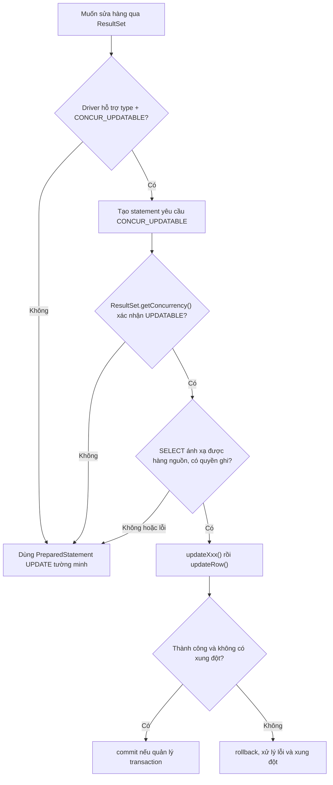

# Kiểm tra điều kiện để tập kết quả được phép cập nhật

Trong JDBC, một `ResultSet` không chỉ dùng để đọc hàng bằng `next()` và `getXxx()`. Nếu JDBC driver, câu truy vấn và cơ sở dữ liệu cho phép, ứng dụng còn có thể **cập nhật hàng hiện tại trực tiếp qua ResultSet** bằng `updateString(...)`, `updateInt(...)`, `updateRow()`, hoặc thậm chí thêm/xóa hàng qua `insertRow()` và `deleteRow()`.

Tuy nhiên, một tập kết quả trả về từ `SELECT` **không đương nhiên được phép cập nhật**. Kể cả khi chương trình yêu cầu `ResultSet.CONCUR_UPDATABLE`, driver có thể không hỗ trợ kiểu cursor đó, câu `SELECT` có thể không ánh xạ được một-một tới hàng gốc, hoặc tài khoản CSDL không có quyền ghi. Muốn dùng chức năng này an toàn, ứng dụng phải **kiểm tra khả năng, yêu cầu đúng chế độ, xác nhận chế độ thực tế và xử lý lỗi khi cập nhật**.

Bài học thuộc chương **ResultSet nâng cao** của module **JDBC**. Nội dung kết hợp `DataSource`, `Connection`, `PreparedStatement`, `ResultSet`, metadata, SQL tham số hóa, transaction, `commit()/rollback()` và kiểm soát đồng thời khi sử dụng tập kết quả cập nhật được (*updatable ResultSet*).

## 1. “Tập kết quả cập nhật được” là gì?

Trong JDBC, thuộc tính *concurrency* của ResultSet được biểu diễn bằng các hằng:

- `ResultSet.CONCUR_READ_ONLY`: tập kết quả chỉ cho phép **đọc**; không được dùng các thao tác cập nhật hàng thông qua cursor này.
- `ResultSet.CONCUR_UPDATABLE`: tập kết quả có khả năng được cập nhật thông qua các phương thức cursor mà driver hỗ trợ.

Chữ “concurrency” trong tên hằng **không phải mức cô lập giao dịch**. Nó cho biết ResultSet có thể sửa dữ liệu qua cursor hay không, chứ không bảo đảm đã khóa hàng, tránh mọi lost update hay tự động commit thay đổi.

Ví dụ, với ResultSet có thể cập nhật:

```java
// rs đã trỏ đến một hàng hợp lệ và là ResultSet CONCUR_UPDATABLE.
rs.updateString("display_name", "Tên mới"); // Đặt giá trị mới vào hàng hiện tại.
rs.updateRow();                             // Yêu cầu ghi thay đổi xuống DBMS.
```

Hai lệnh trên khác với:

```java
// PreparedStatement cập nhật tường minh, không cần ResultSet updatable.
PreparedStatement ps = connection.prepareStatement(
        "UPDATE customer_profile SET display_name = ? WHERE id = ?");
ps.setString(1, "Tên mới");
ps.setLong(2, 42L);
int changed = ps.executeUpdate();
```

Cả hai cách có thể dẫn tới một thao tác `UPDATE` ở cơ sở dữ liệu; cách thứ nhất nhờ driver chuyển đổi các cập nhật cursor thành thao tác ghi, cách thứ hai cho ứng dụng kiểm soát trực tiếp câu SQL và điều kiện cập nhật.

**Phân biệt:** `ResultSet.updateString(...)` chỉ thay giá trị dự kiến của một cột trong hàng hiện tại. Để gửi thay đổi xuống DBMS, thông thường cần gọi **`ResultSet.updateRow()`**. Nếu transaction đang tắt auto-commit, vẫn cần `Connection.commit()` để xác nhận thay đổi.

## 2. Bốn nhóm điều kiện phải kiểm tra

Không tồn tại một câu lệnh JDBC duy nhất bảo đảm rằng **mọi câu SELECT đều cập nhật được**. Hãy kiểm tra theo các lớp:

| Lớp điều kiện | Câu hỏi | Công cụ kiểm tra |
|---|---|---|
| 1. **Khả năng driver/DBMS** | Driver có hỗ trợ ResultSet theo kiểu và concurrency mong muốn không? | `DatabaseMetaData.supportsResultSetType(...)`, `supportsResultSetConcurrency(...)`. |
| 2. **Cấu hình statement và ResultSet** | Có yêu cầu `CONCUR_UPDATABLE` đúng lúc tạo `Statement/PreparedStatement`? Driver thực sự trả về chế độ nào? | Overload `prepareStatement(sql, type, concurrency)`; `ResultSet.getConcurrency()`. |
| 3. **Hình dạng truy vấn và hàng dữ liệu** | Mỗi hàng ResultSet có xác định rõ hàng nguồn cần cập nhật không? Cột định sửa có thể ghi được không? | Câu `SELECT` đơn giản, khóa định danh hàng, `ResultSetMetaData.isWritable(...)` và kiểm thử thực tế. |
| 4. **Quyền, transaction và xung đột** | Tài khoản DB có quyền `UPDATE`? Giao dịch còn hợp lệ? Hàng có bị thay đổi bởi transaction khác không? | Quyền DBMS, `SQLException`, `commit()/rollback()`, kiểm tra đồng thời. |



Các kiểm tra metadata phản ánh khả năng **theo công bố của driver**, không thay thế bước thực thi/kiểm thử với chính câu SQL và quyền truy cập thật.

## 3. `TYPE_*` và `CONCUR_*`: hai đặc tính độc lập

Khi tạo `PreparedStatement`, có thể yêu cầu dạng:

```java
PreparedStatement ps = connection.prepareStatement(
        sql,
        ResultSet.TYPE_SCROLL_INSENSITIVE,
        ResultSet.CONCUR_UPDATABLE
);
```

Hai tham số cấu hình hai chiều khác nhau:

| Nhóm | Hằng JDBC | Ý nghĩa chính |
|---|---|---|
| Loại di chuyển cursor | `TYPE_FORWARD_ONLY` | Di chuyển về phía trước, thường bằng `next()`. |
| Loại di chuyển cursor | `TYPE_SCROLL_INSENSITIVE` | Có thể di chuyển tới/lùi theo các thao tác được hỗ trợ; ResultSet không nhất thiết phản ánh thay đổi do bên khác thực hiện sau khi mở. |
| Loại di chuyển cursor | `TYPE_SCROLL_SENSITIVE` | Có khả năng nhạy với một số thay đổi bên ngoài, tùy driver/DBMS. |
| Khả năng chỉnh sửa | `CONCUR_READ_ONLY` | Chỉ đọc qua ResultSet. |
| Khả năng chỉnh sửa | `CONCUR_UPDATABLE` | Có thể sửa dữ liệu qua các `updateXxx/updateRow` khi những điều kiện khác đáp ứng. |

**Khả năng cuộn (scrollability) không đồng nghĩa khả năng cập nhật (updatability).** Có ResultSet cuộn được nhưng chỉ đọc; cũng có hệ hỗ trợ ResultSet chỉ đi tới mà vẫn cập nhật được hàng hiện tại. Một driver có thể hỗ trợ `TYPE_SCROLL_INSENSITIVE` và `CONCUR_UPDATABLE` riêng lẻ nhưng không hỗ trợ **cặp kết hợp đó**.

Các giá trị thông thường khi gọi `connection.prepareStatement(sql)` mà không truyền thêm tham số là `TYPE_FORWARD_ONLY` và `CONCUR_READ_ONLY`. Muốn sửa bằng cursor, hãy yêu cầu rõ `CONCUR_UPDATABLE`, thay vì giả định statement mặc định đã cho phép.

**Đừng suy từ tên hằng rằng ResultSet sẽ phát hiện hoặc giải quyết mọi xung đột ghi.** Độ cô lập, khóa và chính sách phát hiện xung đột phụ thuộc hệ quản trị, driver, transaction và chính dạng truy vấn.

## 4. Kiểm tra driver bằng `DatabaseMetaData`

Trước khi tạo ResultSet cập nhật được, hỏi driver hỗ trợ cặp tính năng cần dùng hay không. Ví dụ dưới đây dùng `DataSource` đã được cấu hình:

```java
import java.sql.Connection;
import java.sql.DatabaseMetaData;
import java.sql.ResultSet;
import java.sql.SQLException;
import javax.sql.DataSource;

public final class UpdatableCapabilityProbe {
    private UpdatableCapabilityProbe() {
    }

    public static void printSupport(DataSource dataSource)
            throws SQLException {
        try (Connection connection = dataSource.getConnection()) {
            DatabaseMetaData db = connection.getMetaData();

            int[] cursorTypes = {
                ResultSet.TYPE_FORWARD_ONLY,
                ResultSet.TYPE_SCROLL_INSENSITIVE,
                ResultSet.TYPE_SCROLL_SENSITIVE
            };

            for (int type : cursorTypes) {
                boolean supportsType = db.supportsResultSetType(type);
                boolean supportsUpdate = supportsType
                        && db.supportsResultSetConcurrency(
                                type, ResultSet.CONCUR_UPDATABLE);

                System.out.printf(
                        "Type %d: supported=%s, updatable=%s%n",
                        type, supportsType, supportsUpdate);
            }
        }
    }
}
```

Đây là phép dò **khả năng chung**. Ví dụ driver báo hỗ trợ `TYPE_SCROLL_INSENSITIVE + CONCUR_UPDATABLE`, nhưng câu `SELECT SUM(total)` vẫn có thể không cập nhật được vì một hàng kết quả không ánh xạ tới một hàng vật lý duy nhất.

Một số driver có thể không hỗ trợ một phương thức, hoặc báo khả năng chưa phản ánh đầy đủ các giới hạn của câu SQL. Với hệ thống cần tính di động, hãy xem thông tin metadata là **điều kiện sàng lọc ban đầu**, rồi kiểm tra chế độ trả về và chạy thử một cập nhật trong môi trường test.

### `getResultSetConcurrency()` ở statement và `getConcurrency()` ở kết quả

Sau khi tạo statement, có thể gọi:

```java
int requestedType = ResultSet.TYPE_SCROLL_INSENSITIVE;
int requestedConcurrency = ResultSet.CONCUR_UPDATABLE;

try (PreparedStatement ps = connection.prepareStatement(
        sql, requestedType, requestedConcurrency)) {

    System.out.println(ps.getResultSetType());
    System.out.println(ps.getResultSetConcurrency());

    // Sau khi bind tham số và executeQuery(), kiểm tra ResultSet thực tế.
}
```

`Statement.getResultSetConcurrency()` cho biết concurrency của các ResultSet do statement tạo ra, còn `ResultSet.getConcurrency()` phản ánh chế độ của chính ResultSet. Khi cần quyết định có được phép gọi `updateRow()` hay không, hãy **xác nhận ResultSet đã nhận** và vẫn xử lý `SQLException` khi câu UPDATE thật bị từ chối.

Một số driver có thể **hạ cấp** yêu cầu không hỗ trợ sang chế độ ít tính năng hơn và phát `SQLWarning`, hoặc từ chối bằng `SQLException`. Không nên cho rằng không thấy ngoại lệ khi `prepareStatement(...)` là đủ để kết luận tập kết quả có thể cập nhật.

## 5. Điều kiện SQL thường giúp ResultSet được phép cập nhật

Không có một tập quy tắc SQL chung bắt buộc cho mọi DBMS/driver. Tuy nhiên, loại truy vấn thường dễ được hỗ trợ là **SELECT đơn giản từ một bảng cơ sở**, chỉ lấy các cột có thể ghi và có thông tin đủ để nhận diện hàng nguồn.

Giả sử bảng kiểm thử:

```sql
CREATE TABLE customer_profile (
    id BIGINT PRIMARY KEY,
    display_name VARCHAR(120) NOT NULL,
    loyalty_points INTEGER NOT NULL,
    version INTEGER NOT NULL DEFAULT 0
);

INSERT INTO customer_profile
    (id, display_name, loyalty_points, version)
VALUES
    (42, 'Khách hàng 42', 10, 0);
```

Tùy DBMS, cú pháp DDL, định dạng Unicode và ràng buộc có thể cần điều chỉnh. Bảng trên nên sử dụng engine có hỗ trợ transaction.

Truy vấn có cơ hội được driver hỗ trợ cập nhật:

```sql
SELECT id, display_name, loyalty_points, version
FROM customer_profile
WHERE id = ?;
```

Lý do:

- Chỉ đọc từ **một bảng có thật**, không tạo ra hàng bằng tổng hợp hay nối nhiều nguồn.
- Bao gồm **khóa chính `id`** để có thể nhận diện hàng cần sửa.
- Mỗi cột được chọn là một cột trực tiếp của bảng, không phải biểu thức như `loyalty_points + 1`.
- Không sử dụng `DISTINCT`, `GROUP BY`, phép gom nhóm, `UNION` hoặc tạo hàng tổng hợp.

Nhiều driver yêu cầu phải chọn đủ cột khóa chính; nếu không thấy khóa định danh, driver có thể không xác định được điều kiện `WHERE` tương ứng khi gọi `updateRow()`.

### Những truy vấn dễ bị từ chối

| Dạng SELECT | Vì sao thường không cập nhật được qua ResultSet? |
|---|---|
| `SELECT COUNT(*) ...` hoặc `SUM(...)` | Một hàng tổng hợp đại diện cho nhiều hàng nguồn, không có một hàng duy nhất để ghi ngược. |
| `SELECT DISTINCT ...` | Việc loại trùng có thể làm mất nhận diện từng hàng nguồn. |
| `SELECT ... GROUP BY ...` / `HAVING ...` | Hàng kết quả thuộc nhóm, không phải một hàng vật lý. |
| `SELECT ... JOIN ...` | Hàng kết quả có thể chứa cột từ nhiều bảng; driver không luôn xác định được đối tượng nhận cập nhật. |
| `UNION` / `UNION ALL` | Kết quả ghép từ các truy vấn khác nhau, khó xác định hàng nguồn cho thao tác ghi. |
| `SELECT loyalty_points + 10 AS score ...` | `score` là biểu thức tính toán, không phải cột có thể cập nhật trực tiếp. |
| `SELECT ... FROM view` | Khả năng cập nhật phụ thuộc view, trigger và DBMS. |
| Truy vấn thiếu khóa chính hoặc khóa định danh | Driver có thể không biết hàng vật lý nào tương ứng với hàng đang đọc. |

Các yếu tố như `ORDER BY`, `LIMIT/OFFSET`, alias, subquery, computed/generated column và cursor của routine **cũng có thể** ảnh hưởng khả năng cập nhật theo driver. Không đưa ra kết luận tuyệt đối rằng mọi truy vấn có `ORDER BY` đều không cập nhật được hoặc mọi view đều chỉ đọc: một số DBMS hỗ trợ các trường hợp đặc biệt.

**Nguyên tắc an toàn:** khi cần một ResultSet updatable có tính di động, hãy bắt đầu từ `SELECT` đơn giản với khóa chính, trên một bảng, rồi xác minh bằng thử nghiệm. Khi truy vấn cần `JOIN` hoặc tính toán phức tạp, **PreparedStatement `UPDATE ... WHERE ...` tường minh** thường dễ hiểu và kiểm soát hơn.

## 6. Xem khả năng ghi của từng cột bằng ResultSetMetaData

Ngay cả với `ResultSet.CONCUR_UPDATABLE`, không nên mặc định **mọi cột** đều sửa được. JDBC có các phương thức metadata:

```java
ResultSetMetaData md = rs.getMetaData();

for (int column = 1; column <= md.getColumnCount(); column++) {
    System.out.printf(
            "%d: %s, readOnly=%s, writable=%s, definitelyWritable=%s%n",
            column,
            md.getColumnLabel(column),
            md.isReadOnly(column),
            md.isWritable(column),
            md.isDefinitelyWritable(column)
    );
}
```

| Phương thức | Ý nghĩa khái quát |
|---|---|
| `isReadOnly(column)` | Driver đánh giá cột là chỉ đọc. |
| `isWritable(column)` | Driver đánh giá cột **có thể** được ghi. |
| `isDefinitelyWritable(column)` | Driver xác nhận cột chắc chắn ghi được theo metadata nó cung cấp. |

Các giá trị này **không thay thế** `ResultSet.getConcurrency()` và không phải giấy phép vượt qua quyền của người dùng DB. Ví dụ:

- Một cột biểu thức hoặc cột được sinh tự động có thể chỉ đọc dù ResultSet thuộc loại updatable.
- Driver có thể trả thông tin thận trọng hoặc không đầy đủ; `isDefinitelyWritable(...) == false` không tự chứng minh mọi lệnh cập nhật đều phải thất bại.
- Cột `id` là khóa chính về mặt schema nhưng `isWritable(...)` không phải lời khuyên nghiệp vụ rằng nên đổi khóa chính; việc đổi khóa có thể bị ràng buộc khóa ngoại hoặc chính sách ứng dụng cấm.
- Thiếu quyền `UPDATE`, trigger từ chối ghi, ràng buộc `NOT NULL/CHECK` và xung đột transaction vẫn có thể khiến `updateRow()` thất bại.

Dùng metadata để **cảnh báo và thiết kế giao diện**, còn quy tắc cuối cùng phải dựa vào quyền thực tế và thử nghiệm thao tác cập nhật trên CSDL/driver của ứng dụng.

## 7. Ví dụ hoàn chỉnh: kiểm tra rồi mới cập nhật ResultSet

Giả sử `DataSource` đã được cấu hình trỏ tới CSDL kiểm thử chứa bảng `customer_profile`. Ví dụ Java sau yêu cầu `TYPE_SCROLL_INSENSITIVE + CONCUR_UPDATABLE`, kiểm tra khả năng driver, kiểm tra ResultSet thực tế rồi sửa một hàng. Nếu driver không đáp ứng, phương thức **ném lỗi có chủ đích** thay vì âm thầm tiếp tục ở chế độ chỉ đọc.

```java
import java.sql.Connection;
import java.sql.DatabaseMetaData;
import java.sql.PreparedStatement;
import java.sql.ResultSet;
import java.sql.SQLException;
import java.sql.SQLFeatureNotSupportedException;
import javax.sql.DataSource;

public final class UpdatableCustomerRepository {
    private UpdatableCustomerRepository() {
    }

    public static boolean rename(
            DataSource dataSource,
            long customerId,
            String newName
    ) throws SQLException {
        if (newName == null || newName.isBlank()) {
            throw new IllegalArgumentException("Tên mới không hợp lệ");
        }

        String selectSql = "SELECT id, display_name, loyalty_points, version "
                + "FROM customer_profile WHERE id = ?";

        int cursorType = ResultSet.TYPE_SCROLL_INSENSITIVE;
        int concurrency = ResultSet.CONCUR_UPDATABLE;

        try (Connection connection = dataSource.getConnection()) {
            DatabaseMetaData db = connection.getMetaData();
            if (!db.supportsResultSetConcurrency(cursorType, concurrency)) {
                throw new SQLFeatureNotSupportedException(
                        "Driver không hỗ trợ ResultSet updatable với cursor đã chọn");
            }

            connection.setAutoCommit(false);

            try {
                try (PreparedStatement ps = connection.prepareStatement(
                        selectSql, cursorType, concurrency)) {

                    ps.setLong(1, customerId);

                    try (ResultSet rs = ps.executeQuery()) {
                        // Quan trọng: xác nhận chế độ ResultSet nhận được.
                        if (rs.getConcurrency() != ResultSet.CONCUR_UPDATABLE) {
                            throw new SQLFeatureNotSupportedException(
                                    "Truy vấn này không trả ResultSet cập nhật được");
                        }

                        if (!rs.next()) {
                            // Không có hàng: không có dữ liệu cần sửa.
                            connection.rollback();
                            return false;
                        }

                        // Thay đổi cột trong hàng hiện tại của ResultSet.
                        rs.updateString("display_name", newName);

                        // Ghi thay đổi từ cursor xuống DBMS.
                        rs.updateRow();
                    }
                }

                // Với autoCommit=false, vẫn cần xác nhận transaction.
                connection.commit();
                return true;

            } catch (SQLException | RuntimeException failure) {
                try {
                    connection.rollback();
                } catch (SQLException rollbackFailure) {
                    failure.addSuppressed(rollbackFailure);
                }
                throw failure;
            }
        }
    }
}
```

`String.isBlank()` yêu cầu Java 11 trở lên; nếu dùng Java 8, có thể thay điều kiện bằng `newName.trim().isEmpty()` sau khi kiểm tra `null`.

### Đọc đúng kết quả của ví dụ

Nếu có hàng `id = 42` và driver hỗ trợ updatable ResultSet với truy vấn trên, `rename(dataSource, 42L, "Mai")` sẽ:

1. Lấy một `Connection` từ `DataSource`.
2. Kiểm tra driver có hỗ trợ cặp cursor/concurrency cần dùng.
3. Tắt auto-commit để chủ động kết thúc giao dịch.
4. Tạo `PreparedStatement` với SQL tham số hóa và yêu cầu `CONCUR_UPDATABLE`.
5. Dùng `getConcurrency()` để tránh gọi updater trên ResultSet chỉ đọc.
6. Di chuyển tới hàng cần cập nhật bằng `next()`.
7. Gọi `updateString(...)` rồi **`updateRow()`**.
8. Đóng `ResultSet` và statement, sau đó `connection.commit()`.
9. Nếu có lỗi, thử `rollback()` và lưu lỗi rollback dưới dạng suppressed.

**Không tồn tại hàng** thì phương thức trả `false` và không gọi `updateRow()`. Nếu driver không hỗ trợ, phương thức báo `SQLFeatureNotSupportedException`; ứng dụng có thể lựa chọn cách ghi khác, nhưng không nên tự coi yêu cầu cập nhật đã thành công.

**Lưu ý với ví dụ:** cột `version` chỉ có ý nghĩa khi toàn hệ thống có quy tắc sử dụng nó. Mẫu `updateRow()` ở trên **không tự tăng `version`**, nên không có cơ chế optimistic locking theo cột phiên bản. Nếu hệ thống đã dùng version để chống ghi đè, hãy thống nhất cập nhật version ở DB (ví dụ trigger) hoặc ưu tiên câu `UPDATE ... WHERE version = ?` minh họa ở phần sau; không trộn hai chính sách một cách vô thức.

### Một số driver hạ cấp ResultSet

Thậm chí khi `supportsResultSetConcurrency(...)` trả `true`, driver vẫn có thể cho một truy vấn cụ thể ở `CONCUR_READ_ONLY` nếu projection không đáp ứng điều kiện hoặc nếu triển khai hỗ trợ hạn chế. Vì vậy, kiểm tra:

```java
if (rs.getConcurrency() != ResultSet.CONCUR_UPDATABLE) {
    throw new SQLException("ResultSet được trả về ở chế độ chỉ đọc");
}
```

Chỉ kiểm tra `ps.getResultSetConcurrency()` **trước khi executeQuery()** có thể chưa phản ánh đầy đủ sự phù hợp của câu truy vấn với database; hãy kiểm tra thêm đối tượng `ResultSet` thực tế.

## 8. `updateXxx()` khác `updateRow()` và `commit()`

Ba bước có ý nghĩa khác nhau:

| Lệnh | Vai trò |
|---|---|
| `rs.updateString("display_name", value)` | Thay đổi giá trị dự kiến của cột trong hàng **hiện tại** của ResultSet. |
| `rs.updateRow()` | Yêu cầu đồng bộ những thay đổi dự kiến của hàng hiện tại với DBMS; có thể ném lỗi. |
| `connection.commit()` | Xác nhận các thay đổi còn chưa commit thuộc transaction hiện tại của kết nối. |

Không nên cho rằng `rs.updateString(...)` đã lưu dữ liệu xuống CSDL nếu chưa `updateRow()`. Nếu ứng dụng rời khỏi hàng hoặc đóng ResultSet khi chưa cập nhật, những giá trị chờ áp dụng không được xem là thao tác đã commit.

### Hủy thay đổi chưa ghi: `cancelRowUpdates()`

Nếu đã gọi các updater trên hàng hiện tại nhưng quyết định không cập nhật:

```java
// rs đang ở hàng hợp lệ, có khả năng cập nhật.
rs.updateString("display_name", "Tên nháp");

// Từ chối thay đổi trước khi gọi updateRow().
rs.cancelRowUpdates();
```

`cancelRowUpdates()` hủy thay đổi chờ áp dụng trên hàng hiện tại, **không** hoàn tác dữ liệu đã được ghi bằng `updateRow()` hoặc đã commit. Muốn hoàn tác thao tác DB chưa commit, dùng `connection.rollback()` trong transaction phù hợp.

### Đọc lại hàng sau cập nhật: `refreshRow()`

Với cursor/driver hỗ trợ, `rs.refreshRow()` yêu cầu làm mới giá trị của hàng hiện tại từ cơ sở dữ liệu. Đây không phải lệnh commit hoặc bảo đảm vượt qua isolation; tùy driver và trạng thái transaction, giá trị đọc lại có thể chịu ảnh hưởng snapshot/cursor.

```java
// Sau khi rs.updateRow() thành công, nếu driver hỗ trợ:
rs.refreshRow();
String current = rs.getString("display_name");
```

`refreshRow()` không phải giải pháp đồng bộ toàn hệ thống, và có thể không được hỗ trợ. Muốn kiểm tra dữ liệu đã commit, nên mở một transaction đọc mới với isolation phù hợp và truy vấn lại.

## 9. Quyền cập nhật và ràng buộc vẫn có hiệu lực

ResultSet updatable không bỏ qua các chính sách bảo vệ của DBMS. Một vài tình huống:

- Người dùng DB có quyền `SELECT` nhưng không có `UPDATE` đối với bảng hoặc cột cần sửa.
- `display_name` có `NOT NULL`, ứng dụng cố dùng `updateNull("display_name")`.
- Trigger từ chối một giá trị mới hoặc tự thay đổi một số cột.
- Hàng bị xóa bởi transaction khác trước khi lệnh cập nhật được áp dụng.
- Bảng bị khóa hoặc có deadlock, lock timeout hoặc serialization failure.

Trong mọi trường hợp, `rs.getConcurrency() == CONCUR_UPDATABLE` **không hứa rằng mỗi `updateRow()` sẽ thành công**. Driver/DBMS có thể ném `SQLException` tại `updateRow()` hoặc `commit()`. Ứng dụng cần quản lý transaction và lưu `SQLState`, mã lỗi DBMS (`getErrorCode()`) khi chẩn đoán.

### Khóa chính và các cột phải ghi

Trong `SELECT`, có khóa chính giúp driver nhận diện hàng, nhưng điều đó không đồng nghĩa được phép sửa khóa chính. Với đa số nghiệp vụ, nên giữ `id` ổn định và chỉ cập nhật những cột được cho phép.

Ví dụ, một bảng có cột sinh tự động hoặc cột tính toán có thể trả giá trị trong `SELECT` nhưng driver không cho cập nhật cột đó. Hãy đánh giá `ResultSetMetaData` và thiết kế DAO chỉ sửa những cột được phép theo quy tắc nghiệp vụ.

Nếu dữ liệu có thể bị nhiều ứng dụng ghi đồng thời, cần xác định điều kiện xung đột và isolation; không nên để logic chống lost update chỉ dựa vào việc ResultSet được gắn nhãn `CONCUR_UPDATABLE`.

## 10. Thêm hoặc xóa hàng qua ResultSet: các điều kiện bổ sung

Một số ResultSet updatable còn cho phép chèn/xóa hàng mà không phải tạo câu `INSERT/DELETE` riêng. Những thao tác này cũng phụ thuộc khả năng của driver, hình dạng truy vấn, ràng buộc DBMS và quyền truy cập.

### Thêm hàng với `moveToInsertRow()` và `insertRow()`

```java
// Giả định rs là ResultSet CONCUR_UPDATABLE, còn mở,
// lấy từ SELECT id, display_name, loyalty_points, version
// FROM customer_profile (trên driver hỗ trợ insertRow).

rs.moveToInsertRow();

rs.updateLong("id", 1001L);
rs.updateString("display_name", "Khách mới");
rs.updateInt("loyalty_points", 0);
rs.updateInt("version", 0);

rs.insertRow();
rs.moveToCurrentRow();
```

`moveToInsertRow()` chuyển cursor tới hàng đệm dành cho việc chèn, `insertRow()` yêu cầu thêm dữ liệu, còn `moveToCurrentRow()` quay lại vị trí cursor trước đó. Với bảng có cột bắt buộc không có giá trị mặc định, ứng dụng phải cung cấp giá trị hợp lệ; khóa chính trùng sẽ bị DBMS từ chối.

Không phải driver nào hỗ trợ updatable ResultSet cũng hỗ trợ mọi dạng chèn, đặc biệt với SQL phức tạp hoặc cursor đặc biệt. Kiểm tra bằng thử nghiệm và xử lý `SQLException`.

### Xóa hàng hiện tại bằng `deleteRow()`

```java
// rs đang trỏ đến một hàng hợp lệ của ResultSet updatable.
rs.deleteRow(); // Yêu cầu xóa hàng hiện tại.
```

Sau khi xóa, vị trí cursor và hành vi đọc lại hàng đã xóa có thể phụ thuộc loại ResultSet/driver. Không tiếp tục xử lý như thể hàng đó chắc chắn còn hợp lệ; hãy di chuyển cursor theo API được hỗ trợ và xem hợp đồng của driver.

Các API như `rowUpdated()`, `rowInserted()` và `rowDeleted()` có thể cung cấp tín hiệu trạng thái nếu driver hỗ trợ; đừng coi chúng là một cơ chế kiểm toán có thể thay thế truy vấn xác nhận, transaction và kiểm tra DB.

**Lưu ý quyền:** khả năng `UPDATE` không bảo đảm ứng dụng có quyền `INSERT` hoặc `DELETE`. Những quyền này thường được DBMS cấp riêng.

## 11. `SELECT ... FOR UPDATE` không đồng nghĩa ResultSet updatable

Hai cách dùng từ “update” này có thể dẫn tới nhầm lẫn:

1. **`SELECT ... FOR UPDATE`** là cú pháp SQL của một số DBMS nhằm yêu cầu khóa hàng hoặc cơ chế điều phối cập nhật trong transaction. Hành vi cụ thể tùy hệ quản trị.
2. **`ResultSet.CONCUR_UPDATABLE`** là yêu cầu của API JDBC về khả năng sửa giá trị của hàng thông qua các phương thức `ResultSet.updateXxx(...)` và `updateRow()`.

Ví dụ:

```sql
SELECT id, display_name
FROM customer_profile
WHERE id = ?
FOR UPDATE;
```

Truy vấn trên có thể khóa hàng để ứng dụng dùng **một câu `UPDATE` tường minh sau đó**, nhưng **không tự biến ResultSet mặc định `CONCUR_READ_ONLY` thành `CONCUR_UPDATABLE`**.

Ngược lại, một ResultSet updatable không hứa rằng tất cả hàng đã bị khóa với đúng ngữ nghĩa của `FOR UPDATE`. Khóa, khả năng nhìn thấy cập nhật đồng thời và cách xử lý xung đột thuộc DBMS, isolation và triển khai driver.

Khi cần thao tác đọc–kiểm tra–ghi nhiều bước, hãy chọn chiến lược transaction/lock phù hợp; khi chỉ cần cập nhật theo một điều kiện nghiệp vụ, câu `UPDATE ... WHERE ...` trực tiếp thường đơn giản hơn cả hai phương án dựa trên cursor.

## 12. Cạnh tranh cập nhật và optimistic locking

Giả sử hai nhân viên đều mở hồ sơ có `version = 5`:

- Người A thay đổi tên từ giá trị cũ thành `"Mai"`.
- Người B cũng đã đọc version 5 và thay đổi thành `"Lan"`.

Nếu hai thao tác ghi không có kiểm tra xung đột, thay đổi sau có thể ghi đè thay đổi trước. `CONCUR_UPDATABLE` không tự quy định một chính sách optimistic lock thống nhất giữa mọi driver.

Khi muốn kiểm soát rõ ràng, nên dùng SQL tham số hóa với cột phiên bản:

```sql
UPDATE customer_profile
SET display_name = ?, version = version + 1
WHERE id = ? AND version = ?;
```

Đoạn JDBC mẫu:

```java
public static boolean renameIfUnchanged(
        DataSource dataSource,
        long customerId,
        long expectedVersion,
        String newName
) throws SQLException {

    String sql = "UPDATE customer_profile "
            + "SET display_name = ?, version = version + 1 "
            + "WHERE id = ? AND version = ?";

    try (Connection connection = dataSource.getConnection();
         PreparedStatement ps = connection.prepareStatement(sql)) {

        ps.setString(1, newName);
        ps.setLong(2, customerId);
        ps.setLong(3, expectedVersion);

        int affected = ps.executeUpdate();

        // 0: hàng không tồn tại hoặc version đã thay đổi.
        return affected == 1;
    }
}
```

Đây là ví dụ dùng **auto-commit theo cấu hình hiện có của connection** và một câu `UPDATE` đơn lẻ. Với tầng ứng dụng tắt auto-commit hoặc nghiệp vụ nhiều bước, phải kết thúc transaction đúng cách trước khi coi kết quả đã xác nhận.

Ưu điểm của cách này:

- Điều kiện `WHERE version = ?` thể hiện tường minh luật chống ghi đè.
- `executeUpdate()` cho biết ngay có hàng nào khớp điều kiện phiên bản không.
- Hành vi không phụ thuộc vào việc JDBC driver có hỗ trợ ResultSet updatable.
- SQL có thể được điều chỉnh để xử lý phân quyền, điều kiện bổ sung hoặc yêu cầu kiểm soát cập nhật.

Nếu nhiều đường ghi cùng tồn tại (API cursor, DAO `UPDATE`, job nền), **tất cả** phải tuân thủ quy tắc version hoặc có trigger/ràng buộc hỗ trợ. Một đường ghi không tăng version có thể làm logic optimistic locking thiếu hiệu lực.

## 13. Các giới hạn liên quan tới transaction và vòng đời cursor

### Giao dịch gắn với `Connection`, không gắn với ResultSet

Một `ResultSet` do `PreparedStatement` tạo ra sử dụng chính `Connection` của statement đó. `rs.updateRow()` tham gia transaction hiện tại của kết nối theo cách DBMS/driver thực thi.

Nếu `autoCommit = false`:

- Có thể cập nhật nhiều hàng bằng `updateRow()` trong cùng transaction.
- Chỉ `connection.commit()` mới yêu cầu xác nhận toàn bộ thao tác còn chưa commit.
- Nếu một thao tác thất bại, `connection.rollback()` có thể yêu cầu hủy những thay đổi chưa xác nhận trên DBMS/engine hỗ trợ transaction.

Nếu auto-commit đang bật, các thay đổi có thể được xác nhận sau khi thao tác hoàn tất theo quy tắc JDBC/driver, làm mất khả năng rollback nhóm thao tác như một đơn vị. Đừng mặc định chỉ cần giữ một ResultSet mở là đủ để tạo giao dịch nguyên tử nhiều bước.

### Cursor có thể không còn hợp lệ sau commit hoặc rollback

JDBC có khái niệm *result set holdability*, ví dụ `CLOSE_CURSORS_AT_COMMIT` và `HOLD_CURSORS_OVER_COMMIT`. Chế độ này và khả năng hỗ trợ phụ thuộc driver/DBMS. Một số cursor đóng khi transaction kết thúc; một số được giữ lại theo cấu hình.

Vì vậy:

- Không nên thiết kế vòng lặp cập nhật nhiều hàng mà **commit giữa từng hàng** rồi mặc định cursor vẫn di chuyển được.
- Nên đóng ResultSet sau khi xử lý xong, rồi commit/rollback; hoặc kiểm chứng holdability nếu thật sự cần cursor sống qua commit.
- Với xử lý số lượng hàng lớn, đánh giá thời gian giữ khóa, bộ nhớ và hiệu năng; không giữ ResultSet và transaction mở khi thực hiện thao tác ngoài DB kéo dài.

### Trạng thái kết quả commit có thể không rõ

Nếu `commit()` ném `SQLException` do mất kết nối, đôi khi ứng dụng không biết chắc DBMS đã xác nhận trước khi phản hồi bị mất hay chưa. Đừng retry một thao tác có tác dụng phụ dựa trên giả định “có ngoại lệ nghĩa là chưa ghi gì”. Với nghiệp vụ quan trọng, dùng mã yêu cầu duy nhất, idempotency và đối soát kết quả trước khi thực hiện lại.

## 14. Bảng lỗi thường gặp và cách khắc phục

| Nhầm lẫn | Hậu quả | Cách làm đúng |
|---|---|---|
| `PreparedStatement` mặc định tạo ResultSet updatable | Gặp `SQLException` khi gọi `updateRow()`. | Yêu cầu `CONCUR_UPDATABLE` khi tạo statement. |
| Driver hỗ trợ `TYPE_SCROLL_INSENSITIVE` là đủ | Loại cursor có thể hỗ trợ nhưng cặp concurrency không hỗ trợ. | Kiểm tra `supportsResultSetConcurrency(type, CONCUR_UPDATABLE)`. |
| Chỉ dựa vào metadata mà không kiểm tra ResultSet thật | Driver có thể hạ cấp một truy vấn cụ thể xuống read-only. | Kiểm tra `rs.getConcurrency()` và xử lý lỗi khi cập nhật. |
| Mọi `SELECT` đều cập nhật được | Aggregate, JOIN hoặc projection không có hàng nguồn duy nhất. | Chọn truy vấn một bảng với khóa định danh; hoặc dùng `UPDATE` tường minh. |
| `updateString(...)` đã lưu dữ liệu | Thay đổi chỉ đang chờ trên hàng của cursor. | Gọi `updateRow()`; sau đó commit nếu quản lý transaction. |
| `cancelRowUpdates()` là rollback | Không hoàn tác thay đổi đã gửi bởi `updateRow()`. | Dùng rollback ở `Connection` khi chưa commit. |
| `CONCUR_UPDATABLE` bảo vệ khỏi mọi lost update | Chính sách đồng thời phụ thuộc driver/DBMS. | Dùng isolation và optimistic/pessimistic locking theo yêu cầu. |
| Dùng `SELECT ... FOR UPDATE` là tự có ResultSet updatable | Khóa hàng SQL khác với API cursor write. | Kiểm tra hai cơ chế độc lập. |
| Cột expression/aggregate sửa được như cột thật | Không xác định hàng nguồn hoặc cột ghi. | Đọc metadata cột, dùng SQL UPDATE cho nguồn cụ thể. |
| Có `SELECT` nghĩa là cũng có `UPDATE` | Quyền DBMS phân biệt đọc và ghi. | Kiểm tra quyền, constraint và lỗi thực thi. |
| `updateRow()` thành công nghĩa là transaction đã commit | Auto-commit tắt thì thay đổi vẫn chưa xác nhận. | Gọi `connection.commit()` sau khi toàn bộ bước thành công. |
| Commit ngay trong vòng lặp và vẫn dùng cursor | Cursor có thể đóng hoặc mất trạng thái. | Hiểu holdability; ưu tiên một ranh giới transaction rõ ràng. |
| Trộn cập nhật cursor với DAO dùng cột `version` | Có thể bypass cơ chế phát hiện xung đột. | Thống nhất chính sách cập nhật hoặc dùng SQL có `WHERE version`. |

## 15. Thực hành kiểm chứng trên CSDL thật

Hãy dùng bảng `customer_profile` trong **môi trường kiểm thử**. Khả năng ResultSet updatable có thể khác giữa PostgreSQL, MySQL, SQL Server, Oracle và các driver tương ứng; việc ghi nhận hành vi quan trọng hơn việc suy đoán.

### Thí nghiệm A — Xác minh hỗ trợ và chế độ thực tế

1. Chạy `UpdatableCapabilityProbe.printSupport(...)`, ghi kết quả ba loại cursor.
2. Nếu driver báo hỗ trợ một cặp `type + CONCUR_UPDATABLE`, tạo `PreparedStatement` với cặp đó.
3. Chạy `SELECT id, display_name, loyalty_points, version FROM customer_profile WHERE id = ?`.
4. In `ps.getResultSetConcurrency()` và `rs.getConcurrency()`; không tự mặc định chúng luôn khớp yêu cầu.
5. Nếu ResultSet thực sự updatable, sửa `display_name` bằng `updateString(...)` và `updateRow()`, commit rồi mở transaction đọc mới để kiểm tra.

### Thí nghiệm B — Thay đổi projection

Lần lượt thử ba truy vấn:

```sql
-- 1. Một bảng, có khóa chính:
SELECT id, display_name, loyalty_points, version FROM customer_profile;

-- 2. Thiếu khóa định danh:
SELECT display_name, loyalty_points FROM customer_profile;

-- 3. Có biểu thức:
SELECT id, loyalty_points + 10 AS projected_points
FROM customer_profile;
```

Đối với từng truy vấn, ghi `getConcurrency()`, `getColumnCount()`, kết quả `isWritable(...)` và phản hồi khi thử sửa một cột thích hợp trên dữ liệu test. Không ép mọi driver phải đưa ra cùng kết quả: mục tiêu là tìm **điều kiện thực tế của driver đang dùng**.

### Thí nghiệm C — SELECT có JOIN và aggregate

Nếu có bảng đơn hàng liên quan, thử một `JOIN` hai bảng. Sau đó chạy `SELECT COUNT(*) AS total FROM customer_profile`. Ghi lại ResultSet có bị hạ cấp xuống read-only hay từ chối tạo không. Với truy vấn aggregate, không có một hàng vật lý cụ thể để cập nhật trực tiếp, vì vậy nên dùng SQL DML trên bảng nguồn nếu nghiệp vụ cần ghi.

### Thí nghiệm D — Quyền UPDATE

Cấu hình một tài khoản DB thử nghiệm chỉ có quyền `SELECT` trên bảng. Kiểm tra rằng đọc `ResultSet` có thể thành công trong khi `updateRow()` bị từ chối; nếu driver kiểm tra quyền sớm, thông báo có thể xuất hiện từ thời điểm mở cursor. Ghi lại `SQLState` và mã lỗi được trả về.

### Thí nghiệm E — Hủy thay đổi trước khi ghi

Mở cursor updatable, gọi `updateString("display_name", "Tên tạm")` rồi `cancelRowUpdates()`. Đóng ResultSet và kiểm tra rằng chưa có một `UPDATE` được xác nhận cho giá trị tạm đó. So sánh với tình huống có `updateRow()` rồi `rollback()` trên kết nối đã tắt auto-commit.

### Thí nghiệm F — Hai transaction cạnh tranh

Mở hai kết nối trên DB thử nghiệm, cả hai đọc cùng hồ sơ. Cho một kết nối cập nhật và commit, sau đó thử cập nhật qua ResultSet của kết nối còn lại. Quan sát driver/DBMS có báo xung đột, chờ khóa hay ghi đè. Lặp lại với `UPDATE ... WHERE version = ?` và so sánh kết quả `executeUpdate()` để hiểu cách ứng dụng **phát hiện** cạnh tranh cập nhật.

Chỉ tạo dữ liệu và xung đột có chủ ý trong môi trường test; tránh chạy thí nghiệm khóa lâu trên CSDL dùng chung.

## 16. Câu hỏi tự kiểm tra

**1. Vì sao `CONCUR_UPDATABLE` không đủ để kết luận mọi SELECT đều sửa được?**

Vì driver có thể không hỗ trợ cặp loại cursor/concurrency, câu `SELECT` có thể không ánh xạ rõ tới hàng nguồn, hoặc DBMS từ chối do quyền, constraint hay xung đột transaction.

**2. `supportsResultSetConcurrency(...)` trả `true` có bảo đảm `updateRow()` luôn thành công không?**

Không. Đây là thông báo khả năng chung của driver. Cần xác nhận ResultSet thực tế và vẫn xử lý `SQLException` tại thao tác ghi.

**3. `TYPE_SCROLL_INSENSITIVE` và `CONCUR_UPDATABLE` khác nhau thế nào?**

`TYPE_SCROLL_INSENSITIVE` mô tả kiểu di chuyển/nhạy thay đổi của cursor; `CONCUR_UPDATABLE` mô tả khả năng thay đổi hàng qua ResultSet. Hai thuộc tính độc lập.

**4. Vì sao nhiều driver cần khóa chính xuất hiện trong projection?**

Driver cần biết hàng của ResultSet tương ứng với bản ghi nguồn nào để tạo thao tác cập nhật chính xác. Cách sử dụng khóa và cơ chế định danh cụ thể phụ thuộc DBMS/driver.

**5. Gọi `rs.updateString("display_name", "Mai")` có đủ để lưu dữ liệu không?**

Không. Thông thường cần gọi `rs.updateRow()`, và nếu kết nối đang có transaction với auto-commit tắt thì cần `connection.commit()`.

**6. `cancelRowUpdates()` có thay `rollback()` được không?**

Không. Nó chỉ hủy giá trị đang chờ áp dụng trên hàng ResultSet; rollback là thao tác kết thúc transaction chưa commit của `Connection`.

**7. `SELECT ... FOR UPDATE` có làm ResultSet mặc định thành updatable không?**

Không. SQL locking và JDBC cursor updatability là hai cơ chế khác nhau.

**8. Khi nào nên chọn `PreparedStatement UPDATE` thay vì updatable ResultSet?**

Khi cần SQL phức tạp, kiểm tra version/điều kiện nghiệp vụ rõ ràng, cần chạy nhất quán qua nhiều driver hoặc driver không hỗ trợ cursor updatable.

## 17. Checklist trước khi triển khai

- Đã xác định đúng **ResultSet type** và **concurrency**, không nhầm scrollability với updatability?
- Đã kiểm tra `DatabaseMetaData.supportsResultSetConcurrency(type, CONCUR_UPDATABLE)` và **`rs.getConcurrency()` sau thực thi**?
- Câu `SELECT` có đơn giản, ánh xạ mỗi hàng về một hàng gốc, chọn khóa định danh theo yêu cầu driver, tránh aggregate/JOIN không hỗ trợ?
- Các cột muốn sửa có phải cột ghi được; đã kiểm tra metadata, quyền DB và ràng buộc dữ liệu?
- Mã có gọi `updateRow()` sau `updateXxx()`, không hiểu nhầm `cancelRowUpdates()` và `refreshRow()` là commit/rollback?
- Transaction được quản lý bằng **cùng một `Connection`** và có `commit()/rollback()` rõ ràng khi auto-commit tắt?
- Đã thử quyền read-only, projection thiếu khóa, truy vấn aggregate, lỗi transaction và cạnh tranh ghi trên **đúng DBMS/driver phiên bản triển khai**?
- Nếu nghiệp vụ cần chống lost update, có version check hoặc chiến lược isolation/locking tường minh, không chỉ dựa vào `CONCUR_UPDATABLE`?
- Khi driver không hỗ trợ hoặc câu SQL không updatable, có phương án chuyển sang `PreparedStatement UPDATE ... WHERE ...` với SQL tham số hóa?

**Ghi nhớ:** `ResultSet.CONCUR_UPDATABLE` là **khả năng cập nhật qua cursor**, không phải một bảo đảm mọi truy vấn đều được phép sửa hay mọi giao dịch đều an toàn đồng thời. Hãy kiểm tra **driver → kiểu statement → ResultSet thực tế → cấu trúc SELECT → quyền và transaction**. Khi đủ điều kiện, dùng `updateXxx()` rồi `updateRow()` và kết thúc transaction đúng cách. Khi các điều kiện không được đáp ứng hoặc cần kiểm soát logic đồng thời rõ ràng, chọn câu `UPDATE` tham số hóa bằng `PreparedStatement`.
