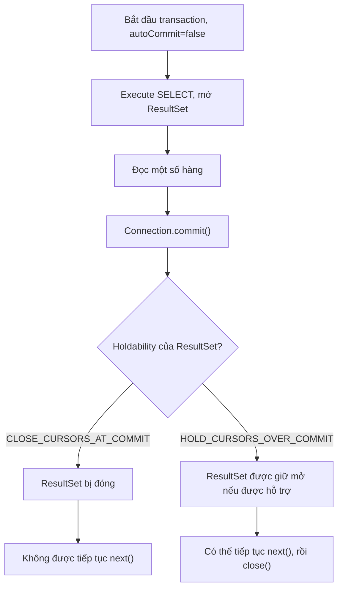

# Quản lý tập kết quả khi commit qua holdability

## 1. Vấn đề: đang đọc `ResultSet` thì transaction kết thúc

Trong ứng dụng Java sử dụng **JDBC**, một câu `SELECT` có thể trả hàng nghìn bản ghi để xuất báo cáo, thống kê hoặc xử lý theo lô. Lập trình viên thường giữ `ResultSet` mở và gọi `next()` để đọc từng hàng. Vậy nếu chương trình gọi `Connection.commit()` **trước khi duyệt hết** tập kết quả thì điều gì xảy ra?

Không thể kết luận chỉ dựa vào `ResultSet.next()` hay `setFetchSize()`. Hành vi còn liên quan đến **holdability** (*khả năng giữ tập kết quả qua commit*), một thuộc tính JDBC quy định tập kết quả có được tiếp tục sử dụng sau khi transaction chứa nó commit hay không.

Ví dụ nghiệp vụ:

1. Chạy `SELECT` danh sách đơn hàng cần xuất.
2. Đọc 100 hàng đầu tiên.
3. Gọi `commit()` để kết thúc transaction hiện tại.
4. Muốn tiếp tục gọi `rs.next()` với các hàng còn lại.

Ở bước 4, có hai chính sách:

- **Đóng cursor/tập kết quả khi commit:** tiếp tục đọc là không hợp lệ vì `ResultSet` đã bị đóng.
- **Giữ cursor/tập kết quả qua commit:** ứng dụng có thể tiếp tục đọc, nếu DBMS và driver thực sự hỗ trợ chế độ đó cho câu lệnh cụ thể.

Điều quan trọng là **holdability chỉ nói về vòng đời `ResultSet` khi commit**, không bảo đảm tính nhất quán dữ liệu theo một snapshot hay khẳng định toàn bộ dữ liệu đang được stream trực tiếp từ server.

## 2. Hai hằng số holdability chuẩn JDBC

JDBC định nghĩa hai hằng `int` trong `java.sql.ResultSet`:

| Hằng | Ngữ nghĩa |
| --- | --- |
| `ResultSet.CLOSE_CURSORS_AT_COMMIT` | Các tập kết quả thuộc chế độ này được đóng khi transaction commit |
| `ResultSet.HOLD_CURSORS_OVER_COMMIT` | Các tập kết quả thuộc chế độ này được giữ mở qua commit để có thể tiếp tục sử dụng |

Ví dụ timeline:



**Không nên nhầm ba kiểu đóng:**

- `ResultSet.close()`: ứng dụng chủ động giải phóng tập kết quả.
- `Statement.close()`: thông thường đóng các `ResultSet` mà statement đó đang giữ; holdability không làm chúng sống lâu hơn statement.
- `Connection.commit()`: có thể đóng hoặc giữ `ResultSet` theo holdability đã cấu hình và khả năng của driver.

Nếu `Connection` bị đóng, `Statement` đóng hoặc driver có lỗi nghiêm trọng, `HOLD_CURSORS_OVER_COMMIT` **không** giữ cho `ResultSet` tồn tại độc lập. Tương tự, holdability **không cam kết giữ cursor qua `rollback()`**; hai hằng trên chỉ mô tả hành vi ở ranh giới **commit**.

## 3. Holdability nằm ở đâu trong API JDBC?

JDBC cho phép kiểm tra và chỉ định holdability ở nhiều cấp:

| Cấp API | Phương thức | Vai trò |
| --- | --- | --- |
| `DatabaseMetaData` | `supportsResultSetHoldability(int)` | Driver/DBMS có công bố hỗ trợ chế độ mong muốn hay không |
| `DatabaseMetaData` | `getResultSetHoldability()` | Kiểm tra holdability mặc định mà metadata báo |
| `Connection` | `getHoldability()` | Đọc giá trị holdability đang cấu hình trên kết nối |
| `Connection` | `setHoldability(int)` | Đặt giá trị mặc định cho `ResultSet` được tạo về sau trên kết nối |
| `Connection` | `createStatement(type, concurrency, holdability)` | Yêu cầu holdability riêng khi tạo `Statement` |
| `Connection` | `prepareStatement(sql, type, concurrency, holdability)` | Yêu cầu holdability riêng cho `PreparedStatement` |
| `Connection` | `prepareCall(sql, type, concurrency, holdability)` | Yêu cầu holdability riêng cho `CallableStatement` |
| `Statement` | `getResultSetHoldability()` | Kiểm tra holdability của `ResultSet` được statement tạo |
| `ResultSet` | `getHoldability()` | Kiểm tra holdability của tập kết quả hiện hành |

Tham số `type` và `concurrency` là những thuộc tính **khác**:

- `ResultSet.TYPE_FORWARD_ONLY`: thường duyệt tiến bằng `next()`.
- `ResultSet.TYPE_SCROLL_INSENSITIVE`: hỗ trợ di chuyển cursor và mức nhạy với thay đổi dữ liệu riêng, nếu driver có hỗ trợ.
- `ResultSet.CONCUR_READ_ONLY`: chỉ đọc.
- `ResultSet.CONCUR_UPDATABLE`: có thể cập nhật qua ResultSet trong điều kiện DBMS/driver cho phép.

**Holdability không phải là scrollability và cũng không phải concurrency.** Một `ResultSet` có thể forward-only, read-only nhưng được giữ qua commit. Không được giả định hỗ trợ riêng lẻ từng tính năng đồng nghĩa mọi tổ hợp `type + concurrency + holdability` đều hỗ trợ.

### 3.1. Kiểm tra trước khi yêu cầu

```java
import java.sql.Connection;
import java.sql.DatabaseMetaData;
import java.sql.ResultSet;
import java.sql.SQLException;

// Giả định connection đã mở.
DatabaseMetaData metadata = connection.getMetaData();

int driverDefault = metadata.getResultSetHoldability();
int connectionDefault = connection.getHoldability();

boolean canHold = metadata.supportsResultSetHoldability(
        ResultSet.HOLD_CURSORS_OVER_COMMIT);
boolean canClose = metadata.supportsResultSetHoldability(
        ResultSet.CLOSE_CURSORS_AT_COMMIT);

System.out.printf(
        "metadataDefault=%d, connectionDefault=%d, hold=%s, close=%s%n",
        driverDefault, connectionDefault, canHold, canClose);
```

Trong nhiều hệ thống, driver báo ít nhất một chế độ hỗ trợ, nhưng không nên đoán chế độ mặc định là `HOLD_CURSORS_OVER_COMMIT` hay `CLOSE_CURSORS_AT_COMMIT`. Hãy kiểm tra **kết nối thực**.

`supportsResultSetHoldability(...) == true` là bước kiểm tra hợp lý trước khi thiết lập; tuy nhiên câu `prepareStatement(...)` với tổ hợp type/concurrency nhất định vẫn có thể thất bại, bị driver điều chỉnh hoặc có giới hạn riêng. Kiểm tra holdability thực tế trên `Statement`/`ResultSet` và chạy kiểm thử tích hợp.

## 4. Cấu hình trên `Connection` hoặc trên từng statement?

### 4.1. Chọn mặc định ở cấp kết nối

```java
import java.sql.Connection;
import java.sql.ResultSet;
import java.sql.SQLException;

// Chỉ thay đổi cấu hình trên connection do ứng dụng đang sở hữu.
int previousHoldability = connection.getHoldability();
try {
    connection.setHoldability(ResultSet.HOLD_CURSORS_OVER_COMMIT);

    // Statement được tạo sau đó có thể dùng holdability mặc định này.
    // Thực hiện các thao tác JDBC cần thiết...
} finally {
    connection.setHoldability(previousHoldability);
}
```

Việc đổi holdability trên kết nối **không phải cách đáng tin cậy để sửa đổi hồi tố** chế độ của những `ResultSet` đã mở trước đó. Nên thiết lập trước khi tạo statement/cursor.

Khi dùng `DataSource` và pool, cần đặc biệt cẩn thận: `setHoldability` thay đổi **trạng thái của connection đang mượn**. Nếu trả connection về pool mà không khôi phục, yêu cầu khác có thể nhận holdability không mong đợi. Một số pool có thể tự reset các thuộc tính kết nối, nhưng ứng dụng không được phụ thuộc vào điều đó khi chưa biết hợp đồng pool.

Nếu `setHoldability(...)` hoặc thao tác khôi phục trong `finally` ném `SQLException`, cần xử lý để không che mất lỗi nghiệp vụ gốc và không tiếp tục sử dụng kết nối có trạng thái không rõ.

### 4.2. Chỉ định khi chuẩn bị câu lệnh

Để hạn chế thay đổi trạng thái kết nối, thường nên chọn trực tiếp trên statement:

```java
import java.sql.PreparedStatement;
import java.sql.ResultSet;

try (PreparedStatement ps = connection.prepareStatement(
        "SELECT order_id, order_status FROM sales_orders ORDER BY order_id",
        ResultSet.TYPE_FORWARD_ONLY,
        ResultSet.CONCUR_READ_ONLY,
        ResultSet.HOLD_CURSORS_OVER_COMMIT)) {

    System.out.println(ps.getResultSetHoldability());
    // Gọi executeQuery() rồi đọc ResultSet trong phạm vi statement.
}
```

Cách này phù hợp hơn khi chỉ **một truy vấn** phải sống qua commit, còn các truy vấn khác tiếp tục dùng mặc định của kết nối. Tuy vậy, vẫn cần xác minh driver thực sự hỗ trợ overload bốn tham số và kiểu cursor đã yêu cầu.

## 5. Dữ liệu mẫu cho ví dụ kiểm chứng

Ví dụ SQL tạo bảng theo cú pháp quan hệ thông dụng; tùy DBMS có thể điều chỉnh kiểu `DECIMAL`, `VARCHAR` hoặc cách chèn dữ liệu:

```sql
CREATE TABLE sales_orders (
    order_id BIGINT PRIMARY KEY,
    order_status VARCHAR(16) NOT NULL,
    amount DECIMAL(18, 2) NOT NULL
);

INSERT INTO sales_orders (order_id, order_status, amount)
VALUES (101, 'PAID', 125.00);

INSERT INTO sales_orders (order_id, order_status, amount)
VALUES (102, 'PAID', 75.50);

INSERT INTO sales_orders (order_id, order_status, amount)
VALUES (103, 'PENDING', 19.99);

INSERT INTO sales_orders (order_id, order_status, amount)
VALUES (104, 'PAID', 250.00);
```

Ta muốn đọc lần lượt các hàng theo `order_id` và **commit sau khi đọc hai hàng đầu tiên**. Kỳ vọng với `HOLD_CURSORS_OVER_COMMIT` được hỗ trợ là vẫn đọc tiếp được các hàng `103`, `104` từ cùng `ResultSet`.

Lưu ý: ví dụ này dùng một giao dịch **chỉ đọc** để làm nổi bật vòng đời cursor. Trong ứng dụng thực tế, cần có lý do nghiệp vụ cụ thể trước khi chủ động commit giữa quá trình đọc.

## 6. Ví dụ JDBC hoàn chỉnh: commit rồi tiếp tục duyệt `ResultSet`

Ví dụ Java 17+ dưới đây dùng `DataSource` đã cấu hình với một DBMS và driver **được xác minh có hỗ trợ `HOLD_CURSORS_OVER_COMMIT`**. Nó không mặc định rằng mọi driver sẽ chạy giống nhau.

```java
import java.math.BigDecimal;
import java.sql.Connection;
import java.sql.DatabaseMetaData;
import java.sql.PreparedStatement;
import java.sql.ResultSet;
import java.sql.SQLException;
import java.sql.SQLFeatureNotSupportedException;
import javax.sql.DataSource;

public final class HoldabilityExample {
    private final DataSource dataSource;

    public HoldabilityExample(DataSource dataSource) {
        this.dataSource = dataSource;
    }

    public void readAcrossCommit() throws SQLException {
        try (Connection connection = dataSource.getConnection()) {
            DatabaseMetaData metadata = connection.getMetaData();
            int hold = ResultSet.HOLD_CURSORS_OVER_COMMIT;

            if (!metadata.supportsResultSetHoldability(hold)) {
                throw new SQLFeatureNotSupportedException(
                        "Driver/DBMS không hỗ trợ giữ ResultSet qua commit");
            }

            boolean originalAutoCommit = connection.getAutoCommit();
            if (!originalAutoCommit) {
                throw new SQLException(
                        "Ví dụ yêu cầu Connection chưa có transaction");
            }

            boolean manualTransaction = false;
            boolean commitInvoked = false;
            boolean transactionEnded = false;
            Throwable primaryFailure = null;

            try {
                connection.setAutoCommit(false);
                manualTransaction = true;

                String sql = """
                        SELECT order_id, order_status, amount
                        FROM sales_orders
                        ORDER BY order_id
                        """;

                try (PreparedStatement statement =
                             connection.prepareStatement(
                                     sql,
                                     ResultSet.TYPE_FORWARD_ONLY,
                                     ResultSet.CONCUR_READ_ONLY,
                                     hold)) {

                    if (statement.getResultSetHoldability() != hold) {
                        throw new SQLFeatureNotSupportedException(
                                "Statement không có holdability mong muốn");
                    }

                    try (ResultSet rs = statement.executeQuery()) {
                        if (rs.getHoldability() != hold) {
                            throw new SQLFeatureNotSupportedException(
                                    "ResultSet không có holdability mong muốn");
                        }

                        // Đọc tối đa hai hàng khi transaction còn mở.
                        for (int i = 0; i < 2 && rs.next(); i++) {
                            printOrder(rs);
                        }

                        // Đây là điểm kiểm chứng holdability.
                        commitInvoked = true;
                        connection.commit();
                        transactionEnded = true;

                        // Vẫn cùng ResultSet, không executeQuery() lại.
                        while (rs.next()) {
                            printOrder(rs);
                        }
                    }
                }
            } catch (SQLException | RuntimeException failure) {
                primaryFailure = failure;

                // Chỉ rollback tự động khi chưa bước vào pha commit.
                if (manualTransaction
                        && !transactionEnded
                        && !commitInvoked) {
                    try {
                        connection.rollback();
                        transactionEnded = true;
                    } catch (SQLException rollbackFailure) {
                        failure.addSuppressed(rollbackFailure);
                    }
                }
                throw failure;
            } finally {
                // Nếu commit() báo lỗi, kết quả có thể chưa rõ.
                // Không bật autoCommit=true khi transaction chưa kết thúc.
                if (manualTransaction && transactionEnded) {
                    try {
                        connection.setAutoCommit(originalAutoCommit);
                    } catch (SQLException resetFailure) {
                        if (primaryFailure != null) {
                            primaryFailure.addSuppressed(resetFailure);
                        } else {
                            throw resetFailure;
                        }
                    }
                }
            }
        }
    }

    private static void printOrder(ResultSet rs) throws SQLException {
        long id = rs.getLong("order_id");
        String status = rs.getString("order_status");
        BigDecimal amount = rs.getBigDecimal("amount");

        System.out.printf(
                "id=%d, status=%s, amount=%s%n",
                id, status, amount.toPlainString());
    }
}
```

Sử dụng:

```java
HoldabilityExample example = new HoldabilityExample(dataSource);
example.readAcrossCommit();
```

Với dữ liệu mẫu và một driver thực thi đúng hợp đồng giữ cursor, phần xuất có dạng:

```text
id=101, status=PAID, amount=125.00
id=102, status=PAID, amount=75.50
-- connection.commit() diễn ra ở đây --
id=103, status=PENDING, amount=19.99
id=104, status=PAID, amount=250.00
```

Dòng chú thích về `commit` chỉ mô tả vị trí xảy ra trong chương trình, không phải dòng thực tế được phương thức `printOrder` in ra.

**Các điểm thiết kế cần chú ý:**

1. `DataSource.getConnection()` chỉ được gọi một lần; `PreparedStatement` và `ResultSet` nằm trong cùng vòng đời kết nối.
2. `setAutoCommit(false)` đặt transaction thủ công; nhờ đó `commit` giữa quá trình duyệt là một ranh giới có chủ đích thay vì mỗi câu lệnh tự commit.
3. Dùng `TYPE_FORWARD_ONLY + CONCUR_READ_ONLY + HOLD_CURSORS_OVER_COMMIT` cho truy vấn thuần đọc. Cả `Statement` và `ResultSet` đều được kiểm tra holdability.
4. Code đọc hai hàng trước `commit`, rồi đọc tiếp **cùng `ResultSet`**. Chính bước này phân biệt holdable cursor với việc chạy lại câu SELECT.
5. `try-with-resources` vẫn **phải đóng** `ResultSet` và `PreparedStatement`, ngay cả khi ResultSet được giữ qua commit.
6. Nếu lỗi xảy ra **trước pha commit**, ví dụ `executeQuery()` ném ngoại lệ, mẫu sẽ rollback giao dịch đã mở.
7. Nếu `commit()` được gọi mà ném lỗi kết nối, **không được giả định nó chưa commit**. Mẫu giữ trạng thái chưa xác định và không tự bật lại `autoCommit` trong trường hợp đó.

Nếu `rs.next()` ném lỗi **sau khi commit đã thành công**, các thay đổi của transaction cũ đã hoàn tất; không thể dùng `rollback` để “hủy” commit trước đó. Khi đó cần đóng các tài nguyên còn lại, log lỗi theo ngữ cảnh và quyết định có thực hiện lại nghiệp vụ hay không bằng cơ chế riêng. Ví dụ chỉ đọc ở đây không có thay đổi dữ liệu cần lũy đẳng hóa.

## 7. Nếu yêu cầu `CLOSE_CURSORS_AT_COMMIT` thì điều gì xảy ra?

Thay đối số thứ tư lúc tạo statement:

```java
try (PreparedStatement statement = connection.prepareStatement(
        "SELECT order_id FROM sales_orders ORDER BY order_id",
        ResultSet.TYPE_FORWARD_ONLY,
        ResultSet.CONCUR_READ_ONLY,
        ResultSet.CLOSE_CURSORS_AT_COMMIT);
     ResultSet rs = statement.executeQuery()) {

    if (rs.next()) {
        System.out.println(rs.getLong(1));
    }

    connection.commit();

    // Không được tiếp tục rs.next() trên ResultSet đã đóng khi commit.
    // Muốn đọc tiếp, cần một truy vấn mới và cách xác định vị trí tiếp theo.
}
```

Đoạn mã giả định `connection` đã ở chế độ `autoCommit=false` và chế độ CLOSE được driver hỗ trợ. `ResultSet` phải bị đóng ở ranh giới commit theo ngữ nghĩa holdability này. Không nên xem `ResultSet.isClosed()` là giải pháp “giữ lại cursor”: nó chỉ cho biết trạng thái đóng, không phục hồi dữ liệu hoặc vị trí đã đọc.

Với ứng dụng không cần đọc qua commit, `CLOSE_CURSORS_AT_COMMIT` có thể làm vòng đời tài nguyên dễ hiểu hơn, đồng thời giảm nguy cơ quên đóng cursor sau một transaction đã hoàn tất. Tuy nhiên, không được dựa vào chính sách này thay cho `try-with-resources`.

## 8. Holdability khác `fetchSize`, streaming và scrollability

Ba thuộc tính thường bị nhầm:

| Thuộc tính | Trả lời câu hỏi | API ví dụ |
| --- | --- | --- |
| **Holdability** | Cursor có tồn tại sau `commit` không? | `HOLD_CURSORS_OVER_COMMIT`, `CLOSE_CURSORS_AT_COMMIT` |
| **Fetch size** | Driver được gợi ý lấy bao nhiêu hàng trong mỗi lần fetch? | `Statement.setFetchSize(int)` |
| **ResultSet type** | Cursor có thể tiến một chiều hay cuộn tới/lùi? | `TYPE_FORWARD_ONLY`, `TYPE_SCROLL_INSENSITIVE`, `TYPE_SCROLL_SENSITIVE` |

Ví dụ:

```java
try (PreparedStatement statement = connection.prepareStatement(
        "SELECT order_id FROM sales_orders ORDER BY order_id",
        ResultSet.TYPE_FORWARD_ONLY,
        ResultSet.CONCUR_READ_ONLY,
        ResultSet.HOLD_CURSORS_OVER_COMMIT)) {

    statement.setFetchSize(100);
    // 100 là gợi ý số HÀNG mỗi lần fetch, không phải "giữ 100 hàng qua commit".
    try (ResultSet rs = statement.executeQuery()) {
        // ...
    }
}
```

Một driver có thể hỗ trợ holdability bằng cách **materialize** phần kết quả còn lại trước hoặc khi commit, thay vì giữ một cursor server sống nguyên trạng. Điều đó ảnh hưởng bộ nhớ, lưu trữ tạm và độ trễ. Mặt khác, driver thực thi streaming theo con trỏ server có thể có giới hạn riêng khi commit. **Không dùng `setFetchSize(100)` như bảo đảm streaming** và cũng không suy ra chi phí bộ nhớ thấp chỉ từ `HOLD_CURSORS_OVER_COMMIT`.

Một `TYPE_SCROLL_INSENSITIVE` có thể dùng bộ đệm phía client để cuộn, nhưng không tự động đồng nghĩa nó giữ được qua commit; ngược lại, `TYPE_FORWARD_ONLY` vẫn có thể holdable nếu driver hỗ trợ. Cần kiểm tra từng tổ hợp thực tế.

## 9. Holdability không giữ nguyên transaction isolation

Đây là điểm dễ nhầm khi phát triển báo cáo dài. **Sau khi `commit()` thành công, transaction cũ đã kết thúc.** Ngay cả khi `ResultSet` vẫn đọc được, không có nghĩa các hàng tiếp theo đang được bảo vệ bởi cùng khóa, snapshot hoặc isolation của transaction trước.

Ví dụ hai transaction:

```text
Transaction A: SELECT các đơn hàng và mở holdable ResultSet.
Transaction A: đọc order_id 101, 102.
Transaction A: COMMIT. ResultSet vẫn mở.

Transaction B: UPDATE trạng thái đơn 103 rồi COMMIT.

Transaction A: tiếp tục next() đến đơn 103.
```

Trạng thái `order_status` mà A thấy tại đơn 103 phụ thuộc cách **driver/DBMS triển khai held result set** và lúc dữ liệu đã được fetch/materialize. Không nên hứa A chắc chắn thấy giá trị trước hoặc sau transaction B.

Tương tự, dữ liệu bên trong một held cursor **không mặc định phản ánh các hàng mới được chèn sau commit**. Nếu nghiệp vụ cần xem dữ liệu mới nhất, hãy chạy truy vấn mới với isolation phù hợp.

Nếu cần một **snapshot nhất quán xuyên suốt nhiều trang** hoặc muốn bảo đảm đúng một bộ hàng bất biến, holdability một mình không đủ. Các hướng khác có thể là:

- Giữ transaction read-only với mức cô lập/snapshot phù hợp **trong khoảng thời gian được chấp nhận** (đổi lại phải trả chi phí tài nguyên).
- Chốt một mốc dữ liệu hoặc tập ID ổn định trong bảng xuất báo cáo, rồi xử lý theo nhiều transaction.
- Phân trang theo khóa có thứ tự (*keyset pagination*) và chấp nhận mô hình nhất quán được xác định rõ.

Holdability cũng không phải cơ chế **khóa hàng** để đảm bảo transaction khác không cập nhật được dữ liệu. Việc commit sẽ kết thúc các khóa transaction trước; đừng dùng held ResultSet như một `SELECT ... FOR UPDATE` tiếp tục bảo vệ hàng qua commit.

## 10. Hạn chế theo driver và hệ quản trị

JDBC cung cấp API chuẩn, nhưng driver/DBMS quyết định cách triển khai cursor:

| Hệ quản trị / driver | Điều cần xác minh |
| --- | --- |
| **PostgreSQL / pgJDBC** | Server cursor, chế độ transaction, `fetchSize`, khả năng hold cursor; không suy hỗ trợ chỉ từ cú pháp SQL `DECLARE CURSOR WITH HOLD` của PostgreSQL |
| **MySQL / Connector/J** | Driver có thể đệm `ResultSet` hoặc dùng phương thức streaming đặc thù; kiểm tra holdability hỗ trợ theo chế độ tải dữ liệu |
| **Oracle JDBC** | Loại result set, cursor server, tài nguyên statement và hành vi commit; thử trên đúng driver và version |
| **SQL Server JDBC** | Cursor server/client, result buffering, concurrency và holdability; kiểm tra metadata thay vì giả định |
| **SQLite JDBC** | Cơ chế ResultSet, transaction và hỗ trợ holdability của driver cụ thể; không giả định có server cursor tồn tại qua commit |

**Quan trọng:** Một DBMS có tính năng SQL tương đương “cursor WITH HOLD” không chứng minh JDBC driver của nó hỗ trợ `ResultSet.HOLD_CURSORS_OVER_COMMIT` cho mọi truy vấn. Ngược lại, driver có thể duy trì khả năng duyệt qua commit bằng cách đệm dữ liệu ở phía client.

Quy trình đúng là **khảo sát bằng `DatabaseMetaData` → yêu cầu holdability khi tạo statement → đọc lại holdability → kiểm thử qua commit**. Trong production, không nên dùng việc thử gọi `rs.next()` sau commit để phát hiện khả năng driver theo kiểu “được thì chạy”, rồi bỏ qua một `SQLException` giữa chừng.

## 11. Quản lý tài nguyên khi cursor sống qua commit

Một `ResultSet` holdable không có nghĩa được giữ mãi mãi mà không tốn chi phí:

1. **Vẫn phải đóng `ResultSet`:** dùng `try-with-resources`, nhất là khi dừng duyệt sớm vì điều kiện nghiệp vụ.
2. **Giữ `Statement` mở:** nếu statement sở hữu cursor bị đóng, cursor cũng có thể đóng theo; không trả `ResultSet` từ repository rồi đóng `Statement` ngay.
3. **Giữ `Connection` mở:** holdability không cho phép mang đối tượng `ResultSet` dùng sau khi đã trả connection về pool.
4. **Lưu ý resource server:** cursor có thể giữ handle, bộ đệm, file tạm hoặc tài nguyên phiên DBMS, ngay cả khi transaction trước đã commit.
5. **Không chia sẻ một `ResultSet` cho nhiều luồng:** việc tương tác đồng thời qua một cursor/connection thường không được bảo đảm thread-safe.
6. **Không trộn cập nhật qua `ResultSet` một cách tùy tiện:** holdability của `CONCUR_UPDATABLE` có thể bị hạn chế, còn hành vi cập nhật sau commit cần được kiểm chứng riêng.

Với JDBC connection pool, thời gian giữ kết nối trong quá trình đọc một báo cáo dài có thể làm giảm số connection sẵn có cho các request khác. Thực tế, giữ cursor qua commit **không** giải phóng được connection; nó chỉ thay đổi vòng đời của `ResultSet`.

### Lưu ý khi xử lý nhiều kết quả

Một `CallableStatement` có thể trả nhiều `ResultSet` hoặc update count. Các lần `getMoreResults()` có thể đóng các kết quả trước theo chế độ của API, trừ khi sử dụng overload với chính sách giữ kết quả và driver hỗ trợ. Đây là vấn đề vòng đời **khác** với holdability qua commit.

Tương tự, `Statement.closeOnCompletion()` có thể tự động đóng statement khi mọi dependent ResultSet đóng; không nên dựa vào khả năng giữ cursor qua commit để ngăn đóng statement theo cơ chế đó.

## 12. Khi không hỗ trợ holdability: phân trang theo khóa

Nếu driver không hỗ trợ `HOLD_CURSORS_OVER_COMMIT`, đừng cố bắt một `ResultSet` đã bị đóng tiếp tục `next()`. Thay vào đó, có thể chia xử lý thành **nhiều truy vấn nhỏ**. Một chiến lược phổ biến là *keyset pagination*:

```sql
-- Ví dụ dialect PostgreSQL/MySQL: LIMIT ?.
-- order_id là khóa duy nhất có thứ tự.
SELECT order_id, order_status, amount
FROM sales_orders
WHERE order_id > ?
ORDER BY order_id
LIMIT ?;
```

Mỗi lần gọi, tham số thứ nhất là `lastSeenOrderId`, tham số thứ hai là kích thước trang. Đọc hết trang, đóng `ResultSet` và statement, rồi mở truy vấn mới. **Không giữ cursor JDBC sống qua commit**.

Ví dụ repository (Java 17+):

```java
import java.math.BigDecimal;
import java.sql.Connection;
import java.sql.PreparedStatement;
import java.sql.ResultSet;
import java.sql.SQLException;
import java.util.ArrayList;
import java.util.List;
import javax.sql.DataSource;

public final class OrderPageReader {
    public record Order(long id, String status, BigDecimal amount) {}

    private final DataSource dataSource;

    public OrderPageReader(DataSource dataSource) {
        this.dataSource = dataSource;
    }

    public List<Order> readNext(long lastSeenId, int pageSize)
            throws SQLException {
        if (pageSize <= 0 || pageSize > 1000) {
            throw new IllegalArgumentException("pageSize phải từ 1 đến 1000");
        }

        String sql = """
                SELECT order_id, order_status, amount
                FROM sales_orders
                WHERE order_id > ?
                ORDER BY order_id
                LIMIT ?
                """;

        List<Order> page = new ArrayList<>();
        try (Connection c = dataSource.getConnection();
             PreparedStatement ps = c.prepareStatement(sql)) {
            ps.setLong(1, lastSeenId);
            ps.setInt(2, pageSize);

            try (ResultSet rs = ps.executeQuery()) {
                while (rs.next()) {
                    page.add(new Order(
                            rs.getLong("order_id"),
                            rs.getString("order_status"),
                            rs.getBigDecimal("amount")));
                }
            }
        }
        return page;
    }
}
```

Gọi lặp: lấy trang đầu với `lastSeenId=0`, xử lý xong, đặt `lastSeenId` bằng ID hàng cuối rồi lấy trang kế tiếp, dừng khi trang rỗng. Mỗi trang có thể dùng connection riêng; truy vấn `LIMIT ?` cần kiểm tra tương thích dialect/driver nếu dùng hệ quản trị khác.

**Đánh đổi quan trọng:** phân trang nhiều transaction có thể thấy những thay đổi dữ liệu xảy ra giữa các trang. Khóa `order_id` tăng dần và bộ lọc `> lastSeenId` giúp giảm đọc trùng khi dữ liệu mới được thêm, nhưng không tạo một snapshot tuyệt đối. Nếu báo cáo cần tập dữ liệu cố định, hãy giới hạn đến một *high-water mark* ổn định hoặc lưu danh sách ID cần xử lý ngay khi bắt đầu.

## 13. Kiểm thử holdability bằng hai ranh giới commit

Kiểm thử tích hợp phải dùng **driver/DBMS thật**, không chỉ mock `ResultSet`, vì một số driver đệm kết quả hoặc không hỗ trợ tổ hợp result set được yêu cầu.

| Ca kiểm thử | Thao tác | Kỳ vọng |
| --- | --- | --- |
| Hỗ trợ HOLD | `supportsResultSetHoldability(HOLD...)` | `true` trước khi yêu cầu; vẫn phải kiểm tra thực tế |
| HOLD qua commit | Đọc hai hàng, `commit()`, gọi `next()` | Đọc tiếp cùng ResultSet nếu driver hỗ trợ đúng |
| CLOSE qua commit | Tạo `CLOSE_CURSORS_AT_COMMIT`, đọc hai hàng, commit | ResultSet không còn hợp lệ để duyệt |
| Không hỗ trợ HOLD | Driver báo không hỗ trợ hoặc từ chối tạo statement | Ứng dụng từ chối rõ hoặc chuyển sang phân trang |
| Statement đóng sớm | Đóng `PreparedStatement` trước khi đọc tiếp | Không được tiếp tục sử dụng ResultSet phụ thuộc |
| Connection đóng sớm | Đóng/trả `Connection` về pool | Không được tiếp tục sử dụng ResultSet |
| Rollback | Mở ResultSet, `rollback()`, kiểm tra trạng thái | Không dựa vào HOLD để giả định cursor còn tồn tại |
| Đọc khi dữ liệu đổi | Transaction khác cập nhật sau commit | Xác nhận ngữ nghĩa dữ liệu của driver, không mặc định nhất quán snapshot |
| ResultSet cuộn / cập nhật | Thử thêm `TYPE_SCROLL_INSENSITIVE` hay `CONCUR_UPDATABLE` | Kiểm tra từng tổ hợp hỗ trợ |
| Dữ liệu nhiều hàng | Đọc tới cuối sau commit | Kiểm tra đúng thứ tự, tài nguyên và chi phí bộ nhớ |
| Lỗi trong lúc đọc | Driver ném lỗi I/O/SQL giữa luồng | Tài nguyên được đóng; kết quả không bị báo thành công nhầm |

Một phép kiểm chứng cụ thể: thiết lập bảng có bốn hàng như mục 5, tạo holdable cursor, đọc hai hàng, `commit()`, đọc hai hàng còn lại, so sánh danh sách ID `[101, 102, 103, 104]`. Chạy bài kiểm tra tương tự với `CLOSE_CURSORS_AT_COMMIT` để xác nhận chiều ngược lại. Không chỉ nhìn `Statement.getResultSetHoldability()` mà bỏ qua hành vi sau commit.

Trong kiểm thử đồng thời, sử dụng hai kết nối: A mở cursor và commit, B sửa dữ liệu, A đọc tiếp. Phần dữ liệu A quan sát được là đặc tính của driver/DBMS tại mức cô lập và cấu hình đang kiểm thử, không phải kết luận phổ quát về mọi held cursor.

## 14. Checklist triển khai

Trước khi dùng holdability trong ứng dụng JDBC:

1. **Xác định có thật sự cần đọc qua commit không.** Nếu xử lý xong toàn bộ ResultSet trước commit, chế độ HOLD thường không mang lợi ích.
2. **Kiểm tra hỗ trợ:** `DatabaseMetaData.supportsResultSetHoldability(...)` và mặc định bằng `getResultSetHoldability/getHoldability`.
3. **Chọn đúng loại cursor:** `TYPE_FORWARD_ONLY`, `CONCUR_READ_ONLY` khi chỉ đọc tuần tự; chỉ yêu cầu scroll/updatable khi có nhu cầu thực.
4. **Đặt holdability trước khi thực thi:** dùng overload `prepareStatement(..., holdability)` hoặc cấu hình mặc định `Connection.setHoldability(...)` có quản lý khôi phục.
5. **Kiểm tra giá trị thực:** `Statement.getResultSetHoldability()` và `ResultSet.getHoldability()`; kiểm thử đọc sau `commit`.
6. **Không hiểu nhầm tính nhất quán:** holdability không giữ transaction snapshot, khóa, isolation hay ngữ nghĩa dữ liệu mới.
7. **Đóng tài nguyên đúng thứ tự:** `ResultSet`, `Statement` và `Connection`; đừng trả cursor ra khỏi phạm vi kết nối.
8. **Cân nhắc hiệu năng:** `fetchSize` chỉ là gợi ý, driver có thể đệm/materialize dữ liệu để giữ cursor qua commit.
9. **Có fallback:** phân trang theo khóa hoặc chia thành các đơn vị đọc độc lập nếu driver không hỗ trợ HOLD.
10. **Đo trên driver thật:** thử commit, rollback, nhiều hàng, connection pool và tình huống lỗi.

**Ghi nhớ:** `HOLD_CURSORS_OVER_COMMIT` và `CLOSE_CURSORS_AT_COMMIT` quyết định vòng đời của `ResultSet` tại thời điểm `Connection.commit()`. Chúng không thay thế quản lý transaction, tính nhất quán dữ liệu hay đóng tài nguyên. Hãy yêu cầu holdability qua API JDBC đúng cấp, kiểm tra hỗ trợ trên DBMS/driver đang sử dụng và chủ động chuyển sang phân trang nếu không thể giữ cursor an toàn qua commit.
