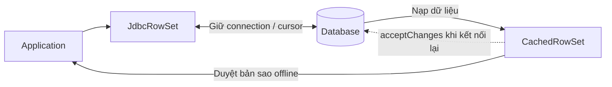

# Sử dụng JdbcRowSet cho mô hình vẫn giữ kết nối

Trong JDBC, một `ResultSet` thông thường gắn với `Statement` và `Connection` đã tạo ra nó. Khi cần một thành phần có giao diện giống JavaBean, hỗ trợ đặt câu SQL, bind tham số, duyệt kết quả và nhận sự kiện thay đổi vị trí con trỏ, Java cung cấp `javax.sql.rowset.JdbcRowSet`. Tuy nằm trong nhóm **RowSet**, `JdbcRowSet` là một **connected RowSet**: sau khi thực thi truy vấn, nó duy trì kết nối tới nguồn dữ liệu để thao tác với kết quả, khác với `CachedRowSet` thường giữ bản sao dữ liệu **ngoại tuyến**.

Bài này thuộc chương **RowSet ngoại tuyến** của module **JDBC**, nhưng cần nhấn mạnh ranh giới ngay từ đầu: **`JdbcRowSet` không phải cơ chế mang dữ liệu đi xử lý khi đã ngắt kết nối**. Nó có thể là lựa chọn tiện lợi cho ứng dụng Java dùng `DataSource`, `PreparedStatement`, `ResultSet`, CRUD và các API chuẩn khi cần tương tác trực tiếp với DB trong vòng đời ngắn. Với dữ liệu cần xử lý sau khi đóng kết nối, hãy xem `CachedRowSet` hoặc chuyển kết quả thành DTO/record.

Mục tiêu: hiểu kiến trúc và vòng đời `JdbcRowSet`, tạo đối tượng bằng `RowSetProvider`, truyền câu SQL có tham số, đọc và di chuyển con trỏ, xử lý cập nhật tùy khả năng driver, lắng nghe sự kiện, quản lý transaction/tài nguyên và chọn phương án phù hợp khi cần mô hình thực sự ngoại tuyến.

## 1. JdbcRowSet là gì?

`JdbcRowSet` là giao diện trong package `javax.sql.rowset`, mở rộng `javax.sql.RowSet`. Vì `RowSet` mở rộng `ResultSet`, ứng dụng có thể dùng các thao tác quen thuộc như `next()`, `getString()`, `getLong()`, `updateString()` hay `close()`, đồng thời có các thuộc tính cấu hình và cơ chế `RowSetListener`.

Một `JdbcRowSet` điển hình vận hành theo trình tự:

```text
Java application
      |
      |  setUrl / setDataSourceName, setCommand, setXxx
      v
  JdbcRowSet --execute()--> JDBC driver ---> Database
      |                         ^
      |  next(), getXxx()       |
      |  updateRow() nếu hỗ trợ |
      +-------------------------+
      |
      +-- close() --> giải phóng cursor, statement và connection
```

Điểm phân biệt:

- **Connected:** `JdbcRowSet` sử dụng kết nối DB đang tồn tại khi thao tác với dữ liệu. Không trông đợi có thể tiếp tục gọi `next()` hoặc `updateRow()` sau khi `close()`.
- **RowSet có thuộc tính:** có thể thiết lập URL hoặc tên `DataSource`, câu lệnh SQL, kiểu và concurrency trước khi thực thi.
- **Có thể phát sự kiện:** bên quan sát đăng ký `RowSetListener` để biết khi tập kết quả được thay đổi, hàng thay đổi hoặc cursor di chuyển qua các thao tác RowSet.
- **Không tự động là giao dịch phân tán, ORM hoặc cache:** các hành vi cập nhật, transaction và khả năng đọc lâu dài vẫn phụ thuộc driver và DB.

`JdbcRowSet` thích hợp cho phạm vi có chủ sở hữu tài nguyên rõ ràng, chẳng hạn một thao tác trong một desktop client hoặc một bước xử lý dữ liệu ngắn. Nó **không** nên được chia sẻ như singleton giữa nhiều request hoặc giữa các luồng.

## 2. Connected và disconnected RowSet khác nhau ở đâu?

| Thuộc tính | `JdbcRowSet` | `CachedRowSet` |
| --- | --- | --- |
| Loại mô hình | **Connected** | **Disconnected** sau khi dữ liệu được nạp |
| Dữ liệu | Đọc/làm việc với cursor gắn với DB | Giữ bản sao kết quả trong bộ nhớ |
| Kết nối trong lúc duyệt | Cần duy trì connection/cursor đang hoạt động | Thông thường không cần mở connection khi duyệt dữ liệu đã nạp |
| Đóng connection rồi tiếp tục duyệt | Không theo hợp đồng connected | Có thể, trong giới hạn dữ liệu đã cache |
| Cập nhật trực tiếp | Có thể dùng `updateRow()` nếu cursor thực tế updatable | Thường sửa bản sao rồi dùng `acceptChanges()` để đồng bộ khi có thể |
| Kiểm soát xung đột | Do DB/driver và transaction hiện tại | Cần đồng bộ và phát hiện xung đột khi ghi ngược về DB |
| Chi phí | Giữ tài nguyên kết nối trong vòng đời sử dụng | Sử dụng bộ nhớ chứa dữ liệu và chi phí đồng bộ |
| Phù hợp | Làm việc ngắn hạn với DB đang kết nối | Truyền/hiển thị một tập dữ liệu nhỏ sau khi đã ngắt kết nối |

Mô hình trực quan:



`CachedRowSet` cũng không tự bảo đảm mọi bản sao được cập nhật không xung đột. Nếu cần đồng bộ, phải xét việc hàng nguồn đã thay đổi/xóa và cơ chế xử lý `SyncProviderException` của implementation. Ngược lại, `JdbcRowSet` không có một pha `acceptChanges()` đồng bộ bản sao giống `CachedRowSet`: nó tiếp xúc với DB thông qua kết nối hiện có.

## 3. Các API cốt lõi

| Nhóm | API | Vai trò |
| --- | --- | --- |
| Khởi tạo | `RowSetProvider.newFactory()`, `RowSetFactory.createJdbcRowSet()` | Tạo implementation phù hợp mà không cần gọi trực tiếp lớp của vendor |
| Kết nối | `setUrl(url)`, `setUsername(user)`, `setPassword(password)` | Cấu hình cách kết nối qua JDBC URL |
| Kết nối qua JNDI | `setDataSourceName(jndiName)` | Tìm `DataSource` được đặt tên trong môi trường có JNDI và implementation hỗ trợ |
| Truy vấn | `setCommand(sql)`, `setString(index, value)`, `setLong(index, value)`, `execute()` | Đặt SQL, bind giá trị, chạy lệnh |
| Duyệt kết quả | `next()`, `previous()`, `absolute(n)`, `getXxx(...)` | Đọc giá trị theo vị trí cursor và tính năng type thực tế |
| Cập nhật (nếu hỗ trợ) | `updateString(...)`, `updateRow()` | Sửa giá trị hàng hiện tại và yêu cầu ghi về DB |
| Cấu hình cursor | `setType(type)`, `setConcurrency(concurrency)` | Đề xuất loại result set và khả năng cập nhật |
| Sự kiện | `addRowSetListener(listener)`, `removeRowSetListener(listener)` | Đăng ký/hủy theo dõi sự kiện RowSet |
| Giao dịch | `setAutoCommit(...)`, `commit()`, `rollback()` | Điều khiển transaction của kết nối bên trong theo hỗ trợ implementation |
| Dọn dẹp | `close()` | Đóng các tài nguyên đang được RowSet quản lý |

**Lưu ý phiên bản:** `javax.sql.rowset` là package chuẩn, được cung cấp bởi module `java.sql.rowset` trên Java 9+. Tên package bắt đầu bằng `javax` **không có nghĩa** cần phụ thuộc vào framework Java EE. Với project sử dụng Java module system, có thể cần khai báo `requires java.sql.rowset;` cùng `requires java.sql;`. Driver JDBC của cơ sở dữ liệu vẫn phải được khai báo riêng và được môi trường runtime tìm thấy.

Các phương thức này là API; **khả năng thực tế** của cursor (scrollable, updatable), quản lý transaction và JNDI còn tùy driver/RowSet provider. Trong ứng dụng production phải kiểm tra và thử trên môi trường tương ứng.

## 4. Tạo JdbcRowSet bằng RowSetFactory

Tránh trực tiếp new một lớp `JdbcRowSetImpl` thuộc nội bộ JDK/vendor. Cách tiêu chuẩn là dùng `RowSetProvider`:

```java
import javax.sql.rowset.JdbcRowSet;
import javax.sql.rowset.RowSetFactory;
import javax.sql.rowset.RowSetProvider;
import java.sql.SQLException;

public final class RowSetCreator {
    private RowSetCreator() {}

    public static JdbcRowSet create(
            String jdbcUrl, String user, String password)
            throws SQLException {
        RowSetFactory factory = RowSetProvider.newFactory();
        JdbcRowSet rowSet = factory.createJdbcRowSet();

        rowSet.setUrl(jdbcUrl);
        rowSet.setUsername(user);
        rowSet.setPassword(password);
        return rowSet; // Caller PHẢI close().
    }
}
```

`setUrl()` chỉ nhận chuỗi kết nối; nó không tự cài JDBC driver. Ví dụ PostgreSQL:

```text
jdbc:postgresql://localhost:5432/shop
```

Cần có PostgreSQL JDBC driver ở classpath/module path theo cơ chế dự án. Thông tin xác thực phải lấy từ nguồn cấu hình bí mật phù hợp, **không nhúng literal mật khẩu vào source code hoặc log**.

Ở đoạn trên, helper trả `JdbcRowSet` mở để caller tiếp tục cấu hình và sử dụng. Vì đối tượng đang giữ thông tin kết nối và sau `execute()` sẽ giữ tài nguyên JDBC, luôn quy định rõ **ai sở hữu và đóng** nó. Trong phần lớn API service, cách dễ kiểm soát nhất là tạo, dùng và đóng `JdbcRowSet` **trong cùng một phương thức** thay vì trả nó xuyên nhiều lớp.

## 5. Ví dụ đọc dữ liệu với lệnh SQL tham số hóa

Giả sử có bảng:

```sql
CREATE TABLE customers (
    id BIGINT PRIMARY KEY,
    full_name VARCHAR(120) NOT NULL,
    email VARCHAR(255),
    status VARCHAR(20) NOT NULL
);
```

Ứng dụng muốn lấy khách hàng có trạng thái cụ thể, đọc tuần tự và đưa dữ liệu ra record. Dùng `setCommand()` để cấu hình SQL, dùng `setString(1, status)` để truyền tham số cho dấu `?`.

```java
import java.sql.ResultSet;
import java.sql.SQLException;
import java.util.ArrayList;
import java.util.List;
import javax.sql.rowset.JdbcRowSet;
import javax.sql.rowset.RowSetProvider;

public final class CustomerRowSetReader {
    private CustomerRowSetReader() {}

    public record Customer(long id, String fullName, String email) {}

    public static List<Customer> findByStatus(
            String url, String user, String password, String status)
            throws SQLException {

        List<Customer> customers = new ArrayList<>();

        try (JdbcRowSet rowSet =
                     RowSetProvider.newFactory().createJdbcRowSet()) {
            rowSet.setUrl(url);
            rowSet.setUsername(user);
            rowSet.setPassword(password);

            rowSet.setType(ResultSet.TYPE_FORWARD_ONLY);
            rowSet.setConcurrency(ResultSet.CONCUR_READ_ONLY);
            rowSet.setCommand("""
                    SELECT id, full_name, email
                    FROM customers
                    WHERE status = ?
                    ORDER BY id
                    """);
            rowSet.setString(1, status);
            rowSet.execute();

            while (rowSet.next()) {
                customers.add(new Customer(
                        rowSet.getLong("id"),
                        rowSet.getString("full_name"),
                        rowSet.getString("email")));
            }
        }
        return customers;
    }
}
```

**Điểm cần chú ý:**

1. `RowSetProvider.newFactory().createJdbcRowSet()` tạo đối tượng RowSet theo cơ chế cung cấp chuẩn; chương trình không phụ thuộc trực tiếp vào lớp implementation cụ thể.
2. `setCommand(sql)` tạo điều kiện để implementation chuẩn bị truy vấn. `setString(1, status)` bind giá trị tham số thay vì nối chuỗi SQL, tránh lỗi ký tự đặc biệt và SQL injection.
3. `execute()` thực hiện lệnh, sau đó `next()/getXxx()` đọc từ kết quả. Không gọi `next()` hoặc `getString()` khi RowSet chưa có kết quả hợp lệ.
4. `try-with-resources` đóng RowSet ngay cả khi truy vấn/đọc lỗi, giải phóng cursor, statement và connection thuộc sở hữu RowSet.
5. Sau khi `close()`, danh sách `Customer` là các record Java bình thường và có thể dùng độc lập; chính **`JdbcRowSet` không được dùng tiếp**.

Đoạn code dùng Java 17+ (record và text block). Khi dùng Java cũ hơn, thay record bằng class và text block bằng chuỗi. Với rất nhiều bản ghi, trả cả `List` có thể gây áp lực bộ nhớ; khi đó cần streaming trong phạm vi connection còn mở hoặc phân trang có checkpoint.

`email` là cột có thể `NULL` nên `getString("email")` có thể trả `null`. Việc một hàng không tồn tại khác với việc hàng có `email IS NULL`; phần mềm tiêu thụ record phải giữ đúng hợp đồng dữ liệu.

## 6. Dùng DataSource và kết nối qua JNDI

Trong ứng dụng có container/JNDI, có thể cấu hình tên `DataSource` bằng `setDataSourceName(...)` **nếu RowSet provider hỗ trợ cơ chế đó**:

```java
try (JdbcRowSet rowSet =
             RowSetProvider.newFactory().createJdbcRowSet()) {

    // JNDI name đã được cấu hình trong môi trường chạy.
    rowSet.setDataSourceName("java:comp/env/jdbc/ShopDB");
    rowSet.setCommand("SELECT id, full_name FROM customers WHERE id = ?");
    rowSet.setLong(1, 101L);
    rowSet.execute();

    if (rowSet.next()) {
        System.out.println(rowSet.getString("full_name"));
    }
}
```

Đoạn code này giả định import `JdbcRowSet` và `RowSetProvider` như ví dụ trên, cùng môi trường JNDI có tên chính xác. Tên `java:comp/env/jdbc/ShopDB` chỉ là ví dụ, **không tự tồn tại** trong JVM Java SE độc lập. Với một RowSet, thông thường chọn **hoặc** `setUrl()` **hoặc** `setDataSourceName()` làm cơ chế xác định nguồn, không pha trộn tùy ý.

**Khác biệt quan trọng:** chuẩn `JdbcRowSet` không có một phương thức phổ thông `setDataSource(DataSource instance)` nhận trực tiếp object `DataSource` mà ứng dụng đã có. `setDataSourceName()` là tên để RowSet tìm qua JNDI, không phải tên biến Java.

Nếu service đã sử dụng dependency-injected `DataSource` trực tiếp và không có JNDI, cách đơn giản nhất thường là dùng JDBC thông thường:

```java
try (Connection con = dataSource.getConnection();
     PreparedStatement ps = con.prepareStatement(
             "SELECT full_name FROM customers WHERE id = ?")) {
    ps.setLong(1, 101L);
    try (ResultSet rs = ps.executeQuery()) {
        if (rs.next()) {
            System.out.println(rs.getString("full_name"));
        }
    }
}
```

Ở đây thêm các import `java.sql.Connection`, `PreparedStatement`, `ResultSet` và `javax.sql.DataSource` tương ứng. Không cố ép `Connection` của một transaction do service sở hữu vào `JdbcRowSet` qua API vendor-specific nếu mục tiêu chỉ là chạy một câu SQL trên connection đó. Lựa chọn API nào cũng cần duy trì một chủ sở hữu rõ ràng cho connection và transaction.

## 7. Di chuyển cursor: không mặc định mọi JdbcRowSet đều scrollable

Vì kế thừa `ResultSet`, `JdbcRowSet` có các phương thức như `next()`, `previous()`, `first()`, `last()` và `absolute(int row)`. Nhưng **hỗ trợ phương thức và khả năng hoạt động thực tế không hoàn toàn giống nhau**.

| Cursor type | Hành vi được kỳ vọng | Giới hạn |
| --- | --- | --- |
| `TYPE_FORWARD_ONLY` | Dùng `next()` theo thứ tự truy vấn | Không trông đợi `previous()/absolute()/beforeFirst()` |
| `TYPE_SCROLL_INSENSITIVE` | Có thể di chuyển qua lại các hàng | Không hứa nhìn thấy mọi thay đổi mới của transaction khác |
| `TYPE_SCROLL_SENSITIVE` | Có thể cuộn và có cơ chế nhạy hơn với thay đổi dữ liệu | Mức hỗ trợ/nhận biết thay đổi phụ thuộc driver/DB |

Nếu tính năng thực sự cần `absolute()/previous()`, phải kiểm tra trước:

```java
if (!con.getMetaData().supportsResultSetType(
        ResultSet.TYPE_SCROLL_INSENSITIVE)) {
    // Chọn fallback như phân trang bằng SQL.
}
```

Đoạn này minh họa cách hỏi metadata trên `Connection` hiện có. Với `JdbcRowSet` được tạo bằng URL, ứng dụng thường không quản lý `Connection` nội bộ qua cùng API; cần kiểm tra capability khi khởi động ứng dụng với một `DataSource` hoặc connection riêng dùng để xác nhận driver.

Để di chuyển trên `JdbcRowSet`, yêu cầu kiểu trước `execute()` rồi xác minh:

```java
rowSet.setType(ResultSet.TYPE_SCROLL_INSENSITIVE);
rowSet.setConcurrency(ResultSet.CONCUR_READ_ONLY);
rowSet.setCommand("SELECT id, full_name FROM customers ORDER BY id");
rowSet.execute();

if (rowSet.getType() != ResultSet.TYPE_FORWARD_ONLY) {
    if (rowSet.last()) {
        System.out.println("Hàng cuối: " + rowSet.getLong("id"));
    }
    rowSet.beforeFirst();
}
while (rowSet.next()) {
    // Duyệt toàn bộ các hàng.
}
```

Các lệnh trên là **một mảnh minh họa** để đặt vào phương thức sở hữu RowSet đã cấu hình kết nối và đóng sau khi sử dụng. Việc code có thể gọi `getType()` không bảo đảm driver chấp nhận mọi kiểu: nó có thể ném `SQLException` hoặc hạ cấp yêu cầu. Khi tính năng cuộn là bắt buộc, nên kiểm tra `rowSet.getType()` đúng loại cần và xây dựng fallback rõ ràng; không chỉ kiểm tra rằng nó khác `TYPE_FORWARD_ONLY`.

`absolute(10)` nghĩa là **hàng thứ 10 của tập kết quả**, không phải record có `id=10`. Khi cần phân trang cho giao diện web, nên ưu tiên truy vấn SQL có `ORDER BY` ổn định với `LIMIT/OFFSET` hoặc keyset pagination, thay vì yêu cầu RowSet scrollable rồi giữ một cursor rất lâu.

## 8. Thay đổi dữ liệu qua JdbcRowSet

Một `JdbcRowSet` có thể yêu cầu `ResultSet.CONCUR_UPDATABLE` và, với truy vấn phù hợp, sử dụng:

- `updateString()/updateInt()/updateNull()` để đặt giá trị mới trong hàng hiện tại.
- `updateRow()` để yêu cầu lưu thay đổi của hàng hiện tại về DB.
- `deleteRow()` để xóa hàng hiện tại, nếu driver/DB cho phép.
- `moveToInsertRow()`, `updateXxx()` và `insertRow()` để chèn hàng, nếu được hỗ trợ.

**Không mặc định rằng cứ là JdbcRowSet thì có thể cập nhật.** Điều kiện thường gồm: driver hỗ trợ `CONCUR_UPDATABLE` với result set type được chọn, câu `SELECT` cho phép nhận diện hàng nguồn, bảng có khóa phù hợp, tài khoản có quyền ghi và transaction còn hợp lệ. `JOIN`, `DISTINCT`, tổng hợp hoặc projection thiếu khóa có thể làm kết quả read-only.

### Ví dụ cập nhật tên hiển thị

Cho bảng `customers` có thêm cột `display_name` nullable:

```sql
ALTER TABLE customers ADD COLUMN display_name VARCHAR(120);
```

Một tác vụ cập nhật qua cursor:

```java
import java.sql.ResultSet;
import java.sql.SQLException;
import java.sql.SQLFeatureNotSupportedException;
import javax.sql.rowset.JdbcRowSet;
import javax.sql.rowset.RowSetProvider;

public final class CustomerRowSetUpdater {
    private CustomerRowSetUpdater() {}

    public static boolean rename(
            String url, String user, String password,
            long id, String displayName) throws SQLException {

        try (JdbcRowSet rowSet =
                     RowSetProvider.newFactory().createJdbcRowSet()) {
            rowSet.setUrl(url);
            rowSet.setUsername(user);
            rowSet.setPassword(password);
            rowSet.setType(ResultSet.TYPE_SCROLL_INSENSITIVE);
            rowSet.setConcurrency(ResultSet.CONCUR_UPDATABLE);
            rowSet.setCommand(
                    "SELECT id, display_name FROM customers WHERE id = ?");
            rowSet.setLong(1, id);
            rowSet.execute();

            if (rowSet.getConcurrency() != ResultSet.CONCUR_UPDATABLE) {
                throw new SQLFeatureNotSupportedException(
                        "Truy vấn không hỗ trợ ResultSet updatable");
            }
            if (!rowSet.next()) {
                return false;
            }

            if (displayName == null) {
                rowSet.updateNull("display_name");
            } else {
                rowSet.updateString("display_name", displayName);
            }
            rowSet.updateRow();
            return true;
        }
    }
}
```

Ví dụ dùng các API chuẩn nhưng **phụ thuộc DB/driver/provider**: ngay cả khi `getConcurrency()` trả `CONCUR_UPDATABLE`, một câu truy vấn cụ thể có thể không thể update hoặc ném `SQLException` tại `updateRow()`. Nếu driver không hỗ trợ kết hợp scrollable + updatable, nên thử một kiểu cursor khác được metadata chấp nhận hoặc chuyển sang `PreparedStatement UPDATE`.

Trong mô hình tự động commit mặc định, việc cập nhật một hàng có thể hoàn tất ngay theo cơ chế giao dịch của driver; **không** dùng ví dụ như một giao dịch nhiều bước bảo đảm atomicity. Với yêu cầu “sửa khách hàng + ghi audit log cùng commit”, sử dụng transaction rõ ràng và tốt nhất dùng `Connection`/`PreparedStatement` trực tiếp dưới sự quản lý của một service.

### Phương án CRUD di động hơn

```java
String sql = "UPDATE customers SET display_name = ? WHERE id = ?";
try (Connection con = dataSource.getConnection();
     PreparedStatement ps = con.prepareStatement(sql)) {
    if (displayName == null) {
        ps.setNull(1, java.sql.Types.VARCHAR);
    } else {
        ps.setString(1, displayName);
    }
    ps.setLong(2, id);
    boolean updated = ps.executeUpdate() == 1;
}
```

Mã trên là ví dụ nằm trong phương thức có `DataSource dataSource` và các import `Connection`, `PreparedStatement`. Nó dễ kiểm soát điều kiện `WHERE`, khóa phiên bản để ngăn lost update và tham số SQL hơn cập nhật qua cursor. Việc `JdbcRowSet` có khả năng update không làm `PreparedStatement` trở nên lỗi thời.

## 9. RowSetListener: quan sát thao tác trên RowSet

`RowSet` có thể thông báo những sự kiện do RowSet tạo ra. Giao diện `javax.sql.RowSetListener` định nghĩa ba callback:

| Callback | Khi nào có thể phát sinh | Ứng dụng |
| --- | --- | --- |
| `cursorMoved(RowSetEvent event)` | Cursor được di chuyển bằng thao tác RowSet | Cập nhật trạng thái chọn hàng trong UI |
| `rowChanged(RowSetEvent event)` | Một hàng trong RowSet được thêm, sửa hoặc xóa bằng thao tác RowSet | Làm mới chi tiết hàng/kiểm soát giao diện |
| `rowSetChanged(RowSetEvent event)` | Nội dung tập kết quả RowSet được thay đổi ở mức tập | Cập nhật trạng thái/tải lại hiển thị |

Ví dụ:

```java
import javax.sql.RowSetEvent;
import javax.sql.RowSetListener;
import javax.sql.rowset.JdbcRowSet;

RowSetListener listener = new RowSetListener() {
    @Override
    public void cursorMoved(RowSetEvent event) {
        System.out.println("Cursor đã di chuyển");
    }

    @Override
    public void rowChanged(RowSetEvent event) {
        System.out.println("Hàng đã thay đổi qua RowSet");
    }

    @Override
    public void rowSetChanged(RowSetEvent event) {
        System.out.println("Tập kết quả RowSet đã thay đổi");
    }
};

rowSet.addRowSetListener(listener);
// rowSet.execute(); rowSet.next(); rowSet.updateRow() ... khi hợp lệ.
rowSet.removeRowSetListener(listener);
```

Đoạn trên là **mảnh code minh họa** cần đặt trong phương thức đang sở hữu một `JdbcRowSet rowSet`. Trong ứng dụng thực tế, đăng ký listener trước thao tác cần theo dõi, hủy đăng ký khi không cần nữa và đóng RowSet.

**Không hiểu nhầm về sự kiện:** đây là các sự kiện gắn với **thao tác RowSet của ứng dụng**, không phải thay đổi-data-capture (CDC) hoặc notification từ DB mỗi khi một người dùng khác sửa hàng. Listener không thay thế audit log hoặc đồng bộ thời gian thực giữa các tiến trình. Callback nên nhẹ, không thực hiện HTTP/I/O dài hoặc tự ý thay đổi cursor từ trong callback gây tái nhập phức tạp.

## 10. Transaction với JdbcRowSet: quản lý thận trọng

`JdbcRowSet` công bố các phương thức giao dịch như `setAutoCommit(boolean)`, `getAutoCommit()`, `commit()` và `rollback()`. Chúng phục vụ transaction của **connection mà JdbcRowSet đang dùng**. Tuy nhiên vòng đời/khởi tạo connection của RowSet provider không giống hoàn toàn với việc ứng dụng trực tiếp gọi `DataSource.getConnection()`.

Khi dùng, cần:

1. Xác định thời điểm RowSet thực sự đã thiết lập connection (thường sau `execute()`) và liệu implementation cho phép thay `autoCommit` vào thời điểm cần hay không.
2. Nếu yêu cầu nhiều thao tác cùng transaction, bảo đảm mọi thao tác cần commit chung **thật sự dùng cùng connection và cùng transaction**; hai `JdbcRowSet` được cấu hình cùng URL **không tự chia sẻ transaction**.
3. Nếu một thao tác SQL thất bại, thử rollback; giữ nguyên `SQLException` chính và gắn lỗi rollback/close bằng `addSuppressed()` khi cần.
4. Không gọi `setAutoCommit(true)` mù quáng sau khi rollback thất bại: hành vi chuyển về auto-commit có thể xác nhận dữ liệu chưa hoàn tất ở một số JDBC connection.
5. Nếu `commit()` bị timeout hoặc mất kết nối, trạng thái commit có thể **không xác định**; xác minh bằng khóa nghiệp vụ/idempotency trước khi retry.

Một **khung minh họa ý tưởng** (không phải công thức có thể chạy với mọi RowSet provider):

```java
// RowSet đã được cấu hình/execute và connection bên trong còn hoạt động.
boolean previous = rowSet.getAutoCommit();
Throwable primary = null;
boolean started = false;
boolean ended = false;

try {
    rowSet.setAutoCommit(false);
    started = true;
    // Thực hiện những sửa đổi mà provider hỗ trợ trong transaction.
    rowSet.updateString("display_name", "Tên mới");
    rowSet.updateRow();
    rowSet.commit();
    ended = true;
} catch (SQLException | RuntimeException | Error failure) {
    primary = failure;
    if (started) {
        try {
            rowSet.rollback();
            ended = true;
        } catch (SQLException | RuntimeException | Error rollbackFailure) {
            if (rollbackFailure != failure) {
                failure.addSuppressed(rollbackFailure);
            }
        }
    }
    throw failure;
} finally {
    if (started && ended) {
        try {
            rowSet.setAutoCommit(previous);
        } catch (SQLException | RuntimeException | Error restoreFailure) {
            if (primary != null) {
                if (restoreFailure != primary) {
                    primary.addSuppressed(restoreFailure);
                }
            } else {
                throw restoreFailure;
            }
        }
    }
}
```

Để chạy khung này, caller phải bảo đảm RowSet đang ở **hàng hiện tại hợp lệ**, có `CONCUR_UPDATABLE`, và các loại exception do implementation phát sinh được xử lý đúng. Một số provider có thể chỉ cho phép các phương thức transaction khi connection đã được mở và còn đủ điều kiện. Vì vậy, khi nghiệp vụ phụ thuộc chặt vào transaction nhiều lệnh, **ưu tiên `Connection` + `PreparedStatement` trực tiếp**: cách này hiển thị rõ nơi transaction bắt đầu và kết thúc, dễ kết hợp nhiều câu SQL trên một connection và dễ quản lý connection pool.

Khung trên giữ lỗi chính kể cả khi rollback hay khôi phục trạng thái phát sinh lỗi, nhưng không thể bảo đảm phục hồi khi JVM gặp sự cố nghiêm trọng hoặc connection đã hỏng. Dự án production nên có helper transaction đã được kiểm thử, và mọi `JdbcRowSet` vẫn phải được đóng ở phạm vi bên ngoài bằng `try-with-resources`.

## 11. Vòng đời tài nguyên và quản lý lỗi

Một `JdbcRowSet` kết nối liên tục tiêu thụ tài nguyên:

- Kết nối tới DB hoặc một logical connection do pool cấp.
- Statement/cursor và có thể cả dữ liệu được driver buffer.
- Tài nguyên session, lock hoặc transaction khi ứng dụng đang giữ cursor/trạng thái ghi.

Do đó:

```java
try (JdbcRowSet rowSet =
             RowSetProvider.newFactory().createJdbcRowSet()) {
    rowSet.setUrl(url);
    rowSet.setCommand("SELECT id FROM customers");
    rowSet.execute();

    while (rowSet.next()) {
        // Đọc trong phạm vi tài nguyên còn mở.
    }
} // close() chạy kể cả khi có SQLException hoặc RuntimeException.
```

Ví dụ này cần bổ sung credentials nếu DB yêu cầu. `try-with-resources` tự gắn lỗi `close()` dưới dạng **suppressed** khi đã có ngoại lệ trước đó, giúp bảo toàn lỗi chính. Không giữ `JdbcRowSet` trong field singleton hoặc trả RowSet đã bị đóng ra ngoài phương thức.

### Các lỗi thường gặp

| Thời điểm lỗi | Biểu hiện | Cách xử lý |
| --- | --- | --- |
| `RowSetProvider.newFactory()` | Không khởi tạo được provider, cấu hình thiếu | Kiểm tra runtime/module/provider; bảo toàn cause |
| `execute()` | Driver thiếu, URL/credential sai, SQL sai, kết nối lỗi | Đọc `SQLException`, SQLState và vendor code; đóng RowSet |
| `setXxx(index, value)` | Sai vị trí tham số hoặc kiểu không khớp | Kiểm tra dấu `?` và schema; không nối SQL thủ công |
| `next()/getXxx()` | Connection/cursor đã đóng hoặc trạng thái cursor sai | Dùng trong phạm vi `try-with-resources`, kiểm tra `next()` |
| `previous()/absolute()` | Cursor forward-only | Kiểm tra type thực tế, fallback bằng phân trang |
| `updateRow()` | ResultSet read-only, query không updatable, quyền/ràng buộc | Kiểm tra concurrency và dùng SQL `UPDATE` nếu cần |
| `commit()/rollback()` | Transaction không hợp lệ, connection hỏng | Không retry mù; giữ ngoại lệ chính, xác minh trạng thái DB |
| `close()` | Lỗi trong lúc dọn dẹp | Với try-with-resources, lỗi đóng được suppressed nếu đã có lỗi trước |

`SQLFeatureNotSupportedException` hoặc một `SQLException` chung có thể được driver/provider dùng để báo khả năng không hỗ trợ. Đừng chuyển mọi lỗi thành một giá trị mặc định như danh sách rỗng: **không có hàng** và **không đọc được vì lỗi** là hai tình huống hoàn toàn khác nhau.

## 12. Tương tác với connection pool và đồng thời

Với `DataSource` thông thường, mỗi lần `getConnection()` cho một connection được pool quản lý. Với `JdbcRowSet`:

- Khi cấu hình bằng **JDBC URL**, implementation có thể tự lấy một kết nối theo URL; không mặc định tận dụng `DataSource` pool mà service đã cấu hình.
- Với `setDataSourceName()`, provider có thể tra JNDI rồi lấy connection theo cấu hình môi trường. Phải kiểm tra provider có hỗ trợ và connection được trả về pool khi RowSet được đóng.
- Không dựa vào việc hai RowSet dùng cùng một `DataSourceName` sẽ sử dụng chung transaction; thường là hai kết nối logic độc lập.
- Không chia sẻ **cùng một JdbcRowSet** giữa nhiều request/luồng đang gọi `next()` hoặc `updateRow()`. Cursor và vị trí hàng là trạng thái mutable; mỗi thao tác nên có RowSet riêng hoặc đồng bộ có chủ đích theo hợp đồng được kiểm chứng.
- Nếu một RowSet chạy truy vấn lâu, connection bên trong có thể giữ chỗ pool suốt vòng đời của nó; cần giới hạn thời gian tồn tại, query timeout và kích thước dữ liệu.

Một service thuần backend đã có `DataSource` được inject thường quản lý `Connection` bằng `try-with-resources` và sử dụng `PreparedStatement` trực tiếp **dễ kiểm soát hơn**. `JdbcRowSet` phù hợp khi các thuộc tính bean, cơ chế listener hoặc giao diện RowSet thực sự đem lại lợi ích.

## 13. Hiệu năng và cách chọn phương án

`JdbcRowSet` không tự làm mọi truy vấn nhanh hơn JDBC thông thường. Các yếu tố vẫn là câu SQL, chỉ mục, plan, số lượt round-trip, fetch size, lượng kết quả và thời gian giữ connection.

| Yêu cầu | Giải pháp thường phù hợp | Vì sao |
| --- | --- | --- |
| Đọc từng hàng trong một thao tác ngắn, cần event RowSet | `JdbcRowSet` | Duyệt trực tiếp và có listener |
| DAO/service đã có `DataSource`, transaction nhiều câu SQL | `Connection` + `PreparedStatement` | Kiểm soát rõ kết nối và transaction |
| Dùng dữ liệu sau khi connection đã đóng | `CachedRowSet` hoặc DTO/record | Không giữ cursor DB mở |
| Chỉnh sửa dữ liệu trong UI đơn giản trên driver hỗ trợ | `JdbcRowSet` updatable | Cần kiểm thử concurrency và truy vấn |
| Sửa một hàng theo khóa chính | `PreparedStatement UPDATE ... WHERE id = ?` | Di động, dễ kiểm tra row count/optimistic locking |
| Xử lý khối lượng lớn qua nhiều chunk | JDBC batch/streaming hoặc phân trang | `JdbcRowSet` không thay thế `addBatch()/executeBatch()` |
| Chia sẻ dữ liệu qua process/network | DTO/JSON hoặc hợp đồng sự kiện | Không serial hóa connected cursor để truyền như dữ liệu |

**Chú ý `fetchSize`:** `rowSet.setFetchSize(n)` chỉ đưa ra gợi ý cho driver; không bảo đảm dữ liệu được stream theo đúng n hàng hoặc dùng n hàng bộ nhớ. Một số driver cần cấu hình `autoCommit`/cursor riêng để thực sự stream. Khi xử lý rất nhiều hàng, không giữ RowSet mở qua các thao tác bên ngoài chậm (HTTP, gửi email, chờ người dùng).

Nếu ứng dụng cần cập nhật nhiều hàng, dùng SQL DML và `PreparedStatement.addBatch()/executeBatch()` hoặc `executeLargeBatch()` trên một connection được quản lý rõ. `JdbcRowSet` hướng tới giao diện tập kết quả, **không phải một batch command manager**.

## 14. Những phản mẫu cần tránh

| Phản mẫu | Vấn đề | Cách thay thế |
| --- | --- | --- |
| Gọi `JdbcRowSet` là “RowSet offline” | Nó duy trì kết nối khi dùng | Dùng `CachedRowSet` hoặc DTO nếu cần ngắt kết nối |
| Trả `JdbcRowSet` ra ngoài `try-with-resources` đã đóng | Caller nhận cursor không còn hợp lệ | Trả list/record hoặc để caller sở hữu việc close rõ ràng |
| Dùng singleton `JdbcRowSet` cho nhiều request | Cursor mutable và connection bị tranh chấp | Tạo đối tượng ngắn hạn theo thao tác |
| Ghép user input vào SQL của `setCommand()` | SQL injection và lỗi escaping | Bind tham số bằng `setXxx(index, value)` |
| Không gọi `execute()` rồi `next()` | Chưa có kết quả hợp lệ | Cấu hình, bind, execute, sau đó đọc |
| Giả định luôn scrollable/updatable | Driver có thể downgrade hoặc từ chối | Kiểm tra type/concurrency, có fallback |
| Dùng `updateString()` nhưng quên `updateRow()` | Giá trị có thể chỉ ở buffer hàng hiện tại | Gọi updateRow theo hợp đồng và kiểm tra DB |
| Coi sự kiện `RowSetListener` là CDC | Thay đổi DB bên ngoài không tự phát sự kiện RowSet | Dùng DB notifications/CDC nếu cần |
| Dùng URL trực tiếp và cho rằng đã dùng pool | Bỏ qua nguồn connection đã quản lý | JNDI nếu phù hợp hoặc JDBC với injected DataSource |
| Quên `close()` vì nghĩ RowSet cache sẵn | Leak connection/cursor | `try-with-resources` |
| Dùng `commit()` của RowSet này cho SQL trên connection khác | Transaction không tự động chia sẻ | Quản lý một connection/transaction tại service |
| Bắt `SQLException` rồi trả danh sách rỗng | Che lỗi truy vấn bằng trạng thái “không có hàng” | Ném hoặc bọc lỗi có cause và thông tin chẩn đoán |

## 15. Ma trận kiểm thử tích hợp

Kiểm thử cần chạy trên **JDK + JDBC driver + RowSet provider + DB thật** tương ứng với môi trường production. Test giả lập chỉ kiểm tra được control flow, không chứng minh driver có hỗ trợ scroll/update/transaction.

| Ca kiểm thử | Kết quả cần xác minh |
| --- | --- |
| Tạo RowSet qua `RowSetProvider` | Provider được tìm thấy, RowSet mở được connection |
| `setCommand()` và `setString()` | Tham số được bind đúng; ký tự đặc biệt không làm hỏng SQL |
| Truy vấn trả 0 hàng | `next() == false`, không bị hiểu là lỗi |
| Truy vấn có cột `NULL` | Getter tham chiếu trả `null` hoặc primitive dùng `wasNull()` đúng |
| `TYPE_FORWARD_ONLY` | Duyệt được qua `next()`, không dựa vào cuộn |
| Yêu cầu `TYPE_SCROLL_INSENSITIVE` | Type thực tế/`previous()/absolute()` đúng theo hỗ trợ |
| `CONCUR_READ_ONLY` | Không viết thành công qua `updateRow()` như thể updatable |
| `CONCUR_UPDATABLE` với SELECT đủ điều kiện | `updateRow()` thay đổi đúng hàng, test đọc lại từ DB |
| SELECT có JOIN hoặc tổng hợp | Không giả định update được; có fallback `PreparedStatement UPDATE` |
| Đăng ký `RowSetListener` | Event thích hợp được nhận khi thao tác RowSet xảy ra |
| Đóng RowSet | Tài nguyên được giải phóng, không tiếp tục dùng cursor |
| Truy vấn sai cú pháp | `SQLException` được giữ, connection/RowSet được đóng |
| DB ngắt kết nối trong lúc đọc | Phát hiện lỗi, không coi dữ liệu không đọc được là danh sách rỗng |
| Giao dịch update + rollback | Dữ liệu khôi phục theo semantics DB/provider được hỗ trợ |
| `DataSourceName` qua JNDI | Lookup thành công ở môi trường đã cấu hình; kết nối trả pool khi đóng |
| Nhiều yêu cầu đồng thời | Mỗi request có RowSet riêng, không làm sai vị trí cursor |

Kiểm tra thêm số connection đang active trong pool trong kịch bản lỗi/timeout. Nếu số connection tăng đều sau mỗi lần truy vấn, có thể có đường code không đóng RowSet. Với update, kiểm tra số hàng/giá trị sau khi commit; không chỉ dựa vào sự kiện `rowChanged()` mà coi dữ liệu đã bền vững.

### Gợi ý kiểm thử tính “connected”

1. Tạo `JdbcRowSet` từ một nguồn DB thử nghiệm và truy vấn một hàng.
2. Khi RowSet còn mở, thực hiện thao tác đọc `next()/getXxx()` để xác nhận cursor hoạt động.
3. Đóng RowSet; gọi tiếp một thao tác cần cursor và xác nhận implementation **không cho tiếp tục xử lý như thể vẫn có bản sao offline**.
4. Đối chiếu với `CachedRowSet`: nạp dữ liệu vào cache, ngắt kết nối rồi duyệt bản sao đã nạp.
5. Xác minh ứng dụng không giữ tài nguyên DB chỉ để chờ người dùng tương tác với bản sao.

Đừng cố tình làm rò rỉ connection hoặc ngắt mạng trên DB production chỉ để kiểm thử. Tạo môi trường kiểm thử độc lập, có giới hạn thời gian và công cụ quan sát kết nối.

## 16. Bài tập thực hành

**Bài 1 — Đọc tham số hóa.** Với bảng `customers`, tạo `JdbcRowSet` bằng `RowSetProvider`, đặt lệnh `SELECT ... WHERE status = ?`, bind trạng thái bằng `setString` rồi duyệt các hàng qua `next()`. Trả về `List<Customer>` sau khi đóng RowSet.

**Bài 2 — Đúng mô hình.** Một ứng dụng desktop muốn tải dữ liệu rồi ngắt kết nối trong một giờ, cho phép người dùng xem lại dữ liệu. Giải thích vì sao `JdbcRowSet` không phù hợp và đề xuất `CachedRowSet` hoặc các DTO.

**Bài 3 — Scroll và fallback.** Yêu cầu `TYPE_SCROLL_INSENSITIVE`, thử `absolute(10)` và `beforeFirst()`. Nếu driver chỉ hỗ trợ forward-only, hãy viết thiết kế phân trang SQL theo `id`.

**Bài 4 — Cập nhật.** Cập nhật `display_name` cho một khách hàng bằng `JdbcRowSet CONCUR_UPDATABLE` nếu driver hỗ trợ. Sau đó viết bản `PreparedStatement UPDATE` và so sánh khả năng kiểm soát transaction/row count.

**Bài 5 — Listener.** Gắn `RowSetListener` để đếm sự kiện `cursorMoved` khi gọi `next()`. Giải thích vì sao sự kiện này không xuất hiện chỉ vì một kết nối DB **khác** cập nhật bảng.

**Bài 6 — Connection pool.** Một backend đã có `DataSource` inject qua DI; người viết muốn dùng `JdbcRowSet.setUrl()` để chạy mọi truy vấn. Phân tích lợi/hại đối với pooling và transaction. Khi nào `setDataSourceName()` dùng được? Khi nào dùng thẳng `Connection`/`PreparedStatement` hợp lý hơn?

## 17. Checklist trước khi chọn JdbcRowSet

- [ ] Đã hiểu `JdbcRowSet` là **connected RowSet**, không phải bản sao dữ liệu ngoại tuyến?
- [ ] Có nhu cầu thực tế về thuộc tính RowSet, listener hoặc giao diện ResultSet phong phú?
- [ ] Tạo qua `RowSetProvider.newFactory().createJdbcRowSet()` thay vì phụ thuộc implementation nội bộ?
- [ ] Chọn rõ cấu hình URL/credentials hoặc tên DataSource trong JNDI, không đưa mật khẩu vào source/log?
- [ ] SQL dùng `setCommand()` và giá trị bên ngoài được bind bằng `setXxx()`?
- [ ] Sau `execute()` mới gọi thao tác đọc, và kiểm tra `next()` trước khi đọc cột?
- [ ] Nếu cần scroll/updatable, đã kiểm tra `getType()/getConcurrency()` và test trên driver thật?
- [ ] Không nhầm `RowSetListener` với cơ chế theo dõi thay đổi dữ liệu ngoài RowSet?
- [ ] Có ranh giới transaction/connection rõ ràng; không kỳ vọng hai RowSet tự chia sẻ giao dịch?
- [ ] `JdbcRowSet` được đóng bằng `try-with-resources`, không chia sẻ xuyên thread/request?
- [ ] Với nhu cầu offline, đã chọn `CachedRowSet`/DTO và xử lý đồng bộ/xung đột nếu cần?
- [ ] Có fallback JDBC thông thường khi provider, JNDI hoặc cursor nâng cao không được hỗ trợ?

`JdbcRowSet` là một cách **làm việc với ResultSet theo mô hình có thuộc tính và sự kiện nhưng vẫn giữ kết nối**. Học nó trong chương RowSet giúp thấy rõ ranh giới giữa connected và disconnected: khi cần thao tác trực tiếp trong vòng đời connection ngắn, `JdbcRowSet` có thể hữu ích; khi cần xử lý dữ liệu sau khi ngắt kết nối, `CachedRowSet` hoặc DTO mới là hướng đúng. Dù chọn cách nào, việc dùng SQL tham số hóa, quản lý connection/transaction và đóng tài nguyên đúng vẫn là nền tảng của JDBC.
