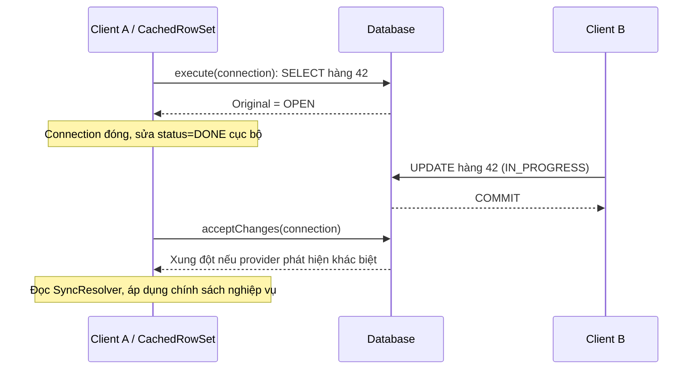
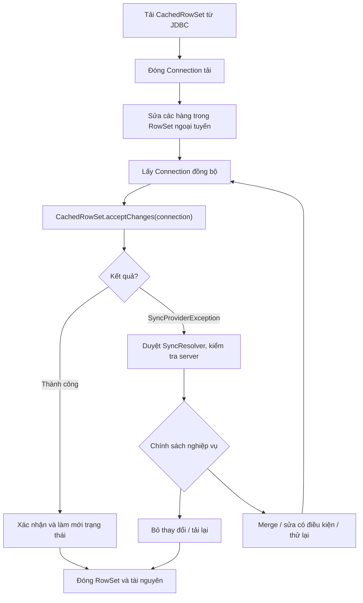

# Xử lý thay đổi và xung đột khi đồng bộ lại dữ liệu với CachedRowSet

## Mục tiêu học tập

Trong **JDBC**, `Connection`, `PreparedStatement` và `ResultSet` thường được dùng để truy cập cơ sở dữ liệu quan hệ khi ứng dụng đang kết nối. Nhưng không phải thao tác nào của người dùng cũng phải giữ connection mở liên tục: một màn hình nhập liệu có thể tải bản ghi, ngắt kết nối, cho người dùng chỉnh sửa rồi **đồng bộ lại** sau vài phút. JDBC cung cấp `javax.sql.rowset.CachedRowSet` để hỗ trợ mô hình dữ liệu ngắt kết nối (*disconnected/offline row set*).

Vấn đề khó không nằm ở việc sửa một ô trong bộ nhớ, mà ở câu hỏi: **nếu người dùng A sửa bản ghi ngoại tuyến trong khi người dùng B đã cập nhật hoặc xóa bản ghi đó trên database, hệ thống phải làm gì khi A đồng bộ lại?** Việc gọi `acceptChanges()` không tự biến xung đột thành một kết quả nghiệp vụ đúng. Ứng dụng cần hiểu dữ liệu gốc, thay đổi cục bộ, dữ liệu hiện tại trên server, chính sách xử lý xung đột và ranh giới giao dịch khi ghi.

Bài thuộc chương **RowSet ngoại tuyến** tập trung vào cách theo dõi và đồng bộ thay đổi của `CachedRowSet` bằng các API JDBC chuẩn, đặc biệt là `acceptChanges(Connection)`, `SyncProviderException` và `SyncResolver`. Sau bài, bạn có thể:

- Phân biệt **bản chụp gốc**, **bản chỉnh sửa cục bộ** và **dữ liệu hiện tại của database**.
- Thực hiện `updateRow()`, `insertRow()`, `deleteRow()` trên `CachedRowSet` mà không nhầm chúng với ghi trực tiếp vào DBMS.
- Gọi `acceptChanges(Connection)` để yêu cầu đồng bộ, rồi phân tích `SyncProviderException` khi phát hiện xung đột.
- Duyệt `SyncResolver.nextConflict()`, đọc `getStatus()`/`getConflictValue()` và đánh giá `setResolvedValue()` một cách thận trọng.
- Chọn chiến lược **server wins**, **client wins có điều kiện**, **merge theo trường** hoặc **yêu cầu người dùng quyết định**.
- Kiểm tra tính nguyên tử, retry, idempotency, khóa phiên bản và tác động của connection pool khi làm việc ngoại tuyến.

## 1. CachedRowSet lưu những gì?

`CachedRowSet` là một `RowSet` có thể giữ bản sao dữ liệu theo dạng hàng/cột trong bộ nhớ và hỗ trợ thao tác ở trạng thái **không giữ connection để người dùng sửa**. Bạn có thể tạo nó thông qua `RowSetProvider`, lấy dữ liệu bằng một truy vấn, đóng connection, rồi tiếp tục di chuyển con trỏ và thay đổi giá trị cột trong Java.

Cần phân biệt ba trạng thái:

| Ký hiệu | Dữ liệu | Ai sở hữu? | Có nhất thiết trùng database hiện tại? |
| --- | --- | --- | --- |
| **Original** | Giá trị của hàng khi `CachedRowSet` tải hoặc sau một lần đồng bộ hợp lệ | RowSet giữ bản gốc để nhận biết thay đổi | **Không** |
| **Local / pending** | Giá trị mà ứng dụng đã chỉnh sửa khi ngoại tuyến | RowSet trên máy/tiến trình đang thao tác | **Không** |
| **Current database** | Giá trị đang có trên database lúc đồng bộ lại | DBMS và các giao dịch đang chạy | Là trạng thái server, có thể đã thay đổi |

Ví dụ một hàng công việc:

| Thời điểm | `id` | `title` | `status` |
| --- | ---: | --- | --- |
| RowSet tải bản gốc lúc 09:00 | 42 | Soạn tài liệu | OPEN |
| Người dùng A sửa ngoại tuyến | 42 | Soạn tài liệu | DONE |
| Người dùng B cập nhật database lúc 09:05 | 42 | Soạn tài liệu mới | IN_PROGRESS |
| Người dùng A đồng bộ lúc 09:10 | 42 | Muốn ghi DONE | Server đã khác bản gốc |

Thao tác của A có thể xung đột với thay đổi của B. Một số provider sẽ so sánh giá trị gốc với giá trị database hiện tại; chính sách kiểm tra chính xác phụ thuộc `SyncProvider`. **Không thể chỉ dựa vào việc khóa chính vẫn tồn tại để kết luận thao tác ngoại tuyến an toàn.**



**Thay đổi trong RowSet chưa được lưu ngay xuống DBMS.** `updateRow()` chỉ đánh dấu/cập nhật hàng cục bộ để chuẩn bị đồng bộ. Phần ghi thật phụ thuộc `acceptChanges(...)` và `SyncProvider`.

## 2. Vòng đời tải, chỉnh sửa, đồng bộ và đóng tài nguyên

Một luồng điển hình có bốn giai đoạn:

1. **Tải bản chụp:** dùng `DataSource.getConnection()`, đặt câu lệnh có tham số và gọi `CachedRowSet.execute(connection)`; sau khi RowSet đã nhận dữ liệu, đóng connection tải.
2. **Chỉnh sửa ngoại tuyến:** di chuyển con trỏ tới hàng, gọi `updateXXX(...)` rồi `updateRow()`; hoặc chèn/xóa hàng bằng API của RowSet.
3. **Đồng bộ:** lấy connection mới, gọi `acceptChanges(connection)`; nếu có xung đột, kiểm tra `SyncProviderException` và áp dụng chính sách xử lý.
4. **Kết thúc:** xác nhận kết quả trên database, làm mới dữ liệu khi cần, rồi đóng `CachedRowSet` và connection.



**Không giữ connection mở trong thời gian người dùng nhập liệu.** Điều đó làm cạn connection pool, kéo dài transaction và có thể giữ khóa không cần thiết. Mục tiêu của `CachedRowSet` là giữ **dữ liệu** sau khi ngắt kết nối, không phải biến một transaction JDBC thành transaction kéo dài qua phiên làm việc của người dùng.

## 3. Tạo CachedRowSet từ API chuẩn, không phụ thuộc lớp triển khai cụ thể

Dùng `RowSetProvider.newFactory().createCachedRowSet()` để tránh ràng buộc trực tiếp với các lớp triển khai nội bộ của JDK.

Giả sử bảng kiểm thử:

```sql
CREATE TABLE tasks (
    id BIGINT PRIMARY KEY,
    title VARCHAR(200) NOT NULL,
    status VARCHAR(30) NOT NULL
);

INSERT INTO tasks(id, title, status)
VALUES (42, 'Soạn tài liệu', 'OPEN');
```

Cú pháp DDL có thể thay đổi theo DBMS. Bảng nên được tạo trong môi trường thử nghiệm, ngoài transaction của phần nhập liệu.

### 3.1. Ví dụ hoàn chỉnh: tải, chỉnh sửa và yêu cầu đồng bộ

```java
import java.sql.Connection;
import java.sql.SQLException;
import javax.sql.DataSource;
import javax.sql.rowset.CachedRowSet;
import javax.sql.rowset.RowSetProvider;
import javax.sql.rowset.spi.SyncProviderException;
import javax.sql.rowset.spi.SyncResolver;

public final class OfflineTaskEditor {
    private final DataSource dataSource;

    public OfflineTaskEditor(DataSource dataSource) {
        this.dataSource = dataSource;
    }

    public CachedRowSet load(long taskId) throws SQLException {
        CachedRowSet rows =
            RowSetProvider.newFactory().createCachedRowSet();
        try {
            rows.setCommand(
                "SELECT id, title, status FROM tasks WHERE id = ?"
            );
            rows.setLong(1, taskId);

            // execute(Connection) tải dữ liệu vào RowSet.
            // Connection này không bị giữ trong lúc sửa ngoại tuyến.
            try (Connection connection = dataSource.getConnection()) {
                rows.execute(connection);
            }

            // Chỉ dẫn để provider nhận diện bảng và khóa của hàng.
            // Các vị trí cột JDBC bắt đầu từ 1.
            rows.setTableName("tasks");
            rows.setKeyColumns(new int[] {1});
            return rows;
        } catch (SQLException | RuntimeException error) {
            try {
                rows.close();
            } catch (SQLException closeError) {
                error.addSuppressed(closeError);
            }
            throw error;
        }
    }

    public void markDone(CachedRowSet rows) throws SQLException {
        rows.beforeFirst();
        if (!rows.next()) {
            throw new SQLException("Không tìm thấy task trong bản chụp");
        }

        rows.updateString("status", "DONE");
        rows.updateRow();  // Chỉ sửa bản sao cục bộ.
    }

    public void synchronize(CachedRowSet rows) throws SQLException {
        try (Connection connection = dataSource.getConnection()) {
            try {
                rows.acceptChanges(connection);
            } catch (SyncProviderException conflict) {
                reportConflicts(conflict);
                // Không tự ghi đè dữ liệu phía server.
                throw conflict;
            }
        }
    }

    private static void reportConflicts(SyncProviderException problem)
            throws SQLException {
        SyncResolver resolver = problem.getSyncResolver();
        if (resolver == null) {
            return;  // Không có chi tiết resolver để duyệt.
        }

        int index = 0;
        while (resolver.nextConflict()) {
            int status = resolver.getStatus();
            System.err.printf(
                "rowConflict=%d, status=%s%n",
                index++, describeStatus(status)
            );
        }
    }

    private static String describeStatus(int status) {
        return switch (status) {
            case SyncResolver.UPDATE_ROW_CONFLICT -> "UPDATE";
            case SyncResolver.DELETE_ROW_CONFLICT -> "DELETE";
            case SyncResolver.INSERT_ROW_CONFLICT -> "INSERT";
            case SyncResolver.NO_ROW_CONFLICT -> "NONE";
            default -> "UNKNOWN(" + status + ")";
        };
    }
}
```

Ví dụ dùng **Java 17+** cho biểu thức `switch`. `DataSource` phải được cấu hình cho DBMS cụ thể và được truyền vào service từ tầng khởi tạo. Khi sử dụng:

```java
OfflineTaskEditor editor = new OfflineTaskEditor(dataSource);

try (CachedRowSet rows = editor.load(42L)) {
    editor.markDone(rows);

    // Người dùng có thể dừng ở đây để làm việc ngoại tuyến;
    // trong thời gian đó, database có thể đã thay đổi.
    editor.synchronize(rows);
}
```

Lỗi đồng bộ được truyền cho tầng gọi để hiển thị xung đột, đối soát hoặc thực hiện workflow khôi phục. Cách ghi log `System.err` ở đây chỉ dùng để minh họa; hệ thống thật nên dùng logger có kiểm soát và không in giá trị chứa thông tin cá nhân.

### 3.2. Những điều ví dụ có và không bảo đảm

- `rows.execute(connection)` nạp bản sao; `Connection` tải được đóng sau khi nạp.
- `updateString()` kết hợp `updateRow()` chỉ thay đổi RowSet, **không cập nhật database ngay lập tức**.
- `setTableName("tasks")` và `setKeyColumns(new int[] {1})` mô tả bảng đích và cột khóa cho provider. Với JOIN, khóa tổng hợp, tên schema hoặc lệnh SQL phức tạp, **khả năng sinh cập nhật tự động phải được kiểm tra**; không cho rằng provider có thể đồng bộ mọi SELECT tùy ý.
- `acceptChanges(connection)` yêu cầu provider ghi thay đổi về DBMS. **Cách provider sử dụng transaction, thứ tự cập nhật, so sánh bản gốc và kết thúc giao dịch phụ thuộc contract/triển khai**, nên cần kiểm thử trước khi phối hợp nó với nhiều DML khác trong cùng một transaction.
- Khi `SyncProviderException` xuất hiện, ví dụ chỉ **ghi trạng thái và ném lại**, không tự gán server/client thắng và không tự gọi lại `acceptChanges()`.
- Provider có thể không hỗ trợ đầy đủ truy vấn, khóa, kiểu dữ liệu hoặc xử lý xung đột mong muốn. Điều kiện “có CachedRowSet chạy được” **không đồng nghĩa** đồng bộ tự động đáng tin cậy trong mọi môi trường.

Nếu muốn triển khai sản phẩm thực tế, cần có cách lưu/khôi phục bản chụp, xác thực quyền truy cập và trình tự đối soát. Đối tượng RowSet lưu nhiều dữ liệu trong bộ nhớ; không nên mặc định giữ nhiều bản chụp lớn trong session người dùng.

## 4. Những thao tác ngoại tuyến nào được theo dõi?

`CachedRowSet` hỗ trợ các thao tác gần với `ResultSet` có khả năng cập nhật:

| Ý định | API điển hình | Ý nghĩa trước đồng bộ |
| --- | --- | --- |
| Sửa hàng có sẵn | `updateString(...)`/`updateInt(...)` rồi `updateRow()` | Ghi nhận giá trị local và hàng đã thay đổi |
| Chèn hàng | `moveToInsertRow()`, `updateXXX(...)`, `insertRow()`, `moveToCurrentRow()` | Tạo hàng chờ chèn khi đồng bộ |
| Xóa hàng | Di chuyển tới hàng rồi `deleteRow()` | Đánh dấu hàng cần xóa |
| Hủy cập nhật cục bộ | `undoUpdate()` trên hàng phù hợp | Hoàn tác thay đổi chưa đồng bộ của hàng |
| Hủy thêm hàng cục bộ | `undoInsert()` trên hàng phù hợp | Bỏ hàng mới được thêm vào RowSet |
| Hủy xóa cục bộ | `undoDelete()` trên hàng phù hợp | Khôi phục hàng bị đánh dấu xóa |
| Khôi phục bản chụp gốc | `restoreOriginal()` | Hủy các chỉnh sửa cục bộ và đưa RowSet về bản gốc đã lưu |

**Phân biệt `restoreOriginal()` với tải lại server:** phương thức này khôi phục **giá trị original mà RowSet đang giữ**, không mặc nhiên truy vấn database để lấy dữ liệu mới nhất. Sau một xung đột, nếu cần dữ liệu server hiện tại, phải truy vấn lại trên connection mới.

### 4.1. Xem giá trị original để hỗ trợ merge

Với một hàng đang được RowSet chọn, `getOriginalRow()` có thể cung cấp `ResultSet` chỉ chứa giá trị gốc của hàng đó:

```java
// Giả sử CachedRowSet rows đang trỏ tới hàng muốn so sánh.
try (java.sql.ResultSet original = rows.getOriginalRow()) {
    if (original.next()) {
        String oldTitle = original.getString("title");
        String oldStatus = original.getString("status");

        String localTitle = rows.getString("title");
        String localStatus = rows.getString("status");

        // So sánh old* với local* để biết phần nào đã đổi ở client.
        // Dữ liệu database hiện tại cần truy vấn riêng khi cần.
    }
}
```

Đoạn mã này chỉ đọc **original và local**. Nó không cho biết người dùng khác đã ghi gì lên database sau khi RowSet được tải. Bởi vậy, một thuật toán merge cần tối thiểu:

- **Original:** snapshot khi tải.
- **Local:** nội dung người dùng muốn lưu.
- **Server:** nội dung mới nhất đọc trong phạm vi đồng bộ thích hợp.

Nếu dùng `getOriginalRow()` trong workflow phức tạp, hãy xác nhận con trỏ RowSet, định dạng hàng, dữ liệu cột bị xóa và ngữ nghĩa provider đang dùng. Không coi một cột chưa bị người dùng sửa là bằng chứng rằng server chưa sửa cột đó.

## 5. Phát hiện xung đột bằng SyncProviderException

`CachedRowSet` dùng cơ chế `SyncProvider` để đọc/ghi dữ liệu khi có đồng bộ. Một provider hỗ trợ optimistic synchronization có thể so sánh dữ liệu original với dữ liệu database. Khi việc ghi không thể hoàn tất do xung đột, `acceptChanges(...)` có thể ném:

```java
javax.sql.rowset.spi.SyncProviderException
```

Đây là loại ngoại lệ thuộc họ `SQLException`, nên vẫn có thể xem `getSQLState()`, `getErrorCode()` và các ngoại lệ liên quan nếu driver cung cấp.

Để lấy thông tin chi tiết:

```java
try {
    rows.acceptChanges(connection);
} catch (javax.sql.rowset.spi.SyncProviderException error) {
    javax.sql.rowset.spi.SyncResolver resolver =
        error.getSyncResolver();

    if (resolver != null) {
        while (resolver.nextConflict()) {
            int status = resolver.getStatus();
            // Xem hàng/trường xung đột theo chính sách nghiệp vụ.
        }
    }

    throw error; // Không âm thầm coi kết quả là thành công.
}
```

**Không phải mọi lỗi đồng bộ đều là xung đột nghiệp vụ có thể merge.** Lỗi quyền truy cập, SQL không hợp lệ, đứt kết nối, thiếu bảng hoặc lỗi giao dịch cũng cần được phân biệt; `SyncResolver` có thể không cung cấp đủ thông tin cho mọi trường hợp.

### 5.1. Các trạng thái xung đột

`SyncResolver.getStatus()` biểu diễn loại xung đột trên hàng:

| Hằng của `SyncResolver` | Ý nghĩa sử dụng | Câu hỏi cần kiểm tra |
| --- | --- | --- |
| `UPDATE_ROW_CONFLICT` | Không thể cập nhật như dự kiến, thường vì dữ liệu đã khác snapshot | Hàng còn tồn tại? Cột nào bị sửa? |
| `DELETE_ROW_CONFLICT` | Không thể xóa hàng đúng như snapshot | Hàng đã bị xóa hay bị thay đổi? |
| `INSERT_ROW_CONFLICT` | Không thể chèn hàng, ví dụ va chạm khóa/ràng buộc | Hàng có sẵn có cùng ý nghĩa nghiệp vụ không? |
| `NO_ROW_CONFLICT` | Hàng được báo không có xung đột | Không cần xử lý xung đột cho hàng đó |

**Đừng dùng số nguyên của các hằng này như mã nghiệp vụ riêng.** Sử dụng đúng tên hằng của API để code dễ đọc và tránh nhầm với update count của `Statement`. `nextConflict()` duyệt qua những mục xung đột mà resolver cung cấp; một provider có thể có giới hạn trong việc phân loại từng cột hoặc giải thích ngữ nghĩa database.

### 5.2. Đọc giá trị xung đột

`SyncResolver.getConflictValue(columnIndex)` hoặc `getConflictValue(columnName)` cung cấp giá trị mà resolver gắn với cột đang xung đột, theo thông tin provider thu được từ database.

Ví dụ một đoạn kiểm tra có chủ đích:

```java
SyncResolver resolver = error.getSyncResolver();

if (resolver != null) {
    while (resolver.nextConflict()) {
        if (resolver.getStatus() == SyncResolver.UPDATE_ROW_CONFLICT) {
            // Chỉ thử đọc cột theo schema và thông tin provider.
            try {
                Object dbStatus =
                    resolver.getConflictValue("status");
                // So sánh với original/local và chính sách nghiệp vụ.
                // Không log trực tiếp giá trị nhạy cảm.
            } catch (SQLException unavailable) {
                // Provider có thể không cung cấp giá trị cho cột này.
                // Giữ lỗi chẩn đoán; truy vấn lại server nếu cần.
            }
        }
    }
}
```

Đoạn này được đặt trong một phương thức **đã có biến `error` kiểu `SyncProviderException` và khai báo/nhập `SyncResolver`**. `getConflictValue(...)` không nhất thiết có giá trị hữu ích cho mọi cột, mọi loại conflict hay mọi driver. Nếu cột trong database là SQL `NULL`, giá trị Java tương ứng có thể là `null`; cần phân biệt với “không có thông tin” dựa trên contract và ngoại lệ.

**Không nên tự động ghi `dbStatus` ra log** vì giá trị xung đột có thể là dữ liệu riêng tư. Để hiển thị cho người dùng, ứng dụng nên truy vấn lại theo quyền hiện tại và chỉ công bố những trường họ được phép xem.

## 6. Cách lựa chọn chính sách giải quyết xung đột

Một xung đột không chỉ là lỗi kỹ thuật. Đó là quyết định **dữ liệu của ai được giữ**, liệu các thay đổi có thể kết hợp an toàn hay cần yêu cầu người dùng xem lại.

| Chính sách | Ý nghĩa | Khi phù hợp | Nguy cơ |
| --- | --- | --- | --- |
| **Server wins** | Bỏ thay đổi cục bộ xung đột, dùng trạng thái server hiện tại | Dữ liệu quan trọng đã được hệ thống khác xác nhận, thay đổi client có thể nhập lại | Mất thao tác chưa lưu của người dùng |
| **Client wins có điều kiện** | Áp lại ý định client sau khi xem server hiện tại | Có quyền ghi đè rõ ràng, điều kiện nghiệp vụ vẫn đúng | Ghi đè thay đổi của người khác nếu dùng mù quáng |
| **Merge theo trường** | Kết hợp thay đổi cục bộ và server trên các trường độc lập | Hai người sửa các trường khác nhau, không vi phạm invariant | Hai trường tưởng độc lập nhưng thực ra liên quan |
| **Yêu cầu người dùng chọn** | Hiển thị chênh lệch và nhận quyết định | Tài liệu cộng tác hoặc dữ liệu không thể merge tự động | Cần UX xử lý chờ và chỉnh sửa lại |
| **Từ chối và tải lại** | Không tự retry khi xung đột | Tài chính, tồn kho, quyền truy cập hoặc yêu cầu nguyên tử cao | Người dùng phải thao tác lại |
| **Bù trừ theo nghiệp vụ** | Ghi hành động mới thay vì chỉnh sửa đè lịch sử | Hệ thống cần audit và bất biến nghiệp vụ | Phức tạp, không thay thế kiểm soát concurrent writes |

### 6.1. Ví dụ merge ba chiều

Giả sử giá trị:

| Trường | Original | Local | Server |
| --- | --- | --- | --- |
| `title` | “Soạn tài liệu” | “Soạn tài liệu” | “Soạn hướng dẫn” |
| `status` | `OPEN` | `DONE` | `OPEN` |

A chỉ sửa `status`, B chỉ sửa `title`. Merge ba chiều có thể chọn:

- `title = "Soạn hướng dẫn"` từ server.
- `status = "DONE"` từ local.

Tuy nhiên, nếu `status=DONE` chỉ hợp lệ sau khi nội dung `title` đã được người dùng xác nhận, hai thay đổi **không thật sự độc lập**. Khi đó nên báo xung đột cho người dùng thay vì merge tự động.

Một quy tắc khởi đầu:

```text
Với từng trường:
  nếu local == original:
      dùng server (client không thay trường này)
  ngược lại nếu server == original:
      dùng local (server không thay trường này)
  ngược lại nếu local == server:
      dùng giá trị chung
  ngược lại:
      đánh dấu xung đột, không tự quyết định
Sau đó:
  kiểm tra ràng buộc chéo giữa các trường
  và ghi bằng một thao tác chống ghi đè đồng thời
```

**Bước sau cùng rất quan trọng:** dù đã chọn giá trị merge, một người khác vẫn có thể cập nhật server **giữa lúc bạn đọc và lúc bạn ghi**. Vì thế, việc áp dụng merge phải có điều kiện concurrency phù hợp (ví dụ optimistic version check) hoặc nằm trong cơ chế cô lập/khóa thích hợp.

### 6.2. setResolvedValue không phải nút “cứ ghi đè”

`SyncResolver.setResolvedValue(columnName, value)` hoặc overload nhận chỉ số cột cho phép cung cấp **giá trị giải quyết** cho cột xung đột theo giao thức của `SyncProvider`.

Đây **không phải** API luôn tự động bảo đảm server wins, client wins, kiểm soát quyền truy cập, merge nguyên tử hoặc commit cuối cùng. Việc tiếp tục đồng bộ sau khi giải quyết các cột phụ thuộc provider và cần được xác minh bằng integration test. Không gọi `setResolvedValue(...)` theo mọi giá trị local chỉ để làm biến mất xung đột.

Quy trình thận trọng:

1. Lấy loại conflict và các giá trị có thể xem từ resolver.
2. Đọc lại bản ghi từ database khi cần có thông tin đầy đủ, với quyền và độ cô lập thích hợp.
3. Đối chiếu original/local/server theo chính sách nghiệp vụ.
4. Chỉ gọi `setResolvedValue(...)` khi đã biết provider hỗ trợ và biết ý nghĩa của giá trị giải quyết.
5. Hoàn thành giao thức đồng bộ theo tài liệu provider, rồi **đọc lại dữ liệu từ DBMS để xác minh**.
6. Nếu provider không đáp ứng yêu cầu, dùng một luồng ghi riêng có điều kiện và tải lại RowSet; không “vá” trạng thái cục bộ để đánh lừa cơ chế phát hiện xung đột.

Không có lời gọi `setResolvedValue(...)` nào được mặc định tương đương câu SQL `UPDATE` thành công và đã commit.

## 7. Xung đột theo thao tác: UPDATE, DELETE, INSERT

### 7.1. UPDATE: bản gốc bị thay đổi

Khi client sửa `status` từ `OPEN` thành `DONE` nhưng server đã sửa cùng hàng, một provider optimistic có thể báo `UPDATE_ROW_CONFLICT`.

Cần xác định:

- Hàng có còn tồn tại không?
- Cột nào bị thay đổi từ original sang server?
- Người dùng còn quyền chỉnh sửa hàng này không?
- Nếu có thể merge, ràng buộc trạng thái có còn hợp lệ không?
- Cần thử lại bao nhiêu lần trước khi chuyển cho người dùng quyết định?

**Không áp dụng “last write wins” theo mặc định** cho trạng thái đơn hàng, số dư, tồn kho hoặc các quyết định nghiệp vụ không thể đảo ngược.

### 7.2. DELETE: hàng đã đổi hoặc đã bị xóa

Client đánh dấu `deleteRow()` khi ngoại tuyến. Trong lúc đó server có thể:

- Đã xóa cùng hàng.
- Đã sửa hàng khiến việc xóa theo bản gốc không còn an toàn.
- Chuyển hàng sang trạng thái không được phép xóa nữa.

Nếu mục tiêu nghiệp vụ là “đảm bảo hàng không còn tồn tại”, một hàng đã bị xóa từ trước **có thể** được coi là đạt mục tiêu. Nhưng nếu xóa cần ghi audit, kiểm tra quyền hoặc phát sự kiện đúng một lần, thì “đã mất hàng” **không tự chứng minh** thao tác có thể xem là thành công của client. Phải kiểm tra theo yêu cầu nghiệp vụ.

### 7.3. INSERT: va chạm khóa hoặc quy tắc duy nhất

Client thêm hàng `insertRow()` ngoại tuyến. Khi đồng bộ, một row khác có thể đã dùng cùng khóa chính hoặc cùng mã nghiệp vụ.

Cách xử lý không phải luôn tạo ID mới rồi thử lại: nếu `request_id` trùng vì yêu cầu đó đã được thực hiện, tạo ID mới có thể nhân đôi tác động. Cần phân biệt **thực hiện lại cùng yêu cầu** với **xung đột từ hai yêu cầu khác nhau** bằng idempotency key hoặc khóa ổn định.

Với khóa sinh ở DBMS, quy tắc cấp ID ngoại tuyến phải được thiết kế rõ. Không mặc định mọi `CachedRowSet` hoặc `SyncProvider` có khả năng tự cấp lại khóa và sửa tất cả khóa ngoại liên quan sau xung đột.

## 8. Phân biệt API đồng bộ RowSet với optimistic locking bằng version

`SyncProvider` quyết định cách nó so sánh original với database và phát hiện xung đột. Nếu hệ thống có quy tắc cạnh tranh nghiêm ngặt, việc dựa vào ngữ nghĩa mặc định chưa được kiểm chứng là rủi ro.

Một lựa chọn khác ở tầng persistence là **optimistic locking tường minh** bằng cột `version`. Ví dụ schema có thêm `version BIGINT NOT NULL` và mỗi lần cập nhật thành công tăng version:

```sql
UPDATE tasks
   SET status = ?,
       version = version + 1
 WHERE id = ?
   AND version = ?;
```

Ý nghĩa:

- `status = ?` là giá trị mới.
- `id = ?` là khóa bản ghi.
- `version = ?` là phiên bản đã đọc khi bắt đầu sửa.
- Nếu số hàng bị ảnh hưởng là **1**, câu UPDATE đã qua kiểm tra version.
- Nếu số hàng bị ảnh hưởng là **0**, hàng có thể bị xóa hoặc phiên bản đã thay đổi; **chưa đủ căn cứ** để kết luận nguyên nhân nào.

Ví dụ Java với `PreparedStatement`:

```java
static boolean updateIfUnchanged(
        Connection connection,
        long taskId,
        long expectedVersion,
        String newStatus) throws SQLException {

    String sql = """
        UPDATE tasks
           SET status = ?,
               version = version + 1
         WHERE id = ?
           AND version = ?
        """;

    try (PreparedStatement ps = connection.prepareStatement(sql)) {
        ps.setString(1, newStatus);
        ps.setLong(2, taskId);
        ps.setLong(3, expectedVersion);

        int count = ps.executeUpdate();
        if (count > 1) {
            throw new SQLException("UPDATE ngoài dự kiến đã sửa nhiều hàng");
        }
        return count == 1;
    }
}
```

Đây là mảnh minh họa đặt trong lớp đã `import java.sql.Connection`, `PreparedStatement` và `SQLException`, và schema **đã có cột `version`** (không phải schema ba cột ở phần 3). Phương thức **không tự commit**: tầng sở hữu connection/transaction phải quyết định commit/rollback. Khi trả `false`, cần xử lý xung đột và đọc lại dữ liệu; không nên lặng lẽ coi là thành công.

**Không nhầm hai cơ chế:**

- `CachedRowSet.acceptChanges()` đồng bộ theo giao thức của `SyncProvider`.
- `UPDATE ... WHERE version = ?` là cách **ứng dụng tự điều khiển** kiểm tra cạnh tranh.

Nếu chọn cơ chế version, đừng giả định `CachedRowSet` tự động tăng version hoặc luôn dùng `version` làm điều kiện ghi. Phải xây đường ghi tương thích với version và kiểm thử. Với thao tác bao gồm nhiều bảng hoặc nhiều đối tượng, còn cần transaction phù hợp để giữ các ràng buộc liên quan.

## 9. Transaction, tính nguyên tử và lỗi trong quá trình acceptChanges

Một RowSet có thể chứa nhiều thay đổi: sửa hai hàng, thêm một hàng và xóa một hàng. Khi đồng bộ:

- Provider có thể tạo nhiều câu SQL để ghi.
- Có thể phát sinh xung đột sau khi một vài câu lệnh đã được thực hiện.
- Cần biết provider có dùng transaction, rollback khi lỗi và báo kết quả ra sao.
- Cần kiểm tra tác động của trigger, khóa, ràng buộc và các bảng không hỗ trợ transaction.
- Nếu connection bị mất ngay lúc commit, trạng thái dữ liệu có thể **chưa xác định**.

**Không suy ra tính nguyên tử chỉ từ việc gọi `acceptChanges()` đúng một lần.** Tính nguyên tử thực tế phụ thuộc DBMS, provider, transaction và đường đi lỗi.

### 9.1. acceptChanges() hay acceptChanges(Connection)?

| API | Đặc điểm | Điểm cần kiểm tra |
| --- | --- | --- |
| `acceptChanges()` | RowSet/provider dùng cấu hình kết nối mà RowSet có sẵn để đồng bộ | DataSource/URL/credentials, cách lấy connection, lỗi và transaction |
| `acceptChanges(Connection c)` | Caller cung cấp một connection cho quá trình đồng bộ | Quyền sở hữu connection, provider có commit/rollback, cách phối hợp với các SQL khác |

Khi kết hợp `acceptChanges(Connection)` với các DML khác, **đừng tự giả định** provider chắc chắn không gọi commit/rollback. Hãy xem hợp đồng provider và kiểm tra transaction boundary trước khi cùng chia một connection với những thao tác nghiệp vụ khác. Nếu cần all-or-nothing phức tạp, một tầng dịch vụ dùng `PreparedStatement` và optimistic locking tường minh thường dễ kiểm chứng hơn giao thức đồng bộ tổng quát.

### 9.2. Lỗi trước commit khác lỗi ở commit

Giả sử quá trình ghi báo xung đột rõ ràng trước khi dữ liệu được xác nhận, ứng dụng có thể rollback/khôi phục theo hợp đồng provider. Nhưng nếu mạng mất lúc chính commit diễn ra, **có khả năng DBMS đã commit rồi**. Không thử lại một thao tác có tác động lớn bằng request ID mới chỉ vì nhận `SQLException`.

Cần có mã yêu cầu ổn định, đối soát từ kết nối mới và cơ chế retry idempotent. Cũng cần phân biệt lỗi `acceptChanges()` với lỗi đóng connection hoặc trả connection về pool: lỗi cleanup không tự động chứng minh thay đổi trước đó đã bị hủy.

### 9.3. Provider và giới hạn đồng bộ

Có thể quan sát provider mà RowSet đang sử dụng:

```java
javax.sql.rowset.spi.SyncProvider provider =
    rows.getSyncProvider();

System.out.println("Provider ID: " + provider.getProviderID());
System.out.println("Provider grade: " + provider.getProviderGrade());
```

Các giá trị này giúp nhận diện provider, **không đủ để chứng minh** cách xử lý conflict trong các tình huống thực tế. Nếu muốn dùng provider khác qua `setSyncProvider(...)`, chỉ chọn provider đã có trong môi trường và đã được kiểm thử với database, driver, transaction và mô hình dữ liệu đang dùng. Tránh phụ thuộc tên lớp triển khai nội bộ không thuộc API được hỗ trợ công khai.

## 10. Thiết kế luồng đồng bộ chịu được mạng chập chờn

Một hệ thống thực tế có thể cần lưu thay đổi qua nhiều lần ngắt kết nối, không chỉ trong bộ nhớ Java của một phiên chạy. Một số nguyên tắc:

- **Định danh ổn định:** mỗi bản ghi có khóa bền vững; mỗi yêu cầu có request ID/idempotency key nếu có tác động nghiệp vụ.
- **Lưu bản gốc:** ghi lại version hoặc snapshot cần thiết để phát hiện xung đột; không chỉ lưu giá trị mới.
- **Phân biệt trạng thái cục bộ:** đang sửa, chờ đồng bộ, đang đồng bộ, xung đột, đã xác nhận hoặc cần đối soát.
- **Không đánh dấu thành công sớm:** hoàn tất `executeBatch()` hay gửi request không đồng nghĩa đã commit và đối soát.
- **Giới hạn retry:** với xung đột liên tục phải chuyển sang UX giải quyết thay vì vòng lặp vô hạn.
- **Bảo vệ dữ liệu:** RowSet có thể chứa thông tin nhạy cảm; nếu serialize hoặc lưu local, cần cơ chế kiểm soát quyền, mã hóa và thời hạn giữ phù hợp.
- **Kiểm tra quyền lại trên server:** user có quyền đọc/sửa lúc tải không đồng nghĩa vẫn có quyền lúc đồng bộ; quyền server là nguồn quyết định.
- **Giới hạn kích thước:** một `CachedRowSet` lớn giữ dữ liệu trong heap; dùng phân trang hoặc thay mô hình nếu dataset quá lớn.

### 10.1. Một luồng kết quả có thể có

```text
LOAD_COMPLETED
    -> LOCAL_EDITED
    -> SYNC_PENDING
    -> SYNC_IN_PROGRESS
         -> CONFIRMED
         -> CONFLICT_REQUIRES_REVIEW
         -> FAILED_RETRYABLE
         -> OUTCOME_UNKNOWN
```

`OUTCOME_UNKNOWN` khác `FAILED_RETRYABLE`: khi commit không rõ kết quả, ưu tiên đối soát bằng mã yêu cầu và dữ liệu trên database trước khi thử lại.

## 11. Kiểm thử xung đột bằng hai connection độc lập

Các phép thử tích hợp phải chạy trên DBMS/driver, provider và cấu hình giống môi trường ứng dụng. Không kết luận từ việc một thao tác đơn giản không ném lỗi.

### 11.1. Thử xung đột UPDATE

1. Tạo một hàng test `tasks(id=42, status='OPEN')`.
2. Tải hàng 42 vào `CachedRowSet` bằng connection A rồi đóng connection A.
3. Sửa `status='DONE'` trong RowSet bằng `updateRow()`.
4. Mở connection B, dùng `PreparedStatement` cập nhật cùng hàng thành `status='IN_PROGRESS'` và commit.
5. Dùng connection C gọi `rowSet.acceptChanges(connectionC)`.
6. Ghi nhận có `SyncProviderException` hay không, `SyncResolver.getStatus()` trả gì, giá trị database cuối cùng và tình trạng thay đổi local.

Kết quả kỳ vọng **nếu provider optimistic phát hiện thay đổi server** là một xung đột cần giải quyết. Nếu không phát hiện, cần kiểm tra provider, khóa, SQL được sinh, cột nào được so sánh và giả định về khả năng chống lost update. Không tuyên bố mọi provider phải phát hiện đúng bằng một thuật toán giống nhau.

### 11.2. Thử xung đột DELETE và INSERT

**DELETE:** tải hàng, đánh dấu `deleteRow()`, cho connection B sửa hoặc xóa hàng trước, rồi đồng bộ. Kiểm tra hành vi đối với hàng đã biến mất và hàng bị chỉnh sửa.

**INSERT:** thêm hàng mới bằng `moveToInsertRow()`/`insertRow()`, cho connection B chèn một hàng có cùng khóa trước, rồi đồng bộ. Quan sát lỗi khóa, trạng thái `INSERT_ROW_CONFLICT` nếu provider cung cấp và cách ứng dụng xử lý bản ghi đã tồn tại.

### 11.3. Thử trường hợp không có xung đột

Tải một hàng, sửa cục bộ, **không có cập nhật cạnh tranh**, đồng bộ và đọc lại trên connection mới. Kiểm tra:

- Giá trị sửa thực sự xuất hiện.
- Những cột không thay đổi vẫn đúng.
- RowSet không còn giữ trạng thái chờ đồng bộ trái kỳ vọng.
- Connection được trả về pool; không còn statement/cursor/transaction treo.

### 11.4. Ma trận cần ghi nhận

| Kịch bản | Kết quả cần đo/đối soát |
| --- | --- |
| Chỉ client sửa một trường | Sync thành công; đúng giá trị DB |
| Hai client sửa cùng trường | Phát hiện xung đột hoặc ghi nhận giới hạn provider |
| Hai client sửa hai trường khác nhau | Xem có thể merge không; không ghi đè nhầm |
| Client UPDATE, server DELETE | Xử lý hàng không còn tồn tại |
| Client DELETE, server UPDATE | Kiểm tra quyền xóa và thay đổi cạnh tranh |
| Client INSERT trùng khóa | Không nhân bản nghiệp vụ khi retry |
| RowSet có nhiều hàng thay đổi, một hàng lỗi | Kiểm tra transaction rollback/partial write theo provider |
| Lỗi kết nối giữa đồng bộ | Đối soát kết quả trên connection mới |
| SQL NULL, hàng rỗng, khóa ghép | Metadata và so sánh đúng |
| Nhiều lần sync/retry | Không tạo bản ghi hoặc sự kiện trùng |

Nên dùng cùng dữ liệu test ban đầu, dọn sạch giữa các lượt và ghi rõ driver, DBMS, `SyncProvider` và cấu hình transaction. Không chạy các thử nghiệm xung đột ghi đè trên bảng sản xuất.

## 12. Những lỗi thiết kế thường gặp

| Sai lầm | Hậu quả | Cách sửa |
| --- | --- | --- |
| Giữ connection mở suốt thời gian người dùng chỉnh sửa | Cạn pool, giữ khóa, transaction quá dài | Tải RowSet rồi đóng connection, sync bằng connection mới |
| Gọi `updateRow()` rồi báo “đã lưu database” | Chỉ sửa bản sao local | Chỉ báo đã lưu khi đồng bộ/commit được xác nhận |
| Mặc định `acceptChanges()` không bao giờ xung đột | Lost update hoặc sai trạng thái | Xử lý `SyncProviderException` và kiểm thử provider |
| Bỏ qua `getSyncResolver()` | Không biết hàng/loại xung đột | Duyệt bằng `nextConflict()`, phân loại trạng thái |
| Mặc định client wins | Ghi đè dữ liệu mới, vi phạm nghiệp vụ | Merge có điều kiện hoặc yêu cầu duyệt |
| Tự động gọi `setResolvedValue(...)` cho mọi cột | Coi xung đột là lỗi hình thức | Áp chính sách và hiểu giao thức provider |
| Coi `restoreOriginal()` là tải server mới | Sử dụng snapshot cũ | Truy vấn lại từ database |
| Không thiết lập đúng bảng/khóa | Writer không tìm đúng hàng hoặc cập nhật sai | Kiểm tra `setTableName` và `setKeyColumns` |
| Dùng một SELECT JOIN phức tạp rồi mong auto-sync | Không có ánh xạ ghi đơn giản tới một bảng | DTO đọc riêng, API ghi nghiệp vụ riêng |
| Lưu RowSet lớn trong session lâu dài | Tốn heap, dữ liệu cũ, rủi ro bảo mật | Phân trang, TTL, kho dữ liệu ngoại tuyến an toàn |
| Chỉ kiểm tra exception message | Lỗi driver/SQLState bị hiểu sai | Dùng lớp lỗi, SQLState, vendor code và đối soát |
| Retry sau timeout bằng ID mới | Có thể tạo nghiệp vụ trùng | Idempotency và trạng thái kết quả rõ ràng |

## 13. Bài luyện tập

**Bài 1 — Local khác server.** A tải `status='OPEN'` vào RowSet rồi gọi `updateString("status","DONE")` và `updateRow()`. Đã có bản ghi nào trên DBMS thay đổi ngay lúc đó chưa?

*Đáp án:* Chưa do chính hai lời gọi đó. Chúng đánh dấu thay đổi trong RowSet; cần đồng bộ bằng `acceptChanges(...)` và xác minh kết quả.

**Bài 2 — Hai phiên sửa chung.** A tải `title='Bản nháp'`, B đổi `title='Bản mới'` và commit, A đổi `title='Bản cuối'` rồi đồng bộ. Có thể tự chọn A thắng chỉ vì người dùng A thao tác sau không?

*Đáp án:* Không. A thao tác trên snapshot cũ; phải phân tích xung đột và chính sách nghiệp vụ. Thời điểm bấm lưu không đủ đảm bảo tính đúng đắn.

**Bài 3 — Original và restoreOriginal.** Sau xung đột, A gọi `restoreOriginal()`. Điều đó có chắc đưa RowSet về giá trị server hiện tại không?

*Đáp án:* Không. Nó khôi phục dữ liệu original mà RowSet lưu, có thể đã cũ. Muốn bản mới nhất cần truy vấn lại.

**Bài 4 — Phân loại conflict.** `resolver.getStatus()` trả `SyncResolver.INSERT_ROW_CONFLICT`. Bạn cần xác minh gì trước khi cho người dùng thử lại?

*Đáp án:* Kiểm tra trùng khóa hoặc ràng buộc, liệu cùng request đã được lưu chưa và chiến lược sinh ID. Không tạo request mới mù quáng.

**Bài 5 — Merge ba chiều.** Original có `title='A', status='OPEN'`; local đổi `status='DONE'`; server đổi `title='B'`. Một kết quả merge có thể là gì?

*Đáp án:* `title='B', status='DONE'` nếu các trường thật sự độc lập và quy tắc nghiệp vụ cho phép. Phải ghi kết quả bằng cơ chế tránh lost update lần nữa.

**Bài 6 — Version check.** Câu `UPDATE ... WHERE id=? AND version=?` trả update count bằng 0. Có thể khẳng định hàng đã bị xóa không?

*Đáp án:* Không. Có thể hàng vẫn còn nhưng version đã thay đổi. Cần đọc lại để phân biệt và xử lý.

**Bài 7 — Lỗi kết nối lúc commit.** RowSet đang đồng bộ, mạng mất đúng thời điểm provider có thể commit. Có nên tự động chạy lại toàn bộ insert với ID mới không?

*Đáp án:* Không. Kết quả có thể chưa xác định; cần đối soát với DBMS và dùng idempotency để tránh lặp tác động.

## Kết luận

**Đồng bộ `CachedRowSet` không chỉ là sao chép dữ liệu từ bộ nhớ về database.** Ứng dụng phải hiểu sự khác biệt giữa **original, local và current database**, quản lý thao tác chờ đồng bộ, phát hiện và phân loại xung đột qua `SyncProviderException`/`SyncResolver`, rồi chọn chính sách nghiệp vụ phù hợp. `acceptChanges(Connection)` hữu ích cho mô hình ngoại tuyến, nhưng khả năng phát hiện xung đột và ngữ nghĩa transaction phụ thuộc `SyncProvider`/DBMS/driver; phải kiểm thử thật. Không tự ghi đè server khi chưa đối soát, không nhầm `restoreOriginal()` với tải dữ liệu mới, và không retry mù quáng sau kết quả commit chưa rõ. Khi cần kiểm soát cạnh tranh chặt chẽ, optimistic locking bằng `version` và các câu `PreparedStatement` có điều kiện là lựa chọn bổ sung đáng cân nhắc. Thiết kế tốt luôn giữ khả năng phục hồi thay đổi của người dùng, bảo vệ dữ liệu mới trên server và đảm bảo trạng thái đã xác nhận có thể kiểm chứng.
